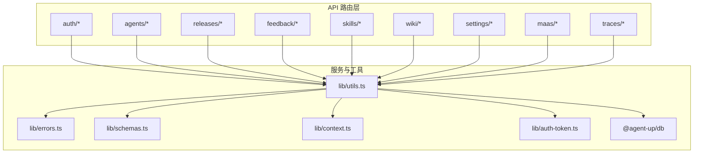
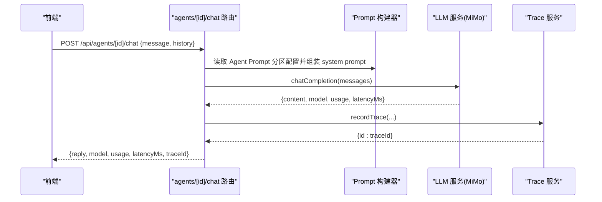
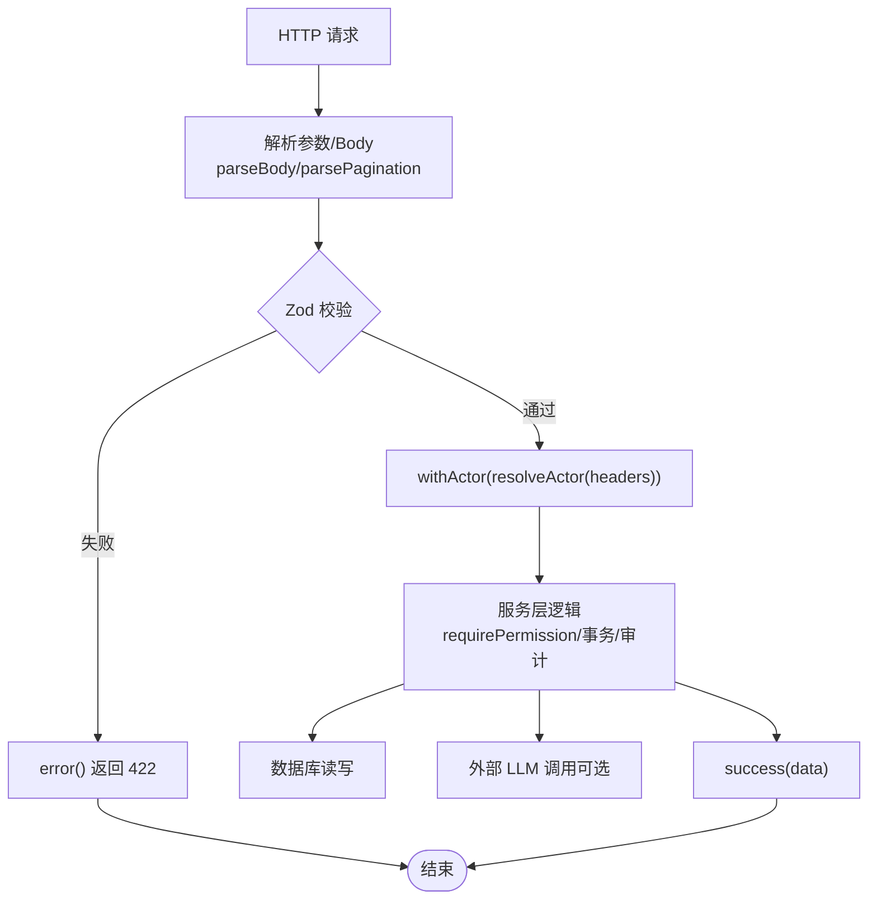

# API 接口文档

<cite>
**本文引用的文件**   
- [apps/web/app/api/auth/login/route.ts](file://apps/web/app/api/auth/login/route.ts)
- [apps/web/app/api/auth/logout/route.ts](file://apps/web/app/api/auth/logout/route.ts)
- [apps/web/app/api/agents/route.ts](file://apps/web/app/api/agents/route.ts)
- [apps/web/app/api/agents/[id]/route.ts](file://apps/web/app/api/agents/[id]/route.ts)
- [apps/web/app/api/agents/[id]/config/[partition]/route.ts](file://apps/web/app/api/agents/[id]/config/[partition]/route.ts)
- [apps/web/app/api/agents/[id]/config/[partition]/rollback/route.ts](file://apps/web/app/api/agents/[id]/config/[partition]/rollback/route.ts)
- [apps/web/app/api/agents/[id]/versions/route.ts](file://apps/web/app/api/agents/[id]/versions/route.ts)
- [apps/web/app/api/agents/[id]/versions/[versionId]/route.ts](file://apps/web/app/api/agents/[id]/versions/[versionId]/route.ts)
- [apps/web/app/api/agents/[id]/rollback/[versionId]/route.ts](file://apps/web/app/api/agents/[id]/rollback/[versionId]/route.ts)
- [apps/web/app/api/agents/[id]/skills/route.ts](file://apps/web/app/api/agents/[id]/skills/route.ts)
- [apps/web/app/api/agents/[id]/release/route.ts](file://apps/web/app/api/agents/[id]/release/route.ts)
- [apps/web/app/api/agents/[id]/eval-cases/route.ts](file://apps/web/app/api/agents/[id]/eval-cases/route.ts)
- [apps/web/app/api/agents/[id]/evidence-chain/route.ts](file://apps/web/app/api/agents/[id]/evidence-chain/route.ts)
- [apps/web/app/api/agents/[id]/version-lineage/route.ts](file://apps/web/app/api/agents/[id]/version-lineage/route.ts)
- [apps/web/app/api/agents/[id]/chat/route.ts](file://apps/web/app/api/agents/[id]/chat/route.ts)
- [apps/web/app/api/releases/route.ts](file://apps/web/app/api/releases/route.ts)
- [docs/api/api-reference.md](file://docs/api/api-reference.md)
</cite>

## 目录
1. [简介](#简介)
2. [项目结构](#项目结构)
3. [核心组件](#核心组件)
4. [架构总览](#架构总览)
5. [详细端点说明](#详细端点说明)
6. [依赖关系分析](#依赖关系分析)
7. [性能与限制](#性能与限制)
8. [故障排查指南](#故障排查指南)
9. [结论](#结论)
10. [附录：客户端集成与 SDK 示例](#附录客户端集成与-sdk-示例)

## 简介
本文件为 AgentUp 平台 RESTful API 的完整接口文档，覆盖全部 40 个 Next.js Route Handler。文档按功能模块分组：认证、Agent 管理、版本控制、发布与评测、反馈处理、技能管理、知识库、设置与其他。每个端点提供 HTTP 方法、URL 模式、请求参数、响应结构与状态码；并统一说明认证授权、错误格式、分页机制与 LLM 相关行为。

## 项目结构
API 基于 Next.js App Router 组织在 `apps/web/app/api` 下，按资源域划分路由目录（如 agents、releases、feedback、wiki、settings 等），并通过 `lib/utils.ts`、`lib/errors.ts`、`lib/schemas.ts`、`lib/context.ts`、`lib/auth-token.ts` 等公共库实现统一的响应封装、校验、错误体系与 Actor 身份解析。

图示来源
- [apps/web/app/api/auth/login/route.ts:1-69](file://apps/web/app/api/auth/login/route.ts#L1-L69)
- [apps/web/app/api/agents/route.ts:1-43](file://apps/web/app/api/agents/route.ts#L1-L43)
- [docs/api/api-reference.md:1-145](file://docs/api/api-reference.md#L1-L145)

章节来源
- [docs/api/api-reference.md:1-145](file://docs/api/api-reference.md#L1-L145)

## 核心组件
- 统一响应与错误
  - 成功响应：`{ success: true, data: ... }`
  - 失败响应：`{ success: false, error, code, details }`
  - 常见错误码映射：NOT_FOUND(404)、VALIDATION(422)、CONFLICT(409)、AUTHORIZATION(403)、INTERNAL(5xx)
- 认证与身份
  - 会话令牌 Cookie：`agentup_session`，格式 `v1.<payload>.<sig>`，HMAC-SHA256 签名，TTL 默认 24h
  - 信任头降级：`x-actor-id/name/role`（受开关控制）
  - 匿名兜底：无法获取可信身份时角色为 `anonymous`
- 分页
  - 列表端点支持 `?page=1&pageSize=20`（pageSize ≤ 100）
  - 响应含 `pagination: { page, pageSize, total, totalPages, hasMore }`
- RBAC 写权限矩阵
  - 写操作在服务层经 `requirePermission(resource, action)` 强制；读型端点保持开放
  - 审计日志记录 actor；当前 service 层不做越权拦截，预留 AUTHORIZATION 语义

章节来源
- [docs/api/api-reference.md:6-74](file://docs/api/api-reference.md#L6-L74)

## 架构总览
下图展示一次“Agent 试聊”的典型调用链：前端 → 路由层 → Prompt 组装 → LLM 调用 → Trace 落盘 → 返回 traceId。

图示来源
- [apps/web/app/api/agents/[id]/chat/route.ts:1-76](file://apps/web/app/api/agents/[id]/chat/route.ts#L1-L76)

## 详细端点说明

### 一、认证接口
- POST /api/auth/login
  - 功能：邮箱+口令登录，签发会话 Cookie
  - 请求体：email、password
  - 响应 data：userId、username、name、sessionIssued
  - 状态码：200 成功；401 凭据错误；422 邮箱格式非法
  - 备注：未配置密钥时 sessionIssued=false，后续写操作署名为 anonymous
- POST /api/auth/logout
  - 功能：清除会话 Cookie，幂等登出
  - 响应 data：loggedOut=true
  - 状态码：200

章节来源
- [apps/web/app/api/auth/login/route.ts:1-69](file://apps/web/app/api/auth/login/route.ts#L1-L69)
- [apps/web/app/api/auth/logout/route.ts:1-18](file://apps/web/app/api/auth/logout/route.ts#L1-L18)
- [docs/api/api-reference.md:119-120](file://docs/api/api-reference.md#L119-L120)

### 二、Agent 管理
- GET /api/agents
  - 查询参数：status、productGroupId、search、page、pageSize
  - 响应 data：items[]、pagination
  - 状态码：200
- POST /api/agents
  - 请求体：createAgentSchema 校验
  - 响应 data：新建 Agent
  - 状态码：201 创建成功；422 校验失败
- GET /api/agents/[id]
  - 响应 data：Agent 详情
  - 状态码：200；404 不存在
- PUT /api/agents/[id]
  - 请求体：updateAgentSchema 校验
  - 响应 data：更新后的 Agent
  - 状态码：200；422 校验失败
- DELETE /api/agents/[id]
  - 功能：归档 Agent
  - 响应 data：message
  - 状态码：200

章节来源
- [apps/web/app/api/agents/route.ts:1-43](file://apps/web/app/api/agents/route.ts#L1-L43)
- [apps/web/app/api/agents/[id]/route.ts:1-50](file://apps/web/app/api/agents/[id]/route.ts#L1-L50)

### 三、版本控制与配置回滚
- GET /api/agents/[id]/config/[partition]
  - partition ∈ {prompt,knowledge,tools,routing}
  - 响应 data：对应分区配置
  - 状态码：200；400 无效分区
- PUT /api/agents/[id]/config/[partition]
  - 请求体：按分区 Zod Schema 校验，自动剥离未知键
  - 响应 data：更新后配置
  - 状态码：200；422 校验失败；400 无效分区
- POST /api/agents/[id]/config/[partition]/rollback
  - 请求体：{ versionId }
  - 行为：从指定 Version 快照恢复该分区，记录变更审计
  - 响应 data：partition、restoredFromVersion、config
  - 状态码：200；404/422 异常
- GET /api/agents/[id]/versions
  - 响应 data：items[]（含 snapshot 与有效性报告懒加载）
  - 状态码：200
- GET /api/agents/[id]/versions/[versionId]
  - 响应 data：单版本详情（含 effectivenessReport 懒计算）
  - 状态码：200；404/422 跨 Agent 访问
- POST /api/agents/[id]/rollback/[versionId]
  - 功能：整版本回滚（四分区同时回滚，生成新版本与 Release）
  - 响应 data：回滚结果
  - 状态码：200

章节来源
- [apps/web/app/api/agents/[id]/config/[partition]/route.ts:1-86](file://apps/web/app/api/agents/[id]/config/[partition]/route.ts#L1-L86)
- [apps/web/app/api/agents/[id]/config/[partition]/rollback/route.ts:1-118](file://apps/web/app/api/agents/[id]/config/[partition]/rollback/route.ts#L1-L118)
- [apps/web/app/api/agents/[id]/versions/route.ts:1-53](file://apps/web/app/api/agents/[id]/versions/route.ts#L1-L53)
- [apps/web/app/api/agents/[id]/versions/[versionId]/route.ts:1-40](file://apps/web/app/api/agents/[id]/versions/[versionId]/route.ts#L1-L40)
- [apps/web/app/api/agents/[id]/rollback/[versionId]/route.ts:1-37](file://apps/web/app/api/agents/[id]/rollback/[versionId]/route.ts#L1-L37)

### 四、发布与评测
- GET /api/releases
  - 查询参数：status（ALL/枚举）、agentId、page、pageSize
  - 响应 data：items[]、pagination
  - 状态码：200
- POST /api/agents/[id]/release
  - 请求体：submitReleaseSchema（changeNote）
  - 响应 data：新建 Release（PENDING）
  - 状态码：201
- PUT /api/agents/[id]/release
  - 请求体：reviewReleaseSchema（releaseId、action、reviewComment）
  - 行为：审批通过则生成不可变 Version
  - 状态码：200；422 校验失败
- GET /api/agents/[id]/eval-cases
  - 响应 data：评测用例列表（按沉淀时间倒序）
  - 状态码：200；404 Agent 不存在
- POST /api/agents/[id]/eval-cases
  - 请求体：createEvalCaseSchema（traceId、expectation、assertions）
  - 行为：将已打分 trace 沉淀为评测用例
  - 状态码：201；404/422

章节来源
- [apps/web/app/api/releases/route.ts:1-47](file://apps/web/app/api/releases/route.ts#L1-L47)
- [apps/web/app/api/agents/[id]/release/route.ts:1-51](file://apps/web/app/api/agents/[id]/release/route.ts#L1-L51)
- [apps/web/app/api/agents/[id]/eval-cases/route.ts:1-57](file://apps/web/app/api/agents/[id]/eval-cases/route.ts#L1-L57)

### 五、证据链与资产演进线
- GET /api/agents/[id]/evidence-chain
  - 功能：聚合反馈→trace→Release→Version→回滚审计，按时间倒序
  - 响应 data：nodes[] + declaration
  - 状态码：200
- GET /api/agents/[id]/version-lineage
  - 功能：相邻版本结构化 diff，首版为基线
  - 响应 data：lineage[]（changedPartitions、added/removed/changed 计数）
  - 状态码：200

章节来源
- [apps/web/app/api/agents/[id]/evidence-chain/route.ts:1-21](file://apps/web/app/api/agents/[id]/evidence-chain/route.ts#L1-L21)
- [apps/web/app/api/agents/[id]/version-lineage/route.ts:1-20](file://apps/web/app/api/agents/[id]/version-lineage/route.ts#L1-L20)

### 六、技能管理
- GET /api/agents/[id]/skills
  - 响应 data：绑定列表
  - 状态码：200
- POST /api/agents/[id]/skills
  - 请求体：bindSkillSchema（skillId、config）
  - 响应 data：新建绑定
  - 状态码：201；422
- DELETE /api/agents/[id]/skills
  - 查询参数：agentId、skillId
  - 响应 data：解绑结果
  - 状态码：200；400 缺参

章节来源
- [apps/web/app/api/agents/[id]/skills/route.ts:1-48](file://apps/web/app/api/agents/[id]/skills/route.ts#L1-L48)

### 七、反馈处理
- GET /api/feedback
- POST /api/feedback
- PUT /api/feedback
- POST /api/feedback/ingest
- POST /api/feedback/[id]/insight
- POST /api/traces/[id]/rate
- DELETE /api/eval-cases/[id]

说明：以上端点契约见通用约定与 LLM 端点说明，具体请求/响应字段以各 route 中 schema 与服务层为准。

章节来源
- [docs/api/api-reference.md:104-108](file://docs/api/api-reference.md#L104-L108)

### 八、知识库（Wiki）
- GET /api/wiki/vaults
- POST /api/wiki/vaults
- GET /api/wiki/vaults/[id]
- PUT /api/wiki/vaults/[id]
- DELETE /api/wiki/vaults/[id]
- GET /api/wiki/vaults/[id]/pages
- POST /api/wiki/vaults/[id]/pages
- GET /api/wiki/pages/[id]
- PUT /api/wiki/pages/[id]
- DELETE /api/wiki/pages/[id]
- GET /api/wiki/vaults/[id]/search
  - 查询参数：q（必填）、limit（1-20，默认 5）、threshold（0-1，默认 0.35）
  - 响应 data：results[]、belowThreshold、fallbackTriggered

章节来源
- [docs/api/api-reference.md:110-112](file://docs/api/api-reference.md#L110-L112)

### 九、设置管理
- GET /api/settings/roles
- POST /api/settings/roles
- PUT /api/settings/roles/[id]
- DELETE /api/settings/roles/[id]
- GET /api/settings/permissions
- POST /api/settings/permissions
- GET /api/settings/product-groups
- POST /api/settings/product-groups
- GET /api/settings/audit-logs

章节来源
- [docs/api/api-reference.md:113-116](file://docs/api/api-reference.md#L113-L116)

### 十、其他
- GET /api/dashboard
  - 工作台聚合统计
- GET /api/maas/usage
  - MaaS 每 Agent 用量聚合（只读）
- GET /api/maas/probe
  - 连接探测（GET 不发起真实请求；POST 发起真实请求）
- POST /api/agents/[id]/chat
  - Agent 试聊 Playground（真实 LLM）
- POST /api/releases/[id]/summary
  - AI 变更摘要（真实 LLM）
- POST /api/releases/[id]/ai-review
  - 发布前 AI 评测（真实 LLM）

章节来源
- [docs/api/api-reference.md:117-139](file://docs/api/api-reference.md#L117-L139)

## 依赖关系分析
- 路由层依赖
  - lib/utils.ts：success/error、parsePagination/paginationMeta、validateBody/handleApiError
  - lib/errors.ts：业务异常类型（NotFoundError、ValidationError 等）
  - lib/schemas.ts：Zod 校验模型（createAgent/updateAgent/PARTITION_SCHEMA/bindSkill/submit/review/eval-case/chat 等）
  - lib/context.ts：withActor/resolveActor 注入 Actor 上下文
  - lib/auth-token.ts：会话令牌签发与 Cookie 值构造
  - @agent-up/db：Prisma 客户端与 JSON 解包工具
- 典型调用链
  - 写操作：路由层 validateBody → withActor(resolveActor(...)) → 服务层 requirePermission → 持久化 → 审计日志
  - LLM 端点：路由层校验 → 调用 LLM 服务 → 记录 trace/结果 → 返回 data

图示来源
- [apps/web/app/api/agents/route.ts:1-43](file://apps/web/app/api/agents/route.ts#L1-L43)
- [apps/web/app/api/agents/[id]/config/[partition]/route.ts:1-86](file://apps/web/app/api/agents/[id]/config/[partition]/route.ts#L1-L86)
- [apps/web/app/api/agents/[id]/chat/route.ts:1-76](file://apps/web/app/api/agents/[id]/chat/route.ts#L1-L76)

## 性能与限制
- 分页
  - 列表端点统一支持 page/pageSize，pageSize ≤ 100
- LLM 端点
  - 未配置返回 503；上游错误 502；超时 504（默认 120s）
  - 成功响应 data 包含 model 与 latencyMs
- 版本有效性报告
  - 对 ≥7 天且缺失 effectivenessReport 的版本懒计算，避免冷启动开销
- 并发与幂等
  - 工单接入同渠道同外部单号重复提交返回 409（幂等）
  - 登出接口幂等，不校验令牌

章节来源
- [docs/api/api-reference.md:70-74](file://docs/api/api-reference.md#L70-L74)
- [docs/api/api-reference.md:122-139](file://docs/api/api-reference.md#L122-L139)
- [apps/web/app/api/agents/[id]/versions/route.ts:1-53](file://apps/web/app/api/agents/[id]/versions/route.ts#L1-L53)

## 故障排查指南
- 401 未认证
  - 检查是否携带有效 agentup_session Cookie 或 x-actor-token
  - 确认 AUTH_SECRET 已配置；未配置时 sessionIssued=false
- 403 权限不足
  - 检查 Actor 角色与所需权限矩阵；注意当前 service 层暂未做越权拦截，预留 AUTHORIZATION
- 404 资源不存在
  - 检查路径参数 id/versionId 是否正确
- 422 校验失败
  - 检查请求体是否符合对应 Zod Schema；注意分区 partition 取值
- 502/503/504 LLM 异常
  - 检查 MIMO_API_KEY 等环境变量；关注上游状态码与超时

章节来源
- [docs/api/api-reference.md:17-26](file://docs/api/api-reference.md#L17-L26)
- [docs/api/api-reference.md:50-68](file://docs/api/api-reference.md#L50-L68)
- [docs/api/api-reference.md:122-139](file://docs/api/api-reference.md#L122-L139)

## 结论
本 API 采用 Next.js Route Handler 分层架构，配合统一响应、Zod 校验、Actor 上下文与 RBAC 写权限矩阵，形成一致的接口契约。Agent 域提供完整的配置分区管理、版本历史、回滚与评测能力；反馈、Wiki、Settings 等模块覆盖平台运营所需的关键流程。LLM 端点对外暴露稳定契约，便于扩展更多智能能力。

## 附录：客户端集成与 SDK 示例
- 认证流程
  - 登录后保存服务端下发的 Set-Cookie；后续请求自动携带
  - 登出调用 POST /api/auth/logout，确保 Cookie 被清除
- 请求头规范
  - 优先使用 Cookie；必要时可传 x-actor-token
  - 调试环境可开启 AUTH_TRUST_ACTOR_HEADERS 使用明文头
- 分页用法
  - 列表端点追加 ?page=1&pageSize=20
- LLM 端点
  - 注意 503/502/504 的错误分支与重试策略
- WebSocket 实时通信
  - 当前仓库未发现 WebSocket 路由；如需流式输出建议在前端轮询或使用 SSE（需另行实现）
- 文件上传下载
  - 当前仓库未发现文件上传/下载路由；如需支持可在 wiki 或 feedback 模块扩展 multipart 路由

章节来源
- [docs/api/api-reference.md:50-68](file://docs/api/api-reference.md#L50-L68)
- [docs/api/api-reference.md:70-74](file://docs/api/api-reference.md#L70-L74)
- [docs/api/api-reference.md:122-139](file://docs/api/api-reference.md#L122-L139)