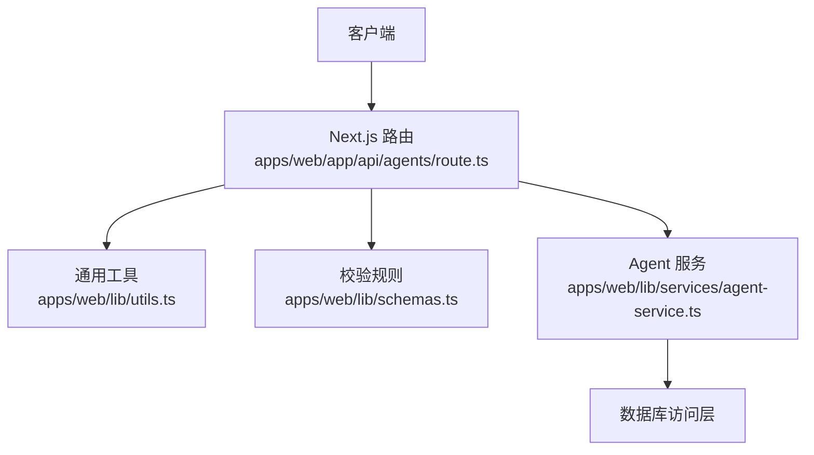
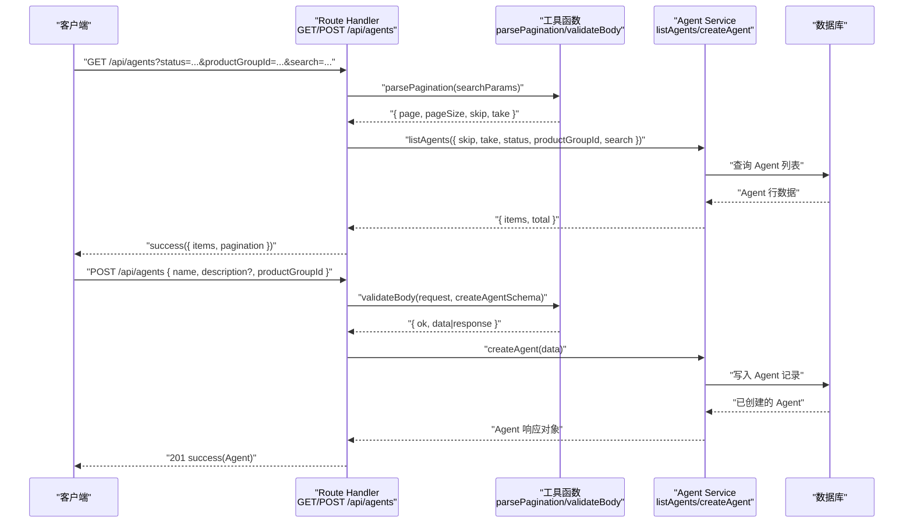
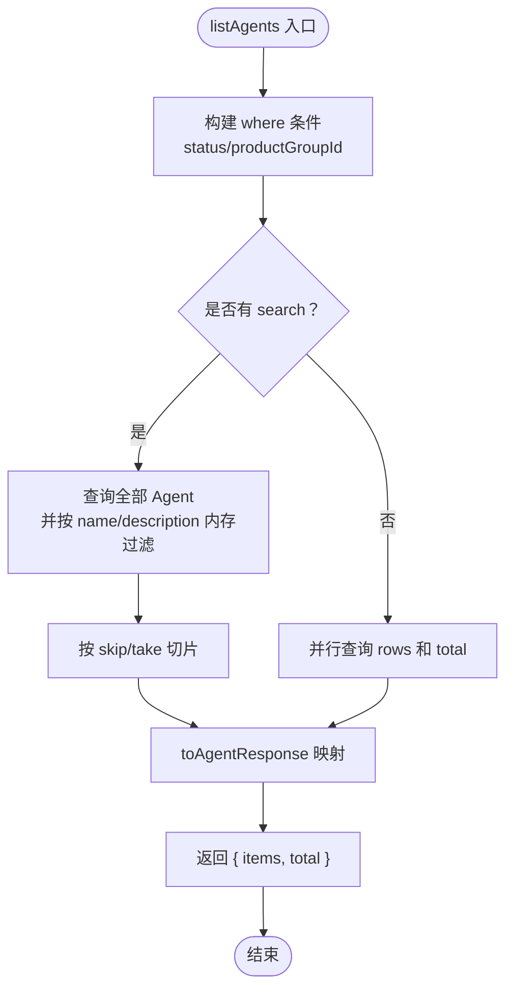

# Agent 基础 CRUD 操作

<cite>
**本文引用的文件**   
- [apps/web/app/api/agents/route.ts](file://apps/web/app/api/agents/route.ts)
- [apps/web/lib/schemas.ts](file://apps/web/lib/schemas.ts)
- [apps/web/lib/services/agent-service.ts](file://apps/web/lib/services/agent-service.ts)
- [apps/web/lib/utils.ts](file://apps/web/lib/utils.ts)
- [apps/web/app/api/__tests__/agents.test.ts](file://apps/web/app/api/__tests__/agents.test.ts)
- [apps/web/lib/__tests__/schemas.test.ts](file://apps/web/lib/__tests__/schemas.test.ts)
</cite>

## 目录
1. [简介](#简介)
2. [项目结构定位](#项目结构定位)
3. [核心接口总览](#核心接口总览)
4. [架构与数据流](#架构与数据流)
5. [GET /api/agents — 获取 Agent 列表](#get-apiaents--获取-agent-列表)
6. [POST /api/agents — 创建 Agent](#post-apiaents--创建-agent)
7. [请求体验证规则：createAgentSchema](#请求体验证规则createagentschema)
8. [响应数据结构](#响应数据结构)
9. [与 agent-service 的调用关系](#与-agent-service-的调用关系)
10. [性能与分页特性](#性能与分页特性)
11. [常见问题排查](#常见问题排查)
12. [结论](#结论)

## 简介
本文面向需要对接 Agent 基础能力的开发者，聚焦以下两个 API：
- GET /api/agents：获取 Agent 列表，支持分页、状态过滤、产品组过滤和关键字搜索。
- POST /api/agents：创建 Agent，基于 createAgentSchema 进行请求体验证。

文档会说明查询参数、验证规则、请求示例、响应结构，并解释 Next.js Route Handler 与 agent-service 之间的调用关系和数据流转过程。

## 项目结构定位
Agent 基础能力位于 Next.js App Router 的 API 路由中，业务逻辑下沉到 service 层，校验规则集中在 schema 定义文件中。



**图表来源**
- [apps/web/app/api/agents/route.ts:1-42](file://apps/web/app/api/agents/route.ts#L1-L42)
- [apps/web/lib/utils.ts:1-86](file://apps/web/lib/utils.ts#L1-L86)
- [apps/web/lib/schemas.ts:1-11](file://apps/web/lib/schemas.ts#L1-L11)
- [apps/web/lib/services/agent-service.ts:210-298](file://apps/web/lib/services/agent-service.ts#L210-L298)

**章节来源**
- [apps/web/app/api/agents/route.ts:1-42](file://apps/web/app/api/agents/route.ts#L1-L42)

## 核心接口总览
- GET /api/agents
  - 作用：获取 Agent 列表，返回分页元数据和 Agent 项集合。
  - 查询参数：page、pageSize、skip、take、status、productGroupId、search。
- POST /api/agents
  - 作用：创建新的 Agent。
  - 请求体：name、description（可选）、productGroupId。
  - 成功状态码：201。

**章节来源**
- [apps/web/app/api/agents/route.ts:7-42](file://apps/web/app/api/agents/route.ts#L7-L42)

## 架构与数据流
Agent 基础接口的调用链如下：
1. 客户端发起 HTTP 请求到 Next.js Route Handler。
2. Route Handler 解析查询参数或请求体。
3. 使用 validateBody + createAgentSchema 对创建请求做字段校验。
4. 通过 withActor/resolveActor 注入当前操作者上下文。
5. 调用 agent-service 中的 listAgents 或 createAgent。
6. agent-service 访问数据库，组装 Agent 响应对象。
7. Route Handler 用 success 包装为统一响应格式。



**图表来源**
- [apps/web/app/api/agents/route.ts:7-42](file://apps/web/app/api/agents/route.ts#L7-L42)
- [apps/web/lib/utils.ts:27-47](file://apps/web/lib/utils.ts#L27-L47)
- [apps/web/lib/services/agent-service.ts:210-298](file://apps/web/lib/services/agent-service.ts#L210-L298)

## GET /api/agents — 获取 Agent 列表

### 接口说明
- 方法：GET
- 路径：/api/agents
- 功能：根据分页、状态、产品组和关键字筛选 Agent 列表。

### 查询参数
| 参数 | 类型 | 必填 | 默认值 | 说明 |
|---|---|---:|---:|---|
| page | number | 否 | 1 | 页码，最小值为 1 |
| pageSize | number | 否 | 20 | 每页数量，范围 1~100 |
| skip | number | 否 | 由 page 和 pageSize 推导 | 底层分页偏移量 |
| take | number | 否 | 等于 pageSize | 底层分页读取条数 |
| status | string | 否 | 不限制 | 按 Agent 状态过滤；若传 ALL 则视为不过滤 |
| productGroupId | string | 否 | 不限制 | 按产品组 ID 过滤 |
| search | string | 否 | 不限制 | 在 name 和 description 中进行大小写不敏感匹配 |

注意：
- page 和 pageSize 是用户友好的分页参数；Route Handler 会将其转换为 skip 和 take 传给 service 层。
- status 为空时不过滤；当传入 ALL 时，service 层不会应用状态过滤。
- search 在当前实现中采用内存过滤方式，因此 total 表示过滤后的总数。

### 请求示例
```text
GET /api/agents?page=1&pageSize=10&status=ACTIVE&productGroupId=ecs-group&search=ECS
```

### 响应示例
```json
{
  "success": true,
  "data": {
    "items": [
      {
        "id": "agent-1",
        "name": "ECS 助手",
        "description": "用于 ECS 运维场景",
        "productGroupId": "ecs-group",
        "status": "ACTIVE",
        "createdBy": "user-1",
        "createdAt": "2026-01-01T00:00:00Z",
        "updatedAt": "2026-01-02T00:00:00Z",
        "productGroup": {
          "id": "ecs-group",
          "name": "ecs-group",
          "displayName": "ECS 产品组"
        },
        "promptConfig": null,
        "knowledgeConfig": null,
        "toolsConfig": null,
        "routingConfig": null,
        "_count": {
          "feedbacks": 0,
          "releases": 0,
          "versions": 0,
          "skillBindings": 0
        }
      }
    ],
    "pagination": {
      "page": 1,
      "pageSize": 10,
      "total": 1,
      "totalPages": 1,
      "hasMore": false
    }
  }
}
```

**章节来源**
- [apps/web/app/api/agents/route.ts:7-27](file://apps/web/app/api/agents/route.ts#L7-L27)
- [apps/web/lib/utils.ts:27-47](file://apps/web/lib/utils.ts#L27-L47)
- [apps/web/lib/services/agent-service.ts:210-248](file://apps/web/lib/services/agent-service.ts#L210-L248)

## POST /api/agents — 创建 Agent

### 接口说明
- 方法：POST
- 路径：/api/agents
- 功能：创建一个新的 Agent，成功后返回 201 和 Agent 对象。

### 请求体验证规则
请求体验证由 validateBody 与 createAgentSchema 共同完成：
- 如果请求体不是合法 JSON，返回 400。
- 如果字段不符合 schema，返回 422，并在 errors 数组中包含具体校验错误信息。

createAgentSchema 字段定义如下：
| 字段 | 类型 | 必填 | 约束 | 说明 |
|---|---|---:|---|---|
| name | string | 是 | 非空，长度不超过 100 | Agent 名称 |
| description | string | 否 | 最大长度 500 | Agent 描述 |
| productGroupId | string | 是 | 非空 | 所属产品组 ID |

创建流程还会检查 productGroupId 是否存在，不存在时抛出未找到错误，最终映射为 404。

### 请求示例
```json
{
  "name": "新 Agent",
  "description": "用于演示创建",
  "productGroupId": "ecs-group"
}
```

### 响应示例
```json
{
  "success": true,
  "data": {
    "id": "agent-new",
    "name": "新 Agent",
    "description": "用于演示创建",
    "productGroupId": "ecs-group",
    "status": "DRAFT",
    "createdBy": "current-user-id",
    "createdAt": "2026-01-01T00:00:00Z",
    "updatedAt": "2026-01-01T00:00:00Z",
    "productGroup": {
      "id": "ecs-group",
      "name": "ecs-group",
      "displayName": "ECS 产品组"
    },
    "promptConfig": null,
    "knowledgeConfig": null,
    "toolsConfig": null,
    "routingConfig": null,
    "_count": {
      "feedbacks": 0,
      "releases": 0,
      "versions": 0,
      "skillBindings": 0
    }
  }
}
```

**章节来源**
- [apps/web/app/api/agents/route.ts:29-42](file://apps/web/app/api/agents/route.ts#L29-L42)
- [apps/web/lib/schemas.ts:7-11](file://apps/web/lib/schemas.ts#L7-L11)
- [apps/web/lib/utils.ts:49-85](file://apps/web/lib/utils.ts#L49-L85)
- [apps/web/lib/services/agent-service.ts:274-298](file://apps/web/lib/services/agent-service.ts#L274-L298)

## 请求体验证规则：createAgentSchema
createAgentSchema 使用 Zod 定义，并由 validateBody 统一处理校验结果。

- 成功时返回 { ok: true, data }，其中 data 类型为 CreateAgentInput。
- 失败时直接返回 NextResponse，包含 success:false、error 消息以及 errors 数组。

关键行为：
- name 不能为空且长度不超过 100。
- description 可选，但最大长度为 500。
- productGroupId 不能为空。
- 当 productGroupId 对应的产品组不存在时，service 层会抛出未找到错误，最终被 handleApiError 转为 404。

**章节来源**
- [apps/web/lib/schemas.ts:7-11](file://apps/web/lib/schemas.ts#L7-L11)
- [apps/web/lib/utils.ts:49-85](file://apps/web/lib/utils.ts#L49-L85)
- [apps/web/lib/services/agent-service.ts:274-298](file://apps/web/lib/services/agent-service.ts#L274-L298)

## 响应数据结构
所有接口统一使用 success 包装响应：
- success：布尔值，表示请求是否成功。
- data：业务数据。
- 错误响应：success:false，包含 error 和可选的 errors 数组。

Agent 对象结构：
| 字段 | 类型 | 说明 |
|---|---|---|
| id | string | Agent 唯一标识 |
| name | string | Agent 名称 |
| description | string \| null | Agent 描述 |
| productGroupId | string | 所属产品组 ID |
| status | string | Agent 状态，如 DRAFT、ACTIVE、ARCHIVED |
| createdBy | string | 创建者标识 |
| createdAt | string | 创建时间，ISO 字符串 |
| updatedAt | string | 更新时间，ISO 字符串 |
| productGroup | object \| null | 产品组摘要，包含 id、name、displayName |
| promptConfig | object \| null | 提示词配置摘要 |
| knowledgeConfig | object \| null | 知识库配置摘要 |
| toolsConfig | object \| null | 工具配置摘要 |
| routingConfig | object \| null | 路由配置摘要 |
| skillBindings | array \| undefined | 技能绑定列表，仅在详情契约中出现 |
| _count | object | 关联计数，包含 feedbacks、releases、versions、skillBindings |

分页元数据：
| 字段 | 类型 | 说明 |
|---|---|---|
| page | number | 当前页码 |
| pageSize | number | 每页数量 |
| total | number | 符合条件的总记录数 |
| totalPages | number | 总页数 |
| hasMore | boolean | 是否还有下一页 |

**章节来源**
- [apps/web/lib/utils.ts:5-47](file://apps/web/lib/utils.ts#L5-L47)
- [apps/web/lib/services/agent-service.ts:124-152](file://apps/web/lib/services/agent-service.ts#L124-L152)

## 与 agent-service 的调用关系
Route Handler 只负责协议层职责：解析参数、校验请求体、包装响应、处理异常。真正的业务逻辑在 agent-service 中：

- listAgents
  - 接收 ListAgentsParams：skip、take、status、productGroupId、search。
  - 构建 where 条件：status 不为 ALL 时按状态过滤；productGroupId 存在时按产品组过滤。
  - 如果存在 search，先查全量再内存过滤 name 和 description，然后按 skip/take 切片。
  - 否则并行执行 findMany 和 count，得到 items 和 total。
  - 返回 { items, total }，items 经过 toAgentResponse 转换。

- createAgent
  - 校验 productGroupId 是否存在，不存在抛 NotFoundError。
  - 写入 Agent 记录，并附带 createdBy。
  - 记录审计日志。
  - 返回 toAgentResponse 转换后的 Agent 对象。



**图表来源**
- [apps/web/lib/services/agent-service.ts:210-248](file://apps/web/lib/services/agent-service.ts#L210-L248)

**章节来源**
- [apps/web/lib/services/agent-service.ts:210-298](file://apps/web/lib/services/agent-service.ts#L210-L298)

## 性能与分页特性
- 分页参数
  - page 最小为 1。
  - pageSize 范围 1~100，默认 20。
  - skip = (page - 1) * pageSize。
  - take = pageSize。
- 搜索性能
  - 当提供 search 时，当前实现会先查询全部满足 where 条件的 Agent，再进行内存过滤，最后切片。
  - 这意味着 total 是过滤后的总数，而不是数据库原始总数。
  - 在数据量较大时，search 会导致额外内存和 I/O 开销。
- 列表字段
  - 列表契约不包含 skillBindings 键，详情契约才包含 skillBindings。
  - 列表返回 productGroup、配置摘要和 _count。

优化建议：
- 如果未来数据量增长，可考虑将 search 改为数据库侧模糊查询，避免全表扫描。
- 对频繁使用的 productGroupId 和 status 组合建立索引，提升过滤性能。
- 对 large pages 增加上限控制，避免一次返回过多数据。

**章节来源**
- [apps/web/lib/utils.ts:27-47](file://apps/web/lib/utils.ts#L27-L47)
- [apps/web/lib/services/agent-service.ts:210-248](file://apps/web/lib/services/agent-service.ts#L210-L248)

## 常见问题排查
- 创建 Agent 返回 422
  - 原因：请求体验证失败。
  - 检查：name 是否为非空字符串且长度不超过 100；productGroupId 是否为非空字符串；description 是否超过 500。
  - 参考：validateBody 返回 422 并携带 errors 数组。
- 创建 Agent 返回 404
  - 原因：productGroupId 不存在。
  - 检查：确认产品组已存在且 ID 正确。
  - 参考：createAgent 中查找 productGroup，不存在抛 NotFoundError。
- 列表结果为空
  - 原因：status、productGroupId 或 search 过滤条件过严。
  - 检查：逐步去掉过滤条件，确认是否命中数据。
  - 参考：listAgents 的 where 条件和 search 内存过滤逻辑。
- 分页 total 与实际 items 数量不一致
  - 原因：search 模式下 total 是过滤后的总数，而非数据库总量。
  - 参考：search 分支先过滤再切片。

**章节来源**
- [apps/web/lib/utils.ts:49-85](file://apps/web/lib/utils.ts#L49-L85)
- [apps/web/lib/services/agent-service.ts:210-298](file://apps/web/lib/services/agent-service.ts#L210-L298)

## 结论
Agent 基础 CRUD 的 GET 和 POST 接口通过 Next.js Route Handler 暴露，业务逻辑集中在 agent-service，校验规则集中在 schemas。GET /api/agents 支持分页、状态过滤、产品组过滤和关键字搜索；POST /api/agents 基于 createAgentSchema 进行严格校验，并依赖 productGroupId 的有效性。理解 Route Handler、utils、schemas 与 agent-service 的职责划分，有助于快速定位问题并进行扩展。