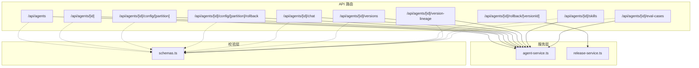
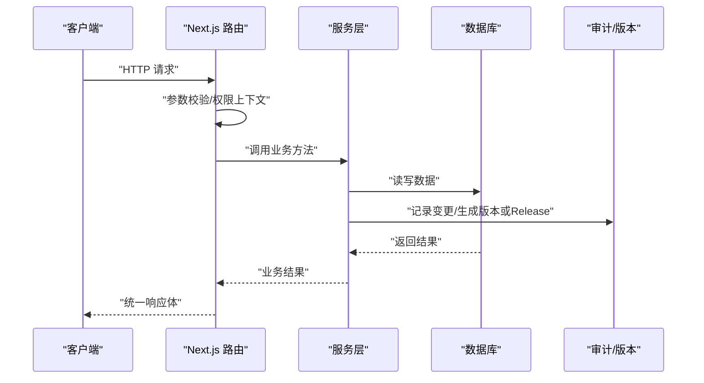
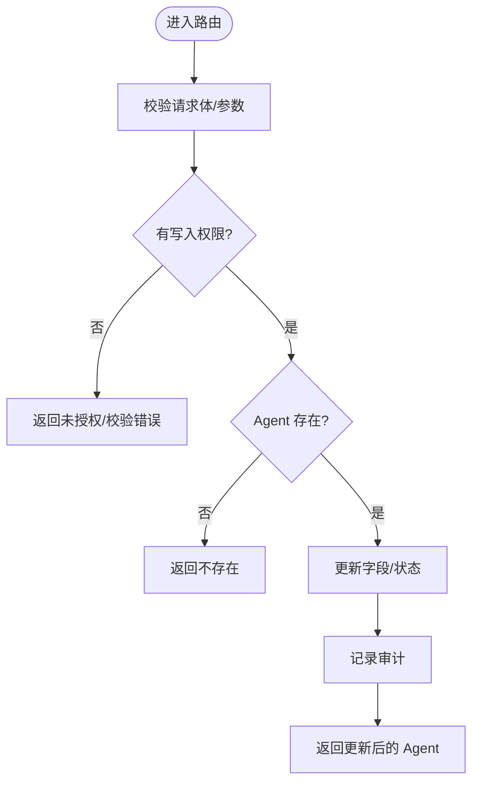
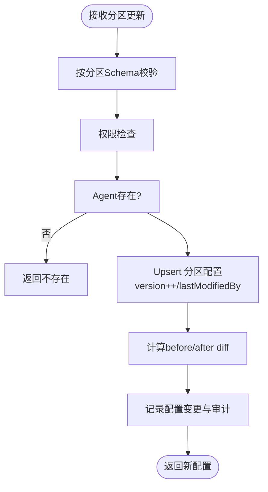
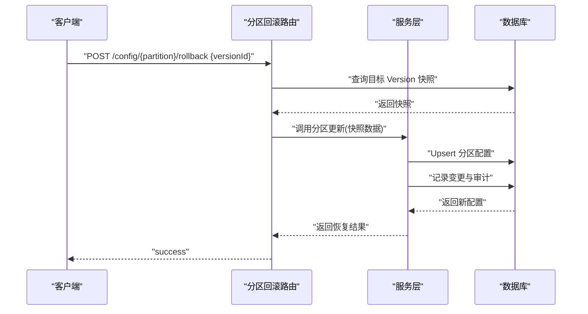
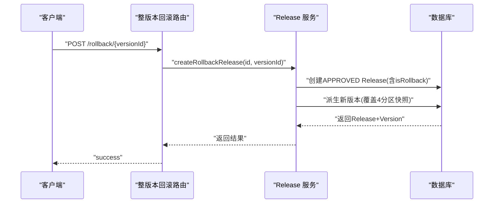
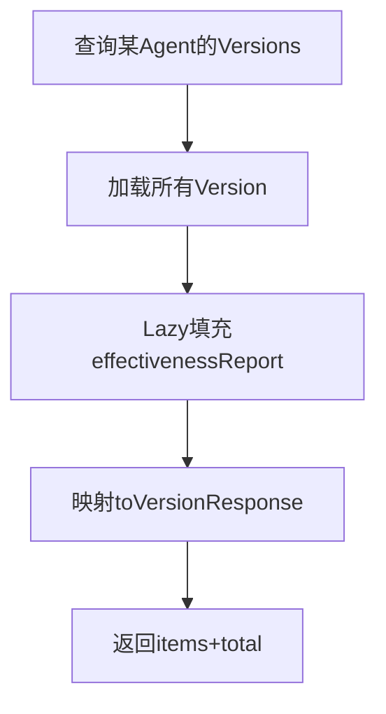
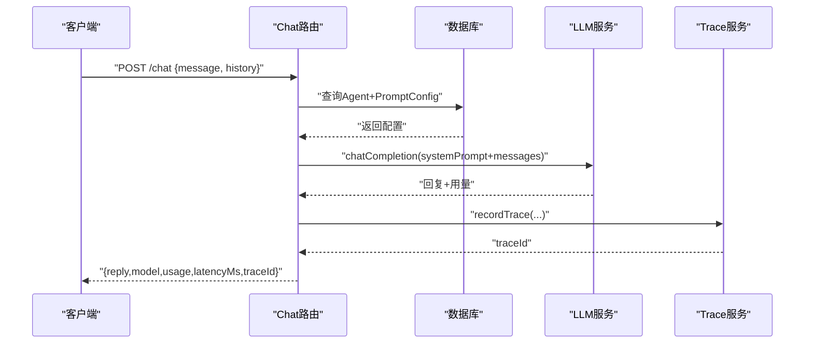
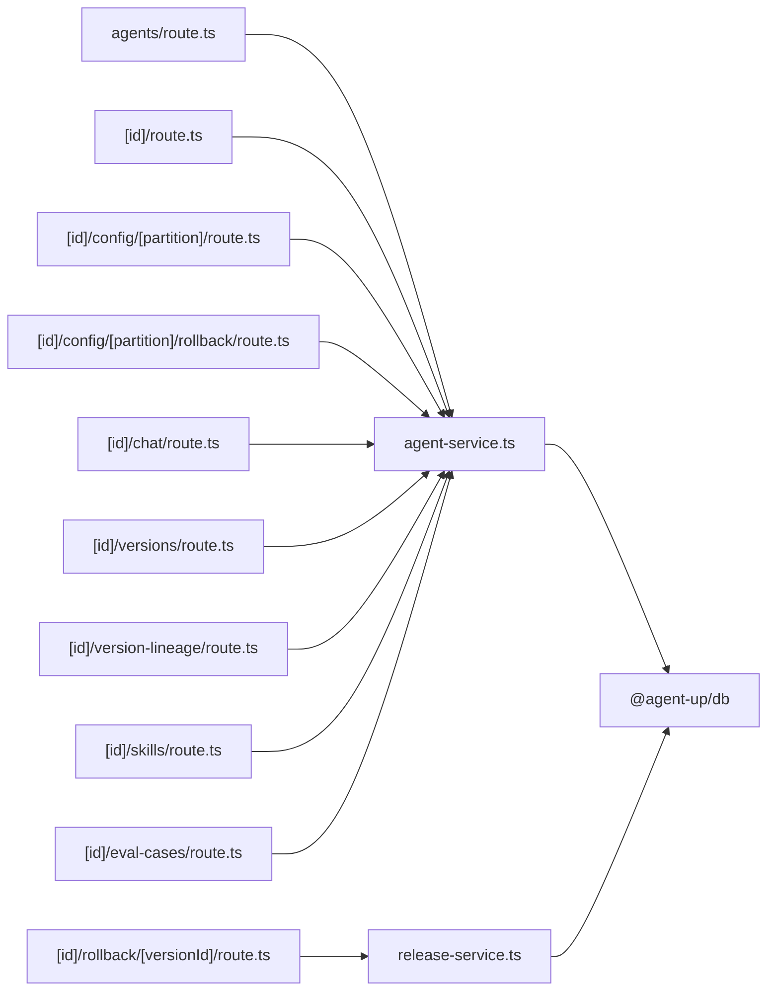

# Agent 管理 API

<cite>
**本文引用的文件**   
- [apps/web/app/api/agents/route.ts](file://apps/web/app/api/agents/route.ts)
- [apps/web/app/api/agents/[id]/route.ts](file://apps/web/app/api/agents/[id]/route.ts)
- [apps/web/app/api/agents/[id]/config/[partition]/route.ts](file://apps/web/app/api/agents/[id]/config/[partition]/route.ts)
- [apps/web/app/api/agents/[id]/config/[partition]/rollback/route.ts](file://apps/web/app/api/agents/[id]/config/[partition]/rollback/route.ts)
- [apps/web/app/api/agents/[id]/chat/route.ts](file://apps/web/app/api/agents/[id]/chat/route.ts)
- [apps/web/app/api/agents/[id]/versions/route.ts](file://apps/web/app/api/agents/[id]/versions/route.ts)
- [apps/web/app/api/agents/[id]/rollback/[versionId]/route.ts](file://apps/web/app/api/agents/[id]/rollback/[versionId]/route.ts)
- [apps/web/app/api/agents/[id]/version-lineage/route.ts](file://apps/web/app/api/agents/[id]/version-lineage/route.ts)
- [apps/web/app/api/agents/[id]/skills/route.ts](file://apps/web/app/api/agents/[id]/skills/route.ts)
- [apps/web/app/api/agents/[id]/eval-cases/route.ts](file://apps/web/app/api/agents/[id]/eval-cases/route.ts)
- [apps/web/lib/schemas.ts](file://apps/web/lib/schemas.ts)
- [apps/web/lib/services/agent-service.ts](file://apps/web/lib/services/agent-service.ts)
- [apps/web/lib/services/release-service.ts](file://apps/web/lib/services/release-service.ts)
</cite>

## 目录
1. [简介](#简介)
2. [项目结构](#项目结构)
3. [核心组件](#核心组件)
4. [架构总览](#架构总览)
5. [详细组件分析](#详细组件分析)
6. [依赖关系分析](#依赖关系分析)
7. [性能与一致性](#性能与一致性)
8. [故障排查指南](#故障排查指南)
9. [结论](#结论)
10. [附录：API 参考与示例](#附录api-参考与示例)

## 简介
本文件面向 Agent 管理相关 API，覆盖 Agent 的 CRUD、四分区配置（Prompt、Knowledge、Tools、Routing）、聊天交互、版本管理与回滚、技能绑定与评测用例沉淀等能力。文档重点说明：
- 请求参数校验规则与响应数据结构
- 四分区配置的读写语义、默认值与版本递增策略
- Agent 状态流转与生命周期（DRAFT / ACTIVE / ARCHIVED）
- 版本控制与数据一致性保证（Release + Version 快照 + 审计）
- 典型操作示例与错误处理建议

## 项目结构
Agent 管理 API 基于 Next.js App Router 组织，路由按资源维度划分；业务逻辑集中在服务层，校验集中在 schema 层。

图表来源
- [apps/web/app/api/agents/route.ts:1-43](file://apps/web/app/api/agents/route.ts#L1-L43)
- [apps/web/app/api/agents/[id]/route.ts:1-50](file://apps/web/app/api/agents/[id]/route.ts#L1-L50)
- [apps/web/app/api/agents/[id]/config/[partition]/route.ts:1-86](file://apps/web/app/api/agents/[id]/config/[partition]/route.ts#L1-L86)
- [apps/web/app/api/agents/[id]/config/[partition]/rollback/route.ts:1-118](file://apps/web/app/api/agents/[id]/config/[partition]/rollback/route.ts#L1-L118)
- [apps/web/app/api/agents/[id]/chat/route.ts:1-76](file://apps/web/app/api/agents/[id]/chat/route.ts#L1-L76)
- [apps/web/app/api/agents/[id]/versions/route.ts:1-53](file://apps/web/app/api/agents/[id]/versions/route.ts#L1-L53)
- [apps/web/app/api/agents/[id]/rollback/[versionId]/route.ts:1-37](file://apps/web/app/api/agents/[id]/rollback/[versionId]/route.ts#L1-L37)
- [apps/web/app/api/agents/[id]/version-lineage/route.ts:1-20](file://apps/web/app/api/agents/[id]/version-lineage/route.ts#L1-L20)
- [apps/web/app/api/agents/[id]/skills/route.ts:1-48](file://apps/web/app/api/agents/[id]/skills/route.ts#L1-L48)
- [apps/web/app/api/agents/[id]/eval-cases/route.ts:1-57](file://apps/web/app/api/agents/[id]/eval-cases/route.ts#L1-L57)
- [apps/web/lib/schemas.ts:1-365](file://apps/web/lib/schemas.ts#L1-L365)
- [apps/web/lib/services/agent-service.ts:1-615](file://apps/web/lib/services/agent-service.ts#L1-L615)
- [apps/web/lib/services/release-service.ts:307-347](file://apps/web/lib/services/release-service.ts#L307-L347)

章节来源
- [apps/web/app/api/agents/route.ts:1-43](file://apps/web/app/api/agents/route.ts#L1-L43)
- [apps/web/lib/schemas.ts:1-60](file://apps/web/lib/schemas.ts#L1-L60)

## 核心组件
- 路由层：负责解析路径参数、查询参数、请求体验证、统一成功/失败包装、异常处理与权限上下文注入。
- 校验层：使用 Zod Schema 集中定义 Agent、四分区配置、聊天输入、发布与评审等字段约束。
- 服务层：封装数据库访问、权限检查、审计记录、JSON 序列化/反序列化、Diff 计算、版本与 Release 流程。

关键职责边界
- 路由不直接写库，只做入参校验与编排。
- 服务层承担业务规则、事务与审计。
- Schema 是接口契约的唯一真相源，前后端共享。

章节来源
- [apps/web/lib/schemas.ts:1-60](file://apps/web/lib/schemas.ts#L1-L60)
- [apps/web/lib/services/agent-service.ts:1-60](file://apps/web/lib/services/agent-service.ts#L1-L60)

## 架构总览
Agent 管理的整体调用链如下：客户端 → Next.js 路由 → 服务层 → 数据库；同时通过审计与版本系统形成可追溯闭环。

图表来源
- [apps/web/app/api/agents/route.ts:1-43](file://apps/web/app/api/agents/route.ts#L1-L43)
- [apps/web/lib/services/agent-service.ts:274-339](file://apps/web/lib/services/agent-service.ts#L274-L339)
- [apps/web/lib/services/release-service.ts:307-347](file://apps/web/lib/services/release-service.ts#L307-L347)

## 详细组件分析

### Agent 基础 CRUD
- 列表：GET /api/agents
  - 查询参数：page、pageSize、skip、take、status、productGroupId、search
  - 行为：分页、可选按 status/productGroupId 过滤，search 为内存过滤（SQLite 限制）
  - 响应：{ items, pagination }
- 创建：POST /api/agents
  - 请求体验证：name、description、productGroupId
  - 行为：权限检查、产品组存在性校验、创建并审计
  - 响应：Agent 详情对象
- 详情：GET /api/agents/[id]
  - 响应：Agent 详情 + 最近版本 + 待发布 Release
- 更新：PUT /api/agents/[id]
  - 请求体验证：name、description、status（DRAFT/ACTIVE/ARCHIVED）
  - 行为：权限检查、存在性校验、更新并审计
- 删除：DELETE /api/agents/[id]
  - 行为：软删除（归档），将 status 置为 ARCHIVED，并审计

图表来源
- [apps/web/app/api/agents/[id]/route.ts:1-50](file://apps/web/app/api/agents/[id]/route.ts#L1-L50)
- [apps/web/lib/services/agent-service.ts:300-339](file://apps/web/lib/services/agent-service.ts#L300-L339)

章节来源
- [apps/web/app/api/agents/route.ts:1-43](file://apps/web/app/api/agents/route.ts#L1-L43)
- [apps/web/app/api/agents/[id]/route.ts:1-50](file://apps/web/app/api/agents/[id]/route.ts#L1-L50)
- [apps/web/lib/schemas.ts:7-17](file://apps/web/lib/schemas.ts#L7-L17)
- [apps/web/lib/services/agent-service.ts:210-339](file://apps/web/lib/services/agent-service.ts#L210-L339)

### 四分区配置管理（Prompt / Knowledge / Tools / Routing）
- 读取：GET /api/agents/[id]/config/[partition]
  - partition 取值：prompt、knowledge、tools、routing
  - 响应：对应分区的当前配置（含 version、lastModifiedAt）
- 更新：PUT /api/agents/[id]/config/[partition]
  - 请求体验证：按分区 Schema 校验
  - 行为：权限检查、存在性检查、upsert 合并语义、version 自增、记录变更 diff 与审计
  - 响应：更新后的分区配置

分区字段与校验要点
- Prompt
  - systemPrompt：必填字符串
  - roleDefinition：可选字符串或 null
  - constraints：可选字符串数组
  - outputFormat：可选字符串或 null
- Knowledge
  - wikiVaultId：可选字符串或 null
  - searchStrategy：枚举 WIKI_FIRST/WIKI_ONLY/MCP_FIRST/HYBRID
  - fallbackToMcp：可选布尔
  - maxWikiResults：整数 1..50
  - confidenceThreshold：浮点 0..1
- Tools
  - mcpTools：可选任意数组
  - wikiQueryTools：可选任意数组
  - maxConcurrentCalls：整数 1..20
  - timeoutMs：整数 1000..120000
  - retryCount：整数 0..5
- Routing
  - rules：可选任意数组
  - escalationPolicy：可选任意或 null
  - humanThreshold：浮点 0..1
  - maxConversationTurns：整数 1..100
  - idleTimeoutMinutes：整数 1..60

图表来源
- [apps/web/app/api/agents/[id]/config/[partition]/route.ts:1-86](file://apps/web/app/api/agents/[id]/config/[partition]/route.ts#L1-L86)
- [apps/web/lib/services/agent-service.ts:341-565](file://apps/web/lib/services/agent-service.ts#L341-L565)
- [apps/web/lib/schemas.ts:23-60](file://apps/web/lib/schemas.ts#L23-L60)

章节来源
- [apps/web/app/api/agents/[id]/config/[partition]/route.ts:1-86](file://apps/web/app/api/agents/[id]/config/[partition]/route.ts#L1-L86)
- [apps/web/lib/services/agent-service.ts:341-615](file://apps/web/lib/services/agent-service.ts#L341-L615)
- [apps/web/lib/schemas.ts:23-60](file://apps/web/lib/schemas.ts#L23-L60)

### 分区级回滚
- 接口：POST /api/agents/[id]/config/[partition]/rollback
- 请求体：{ versionId }
- 行为：
  - 校验 partition 与 versionId
  - 从目标 Version 的对应 snapshot 中取出该分区配置
  - 复用分区更新流程，覆盖 active 配置
  - 记录变更（partition_rollback）与审计
- 响应：包含 restoredFromVersion 与恢复后的配置

图表来源
- [apps/web/app/api/agents/[id]/config/[partition]/rollback/route.ts:1-118](file://apps/web/app/api/agents/[id]/config/[partition]/rollback/route.ts#L1-L118)
- [apps/web/lib/services/agent-service.ts:364-565](file://apps/web/lib/services/agent-service.ts#L364-L565)

章节来源
- [apps/web/app/api/agents/[id]/config/[partition]/rollback/route.ts:1-118](file://apps/web/app/api/agents/[id]/config/[partition]/rollback/route.ts#L1-L118)

### 整版本回滚
- 接口：POST /api/agents/[id]/rollback/[versionId]
- 行为：
  - 一次性回滚全部 4 个分区到指定 Version 的快照
  - 创建 APPROVED 状态的 Release（标记 isRollback）
  - 派生新版本（版本号自增），确保历史快照不可变
  - 记录审计 action=agent.rollback
- 响应：包含 release、version、restoredFrom

图表来源
- [apps/web/app/api/agents/[id]/rollback/[versionId]/route.ts:1-37](file://apps/web/app/api/agents/[id]/rollback/[versionId]/route.ts#L1-L37)
- [apps/web/lib/services/release-service.ts:307-347](file://apps/web/lib/services/release-service.ts#L307-L347)

章节来源
- [apps/web/app/api/agents/[id]/rollback/[versionId]/route.ts:1-37](file://apps/web/app/api/agents/[id]/rollback/[versionId]/route.ts#L1-L37)
- [apps/web/lib/services/release-service.ts:307-347](file://apps/web/lib/services/release-service.ts#L307-L347)

### 版本历史与血缘
- 版本历史：GET /api/agents/[id]/versions
  - 返回所有已发布 Version，按 publishedAt 倒序
  - 每个 Version 包含四个分区的 snapshot
  - Lazy 计算 effectivenessReport（若缺失且超过窗口期）
- 版本血缘：GET /api/agents/[id]/version-lineage
  - 只读聚合相邻版本的 4 分区 diff，首版本为基线

图表来源
- [apps/web/app/api/agents/[id]/versions/route.ts:1-53](file://apps/web/app/api/agents/[id]/versions/route.ts#L1-L53)
- [apps/web/app/api/agents/[id]/version-lineage/route.ts:1-20](file://apps/web/app/api/agents/[id]/version-lineage/route.ts#L1-L20)

章节来源
- [apps/web/app/api/agents/[id]/versions/route.ts:1-53](file://apps/web/app/api/agents/[id]/versions/route.ts#L1-L53)
- [apps/web/app/api/agents/[id]/version-lineage/route.ts:1-20](file://apps/web/app/api/agents/[id]/version-lineage/route.ts#L1-L20)

### 聊天交互（Playground）
- 接口：POST /api/agents/[id]/chat
- 请求体：message（必填）、history（可选，最多20条，每条role=user/assistant，content≤8000）
- 行为：
  - 校验 Agent 存在
  - 以当前 Prompt 分区配置构建 system prompt
  - 调用 LLM 完成对话
  - 成功后落盘 trace（traceId 用于打分/沉淀用例）
- 响应：reply、model、usage、latencyMs、traceId

图表来源
- [apps/web/app/api/agents/[id]/chat/route.ts:1-76](file://apps/web/app/api/agents/[id]/chat/route.ts#L1-L76)
- [apps/web/lib/schemas.ts:289-300](file://apps/web/lib/schemas.ts#L289-L300)

章节来源
- [apps/web/app/api/agents/[id]/chat/route.ts:1-76](file://apps/web/app/api/agents/[id]/chat/route.ts#L1-L76)
- [apps/web/lib/schemas.ts:289-300](file://apps/web/lib/schemas.ts#L289-L300)

### 技能绑定（Skill Bindings）
- GET /api/agents/[id]/skills：获取已绑定的技能列表
- POST /api/agents/[id]/skills：绑定技能（skillId + config）
- DELETE /api/agents/[id]/skills?agentId=&skillId=：解绑技能

章节来源
- [apps/web/app/api/agents/[id]/skills/route.ts:1-48](file://apps/web/app/api/agents/[id]/skills/route.ts#L1-L48)
- [apps/web/lib/schemas.ts:183-186](file://apps/web/lib/schemas.ts#L183-L186)

### 评测用例沉淀
- GET /api/agents/[id]/eval-cases：列出该 Agent 的评测用例
- POST /api/agents/[id]/eval-cases：将一条已打分的试聊 trace 沉淀为评测用例（traceId + expectation + assertions）

章节来源
- [apps/web/app/api/agents/[id]/eval-cases/route.ts:1-57](file://apps/web/app/api/agents/[id]/eval-cases/route.ts#L1-L57)
- [apps/web/lib/schemas.ts:306-338](file://apps/web/lib/schemas.ts#L306-L338)

## 依赖关系分析
- 路由层依赖：
  - utils：success/error/handleApiError/validateBody/paginationMeta
  - schemas：Zod 校验模型
  - context：withActor/resolveActor
  - services：agent-service、release-service、llm-service、trace-service、effectiveness-service
- 服务层依赖：
  - db：prisma、packJson/unpackJson/unpackJsonArray
  - rbac：requirePermission
  - audit：recordAudit
  - diff：computeJsonDiff

图表来源
- [apps/web/app/api/agents/route.ts:1-43](file://apps/web/app/api/agents/route.ts#L1-L43)
- [apps/web/app/api/agents/[id]/route.ts:1-50](file://apps/web/app/api/agents/[id]/route.ts#L1-L50)
- [apps/web/app/api/agents/[id]/config/[partition]/route.ts:1-86](file://apps/web/app/api/agents/[id]/config/[partition]/route.ts#L1-L86)
- [apps/web/app/api/agents/[id]/config/[partition]/rollback/route.ts:1-118](file://apps/web/app/api/agents/[id]/config/[partition]/rollback/route.ts#L1-L118)
- [apps/web/app/api/agents/[id]/chat/route.ts:1-76](file://apps/web/app/api/agents/[id]/chat/route.ts#L1-L76)
- [apps/web/app/api/agents/[id]/versions/route.ts:1-53](file://apps/web/app/api/agents/[id]/versions/route.ts#L1-L53)
- [apps/web/app/api/agents/[id]/rollback/[versionId]/route.ts:1-37](file://apps/web/app/api/agents/[id]/rollback/[versionId]/route.ts#L1-L37)
- [apps/web/app/api/agents/[id]/version-lineage/route.ts:1-20](file://apps/web/app/api/agents/[id]/version-lineage/route.ts#L1-L20)
- [apps/web/app/api/agents/[id]/skills/route.ts:1-48](file://apps/web/app/api/agents/[id]/skills/route.ts#L1-L48)
- [apps/web/app/api/agents/[id]/eval-cases/route.ts:1-57](file://apps/web/app/api/agents/[id]/eval-cases/route.ts#L1-L57)
- [apps/web/lib/services/agent-service.ts:1-615](file://apps/web/lib/services/agent-service.ts#L1-L615)
- [apps/web/lib/services/release-service.ts:307-347](file://apps/web/lib/services/release-service.ts#L307-L347)

章节来源
- [apps/web/lib/services/agent-service.ts:1-60](file://apps/web/lib/services/agent-service.ts#L1-L60)
- [apps/web/lib/services/release-service.ts:307-347](file://apps/web/lib/services/release-service.ts#L307-L347)

## 性能与一致性
- 列表搜索：在 SQLite 环境下采用内存过滤，适合演示规模；大数据量时应考虑后端索引与全文检索。
- 配置更新：采用 upsert 合并语义，避免全量覆盖导致的数据丢失；version 恒递增，便于审计与回滚。
- 版本与 Release：回滚时在同一事务内创建 Release 与派生 Version，保证组合一致性与不可变快照。
- 有效性报告：对旧版本 lazy 计算，避免冷数据重复计算开销。

[本节为通用指导，不直接分析具体文件]

## 故障排查指南
- 常见错误
  - 400：无效分区、请求体验证失败
  - 404：Agent 不存在、Version 不属于该 Agent
  - 409：外部渠道幂等冲突（反馈接入场景）
  - 5xx：上游 LLM 或下游服务异常（由 handleApiError 统一包装）
- 排查步骤
  - 确认 path 参数与 partition 是否合法
  - 检查请求体是否符合对应 Schema
  - 查看审计日志与配置变更记录（diff）
  - 对于回滚失败，核对目标 Version 是否存在且属于该 Agent

章节来源
- [apps/web/app/api/agents/[id]/config/[partition]/route.ts:24-57](file://apps/web/app/api/agents/[id]/config/[partition]/route.ts#L24-L57)
- [apps/web/app/api/agents/[id]/config/[partition]/rollback/route.ts:46-74](file://apps/web/app/api/agents/[id]/config/[partition]/rollback/route.ts#L46-L74)
- [apps/web/lib/errors.ts](file://apps/web/lib/errors.ts)

## 结论
本 API 围绕 Agent 的生命周期与四分区配置展开，提供完整的 CRUD、配置管理、聊天交互、版本与回滚、技能绑定与评测用例沉淀能力。通过统一的校验层与服务层抽象，结合审计与版本快照机制，保证了变更的可追溯性与数据一致性。建议在大规模场景下进一步优化搜索与缓存策略，并持续完善 RBAC 与审计报表。

[本节为总结性内容，不直接分析具体文件]

## 附录：API 参考与示例

### 端点总览
- GET /api/agents
  - 作用：获取 Agent 列表（支持分页、status、productGroupId、search）
  - 响应：{ items, pagination }
- POST /api/agents
  - 作用：创建 Agent
  - 请求体：{ name, description?, productGroupId }
  - 响应：Agent 详情
- GET /api/agents/:id
  - 作用：获取 Agent 详情
  - 响应：Agent 详情 + releases + versions
- PUT /api/agents/:id
  - 作用：更新 Agent（name/description/status）
  - 响应：Agent 详情
- DELETE /api/agents/:id
  - 作用：归档 Agent
  - 响应：{ message }
- GET /api/agents/:id/config/:partition
  - 作用：读取分区配置
  - 响应：分区配置对象
- PUT /api/agents/:id/config/:partition
  - 作用：更新分区配置
  - 响应：更新后的分区配置
- POST /api/agents/:id/config/:partition/rollback
  - 作用：分区级回滚
  - 请求体：{ versionId }
  - 响应：{ partition, restoredFromVersion, config }
- POST /api/agents/:id/chat
  - 作用：试聊 Playground
  - 请求体：{ message, history? }
  - 响应：{ reply, model, usage, latencyMs, traceId }
- GET /api/agents/:id/versions
  - 作用：版本历史
  - 响应：{ items, total }
- POST /api/agents/:id/rollback/:versionId
  - 作用：整版本回滚
  - 响应：{ release, version, restoredFrom }
- GET /api/agents/:id/version-lineage
  - 作用：版本血缘（相邻版本 diff）
  - 响应：血缘聚合数据
- GET/POST/DELETE /api/agents/:id/skills
  - 作用：技能绑定管理
- GET/POST /api/agents/:id/eval-cases
  - 作用：评测用例管理

### 请求参数验证规则摘要
- Agent 创建
  - name：非空，长度 ≤100
  - description：可选，长度 ≤500
  - productGroupId：非空
- Agent 更新
  - name：可选，长度 ≤100
  - description：可选，可为 null，长度 ≤500
  - status：枚举 DRAFT/ACTIVE/ARCHIVED
- Prompt 配置
  - systemPrompt：必填字符串
  - roleDefinition：可选字符串或 null
  - constraints：可选字符串数组
  - outputFormat：可选字符串或 null
- Knowledge 配置
  - wikiVaultId：可选字符串或 null
  - searchStrategy：枚举 WIKI_FIRST/WIKI_ONLY/MCP_FIRST/HYBRID
  - fallbackToMcp：可选布尔
  - maxWikiResults：整数 1..50
  - confidenceThreshold：浮点 0..1
- Tools 配置
  - mcpTools：可选任意数组
  - wikiQueryTools：可选任意数组
  - maxConcurrentCalls：整数 1..20
  - timeoutMs：整数 1000..120000
  - retryCount：整数 0..5
- Routing 配置
  - rules：可选任意数组
  - escalationPolicy：可选任意或 null
  - humanThreshold：浮点 0..1
  - maxConversationTurns：整数 1..100
  - idleTimeoutMinutes：整数 1..60
- 聊天输入
  - message：必填，长度 ≤4000
  - history：可选，最多 20 条，每条 role ∈ {user, assistant}，content ≤8000

章节来源
- [apps/web/lib/schemas.ts:7-52](file://apps/web/lib/schemas.ts#L7-L52)
- [apps/web/lib/schemas.ts:289-300](file://apps/web/lib/schemas.ts#L289-L300)

### 典型操作示例（描述性）
- 创建 Agent
  - 请求：POST /api/agents
  - 请求体：{ name: "客服助手", description: "售后问题处理", productGroupId: "pg-001" }
  - 预期：返回 201 与 Agent 详情
- 更新 Agent 状态
  - 请求：PUT /api/agents/:id
  - 请求体：{ status: "ACTIVE" }
  - 预期：返回更新后的 Agent
- 修改 Prompt 配置
  - 请求：PUT /api/agents/:id/config/prompt
  - 请求体：{ systemPrompt: "你是一个专业的售后客服...", constraints: ["不得承诺退款金额"] }
  - 预期：返回新的 prompt 配置（version 递增）
- 分区回滚
  - 请求：POST /api/agents/:id/config/knowledge/rollback
  - 请求体：{ versionId: "ver-003" }
  - 预期：返回恢复后的 knowledge 配置与 restoredFromVersion
- 整版本回滚
  - 请求：POST /api/agents/:id/rollback/ver-002
  - 预期：返回 APPROVED 的 Release 与新 Version（版本号自增）
- 试聊
  - 请求：POST /api/agents/:id/chat
  - 请求体：{ message: "如何申请退款？", history: [{ role: "user", content: "你好" }] }
  - 预期：返回 reply、traceId 等

[本节为概念性示例，不直接分析具体文件]