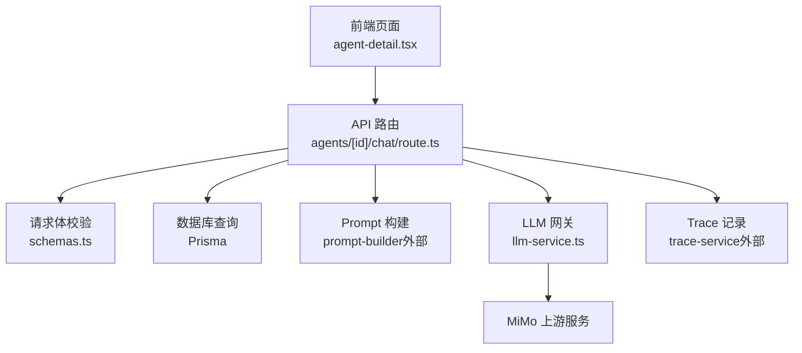
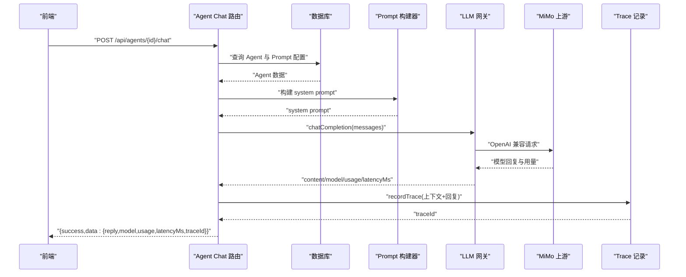
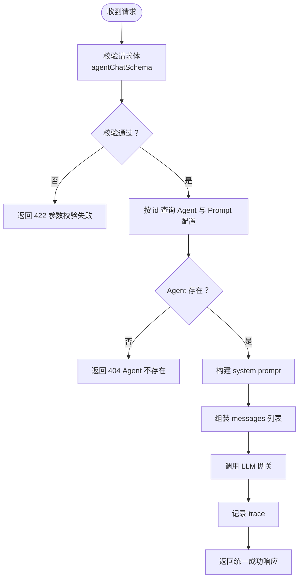
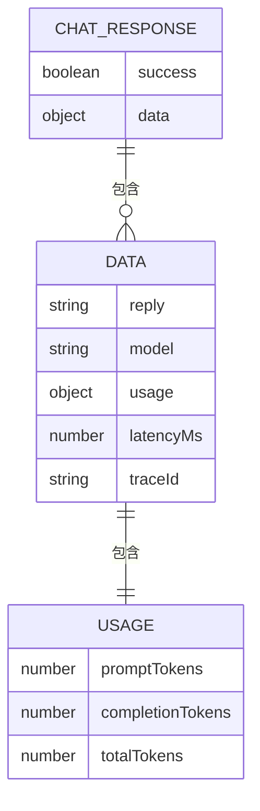
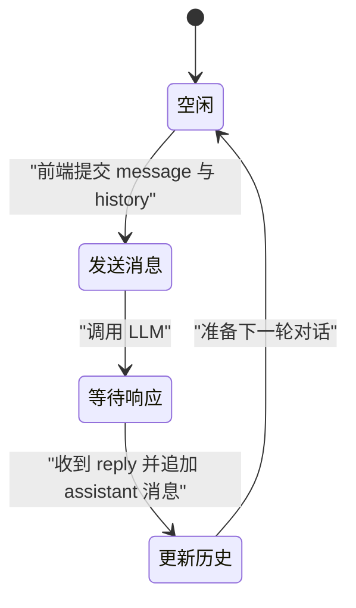
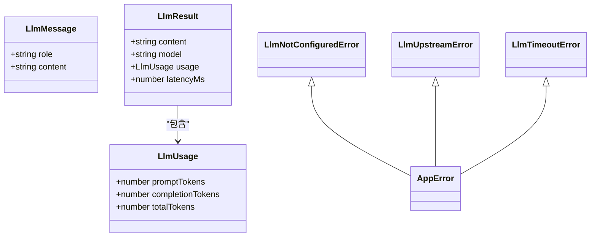
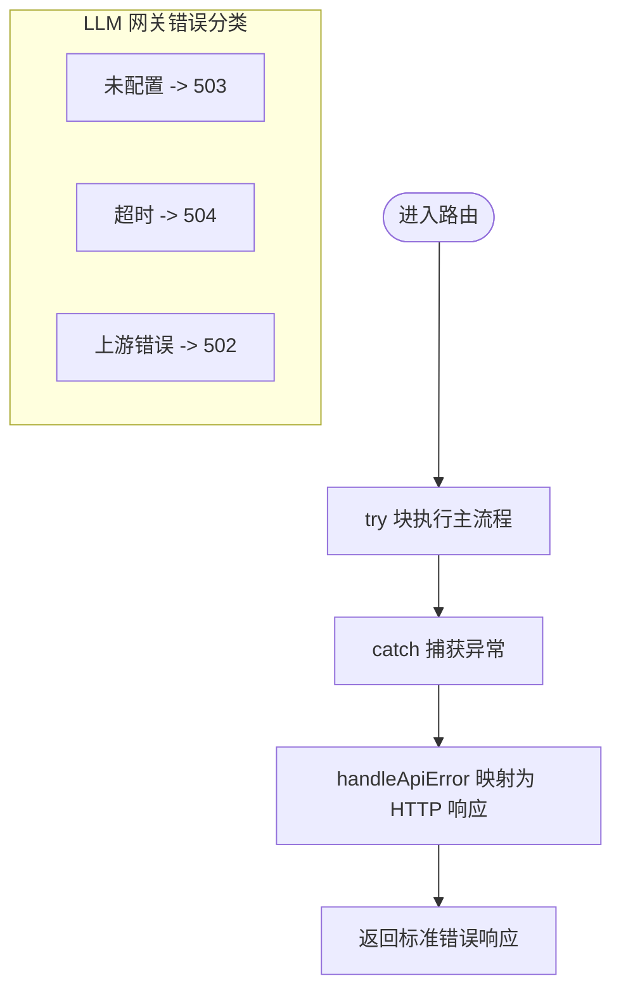
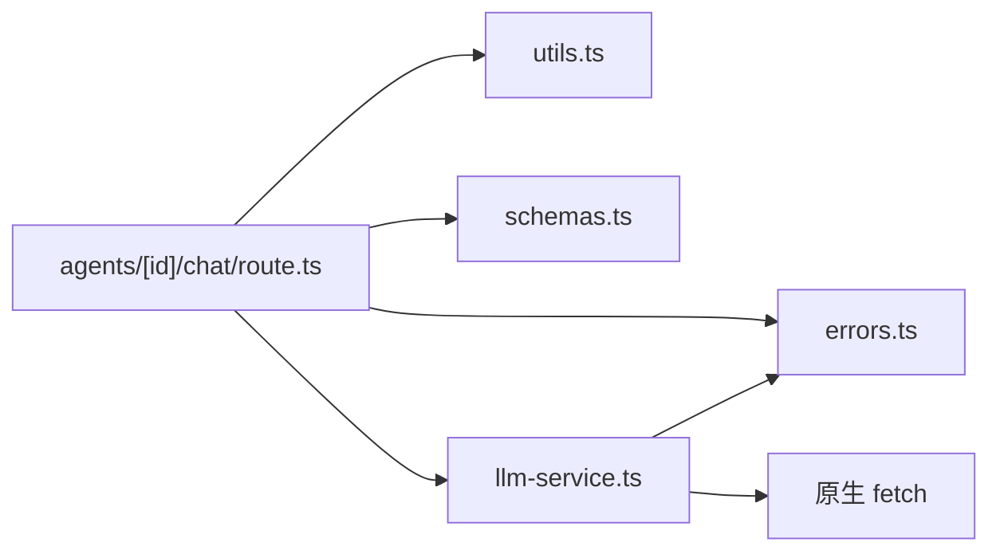

# Agent 聊天交互

<cite>
**本文引用的文件**   
- [apps/web/app/api/agents/[id]/chat/route.ts](file://apps/web/app/api/agents/[id]/chat/route.ts)
- [apps/web/lib/schemas.ts](file://apps/web/lib/schemas.ts)
- [apps/web/lib/services/llm-service.ts](file://apps/web/lib/services/llm-service.ts)
- [apps/web/lib/utils.ts](file://apps/web/lib/utils.ts)
- [apps/web/lib/errors.ts](file://apps/web/lib/errors.ts)
- [apps/web/app/(dashboard)/agents/[id]/agent-detail.tsx](file://apps/web/app/(dashboard)/agents/[id]/agent-detail.tsx)
- [apps/web/demo/mock-server.ts](file://apps/web/demo/mock-server.ts)
- [apps/web/app/api/__tests__/llm-integrations.test.ts](file://apps/web/app/api/__tests__/llm-integrations.test.ts)
</cite>

## 目录
1. [简介](#简介)
2. [项目结构](#项目结构)
3. [核心组件](#核心组件)
4. [架构总览](#架构总览)
5. [详细组件分析](#详细组件分析)
6. [依赖关系分析](#依赖关系分析)
7. [性能与可靠性](#性能与可靠性)
8. [故障排查指南](#故障排查指南)
9. [结论](#结论)

## 简介
本文档面向需要调用 Agent 聊天能力的开发者，聚焦接口 `POST /api/agents/[id]/chat`。该接口用于对指定 Agent 发起一次对话请求：服务端加载 Agent 的 Prompt 分区配置作为系统提示词，结合前端传入的历史消息与新消息，调用 LLM 服务并返回结构化结果。当前实现为一次性请求-响应模式，并非流式 SSE 接口；前端在页面内通过普通 fetch 获取完整回复后渲染到聊天界面。

## 项目结构
Agent 聊天能力位于 Next.js App Router 的 API 路由中，围绕以下关键文件组织：
- 路由入口：`apps/web/app/api/agents/[id]/chat/route.ts`
- 请求体校验：`apps/web/lib/schemas.ts`
- LLM 网关：`apps/web/lib/services/llm-service.ts`
- 通用工具与错误映射：`apps/web/lib/utils.ts`、`apps/web/lib/errors.ts`
- 前端调用示例：`apps/web/app/(dashboard)/agents/[id]/agent-detail.tsx`
- Mock 行为与测试用例：`apps/web/demo/mock-server.ts`、`apps/web/app/api/__tests__/llm-integrations.test.ts`

图表来源
- [apps/web/app/api/agents/[id]/chat/route.ts:18-75](file://apps/web/app/api/agents/[id]/chat/route.ts#L18-L75)
- [apps/web/lib/services/llm-service.ts:67-139](file://apps/web/lib/services/llm-service.ts#L67-L139)

章节来源
- [apps/web/app/api/agents/[id]/chat/route.ts:10-75](file://apps/web/app/api/agents/[id]/chat/route.ts#L10-L75)
- [apps/web/lib/schemas.ts:289-300](file://apps/web/lib/schemas.ts#L289-L300)
- [apps/web/lib/services/llm-service.ts:1-139](file://apps/web/lib/services/llm-service.ts#L1-L139)

## 核心组件
- API 路由处理器：负责参数解析、Agent 查找、Prompt 组装、LLM 调用、Trace 落盘和统一响应封装。
- 请求体校验器：使用 Zod 定义 `agentChatSchema`，约束 `message` 与 `history` 的结构、长度与枚举值。
- LLM 网关：封装 MiMo OpenAI 兼容接口的调用、超时控制、错误分类与用量统计。
- 错误体系：提供 `AppError` 及其子类，配合 `handleApiError` 将异常映射为标准 HTTP 响应。
- 前端调用方：构造 `{ message, history }` 并处理成功或失败响应。

章节来源
- [apps/web/app/api/agents/[id]/chat/route.ts:18-75](file://apps/web/app/api/agents/[id]/chat/route.ts#L18-L75)
- [apps/web/lib/schemas.ts:289-300](file://apps/web/lib/schemas.ts#L289-L300)
- [apps/web/lib/services/llm-service.ts:11-27](file://apps/web/lib/services/llm-service.ts#L11-L27)
- [apps/web/lib/errors.ts:15-34](file://apps/web/lib/errors.ts#L15-L34)
- [apps/web/app/(dashboard)/agents/[id]/agent-detail.tsx:1164-1202](file://apps/web/app/(dashboard)/agents/[id]/agent-detail.tsx#L1164-L1202)

## 架构总览
Agent 聊天接口的工作流程如下：
1. 前端向 `/api/agents/{id}/chat` 发送 POST 请求，携带用户输入与历史消息。
2. 路由层根据 `id` 查询 Agent 及其 Prompt 配置，并使用 Prompt 构建器生成 system prompt。
3. 将 system prompt、历史消息和新消息组合成消息列表，调用 LLM 网关。
4. LLM 网关以 OpenAI 兼容协议调用 MiMo，返回模型名称、内容、用量与耗时。
5. 路由层将整轮上下文写入 trace，并返回包含 reply、model、usage、latencyMs、traceId 的统一响应。

图表来源
- [apps/web/app/api/agents/[id]/chat/route.ts:24-71](file://apps/web/app/api/agents/[id]/chat/route.ts#L24-L71)
- [apps/web/lib/services/llm-service.ts:81-139](file://apps/web/lib/services/llm-service.ts#L81-L139)

## 详细组件分析

### 接口定义与请求体
- 方法：POST
- 路径：`/api/agents/[id]/chat`
- URL 参数：
  - `id`：Agent 标识符
- 请求体字段：
  - `message`：必填字符串，最大 4000 字符
  - `history`：可选数组，最多 20 条；每条包含：
    - `role`：枚举值 `user` 或 `assistant`
    - `content`：字符串，最大 8000 字符

图表来源
- [apps/web/lib/schemas.ts:289-300](file://apps/web/lib/schemas.ts#L289-L300)
- [apps/web/app/api/agents/[id]/chat/route.ts:24-71](file://apps/web/app/api/agents/[id]/chat/route.ts#L24-L71)

章节来源
- [apps/web/lib/schemas.ts:289-300](file://apps/web/lib/schemas.ts#L289-L300)
- [apps/web/app/api/agents/[id]/chat/route.ts:30-50](file://apps/web/app/api/agents/[id]/chat/route.ts#L30-L50)

### 响应结构与字段说明
成功响应统一由 `success(data)` 包装，外层结构为 `{ success: true, data }`。`data` 字段包括：
- `reply`：LLM 返回的文本内容
- `model`：实际使用的模型名称
- `usage`：用量信息，包含 `promptTokens`、`completionTokens`、`totalTokens`
- `latencyMs`：本次 LLM 调用的毫秒耗时
- `traceId`：本次对话的 trace 记录 ID，可用于后续打分或评测

图表来源
- [apps/web/lib/utils.ts:6-8](file://apps/web/lib/utils.ts#L6-L8)
- [apps/web/app/api/agents/[id]/chat/route.ts:65-71](file://apps/web/app/api/agents/[id]/chat/route.ts#L65-L71)
- [apps/web/lib/services/llm-service.ts:16-27](file://apps/web/lib/services/llm-service.ts#L16-L27)

章节来源
- [apps/web/lib/utils.ts:6-8](file://apps/web/lib/utils.ts#L6-L8)
- [apps/web/app/api/agents/[id]/chat/route.ts:65-71](file://apps/web/app/api/agents/[id]/chat/route.ts#L65-L71)
- [apps/web/lib/services/llm-service.ts:16-27](file://apps/web/lib/services/llm-service.ts#L16-L27)

### 会话生命周期管理
当前接口不维护服务器端会话状态，而是采用“无状态 + 前端传历史”的模式：
- 初始化：前端首次对话时，可只传 `message`，`history` 为空数组。
- 消息发送：每次请求都带上历史消息数组，服务端将其拼接到 system prompt 之后、新消息之前。
- 响应接收：服务端返回完整回复；前端将 assistant 回复追加到本地消息列表，并在下一次请求时继续传递。

[本图为概念性流程图，不直接对应具体代码结构]

章节来源
- [apps/web/app/(dashboard)/agents/[id]/agent-detail.tsx:1164-1202](file://apps/web/app/(dashboard)/agents/[id]/agent-detail.tsx#L1164-L1202)
- [apps/web/app/api/agents/[id]/chat/route.ts:45-50](file://apps/web/app/api/agents/[id]/chat/route.ts#L45-L50)

### 与 LLM 服务的集成
LLM 网关 `chatCompletion` 负责：
- 从环境变量读取 MiMo 凭据与模型配置，默认模型为 `mimo-v2.5-pro`，默认基础地址为 `https://token-plan-cn.xiaomimimo.com/v1`。
- 构造 OpenAI 兼容的请求体，包含 `model`、`messages`、`max_completion_tokens`，并可设置 `response_format`。
- 使用 `AbortSignal.timeout` 实现超时控制，默认超时为 120 秒。
- 解析响应中的 `choices[0].message.content`、`model`、`usage`，并计算耗时。
- 抛出结构化错误：未配置、上游错误、超时等。

图表来源
- [apps/web/lib/services/llm-service.ts:11-48](file://apps/web/lib/services/llm-service.ts#L11-L48)
- [apps/web/lib/services/llm-service.ts:67-139](file://apps/web/lib/services/llm-service.ts#L67-L139)
- [apps/web/lib/errors.ts:15-34](file://apps/web/lib/errors.ts#L15-L34)

章节来源
- [apps/web/lib/services/llm-service.ts:50-65](file://apps/web/lib/services/llm-service.ts#L50-L65)
- [apps/web/lib/services/llm-service.ts:67-139](file://apps/web/lib/services/llm-service.ts#L67-L139)

### 流式响应与 SSE 支持说明
当前 `POST /api/agents/[id]/chat` 不是流式接口，也不使用 Server-Sent Events。它是一次性请求-响应：
- 路由层等待 `chatCompletion` 完成后再返回完整 `reply`。
- 前端使用普通 `fetch` 解析 JSON 响应，并将 assistant 消息追加到聊天列表。
- 若需要流式体验，应在现有网关基础上扩展为流式输出，并在路由层以流式响应返回；当前仓库未实现该分支。

章节来源
- [apps/web/app/(dashboard)/agents/[id]/agent-detail.tsx:1174-1202](file://apps/web/app/(dashboard)/agents/[id]/agent-detail.tsx#L1174-L1202)
- [apps/web/app/api/agents/[id]/chat/route.ts:45-71](file://apps/web/app/api/agents/[id]/chat/route.ts#L45-L71)

### 错误处理、超时控制与重试机制
- 参数校验失败：返回 422，错误信息来自 Zod schema。
- Agent 不存在：抛出 `NotFoundError`，最终返回 404。
- LLM 未配置：抛出 `LlmNotConfiguredError`，返回 503。
- LLM 上游错误：如鉴权失败、限流、空响应等，抛出 `LlmUpstreamError`，返回 502。
- LLM 调用超时：捕获 `TimeoutError`，抛出 `LlmTimeoutError`，返回 504。
- 未知异常：由 `toErrorBody` 兜底为 500，并记录日志。
- 重试机制：当前路由与 LLM 网关未实现自动重试；如需重试，可在网关层增加指数退避策略。

图表来源
- [apps/web/app/api/agents/[id]/chat/route.ts:72-74](file://apps/web/app/api/agents/[id]/chat/route.ts#L72-L74)
- [apps/web/lib/utils.ts:22-25](file://apps/web/lib/utils.ts#L22-L25)
- [apps/web/lib/errors.ts:68-94](file://apps/web/lib/errors.ts#L68-L94)
- [apps/web/lib/services/llm-service.ts:29-48](file://apps/web/lib/services/llm-service.ts#L29-L48)
- [apps/web/lib/services/llm-service.ts:95-110](file://apps/web/lib/services/llm-service.ts#L95-L110)

章节来源
- [apps/web/app/api/agents/[id]/chat/route.ts:28-31](file://apps/web/app/api/agents/[id]/chat/route.ts#L28-L31)
- [apps/web/lib/services/llm-service.ts:29-48](file://apps/web/lib/services/llm-service.ts#L29-L48)
- [apps/web/lib/services/llm-service.ts:95-110](file://apps/web/lib/services/llm-service.ts#L95-L110)
- [apps/web/lib/utils.ts:22-25](file://apps/web/lib/utils.ts#L22-L25)
- [apps/web/lib/errors.ts:68-94](file://apps/web/lib/errors.ts#L68-L94)

## 依赖关系分析
- 路由层依赖：
  - Prisma 客户端用于查询 Agent 与 Prompt 配置
  - `validateBody` 与 `success`、`handleApiError` 用于请求校验与响应封装
  - `buildSystemPrompt` 用于组装 system prompt
  - `chatCompletion` 用于 LLM 调用
  - `recordTrace` 用于对话轨迹记录
- LLM 网关依赖：
  - 环境变量 `MIMO_API_KEY`、`MIMO_BASE_URL`、`MIMO_MODEL`
  - 原生 `fetch` 调用上游 OpenAI 兼容接口
  - `AppError` 体系进行错误分类

图表来源
- [apps/web/app/api/agents/[id]/chat/route.ts:1-8](file://apps/web/app/api/agents/[id]/chat/route.ts#L1-L8)
- [apps/web/lib/services/llm-service.ts:1-10](file://apps/web/lib/services/llm-service.ts#L1-L10)

章节来源
- [apps/web/app/api/agents/[id]/chat/route.ts:1-8](file://apps/web/app/api/agents/[id]/chat/route.ts#L1-L8)
- [apps/web/lib/services/llm-service.ts:1-10](file://apps/web/lib/services/llm-service.ts#L1-L10)

## 性能与可靠性
- 超时控制：LLM 网关默认超时 120 秒，适合推理模型较慢的场景。
- Token 上限：默认 `max_completion_tokens` 为 2048，避免推理 tokens 超出导致内容为空。
- 用量统计：返回 `promptTokens`、`completionTokens`、`totalTokens`，便于监控与计费。
- 延迟指标：返回 `latencyMs`，便于前端展示与服务端观测。
- 可扩展点：
  - 在 LLM 网关增加重试与指数退避
  - 在路由层增加请求级超时与熔断
  - 在网关层支持流式响应，降低首字节延迟

章节来源
- [apps/web/lib/services/llm-service.ts:50-54](file://apps/web/lib/services/llm-service.ts#L50-L54)
- [apps/web/lib/services/llm-service.ts:87-94](file://apps/web/lib/services/llm-service.ts#L87-L94)
- [apps/web/lib/services/llm-service.ts:129-138](file://apps/web/lib/services/llm-service.ts#L129-L138)

## 故障排查指南
- 422 参数校验失败：检查 `message` 是否为非空字符串且不超过 4000 字符；检查 `history` 是否满足角色枚举与长度限制。
- 404 Agent 不存在：确认 URL 中的 `id` 是否正确，数据库中是否存在该 Agent。
- 503 LLM 未配置：检查环境变量 `MIMO_API_KEY` 是否已设置。
- 502 LLM 上游错误：检查网络连通性、API Key 权限、上游限流与响应格式；查看错误详情中的 status 与 body。
- 504 调用超时：适当增大 `timeoutMs` 或优化 Prompt 与消息长度；必要时增加重试。
- 前端显示错误：参考前端 `agent-detail.tsx` 中对 `json.success` 的判断与错误消息展示逻辑。

章节来源
- [apps/web/lib/schemas.ts:289-300](file://apps/web/lib/schemas.ts#L289-L300)
- [apps/web/app/api/agents/[id]/chat/route.ts:24-31](file://apps/web/app/api/agents/[id]/chat/route.ts#L24-L31)
- [apps/web/lib/services/llm-service.ts:29-48](file://apps/web/lib/services/llm-service.ts#L29-L48)
- [apps/web/lib/services/llm-service.ts:95-110](file://apps/web/lib/services/llm-service.ts#L95-L110)
- [apps/web/app/(dashboard)/agents/[id]/agent-detail.tsx:1174-1202](file://apps/web/app/(dashboard)/agents/[id]/agent-detail.tsx#L1174-L1202)

## 结论
`POST /api/agents/[id]/chat` 提供了基于 Agent Prompt 配置的标准化聊天接口，具备清晰的请求体结构、统一的响应格式、完善的错误分类与用量统计。当前实现为一次性响应模式，未启用流式 SSE；若需实时流式体验，应扩展 LLM 网关与路由层以支持流式传输。对于生产环境，建议补充重试、熔断与更细粒度的超时控制，并结合 trace 与用量数据进行持续优化。