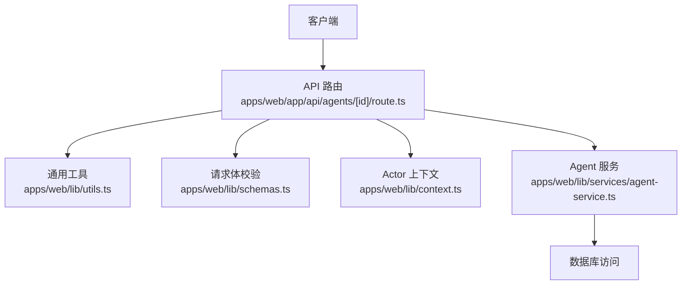
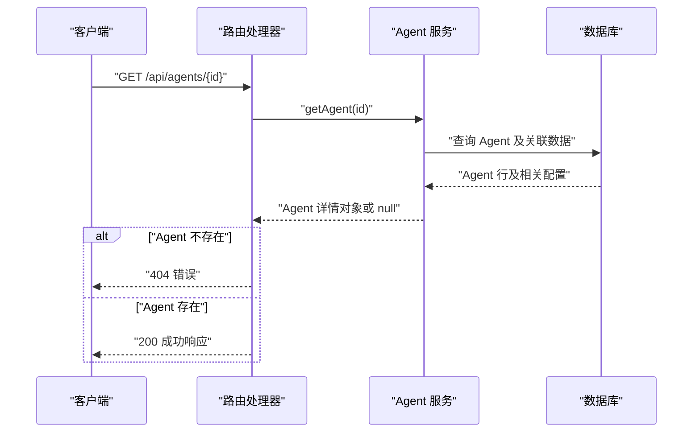
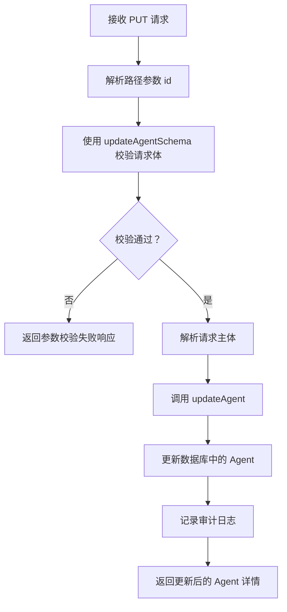
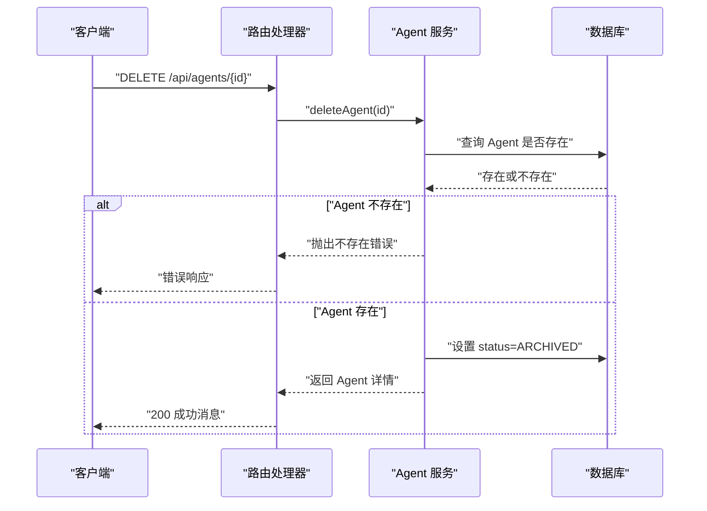
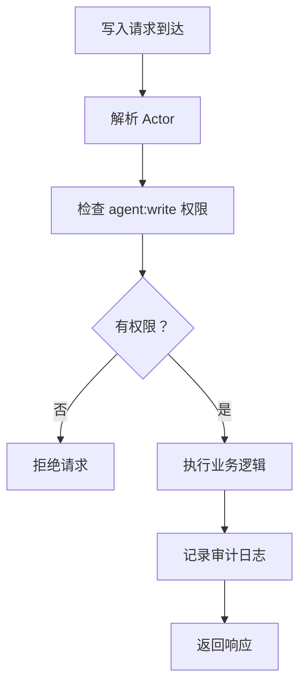
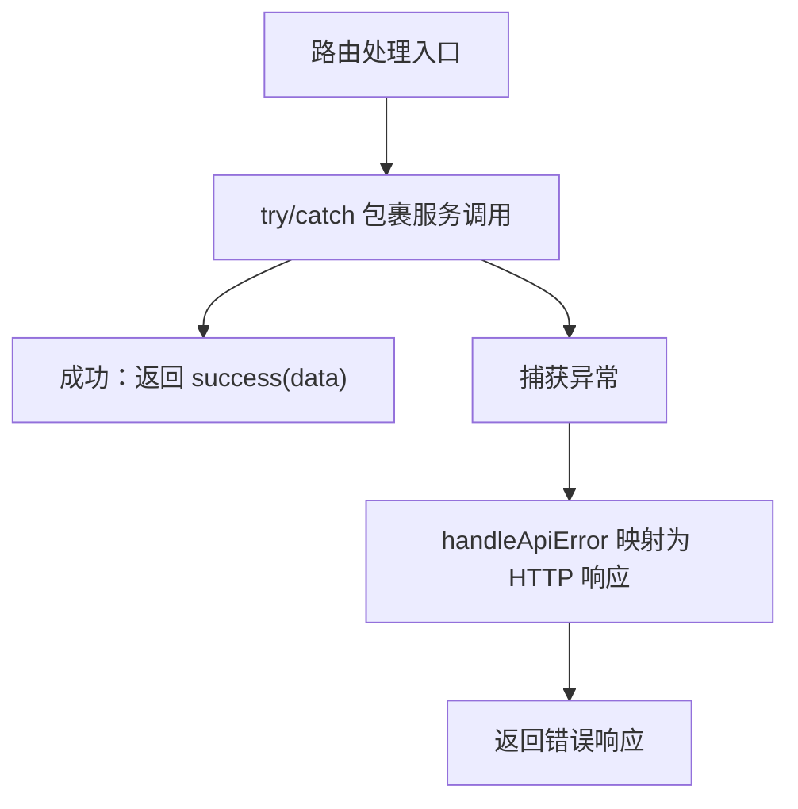
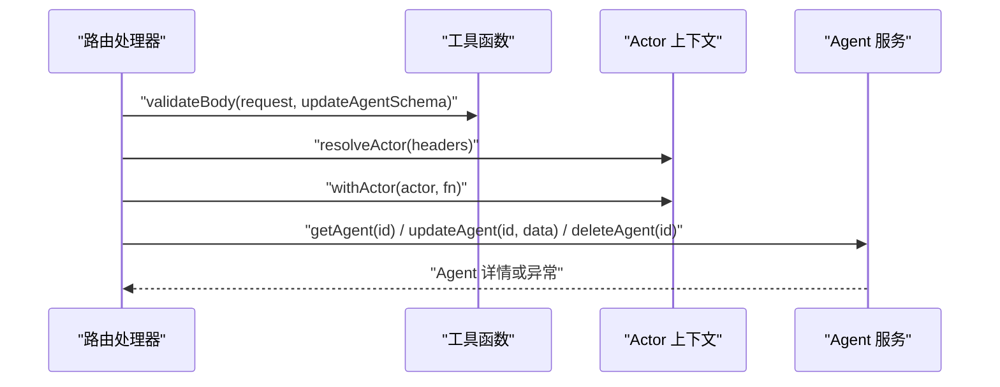

# Agent 详情管理

<cite>
**本文引用的文件**   
- [apps/web/app/api/agents/[id]/route.ts](file://apps/web/app/api/agents/[id]/route.ts)
- [apps/web/lib/services/agent-service.ts](file://apps/web/lib/services/agent-service.ts)
- [apps/web/lib/schemas.ts](file://apps/web/lib/schemas.ts)
- [apps/web/lib/utils.ts](file://apps/web/lib/utils.ts)
- [apps/web/lib/context.ts](file://apps/web/lib/context.ts)
</cite>

## 目录
1. [简介](#简介)
2. [项目结构定位](#项目结构定位)
3. [接口总览](#接口总览)
4. [路径参数 id 的格式与验证](#路径参数-id-的格式与验证)
5. [GET /api/agents/[id]：获取 Agent 详情](#get-apiaentsid获取-agent-详情)
6. [PUT /api/agents/[id]：更新 Agent](#put-apiaentsid更新-agent)
7. [DELETE /api/agents/[id]：归档 Agent](#delete-apiaentsid归档-agent)
8. [Agent 完整数据结构](#agent-完整数据结构)
9. [权限控制与业务规则](#权限控制与业务规则)
10. [错误处理与异常行为](#错误处理与异常行为)
11. [请求响应示例](#请求响应示例)
12. [与 agent-service 的调用关系](#与-agent-service-的调用关系)
13. [性能与可维护性说明](#性能与可维护性说明)
14. [常见问题排查](#常见问题排查)
15. [结论](#结论)

## 简介
本文档面向需要对接或维护 Agent 详情能力的开发者，聚焦以下三个端点：
- GET /api/agents/[id]：根据 ID 获取单个 Agent 详情。
- PUT /api/agents/[id]：根据 ID 更新 Agent 的可变字段。
- DELETE /api/agents/[id]：根据 ID 对 Agent 执行“归档”操作。

这些接口位于 Next.js App Router 的路由处理器中，并通过 `lib/services/agent-service.ts` 中的服务方法完成数据访问、权限校验和审计记录。

## 项目结构定位
Agent 详情管理的核心代码分布在以下位置：
- API 路由层：`apps/web/app/api/agents/[id]/route.ts`
- 领域服务层：`apps/web/lib/services/agent-service.ts`
- 请求体校验 Schema：`apps/web/lib/schemas.ts`
- 通用工具函数：`apps/web/lib/utils.ts`
- 请求级 Actor 上下文：`apps/web/lib/context.ts`

**图表来源**
- [apps/web/app/api/agents/[id]/route.ts:1-49](file://apps/web/app/api/agents/[id]/route.ts#L1-L49)
- [apps/web/lib/services/agent-service.ts:300-339](file://apps/web/lib/services/agent-service.ts#L300-L339)
- [apps/web/lib/schemas.ts:13-17](file://apps/web/lib/schemas.ts#L13-L17)
- [apps/web/lib/utils.ts:6-25](file://apps/web/lib/utils.ts#L6-L25)
- [apps/web/lib/context.ts:65-89](file://apps/web/lib/context.ts#L65-L89)

**章节来源**
- [apps/web/app/api/agents/[id]/route.ts:1-49](file://apps/web/app/api/agents/[id]/route.ts#L1-L49)
- [apps/web/lib/services/agent-service.ts:300-339](file://apps/web/lib/services/agent-service.ts#L300-L339)

## 接口总览
| 方法 | 路径 | 用途 | 主要输入 | 主要输出 |
|---|---|---|---|---|
| GET | `/api/agents/[id]` | 获取指定 Agent 的完整详情 | 路径参数 `id` | Agent 详情对象 |
| PUT | `/api/agents/[id]` | 更新 Agent 的名称、描述或状态 | 路径参数 `id` + JSON 请求体 | 更新后的 Agent 详情对象 |
| DELETE | `/api/agents/[id]` | 将 Agent 标记为已归档 | 路径参数 `id` | 成功消息或 Agent 详情（取决于实现） |

所有写操作（更新、删除）都需要具备 `agent:write` 权限；未认证或无权限的请求会被拒绝。

**章节来源**
- [apps/web/app/api/agents/[id]/route.ts:7-49](file://apps/web/app/api/agents/[id]/route.ts#L7-L49)
- [apps/web/lib/services/agent-service.ts:300-339](file://apps/web/lib/services/agent-service.ts#L300-L339)

## 路径参数 id 的格式与验证
当前路由处理器直接从 Next.js 路由参数中读取 `id`，没有在该文件中对 `id` 做额外正则或长度校验。因此：
- `id` 是字符串类型。
- 如果传入空值或不存在，服务层会返回“不存在”的错误。
- 如果传入非法 UUID 或其他非预期格式，数据库查询不会匹配到记录，最终也会表现为“Agent 不存在”。

建议前端在调用前保证 `id` 不为空，并尽量使用系统生成的 Agent ID。

**章节来源**
- [apps/web/app/api/agents/[id]/route.ts:10-13](file://apps/web/app/api/agents/[id]/route.ts#L10-L13)
- [apps/web/lib/services/agent-service.ts:309-310](file://apps/web/lib/services/agent-service.ts#L309-L310)
- [apps/web/lib/services/agent-service.ts:328-329](file://apps/web/lib/services/agent-service.ts#L328-L329)

## GET /api/agents/[id]：获取 Agent 详情
### 行为说明
- 从路由参数解析 `id`。
- 调用服务层的 `getAgent(id)`。
- 如果服务层返回空，则返回 404 错误。
- 否则返回标准成功响应，包含 Agent 详情。

### 关键流程

**图表来源**
- [apps/web/app/api/agents/[id]/route.ts:8-16](file://apps/web/app/api/agents/[id]/route.ts#L8-L16)
- [apps/web/lib/services/agent-service.ts:250-272](file://apps/web/lib/services/agent-service.ts#L250-L272)

**章节来源**
- [apps/web/app/api/agents/[id]/route.ts:8-16](file://apps/web/app/api/agents/[id]/route.ts#L8-L16)
- [apps/web/lib/services/agent-service.ts:250-272](file://apps/web/lib/services/agent-service.ts#L250-L272)

## PUT /api/agents/[id]：更新 Agent
### 行为说明
- 从路由参数解析 `id`。
- 使用 `updateAgentSchema` 校验请求体。
- 通过 `resolveActor` 和 `withActor` 注入当前请求主体。
- 调用服务层 `updateAgent(id, validated.data)`。
- 成功时返回更新后的 Agent 详情。
- 失败时统一通过 `handleApiError` 转换为 HTTP 响应。

### 请求体验证规则
根据 `updateAgentSchema`，允许更新的字段如下：
| 字段 | 类型 | 是否必填 | 约束 |
|---|---|---:|---|
| `name` | 字符串 | 否 | 非空字符串，最大 100 字符 |
| `description` | 字符串或空值 | 否 | 最大 500 字符，可为空 |
| `status` | 枚举 | 否 | 仅允许 `DRAFT`、`ACTIVE`、`ARCHIVED` |

注意：
- 该 Schema 只限制字段类型和长度，不强制要求至少提供一个字段。
- 如果请求体为空对象，校验可能通过，但服务层只会更新提供的字段。
- 如果希望明确禁止空更新，应在业务层增加额外校验。

### 更新流程图

**图表来源**
- [apps/web/app/api/agents/[id]/route.ts:18-35](file://apps/web/app/api/agents/[id]/route.ts#L18-L35)
- [apps/web/lib/schemas.ts:13-17](file://apps/web/lib/schemas.ts#L13-L17)
- [apps/web/lib/services/agent-service.ts:300-324](file://apps/web/lib/services/agent-service.ts#L300-L324)

**章节来源**
- [apps/web/app/api/agents/[id]/route.ts:18-35](file://apps/web/app/api/agents/[id]/route.ts#L18-L35)
- [apps/web/lib/schemas.ts:13-17](file://apps/web/lib/schemas.ts#L13-L17)
- [apps/web/lib/services/agent-service.ts:300-324](file://apps/web/lib/services/agent-service.ts#L300-L324)

## DELETE /api/agents/[id]：归档 Agent
### 行为说明
- 从路由参数解析 `id`。
- 通过 `resolveActor` 和 `withActor` 注入当前请求主体。
- 调用服务层 `deleteAgent(id)`。
- 服务层将 Agent 的状态设置为 `ARCHIVED`。
- 路由处理器返回成功消息 `{ message: "Agent 已归档" }`。

### 重要差异
虽然服务层 `deleteAgent` 实际返回完整的 Agent 详情对象，但路由处理器没有直接返回该对象，而是返回固定成功消息。这意味着：
- 客户端不应依赖 DELETE 响应中的 Agent 详情。
- 如果需要确认归档结果，应再次调用 GET /api/agents/[id]。

### 归档流程图

**图表来源**
- [apps/web/app/api/agents/[id]/route.ts:37-49](file://apps/web/app/api/agents/[id]/route.ts#L37-L49)
- [apps/web/lib/services/agent-service.ts:326-339](file://apps/web/lib/services/agent-service.ts#L326-L339)

**章节来源**
- [apps/web/app/api/agents/[id]/route.ts:37-49](file://apps/web/app/api/agents/[id]/route.ts#L37-L49)
- [apps/web/lib/services/agent-service.ts:326-339](file://apps/web/lib/services/agent-service.ts#L326-L339)

## Agent 完整数据结构
GET 接口和服务层返回的 Agent 详情包含基础信息、产品组、配置快照、技能绑定以及计数信息。

| 字段 | 类型 | 含义 |
|---|---|---|
| `id` | 字符串 | Agent 唯一标识 |
| `name` | 字符串 | Agent 名称 |
| `description` | 字符串或空值 | Agent 描述 |
| `productGroupId` | 字符串 | 所属产品组 ID |
| `status` | 枚举 | Agent 状态，通常为 `DRAFT`、`ACTIVE`、`ARCHIVED` |
| `createdBy` | 字符串 | 创建者标识 |
| `createdAt` | 字符串时间戳 | 创建时间 |
| `updatedAt` | 字符串时间戳 | 更新时间 |
| `productGroup` | 对象或空值 | 产品组摘要，包含 `id`、`name`、`displayName` |
| `promptConfig` | 对象或空值 | 提示词配置 |
| `knowledgeConfig` | 对象或空值 | 知识库配置 |
| `toolsConfig` | 对象或空值 | 工具配置 |
| `routingConfig` | 对象或空值 | 路由配置 |
| `skillBindings` | 数组或空值 | 绑定的技能列表 |
| `_count` | 对象 | 反馈、发布、版本、技能绑定数量统计 |
| `releases` | 数组 | 待发布的发布单列表 |
| `versions` | 数组 | 最近发布的版本列表 |

其中：
- `promptConfig`、`knowledgeConfig`、`toolsConfig`、`routingConfig` 各自包含对应分区配置的字段和时间戳。
- `skillBindings` 中的每个条目包含技能摘要和绑定元数据。
- `releases` 和 `versions` 是 GET 详情接口额外补充的数据，便于前端展示 Agent 的发布历史和最新版本。

**章节来源**
- [apps/web/lib/services/agent-service.ts:124-152](file://apps/web/lib/services/agent-service.ts#L124-L152)
- [apps/web/lib/services/agent-service.ts:250-272](file://apps/web/lib/services/agent-service.ts#L250-L272)

## 权限控制与业务规则
### 权限模型
- 更新和删除操作都调用 `requirePermission("agent", "write")`。
- 未获得 `agent:write` 权限的请求会在服务层被拒绝。
- 请求主体通过 `resolveActor` 解析，优先使用签名会话令牌；在无可信令牌且环境允许的情况下，才接受明文 Actor 头；否则视为匿名主体。

### 状态变更规则
- 更新接口允许将 `status` 设置为 `DRAFT`、`ACTIVE`、`ARCHIVED`。
- 当前服务层没有显式限制状态迁移方向，例如允许从任意状态改为其他状态。
- 删除接口会将状态强制设置为 `ARCHIVED`，属于软删除语义。

### 审计记录
- 更新操作记录 `agent.update` 审计事件，包含更新输入。
- 归档操作记录 `agent.archive` 审计事件。

**图表来源**
- [apps/web/lib/services/agent-service.ts:308-323](file://apps/web/lib/services/agent-service.ts#L308-L323)
- [apps/web/lib/services/agent-service.ts:327-338](file://apps/web/lib/services/agent-service.ts#L327-L338)
- [apps/web/lib/context.ts:65-89](file://apps/web/lib/context.ts#L65-L89)

**章节来源**
- [apps/web/lib/services/agent-service.ts:300-339](file://apps/web/lib/services/agent-service.ts#L300-L339)
- [apps/web/lib/context.ts:65-89](file://apps/web/lib/context.ts#L65-L89)

## 错误处理与异常行为
### 统一错误处理
路由层使用 `handleApiError` 将服务层抛出的异常转换为标准 HTTP 响应。服务层通常抛出 `NotFoundError` 等应用错误类型，由工具层映射为正确的状态码和响应体。

### 常见错误场景
| 场景 | 行为 |
|---|---|
| GET 请求的 Agent 不存在 | 路由层返回 404 错误 |
| PUT 请求体不符合 Schema | 返回 422 参数校验失败 |
| PUT/DELETE 无 `agent:write` 权限 | 服务层拒绝，路由层转为错误响应 |
| PUT/DELETE 的 Agent 不存在 | 服务层抛出不存在错误，路由层转为错误响应 |
| 请求体无法解析为 JSON | 返回 400 无效请求体 |

### 错误处理流程

**图表来源**
- [apps/web/lib/utils.ts:22-25](file://apps/web/lib/utils.ts#L22-L25)
- [apps/web/app/api/agents/[id]/route.ts:27-34](file://apps/web/app/api/agents/[id]/route.ts#L27-L34)
- [apps/web/app/api/agents/[id]/route.ts:43-48](file://apps/web/app/api/agents/[id]/route.ts#L43-L48)

**章节来源**
- [apps/web/lib/utils.ts:22-25](file://apps/web/lib/utils.ts#L22-L25)
- [apps/web/app/api/agents/[id]/route.ts:27-34](file://apps/web/app/api/agents/[id]/route.ts#L27-L34)
- [apps/web/app/api/agents/[id]/route.ts:43-48](file://apps/web/app/api/agents/[id]/route.ts#L43-L48)

## 请求响应示例
以下为典型交互示例，用于帮助理解接口行为。

### GET /api/agents/[id]
**请求**
- 方法：GET
- 路径：`/api/agents/<agent-id>`

**成功响应**
- 状态码：200
- 响应体包含标准成功包装和 Agent 详情对象。

**失败响应**
- 状态码：404
- 响应体包含错误信息。

### PUT /api/agents/[id]
**请求**
- 方法：PUT
- 路径：`/api/agents/<agent-id>`
- 请求体示例字段：
  - `name`：可选，字符串，最大 100 字符
  - `description`：可选，字符串或空值，最大 500 字符
  - `status`：可选，枚举 `DRAFT`、`ACTIVE`、`ARCHIVED`

**成功响应**
- 状态码：200
- 响应体包含标准成功包装和更新后的 Agent 详情对象。

**失败响应**
- 状态码：400：请求体无法解析
- 状态码：422：参数校验失败
- 状态码：404：Agent 不存在
- 状态码：403 或权限相关错误：无 `agent:write` 权限

### DELETE /api/agents/[id]
**请求**
- 方法：DELETE
- 路径：`/api/agents/<agent-id>`

**成功响应**
- 状态码：200
- 响应体包含成功消息。

**失败响应**
- 状态码：404：Agent 不存在
- 状态码：403 或权限相关错误：无 `agent:write` 权限

**章节来源**
- [apps/web/app/api/agents/[id]/route.ts:8-49](file://apps/web/app/api/agents/[id]/route.ts#L8-L49)
- [apps/web/lib/schemas.ts:13-17](file://apps/web/lib/schemas.ts#L13-L17)
- [apps/web/lib/utils.ts:6-25](file://apps/web/lib/utils.ts#L6-L25)

## 与 agent-service 的调用关系
### 调用链

**图表来源**
- [apps/web/app/api/agents/[id]/route.ts:1-49](file://apps/web/app/api/agents/[id]/route.ts#L1-L49)
- [apps/web/lib/services/agent-service.ts:250-339](file://apps/web/lib/services/agent-service.ts#L250-L339)
- [apps/web/lib/utils.ts:63-85](file://apps/web/lib/utils.ts#L63-L85)
- [apps/web/lib/context.ts:65-89](file://apps/web/lib/context.ts#L65-L89)

### 方法职责对照
| 路由方法 | 服务方法 | 主要职责 |
|---|---|---|
| GET | `getAgent(id)` | 查询 Agent 详情，并补充发布单和版本信息 |
| PUT | `updateAgent(id, input)` | 校验权限、查找记录、更新字段、记录审计 |
| DELETE | `deleteAgent(id)` | 校验权限、查找记录、设置归档状态、记录审计 |

**章节来源**
- [apps/web/app/api/agents/[id]/route.ts:1-49](file://apps/web/app/api/agents/[id]/route.ts#L1-L49)
- [apps/web/lib/services/agent-service.ts:250-339](file://apps/web/lib/services/agent-service.ts#L250-L339)

## 性能与可维护性说明
- GET 详情接口会并行查询待发布 release 和最近版本，减少多次往返。
- 详情查询使用 include 策略加载产品组、配置和 skillBindings，避免 N+1 查询。
- 更新和删除操作先查是否存在，再执行更新，确保错误语义清晰。
- 所有写操作均记录审计日志，便于追踪变更。
- 请求体校验集中在 Schema 中，便于维护和扩展。

**章节来源**
- [apps/web/lib/services/agent-service.ts:250-272](file://apps/web/lib/services/agent-service.ts#L250-L272)
- [apps/web/lib/services/agent-service.ts:300-339](file://apps/web/lib/services/agent-service.ts#L300-L339)

## 常见问题排查
| 问题 | 可能原因 | 排查建议 |
|---|---|---|
| 404 找不到 Agent | ID 错误或 Agent 已被归档或删除 | 确认 ID 是否正确，必要时重新获取 Agent 列表 |
| 422 参数校验失败 | 请求体字段类型或长度不符合 Schema | 检查 `name`、`description`、`status` 是否符合规则 |
| 400 无效请求体 | 请求体不是合法 JSON | 检查 Content-Type 和请求体格式 |
| 权限不足 | 缺少 `agent:write` 权限 | 检查登录态、Actor 头和权限配置 |
| 更新后状态未变化 | 未传递 `status` 字段 | 确认请求体中包含期望的状态字段 |
| DELETE 响应没有 Agent 详情 | 路由层返回固定消息 | 如需确认归档结果，再次调用 GET 接口 |

**章节来源**
- [apps/web/lib/schemas.ts:13-17](file://apps/web/lib/schemas.ts#L13-L17)
- [apps/web/lib/utils.ts:63-85](file://apps/web/lib/utils.ts#L63-L85)
- [apps/web/app/api/agents/[id]/route.ts:8-49](file://apps/web/app/api/agents/[id]/route.ts#L8-L49)

## 结论
Agent 详情管理接口以清晰的三层结构实现：
- 路由层负责参数解析、请求体校验、Actor 上下文注入和统一错误处理。
- 服务层负责权限校验、数据访问、状态变更和审计记录。
- Schema 层集中定义更新接口的字段约束。

对于调用方而言：
- GET 接口适合获取完整 Agent 详情。
- PUT 接口适合增量更新名称、描述或状态。
- DELETE 接口适合归档 Agent，但不应依赖其响应体中的 Agent 详情。

若未来需要更严格的状态迁移控制、更强的 ID 格式校验或更一致的 DELETE 响应结构，可在当前架构基础上扩展路由层或服务层逻辑。