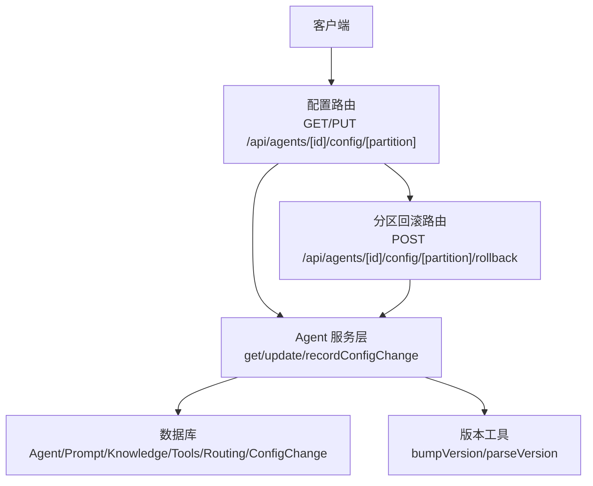
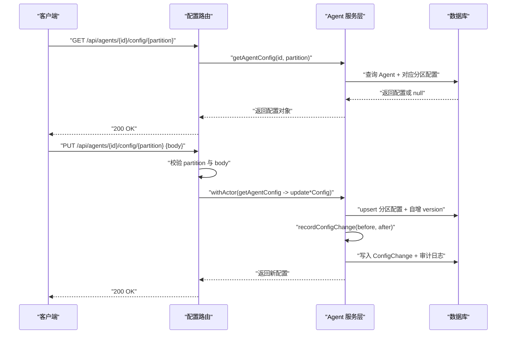
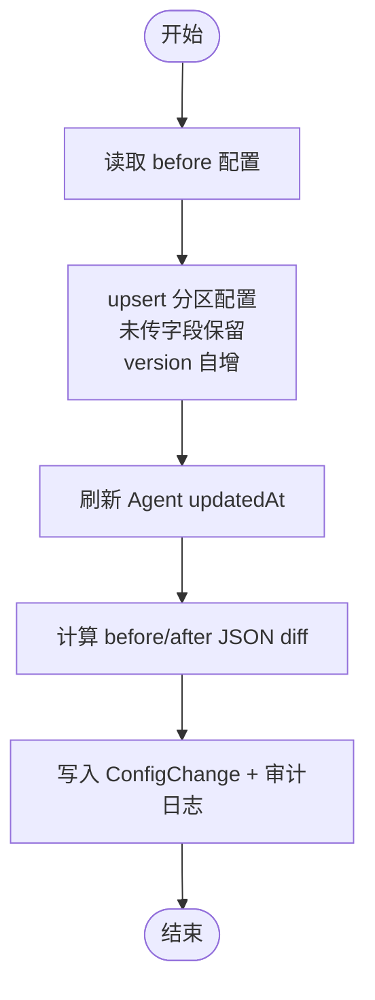
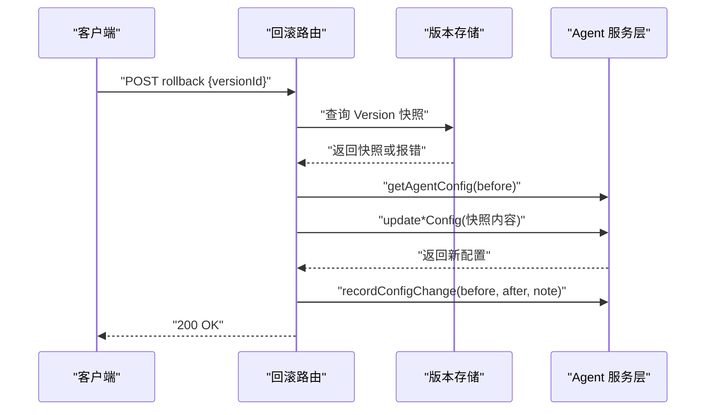
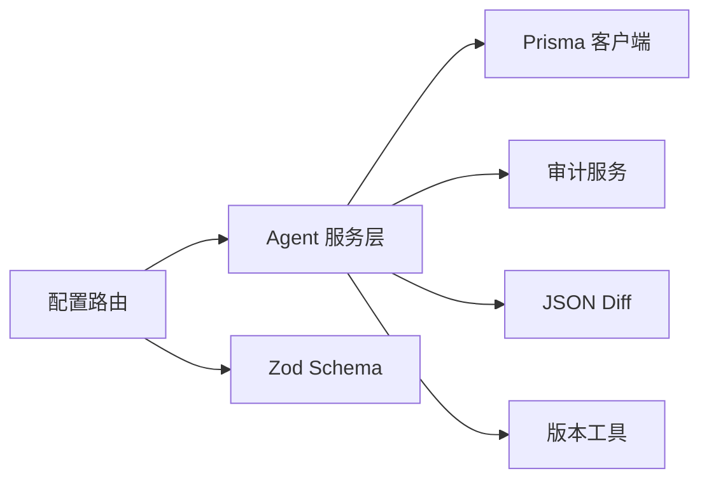

# Agent 配置管理

<cite>
**本文引用的文件**   
- [apps/web/app/api/agents/[id]/config/[partition]/route.ts](file://apps/web/app/api/agents/[id]/config/[partition]/route.ts)
- [apps/web/app/api/agents/[id]/config/[partition]/rollback/route.ts](file://apps/web/app/api/agents/[id]/config/[partition]/rollback/route.ts)
- [apps/web/lib/services/agent-service.ts](file://apps/web/lib/services/agent-service.ts)
- [apps/web/lib/schemas.ts](file://apps/web/lib/schemas.ts)
- [packages/db/prisma/schema.prisma](file://packages/db/prisma/schema.prisma)
- [apps/web/lib/versioning.ts](file://apps/web/lib/versioning.ts)
- [docs/distilled/agent-service.md](file://docs/distilled/agent-service.md)
- [docs/api/api-reference.md](file://docs/api/api-reference.md)
- [apps/web/app/api/__tests__/agents.test.ts](file://apps/web/app/api/__tests__/agents.test.ts)
</cite>

## 目录
1. [简介](#简介)
2. [项目结构](#项目结构)
3. [核心组件](#核心组件)
4. [架构总览](#架构总览)
5. [详细组件分析](#详细组件分析)
6. [依赖关系分析](#依赖关系分析)
7. [性能与一致性](#性能与一致性)
8. [故障排查指南](#故障排查指南)
9. [结论](#结论)
10. [附录：API 参考与操作示例](#附录api-参考与操作示例)

## 简介
本文档面向 Agent 四分区配置管理的 API，覆盖 Prompt、Knowledge、Tools、Routing 四个分区的配置读取、更新、版本控制、变更追踪、合并策略、回滚机制与生效方式。目标是帮助使用者理解接口契约、数据模型、校验规则以及版本化与回滚流程，从而安全地进行批量更新、部分更新和回滚操作。

## 项目结构
Agent 配置管理相关代码主要分布在以下位置：
- API 路由层：Next.js Route Handler 暴露 REST 接口，负责参数校验、权限上下文注入、调用服务层并返回统一响应。
- 服务层：封装数据库读写、分区 upsert 合并、变更 diff 记录、审计日志写入等核心逻辑。
- 校验层：使用 Zod Schema 定义各分区配置的输入约束。
- 数据层：Prisma schema 定义 Agent 及其四分区配置、变更记录、版本快照等持久化结构。
- 版本工具：语义化版本计算与发布策略。

图表来源
- [apps/web/app/api/agents/[id]/config/[partition]/route.ts:1-86](file://apps/web/app/api/agents/[id]/config/[partition]/route.ts#L1-L86)
- [apps/web/app/api/agents/[id]/config/[partition]/rollback/route.ts:1-118](file://apps/web/app/api/agents/[id]/config/[partition]/rollback/route.ts#L1-L118)
- [apps/web/lib/services/agent-service.ts:341-614](file://apps/web/lib/services/agent-service.ts#L341-L614)
- [packages/db/prisma/schema.prisma:66-168](file://packages/db/prisma/schema.prisma#L66-L168)
- [apps/web/lib/versioning.ts:1-70](file://apps/web/lib/versioning.ts#L1-L70)

章节来源
- [docs/api/api-reference.md:77-93](file://docs/api/api-reference.md#L77-L93)
- [docs/distilled/agent-service.md:58-87](file://docs/distilled/agent-service.md#L58-L87)

## 核心组件
- 配置路由层：提供 GET/PUT 四分区配置接口，以及 POST 分区级回滚接口。
- 服务层：实现 getAgentConfig、updatePromptConfig、updateKnowledgeConfig、updateToolsConfig、updateRoutingConfig、recordConfigChange。
- 校验层：Zod Schema 定义各分区字段类型、可选性、取值范围与枚举值。
- 数据层：Prisma 模型定义 Agent 及四分区配置表、ConfigChange 变更记录表、AgentVersion 版本快照表。
- 版本工具：SemVer 计算函数，用于发布时根据变更分区集合决定版本号递增策略。

章节来源
- [apps/web/lib/services/agent-service.ts:77-122](file://apps/web/lib/services/agent-service.ts#L77-L122)
- [apps/web/lib/schemas.ts:23-60](file://apps/web/lib/schemas.ts#L23-L60)
- [packages/db/prisma/schema.prisma:105-168](file://packages/db/prisma/schema.prisma#L105-L168)
- [apps/web/lib/versioning.ts:18-70](file://apps/web/lib/versioning.ts#L18-L70)

## 架构总览
配置更新的端到端流程如下：
- 客户端发起 GET/PUT 请求到配置路由。
- 路由层解析路径参数（agentId、partition），校验 partition 是否合法。
- PUT 请求体通过 Zod Schema 校验；成功后进入 withActor 权限上下文。
- 服务层先读取 before 配置，再按分区执行 upsert 合并，version 自增，lastModifiedAt 刷新。
- 服务层计算 before/after 的 JSON diff，写入 ConfigChange 并记录审计日志。
- 路由层返回成功响应，包含新配置与 version。

图表来源
- [apps/web/app/api/agents/[id]/config/[partition]/route.ts:28-85](file://apps/web/app/api/agents/[id]/config/[partition]/route.ts#L28-L85)
- [apps/web/lib/services/agent-service.ts:341-614](file://apps/web/lib/services/agent-service.ts#L341-L614)

## 详细组件分析

### 配置路由层
- 支持的分区：prompt、knowledge、tools、routing。
- GET：返回指定分区的当前配置；若未初始化则返回 null。
- PUT：对请求体进行 Zod 校验后，调用对应分区更新函数，并记录变更。
- 错误处理：无效分区返回 400；其他异常经 handleApiError 包装返回。

章节来源
- [apps/web/app/api/agents/[id]/config/[partition]/route.ts:14-85](file://apps/web/app/api/agents/[id]/config/[partition]/route.ts#L14-L85)
- [apps/web/app/api/__tests__/agents.test.ts:170-211](file://apps/web/app/api/__tests__/agents.test.ts#L170-L211)

### 服务层
- getAgentConfig：按分区返回配置响应对象；不存在返回 null。
- updateConfigPartition：通用分区更新逻辑，采用 upsert 合并语义（未传字段保留），version 恒为干净递增 Int，lastModifiedBy 落库但不回显。
- recordConfigChange：计算 before/after 的 JSON diff，写入 ConfigChange，并记录审计日志。

图表来源
- [apps/web/lib/services/agent-service.ts:364-549](file://apps/web/lib/services/agent-service.ts#L364-L549)
- [apps/web/lib/services/agent-service.ts:571-614](file://apps/web/lib/services/agent-service.ts#L571-L614)

章节来源
- [apps/web/lib/services/agent-service.ts:341-614](file://apps/web/lib/services/agent-service.ts#L341-L614)

### 校验层（Zod Schema）
- Prompt：systemPrompt 必填字符串；roleDefinition、constraints、outputFormat 可选。
- Knowledge：wikiVaultId 可选；searchStrategy 枚举；fallbackToMcp 布尔；maxWikiResults 整数范围；confidenceThreshold 浮点范围。
- Tools：mcpTools、wikiQueryTools 数组；maxConcurrentCalls、timeoutMs、retryCount 整数范围。
- Routing：rules 数组；escalationPolicy 任意可空；humanThreshold 浮点范围；maxConversationTurns、idleTimeoutMinutes 整数范围。

章节来源
- [apps/web/lib/schemas.ts:23-60](file://apps/web/lib/schemas.ts#L23-L60)

### 数据层（Prisma 模型）
- Agent：聚合四分区配置与关联实体。
- PromptConfig：systemPrompt、roleDefinition、constraints、outputFormat、version、lastModifiedBy、lastModifiedAt。
- KnowledgeConfig：wikiVaultId、searchStrategy、fallbackToMcp、maxWikiResults、confidenceThreshold、version、lastModifiedBy、lastModifiedAt。
- ToolsConfig：mcpTools、wikiQueryTools、maxConcurrentCalls、timeoutMs、retryCount、version、lastModifiedBy、lastModifiedAt。
- RoutingConfig：rules、escalationPolicy、humanThreshold、maxConversationTurns、idleTimeoutMinutes、version、lastModifiedBy、lastModifiedAt。
- ConfigChange：记录 agentId、partition、before、after、diff、changedBy、changedAt、changeNote、releaseId。

章节来源
- [packages/db/prisma/schema.prisma:66-168](file://packages/db/prisma/schema.prisma#L66-L168)
- [packages/db/prisma/schema.prisma:188-205](file://packages/db/prisma/schema.prisma#L188-L205)

### 分区回滚接口
- 路径：POST /api/agents/[id]/config/[partition]/rollback
- 功能：从指定 Version 的 snapshot 中取出该分区配置，覆盖当前 active 配置。
- 行为：复用分区更新函数，自动自增 version，并记录变更（partition 后缀 _ROLLBACK）。

图表来源
- [apps/web/app/api/agents/[id]/config/[partition]/rollback/route.ts:34-117](file://apps/web/app/api/agents/[id]/config/[partition]/rollback/route.ts#L34-L117)

章节来源
- [apps/web/app/api/agents/[id]/config/[partition]/rollback/route.ts:1-118](file://apps/web/app/api/agents/[id]/config/[partition]/rollback/route.ts#L1-L118)

### 版本控制与变更追踪
- 分区级 version：每个分区配置行维护独立 version 整数，每次更新自增。
- 变更记录：每次 PUT 或回滚都会生成 ConfigChange，包含 before/after/diff。
- 版本快照：AgentVersion 表保存四分区快照，用于发布与回滚。
- 语义化版本：bumpVersion 根据变更分区集合决定 major/minor/patch 递增策略。

章节来源
- [packages/db/prisma/schema.prisma:294-318](file://packages/db/prisma/schema.prisma#L294-L318)
- [apps/web/lib/versioning.ts:1-70](file://apps/web/lib/versioning.ts#L1-L70)
- [apps/web/lib/services/agent-service.ts:571-614](file://apps/web/lib/services/agent-service.ts#L571-L614)

## 依赖关系分析
- 路由层依赖服务层与校验层。
- 服务层依赖 Prisma 客户端、权限检查、审计服务、JSON diff 工具。
- 数据层由 Prisma schema 定义，所有 JSON 字段以 String 存储，通过 packJson/unpackJson 收口。
- 版本工具被发布流程使用，与配置更新解耦。

图表来源
- [apps/web/app/api/agents/[id]/config/[partition]/route.ts:1-12](file://apps/web/app/api/agents/[id]/config/[partition]/route.ts#L1-L12)
- [apps/web/lib/services/agent-service.ts:1-21](file://apps/web/lib/services/agent-service.ts#L1-L21)
- [apps/web/lib/schemas.ts:1-60](file://apps/web/lib/schemas.ts#L1-L60)
- [apps/web/lib/versioning.ts:1-70](file://apps/web/lib/versioning.ts#L1-L70)

章节来源
- [apps/web/lib/services/agent-service.ts:1-21](file://apps/web/lib/services/agent-service.ts#L1-L21)
- [apps/web/lib/schemas.ts:1-60](file://apps/web/lib/schemas.ts#L1-L60)

## 性能与一致性
- 分区更新采用 upsert 合并语义，避免全量覆盖，减少不必要字段写放大。
- version 自增保证单调递增，便于排序与比较。
- lastModifiedAt 刷新确保时间戳准确。
- ConfigChange 记录 diff，便于审计与回溯。
- JSON 字段以 String 存储，读写经 packJson/unpackJson 收口，提升兼容性。

[本节为通用指导，不直接分析具体文件]

## 故障排查指南
- 无效分区：路由层会返回 400，确认 partition ∈ {prompt, knowledge, tools, routing}。
- 校验失败：Zod Schema 会返回具体字段错误信息，检查字段类型与取值范围。
- 找不到 Agent：服务层抛出 NotFoundError，确认 agentId 存在且未被归档。
- 回滚失败：确认 versionId 属于当前 Agent，且该 Version 存在对应分区快照。
- 变更未记录：检查 recordConfigChange 是否被调用，确认 ConfigChange 表有新增记录。

章节来源
- [apps/web/app/api/agents/[id]/config/[partition]/route.ts:34-57](file://apps/web/app/api/agents/[id]/config/[partition]/route.ts#L34-L57)
- [apps/web/lib/services/agent-service.ts:341-377](file://apps/web/lib/services/agent-service.ts#L341-L377)
- [apps/web/app/api/agents/[id]/config/[partition]/rollback/route.ts:48-74](file://apps/web/app/api/agents/[id]/config/[partition]/rollback/route.ts#L48-L74)

## 结论
Agent 四分区配置管理通过清晰的路由层、健壮的服务层、严格的校验层与完整的数据层设计，实现了配置的读取、更新、版本控制、变更追踪与回滚。分区级 upsert 合并语义保证了字段级别的增量更新，version 自增与 ConfigChange 提供了可靠的审计能力，语义化版本工具支持发布策略的可控演进。整体架构简洁、可扩展，适合在 MVP 阶段快速迭代并在后续扩展更复杂的发布审批与效果评估流程。

[本节为总结性内容，不直接分析具体文件]

## 附录：API 参考与操作示例

### 接口总览
- GET /api/agents/[id]/config/[partition]：获取指定分区配置。
- PUT /api/agents/[id]/config/[partition]：更新指定分区配置。
- POST /api/agents/[id]/config/[partition]/rollback：分区级回滚到指定 Version。

章节来源
- [docs/api/api-reference.md:77-93](file://docs/api/api-reference.md#L77-L93)

### 分区配置结构定义与验证规则

#### Prompt 分区
- 字段：
  - systemPrompt：字符串，必填。
  - roleDefinition：字符串，可选，可为空。
  - constraints：字符串数组，可选。
  - outputFormat：字符串，可选，可为空。
- 默认值：无（首次创建时由服务端赋初始值）。
- 继承关系：无（分区独立）。
- 生效机制：PUT 成功后立即生效；version 自增；lastModifiedAt 刷新。

章节来源
- [apps/web/lib/schemas.ts:23-28](file://apps/web/lib/schemas.ts#L23-L28)
- [apps/web/lib/services/agent-service.ts:379-417](file://apps/web/lib/services/agent-service.ts#L379-L417)

#### Knowledge 分区
- 字段：
  - wikiVaultId：字符串，可选，可为空。
  - searchStrategy：枚举，可选，取值 WIKI_FIRST/WIKI_ONLY/MCP_FIRST/HYBRID。
  - fallbackToMcp：布尔，可选。
  - maxWikiResults：整数，范围 1-50，可选。
  - confidenceThreshold：浮点，范围 0-1，可选。
- 默认值：searchStrategy=WIKI_FIRST，fallbackToMcp=true，maxWikiResults=5，confidenceThreshold=0.6。
- 继承关系：无。
- 生效机制：同 Prompt。

章节来源
- [apps/web/lib/schemas.ts:30-36](file://apps/web/lib/schemas.ts#L30-L36)
- [packages/db/prisma/schema.prisma:119-136](file://packages/db/prisma/schema.prisma#L119-L136)
- [apps/web/lib/services/agent-service.ts:418-465](file://apps/web/lib/services/agent-service.ts#L418-L465)

#### Tools 分区
- 字段：
  - mcpTools：数组，可选。
  - wikiQueryTools：数组，可选。
  - maxConcurrentCalls：整数，范围 1-20，可选。
  - timeoutMs：整数，范围 1000-120000，可选。
  - retryCount：整数，范围 0-5，可选。
- 默认值：maxConcurrentCalls=3，timeoutMs=30000，retryCount=2。
- 继承关系：无。
- 生效机制：同 Prompt。

章节来源
- [apps/web/lib/schemas.ts:38-44](file://apps/web/lib/schemas.ts#L38-L44)
- [packages/db/prisma/schema.prisma:138-152](file://packages/db/prisma/schema.prisma#L138-L152)
- [apps/web/lib/services/agent-service.ts:466-501](file://apps/web/lib/services/agent-service.ts#L466-L501)

#### Routing 分区
- 字段：
  - rules：数组，可选。
  - escalationPolicy：任意类型，可选，可为空。
  - humanThreshold：浮点，范围 0-1，可选。
  - maxConversationTurns：整数，范围 1-100，可选。
  - idleTimeoutMinutes：整数，范围 1-60，可选。
- 默认值：humanThreshold=0.3，maxConversationTurns=10，idleTimeoutMinutes=5。
- 继承关系：无。
- 生效机制：同 Prompt。

章节来源
- [apps/web/lib/schemas.ts:46-52](file://apps/web/lib/schemas.ts#L46-L52)
- [packages/db/prisma/schema.prisma:154-168](file://packages/db/prisma/schema.prisma#L154-L168)
- [apps/web/lib/services/agent-service.ts:502-547](file://apps/web/lib/services/agent-service.ts#L502-L547)

### 配置合并策略与冲突解决
- 合并策略：upsert 合并语义，仅更新传入字段，未传字段保留原值。
- 冲突解决：无并发冲突处理（单写模型）；version 自增保证顺序一致。
- 模板与默认值：服务端在 create 分支设置默认值；update 分支仅更新传入字段。
- 继承关系：分区之间相互独立，无继承。

章节来源
- [apps/web/lib/services/agent-service.ts:360-549](file://apps/web/lib/services/agent-service.ts#L360-L549)

### 配置生效机制与热重载支持
- 生效机制：PUT 成功后立即生效，client 下次读取即获得新版本配置。
- 热重载：当前实现为同步更新，无缓存失效机制；如需热重载，可在上层引入缓存并监听 ConfigChange 事件。

[本节为通用指导，不直接分析具体文件]

### 配置操作示例

#### 批量更新
- 说明：依次调用多个分区的 PUT 接口，或使用发布流程提交变更。
- 注意：每次 PUT 会记录一次 ConfigChange；发布流程会汇总 changedPartitions 并计算 SemVer。

章节来源
- [apps/web/lib/versioning.ts:46-70](file://apps/web/lib/versioning.ts#L46-L70)

#### 部分更新
- 说明：PUT 仅传入需要更新的字段，其余字段保持不变。
- 示例：仅更新 Prompt 的 systemPrompt，其他字段保留。

章节来源
- [apps/web/lib/services/agent-service.ts:379-417](file://apps/web/lib/services/agent-service.ts#L379-L417)

#### 回滚操作
- 说明：POST /api/agents/[id]/config/[partition]/rollback，传入 versionId。
- 行为：从 Version 快照恢复该分区配置，覆盖当前配置，并记录变更。

章节来源
- [apps/web/app/api/agents/[id]/config/[partition]/rollback/route.ts:34-117](file://apps/web/app/api/agents/[id]/config/[partition]/rollback/route.ts#L34-L117)