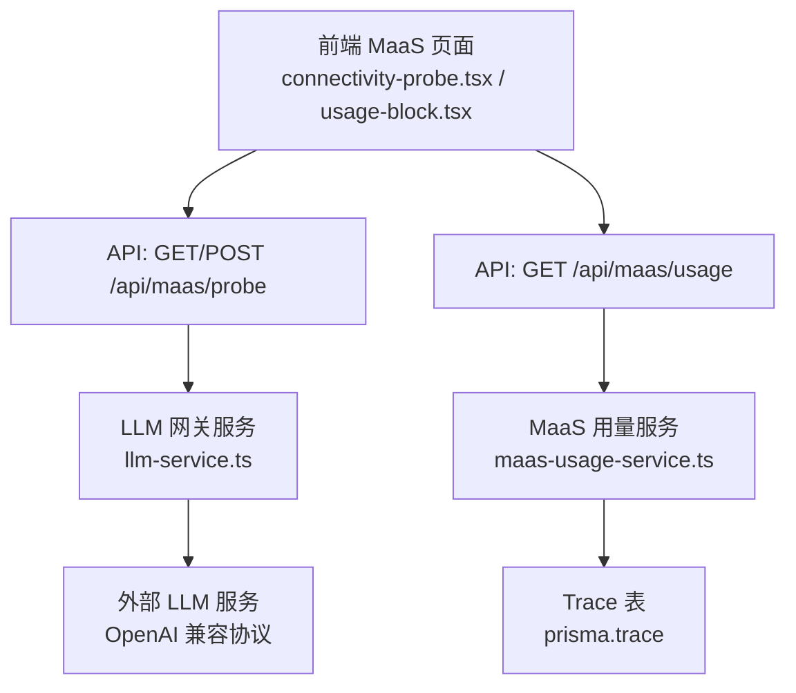
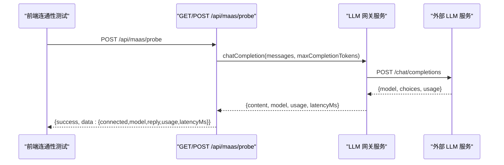
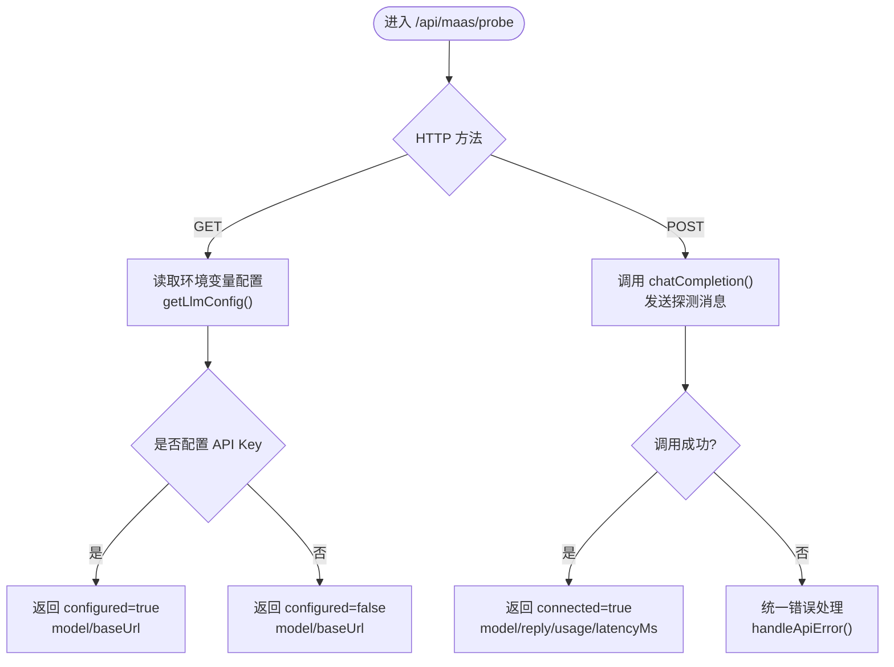
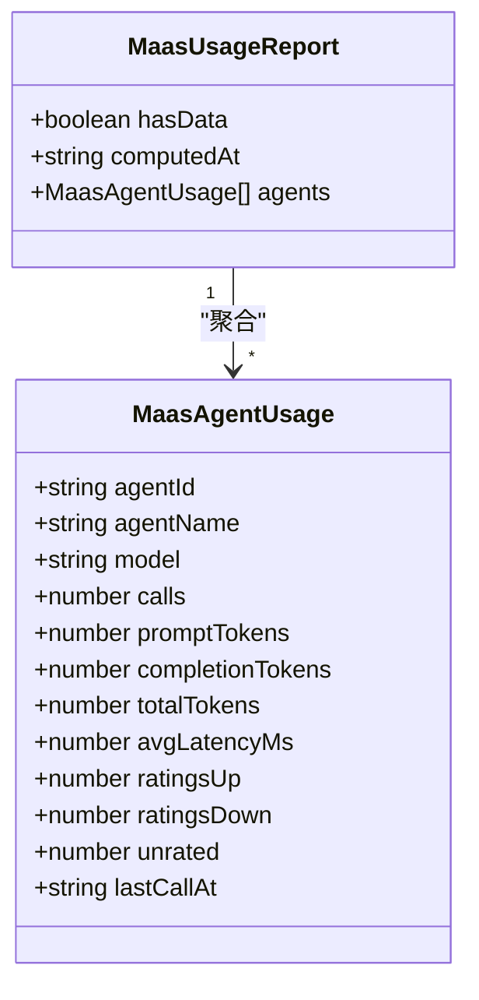
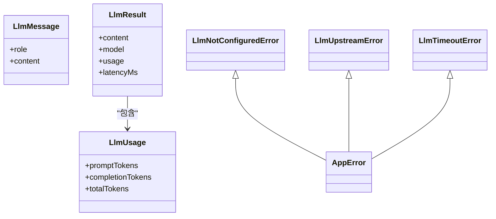
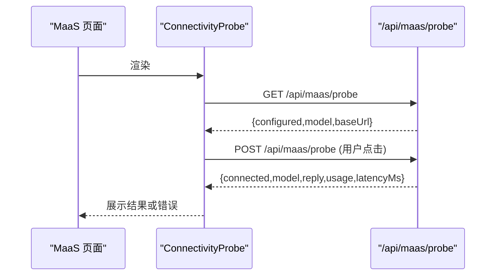
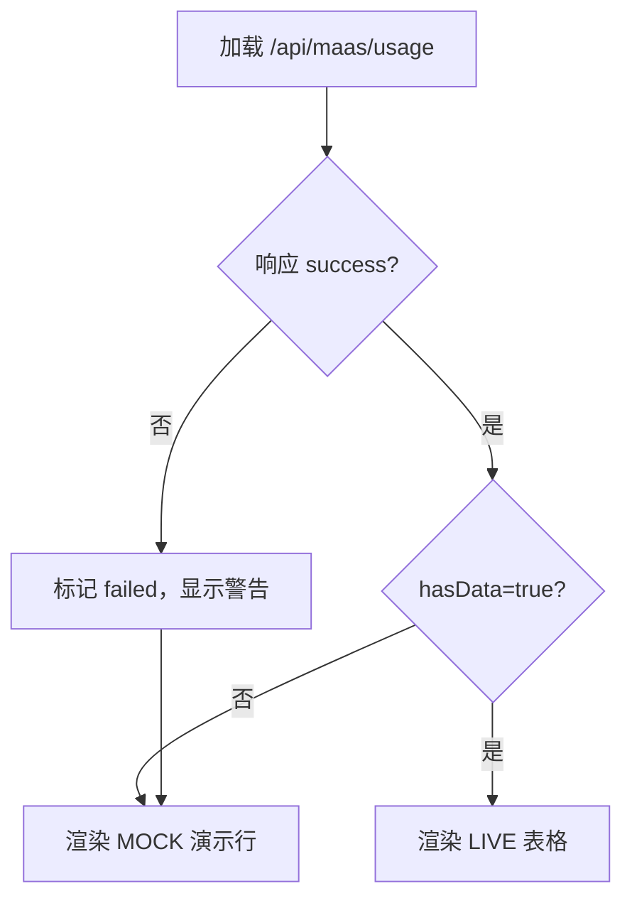
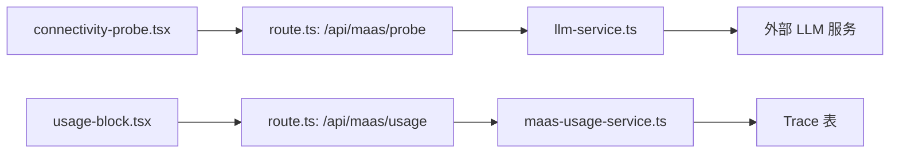

# MAAS 集成 API

<cite>
**本文引用的文件**   
- [apps/web/app/api/maas/probe/route.ts](file://apps/web/app/api/maas/probe/route.ts)
- [apps/web/app/api/maas/usage/route.ts](file://apps/web/app/api/maas/usage/route.ts)
- [apps/web/lib/services/llm-service.ts](file://apps/web/lib/services/llm-service.ts)
- [apps/web/lib/services/maas-usage-service.ts](file://apps/web/lib/services/maas-usage-service.ts)
- [apps/web/app/(dashboard)/maas/page.tsx](file://apps/web/app/(dashboard)/maas/page.tsx)
- [apps/web/app/(dashboard)/maas/connectivity-probe.tsx](file://apps/web/app/(dashboard)/maas/connectivity-probe.tsx)
- [apps/web/app/(dashboard)/maas/usage-block.tsx](file://apps/web/app/(dashboard)/maas/usage-block.tsx)
- [apps/web/app/api/__tests__/llm-integrations.test.ts](file://apps/web/app/api/__tests__/llm-integrations.test.ts)
- [apps/web/app/api/__tests__/maas-usage.test.ts](file://apps/web/app/api/__tests__/maas-usage.test.ts)
</cite>

## 目录
1. [引言](#引言)
2. [项目结构](#项目结构)
3. [核心组件](#核心组件)
4. [架构总览](#架构总览)
5. [详细组件分析](#详细组件分析)
6. [依赖关系分析](#依赖关系分析)
7. [性能与可靠性](#性能与可靠性)
8. [故障排查指南](#故障排查指南)
9. [结论](#结论)
10. [附录：端点参考与示例](#附录端点参考与示例)

## 引言
本文档面向需要在 agent-up 平台中接入、测试和监控外部 LLM 服务的工程师与产品人员，聚焦 MAAS（Model-as-a-Service）集成相关 API。内容覆盖：
- 连接探测：查看当前 LLM 配置状态，以及发起真实连通性测试。
- 使用统计：按 Agent 聚合试聊调用次数、tokens、平均时延与评分情况。
- 外部 LLM 提供商集成方式：基于 OpenAI 兼容协议的 MiMo 接入，环境变量驱动配置。
- 错误处理与重试建议：统一错误类型、超时控制、上游错误包装。
- 前端交互：MaaS 页面中的 LIVE 连通性测试与用量表格。

## 项目结构
MAAS 相关能力由“Next.js API 路由 + 服务层 + 前端页面”组成：
- API 路由负责请求解析、鉴权前置、调用服务层并返回统一响应。
- 服务层封装对外部 LLM 的 HTTP 调用与对数据库 trace 的聚合。
- 前端页面提供可视化入口，包括连通性测试按钮与用量表格。

**图表来源**
- [apps/web/app/(dashboard)/maas/connectivity-probe.tsx:33-41](file://apps/web/app/(dashboard)/maas/connectivity-probe.tsx#L33-L41)
- [apps/web/app/(dashboard)/maas/connectivity-probe.tsx:72-86](file://apps/web/app/(dashboard)/maas/connectivity-probe.tsx#L72-L86)
- [apps/web/app/(dashboard)/maas/usage-block.tsx:56-64](file://apps/web/app/(dashboard)/maas/usage-block.tsx#L56-L64)
- [apps/web/app/api/maas/probe/route.ts:13-45](file://apps/web/app/api/maas/probe/route.ts#L13-L45)
- [apps/web/app/api/maas/usage/route.ts:11-17](file://apps/web/app/api/maas/usage/route.ts#L11-L17)
- [apps/web/lib/services/llm-service.ts:55-65](file://apps/web/lib/services/llm-service.ts#L55-L65)
- [apps/web/lib/services/maas-usage-service.ts:46-88](file://apps/web/lib/services/maas-usage-service.ts#L46-L88)

**章节来源**
- [apps/web/app/(dashboard)/maas/page.tsx:31-50](file://apps/web/app/(dashboard)/maas/page.tsx#L31-L50)
- [apps/web/app/(dashboard)/maas/connectivity-probe.tsx:1-145](file://apps/web/app/(dashboard)/maas/connectivity-probe.tsx#L1-L145)
- [apps/web/app/(dashboard)/maas/usage-block.tsx:1-140](file://apps/web/app/(dashboard)/maas/usage-block.tsx#L1-L140)

## 核心组件
- LLM 网关服务：读取环境变量，构造 OpenAI 兼容请求，统一超时、错误与结果结构。
- MaaS 用量服务：从 Trace 表聚合每个 Agent 的调用次数、tokens、平均时延与评分。
- 探测 API：GET 返回配置状态；POST 执行一次真实模型调用以验证凭据、网络与端点。
- 用量 API：返回按 Agent 聚合的使用报告，包含 hasData 标志用于前端回退 mock。
- 前端组件：连通性测试区块与用量表格，分别对接上述两个 API。

**章节来源**
- [apps/web/lib/services/llm-service.ts:1-140](file://apps/web/lib/services/llm-service.ts#L1-L140)
- [apps/web/lib/services/maas-usage-service.ts:1-89](file://apps/web/lib/services/maas-usage-service.ts#L1-L89)
- [apps/web/app/api/maas/probe/route.ts:1-46](file://apps/web/app/api/maas/probe/route.ts#L1-L46)
- [apps/web/app/api/maas/usage/route.ts:1-18](file://apps/web/app/api/maas/usage/route.ts#L1-L18)

## 架构总览
下图展示一次“连通性测试”的完整调用链：前端点击按钮 → Next.js 路由 → LLM 网关 → 外部 LLM 服务 → 返回模型回复、用量与时延。

**图表来源**
- [apps/web/app/(dashboard)/maas/connectivity-probe.tsx:72-86](file://apps/web/app/(dashboard)/maas/connectivity-probe.tsx#L72-L86)
- [apps/web/app/api/maas/probe/route.ts:22-45](file://apps/web/app/api/maas/probe/route.ts#L22-L45)
- [apps/web/lib/services/llm-service.ts:67-139](file://apps/web/lib/services/llm-service.ts#L67-L139)

## 详细组件分析

### 连接探测 API：/api/maas/probe
- GET：不发起真实 LLM 调用，仅返回当前是否已配置、生效模型与 baseUrl。
- POST：发送一条固定探测消息到外部 LLM，返回 connected、model、reply、usage、latencyMs。

**图表来源**
- [apps/web/app/api/maas/probe/route.ts:13-45](file://apps/web/app/api/maas/probe/route.ts#L13-L45)
- [apps/web/lib/services/llm-service.ts:55-65](file://apps/web/lib/services/llm-service.ts#L55-L65)

关键行为说明：
- GET 路径通过 getLlmConfig 与 isLlmConfigured 判断配置状态，避免误发请求。
- POST 路径使用固定 system/user 消息进行最小化探测，限制 maxCompletionTokens 以降低消耗。
- 错误通过 handleApiError 统一返回结构化错误，便于前端提示。

**章节来源**
- [apps/web/app/api/maas/probe/route.ts:1-46](file://apps/web/app/api/maas/probe/route.ts#L1-L46)
- [apps/web/lib/services/llm-service.ts:55-65](file://apps/web/lib/services/llm-service.ts#L55-L65)

### 使用统计 API：/api/maas/usage
- GET：聚合 Trace 表数据，返回 hasData、computedAt、agents 列表。
- agents 字段包含每个 Agent 的调用次数、prompt/completion/total tokens、平均时延、评分计数与最近调用时间。
- 当无 trace 数据时，hasData=false，前端回退为 MOCK 演示口径。

**图表来源**
- [apps/web/lib/services/maas-usage-service.ts:15-38](file://apps/web/lib/services/maas-usage-service.ts#L15-L38)

关键行为说明：
- 并发查询 traces 与 agents，构建 nameOf 映射，按 agentId 分组聚合。
- 计算 sum 函数累加 tokens，avgLatencyMs 取平均值。
- 排序规则：先按调用次数降序，再按 agentId 字典序。
- 返回 hasData 供前端切换 LIVE/MOCK 视图。

**章节来源**
- [apps/web/app/api/maas/usage/route.ts:1-18](file://apps/web/app/api/maas/usage/route.ts#L1-L18)
- [apps/web/lib/services/maas-usage-service.ts:40-88](file://apps/web/lib/services/maas-usage-service.ts#L40-L88)

### LLM 网关服务：llm-service.ts
职责：
- 读取环境变量 MIMO_API_KEY、MIMO_BASE_URL、MIMO_MODEL。
- 构造 OpenAI 兼容的 /chat/completions 请求。
- 统一超时、错误与结果结构。

**图表来源**
- [apps/web/lib/services/llm-service.ts:11-48](file://apps/web/lib/services/llm-service.ts#L11-L48)

关键行为说明：
- 默认 baseUrl 与 model 来自常量，可通过环境变量覆盖。
- chatCompletion 支持 responseFormat 等扩展参数。
- 超时通过 AbortSignal.timeout 控制，默认 120 秒。
- 非 2xx 响应被包装为 LlmUpstreamError，携带 status 与截断 body。
- 空 content 被视为异常，提示可能因推理 tokens 超出上限。

**章节来源**
- [apps/web/lib/services/llm-service.ts:1-140](file://apps/web/lib/services/llm-service.ts#L1-L140)

### 前端连通性测试组件：connectivity-probe.tsx
职责：
- 初始拉取 GET /api/maas/probe 显示当前模型与 baseUrl。
- 用户点击按钮后发起 POST /api/maas/probe，展示模型回复、时延与 token 用量。
- 未配置 API Key 时禁用按钮并给出提示。

**图表来源**
- [apps/web/app/(dashboard)/maas/connectivity-probe.tsx:33-41](file://apps/web/app/(dashboard)/maas/connectivity-probe.tsx#L33-L41)
- [apps/web/app/(dashboard)/maas/connectivity-probe.tsx:72-86](file://apps/web/app/(dashboard)/maas/connectivity-probe.tsx#L72-L86)

**章节来源**
- [apps/web/app/(dashboard)/maas/connectivity-probe.tsx:1-145](file://apps/web/app/(dashboard)/maas/connectivity-probe.tsx#L1-L145)

### 前端用量表格组件：usage-block.tsx
职责：
- 拉取 GET /api/maas/usage，根据 hasData 决定显示 LIVE 表格或 MOCK 演示行。
- 格式化时延与时间，展示评分计数与最近调用时间。

**图表来源**
- [apps/web/app/(dashboard)/maas/usage-block.tsx:56-64](file://apps/web/app/(dashboard)/maas/usage-block.tsx#L56-L64)
- [apps/web/app/(dashboard)/maas/usage-block.tsx:92-125](file://apps/web/app/(dashboard)/maas/usage-block.tsx#L92-L125)

**章节来源**
- [apps/web/app/(dashboard)/maas/usage-block.tsx:1-140](file://apps/web/app/(dashboard)/maas/usage-block.tsx#L1-L140)

## 依赖关系分析
- API 路由依赖服务层：probe 路由依赖 llm-service；usage 路由依赖 maas-usage-service。
- 服务层依赖外部系统：llm-service 依赖外部 LLM 服务；maas-usage-service 依赖 Prisma 与 Trace 表。
- 前端组件依赖 API 路由：connectivity-probe 与 usage-block 分别调用 probe 与 usage。

**图表来源**
- [apps/web/app/api/maas/probe/route.ts:1-46](file://apps/web/app/api/maas/probe/route.ts#L1-L46)
- [apps/web/app/api/maas/usage/route.ts:1-18](file://apps/web/app/api/maas/usage/route.ts#L1-L18)
- [apps/web/lib/services/llm-service.ts:1-140](file://apps/web/lib/services/llm-service.ts#L1-L140)
- [apps/web/lib/services/maas-usage-service.ts:1-89](file://apps/web/lib/services/maas-usage-service.ts#L1-L89)
- [apps/web/app/(dashboard)/maas/connectivity-probe.tsx:1-145](file://apps/web/app/(dashboard)/maas/connectivity-probe.tsx#L1-L145)
- [apps/web/app/(dashboard)/maas/usage-block.tsx:1-140](file://apps/web/app/(dashboard)/maas/usage-block.tsx#L1-L140)

**章节来源**
- [apps/web/app/api/maas/probe/route.ts:1-46](file://apps/web/app/api/maas/probe/route.ts#L1-L46)
- [apps/web/app/api/maas/usage/route.ts:1-18](file://apps/web/app/api/maas/usage/route.ts#L1-L18)
- [apps/web/lib/services/llm-service.ts:1-140](file://apps/web/lib/services/llm-service.ts#L1-L140)
- [apps/web/lib/services/maas-usage-service.ts:1-89](file://apps/web/lib/services/maas-usage-service.ts#L1-L89)

## 性能与可靠性
- 超时控制：LLM 调用默认 120 秒，长输出场景可传入更大 timeoutMs。
- Token 预算：推理模型 reasoning_content 会消耗 completion tokens，需确保 maxCompletionTokens 足够。
- 错误分类：
  - 未配置凭据：返回 503，提示设置 MIMO_API_KEY。
  - 上游错误：返回 502，携带 status 与截断 body，便于定位 401/429 等。
  - 超时：返回 504，提示增大超时。
- 重试建议：
  - 对 429 限流：指数退避重试。
  - 对 5xx 临时错误：有限次重试，避免雪崩。
  - 对 401 鉴权失败：直接失败，提示刷新凭据。
- 用量聚合复杂度：O(n) 遍历 traces，分组与排序开销可控；大数据量时可考虑分页或缓存。

[本节为通用指导，不直接分析具体文件]

## 故障排查指南
常见问题与定位要点：
- 接口报 503 “LLM 未配置”：检查 MIMO_API_KEY 是否设置。
- 报 502 “无法连接 LLM 服务”：检查网络/DNS/baseUrl；details.cause 含原始错误。
- 报 502 “LLM 上游错误（HTTP xxx）”：查看 details.status 与 details.body（截断 300 字符），401/429 对应鉴权失败/限流。
- 返回“模型返回空内容”：可能是推理 tokens 超出 max_completion_tokens，调大调用方 maxCompletionTokens。
- 报 504 超时：默认 120 秒，长输出场景传更大的 timeoutMs。
- 想确认 LLM 是否可用：GET /api/maas/probe 查看 configured 字段。

**章节来源**
- [apps/web/lib/services/llm-service.ts:29-48](file://apps/web/lib/services/llm-service.ts#L29-L48)
- [apps/web/lib/services/llm-service.ts:94-127](file://apps/web/lib/services/llm-service.ts#L94-L127)
- [apps/web/app/api/maas/probe/route.ts:13-19](file://apps/web/app/api/maas/probe/route.ts#L13-L19)

## 结论
agent-up 的 MAAS 集成通过统一的 LLM 网关与用量服务，将外部 LLM 能力纳入平台的可观测性与可运营体系。连接探测 API 帮助快速验证凭据与端点可用性；用量 API 将每次试聊落盘为 trace，形成按 Agent 的用量与效果指标。前端页面提供直观入口，区分 LIVE 与 MOCK 数据，便于演示与生产观察。建议在部署时明确环境变量配置，并在客户端实现合理的重试策略，以提升整体可靠性。

[本节为总结性内容，不直接分析具体文件]

## 附录：端点参考与示例

### 端点清单
- GET /api/maas/probe
  - 作用：返回 LLM 配置状态（不发起真实请求）。
  - 成功响应字段：configured、model、baseUrl。
- POST /api/maas/probe
  - 作用：真实调用 LLM 验证连通性。
  - 成功响应字段：connected、model、reply、usage、latencyMs。
- GET /api/maas/usage
  - 作用：按 Agent 聚合试聊 trace 的真实用量。
  - 成功响应字段：hasData、computedAt、agents[]。

**章节来源**
- [apps/web/app/api/maas/probe/route.ts:9-45](file://apps/web/app/api/maas/probe/route.ts#L9-L45)
- [apps/web/app/api/maas/usage/route.ts:5-17](file://apps/web/app/api/maas/usage/route.ts#L5-L17)

### 连接测试示例
- 步骤：
  1. 在 .env 中设置 MIMO_API_KEY（可选设置 MIMO_BASE_URL、MIMO_MODEL）。
  2. 打开 MaaS 页面，点击“发起真实调用”。
  3. 查看模型回复、时延与 token 用量。
- 预期：
  - 若配置正确且网络可达，返回 connected=true 与模型回复。
  - 若未配置凭据，按钮禁用并提示配置 MIMO_API_KEY。

**章节来源**
- [apps/web/app/(dashboard)/maas/connectivity-probe.tsx:72-97](file://apps/web/app/(dashboard)/maas/connectivity-probe.tsx#L72-L97)
- [apps/web/lib/services/llm-service.ts:55-65](file://apps/web/lib/services/llm-service.ts#L55-L65)

### 使用查询示例
- 步骤：
  1. 在任意 Agent 详情页进行一次试聊，产生 trace。
  2. 访问 MaaS 页面，查看“每 Agent 模型用量”块。
  3. 若有 trace，显示 LIVE 表格；若无，显示 MOCK 演示行。
- 预期：
  - hasData=true 时，显示调用次数、tokens、平均时延与评分计数。
  - hasData=false 时，显示 MOCK 演示行并提示尚无试聊数据。

**章节来源**
- [apps/web/app/(dashboard)/maas/usage-block.tsx:56-64](file://apps/web/app/(dashboard)/maas/usage-block.tsx#L56-L64)
- [apps/web/app/(dashboard)/maas/usage-block.tsx:92-125](file://apps/web/app/(dashboard)/maas/usage-block.tsx#L92-L125)

### 多种 LLM 服务提供商的配置与适配
- 当前实现基于 OpenAI 兼容协议的 MiMo 服务，通过环境变量配置：
  - MIMO_API_KEY：鉴权凭据。
  - MIMO_BASE_URL：可选，默认 https://token-plan-cn.xiaomimimo.com/v1。
  - MIMO_MODEL：可选，默认 mimo-v2.5-pro。
- 适配要点：
  - 保持 OpenAI 兼容的请求体结构（model、messages、max_completion_tokens）。
  - 如需 JSON 结构化输出，可传入 responseFormat=json_object。
  - 不同提供商的鉴权头名可能不同，当前实现使用 api-key 头。

**章节来源**
- [apps/web/lib/services/llm-service.ts:1-8](file://apps/web/lib/services/llm-service.ts#L1-L8)
- [apps/web/lib/services/llm-service.ts:50-60](file://apps/web/lib/services/llm-service.ts#L50-L60)
- [apps/web/lib/services/llm-service.ts:81-94](file://apps/web/lib/services/llm-service.ts#L81-L94)

### 错误处理与重试机制
- 错误类型：
  - LlmNotConfiguredError：503，未配置凭据。
  - LlmUpstreamError：502，上游错误或网络异常。
  - LlmTimeoutError：504，调用超时。
- 重试建议：
  - 429 限流：指数退避重试。
  - 5xx 临时错误：有限次重试。
  - 401 鉴权失败：直接失败，提示刷新凭据。
- 前端表现：
  - 连通性测试失败时显示错误提示。
  - 用量接口失败时回退 MOCK 演示行。

**章节来源**
- [apps/web/lib/services/llm-service.ts:29-48](file://apps/web/lib/services/llm-service.ts#L29-L48)
- [apps/web/lib/services/llm-service.ts:94-127](file://apps/web/lib/services/llm-service.ts#L94-L127)
- [apps/web/app/(dashboard)/maas/connectivity-probe.tsx:115-122](file://apps/web/app/(dashboard)/maas/connectivity-probe.tsx#L115-L122)
- [apps/web/app/(dashboard)/maas/usage-block.tsx:86-90](file://apps/web/app/(dashboard)/maas/usage-block.tsx#L86-L90)

### 测试用例参考
- LLM 集成测试：mock global.fetch，验证 GET/POST /api/maas/probe 的行为。
- 用量聚合测试：构造 trace 数据，验证 hasData、agents 聚合与排序。

**章节来源**
- [apps/web/app/api/__tests__/llm-integrations.test.ts:38-56](file://apps/web/app/api/__tests__/llm-integrations.test.ts#L38-L56)
- [apps/web/app/api/__tests__/maas-usage.test.ts:63-135](file://apps/web/app/api/__tests__/maas-usage.test.ts#L63-L135)