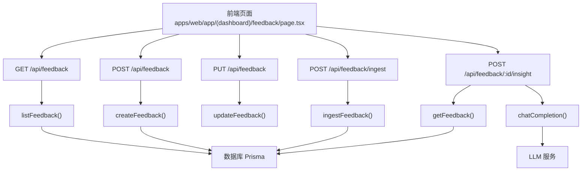
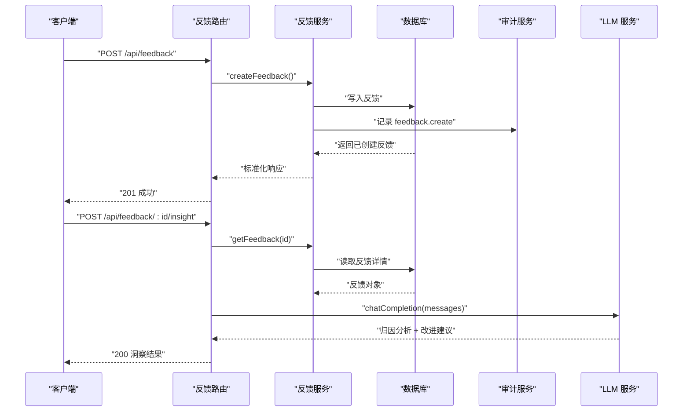
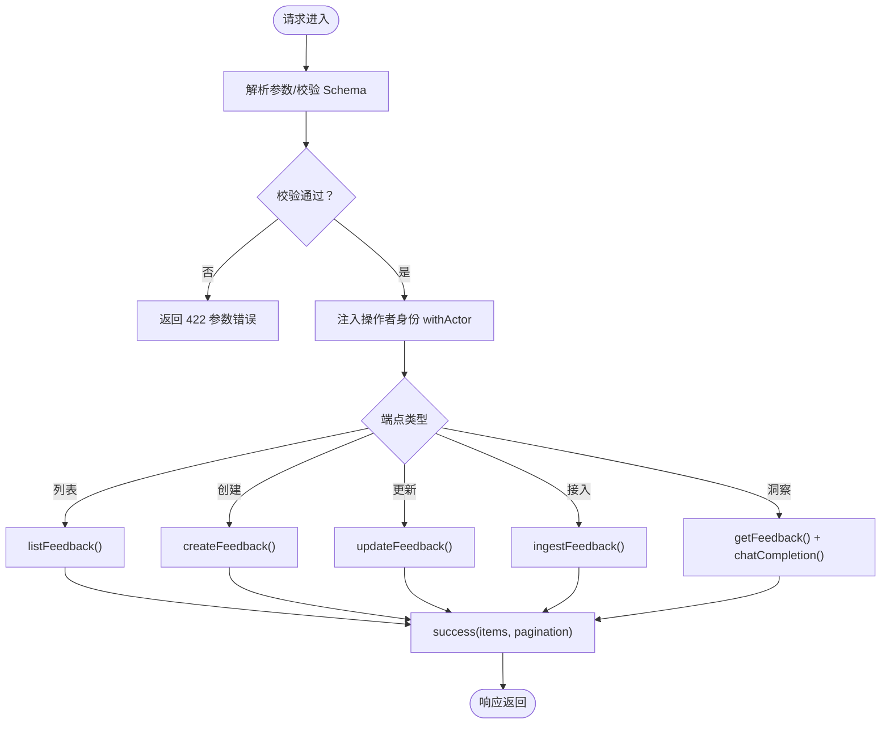
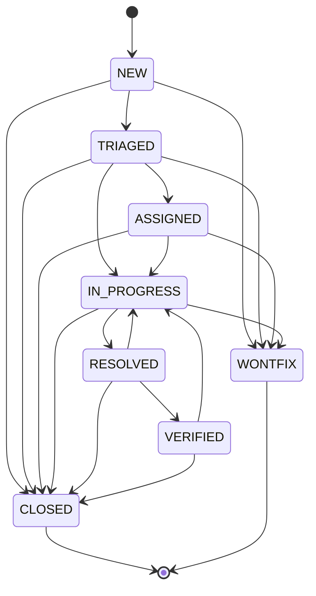
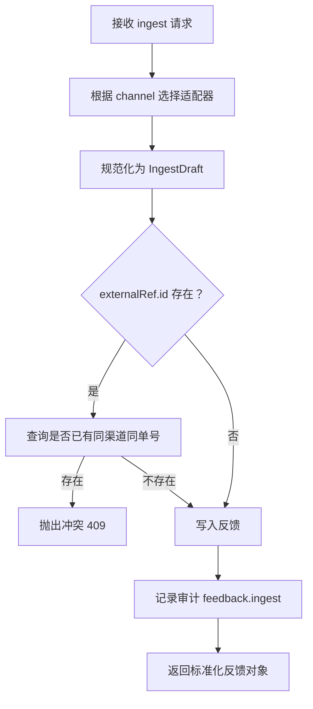
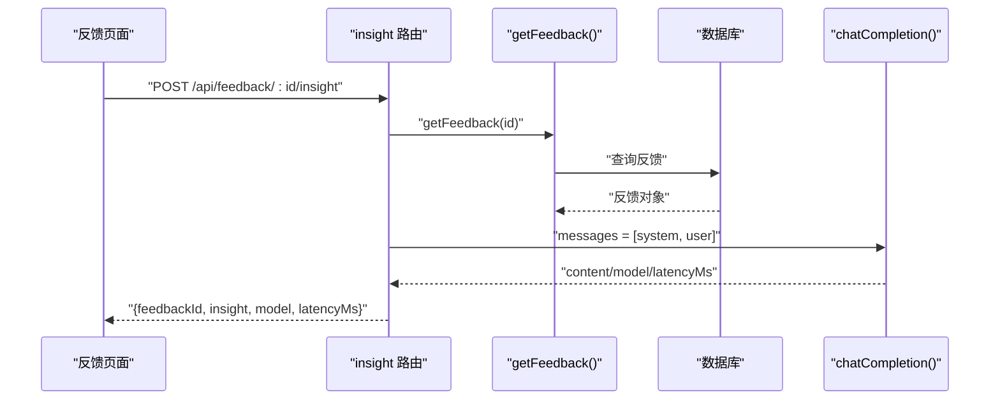
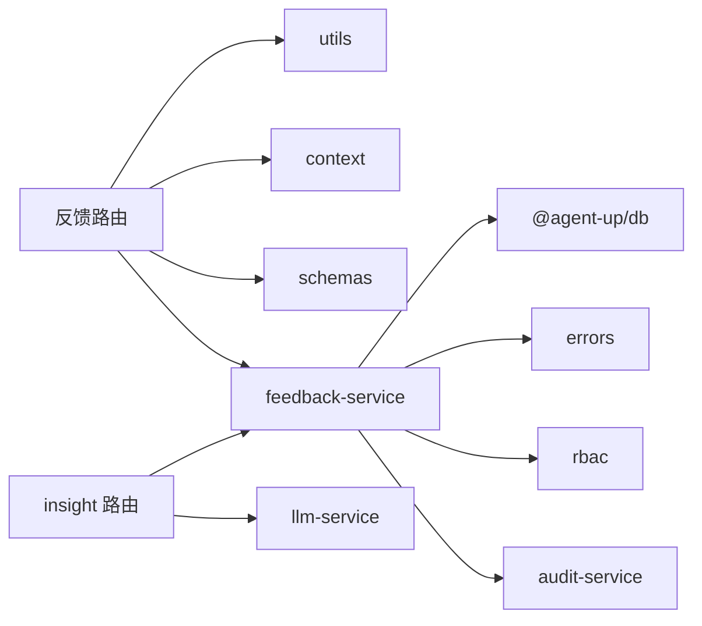

# 反馈处理 API

<cite>
**本文引用的文件**   
- [apps/web/app/api/feedback/route.ts](file://apps/web/app/api/feedback/route.ts)
- [apps/web/app/api/feedback/ingest/route.ts](file://apps/web/app/api/feedback/ingest/route.ts)
- [apps/web/app/api/feedback/[id]/insight/route.ts](file://apps/web/app/api/feedback/[id]/insight/route.ts)
- [apps/web/lib/services/feedback-service.ts](file://apps/web/lib/services/feedback-service.ts)
- [apps/web/lib/schemas.ts](file://apps/web/lib/schemas.ts)
- [apps/web/app/(dashboard)/feedback/page.tsx](file://apps/web/app/(dashboard)/feedback/page.tsx)
- [apps/web/demo/mock-server.ts](file://apps/web/demo/mock-server.ts)
- [apps/web/app/api/__tests__/llm-integrations.test.ts](file://apps/web/app/api/__tests__/llm-integrations.test.ts)
- [docs/distilled/feedback-service.md](file://docs/distilled/feedback-service.md)
</cite>

## 目录
1. [简介](#简介)
2. [项目结构](#项目结构)
3. [核心组件](#核心组件)
4. [架构总览](#架构总览)
5. [详细组件分析](#详细组件分析)
6. [依赖关系分析](#依赖关系分析)
7. [性能与扩展性](#性能与扩展性)
8. [故障排查指南](#故障排查指南)
9. [结论](#结论)
10. [附录：API 参考与示例](#附录api-参考与示例)

## 简介
本文件面向“反馈处理”相关 API，覆盖反馈收集、入库、处理、分析与洞察生成等完整链路。重点包括：
- 反馈提交与查询接口
- 多渠道工单接入（批量/机器）与幂等保护
- 反馈状态机与字段副作用
- LLM 驱动的归因分析与改进建议生成
- 与 Agent 性能监控、数据可视化的集成方式与最佳实践

## 项目结构
反馈处理功能位于 Next.js Web 应用内，采用“路由层 + 服务层 + 校验层”的分层组织：
- 路由层：定义 REST 端点，负责参数解析、权限注入、错误包装
- 服务层：封装业务逻辑，含反馈生命周期、多渠道适配、LLM 调用编排
- 校验层：使用 Zod 定义输入契约，保证请求体安全与一致性

图表来源
- [apps/web/app/api/feedback/route.ts:11-73](file://apps/web/app/api/feedback/route.ts#L11-L73)
- [apps/web/app/api/feedback/ingest/route.ts:15-32](file://apps/web/app/api/feedback/ingest/route.ts#L15-L32)
- [apps/web/app/api/feedback/[id]/insight/route.ts:13-58](file://apps/web/app/api/feedback/[id]/insight/route.ts#L13-L58)
- [apps/web/lib/services/feedback-service.ts:85-174](file://apps/web/lib/services/feedback-service.ts#L85-L174)
- [apps/web/lib/services/feedback-service.ts:244-294](file://apps/web/lib/services/feedback-service.ts#L244-L294)
- [apps/web/lib/services/feedback-service.ts:296-336](file://apps/web/lib/services/feedback-service.ts#L296-L336)

章节来源
- [apps/web/app/api/feedback/route.ts:1-74](file://apps/web/app/api/feedback/route.ts#L1-L74)
- [apps/web/app/api/feedback/ingest/route.ts:1-33](file://apps/web/app/api/feedback/ingest/route.ts#L1-L33)
- [apps/web/app/api/feedback/[id]/insight/route.ts:1-59](file://apps/web/app/api/feedback/[id]/insight/route.ts#L1-L59)

## 核心组件
- 反馈路由控制器：提供列表、创建、更新、多渠道接入、洞察生成五个端点
- 反馈服务：实现反馈 CRUD、状态机、多渠道适配器、审计记录
- 输入校验：Zod schema 统一约束反馈创建、更新与多渠道接入参数
- 前端反馈中心：展示反馈列表、触发洞察生成、辅助人工处理

章节来源
- [apps/web/lib/services/feedback-service.ts:16-41](file://apps/web/lib/services/feedback-service.ts#L16-L41)
- [apps/web/lib/schemas.ts:66-134](file://apps/web/lib/schemas.ts#L66-L134)
- [apps/web/app/(dashboard)/feedback/page.tsx:366-386](file://apps/web/app/(dashboard)/feedback/page.tsx#L366-L386)

## 架构总览
反馈处理整体流程如下：
- 用户或外部系统通过 HTTP 提交反馈
- 路由层校验并注入操作者身份
- 服务层执行业务规则（状态机、渠道适配、幂等）
- 持久化到数据库，并记录审计日志
- 对单条反馈可触发 LLM 洞察分析，输出归因与建议

图表来源
- [apps/web/app/api/feedback/route.ts:31-49](file://apps/web/app/api/feedback/route.ts#L31-L49)
- [apps/web/lib/services/feedback-service.ts:135-174](file://apps/web/lib/services/feedback-service.ts#L135-L174)
- [apps/web/app/api/feedback/[id]/insight/route.ts:13-58](file://apps/web/app/api/feedback/[id]/insight/route.ts#L13-L58)

## 详细组件分析

### 反馈路由层
- GET /api/feedback：分页查询，支持按 agentId/status/severity/rating/tag 过滤
- POST /api/feedback：创建反馈，需具备 write 权限
- PUT /api/feedback：更新反馈，body 中携带 id，支持状态转移与字段合并
- POST /api/feedback/ingest：多渠道工单接入，channel 驱动适配器规范化
- POST /api/feedback/:id/insight：基于反馈内容调用 LLM 生成洞察

图表来源
- [apps/web/app/api/feedback/route.ts:11-73](file://apps/web/app/api/feedback/route.ts#L11-L73)
- [apps/web/app/api/feedback/ingest/route.ts:15-32](file://apps/web/app/api/feedback/ingest/route.ts#L15-L32)
- [apps/web/app/api/feedback/[id]/insight/route.ts:13-58](file://apps/web/app/api/feedback/[id]/insight/route.ts#L13-L58)

章节来源
- [apps/web/app/api/feedback/route.ts:11-73](file://apps/web/app/api/feedback/route.ts#L11-L73)
- [apps/web/app/api/feedback/ingest/route.ts:15-32](file://apps/web/app/api/feedback/ingest/route.ts#L15-L32)
- [apps/web/app/api/feedback/[id]/insight/route.ts:13-58](file://apps/web/app/api/feedback/[id]/insight/route.ts#L13-L58)

### 反馈服务层与状态机
反馈服务承担以下职责：
- 列表查询：多条件过滤、分页、标签内存过滤（SQLite 限制）
- 单条详情：补全 agent 摘要，统一响应形状
- 创建反馈：校验 Agent 存在、默认 severity、source=MANUAL、审计记录
- 更新反馈：显式状态机校验、状态驱动字段副作用、通用字段合并、审计记录
- 多渠道接入：按 channel 规范化 payload、外部单号幂等、审计记录

状态机设计要点：
- 8 个状态：NEW、TRIAGED、ASSIGNED、IN_PROGRESS、RESOLVED、VERIFIED、CLOSED、WONTFIX
- 合法转移表为唯一事实源；同状态更新放行；终态不可再转
- 状态副作用集中：RESOLVED 打 resolvedAt；ASSIGNED 且带 assignedTo 时写 assignedTo/assignedAt；VERIFIED 打 verifiedAt 与可选 verificationNote

图表来源
- [apps/web/lib/services/feedback-service.ts:21-30](file://apps/web/lib/services/feedback-service.ts#L21-L30)

章节来源
- [apps/web/lib/services/feedback-service.ts:16-41](file://apps/web/lib/services/feedback-service.ts#L16-L41)
- [apps/web/lib/services/feedback-service.ts:85-174](file://apps/web/lib/services/feedback-service.ts#L85-L174)
- [apps/web/lib/services/feedback-service.ts:244-294](file://apps/web/lib/services/feedback-service.ts#L244-L294)
- [apps/web/lib/services/feedback-service.ts:296-336](file://apps/web/lib/services/feedback-service.ts#L296-L336)
- [docs/distilled/feedback-service.md:15-23](file://docs/distilled/feedback-service.md#L15-L23)

### 多渠道接入与幂等机制
- 支持 generic 与 ticket-webhook 两种 channel
- generic：外部系统自行映射字段，externalId 作为幂等键
- ticket-webhook：将工单 priority 映射为 severity（P0→CRITICAL、P1→MAJOR、P2→MINOR、P3→SUGGESTION）
- 幂等保护：同 channel + externalRefId 重复接入返回冲突（409），防止 webhook 重试造成重复工单

图表来源
- [apps/web/lib/services/feedback-service.ts:185-242](file://apps/web/lib/services/feedback-service.ts#L185-L242)
- [apps/web/lib/services/feedback-service.ts:244-294](file://apps/web/lib/services/feedback-service.ts#L244-L294)

章节来源
- [apps/web/lib/services/feedback-service.ts:185-294](file://apps/web/lib/services/feedback-service.ts#L185-L294)

### 洞察生成与 LLM 集成
- 端点：POST /api/feedback/:id/insight
- 行为：读取反馈详情，构造 system/user 消息，调用 chatCompletion 生成“归因分析 + 改进建议”
- 输出：feedbackId、insight、model、latencyMs；不落库，无状态
- 前端：在反馈列表中点击按钮触发洞察生成，用于辅助运营决策

图表来源
- [apps/web/app/api/feedback/[id]/insight/route.ts:13-58](file://apps/web/app/api/feedback/[id]/insight/route.ts#L13-L58)
- [apps/web/app/(dashboard)/feedback/page.tsx:366-386](file://apps/web/app/(dashboard)/feedback/page.tsx#L366-L386)

章节来源
- [apps/web/app/api/feedback/[id]/insight/route.ts:13-58](file://apps/web/app/api/feedback/[id]/insight/route.ts#L13-L58)
- [apps/web/app/(dashboard)/feedback/page.tsx:366-386](file://apps/web/app/(dashboard)/feedback/page.tsx#L366-L386)

### 数据结构与响应规范
反馈对象包含以下关键字段：
- 标识与来源：id、agentId、source、submittedBy、submittedAt
- 内容与分类：title、content、rating、tags、severity、targetPartition
- 处理状态：status、assignedTo、assignedAt、resolvedAt、verifiedAt、verificationNote、resolution
- 外部关联：externalRef.id、externalRef.url
- 会话上下文：sessionData（JSON）
- 关联实体：agent（id、name）

所有出口（列表、详情、创建、更新）均通过 toFeedbackResponse 统一形状，确保前端稳定消费。

章节来源
- [apps/web/lib/services/feedback-service.ts:48-81](file://apps/web/lib/services/feedback-service.ts#L48-L81)
- [apps/web/lib/services/feedback-service.ts:135-174](file://apps/web/lib/services/feedback-service.ts#L135-L174)

### 评估算法与改进建议生成机制
- 评估维度：rating（POSITIVE/NEGATIVE/NEUTRAL）、severity（CRITICAL/MAJOR/MINOR/SUGGESTION）、targetPartition（PROMPT/KNOWLEDGE/TOOLS/ROUTING）
- 洞察生成：由 LLM 根据反馈标题、内容、评价、严重程度及目标分区，输出“归因分析”和“改进建议”
- 演示环境：mock-server 提供 cannedInsight，模拟不同 rating 下的建议文案，便于前端调试

章节来源
- [apps/web/app/api/feedback/[id]/insight/route.ts:25-47](file://apps/web/app/api/feedback/[id]/insight/route.ts#L25-L47)
- [apps/web/demo/mock-server.ts:577-610](file://apps/web/demo/mock-server.ts#L577-L610)

## 依赖关系分析
- 路由层依赖 utils（success/error/pagination）、context（withActor/resolveActor）、schemas（Zod 校验）
- 服务层依赖 db（Prisma）、context（getActor）、errors（NotFoundError/ValidationError/ConflictError）、rbac（requirePermission）、audit-service（recordAudit）
- 洞察端点额外依赖 llm-service（chatCompletion）

图表来源
- [apps/web/app/api/feedback/route.ts:1-9](file://apps/web/app/api/feedback/route.ts#L1-L9)
- [apps/web/lib/services/feedback-service.ts:1-14](file://apps/web/lib/services/feedback-service.ts#L1-L14)
- [apps/web/app/api/feedback/[id]/insight/route.ts:1-5](file://apps/web/app/api/feedback/[id]/insight/route.ts#L1-L5)

章节来源
- [apps/web/app/api/feedback/route.ts:1-9](file://apps/web/app/api/feedback/route.ts#L1-L9)
- [apps/web/lib/services/feedback-service.ts:1-14](file://apps/web/lib/services/feedback-service.ts#L1-L14)
- [apps/web/app/api/feedback/[id]/insight/route.ts:1-5](file://apps/web/app/api/feedback/[id]/insight/route.ts#L1-L5)

## 性能与扩展性
- 列表查询：当 tag 过滤启用时，由于 SQLite 不支持标量列表 has 过滤，服务层先取数后内存过滤，total 口径与过滤一致；适用于演示规模
- 并发与幂等：ingest 通过 externalRefId 做幂等判断，避免 webhook 重试导致重复工单
- LLM 调用：洞察生成无状态、不落库，适合按需触发；latencyMs 可用于前端体验优化
- 扩展建议：
  - 将 tag 过滤下沉至数据库侧（如引入 JSON 索引或迁移至支持 JSON 查询的数据库）
  - 洞察生成增加缓存（按 feedbackId + prompt 版本）以降低重复调用成本
  - 将洞察结果落库并纳入效果分析，形成闭环指标

[本节为通用指导，不直接分析具体文件]

## 故障排查指南
常见问题与定位要点：
- 状态转移被拒 422：检查 from → to 是否在 ALLOWED_TRANSITIONS 中；对照状态机图确认路径
- assignedTo 或 verificationNote 静默丢失：仅在 status 同步转移到 ASSIGNED/VERIFIED 时才落盘；单独传这些字段会被丢弃
- 终态仍可改非状态字段：CLOSED/WONTFIX 仅锁 status，其他字段仍走通用合并
- tag 过滤传 ALL 返回空：tag 无 ALL 豁免，需前端单独处理
- Agent 不存在：createFeedback/ingestFeedback 会校验 agentId 是否存在
- 洞察为空或异常：确认 getFeedback 能查到反馈，且 LLM 服务可用

章节来源
- [apps/web/lib/services/feedback-service.ts:32-41](file://apps/web/lib/services/feedback-service.ts#L32-L41)
- [apps/web/lib/services/feedback-service.ts:135-174](file://apps/web/lib/services/feedback-service.ts#L135-L174)
- [apps/web/lib/services/feedback-service.ts:244-294](file://apps/web/lib/services/feedback-service.ts#L244-L294)
- [apps/web/lib/services/feedback-service.ts:296-336](file://apps/web/lib/services/feedback-service.ts#L296-L336)
- [docs/distilled/feedback-service.md:87-104](file://docs/distilled/feedback-service.md#L87-L104)

## 结论
反馈处理 API 以清晰的分层与显式状态机为核心，提供从多渠道接入、入库、处理到洞察生成的完整能力。通过统一的响应形状与严格的输入校验，保障前后端协作稳定性；结合 LLM 洞察，形成“反馈 → 归因 → 改进”的闭环，支撑 Agent 持续优化。

[本节为总结性内容，不直接分析具体文件]

## 附录：API 参考与示例

### 接口清单
- GET /api/feedback
  - 作用：获取反馈列表（分页）
  - 查询参数：page、pageSize、skip、take、agentId、status、severity、rating、tag
  - 响应：{ items[], pagination }
- POST /api/feedback
  - 作用：创建反馈
  - 请求体：agentId、title、content、rating、tags、severity、sessionData、targetPartition
  - 响应：标准化反馈对象
- PUT /api/feedback
  - 作用：更新反馈（body 带 id）
  - 请求体：status、severity、assignedTo、resolution、targetPartition、verificationNote
  - 响应：标准化反馈对象
- POST /api/feedback/ingest
  - 作用：多渠道工单接入（machine）
  - 请求体：channel（generic | ticket-webhook）+ 对应字段
  - 响应：标准化反馈对象
- POST /api/feedback/:id/insight
  - 作用：LLM 归因分析与改进建议
  - 响应：{ feedbackId, insight, model, latencyMs }

章节来源
- [apps/web/app/api/feedback/route.ts:11-73](file://apps/web/app/api/feedback/route.ts#L11-L73)
- [apps/web/app/api/feedback/ingest/route.ts:15-32](file://apps/web/app/api/feedback/ingest/route.ts#L15-L32)
- [apps/web/app/api/feedback/[id]/insight/route.ts:13-58](file://apps/web/app/api/feedback/[id]/insight/route.ts#L13-L58)

### 数据模型说明
- Feedback 对象关键字段：
  - id、agentId、source、title、content、rating、tags、severity、status、targetPartition
  - submittedBy、submittedAt
  - assignedTo、assignedAt、resolvedAt、verifiedAt、verificationNote、resolution
  - externalRef.id、externalRef.url
  - sessionData（JSON）
  - agent（id、name）

章节来源
- [apps/web/lib/services/feedback-service.ts:48-81](file://apps/web/lib/services/feedback-service.ts#L48-L81)

### 输入校验与枚举
- 创建反馈：
  - rating ∈ {POSITIVE, NEGATIVE, NEUTRAL}
  - severity ∈ {CRITICAL, MAJOR, MINOR, SUGGESTION}
  - tags ∈ {ANSWER_QUALITY, KNOWLEDGE_GAP, TOOL_FAILURE, ROUTING_ERROR, HALLUCINATION, OUTDATED_INFO, TONE_ISSUE, INCOMPLETE, OFF_TOPIC}
  - targetPartition ∈ {PROMPT, KNOWLEDGE, TOOLS, ROUTING}
- 更新反馈：
  - status ∈ {NEW, TRIAGED, ASSIGNED, IN_PROGRESS, RESOLVED, VERIFIED, CLOSED, WONTFIX}
- 多渠道接入：
  - generic：externalId、externalUrl 可选
  - ticket-webhook：ticket.key、subject、description、priority ∈ {P0,P1,P2,P3}、url 可选

章节来源
- [apps/web/lib/schemas.ts:66-134](file://apps/web/lib/schemas.ts#L66-L134)

### 典型操作流程示例
- 提交反馈
  - 前端调用 POST /api/feedback，传入 agentId/title/content/rating 等
  - 服务端校验、写入数据库、记录审计，返回 201
- 查询反馈
  - 前端调用 GET /api/feedback?agentId=&status=&severity=&rating=&tag=
  - 服务端返回列表与分页元信息
- 处理反馈
  - 前端调用 PUT /api/feedback，携带 id 与 status 转移（如 NEW → ASSIGNED）
  - 服务端执行状态机校验与字段副作用，返回更新后的反馈
- 生成洞察
  - 前端点击“洞察”按钮，调用 POST /api/feedback/:id/insight
  - 服务端读取反馈并调用 LLM，返回归因与分析建议

章节来源
- [apps/web/app/api/feedback/route.ts:31-73](file://apps/web/app/api/feedback/route.ts#L31-L73)
- [apps/web/app/api/feedback/[id]/insight/route.ts:13-58](file://apps/web/app/api/feedback/[id]/insight/route.ts#L13-L58)
- [apps/web/app/api/__tests__/llm-integrations.test.ts:58-92](file://apps/web/app/api/__tests__/llm-integrations.test.ts#L58-L92)

### 与 Agent 性能监控和数据可视化的集成
- 监控指标建议：
  - 反馈总量、按 rating/severity/status 分布
  - 洞察生成次数、平均延迟、失败率
  - 反馈到解决的平均时长（resolvedAt - submittedAt）
  - 各分区（Prompt/Knowledge/Tools/Routing）问题占比趋势
- 可视化建议：
  - 仪表盘：反馈趋势、严重等级分布、状态流转漏斗
  - 洞察面板：每条反馈的归因与建议，支持导出与人工确认
  - 与发布流水线联动：将高频问题分区与变更关联，追踪改进效果
- 数据来源：
  - 反馈表（feedback）
  - 审计日志（audit-service）
  - LLM 调用结果（insight 响应中的 latencyMs、model）

[本节为通用指导，不直接分析具体文件]