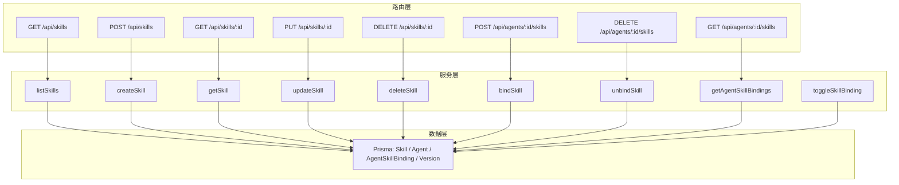
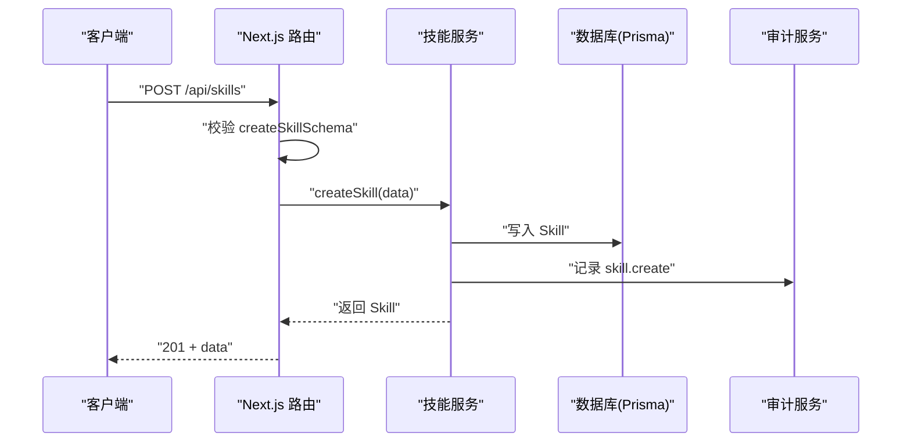
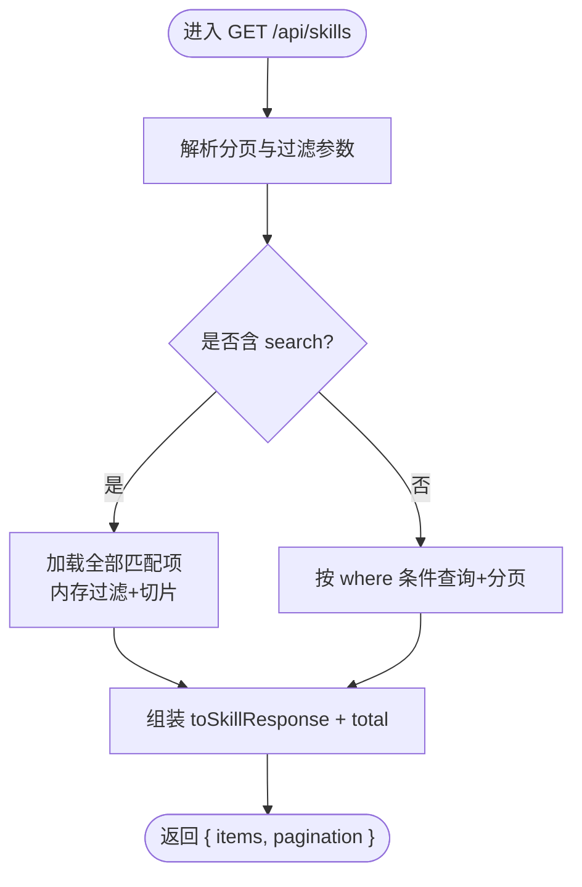
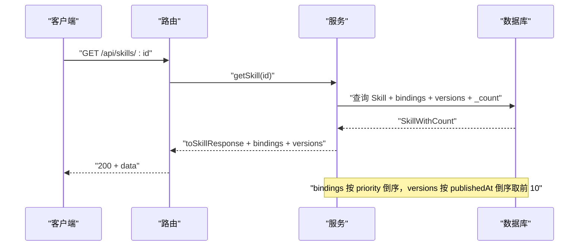
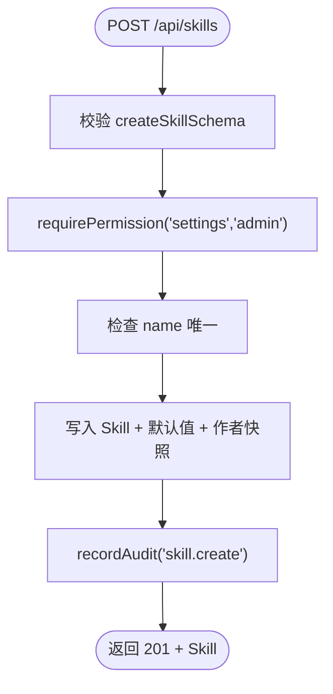
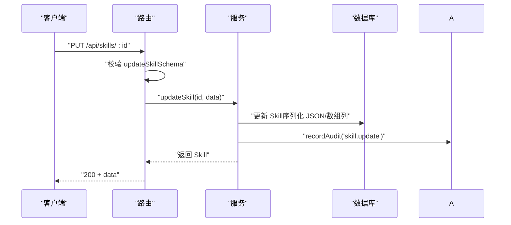
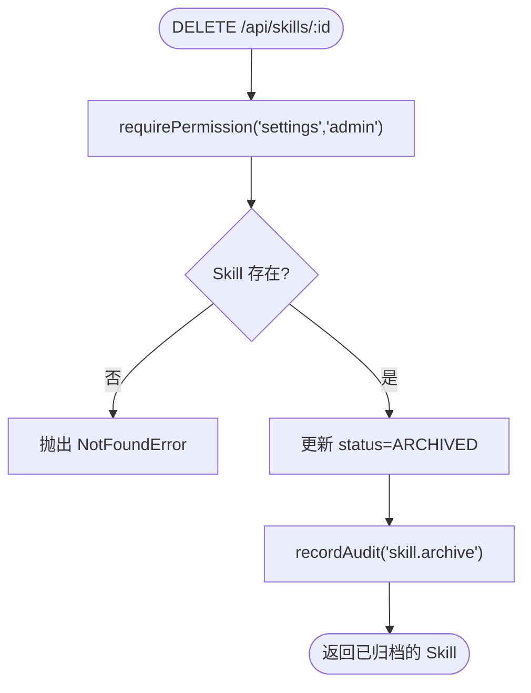
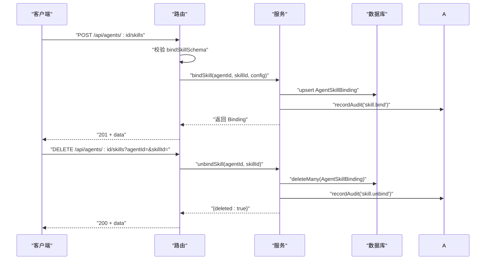
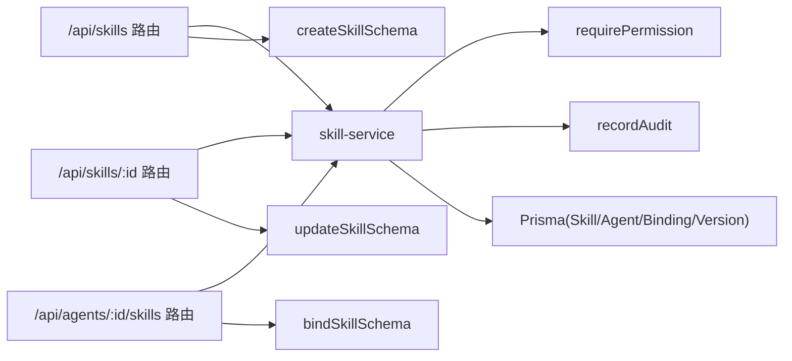

# 技能管理 API

<cite>
**本文引用的文件**   
- [apps/web/app/api/skills/route.ts](file://apps/web/app/api/skills/route.ts)
- [apps/web/app/api/skills/[id]/route.ts](file://apps/web/app/api/skills/[id]/route.ts)
- [apps/web/app/api/agents/[id]/skills/route.ts](file://apps/web/app/api/agents/[id]/skills/route.ts)
- [apps/web/lib/services/skill-service.ts](file://apps/web/lib/services/skill-service.ts)
- [apps/web/lib/schemas.ts](file://apps/web/lib/schemas.ts)
- [packages/db/prisma/schema.prisma](file://packages/db/prisma/schema.prisma)
- [docs/distilled/skill-service.md](file://docs/distilled/skill-service.md)
</cite>

## 目录
1. [简介](#简介)
2. [项目结构](#项目结构)
3. [核心组件](#核心组件)
4. [架构总览](#架构总览)
5. [详细组件分析](#详细组件分析)
6. [依赖关系分析](#依赖关系分析)
7. [性能与扩展性](#性能与扩展性)
8. [故障排查指南](#故障排查指南)
9. [结论](#结论)
10. [附录：API 规范与示例](#附录api-规范与示例)

## 简介
本文件面向“技能（Skill）”全生命周期管理的 API 文档，覆盖技能的创建、查询、更新、归档（软删除）、绑定到 Agent、解绑、启用/停用绑定等能力，并说明权限控制、参数校验、审计记录、版本兼容性与数据模型。同时给出端到端调用序列图与流程图，帮助前端、集成方与平台维护者快速上手与排障。

## 项目结构
技能相关代码集中在 Next.js App Router 的路由与服务层：
- 路由层：暴露 REST 风格接口，负责参数解析、鉴权上下文注入、请求体校验与统一响应封装。
- 服务层：实现领域逻辑，包括技能 CRUD、绑定 upsert、计数聚合、权限检查与审计记录。
- 校验层：集中定义 Zod schema，约束输入字段与枚举值。
- 数据层：基于 Prisma 的 Skill、Agent、AgentSkillBinding、Version 等实体。

图示来源
- [apps/web/app/api/skills/route.ts:7-30](file://apps/web/app/api/skills/route.ts#L7-L30)
- [apps/web/app/api/skills/[id]/route.ts:7-46](file://apps/web/app/api/skills/[id]/route.ts#L7-L46)
- [apps/web/app/api/agents/[id]/skills/route.ts:7-47](file://apps/web/app/api/agents/[id]/skills/route.ts#L7-L47)
- [apps/web/lib/services/skill-service.ts:74-295](file://apps/web/lib/services/skill-service.ts#L74-L295)
- [packages/db/prisma/schema.prisma:320-360](file://packages/db/prisma/schema.prisma#L320-L360)

章节来源
- [apps/web/app/api/skills/route.ts:1-31](file://apps/web/app/api/skills/route.ts#L1-L31)
- [apps/web/app/api/skills/[id]/route.ts:1-47](file://apps/web/app/api/skills/[id]/route.ts#L1-L47)
- [apps/web/app/api/agents/[id]/skills/route.ts:1-48](file://apps/web/app/api/agents/[id]/skills/route.ts#L1-L48)
- [apps/web/lib/services/skill-service.ts:1-296](file://apps/web/lib/services/skill-service.ts#L1-L296)
- [packages/db/prisma/schema.prisma:320-360](file://packages/db/prisma/schema.prisma#L320-L360)

## 核心组件
- 路由处理器
  - /api/skills：列表与创建
  - /api/skills/:id：详情、更新、归档
  - /api/agents/:id/skills：绑定列表、绑定、解绑
- 领域服务
  - listSkills / getSkill / createSkill / updateSkill / deleteSkill
  - bindSkill / unbindSkill / getAgentSkillBindings / toggleSkillBinding
- 校验 Schema
  - createSkillSchema / updateSkillSchema / bindSkillSchema
- 数据模型
  - Skill、Agent、AgentSkillBinding、Version（通过 Prisma）

章节来源
- [apps/web/lib/services/skill-service.ts:74-295](file://apps/web/lib/services/skill-service.ts#L74-L295)
- [apps/web/lib/schemas.ts:154-186](file://apps/web/lib/schemas.ts#L154-L186)
- [packages/db/prisma/schema.prisma:320-360](file://packages/db/prisma/schema.prisma#L320-L360)

## 架构总览
技能 API 采用“路由 → 服务 → 数据库”的分层结构。所有写操作均通过 withActor 注入当前操作人，并由服务层调用审计记录；读操作返回标准化数据结构，包含关联的 bindings 与 versions 以及计数信息。

图示来源
- [apps/web/app/api/skills/route.ts:18-30](file://apps/web/app/api/skills/route.ts#L18-L30)
- [apps/web/lib/services/skill-service.ts:144-179](file://apps/web/lib/services/skill-service.ts#L144-L179)

## 详细组件分析

### 技能清单与搜索
- 端点：GET /api/skills
- 功能：分页、按 category/status 过滤、全文搜索（name/displayName/description），默认按 updatedAt 倒序
- 权限：无显式权限拦截（读取）
- 输出：items 数组 + pagination 元信息

图示来源
- [apps/web/lib/services/skill-service.ts:74-115](file://apps/web/lib/services/skill-service.ts#L74-L115)
- [apps/web/app/api/skills/route.ts:7-16](file://apps/web/app/api/skills/route.ts#L7-L16)

章节来源
- [apps/web/app/api/skills/route.ts:7-16](file://apps/web/app/api/skills/route.ts#L7-L16)
- [apps/web/lib/services/skill-service.ts:74-115](file://apps/web/lib/services/skill-service.ts#L74-L115)

### 技能详情
- 端点：GET /api/skills/:id
- 功能：返回技能本体、绑定列表（含 agent 快照）、最近 10 条版本、计数
- 异常：不存在时返回 404

图示来源
- [apps/web/app/api/skills/[id]/route.ts:7-15](file://apps/web/app/api/skills/[id]/route.ts#L7-L15)
- [apps/web/lib/services/skill-service.ts:117-142](file://apps/web/lib/services/skill-service.ts#L117-L142)

章节来源
- [apps/web/app/api/skills/[id]/route.ts:7-15](file://apps/web/app/api/skills/[id]/route.ts#L7-L15)
- [apps/web/lib/services/skill-service.ts:117-142](file://apps/web/lib/services/skill-service.ts#L117-L142)

### 技能创建
- 端点：POST /api/skills
- 入参：遵循 createSkillSchema（name、displayName、description、category、triggerPatterns、inputSchema、outputSchema、runtime、endpoint）
- 权限：settings.admin
- 行为：唯一名校验、作者快照、默认值兜底、审计记录
- 状态码：201

图示来源
- [apps/web/app/api/skills/route.ts:18-30](file://apps/web/app/api/skills/route.ts#L18-L30)
- [apps/web/lib/services/skill-service.ts:144-179](file://apps/web/lib/services/skill-service.ts#L144-L179)
- [apps/web/lib/schemas.ts:159-169](file://apps/web/lib/schemas.ts#L159-L169)

章节来源
- [apps/web/app/api/skills/route.ts:18-30](file://apps/web/app/api/skills/route.ts#L18-L30)
- [apps/web/lib/services/skill-service.ts:144-179](file://apps/web/lib/services/skill-service.ts#L144-L179)
- [apps/web/lib/schemas.ts:159-169](file://apps/web/lib/schemas.ts#L159-L169)

### 技能更新
- 端点：PUT /api/skills/:id
- 入参：遵循 updateSkillSchema（支持 displayName、description、category、triggerPatterns、inputSchema、outputSchema、runtime、endpoint、status）
- 权限：settings.admin
- 行为：存在性校验、JSON/数组字段序列化、审计记录
- 注意：不直接接受 publishedAt（发布语义由其他流程处理）

图示来源
- [apps/web/app/api/skills/[id]/route.ts:17-33](file://apps/web/app/api/skills/[id]/route.ts#L17-L33)
- [apps/web/lib/services/skill-service.ts:182-207](file://apps/web/lib/services/skill-service.ts#L182-L207)
- [apps/web/lib/schemas.ts:171-181](file://apps/web/lib/schemas.ts#L171-L181)

章节来源
- [apps/web/app/api/skills/[id]/route.ts:17-33](file://apps/web/app/api/skills/[id]/route.ts#L17-L33)
- [apps/web/lib/services/skill-service.ts:182-207](file://apps/web/lib/services/skill-service.ts#L182-L207)
- [apps/web/lib/schemas.ts:171-181](file://apps/web/lib/schemas.ts#L171-L181)

### 技能归档（软删除）
- 端点：DELETE /api/skills/:id
- 行为：将 status 改为 ARCHIVED，保留历史引用
- 权限：settings.admin
- 审计：recordAudit("skill.archive")

图示来源
- [apps/web/app/api/skills/[id]/route.ts:35-46](file://apps/web/app/api/skills/[id]/route.ts#L35-L46)
- [apps/web/lib/services/skill-service.ts:209-221](file://apps/web/lib/services/skill-service.ts#L209-L221)

章节来源
- [apps/web/app/api/skills/[id]/route.ts:35-46](file://apps/web/app/api/skills/[id]/route.ts#L35-L46)
- [apps/web/lib/services/skill-service.ts:209-221](file://apps/web/lib/services/skill-service.ts#L209-L221)

### 绑定管理（Agent ↔ Skill）
- 端点：
  - GET /api/agents/:id/skills：获取 Agent 的技能绑定列表
  - POST /api/agents/:id/skills：绑定技能（幂等 upsert）
  - DELETE /api/agents/:id/skills?agentId=&skillId=：解绑技能
- 权限：agent.write
- 行为：
  - 绑定：校验 Agent/Skill 存在；重复绑定合并 config 并重新启用；记录 boundBy
  - 解绑：静默成功（即使绑定不存在也返回 deleted:true）
  - 列表：按 priority 倒序，附带 skill 快照

图示来源
- [apps/web/app/api/agents/[id]/skills/route.ts:16-47](file://apps/web/app/api/agents/[id]/skills/route.ts#L16-L47)
- [apps/web/lib/services/skill-service.ts:223-265](file://apps/web/lib/services/skill-service.ts#L223-L265)
- [apps/web/lib/schemas.ts:183-186](file://apps/web/lib/schemas.ts#L183-L186)

章节来源
- [apps/web/app/api/agents/[id]/skills/route.ts:7-47](file://apps/web/app/api/agents/[id]/skills/route.ts#L7-L47)
- [apps/web/lib/services/skill-service.ts:223-277](file://apps/web/lib/services/skill-service.ts#L223-L277)
- [apps/web/lib/schemas.ts:183-186](file://apps/web/lib/schemas.ts#L183-L186)

### 启用/停用绑定（未对外暴露）
- 服务函数：toggleSkillBinding(agentId, skillId, enabled)
- 现状：无生产路由调用，仅测试引用；若未来暴露需补充审计
- 行为：校验 Agent 与 Binding 存在，更新 enabled

章节来源
- [apps/web/lib/services/skill-service.ts:279-295](file://apps/web/lib/services/skill-service.ts#L279-L295)

## 依赖关系分析
- 路由依赖服务：skills 路由调用 listSkills/createSkill；skills/:id 路由调用 getSkill/updateSkill/deleteSkill；agents/:id/skills 路由调用 getAgentSkillBindings/bindSkill/unbindSkill
- 服务依赖：
  - 权限：requirePermission（settings.admin 或 agent.write）
  - 审计：recordAudit（skill.create/update/archive/bind/unbind）
  - 数据：prisma（Skill、Agent、AgentSkillBinding、Version）
- 校验依赖：Zod schemas（createSkillSchema、updateSkillSchema、bindSkillSchema）

图示来源
- [apps/web/app/api/skills/route.ts:1-30](file://apps/web/app/api/skills/route.ts#L1-L30)
- [apps/web/app/api/skills/[id]/route.ts:1-46](file://apps/web/app/api/skills/[id]/route.ts#L1-L46)
- [apps/web/app/api/agents/[id]/skills/route.ts:1-47](file://apps/web/app/api/agents/[id]/skills/route.ts#L1-L47)
- [apps/web/lib/services/skill-service.ts:1-15](file://apps/web/lib/services/skill-service.ts#L1-L15)
- [apps/web/lib/schemas.ts:154-186](file://apps/web/lib/schemas.ts#L154-L186)

章节来源
- [apps/web/lib/services/skill-service.ts:1-15](file://apps/web/lib/services/skill-service.ts#L1-L15)
- [apps/web/lib/schemas.ts:154-186](file://apps/web/lib/schemas.ts#L154-L186)

## 性能与扩展性
- 列表搜索：当传入 search 参数时，先拉取全部匹配项再内存过滤与切片，适合演示规模；在大数据量下建议引入后端全文检索或索引优化
- 详情聚合：getSkill 一次性 include bindings 与 versions，避免 N+1 查询；versions 限制为最近 10 条
- 绑定查询：getAgentSkillBindings 按 priority 倒序排序，便于优先级调度
- 扩展点：
  - 新增分类/运行时类型：扩展 skillCategoryEnum / skillRuntimeEnum
  - 新增字段：在 schema 与 service 中同步扩展，并在 updateSkill 中对 JSON/数组列做 packJson 序列化
  - 权限扩展：在 requirePermission 中增加新资源/动作组合

章节来源
- [apps/web/lib/services/skill-service.ts:74-142](file://apps/web/lib/services/skill-service.ts#L74-L142)
- [apps/web/lib/schemas.ts:154-186](file://apps/web/lib/schemas.ts#L154-L186)

## 故障排查指南
- 绑定列表中 skill 名称旧：binding 内固化的是绑定时刻的 skill 快照，改名后不会自动刷新；可重新绑定或修正数据
- 解绑返回“已解绑”但实际未绑定：unbindSkill 对不存在绑定静默成功；应先 GET 绑定列表确认真实状态
- 技能详情慢：getSkill 会 include bindings 与 versions，数据量大时需注意；考虑缓存或分页
- 审计署名异常：确保路由使用 withActor(resolveActor(...)) 包裹写操作；部分路径可能遗漏导致署名恒为系统
- publishedAt 始终为空：updateSkillSchema 不接受 publishedAt；发布流程应单独处理该字段

章节来源
- [docs/distilled/skill-service.md:95-115](file://docs/distilled/skill-service.md#L95-L115)
- [apps/web/lib/services/skill-service.ts:182-221](file://apps/web/lib/services/skill-service.ts#L182-L221)

## 结论
技能管理 API 以清晰的分层与严格的校验/权限/审计机制，提供完整的技能生命周期管理与绑定管理能力。建议在后续迭代中完善发布流程对 publishedAt 的处理、增强搜索性能，并在需要时暴露 toggleSkillBinding 以支持启停绑定。

## 附录：API 规范与示例

### 通用约定
- 认证：通过请求头注入操作人上下文（withActor/resolveActor）
- 权限：
  - 技能管理（CRUD）：settings.admin
  - 绑定管理（bind/unbind/toggle）：agent.write
- 错误响应：统一 error() 或 handleApiError() 返回
- 成功响应：success() 返回 { success: true, data }

### 端点清单

- 技能列表
  - 方法：GET
  - 路径：/api/skills
  - 查询参数：page、pageSize、skip、take、category、status、search
  - 响应：{ items: Skill[], pagination: { page, pageSize, total } }

- 技能创建
  - 方法：POST
  - 路径：/api/skills
  - 请求体：遵循 createSkillSchema
  - 响应：201 + Skill

- 技能详情
  - 方法：GET
  - 路径：/api/skills/:id
  - 响应：Skill（含 bindings、versions、_count）

- 技能更新
  - 方法：PUT
  - 路径：/api/skills/:id
  - 请求体：遵循 updateSkillSchema
  - 响应：Skill

- 技能归档
  - 方法：DELETE
  - 路径：/api/skills/:id
  - 响应：{ message: "Skill 已归档" }

- 绑定列表
  - 方法：GET
  - 路径：/api/agents/:id/skills
  - 响应：Binding[]（按 priority 倒序）

- 绑定技能
  - 方法：POST
  - 路径：/api/agents/:id/skills
  - 请求体：遵循 bindSkillSchema（skillId、config?）
  - 响应：201 + Binding

- 解绑技能
  - 方法：DELETE
  - 路径：/api/agents/:id/skills?agentId=&skillId=
  - 响应：{ deleted: true }

### 数据模型要点（Prisma）
- Skill：包含 name、displayName、description、category、triggerPatterns、inputSchema、outputSchema、runtime、endpoint、version、status、publishedAt、downloadCount、authorId、authorName、createdAt、updatedAt
- AgentSkillBinding：包含 agentId、skillId、config、enabled、priority、boundBy、boundAt
- Version：包含 skillId、version、changelog、publishedAt、publishedBy、changeNote

章节来源
- [packages/db/prisma/schema.prisma:320-360](file://packages/db/prisma/schema.prisma#L320-L360)
- [apps/web/lib/services/skill-service.ts:28-72](file://apps/web/lib/services/skill-service.ts#L28-L72)