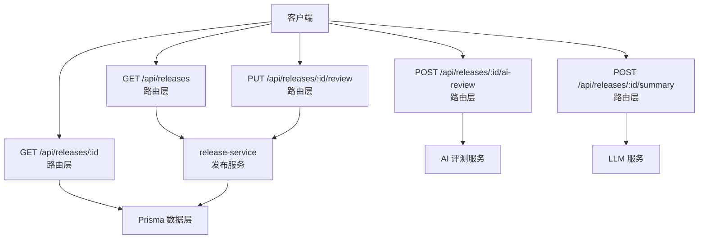
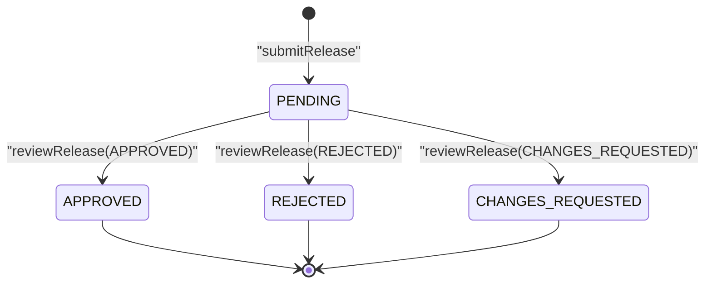
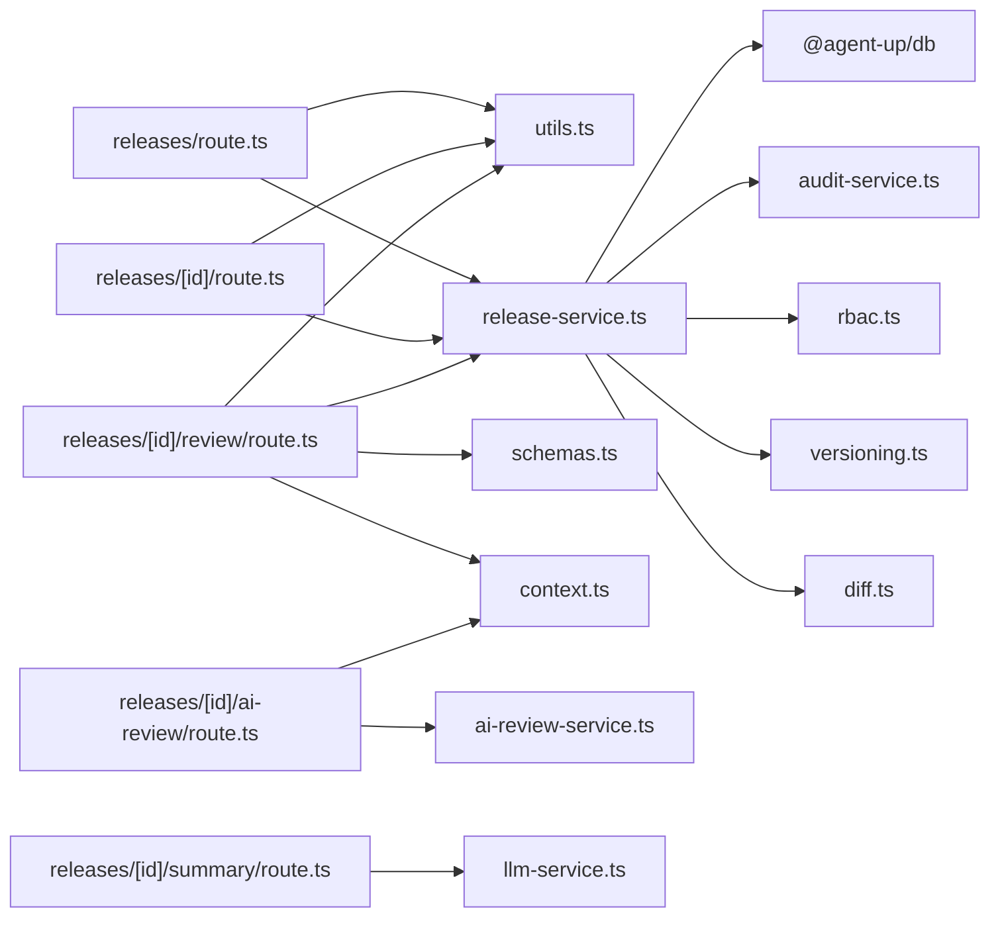

# 发布管理 API

<cite>
**本文引用的文件**   
- [apps/web/app/api/releases/route.ts](file://apps/web/app/api/releases/route.ts)
- [apps/web/app/api/releases/[id]/route.ts](file://apps/web/app/api/releases/[id]/route.ts)
- [apps/web/app/api/releases/[id]/review/route.ts](file://apps/web/app/api/releases/[id]/review/route.ts)
- [apps/web/app/api/releases/[id]/ai-review/route.ts](file://apps/web/app/api/releases/[id]/ai-review/route.ts)
- [apps/web/app/api/releases/[id]/summary/route.ts](file://apps/web/app/api/releases/[id]/summary/route.ts)
- [apps/web/lib/services/release-service.ts](file://apps/web/lib/services/release-service.ts)
- [apps/web/lib/schemas.ts](file://apps/web/lib/schemas.ts)
- [apps/web/lib/utils.ts](file://apps/web/lib/utils.ts)
- [packages/db/src/enums.ts](file://packages/db/src/enums.ts)
- [docs/distilled/release-service.md](file://docs/distilled/release-service.md)
</cite>

## 目录
1. [简介](#简介)
2. [项目结构](#项目结构)
3. [核心组件](#核心组件)
4. [架构总览](#架构总览)
5. [详细接口说明](#详细接口说明)
6. [依赖关系分析](#依赖关系分析)
7. [性能与分页特性](#性能与分页特性)
8. [故障排查指南](#故障排查指南)
9. [结论](#结论)

## 简介
本文档面向“发布管理”相关 API，覆盖以下能力：
- 发布列表查询：支持分页、按状态过滤、按 Agent 过滤。
- 发布详情获取：返回 Release 全量字段、关联 Agent 信息、以及用于 diff 的 baseline 快照。
- 发布审批流程：定义待审批、已批准、已拒绝、要求修改等状态机流转，并说明权限控制与审计记录。
- AI 评测与变更摘要：提供发布前 AI 评测与 LLM 变更摘要辅助审批决策。
- 分页参数、过滤条件、返回数据结构与完整调用示例。
- 发布与 Agent 的关联关系、权限控制机制说明。

## 项目结构
发布管理 API 位于 Next.js App Router 的 `apps/web/app/api/releases` 下，路由层负责解析请求、校验参数、调用服务层；服务层封装发布状态机、版本派生、审计记录等核心逻辑；数据库枚举与公共工具函数被多处复用。

图表来源
- [apps/web/app/api/releases/route.ts:7-46](file://apps/web/app/api/releases/route.ts#L7-L46)
- [apps/web/app/api/releases/[id]/route.ts:14-59](file://apps/web/app/api/releases/[id]/route.ts#L14-L59)
- [apps/web/app/api/releases/[id]/review/route.ts:11-28](file://apps/web/app/api/releases/[id]/review/route.ts#L11-L28)
- [apps/web/app/api/releases/[id]/ai-review/route.ts:13-26](file://apps/web/app/api/releases/[id]/ai-review/route.ts#L13-L26)
- [apps/web/app/api/releases/[id]/summary/route.ts:14-86](file://apps/web/app/api/releases/[id]/summary/route.ts#L14-L86)
- [apps/web/lib/services/release-service.ts:77-149](file://apps/web/lib/services/release-service.ts#L77-L149)

章节来源
- [apps/web/app/api/releases/route.ts:1-47](file://apps/web/app/api/releases/route.ts#L1-L47)
- [apps/web/app/api/releases/[id]/route.ts:1-60](file://apps/web/app/api/releases/[id]/route.ts#L1-L60)
- [apps/web/app/api/releases/[id]/review/route.ts:1-29](file://apps/web/app/api/releases/[id]/review/route.ts#L1-L29)
- [apps/web/app/api/releases/[id]/ai-review/route.ts:1-27](file://apps/web/app/api/releases/[id]/ai-review/route.ts#L1-L27)
- [apps/web/app/api/releases/[id]/summary/route.ts:1-87](file://apps/web/app/api/releases/[id]/summary/route.ts#L1-L87)

## 核心组件
- 路由层（Route）
  - GET /api/releases：列表查询，支持分页、status、agentId。
  - GET /api/releases/:id：详情查询，包含 configSnapshot 与 baseline 快照。
  - PUT /api/releases/:id/review：审批发布，action 为 APPROVED/REJECTED/CHANGES_REQUESTED。
  - POST /api/releases/:id/ai-review：运行发布前 AI 评测，结果写回 release.aiReview。
  - POST /api/releases/:id/summary：基于变更生成 LLM 摘要，无状态不落库。
- 服务层（Service）
  - release-service：提交发布、审批发布、创建 Version、回滚、列出发布等核心业务。
  - ai-review-service：执行 AI 评测。
  - llm-service：调用 LLM 生成摘要。
- 公共模块
  - utils：success、handleApiError、parsePagination、paginationMeta、validateBody。
  - schemas：Zod 校验规则，如 reviewReleaseSchema。
  - enums：ReleaseStatus 等枚举常量。

章节来源
- [apps/web/lib/services/release-service.ts:36-41](file://apps/web/lib/services/release-service.ts#L36-L41)
- [apps/web/lib/utils.ts:6-47](file://apps/web/lib/utils.ts#L6-L47)
- [apps/web/lib/schemas.ts:140-148](file://apps/web/lib/schemas.ts#L140-L148)
- [packages/db/src/enums.ts:95-102](file://packages/db/src/enums.ts#L95-L102)

## 架构总览
发布管理的核心流程是“提交 → 审批 → 版本落盘”，其中：
- 提交时固化四分区配置快照，并计算 changedPartitions。
- 审批通过才派生不可变 Version，版本号由 versioning 模块决定。
- 所有关键动作均记录审计日志。

图表来源
- [apps/web/lib/services/release-service.ts:159-217](file://apps/web/lib/services/release-service.ts#L159-L217)
- [docs/distilled/release-service.md:28-39](file://docs/distilled/release-service.md#L28-L39)

## 详细接口说明

### 发布列表查询
- 方法：GET
- 路径：/api/releases
- 认证与权限：未显式在路由层做 RBAC 检查；服务层 submit/review 使用 requirePermission。
- 查询参数
  - page：页码，默认 1，最小 1。
  - pageSize：每页条数，默认 20，最大 100。
  - status：过滤状态，可选 ALL 或 VALID_RELEASE_STATUSES 中的值；未知值返回空列表。
  - agentId：按 Agent 过滤。
- 排序：submittedAt 倒序，其次 id 倒序。
- 返回结构
  - items：Release 列表项，包含 toReleaseResponse 转换后的字段，以及 agent 简表 {id, name}。
  - pagination：{page, pageSize, total, totalPages, hasMore}。

示例请求
- 查询所有发布：GET /api/releases?page=1&pageSize=20
- 按状态筛选：GET /api/releases?status=PENDING&page=1&pageSize=20
- 按 Agent 筛选：GET /api/releases?agentId=AGENT_ID&page=1&pageSize=20

示例响应
- 成功：{ success: true, data: { items: [...], pagination: {...} } }
- 失败：统一错误格式 { success: false, error: "...", errors?: [...] }

章节来源
- [apps/web/app/api/releases/route.ts:7-46](file://apps/web/app/api/releases/route.ts#L7-L46)
- [apps/web/lib/utils.ts:27-47](file://apps/web/lib/utils.ts#L27-L47)

### 发布详情获取
- 方法：GET
- 路径：/api/releases/:id
- 返回结构
  - Release 全量字段（toReleaseResponse）。
  - agent：{id, name}。
  - baseline：上一次已发布版本的快照（prompt/knowledge/tools/routing/version），用于 diff 展示。
- 行为说明
  - 若 Release 不存在，返回 NotFoundError。
  - baseline 选择逻辑：取该 release 对应 version 的前一个版本；若无则取最新已发布版本。

示例请求
- GET /api/releases/RELEASE_ID

示例响应
- 成功：{ success: true, data: { ...release, agent, baseline } }
- 失败：统一错误格式

章节来源
- [apps/web/app/api/releases/[id]/route.ts:14-59](file://apps/web/app/api/releases/[id]/route.ts#L14-L59)

### 发布审批
- 方法：PUT
- 路径：/api/releases/:id/review
- 请求体（Zod 校验）
  - releaseId：字符串，必填（path 的 id 为权威，body 中仅作兼容）。
  - action：APPROVED | REJECTED | CHANGES_REQUESTED，必填。
  - reviewComment：字符串，可选，长度上限 2000。
- 权限控制
  - 需要 release 资源的 approve 权限。
- 业务规则
  - 仅 PENDING 可审批；重复审批抛 ConflictError。
  - CHANGES_REQUESTED 必须带 reviewComment。
  - 若 AI 评测结果为 FAILED，APPROVED 时必须填写 reviewComment。
  - APPROVED 会派生不可变 Version（事务内保证一致性）。
- 返回结构
  - 更新后的 Release（toReleaseResponse）。

示例请求
- PUT /api/releases/RELEASE_ID/review
- 请求体：{ releaseId: "RELEASE_ID", action: "APPROVED", reviewComment: "同意上线" }

示例响应
- 成功：{ success: true, data: { ...release } }
- 失败：统一错误格式

章节来源
- [apps/web/app/api/releases/[id]/review/route.ts:11-28](file://apps/web/app/api/releases/[id]/review/route.ts#L11-L28)
- [apps/web/lib/schemas.ts:144-148](file://apps/web/lib/schemas.ts#L144-L148)
- [apps/web/lib/services/release-service.ts:159-217](file://apps/web/lib/services/release-service.ts#L159-L217)

### 发布前 AI 评测
- 方法：POST
- 路径：/api/releases/:id/ai-review
- 功能
  - 对一条待审批 Release 运行发布前 AI 评测。
  - 用 release 快照的 prompt 配置 replay 该 Agent 的全部评测用例，LLM 判官逐条对照参考回复给出 PASS/FAIL。
  - 结果写回 release.aiReview，仅供审批人参考，不阻断审批。
- 返回结构
  - 更新后的 Release（含 aiReview）。

示例请求
- POST /api/releases/RELEASE_ID/ai-review

示例响应
- 成功：{ success: true, data: { ...release } }
- 失败：统一错误格式

章节来源
- [apps/web/app/api/releases/[id]/ai-review/route.ts:13-26](file://apps/web/app/api/releases/[id]/ai-review/route.ts#L13-L26)

### 变更摘要（LLM）
- 方法：POST
- 路径：/api/releases/:id/summary
- 功能
  - 读取 Release 的 configSnapshot 与 baseline，让 LLM 总结本次变更的影响面与风险点，辅助审批决策。
  - 无状态，不落库。
- 返回结构
  - releaseId、summary、model、latencyMs。

示例请求
- POST /api/releases/RELEASE_ID/summary

示例响应
- 成功：{ success: true, data: { releaseId, summary, model, latencyMs } }
- 失败：统一错误格式

章节来源
- [apps/web/app/api/releases/[id]/summary/route.ts:14-86](file://apps/web/app/api/releases/[id]/summary/route.ts#L14-L86)

## 依赖关系分析
- 路由层依赖
  - utils.success/handleApiError：统一成功/错误响应。
  - utils.parsePagination/paginationMeta：分页参数与元数据。
  - utils.validateBody + schemas.reviewReleaseSchema：请求体验证。
  - context.withActor/resolveActor：注入操作者身份。
  - services.release-service：发布状态机、Version 派生、审计。
  - services.ai-review-service：AI 评测。
  - services.llm-service：LLM 摘要。
- 服务层依赖
  - prisma：数据库访问。
  - audit-service.recordAudit：审计记录。
  - rbac.requirePermission：权限控制。
  - versioning.bumpVersion/formatVersion：版本号计算。
  - diff.computeJsonDiff：分区级变更判定。

图表来源
- [apps/web/app/api/releases/route.ts:1-46](file://apps/web/app/api/releases/route.ts#L1-L46)
- [apps/web/app/api/releases/[id]/route.ts:1-59](file://apps/web/app/api/releases/[id]/route.ts#L1-L59)
- [apps/web/app/api/releases/[id]/review/route.ts:1-28](file://apps/web/app/api/releases/[id]/review/route.ts#L1-L28)
- [apps/web/app/api/releases/[id]/ai-review/route.ts:1-26](file://apps/web/app/api/releases/[id]/ai-review/route.ts#L1-L26)
- [apps/web/app/api/releases/[id]/summary/route.ts:1-86](file://apps/web/app/api/releases/[id]/summary/route.ts#L1-L86)
- [apps/web/lib/services/release-service.ts:1-32](file://apps/web/lib/services/release-service.ts#L1-L32)

章节来源
- [apps/web/lib/services/release-service.ts:1-32](file://apps/web/lib/services/release-service.ts#L1-L32)
- [apps/web/lib/utils.ts:1-86](file://apps/web/lib/utils.ts#L1-L86)
- [apps/web/lib/schemas.ts:140-148](file://apps/web/lib/schemas.ts#L140-L148)

## 性能与分页特性
- 分页参数
  - page：默认 1，最小 1。
  - pageSize：默认 20，最大 100。
  - skip/take：由 parsePagination 自动计算。
- 列表查询
  - 使用 Promise.all 并行查询 rows 与 total，减少往返。
  - orderBy 先按 submittedAt 倒序，再按 id 倒序，保证稳定排序。
- 详情查询
  - 额外查询 versions 以计算 baseline，注意版本数量增长时的潜在性能影响。
- 建议
  - 前端合理设置 pageSize，避免过大导致响应体积膨胀。
  - 列表页优先使用 status 与 agentId 过滤缩小数据集。

章节来源
- [apps/web/lib/utils.ts:27-47](file://apps/web/lib/utils.ts#L27-L47)
- [apps/web/app/api/releases/route.ts:25-37](file://apps/web/app/api/releases/route.ts#L25-L37)
- [apps/web/app/api/releases/[id]/route.ts:30-49](file://apps/web/app/api/releases/[id]/route.ts#L30-L49)

## 故障排查指南
- 列表查询返回空
  - 检查 status 是否为有效值；未知 status 会返回空列表。
  - 确认 agentId 是否正确。
- 审批失败
  - 非 PENDING 状态无法再次审批，抛 ConflictError。
  - CHANGES_REQUESTED 必须带 reviewComment。
  - AI 评测 FAILED 时，APPROVED 必须填写 reviewComment。
- 详情查询报错
  - Release 不存在将抛出 NotFoundError。
- 审计日志缺失
  - recordAudit 为 fire-and-forget，写入失败不会阻塞业务，需查看审计服务日志。

章节来源
- [apps/web/app/api/releases/route.ts:13-16](file://apps/web/app/api/releases/route.ts#L13-L16)
- [apps/web/lib/services/release-service.ts:165-179](file://apps/web/lib/services/release-service.ts#L165-L179)
- [apps/web/app/api/releases/[id]/route.ts:27-27](file://apps/web/app/api/releases/[id]/route.ts#L27-L27)
- [docs/distilled/release-service.md:117-126](file://docs/distilled/release-service.md#L117-L126)

## 结论
发布管理 API 围绕“提交 → 审批 → 版本落盘”的主线设计，提供完整的列表查询、详情获取、审批流程、AI 评测与变更摘要能力。通过统一的响应格式、分页工具与 Zod 校验，保证了接口的健壮性与可维护性。权限控制与审计记录贯穿关键路径，确保发布过程可追溯、可控。