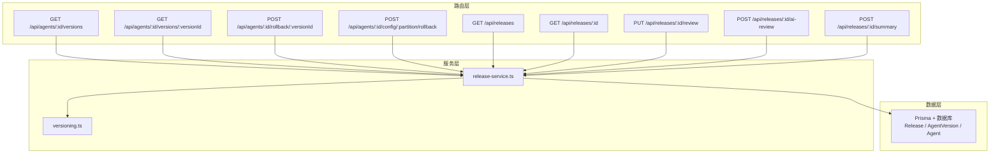
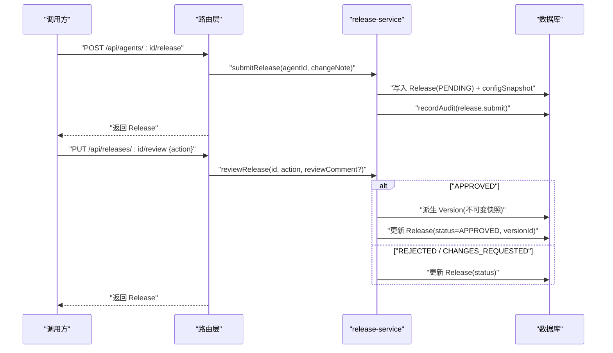
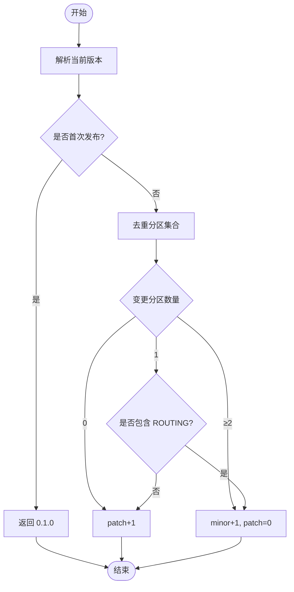
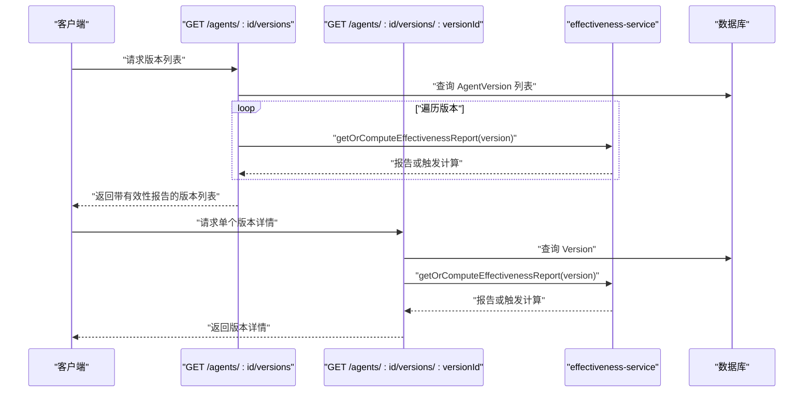
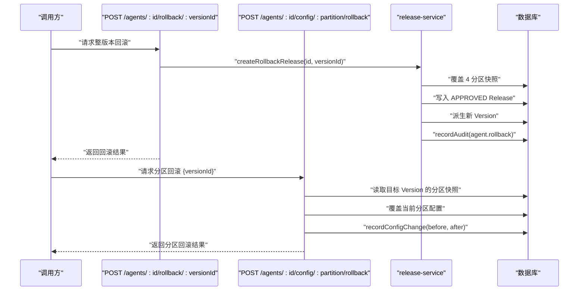
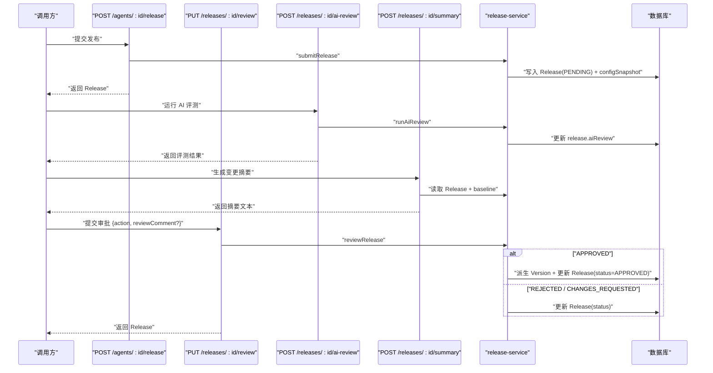
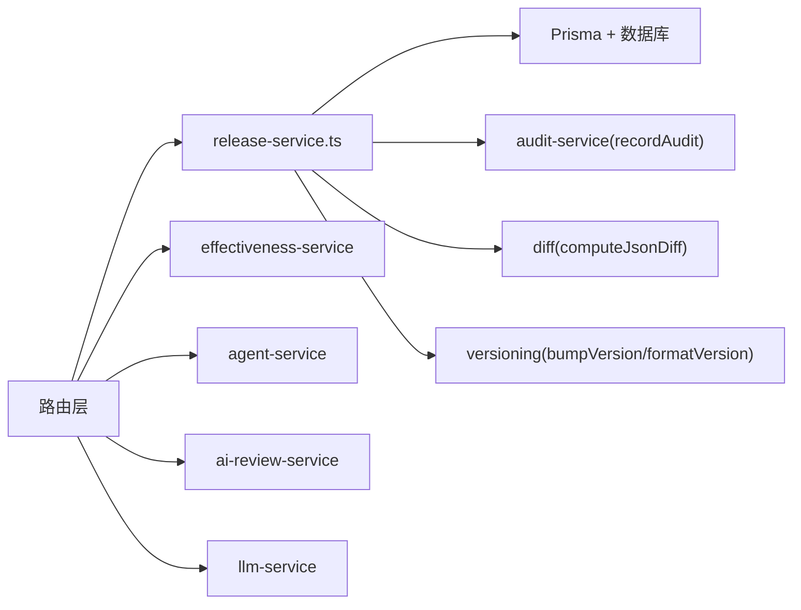

# 版本控制 API

<cite>
**本文引用的文件**   
- [apps/web/app/api/agents/[id]/versions/route.ts](file://apps/web/app/api/agents/[id]/versions/route.ts)
- [apps/web/app/api/agents/[id]/versions/[versionId]/route.ts](file://apps/web/app/api/agents/[id]/versions/[versionId]/route.ts)
- [apps/web/app/api/agents/[id]/rollback/[versionId]/route.ts](file://apps/web/app/api/agents/[id]/rollback/[versionId]/route.ts)
- [apps/web/app/api/agents/[id]/config/[partition]/rollback/route.ts](file://apps/web/app/api/agents/[id]/config/[partition]/rollback/route.ts)
- [apps/web/app/api/releases/route.ts](file://apps/web/app/api/releases/route.ts)
- [apps/web/app/api/releases/[id]/route.ts](file://apps/web/app/api/releases/[id]/route.ts)
- [apps/web/app/api/releases/[id]/review/route.ts](file://apps/web/app/api/releases/[id]/review/route.ts)
- [apps/web/app/api/releases/[id]/ai-review/route.ts](file://apps/web/app/api/releases/[id]/ai-review/route.ts)
- [apps/web/app/api/releases/[id]/summary/route.ts](file://apps/web/app/api/releases/[id]/summary/route.ts)
- [apps/web/lib/versioning.ts](file://apps/web/lib/versioning.ts)
- [apps/web/lib/services/release-service.ts](file://apps/web/lib/services/release-service.ts)
- [docs/skills/agent-up-services/references/release-service-component.md](file://docs/skills/agent-up-services/references/release-service-component.md)
</cite>

## 目录
1. [简介](#简介)
2. [项目结构](#项目结构)
3. [核心组件](#核心组件)
4. [架构总览](#架构总览)
5. [详细组件分析](#详细组件分析)
6. [依赖关系分析](#依赖关系分析)
7. [性能与一致性](#性能与一致性)
8. [故障排查指南](#故障排查指南)
9. [结论](#结论)
10. [附录：API 参考与示例](#附录api-参考与示例)

## 简介
本文件面向“版本控制”相关能力，覆盖发布审批、版本创建、回滚操作、版本对比等端点；说明语义化版本策略、发布流程与审批机制；描述版本快照数据结构、变更追踪与审计日志；并提供版本创建、审批、回滚、对比的完整调用示例。同时说明版本线性和分支管理策略，以及与 Agent 配置的关联关系。

## 项目结构
版本控制能力由以下层次组成：
- 路由层（Next.js App Router）：暴露 REST 端点，负责参数校验、权限上下文注入、错误封装。
- 服务层：release-service 实现发布提交、审批、回滚、版本派生等核心逻辑；versioning 提供语义化版本计算。
- 数据层：通过 Prisma 访问数据库，持久化 Release、AgentVersion、Agent 配置与审计日志。

图表来源
- [apps/web/app/api/agents/[id]/versions/route.ts:8-16](file://apps/web/app/api/agents/[id]/versions/route.ts#L8-L16)
- [apps/web/app/api/releases/[id]/route.ts:7-13](file://apps/web/app/api/releases/[id]/route.ts#L7-L13)
- [apps/web/lib/services/release-service.ts:151-179](file://apps/web/lib/services/release-service.ts#L151-L179)
- [apps/web/lib/versioning.ts:1-16](file://apps/web/lib/versioning.ts#L1-L16)

章节来源
- [apps/web/app/api/agents/[id]/versions/route.ts:8-16](file://apps/web/app/api/agents/[id]/versions/route.ts#L8-L16)
- [apps/web/app/api/releases/[id]/route.ts:7-13](file://apps/web/app/api/releases/[id]/route.ts#L7-L13)
- [apps/web/lib/services/release-service.ts:151-179](file://apps/web/lib/services/release-service.ts#L151-L179)
- [apps/web/lib/versioning.ts:1-16](file://apps/web/lib/versioning.ts#L1-L16)

## 核心组件
- 语义化版本模块 versioning.ts
  - 定义分区类型 Partition 与 SemVer 结构。
  - 提供 parseVersion、formatVersion、bumpVersion 三个函数，依据分区变更集合决定 major/minor/patch 递增策略。
- 发布服务 release-service.ts
  - 提交发布：四分区 diff → 写入 PENDING Release + configSnapshot → 记录审计。
  - 审批发布：状态机校验、AI 评测门禁、APPROVED 时派生 Version 并回填摘要。
  - 回滚发布：覆盖 4 个分区为指定 Version 的快照 → 生成 APPROVED Release → 派生新 Version → 记录审计。
  - 列表查询：按 submittedAt 倒序返回 Release 列表。
- 版本历史与详情路由
  - GET /api/agents/:id/versions：返回某 Agent 的所有已发布 Version（含四分区不可变快照），并按 publishedAt 倒序；对缺失 effectivenessReport 且超窗的版本进行惰性计算。
  - GET /api/agents/:id/versions/:versionId：返回单个 Version 详情，同样支持惰性计算。
- 回滚路由
  - POST /api/agents/:id/rollback/:versionId：整版本回滚，一次性恢复 4 个分区，保证组合一致。
  - POST /api/agents/:id/config/:partition/rollback：分区级回滚，从目标 Version 的 snapshot 恢复该分区。
- 发布审批与辅助能力
  - PUT /api/releases/:id/review：权威审批入口，支持 APPROVED / REJECTED / CHANGES_REQUESTED。
  - POST /api/releases/:id/ai-review：运行发布前 AI 评测，结果写回 release.aiReview，不阻断审批。
  - POST /api/releases/:id/summary：基于 LLM 生成变更摘要与风险提示，无状态不落库。
  - GET /api/releases/:id：返回 Release 详情与 baseline 快照，供前端 diff viewer 展示差异。
  - GET /api/releases：分页列出 Release，支持 status 与 agentId 过滤。

章节来源
- [apps/web/lib/versioning.ts:18-69](file://apps/web/lib/versioning.ts#L18-L69)
- [apps/web/lib/services/release-service.ts:147-179](file://apps/web/lib/services/release-service.ts#L147-L179)
- [apps/web/app/api/agents/[id]/versions/route.ts:8-16](file://apps/web/app/api/agents/[id]/versions/route.ts#L8-L16)
- [apps/web/app/api/agents/[id]/versions/[versionId]/route.ts:9-14](file://apps/web/app/api/agents/[id]/versions/[versionId]/route.ts#L9-L14)
- [apps/web/app/api/agents/[id]/rollback/[versionId]/route.ts:6-19](file://apps/web/app/api/agents/[id]/rollback/[versionId]/route.ts#L6-L19)
- [apps/web/app/api/agents/[id]/config/[partition]/rollback/route.ts:34-41](file://apps/web/app/api/agents/[id]/config/[partition]/rollback/route.ts#L34-L41)
- [apps/web/app/api/releases/[id]/review/route.ts:7-10](file://apps/web/app/api/releases/[id]/review/route.ts#L7-L10)
- [apps/web/app/api/releases/[id]/ai-review/route.ts:6-12](file://apps/web/app/api/releases/[id]/ai-review/route.ts#L6-L12)
- [apps/web/app/api/releases/[id]/summary/route.ts:7-13](file://apps/web/app/api/releases/[id]/summary/route.ts#L7-L13)
- [apps/web/app/api/releases/[id]/route.ts:7-13](file://apps/web/app/api/releases/[id]/route.ts#L7-L13)
- [apps/web/app/api/releases/route.ts:7-16](file://apps/web/app/api/releases/route.ts#L7-L16)

## 架构总览
版本控制的主流程包括：提交发布 → 审批 → 版本派生；以及回滚路径：选择目标版本 → 一键恢复全部或单分区 → 生成新版本。

图表来源
- [apps/web/lib/services/release-service.ts:147-179](file://apps/web/lib/services/release-service.ts#L147-L179)
- [apps/web/app/api/releases/[id]/review/route.ts:7-10](file://apps/web/app/api/releases/[id]/review/route.ts#L7-L10)

## 详细组件分析

### 语义化版本策略（SemVer）
- 首次发布：0.1.0。
- ROUTING 分区变更：minor。
- 任意 ≥2 个分区变更：minor。
- 单个非路由分区变更（Prompt/Knowledge/Tools）：patch。
- 同时变更全部 4 个分区：minor（不自动 major，major 留给破坏性重写的人工显式标注）。
- bumpVersion 输入当前最高版本字符串与本次变更分区集合，输出下一个 SemVer。

图表来源
- [apps/web/lib/versioning.ts:18-69](file://apps/web/lib/versioning.ts#L18-L69)

章节来源
- [apps/web/lib/versioning.ts:1-16](file://apps/web/lib/versioning.ts#L1-L16)
- [apps/web/lib/versioning.ts:18-69](file://apps/web/lib/versioning.ts#L18-L69)

### 版本历史与详情（GET /api/agents/:id/versions 与 GET /api/agents/:id/versions/:versionId）
- 返回所有已发布 Version，按 publishedAt 倒序；每个 Version 包含四个分区的不可变快照。
- 若某 Version 距今 ≥7 天且 effectivenessReport 缺失，则惰性计算并写回，同时记录审计。
- 单个 Version 详情接口同样支持惰性计算。

图表来源
- [apps/web/app/api/agents/[id]/versions/route.ts:8-16](file://apps/web/app/api/agents/[id]/versions/route.ts#L8-L16)
- [apps/web/app/api/agents/[id]/versions/[versionId]/route.ts:9-14](file://apps/web/app/api/agents/[id]/versions/[versionId]/route.ts#L9-L14)

章节来源
- [apps/web/app/api/agents/[id]/versions/route.ts:8-16](file://apps/web/app/api/agents/[id]/versions/route.ts#L8-L16)
- [apps/web/app/api/agents/[id]/versions/[versionId]/route.ts:9-14](file://apps/web/app/api/agents/[id]/versions/[versionId]/route.ts#L9-L14)

### 回滚操作
- 整版本回滚：POST /api/agents/:id/rollback/:versionId
  - 行为：覆盖 Agent 4 个 active config 为目标 Version 的快照；写入一个 status=APPROVED 的 Release（含 configSnapshot）做追溯；派生新 Version（版本号自增）；写入审计 action="agent.rollback"。
- 分区级回滚：POST /api/agents/:id/config/:partition/rollback
  - 行为：从指定 Version 的 snapshot 取出该分区配置，覆盖当前 active 配置；复用分区更新函数；记录变更 before/after；审计记录分区回滚动作。

图表来源
- [apps/web/app/api/agents/[id]/rollback/[versionId]/route.ts:6-19](file://apps/web/app/api/agents/[id]/rollback/[versionId]/route.ts#L6-L19)
- [apps/web/app/api/agents/[id]/config/[partition]/rollback/route.ts:34-41](file://apps/web/app/api/agents/[id]/config/[partition]/rollback/route.ts#L34-L41)
- [apps/web/lib/services/release-service.ts:147-179](file://apps/web/lib/services/release-service.ts#L147-L179)

章节来源
- [apps/web/app/api/agents/[id]/rollback/[versionId]/route.ts:6-19](file://apps/web/app/api/agents/[id]/rollback/[versionId]/route.ts#L6-L19)
- [apps/web/app/api/agents/[id]/config/[partition]/rollback/route.ts:34-41](file://apps/web/app/api/agents/[id]/config/[partition]/rollback/route.ts#L34-L41)
- [apps/web/lib/services/release-service.ts:147-179](file://apps/web/lib/services/release-service.ts#L147-L179)

### 发布审批与辅助能力
- 提交发布：POST /api/agents/:id/release（服务层 submitRelease）
  - 校验 Agent 存在 → 四分区 diff → 写入 PENDING Release + configSnapshot → 记录审计。
- 审批发布：PUT /api/releases/:id/review
  - 状态机校验：仅 PENDING 可处理；CHANGES_REQUESTED 必须带意见；AI 评测 FAILED 时批准需带意见。
  - APPROVED 时派生 Version 并回填摘要；REJECTED/CHANGES_REQUESTED 更新状态。
- AI 评测：POST /api/releases/:id/ai-review
  - 用 release 快照的 prompt 配置 replay 评测用例，LLM 判官逐条 PASS/FAIL，结果写回 release.aiReview，仅供审批参考。
- 变更摘要：POST /api/releases/:id/summary
  - 读取 Release 的 configSnapshot 与 baseline，让 LLM 总结影响面与风险点，无状态不落库。
- Release 详情：GET /api/releases/:id
  - 返回 Release 全字段与 baseline 快照，供前端 diff viewer 展示差异。
- Release 列表：GET /api/releases
  - 分页查询，支持 status 与 agentId 过滤；未知 status 返回空集。

图表来源
- [apps/web/app/api/releases/[id]/review/route.ts:7-10](file://apps/web/app/api/releases/[id]/review/route.ts#L7-L10)
- [apps/web/app/api/releases/[id]/ai-review/route.ts:6-12](file://apps/web/app/api/releases/[id]/ai-review/route.ts#L6-L12)
- [apps/web/app/api/releases/[id]/summary/route.ts:7-13](file://apps/web/app/api/releases/[id]/summary/route.ts#L7-L13)
- [apps/web/lib/services/release-service.ts:147-179](file://apps/web/lib/services/release-service.ts#L147-L179)

章节来源
- [apps/web/app/api/releases/[id]/review/route.ts:7-10](file://apps/web/app/api/releases/[id]/review/route.ts#L7-L10)
- [apps/web/app/api/releases/[id]/ai-review/route.ts:6-12](file://apps/web/app/api/releases/[id]/ai-review/route.ts#L6-L12)
- [apps/web/app/api/releases/[id]/summary/route.ts:7-13](file://apps/web/app/api/releases/[id]/summary/route.ts#L7-L13)
- [apps/web/lib/services/release-service.ts:147-179](file://apps/web/lib/services/release-service.ts#L147-L179)

### 版本线性与分支管理策略
- 版本线性：Version 以时间顺序累积，按 publishedAt 倒序排列；每次 APPROVED 都会派生新的不可变 Version，确保历史快照不可变。
- 分支管理：当前实现聚焦于单一 Agent 的配置演进；未引入多分支合并模型。回滚通过选择历史 Version 的快照恢复，保证组合一致性。
- 与 Agent 配置的关联：Version 快照包含 Prompt/Knowledge/Tools/Routing 四个分区；回滚会直接覆盖 Agent 的 active 配置，随后生成新的 Version 以保持历史可追溯。

章节来源
- [apps/web/app/api/agents/[id]/versions/route.ts:8-16](file://apps/web/app/api/agents/[id]/versions/route.ts#L8-L16)
- [apps/web/app/api/agents/[id]/rollback/[versionId]/route.ts:6-19](file://apps/web/app/api/agents/[id]/rollback/[versionId]/route.ts#L6-L19)
- [apps/web/app/api/agents/[id]/config/[partition]/rollback/route.ts:34-41](file://apps/web/app/api/agents/[id]/config/[partition]/rollback/route.ts#L34-L41)

## 依赖关系分析
- 路由层依赖：
  - utils：success、handleApiError、parsePagination、paginationMeta。
  - context：withActor、resolveActor 用于注入操作者身份。
  - errors：NotFoundError、ValidationError、ConflictError。
  - services：release-service、effectiveness-service、agent-service、ai-review-service、llm-service。
- 服务层依赖：
  - release-service 依赖 store（Prisma）、audit-service（recordAudit）、diff（computeJsonDiff）、versioning（bumpVersion/formatVersion/Partition/SemVer）。
- 反向依赖（谁调用 release-service）：
  - 提交发布：POST /api/agents/:id/release。
  - 审批发布：PUT /api/releases/:id/review。
  - 整版本回滚：POST /api/agents/:id/rollback/:versionId。

图表来源
- [docs/skills/agent-up-services/references/release-service-component.md:58-61](file://docs/skills/agent-up-services/references/release-service-component.md#L58-L61)

章节来源
- [docs/skills/agent-up-services/references/release-service-component.md:58-61](file://docs/skills/agent-up-services/references/release-service-component.md#L58-L61)

## 性能与一致性
- 惰性计算：Version 的有效性报告在查询时惰性计算，避免重复计算开销；仅在缺失且超过窗口期时触发。
- 批量查询：Release 列表使用 Promise.all 并行获取 rows 与 total，减少往返次数。
- 事务一致性：APPROVED 时派生 Version 与更新 Release 状态在同一事务内，保证状态一致。
- 版本不可变性：Version 快照一旦生成即不可变，确保历史可追溯与回滚一致性。

章节来源
- [apps/web/app/api/agents/[id]/versions/route.ts:8-16](file://apps/web/app/api/agents/[id]/versions/route.ts#L8-L16)
- [apps/web/app/api/releases/route.ts:25-37](file://apps/web/app/api/releases/route.ts#L25-L37)
- [apps/web/lib/services/release-service.ts:151-179](file://apps/web/lib/services/release-service.ts#L151-L179)

## 故障排查指南
- NotFoundError：Version 不存在或不属于此 Agent。
- ValidationError：分区无效、缺少必填字段（如 CHANGES_REQUESTED 必须带意见）、AI 评测未通过但批准未带意见。
- ConflictError：Release 已处理（非 PENDING 状态再次审批）。
- 常见定位步骤：
  - 检查 path 参数是否正确（id、versionId、partition）。
  - 检查 body 校验是否通过（zod schema）。
  - 检查 actor 上下文是否注入成功（withActor/resolveActor）。
  - 查看审计日志确认操作轨迹（recordAudit/recordConfigChange）。

章节来源
- [apps/web/app/api/agents/[id]/versions/[versionId]/route.ts:21-25](file://apps/web/app/api/agents/[id]/versions/[versionId]/route.ts#L21-L25)
- [apps/web/app/api/agents/[id]/config/[partition]/rollback/route.ts:48-53](file://apps/web/app/api/agents/[id]/config/[partition]/rollback/route.ts#L48-L53)
- [apps/web/lib/services/release-service.ts:164-179](file://apps/web/lib/services/release-service.ts#L164-L179)

## 结论
本版本控制体系以“提交 → 审批 → 版本派生”为主线，辅以 AI 评测与 LLM 摘要辅助决策；通过不可变 Version 快照与审计日志保障可追溯性；语义化版本策略将分区变更映射到 minor/patch 递增，避免版本号膨胀；回滚提供整版本与分区级两种粒度，确保配置一致性与历史可回溯。

## 附录：API 参考与示例

### 端点总览
- 版本历史
  - GET /api/agents/:id/versions
  - GET /api/agents/:id/versions/:versionId
- 回滚
  - POST /api/agents/:id/rollback/:versionId
  - POST /api/agents/:id/config/:partition/rollback
- 发布与审批
  - POST /api/agents/:id/release（提交发布）
  - PUT /api/releases/:id/review（审批）
  - POST /api/releases/:id/ai-review（AI 评测）
  - POST /api/releases/:id/summary（变更摘要）
  - GET /api/releases/:id（Release 详情）
  - GET /api/releases（Release 列表）

### 语义化版本策略要点
- 首次发布：0.1.0。
- ROUTING 变更或 ≥2 分区变更：minor。
- 单个非路由分区变更：patch。
- 全部 4 分区变更：minor（不自动 major）。

### 版本快照数据结构
- Version 快照包含四个分区：prompt/knowledge/tools/routing。
- 每个分区快照为 JSON 对象，包含配置内容与元数据（如 version、lastModifiedAt）。
- Release.configSnapshot 保存提交时的四分区快照，baseline 为上一版本快照，用于 diff。

### 变更追踪与审计日志
- 提交发布：recordAudit("release.submit")。
- 审批：recordAudit("release.approve"/"release.reject"/"release.changes_requested")。
- 回滚：recordAudit("agent.rollback")。
- 分区回滚：recordConfigChange(before, after)。

### 调用示例（路径与关键参数）
- 提交发布
  - 方法：POST
  - 路径：/api/agents/{agentId}/release
  - 主体：{ changeNote }
  - 说明：提交后返回 PENDING Release，等待审批。
- 审批发布
  - 方法：PUT
  - 路径：/api/releases/{releaseId}/review
  - 主体：{ action, reviewComment? }
  - 说明：action ∈ {APPROVED, REJECTED, CHANGES_REQUESTED}；CHANGES_REQUESTED 必须带 reviewComment；AI 评测 FAILED 时批准需带 reviewComment。
- 运行 AI 评测
  - 方法：POST
  - 路径：/api/releases/{releaseId}/ai-review
  - 说明：结果写回 release.aiReview，不阻断审批。
- 生成变更摘要
  - 方法：POST
  - 路径：/api/releases/{releaseId}/summary
  - 说明：无状态，返回 summary 与 model/latencyMs。
- 查看 Release 详情
  - 方法：GET
  - 路径：/api/releases/{releaseId}
  - 说明：返回 Release 与 baseline 快照，供 diff viewer。
- 列出 Release
  - 方法：GET
  - 路径：/api/releases
  - 查询参数：status、agentId、page、pageSize
  - 说明：未知 status 返回空集。
- 整版本回滚
  - 方法：POST
  - 路径：/api/agents/{agentId}/rollback/{versionId}
  - 说明：覆盖 4 分区为 target Version 快照，生成 APPROVED Release 与新 Version。
- 分区级回滚
  - 方法：POST
  - 路径：/api/agents/{agentId}/config/{partition}/rollback
  - 主体：{ versionId }
  - 说明：从目标 Version 的 snapshot 恢复该分区，记录变更审计。

章节来源
- [apps/web/app/api/releases/[id]/review/route.ts:7-10](file://apps/web/app/api/releases/[id]/review/route.ts#L7-L10)
- [apps/web/app/api/releases/[id]/ai-review/route.ts:6-12](file://apps/web/app/api/releases/[id]/ai-review/route.ts#L6-L12)
- [apps/web/app/api/releases/[id]/summary/route.ts:7-13](file://apps/web/app/api/releases/[id]/summary/route.ts#L7-L13)
- [apps/web/app/api/releases/[id]/route.ts:7-13](file://apps/web/app/api/releases/[id]/route.ts#L7-L13)
- [apps/web/app/api/releases/route.ts:7-16](file://apps/web/app/api/releases/route.ts#L7-L16)
- [apps/web/app/api/agents/[id]/rollback/[versionId]/route.ts:6-19](file://apps/web/app/api/agents/[id]/rollback/[versionId]/route.ts#L6-L19)
- [apps/web/app/api/agents/[id]/config/[partition]/rollback/route.ts:34-41](file://apps/web/app/api/agents/[id]/config/[partition]/rollback/route.ts#L34-L41)
- [apps/web/lib/versioning.ts:18-69](file://apps/web/lib/versioning.ts#L18-L69)