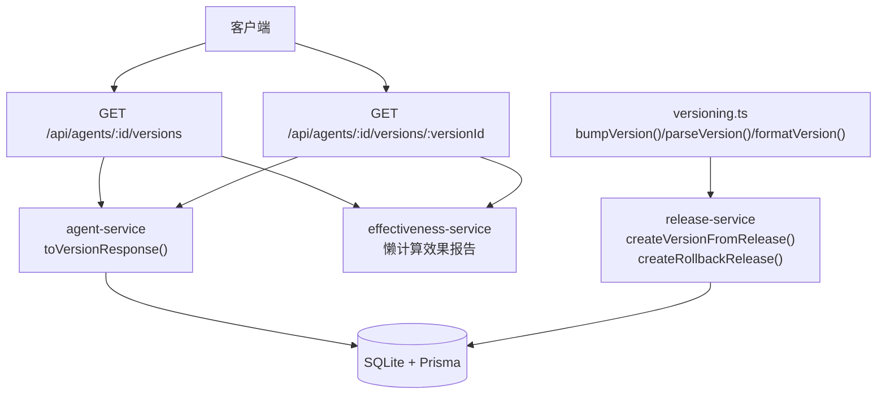
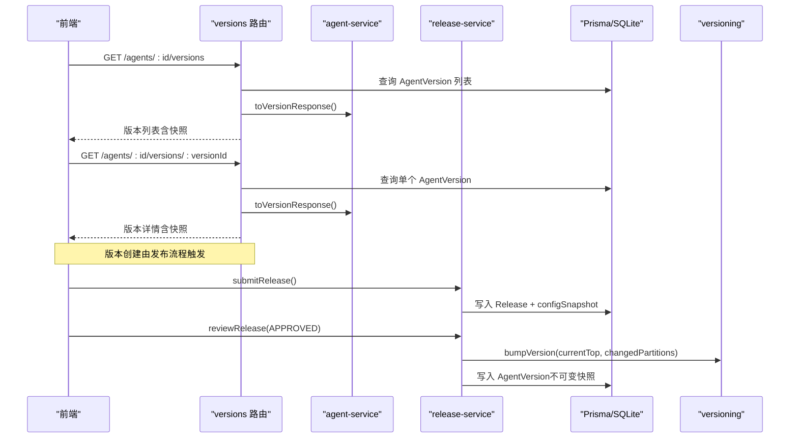
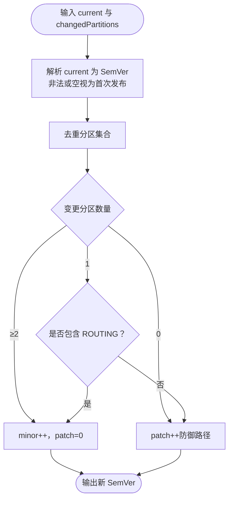
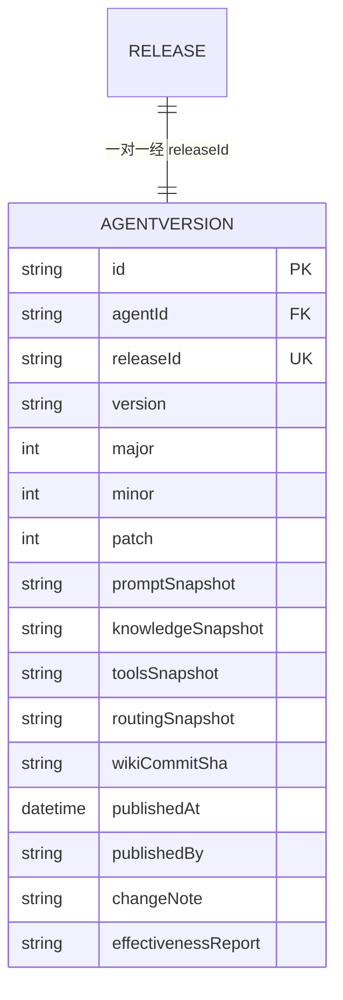
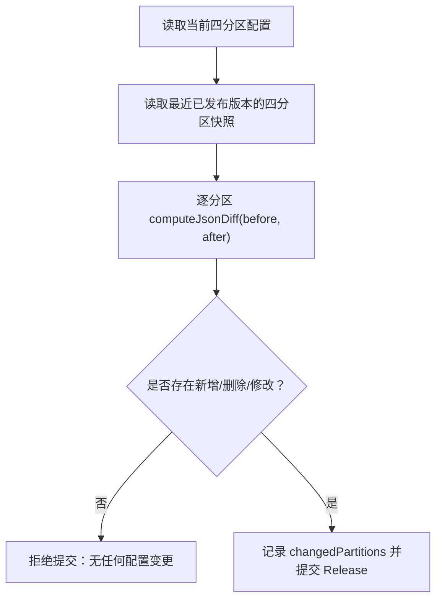
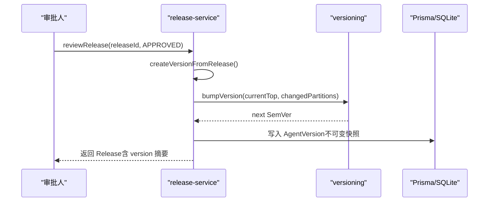
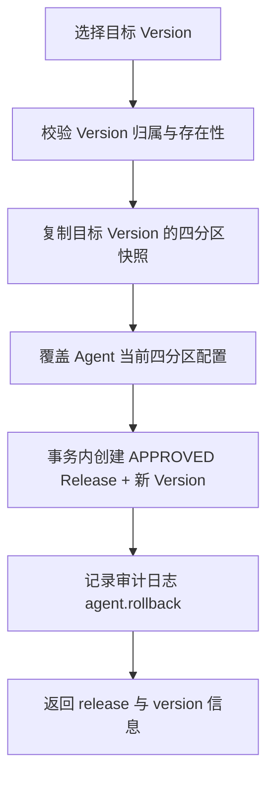
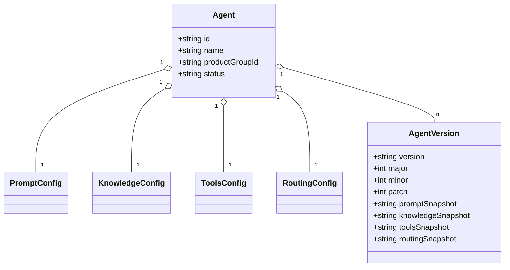
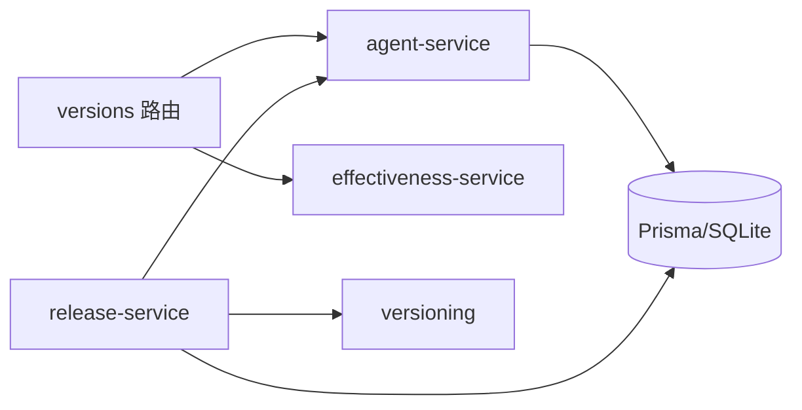

# 版本操作 API

<cite>
**本文引用的文件**   
- [apps/web/lib/versioning.ts](file://apps/web/lib/versioning.ts)
- [packages/db/prisma/schema.prisma](file://packages/db/prisma/schema.prisma)
- [apps/web/app/api/agents/[id]/versions/route.ts](file://apps/web/app/api/agents/[id]/versions/route.ts)
- [apps/web/app/api/agents/[id]/versions/[versionId]/route.ts](file://apps/web/app/api/agents/[id]/versions/[versionId]/route.ts)
- [apps/web/lib/services/agent-service.ts](file://apps/web/lib/services/agent-service.ts)
- [apps/web/lib/services/release-service.ts](file://apps/web/lib/services/release-service.ts)
</cite>

## 目录
1. [引言](#引言)
2. [项目结构](#项目结构)
3. [核心组件](#核心组件)
4. [架构总览](#架构总览)
5. [详细组件分析](#详细组件分析)
6. [依赖关系分析](#依赖关系分析)
7. [性能与一致性](#性能与一致性)
8. [故障排查指南](#故障排查指南)
9. [结论](#结论)
10. [附录：API 端点与示例](#附录api-端点与示例)

## 引言
本文件聚焦 Agent 配置“版本”相关能力，覆盖以下目标：
- 版本创建、版本获取、版本删除（当前实现为归档式删除）等端点的行为说明。
- 语义化版本控制（SemVer：major.minor.patch）的计算策略与边界条件。
- 版本快照的数据结构、配置差异对比与版本元数据管理。
- 版本与 Agent 配置的关联关系、版本回滚机制（分区级与整版本）。
- 提供完整操作示例：创建新版本、获取版本详情、删除历史版本等。

## 项目结构
与版本相关的代码主要分布在以下位置：
- 路由层：Next.js App Router 的 `/api/agents/[id]/versions` 与 `/api/agents/[id]/versions/[versionId]`。
- 服务层：Agent 服务（配置与响应转换）、发布服务（Release → Version 生成、回滚）。
- 领域工具：语义化版本计算（bumpVersion、parseVersion、formatVersion）。
- 数据模型：Prisma schema 中的 AgentVersion、Release、Agent 及其四分区配置。

图示来源
- [apps/web/app/api/agents/[id]/versions/route.ts:1-53](file://apps/web/app/api/agents/[id]/versions/route.ts#L1-L53)
- [apps/web/app/api/agents/[id]/versions/[versionId]/route.ts:1-40](file://apps/web/app/api/agents/[id]/versions/[versionId]/route.ts#L1-L40)
- [apps/web/lib/services/agent-service.ts:186-208](file://apps/web/lib/services/agent-service.ts#L186-L208)
- [apps/web/lib/services/release-service.ts:235-265](file://apps/web/lib/services/release-service.ts#L235-L265)
- [apps/web/lib/versioning.ts:46-69](file://apps/web/lib/versioning.ts#L46-L69)

章节来源
- [README.md:277-289](file://README.md#L277-L289)
- [README.md:349-378](file://README.md#L349-L378)

## 核心组件
- 语义化版本工具（versioning.ts）
  - 解析、格式化与递增版本号；规则集中在 bumpVersion。
- 版本路由（versions route）
  - 列出某 Agent 的所有已发布版本；按 publishedAt 倒序；支持懒填充效果报告。
  - 获取单个版本详情；校验归属并返回四分区快照。
- Agent 服务（agent-service.ts）
  - toVersionResponse 将数据库行转换为对外 JSON 契约；包含四分区快照、元数据与可选效果报告。
- 发布服务（release-service.ts）
  - createVersionFromRelease：从 Release 生成不可变 Version，基于 changedPartitions 计算 SemVer。
  - createRollbackRelease：整版本回滚，覆盖 4 个分区并立即派生新 Version。
- 数据模型（schema.prisma）
  - AgentVersion：存储 version、major/minor/patch、四分区 snapshot、releaseId、publishedAt/publishedBy/changeNote 等。
  - Release：审批流状态机、configSnapshot、AI 评测结果、回滚标记与来源版本。
  - Agent 与四分区配置：Prompt/Knowledge/Tools/Routing 配置表，作为 diff 基线与快照来源。

章节来源
- [apps/web/lib/versioning.ts:1-69](file://apps/web/lib/versioning.ts#L1-L69)
- [apps/web/app/api/agents/[id]/versions/route.ts:1-53](file://apps/web/app/api/agents/[id]/versions/route.ts#L1-L53)
- [apps/web/app/api/agents/[id]/versions/[versionId]/route.ts:1-40](file://apps/web/app/api/agents/[id]/versions/[versionId]/route.ts#L1-L40)
- [apps/web/lib/services/agent-service.ts:186-208](file://apps/web/lib/services/agent-service.ts#L186-L208)
- [apps/web/lib/services/release-service.ts:77-149](file://apps/web/lib/services/release-service.ts#L77-L149)
- [apps/web/lib/services/release-service.ts:235-265](file://apps/web/lib/services/release-service.ts#L235-L265)
- [apps/web/lib/services/release-service.ts:275-354](file://apps/web/lib/services/release-service.ts#L275-L354)
- [packages/db/prisma/schema.prisma:257-318](file://packages/db/prisma/schema.prisma#L257-L318)

## 架构总览
版本生命周期由“编辑 → 提交发布 → 审批 → 生成版本快照 → 可回滚”构成。

图示来源
- [apps/web/app/api/agents/[id]/versions/route.ts:18-48](file://apps/web/app/api/agents/[id]/versions/route.ts#L18-L48)
- [apps/web/app/api/agents/[id]/versions/[versionId]/route.ts:15-35](file://apps/web/app/api/agents/[id]/versions/[versionId]/route.ts#L15-L35)
- [apps/web/lib/services/release-service.ts:77-149](file://apps/web/lib/services/release-service.ts#L77-L149)
- [apps/web/lib/services/release-service.ts:159-217](file://apps/web/lib/services/release-service.ts#L159-L217)
- [apps/web/lib/services/release-service.ts:235-265](file://apps/web/lib/services/release-service.ts#L235-L265)
- [apps/web/lib/versioning.ts:46-69](file://apps/web/lib/versioning.ts#L46-L69)

## 详细组件分析

### 语义化版本控制（SemVer）
- 首次发布：0.1.0。
- ROUTING 分区变更或 ≥2 个分区变更：minor++，patch=0。
- 单个非 ROUTING 分区变更：patch++。
- 同时变更全部 4 个分区：不自动 major，避免版本号膨胀；major 留给破坏性重写的人工显式标注。
- 无变更时保守 patch++（防御路径）。

图示来源
- [apps/web/lib/versioning.ts:46-69](file://apps/web/lib/versioning.ts#L46-L69)

章节来源
- [apps/web/lib/versioning.ts:1-69](file://apps/web/lib/versioning.ts#L1-L69)

### 版本快照数据结构
AgentVersion 记录一次不可变的发布快照，字段包括：
- 标识与关联：id、agentId、releaseId。
- 版本号：version（字符串如 "0.2.0"）、major/minor/patch（数值）。
- 四分区快照：promptSnapshot/knowledgeSnapshot/toolsSnapshot/routingSnapshot（JSON 文本）。
- 元数据：wikiCommitSha、publishedAt、publishedBy、changeNote、effectivenessReport（可选）。

图示来源
- [packages/db/prisma/schema.prisma:294-318](file://packages/db/prisma/schema.prisma#L294-L318)
- [packages/db/prisma/schema.prisma:257-288](file://packages/db/prisma/schema.prisma#L257-L288)

章节来源
- [packages/db/prisma/schema.prisma:294-318](file://packages/db/prisma/schema.prisma#L294-L318)

### 配置差异对比与变更范围
- 提交发布时，系统以最近一次已发布版本的四个分区快照为基线，与当前活跃配置做真 diff。
- 仅当至少一个分区存在真实变更时才允许提交发布。
- changedPartitions 用于后续 SemVer 计算与审计。

图示来源
- [apps/web/lib/services/release-service.ts:50-59](file://apps/web/lib/services/release-service.ts#L50-L59)
- [apps/web/lib/services/release-service.ts:97-125](file://apps/web/lib/services/release-service.ts#L97-L125)

章节来源
- [apps/web/lib/services/release-service.ts:77-149](file://apps/web/lib/services/release-service.ts#L77-L149)

### 版本创建流程（审批通过）
- 审批通过（APPROVED）后，在事务中生成 AgentVersion，版本号由 bumpVersion 决定。
- Version 一旦创建即不可变；所有历史保留。

图示来源
- [apps/web/lib/services/release-service.ts:159-217](file://apps/web/lib/services/release-service.ts#L159-L217)
- [apps/web/lib/services/release-service.ts:235-265](file://apps/web/lib/services/release-service.ts#L235-L265)
- [apps/web/lib/versioning.ts:46-69](file://apps/web/lib/versioning.ts#L46-L69)

章节来源
- [apps/web/lib/services/release-service.ts:159-217](file://apps/web/lib/services/release-service.ts#L159-L217)
- [apps/web/lib/services/release-service.ts:235-265](file://apps/web/lib/services/release-service.ts#L235-L265)

### 版本回滚机制
- 分区级回滚：对单个分区进行一键回滚，其余三个分区保持现状；会生成新的 Version。
- 整版本回滚：一次性覆盖 4 个分区为目标 Version 的快照，立即生成 APPROVED Release 与新 Version，确保历史不可变。

图示来源
- [apps/web/lib/services/release-service.ts:275-354](file://apps/web/lib/services/release-service.ts#L275-L354)

章节来源
- [apps/web/lib/services/release-service.ts:275-354](file://apps/web/lib/services/release-service.ts#L275-L354)

### 版本与 Agent 配置的关联
- Agent 拥有四分区配置（Prompt/Knowledge/Tools/Routing），每次发布都会将这些配置序列化进 Version 快照。
- 回滚时，会将目标 Version 的快照反序列化为配置并写回对应分区表，从而恢复 Agent 运行态配置。

图示来源
- [packages/db/prisma/schema.prisma:66-99](file://packages/db/prisma/schema.prisma#L66-L99)
- [packages/db/prisma/schema.prisma:105-168](file://packages/db/prisma/schema.prisma#L105-L168)
- [packages/db/prisma/schema.prisma:294-318](file://packages/db/prisma/schema.prisma#L294-L318)

章节来源
- [packages/db/prisma/schema.prisma:66-99](file://packages/db/prisma/schema.prisma#L66-L99)
- [packages/db/prisma/schema.prisma:105-168](file://packages/db/prisma/schema.prisma#L105-L168)
- [packages/db/prisma/schema.prisma:294-318](file://packages/db/prisma/schema.prisma#L294-L318)

## 依赖关系分析
- 路由层依赖：
  - versions 列表与详情路由依赖 agent-service 的 toVersionResponse 与 effectiveness-service 的懒计算。
- 服务层依赖：
  - release-service 依赖 versioning 计算 SemVer，依赖 agent-service 的配置更新与响应转换。
- 数据层依赖：
  - 所有读写统一走 Prisma；JSON 字段经 packJson/unpackJson 收口。

图示来源
- [apps/web/app/api/agents/[id]/versions/route.ts:1-53](file://apps/web/app/api/agents/[id]/versions/route.ts#L1-L53)
- [apps/web/lib/services/agent-service.ts:186-208](file://apps/web/lib/services/agent-service.ts#L186-L208)
- [apps/web/lib/services/release-service.ts:235-265](file://apps/web/lib/services/release-service.ts#L235-L265)
- [apps/web/lib/versioning.ts:46-69](file://apps/web/lib/versioning.ts#L46-L69)

章节来源
- [apps/web/app/api/agents/[id]/versions/route.ts:1-53](file://apps/web/app/api/agents/[id]/versions/route.ts#L1-L53)
- [apps/web/lib/services/agent-service.ts:186-208](file://apps/web/lib/services/agent-service.ts#L186-L208)
- [apps/web/lib/services/release-service.ts:235-265](file://apps/web/lib/services/release-service.ts#L235-L265)
- [apps/web/lib/versioning.ts:46-69](file://apps/web/lib/versioning.ts#L46-L69)

## 性能与一致性
- 懒计算效果报告：对发布时间 ≥7 天且未计算的版本，在读取时计算并写回，避免重复计算。
- 事务一致性：审批通过生成 Version 与更新 Release 状态在同一事务中，保证状态与快照一致。
- JSON 序列化：大量复杂对象以 JSON 文本存储，读写经 packJson/unpackJson 处理，失败时回退默认值，提升鲁棒性。

章节来源
- [apps/web/app/api/agents/[id]/versions/route.ts:33-46](file://apps/web/app/api/agents/[id]/versions/route.ts#L33-L46)
- [apps/web/app/api/agents/[id]/versions/[versionId]/route.ts:27-33](file://apps/web/app/api/agents/[id]/versions/[versionId]/route.ts#L27-L33)
- [apps/web/lib/services/release-service.ts:182-202](file://apps/web/lib/services/release-service.ts#L182-L202)
- [packages/db/prisma/schema.prisma:1-9](file://packages/db/prisma/schema.prisma#L1-L9)

## 故障排查指南
- 404 不存在
  - 请求的 Agent 或 Version 不存在时，路由或服务层抛出 NotFoundError。
- 422 参数错误
  - 版本不属于该 Agent、无任何配置变更、CHANGES_REQUESTED 缺少意见等场景返回 ValidationError。
- 409 冲突
  - 对已处理的 Release 再次审批返回 ConflictError。
- 权限不足
  - 写操作与审批操作需 RBAC 授权，否则拒绝。

章节来源
- [apps/web/app/api/agents/[id]/versions/[versionId]/route.ts:21-25](file://apps/web/app/api/agents/[id]/versions/[versionId]/route.ts#L21-L25)
- [apps/web/lib/services/release-service.ts:123-125](file://apps/web/lib/services/release-service.ts#L123-L125)
- [apps/web/lib/services/release-service.ts:167-172](file://apps/web/lib/services/release-service.ts#L167-L172)
- [apps/web/lib/services/release-service.ts:175-179](file://apps/web/lib/services/release-service.ts#L175-L179)

## 结论
本项目的版本体系围绕“不可变快照 + 语义化版本 + 审批流 + 双粒度回滚”构建。通过真实 diff 与 bumpVersion 规则，既能表达小修与大改，又避免版本号膨胀；Version 一旦生成即不可变，配合审计与懒计算效果报告，形成完整的 Agent 配置治理闭环。

## 附录：API 端点与示例

### 端点定义
- 列出版本
  - 方法：GET
  - 路径：/api/agents/{id}/versions
  - 功能：返回某 Agent 的所有已发布版本，按 publishedAt 倒序；每个版本包含四分区快照与可选效果报告。
- 获取版本详情
  - 方法：GET
  - 路径：/api/agents/{id}/versions/{versionId}
  - 功能：返回指定 Version 的全部字段；校验归属；同样支持懒填充效果报告。
- 创建新版本（通过发布流程）
  - 方法：POST
  - 路径：/api/agents/{id}/release
  - 功能：提交发布，计算 changedPartitions，写入 Release 与 configSnapshot；待审批通过后生成 Version。
- 删除历史版本
  - 说明：当前实现未提供直接删除 Version 的端点；历史版本不可变且保留。若需“移除”，可通过归档 Agent 或业务侧逻辑处理。

章节来源
- [apps/web/app/api/agents/[id]/versions/route.ts:8-17](file://apps/web/app/api/agents/[id]/versions/route.ts#L8-L17)
- [apps/web/app/api/agents/[id]/versions/[versionId]/route.ts:9-14](file://apps/web/app/api/agents/[id]/versions/[versionId]/route.ts#L9-L14)
- [README.md:349-378](file://README.md#L349-L378)

### 使用示例

- 创建新版本
  1) 编辑 Agent 四分区配置（任意分区）。
  2) 调用 POST /api/agents/{id}/release，提交发布。
  3) 审批通过（APPROVED）后，系统根据 changedPartitions 计算 SemVer 并生成不可变 Version。

- 获取版本详情
  1) 调用 GET /api/agents/{id}/versions/{versionId}。
  2) 返回中包含 version、major/minor/patch、四分区快照、publishedAt/publishedBy/changeNote 等。

- 删除历史版本
  - 当前版本不可删除；如需“隐藏”，可在上层业务中通过筛选或归档策略处理。

- 版本回滚
  - 分区级回滚：对单个分区执行回滚，不影响其他分区。
  - 整版本回滚：选择目标 Version，系统将覆盖 4 个分区并立即生成新 Version。

章节来源
- [apps/web/lib/services/release-service.ts:77-149](file://apps/web/lib/services/release-service.ts#L77-L149)
- [apps/web/lib/services/release-service.ts:275-354](file://apps/web/lib/services/release-service.ts#L275-L354)
- [apps/web/lib/services/agent-service.ts:186-208](file://apps/web/lib/services/agent-service.ts#L186-L208)