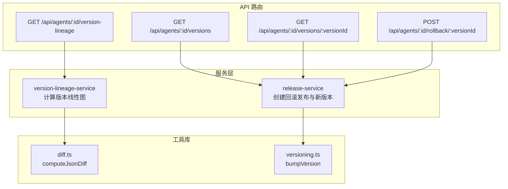
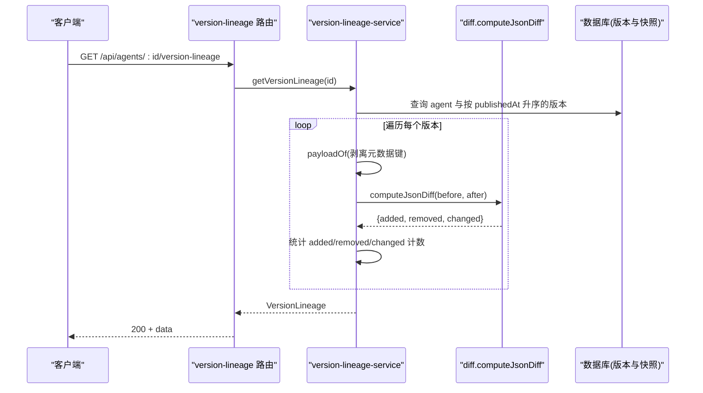
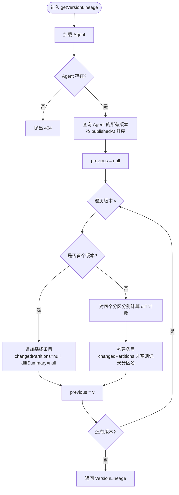
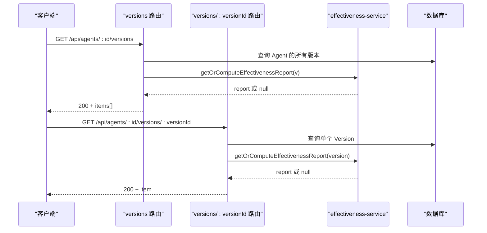
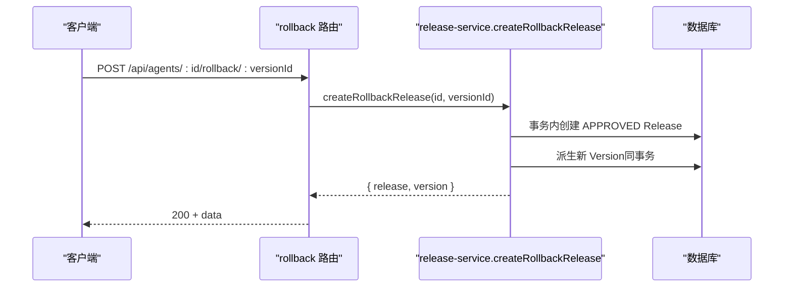
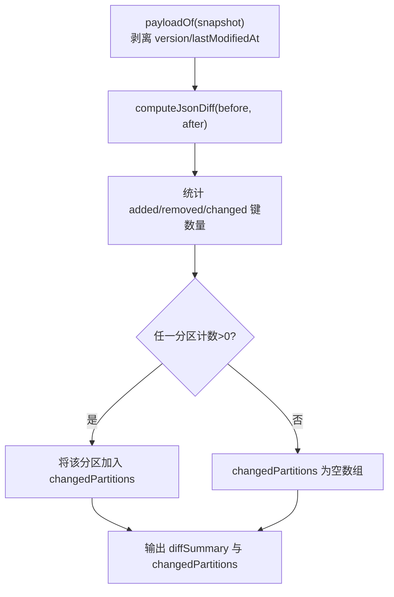
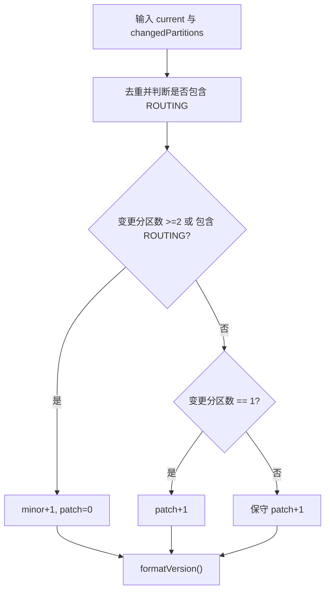
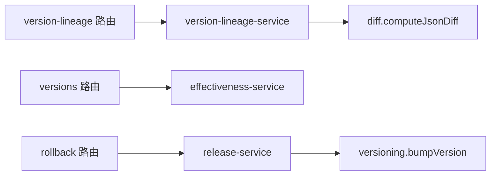

# 版本线性和对比 API

<cite>
**本文引用的文件**   
- [apps/web/app/api/agents/[id]/version-lineage/route.ts](file://apps/web/app/api/agents/[id]/version-lineage/route.ts)
- [apps/web/lib/services/version-lineage-service.ts](file://apps/web/lib/services/version-lineage-service.ts)
- [apps/web/lib/diff.ts](file://apps/web/lib/diff.ts)
- [apps/web/lib/versioning.ts](file://apps/web/lib/versioning.ts)
- [apps/web/app/api/agents/[id]/versions/route.ts](file://apps/web/app/api/agents/[id]/versions/route.ts)
- [apps/web/app/api/agents/[id]/versions/[versionId]/route.ts](file://apps/web/app/api/agents/[id]/versions/[versionId]/route.ts)
- [apps/web/app/api/agents/[id]/rollback/[versionId]/route.ts](file://apps/web/app/api/agents/[id]/rollback/[versionId]/route.ts)
- [apps/web/lib/services/release-service.ts](file://apps/web/lib/services/release-service.ts)
- [apps/web/app/api/__tests__/version-lineage.test.ts](file://apps/web/app/api/__tests__/version-lineage.test.ts)
</cite>

## 目录
1. [简介](#简介)
2. [项目结构](#项目结构)
3. [核心组件](#核心组件)
4. [架构总览](#架构总览)
5. [详细组件分析](#详细组件分析)
6. [依赖关系分析](#依赖关系分析)
7. [性能考虑](#性能考虑)
8. [故障排查指南](#故障排查指南)
9. [结论](#结论)
10. [附录](#附录)

## 简介
本文件面向“版本线性与对比”相关 API，覆盖以下能力：
- 获取某 Agent 的版本线性图（演进历史）
- 对比两个版本的差异（基于四分区结构化 diff）
- 版本继承关系与分支管理策略（语义化版本号、分区影响面）
- 版本差异数据结构（新增字段、删除字段、变更字段计数）
- 完整操作示例（获取线性图、对比差异、回滚到指定版本）
- 可视化展示建议与数据格式规范

该能力以只读聚合方式提供，不引入新存储，保持对现有 /versions 接口的向后兼容。

## 项目结构
与版本线性与对比相关的代码主要位于 Next.js App Router 的 API 路由与服务层：
- API 路由：暴露 REST 端点
- 服务层：实现业务逻辑（版本线性计算、diff 统计、回滚流程）
- 工具库：JSON diff 算法、语义化版本计算

**图表来源**
- [apps/web/app/api/agents/[id]/version-lineage/route.ts:1-19](file://apps/web/app/api/agents/[id]/version-lineage/route.ts#L1-L19)
- [apps/web/lib/services/version-lineage-service.ts:1-125](file://apps/web/lib/services/version-lineage-service.ts#L1-L125)
- [apps/web/lib/diff.ts:1-35](file://apps/web/lib/diff.ts#L1-L35)
- [apps/web/lib/versioning.ts:1-70](file://apps/web/lib/versioning.ts#L1-L70)
- [apps/web/app/api/agents/[id]/versions/route.ts:1-53](file://apps/web/app/api/agents/[id]/versions/route.ts#L1-L53)
- [apps/web/app/api/agents/[id]/versions/[versionId]/route.ts:1-40](file://apps/web/app/api/agents/[id]/versions/[versionId]/route.ts#L1-L40)
- [apps/web/app/api/agents/[id]/rollback/[versionId]/route.ts:1-36](file://apps/web/app/api/agents/[id]/rollback/[versionId]/route.ts#L1-L36)
- [apps/web/lib/services/release-service.ts:307-347](file://apps/web/lib/services/release-service.ts#L307-L347)

**章节来源**
- [apps/web/app/api/agents/[id]/version-lineage/route.ts:1-19](file://apps/web/app/api/agents/[id]/version-lineage/route.ts#L1-L19)
- [apps/web/lib/services/version-lineage-service.ts:1-125](file://apps/web/lib/services/version-lineage-service.ts#L1-L125)

## 核心组件
- 版本线性接口
  - GET /api/agents/{id}/version-lineage：返回按发布时间升序的演进线，相邻版本做四分区 diff，首版本为基线。
- 版本列表与详情接口
  - GET /api/agents/{id}/versions：返回所有已发布 Version（含四分区快照），用于历史浏览与回滚选择。
  - GET /api/agents/{id}/versions/{versionId}：返回单个 Version 详情。
- 回滚接口
  - POST /api/agents/{id}/rollback/{versionId}：整版本回滚，生成 APPROVED 的 Release 并派生新版本。
- 工具库
  - computeJsonDiff：计算 JSON 对象的新增、删除、变更键集合。
  - bumpVersion：根据分区变更集合计算下一个语义化版本号。

**章节来源**
- [apps/web/app/api/agents/[id]/version-lineage/route.ts:1-19](file://apps/web/app/api/agents/[id]/version-lineage/route.ts#L1-L19)
- [apps/web/app/api/agents/[id]/versions/route.ts:1-53](file://apps/web/app/api/agents/[id]/versions/route.ts#L1-L53)
- [apps/web/app/api/agents/[id]/versions/[versionId]/route.ts:1-40](file://apps/web/app/api/agents/[id]/versions/[versionId]/route.ts#L1-L40)
- [apps/web/app/api/agents/[id]/rollback/[versionId]/route.ts:1-36](file://apps/web/app/api/agents/[id]/rollback/[versionId]/route.ts#L1-L36)
- [apps/web/lib/diff.ts:1-35](file://apps/web/lib/diff.ts#L1-L35)
- [apps/web/lib/versioning.ts:1-70](file://apps/web/lib/versioning.ts#L1-L70)

## 架构总览
版本线性与对比的整体调用链如下：

**图表来源**
- [apps/web/app/api/agents/[id]/version-lineage/route.ts:1-19](file://apps/web/app/api/agents/[id]/version-lineage/route.ts#L1-L19)
- [apps/web/lib/services/version-lineage-service.ts:57-124](file://apps/web/lib/services/version-lineage-service.ts#L57-L124)
- [apps/web/lib/diff.ts:9-34](file://apps/web/lib/diff.ts#L9-L34)

## 详细组件分析

### 版本线性接口：GET /api/agents/{id}/version-lineage
- 功能
  - 读取 Agent 的所有已发布版本，按 publishedAt 升序组成演进线。
  - 对相邻版本进行四分区（PROMPT、KNOWLEDGE、TOOLS、ROUTING）结构化 diff。
  - 首版本为基线：changedPartitions 与 diffSummary 为 null。
  - 后续版本给出 vs 上一版本的分区变更计数；无变更时 changedPartitions 为空数组。
- 请求参数
  - path: id = Agent 标识
- 响应结构
  - data.agentId: string
  - data.agentName: string | null
  - data.computedAt: string (ISO 时间)
  - data.lineage: VersionLineageEntry[]
    - versionId: string
    - version: string
    - publishedAt: string
    - changeNote: string | null
    - changedPartitions: string[] | null
    - diffSummary: Record<string, PartitionDiffCount> | null
      - PROMPT/KNOWLEDGE/TOOLS/ROUTING → { added: number, removed: number, changed: number }
- 错误处理
  - Agent 不存在 → 404
- 行为约束
  - 只读聚合，不修改现有 /versions 响应形状。

**图表来源**
- [apps/web/lib/services/version-lineage-service.ts:76-124](file://apps/web/lib/services/version-lineage-service.ts#L76-L124)

**章节来源**
- [apps/web/app/api/agents/[id]/version-lineage/route.ts:1-19](file://apps/web/app/api/agents/[id]/version-lineage/route.ts#L1-L19)
- [apps/web/lib/services/version-lineage-service.ts:1-125](file://apps/web/lib/services/version-lineage-service.ts#L1-L125)
- [apps/web/app/api/__tests__/version-lineage.test.ts:61-138](file://apps/web/app/api/__tests__/version-lineage.test.ts#L61-L138)

### 版本列表与详情接口
- GET /api/agents/{id}/versions
  - 返回所有已发布 Version，按 publishedAt 倒序。
  - 每个 Version 包含四分区 snapshot，供前端展示与一键回滚。
  - 若某 Version 距今 ≥7 天且 effectivenessReport 缺失，则 lazy 计算并写回。
- GET /api/agents/{id}/versions/{versionId}
  - 返回指定 Version 的全部字段，包括四分区 snapshot、changeNote 等。
  - 同样支持 effectivenessReport 的 lazy fill。

**图表来源**
- [apps/web/app/api/agents/[id]/versions/route.ts:18-52](file://apps/web/app/api/agents/[id]/versions/route.ts#L18-L52)
- [apps/web/app/api/agents/[id]/versions/[versionId]/route.ts:15-39](file://apps/web/app/api/agents/[id]/versions/[versionId]/route.ts#L15-L39)

**章节来源**
- [apps/web/app/api/agents/[id]/versions/route.ts:1-53](file://apps/web/app/api/agents/[id]/versions/route.ts#L1-L53)
- [apps/web/app/api/agents/[id]/versions/[versionId]/route.ts:1-40](file://apps/web/app/api/agents/[id]/versions/[versionId]/route.ts#L1-L40)

### 回滚接口：POST /api/agents/{id}/rollback/{versionId}
- 功能
  - 将 Agent 的四个 active config 覆盖为目标 Version 的 snapshot。
  - 写入 status=APPROVED 的 release（含 configSnapshot）作为追溯。
  - 派生新 Version（版本号自增），确保历史快照不可变。
  - 写入审计日志 action="agent.rollback"。
- 请求参数
  - path: id = Agent 标识；versionId = 目标 Version 的 id
- 响应结构
  - data.release: Release 对象（含 isRollback=true、rollbackFromVersion 等）
  - data.version: 新派生的 Version 对象
  - data.restoredFrom: { id, version } 指向被回滚的目标版本
- 错误处理
  - 目标 Version 不存在 → 404
  - Version 不属于该 Agent → 422
  - Agent 不存在 → 404

**图表来源**
- [apps/web/app/api/agents/[id]/rollback/[versionId]/route.ts:21-35](file://apps/web/app/api/agents/[id]/rollback/[versionId]/route.ts#L21-L35)
- [apps/web/lib/services/release-service.ts:307-347](file://apps/web/lib/services/release-service.ts#L307-L347)

**章节来源**
- [apps/web/app/api/agents/[id]/rollback/[versionId]/route.ts:1-36](file://apps/web/app/api/agents/[id]/rollback/[versionId]/route.ts#L1-L36)
- [apps/web/lib/services/release-service.ts:307-347](file://apps/web/lib/services/release-service.ts#L307-L347)

### 版本差异数据结构与算法
- 四分区
  - PROMPT、KNOWLEDGE、TOOLS、ROUTING
- 快照处理
  - 从 JSON 文本还原对象后，剥离元数据键 version/lastModifiedAt，仅比较真实配置内容。
- diff 结果
  - added: 新增键集合
  - removed: 删除键集合
  - changed: 变更键集合（包含 before/after）
- 计数规则
  - 对每个分区统计 added/removed/changed 的数量。
  - 若任一分区计数 >0，则该分区加入 changedPartitions。
- 基线与无变更
  - 首个版本为基线：changedPartitions=null，diffSummary=null。
  - 后续版本若无变更：changedPartitions=[]，diffSummary 各分区计数均为 0。

**图表来源**
- [apps/web/lib/services/version-lineage-service.ts:57-74](file://apps/web/lib/services/version-lineage-service.ts#L57-L74)
- [apps/web/lib/diff.ts:9-34](file://apps/web/lib/diff.ts#L9-L34)

**章节来源**
- [apps/web/lib/services/version-lineage-service.ts:19-74](file://apps/web/lib/services/version-lineage-service.ts#L19-L74)
- [apps/web/lib/diff.ts:1-35](file://apps/web/lib/diff.ts#L1-L35)

### 版本继承关系与分支管理策略
- 语义化版本（SemVer）
  - 首次发布：0.1.0
  - ROUTING 分区变更（影响工单路由/转人工阈值，行为面广）→ minor
  - 任意 ≥2 个分区变更 → minor
  - 单个非路由分区变更（Prompt/Knowledge/Tools）→ patch
  - 同时变更全部 4 个分区 → minor（避免 major 膨胀；major 留给破坏性重写的人工显式标注）
- 版本递增
  - bumpVersion(current, changedPartitions) 根据上述规则计算下一版本号。
- 回滚后的版本
  - 回滚会派生新 Version，版本号高于现有最高版本（遵循 SemVer 规则）。

**图表来源**
- [apps/web/lib/versioning.ts:28-69](file://apps/web/lib/versioning.ts#L28-L69)

**章节来源**
- [apps/web/lib/versioning.ts:1-70](file://apps/web/lib/versioning.ts#L1-L70)

## 依赖关系分析
- 路由层依赖服务层
  - version-lineage 路由 → version-lineage-service
  - versions 路由 → effectiveness-service（lazy fill）
  - rollback 路由 → release-service
- 服务层依赖工具库
  - version-lineage-service → diff.computeJsonDiff
  - release-service → versioning.bumpVersion
- 测试用例验证关键路径
  - version-lineage.test.ts 验证了基线、相邻版本 diff、乱序写入排序、null 快照处理等行为。

**图表来源**
- [apps/web/app/api/agents/[id]/version-lineage/route.ts:1-19](file://apps/web/app/api/agents/[id]/version-lineage/route.ts#L1-L19)
- [apps/web/lib/services/version-lineage-service.ts:1-125](file://apps/web/lib/services/version-lineage-service.ts#L1-L125)
- [apps/web/app/api/agents/[id]/versions/route.ts:1-53](file://apps/web/app/api/agents/[id]/versions/route.ts#L1-L53)
- [apps/web/app/api/agents/[id]/rollback/[versionId]/route.ts:1-36](file://apps/web/app/api/agents/[id]/rollback/[versionId]/route.ts#L1-L36)
- [apps/web/lib/diff.ts:1-35](file://apps/web/lib/diff.ts#L1-L35)
- [apps/web/lib/versioning.ts:1-70](file://apps/web/lib/versioning.ts#L1-L70)

**章节来源**
- [apps/web/app/api/__tests__/version-lineage.test.ts:1-139](file://apps/web/app/api/__tests__/version-lineage.test.ts#L1-L139)

## 性能考虑
- 版本线性计算为只读聚合，复杂度与版本数量线性相关；每次请求按 publishedAt 升序遍历并逐对 diff。
- 快照为列存 JSON 文本，需先 unpack 再剥离元数据键，注意大对象 diff 的成本。
- 建议在高频访问场景下对 computedAt 做缓存（例如短 TTL），以减少重复计算。
- 对大型快照可考虑增量 diff 或分块比较，以降低 CPU 占用。

[本节为通用指导，不涉及具体文件分析]

## 故障排查指南
- 404 未找到
  - Agent 不存在：检查 path id 是否正确。
  - Version 不存在：确认 versionId 是否存在且属于该 Agent。
- 422 参数校验失败
  - Version 不属于该 Agent：检查跨 Agent 误用。
- 版本线性异常
  - 基线字段为 null：符合预期（首个版本）。
  - changedPartitions 为空数组：表示相邻版本无变更，符合预期。
  - diffSummary 计数异常：检查快照是否包含元数据键（应被剥离），以及 JSON 解析是否正常。
- 回滚失败
  - 目标 Version 不存在或归属不同 Agent：检查传入 versionId。
  - 新版本号不符合预期：确认 SemVer 规则与分区变更集合。

**章节来源**
- [apps/web/app/api/agents/[id]/version-lineage/route.ts:13-18](file://apps/web/app/api/agents/[id]/version-lineage/route.ts#L13-L18)
- [apps/web/app/api/agents/[id]/versions/[versionId]/route.ts:20-25](file://apps/web/app/api/agents/[id]/versions/[versionId]/route.ts#L20-L25)
- [apps/web/app/api/agents/[id]/rollback/[versionId]/route.ts:27-35](file://apps/web/app/api/agents/[id]/rollback/[versionId]/route.ts#L27-L35)

## 结论
- 版本线性 API 提供了按时间顺序的演进视图，并通过四分区 diff 量化变更影响面。
- 语义化版本规则将分区影响面映射到版本号增长策略，便于理解变更范围。
- 回滚接口保证组合一致性，通过 APPROVED Release 与审计日志实现可追溯。
- 建议在可视化层使用线性图与分区变更高亮，结合 diffSummary 展示新增、删除、变更键的分布。

[本节为总结性内容，不涉及具体文件分析]

## 附录

### API 定义与示例

#### 获取版本线性图
- 方法：GET
- 路径：/api/agents/{id}/version-lineage
- 成功响应示例（结构说明）
  - data.agentId: string
  - data.agentName: string | null
  - data.computedAt: string
  - data.lineage: VersionLineageEntry[]
    - versionId: string
    - version: string
    - publishedAt: string
    - changeNote: string | null
    - changedPartitions: string[] | null
    - diffSummary: Record<string, PartitionDiffCount> | null
- 错误码
  - 404：Agent 不存在

**章节来源**
- [apps/web/app/api/agents/[id]/version-lineage/route.ts:5-18](file://apps/web/app/api/agents/[id]/version-lineage/route.ts#L5-L18)
- [apps/web/lib/services/version-lineage-service.ts:32-55](file://apps/web/lib/services/version-lineage-service.ts#L32-L55)

#### 获取版本列表
- 方法：GET
- 路径：/api/agents/{id}/versions
- 成功响应示例（结构说明）
  - data.items: VersionResponse[]
  - data.total: number
- 备注
  - 对旧版本可能触发 effectivenessReport 的 lazy fill。

**章节来源**
- [apps/web/app/api/agents/[id]/versions/route.ts:8-17](file://apps/web/app/api/agents/[id]/versions/route.ts#L8-L17)
- [apps/web/app/api/agents/[id]/versions/route.ts:18-52](file://apps/web/app/api/agents/[id]/versions/route.ts#L18-L52)

#### 获取版本详情
- 方法：GET
- 路径：/api/agents/{id}/versions/{versionId}
- 成功响应示例（结构说明）
  - data: VersionResponse（含四分区 snapshot、changeNote 等）
- 错误码
  - 404：Version 不存在
  - 422：Version 不属于该 Agent

**章节来源**
- [apps/web/app/api/agents/[id]/versions/[versionId]/route.ts:9-14](file://apps/web/app/api/agents/[id]/versions/[versionId]/route.ts#L9-L14)
- [apps/web/app/api/agents/[id]/versions/[versionId]/route.ts:15-39](file://apps/web/app/api/agents/[id]/versions/[versionId]/route.ts#L15-L39)

#### 回滚到指定版本
- 方法：POST
- 路径：/api/agents/{id}/rollback/{versionId}
- 成功响应示例（结构说明）
  - data.release: Release（isRollback=true，含 rollbackFromVersion）
  - data.version: 新派生的 Version
  - data.restoredFrom: { id, version }
- 错误码
  - 404：目标 Version 不存在或 Agent 不存在
  - 422：Version 不属于该 Agent

**章节来源**
- [apps/web/app/api/agents/[id]/rollback/[versionId]/route.ts:6-20](file://apps/web/app/api/agents/[id]/rollback/[versionId]/route.ts#L6-L20)
- [apps/web/app/api/agents/[id]/rollback/[versionId]/route.ts:21-35](file://apps/web/app/api/agents/[id]/rollback/[versionId]/route.ts#L21-L35)
- [apps/web/lib/services/release-service.ts:307-347](file://apps/web/lib/services/release-service.ts#L307-L347)

### 可视化展示建议
- 线性图
  - 横轴：publishedAt（时间）
  - 节点：每个 Version（显示 version 与 changeNote）
  - 边：相邻版本之间的 diffSummary（可用颜色深浅表示变更强度）
- 分区变更高亮
  - 在节点旁列出 changedPartitions，并用图标标记新增/删除/变更数量。
- 交互
  - 点击节点可查看 diffSummary 详情（新增/删除/变更键列表）。
  - 支持跳转到对应 Version 详情或执行回滚。

[本节为概念性说明，不涉及具体文件分析]