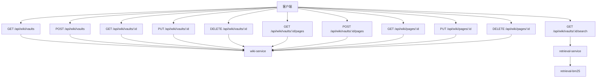
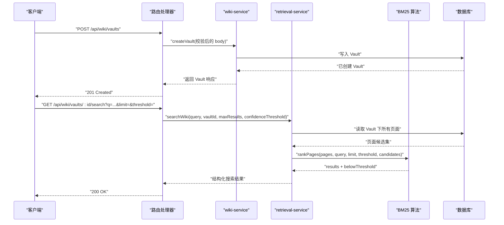
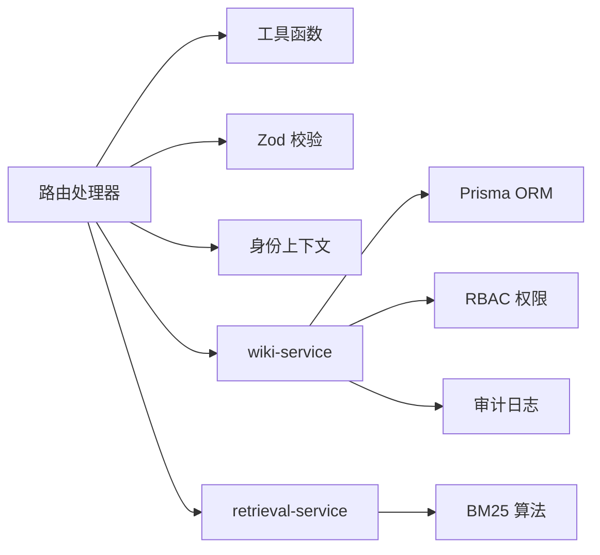
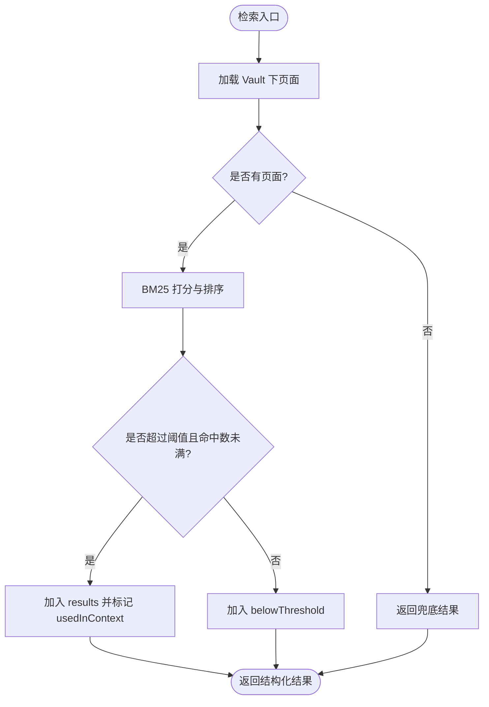

# 知识库 API

<cite>
**本文引用的文件**   
- [apps/web/app/api/wiki/vaults/route.ts](file://apps/web/app/api/wiki/vaults/route.ts)
- [apps/web/app/api/wiki/vaults/[id]/route.ts](file://apps/web/app/api/wiki/vaults/[id]/route.ts)
- [apps/web/app/api/wiki/vaults/[id]/pages/route.ts](file://apps/web/app/api/wiki/vaults/[id]/pages/route.ts)
- [apps/web/app/api/wiki/vaults/[id]/search/route.ts](file://apps/web/app/api/wiki/vaults/[id]/search/route.ts)
- [apps/web/app/api/wiki/pages/[id]/route.ts](file://apps/web/app/api/wiki/pages/[id]/route.ts)
- [apps/web/lib/services/wiki-service.ts](file://apps/web/lib/services/wiki-service.ts)
- [apps/web/lib/services/retrieval-service.ts](file://apps/web/lib/services/retrieval-service.ts)
- [apps/web/lib/retrieval-bm25.ts](file://apps/web/lib/retrieval-bm25.ts)
- [apps/web/lib/schemas.ts](file://apps/web/lib/schemas.ts)
- [apps/web/app/api/__tests__/wiki-crud.test.ts](file://apps/web/app/api/__tests__/wiki-crud.test.ts)
- [apps/web/app/api/__tests__/wiki-search.test.ts](file://apps/web/app/api/__tests__/wiki-search.test.ts)
- [apps/web/lib/__tests__/retrieval-service.test.ts](file://apps/web/lib/__tests__/retrieval-service.test.ts)
</cite>

## 目录
1. [简介](#简介)
2. [项目结构](#项目结构)
3. [核心组件](#核心组件)
4. [架构总览](#架构总览)
5. [详细接口说明](#详细接口说明)
6. [依赖关系分析](#依赖关系分析)
7. [性能与检索特性](#性能与检索特性)
8. [故障排查](#故障排查)
9. [结论](#结论)

## 简介
本文件为知识库（Wiki）相关 API 的完整技术文档，覆盖以下能力：
- Vault 管理：创建、查询、更新、删除。
- 页面 CRUD：在指定 Vault 下创建、分页查询、获取、更新、删除页面。
- 搜索检索：基于 BM25-lite 的向量/全文检索，支持置信度阈值与结果上限控制。
- 多仓库支持：通过 Vault 隔离不同 Agent 或业务域的知识集合，支持共享标记与按 Agent 过滤。
- Git 同步机制：Vault 模型包含外部 Git 仓库地址与分支字段；当前实现以配置为主，未暴露显式同步端点。
- 元数据与全文搜索：页面包含标题、内容、摘要、标签、分类、链接、来源、生命周期、分级、基础置信度等字段；检索服务对标题、标签、摘要、正文进行加权打分。

该 API 采用 Next.js App Router 的路由处理器，结合 Zod 校验、RBAC 权限检查、审计日志与 Prisma ORM，面向前端与外部系统集成。

## 项目结构
知识库 API 位于 `apps/web/app/api/wiki` 下，路由组织如下：
- `/api/wiki/vaults`：Vault 列表与创建。
- `/api/wiki/vaults/:id`：单个 Vault 详情、更新、删除。
- `/api/wiki/vaults/:id/pages`：指定 Vault 下的页面列表与创建。
- `/api/wiki/vaults/:id/search`：针对 Vault 的检索接口。
- `/api/wiki/pages/:id`：跨 Vault 的页面详情、更新、删除。



**图表来源**
- [apps/web/app/api/wiki/vaults/route.ts:7-29](file://apps/web/app/api/wiki/vaults/route.ts#L7-L29)
- [apps/web/app/api/wiki/vaults/[id]/route.ts:7-37](file://apps/web/app/api/wiki/vaults/[id]/route.ts#L7-L37)
- [apps/web/app/api/wiki/vaults/[id]/pages/route.ts:7-33](file://apps/web/app/api/wiki/vaults/[id]/pages/route.ts#L7-L33)
- [apps/web/app/api/wiki/vaults/[id]/search/route.ts:8-34](file://apps/web/app/api/wiki/vaults/[id]/search/route.ts#L8-L34)
- [apps/web/app/api/wiki/pages/[id]/route.ts:7-37](file://apps/web/app/api/wiki/pages/[id]/route.ts#L7-L37)
- [apps/web/lib/services/wiki-service.ts:65-297](file://apps/web/lib/services/wiki-service.ts#L65-L297)
- [apps/web/lib/services/retrieval-service.ts:91-119](file://apps/web/lib/services/retrieval-service.ts#L91-L119)
- [apps/web/lib/retrieval-bm25.ts:143-197](file://apps/web/lib/retrieval-bm25.ts#L143-L197)

**章节来源**
- [apps/web/app/api/wiki/vaults/route.ts:1-30](file://apps/web/app/api/wiki/vaults/route.ts#L1-L30)
- [apps/web/app/api/wiki/vaults/[id]/route.ts:1-38](file://apps/web/app/api/wiki/vaults/[id]/route.ts#L1-L38)
- [apps/web/app/api/wiki/vaults/[id]/pages/route.ts:1-34](file://apps/web/app/api/wiki/vaults/[id]/pages/route.ts#L1-L34)
- [apps/web/app/api/wiki/vaults/[id]/search/route.ts:1-35](file://apps/web/app/api/wiki/vaults/[id]/search/route.ts#L1-L35)
- [apps/web/app/api/wiki/pages/[id]/route.ts:1-38](file://apps/web/app/api/wiki/pages/[id]/route.ts#L1-L38)

## 核心组件
- 路由层：Next.js Route Handler，负责参数解析、请求体校验、错误封装与统一响应。
- 服务层：
  - wiki-service：Vault 与页面的持久化、权限校验、审计记录、数据转换。
  - retrieval-service：从数据库加载候选页面，调用 BM25 算法计算相关性并返回结构化结果。
- 算法层：retrieval-bm25，零依赖纯函数模块，提供分词、打分、归一化与阈值切分逻辑。
- 校验层：schemas.ts，使用 Zod 定义 Vault/Page/Search 的请求体与查询参数约束。
- 上下文与权限：withActor/resolveActor 注入操作者身份；requirePermission 强制 wiki:write 写权限。

**章节来源**
- [apps/web/lib/services/wiki-service.ts:1-297](file://apps/web/lib/services/wiki-service.ts#L1-L297)
- [apps/web/lib/services/retrieval-service.ts:1-120](file://apps/web/lib/services/retrieval-service.ts#L1-L120)
- [apps/web/lib/retrieval-bm25.ts:1-198](file://apps/web/lib/retrieval-bm25.ts#L1-L198)
- [apps/web/lib/schemas.ts:192-250](file://apps/web/lib/schemas.ts#L192-L250)

## 架构总览
知识库 API 的整体调用链如下：
- Vault 与页面读写：Route → wiki-service → Prisma → 数据库。
- 检索：Route → retrieval-service → Prisma → retrieval-bm25 → 返回结果。
- 权限与审计：所有写操作经 withActor + requirePermission，并在关键变更处记录审计日志。



**图表来源**
- [apps/web/app/api/wiki/vaults/route.ts:17-29](file://apps/web/app/api/wiki/vaults/route.ts#L17-L29)
- [apps/web/lib/services/wiki-service.ts:96-119](file://apps/web/lib/services/wiki-service.ts#L96-L119)
- [apps/web/app/api/wiki/vaults/[id]/search/route.ts:8-34](file://apps/web/app/api/wiki/vaults/[id]/search/route.ts#L8-L34)
- [apps/web/lib/services/retrieval-service.ts:91-119](file://apps/web/lib/services/retrieval-service.ts#L91-L119)
- [apps/web/lib/retrieval-bm25.ts:143-197](file://apps/web/lib/retrieval-bm25.ts#L143-L197)

## 详细接口说明

### Vault 管理

#### 列出 Vault
- 方法：GET
- 路径：`/api/wiki/vaults`
- 查询参数：
  - page：页码
  - pageSize：每页数量
  - agentId：按 Agent 过滤
  - shared：true/false，是否仅返回共享库
- 响应：
  - items：Vault 列表
  - pagination：分页元信息
- 行为：
  - 支持按 agentId 与 isShared 过滤。
  - 返回列表包含关联计数与 Agent 基本信息。

示例请求：
```
GET /api/wiki/vaults?page=1&pageSize=10&agentId=AGENT_ID&shared=true
```

示例响应（结构）：
```json
{
  "data": {
    "items": [
      {
        "id": "vault-id",
        "name": "知识库名称",
        "description": "描述",
        "agentId": "agent-id",
        "isShared": true,
        "gitRepoUrl": "https://github.com/org/repo",
        "gitBranch": "main",
        "pageCount": 10,
        "avgConfidence": 0.75,
        "orphanCount": 0,
        "createdAt": "2026-01-01T00:00:00Z",
        "updatedAt": "2026-01-02T00:00:00Z",
        "_count": { "pages": 10, "ingestJobs": 0 },
        "agent": { "id": "agent-id", "name": "Agent 名称" }
      }
    ],
    "pagination": { "page": 1, "pageSize": 10, "total": 1 }
  }
}
```

**章节来源**
- [apps/web/app/api/wiki/vaults/route.ts:7-15](file://apps/web/app/api/wiki/vaults/route.ts#L7-L15)
- [apps/web/lib/services/wiki-service.ts:65-86](file://apps/web/lib/services/wiki-service.ts#L65-L86)
- [apps/web/lib/schemas.ts:192-207](file://apps/web/lib/schemas.ts#L192-L207)

#### 创建 Vault
- 方法：POST
- 路径：`/api/wiki/vaults`
- 请求体：
  - name：必填，最大 200
  - description：可选，最大 2000
  - agentId：可选，可为 null
  - gitRepoUrl：可选，URL 格式或空字符串
  - gitBranch：可选，最大 200，默认 main
  - isShared：可选，布尔值
- 响应：201 Created，返回新 Vault。
- 权限：需要 wiki:write。

示例请求体：
```json
{
  "name": "产品知识",
  "description": "产品功能与 FAQ",
  "agentId": "agent-id",
  "gitRepoUrl": "https://github.com/org/repo",
  "gitBranch": "main",
  "isShared": false
}
```

**章节来源**
- [apps/web/app/api/wiki/vaults/route.ts:17-29](file://apps/web/app/api/wiki/vaults/route.ts#L17-L29)
- [apps/web/lib/services/wiki-service.ts:96-119](file://apps/web/lib/services/wiki-service.ts#L96-L119)
- [apps/web/lib/schemas.ts:192-199](file://apps/web/lib/schemas.ts#L192-L199)

#### 获取 Vault
- 方法：GET
- 路径：`/api/wiki/vaults/:id`
- 响应：Vault 详情，不存在时返回 404。

示例请求：
```
GET /api/wiki/vaults/vault-id
```

**章节来源**
- [apps/web/app/api/wiki/vaults/[id]/route.ts:7-12](file://apps/web/app/api/wiki/vaults/[id]/route.ts#L7-L12)
- [apps/web/lib/services/wiki-service.ts:88-94](file://apps/web/lib/services/wiki-service.ts#L88-L94)

#### 更新 Vault
- 方法：PUT
- 路径：`/api/wiki/vaults/:id`
- 请求体：
  - name：可选，最大 200
  - description：可选，可为 null
  - gitRepoUrl：可选，URL 格式或空字符串
  - gitBranch：可选，可为 null
  - isShared：可选
- 权限：需要 wiki:write。

示例请求体：
```json
{
  "name": "更新后的名称",
  "isShared": true
}
```

**章节来源**
- [apps/web/app/api/wiki/vaults/[id]/route.ts:14-27](file://apps/web/app/api/wiki/vaults/[id]/route.ts#L14-L27)
- [apps/web/lib/services/wiki-service.ts:121-133](file://apps/web/lib/services/wiki-service.ts#L121-L133)
- [apps/web/lib/schemas.ts:201-207](file://apps/web/lib/schemas.ts#L201-L207)

#### 删除 Vault
- 方法：DELETE
- 路径：`/api/wiki/vaults/:id`
- 权限：需要 wiki:write。
- 行为：级联删除该 Vault 下的 pages 与 ingestJobs。

示例请求：
```
DELETE /api/wiki/vaults/vault-id
```

**章节来源**
- [apps/web/app/api/wiki/vaults/[id]/route.ts:29-37](file://apps/web/app/api/wiki/vaults/[id]/route.ts#L29-L37)
- [apps/web/lib/services/wiki-service.ts:135-144](file://apps/web/lib/services/wiki-service.ts#L135-L144)

### 页面管理

#### 列出页面
- 方法：GET
- 路径：`/api/wiki/vaults/:id/pages`
- 查询参数：
  - page、pageSize：分页
  - lifecycle：生命周期过滤（如 DRAFT、IN_REVIEW、VERIFIED、STALE、DEPRECATED）
  - tier：分级过滤（CORE、SPECIALIZED、EDGE_CASE）
  - search：关键字搜索（标题与内容）
- 行为：
  - 当存在 tag 或 search 时，服务端先取数再内存过滤，total 为过滤后口径。
  - 返回列表包含页面元数据与旧 JSON 契约兼容字段。

示例请求：
```
GET /api/wiki/vaults/vault-id/pages?page=1&pageSize=10&lifecycle=DRAFT&tier=SPECIALIZED&search=关键词
```

**章节来源**
- [apps/web/app/api/wiki/vaults/[id]/pages/route.ts:7-17](file://apps/web/app/api/wiki/vaults/[id]/pages/route.ts#L7-L17)
- [apps/web/lib/services/wiki-service.ts:146-196](file://apps/web/lib/services/wiki-service.ts#L146-L196)

#### 创建页面
- 方法：POST
- 路径：`/api/wiki/vaults/:id/pages`
- 请求体：
  - vaultId：必填（会被 path 的 id 覆盖）
  - title：必填，最大 300
  - slug：必填，最大 300，同 vault 下唯一
  - content：必填
  - summary：可选，最大 1000
  - provenance：可选，枚举 AUTHORED/EXTRACTED/DISTILLED/IMPORTED/SYNTHESIZED
  - lifecycle：可选，枚举 DRAFT/IN_REVIEW/VERIFIED/STALE/DEPRECATED
  - tier：可选，枚举 CORE/SPECIALIZED/EDGE_CASE
  - baseConfidence：可选，0-1
  - tags/categories/wikilinks：可选，字符串数组
- 权限：需要 wiki:write。
- 行为：
  - 若 slug 重复，返回冲突错误。
  - filePath 默认生成 `<slug>.md`。

示例请求体：
```json
{
  "title": "安装指南",
  "slug": "install-guide",
  "content": "安装步骤...",
  "summary": "简要说明",
  "tags": ["安装", "入门"],
  "categories": ["用户指南"],
  "wikilinks": ["faq", "troubleshooting"]
}
```

**章节来源**
- [apps/web/app/api/wiki/vaults/[id]/pages/route.ts:19-33](file://apps/web/app/api/wiki/vaults/[id]/pages/route.ts#L19-L33)
- [apps/web/lib/services/wiki-service.ts:211-259](file://apps/web/lib/services/wiki-service.ts#L211-L259)
- [apps/web/lib/schemas.ts:217-230](file://apps/web/lib/schemas.ts#L217-L230)

#### 获取页面
- 方法：GET
- 路径：`/api/wiki/pages/:id`
- 响应：页面详情，包含所属 Vault 的基本信息。

示例请求：
```
GET /api/wiki/pages/page-id
```

**章节来源**
- [apps/web/app/api/wiki/pages/[id]/route.ts:7-12](file://apps/web/app/api/wiki/pages/[id]/route.ts#L7-L12)
- [apps/web/lib/services/wiki-service.ts:198-209](file://apps/web/lib/services/wiki-service.ts#L198-L209)

#### 更新页面
- 方法：PUT
- 路径：`/api/wiki/pages/:id`
- 请求体：
  - title/content/summary/provenance/lifecycle/tier/baseConfidence/tags/categories/wikilinks 均为可选。
- 权限：需要 wiki:write。
- 行为：
  - 对 tags/categories/wikilinks/sourceRefs 等数组字段，服务端会序列化为 JSON 文本存储。

示例请求体：
```json
{
  "title": "更新后的标题",
  "content": "更新后的内容",
  "tags": ["更新", "维护"]
}
```

**章节来源**
- [apps/web/app/api/wiki/pages/[id]/route.ts:14-27](file://apps/web/app/api/wiki/pages/[id]/route.ts#L14-L27)
- [apps/web/lib/services/wiki-service.ts:261-284](file://apps/web/lib/services/wiki-service.ts#L261-L284)
- [apps/web/lib/schemas.ts:232-243](file://apps/web/lib/schemas.ts#L232-L243)

#### 删除页面
- 方法：DELETE
- 路径：`/api/wiki/pages/:id`
- 权限：需要 wiki:write。

示例请求：
```
DELETE /api/wiki/pages/page-id
```

**章节来源**
- [apps/web/app/api/wiki/pages/[id]/route.ts:29-37](file://apps/web/app/api/wiki/pages/[id]/route.ts#L29-L37)
- [apps/web/lib/services/wiki-service.ts:286-297](file://apps/web/lib/services/wiki-service.ts#L286-L297)

### 搜索检索

#### Vault 内检索
- 方法：GET
- 路径：`/api/wiki/vaults/:id/search`
- 查询参数：
  - q：必填，检索词，最大 500
  - limit：可选，整数 1-20，默认 5
  - threshold：可选，0-1，默认 0.35
- 响应：
  - query：原始查询
  - strategy：策略名（BM25_LITE）
  - candidates：候选页面总数
  - results：命中结果，包含 pageId/title/slug/score/confidence/excerpt/usedInContext
  - belowThreshold：低于阈值的候选
  - fallbackTriggered：是否触发兜底（结果为空）

示例请求：
```
GET /api/wiki/vaults/vault-id/search?q=安装+指南&limit=10&threshold=0.5
```

示例响应（结构）：
```json
{
  "data": {
    "query": "安装 指南",
    "strategy": "BM25_LITE",
    "candidates": 100,
    "results": [
      {
        "pageId": "page-id",
        "title": "安装指南",
        "slug": "install-guide",
        "score": 1.23,
        "confidence": 0.78,
        "excerpt": "安装步骤...",
        "usedInContext": true
      }
    ],
    "belowThreshold": [
      { "pageId": "other-page-id", "score": 0.1, "confidence": 0.3 }
    ],
    "fallbackTriggered": false
  }
}
```

**章节来源**
- [apps/web/app/api/wiki/vaults/[id]/search/route.ts:8-34](file://apps/web/app/api/wiki/vaults/[id]/search/route.ts#L8-L34)
- [apps/web/lib/services/retrieval-service.ts:91-119](file://apps/web/lib/services/retrieval-service.ts#L91-L119)
- [apps/web/lib/retrieval-bm25.ts:143-197](file://apps/web/lib/retrieval-bm25.ts#L143-L197)
- [apps/web/lib/schemas.ts:245-250](file://apps/web/lib/schemas.ts#L245-L250)

## 依赖关系分析
- 路由层依赖：
  - utils：success/error/pagination/validateBody/handleApiError。
  - schemas：Zod 校验规则。
  - context：withActor/resolveActor。
  - services：wiki-service 与 retrieval-service。
- 服务层依赖：
  - wiki-service：Prisma、RBAC、审计服务、错误类型。
  - retrieval-service：Prisma、BM25 算法。
- 算法层：
  - retrieval-bm25：纯函数，无外部依赖，确保浏览器与服务端一致。



**图表来源**
- [apps/web/app/api/wiki/vaults/route.ts:1-5](file://apps/web/app/api/wiki/vaults/route.ts#L1-L5)
- [apps/web/lib/services/wiki-service.ts:1-13](file://apps/web/lib/services/wiki-service.ts#L1-L13)
- [apps/web/lib/services/retrieval-service.ts:16-17](file://apps/web/lib/services/retrieval-service.ts#L16-L17)

**章节来源**
- [apps/web/app/api/wiki/vaults/route.ts:1-29](file://apps/web/app/api/wiki/vaults/route.ts#L1-L29)
- [apps/web/lib/services/wiki-service.ts:1-297](file://apps/web/lib/services/wiki-service.ts#L1-L297)
- [apps/web/lib/services/retrieval-service.ts:1-120](file://apps/web/lib/services/retrieval-service.ts#L1-L120)

## 性能与检索特性
- 分页：Vault 与页面列表均支持 skip/take 分页；当存在 tag 或 search 时，服务端先全量取数再内存过滤，适用于演示规模。
- 检索算法：
  - 分词：中文单字与 bigram，拉丁整词，停用单字过滤。
  - 打分：标题权重最高，其次标签、摘要、正文。
  - 置信度：检索分数归一化与 baseConfidence 加权（0.6/0.4）。
  - 阈值：低于 threshold 的结果进入 belowThreshold，不进入 results。
- 候选计数：candidates 为 Vault 下页面总数，便于客户端展示完整性。



**图表来源**
- [apps/web/lib/retrieval-bm25.ts:143-197](file://apps/web/lib/retrieval-bm25.ts#L143-L197)
- [apps/web/lib/services/retrieval-service.ts:91-119](file://apps/web/lib/services/retrieval-service.ts#L91-L119)

**章节来源**
- [apps/web/lib/retrieval-bm25.ts:1-198](file://apps/web/lib/retrieval-bm25.ts#L1-L198)
- [apps/web/lib/services/retrieval-service.ts:1-120](file://apps/web/lib/services/retrieval-service.ts#L1-L120)

## 故障排查
- 404 Vault 不存在：
  - GET /api/wiki/vaults/:id 或搜索前校验失败。
  - 参考测试用例验证行为。
- 409 页面 slug 重复：
  - 在同 Vault 下创建相同 slug 的页面会冲突。
- 422 校验失败：
  - 缺少必填字段或 URL 格式非法。
- 403 权限不足：
  - 写操作需 wiki:write 权限；无身份头将拒绝。
- 检索为空：
  - 可能因 threshold 过高或无匹配 token；可调整 threshold 与 limit。

**章节来源**
- [apps/web/app/api/__tests__/wiki-crud.test.ts:74-110](file://apps/web/app/api/__tests__/wiki-crud.test.ts#L74-L110)
- [apps/web/lib/__tests__/wiki-service.test.ts:48-73](file://apps/web/lib/__tests__/wiki-service.test.ts#L48-L73)
- [apps/web/lib/__tests__/retrieval-service.test.ts:44-44](file://apps/web/lib/__tests__/retrieval-service.test.ts#L44-L44)

## 结论
知识库 API 提供了完整的 Vault 与页面管理能力，并通过 BM25-lite 检索为 Agent 提供高质量知识上下文。Vault 模型支持外部 Git 仓库地址与分支配置，但当前未暴露显式同步端点；Git 同步策略应作为扩展点，在后续版本中增加同步任务、冲突解决与一致性保证机制。建议在生产环境中：
- 明确 Git 同步策略（拉取/推送、增量/全量、冲突处理）。
- 引入索引构建与缓存，提升检索性能。
- 加强权限与审计，确保数据安全与可追溯性。