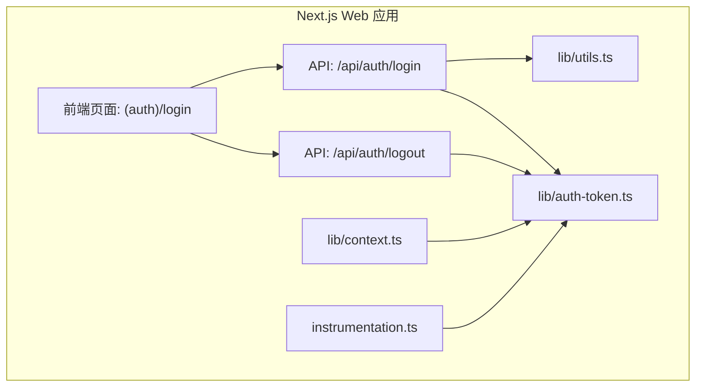
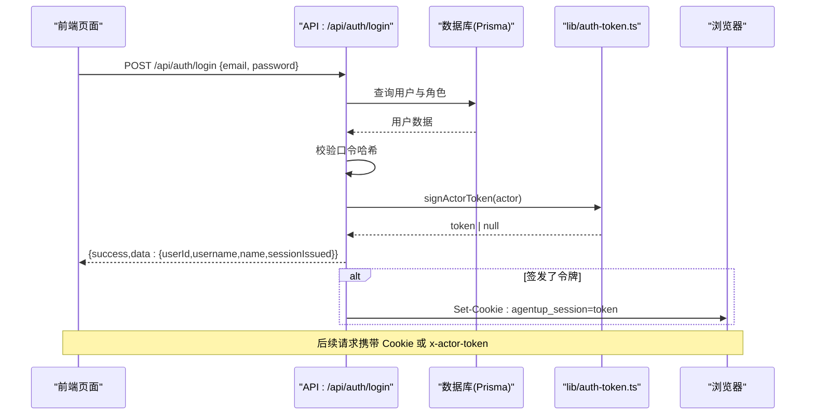
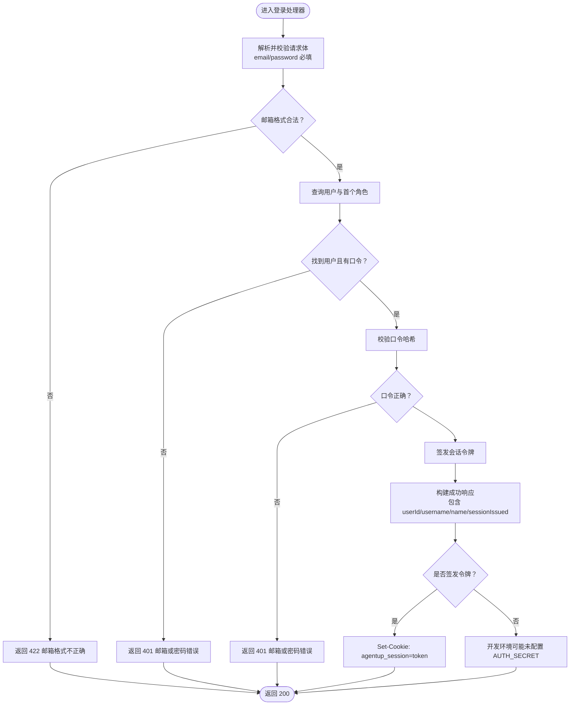
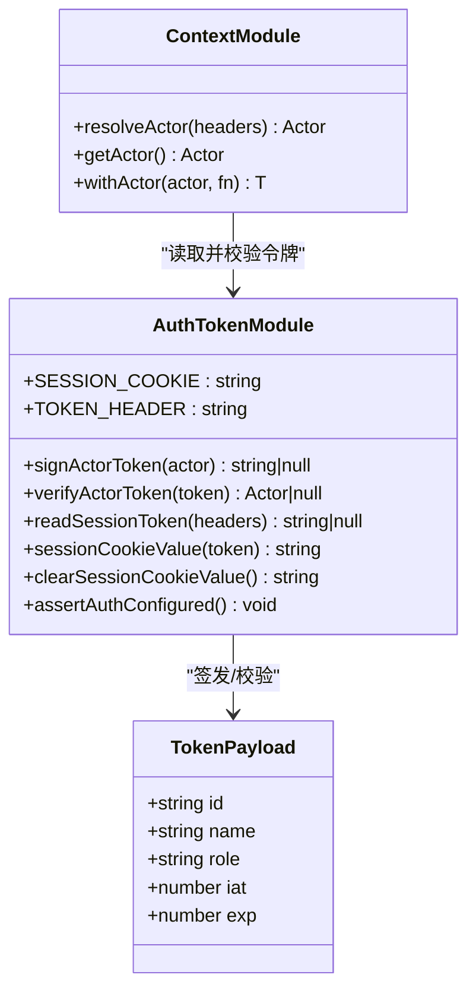
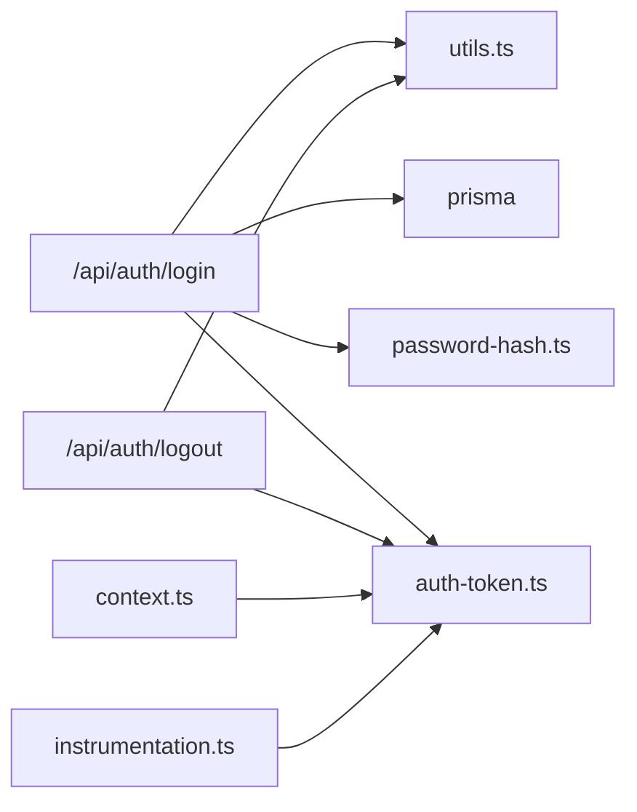

# 认证接口

<cite>
**本文引用的文件**   
- [apps/web/app/api/auth/login/route.ts](file://apps/web/app/api/auth/login/route.ts)
- [apps/web/app/api/auth/logout/route.ts](file://apps/web/app/api/auth/logout/route.ts)
- [apps/web/lib/auth-token.ts](file://apps/web/lib/auth-token.ts)
- [apps/web/lib/context.ts](file://apps/web/lib/context.ts)
- [apps/web/lib/utils.ts](file://apps/web/lib/utils.ts)
- [apps/web/instrumentation.ts](file://apps/web/instrumentation.ts)
- [apps/web/app/(auth)/login/page.tsx](file://apps/web/app/(auth)/login/page.tsx)
- [apps/web/app/api/__tests__/auth-login.test.ts](file://apps/web/app/api/__tests__/auth-login.test.ts)
- [apps/web/app/api/__tests__/auth-logout.test.ts](file://apps/web/app/api/__tests__/auth-logout.test.ts)
</cite>

## 目录
1. [简介](#简介)
2. [项目结构](#项目结构)
3. [核心组件](#核心组件)
4. [架构总览](#架构总览)
5. [详细组件分析](#详细组件分析)
6. [依赖关系分析](#依赖关系分析)
7. [性能与安全性考量](#性能与安全性考量)
8. [故障排查指南](#故障排查指南)
9. [结论](#结论)
10. [附录：前端集成与安全最佳实践](#附录前端集成与安全最佳实践)

## 简介
本文件面向开发者与运维人员，系统化记录 Agent Up 平台的认证相关 API、令牌机制与会话管理。当前实现采用“邮箱 + 口令”登录，服务端签发并维护一个基于 HMAC-SHA256 的会话令牌；浏览器通过 HttpOnly Cookie 持有会话，非浏览器客户端可通过自定义请求头携带令牌。文档覆盖以下主题：
- 认证端点：登录、登出
- HTTP 方法、URL、请求体、响应结构与状态码
- 认证流程、令牌格式、过期策略与刷新建议
- 错误处理与常见异常
- 前端集成要点：Token 存储、自动刷新、权限检查
- 安全配置与生产环境注意事项

## 项目结构
认证能力集中在 Next.js App Router 的 API 路由与共享库中：
- API 层：`/api/auth/login`、`/api/auth/logout`
- 令牌与上下文：`lib/auth-token.ts`、`lib/context.ts`
- 统一响应工具：`lib/utils.ts`
- 启动期安全检查：`instrumentation.ts`
- 登录页面（前端）：`(auth)/login/page.tsx`
- 回归测试：`app/api/__tests__/auth-login.test.ts`、`app/api/__tests__/auth-logout.test.ts`



**图表来源**
- [apps/web/app/api/auth/login/route.ts:1-69](file://apps/web/app/api/auth/login/route.ts#L1-L69)
- [apps/web/app/api/auth/logout/route.ts:1-18](file://apps/web/app/api/auth/logout/route.ts#L1-L18)
- [apps/web/lib/auth-token.ts:1-164](file://apps/web/lib/auth-token.ts#L1-L164)
- [apps/web/lib/context.ts:1-97](file://apps/web/lib/context.ts#L1-L97)
- [apps/web/lib/utils.ts:1-86](file://apps/web/lib/utils.ts#L1-L86)
- [apps/web/instrumentation.ts:1-22](file://apps/web/instrumentation.ts#L1-L22)
- [apps/web/app/(auth)/login/page.tsx:1-139](file://apps/web/app/(auth)/login/page.tsx#L1-L139)

**章节来源**
- [apps/web/app/api/auth/login/route.ts:1-69](file://apps/web/app/api/auth/login/route.ts#L1-L69)
- [apps/web/app/api/auth/logout/route.ts:1-18](file://apps/web/app/api/auth/logout/route.ts#L1-L18)
- [apps/web/lib/auth-token.ts:1-164](file://apps/web/lib/auth-token.ts#L1-L164)
- [apps/web/lib/context.ts:1-97](file://apps/web/lib/context.ts#L1-L97)
- [apps/web/lib/utils.ts:1-86](file://apps/web/lib/utils.ts#L1-L86)
- [apps/web/instrumentation.ts:1-22](file://apps/web/instrumentation.ts#L1-L22)
- [apps/web/app/(auth)/login/page.tsx:1-139](file://apps/web/app/(auth)/login/page.tsx#L1-L139)

## 核心组件
- 登录路由 `/api/auth/login`：校验邮箱与口令，查询用户与角色，签发会话令牌，返回用户信息并在成功时下发 Set-Cookie。
- 登出路由 `/api/auth/logout`：幂等清除会话 Cookie，不校验令牌，始终返回 200。
- 令牌模块 `lib/auth-token.ts`：定义会话 Cookie 名、令牌头名、签名与校验逻辑、Cookie 生成与清除、TTL 策略、生产环境密钥自检。
- 上下文模块 `lib/context.ts`：解析 Actor（id/name/role），优先使用签名令牌，其次在受信任环境下接受明文头，否则匿名。
- 统一响应 `lib/utils.ts`：提供 success/error 包装与 JSON body 解析。
- 启动钩子 `instrumentation.ts`：在生产环境缺失 AUTH_SECRET 时主动退出进程，避免静默降级导致审计失效。

**章节来源**
- [apps/web/app/api/auth/login/route.ts:1-69](file://apps/web/app/api/auth/login/route.ts#L1-L69)
- [apps/web/app/api/auth/logout/route.ts:1-18](file://apps/web/app/api/auth/logout/route.ts#L1-L18)
- [apps/web/lib/auth-token.ts:1-164](file://apps/web/lib/auth-token.ts#L1-L164)
- [apps/web/lib/context.ts:1-97](file://apps/web/lib/context.ts#L1-L97)
- [apps/web/lib/utils.ts:1-86](file://apps/web/lib/utils.ts#L1-L86)
- [apps/web/instrumentation.ts:1-22](file://apps/web/instrumentation.ts#L1-L22)

## 架构总览
认证整体流程如下：
- 前端调用登录接口提交邮箱与口令。
- 服务端校验参数、查询数据库、比对口令哈希。
- 成功后签发会话令牌，并通过 Set-Cookie 写入浏览器。
- 后续请求由上下文模块从 Cookie 或自定义头读取并校验令牌，得到可信 Actor。
- 登出接口仅清除 Cookie，保证幂等。



**图表来源**
- [apps/web/app/api/auth/login/route.ts:18-67](file://apps/web/app/api/auth/login/route.ts#L18-L67)
- [apps/web/lib/auth-token.ts:68-81](file://apps/web/lib/auth-token.ts#L68-L81)
- [apps/web/lib/auth-token.ts:148-151](file://apps/web/lib/auth-token.ts#L148-L151)

## 详细组件分析

### 登录接口 POST /api/auth/login
- 方法：POST
- URL：/api/auth/login
- Content-Type：application/json
- 请求体字段：
  - email：字符串，必填，会 trim 并转小写后精确匹配
  - password：字符串，必填
- 成功响应（HTTP 200）：
  - success：true
  - data：
    - userId：字符串，用户 ID
    - username：字符串，兼容旧字段，值为邮箱
    - name：字符串，显示名称（回退到邮箱）
    - sessionIssued：布尔值，是否成功签发会话令牌
  - 成功且签发令牌时，Set-Cookie：agentup_session=令牌
- 失败响应：
  - 缺少必填字段：HTTP 400，error 提示
  - 邮箱格式非法：HTTP 422，error 提示
  - 邮箱不存在或未设置口令或口令错误：HTTP 401，统一文案“邮箱或密码错误”（防枚举）



**图表来源**
- [apps/web/app/api/auth/login/route.ts:18-67](file://apps/web/app/api/auth/login/route.ts#L18-L67)
- [apps/web/lib/utils.ts:5-16](file://apps/web/lib/utils.ts#L5-L16)

**章节来源**
- [apps/web/app/api/auth/login/route.ts:1-69](file://apps/web/app/api/auth/login/route.ts#L1-L69)
- [apps/web/app/api/__tests__/auth-login.test.ts:54-109](file://apps/web/app/api/__tests__/auth-login.test.ts#L54-L109)
- [apps/web/lib/utils.ts:5-16](file://apps/web/lib/utils.ts#L5-L16)

### 登出接口 POST /api/auth/logout
- 方法：POST
- URL：/api/auth/logout
- 请求体：无
- 行为：
  - 不校验令牌、不查库
  - 总是返回 200，确保幂等
  - 返回 Set-Cookie 以清除会话 Cookie
- 成功响应（HTTP 200）：
  - success：true
  - data：{ loggedOut: true }
  - Set-Cookie：agentup_session=; Max-Age=0; Path=/; HttpOnly; SameSite=Lax; Secure(生产)

```mermaid
sequenceDiagram
participant FE as "前端页面"
participant Logout as "API : /api/auth/logout"
participant Browser as "浏览器"
FE->>Logout : POST /api/auth/logout
Logout-->>FE : {success : true, data : {loggedOut : true}}
Logout->>Browser : Set-Cookie : agentup_session=; Max-Age=0
Note over FE,Browser : 登出必须幂等，即使令牌已过期也返回 200
```

**图表来源**
- [apps/web/app/api/auth/logout/route.ts:1-18](file://apps/web/app/api/auth/logout/route.ts#L1-L18)
- [apps/web/lib/auth-token.ts:160-163](file://apps/web/lib/auth-token.ts#L160-L163)

**章节来源**
- [apps/web/app/api/auth/logout/route.ts:1-18](file://apps/web/app/api/auth/logout/route.ts#L1-L18)
- [apps/web/app/api/__tests__/auth-logout.test.ts:12-36](file://apps/web/app/api/__tests__/auth-logout.test.ts#L12-L36)

### 令牌与会话机制
- 令牌格式：v1.<base64url(payload)>.<base64url(sig)>
- 载荷字段：
  - id：字符串，用户 ID
  - name：字符串，用户名
  - role：字符串，角色名（来自用户首个角色）
  - iat：签发时间（秒）
  - exp：过期时间（秒）
- 签名算法：HMAC-SHA256，密钥来自环境变量 AUTH_SECRET
- 会话 Cookie：
  - 名称：agentup_session
  - 属性：Path=/; HttpOnly; SameSite=Lax; Max-Age=TTL秒; Secure(生产)
- 令牌读取优先级：
  - 显式头 x-actor-token（供非浏览器客户端）
  - Cookie agentup_session
- TTL 策略：
  - 环境变量 AUTH_SESSION_TTL_HOURS，默认 24 小时
- 生产环境密钥自检：
  - instrumentation.ts 在服务进程启动时检查 AUTH_SECRET，缺失则退出进程，避免静默降级



**图表来源**
- [apps/web/lib/auth-token.ts:21-26](file://apps/web/lib/auth-token.ts#L21-L26)
- [apps/web/lib/auth-token.ts:68-118](file://apps/web/lib/auth-token.ts#L68-L118)
- [apps/web/lib/auth-token.ts:137-163](file://apps/web/lib/auth-token.ts#L137-L163)
- [apps/web/lib/context.ts:65-80](file://apps/web/lib/context.ts#L65-L80)

**章节来源**
- [apps/web/lib/auth-token.ts:1-164](file://apps/web/lib/auth-token.ts#L1-L164)
- [apps/web/lib/context.ts:1-97](file://apps/web/lib/context.ts#L1-L97)
- [apps/web/instrumentation.ts:1-22](file://apps/web/instrumentation.ts#L1-L22)

### 前端登录页面
- 表单字段：email、password
- 提交目标：/api/auth/login
- 成功跳转：/dashboard
- 错误展示：统一 Alert 提示
- 说明：
  - 演示账号来自种子数据
  - 登录成功后写入 HttpOnly 会话 Cookie
  - 若未配置 AUTH_SECRET，审计署名将落到 anonymous

**章节来源**
- [apps/web/app/(auth)/login/page.tsx:1-139](file://apps/web/app/(auth)/login/page.tsx#L1-L139)

## 依赖关系分析
- 登录路由依赖：
  - utils.success/error：统一响应封装
  - prisma：用户与角色查询
  - auth-token.signActorToken：签发会话令牌
  - password-hash.verifyPassword：口令哈希校验
- 登出路由依赖：
  - utils.success：统一响应封装
  - auth-token.clearSessionCookieValue：生成清除 Cookie 指令
- 上下文模块依赖：
  - auth-token.readSessionToken/verifyActorToken：令牌读取与校验
- 启动钩子依赖：
  - auth-token.assertAuthConfigured：生产环境密钥自检



**图表来源**
- [apps/web/app/api/auth/login/route.ts:1-69](file://apps/web/app/api/auth/login/route.ts#L1-L69)
- [apps/web/app/api/auth/logout/route.ts:1-18](file://apps/web/app/api/auth/logout/route.ts#L1-L18)
- [apps/web/lib/context.ts:1-97](file://apps/web/lib/context.ts#L1-L97)
- [apps/web/instrumentation.ts:1-22](file://apps/web/instrumentation.ts#L1-L22)

**章节来源**
- [apps/web/app/api/auth/login/route.ts:1-69](file://apps/web/app/api/auth/login/route.ts#L1-L69)
- [apps/web/app/api/auth/logout/route.ts:1-18](file://apps/web/app/api/auth/logout/route.ts#L1-L18)
- [apps/web/lib/context.ts:1-97](file://apps/web/lib/context.ts#L1-L97)
- [apps/web/instrumentation.ts:1-22](file://apps/web/instrumentation.ts#L1-L22)

## 性能与安全性考量
- 口令哈希：使用 scrypt 进行安全存储与校验，避免明文口令。
- 令牌签名：HMAC-SHA256，避免引入额外 JWT 库，减少依赖面。
- 常量时间比较：使用 timingSafeEqual 防止时序攻击。
- 防用户枚举：未知邮箱与错误口令返回相同 401 文案。
- 防提权：令牌载荷严格校验类型与字段，过期或篡改一律拒绝。
- 会话 Cookie：HttpOnly、SameSite=Lax，生产环境追加 Secure。
- 生产环境密钥自检：缺失 AUTH_SECRET 直接退出进程，避免静默降级。
- 登出幂等：不校验令牌，始终返回 200，避免前端卡死。

[本节为通用指导，无需具体文件引用]

## 故障排查指南
- 登录成功但无法访问受保护资源：
  - 检查是否配置了 AUTH_SECRET；未配置时不会签发令牌，审计署名会落到 anonymous。
  - 确认浏览器是否收到 Set-Cookie；检查 Path/SameSite/Secure 是否与生产一致。
- 登出无效：
  - 确认登出接口返回了 Set-Cookie 且属性与签发时一致（Path、SameSite、Secure）。
  - 重复调用登出应返回 200，不应出现 401。
- 令牌校验失败：
  - 检查 x-actor-token 或 agentup_session 是否正确传递。
  - 检查令牌是否过期（exp 小于当前时间）。
  - 检查载荷是否被篡改（签名失配）。
- 生产环境启动失败：
  - 检查 AUTH_SECRET 是否配置；instrumentation.ts 会在缺失时主动退出进程。

**章节来源**
- [apps/web/lib/auth-token.ts:28-54](file://apps/web/lib/auth-token.ts#L28-L54)
- [apps/web/lib/auth-token.ts:87-118](file://apps/web/lib/auth-token.ts#L87-L118)
- [apps/web/app/api/auth/logout/route.ts:1-18](file://apps/web/app/api/auth/logout/route.ts#L1-L18)
- [apps/web/instrumentation.ts:1-22](file://apps/web/instrumentation.ts#L1-L22)

## 结论
本项目实现了轻量而安全的认证方案：邮箱+口令登录、HMAC 签名会话令牌、HttpOnly Cookie 会话、幂等登出、生产环境密钥自检。通过统一的响应封装与上下文解析，服务层可稳定获取可信 Actor，便于后续权限控制与审计。前端需正确处理登录响应、Cookie 与错误提示，并在需要时通过 x-actor-token 向非浏览器客户端传递身份。

[本节为总结性内容，无需具体文件引用]

## 附录：前端集成与安全最佳实践

### 登录流程集成
- 调用 POST /api/auth/login，发送 {email, password}
- 成功时跳转到受保护页面（如 /dashboard）
- 失败时根据 error 字段提示用户
- 注意：登录成功不一定意味着签发了令牌（sessionIssued=false），需结合后端日志排查

**章节来源**
- [apps/web/app/(auth)/login/page.tsx:24-40](file://apps/web/app/(auth)/login/page.tsx#L24-L40)
- [apps/web/app/api/auth/login/route.ts:58-67](file://apps/web/app/api/auth/login/route.ts#L58-L67)

### 登出流程集成
- 调用 POST /api/auth/logout
- 忽略响应体，直接清理本地状态并跳转登录页
- 不要自行删除 Cookie，必须由服务端 Set-Cookie 清除

**章节来源**
- [apps/web/app/api/auth/logout/route.ts:1-18](file://apps/web/app/api/auth/logout/route.ts#L1-L18)

### 令牌存储与传递
- 浏览器：依赖 HttpOnly Cookie，无需前端存储
- 非浏览器客户端：通过请求头 x-actor-token 传递令牌
- 所有敏感请求都应携带令牌，避免匿名访问

**章节来源**
- [apps/web/lib/auth-token.ts:14-17](file://apps/web/lib/auth-token.ts#L14-L17)
- [apps/web/lib/auth-token.ts:137-143](file://apps/web/lib/auth-token.ts#L137-L143)

### 自动刷新与权限检查
- 当前实现未提供令牌自动刷新端点；建议在业务层增加刷新接口或在令牌即将过期前重新登录
- 权限检查应在服务层通过 getActor() 获取 Actor 并进行 RBAC 判断
- 前端侧可做软拦截（UI 禁用按钮），但关键操作必须在服务端校验

**章节来源**
- [apps/web/lib/context.ts:87-90](file://apps/web/lib/context.ts#L87-L90)

### 安全最佳实践清单
- 生产环境必须配置 AUTH_SECRET
- 使用 HTTPS，确保 Secure Cookie 生效
- 限制会话 TTL，避免长期有效令牌
- 对登录接口实施速率限制与防护（WAF/网关）
- 禁止在前端存储敏感令牌
- 对所有写操作进行服务端权限校验

[本节为通用指导，无需具体文件引用]