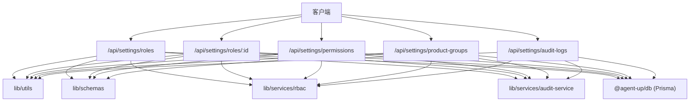
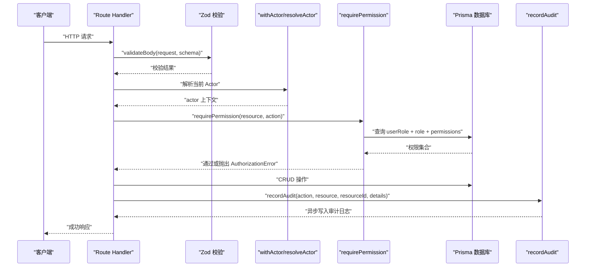
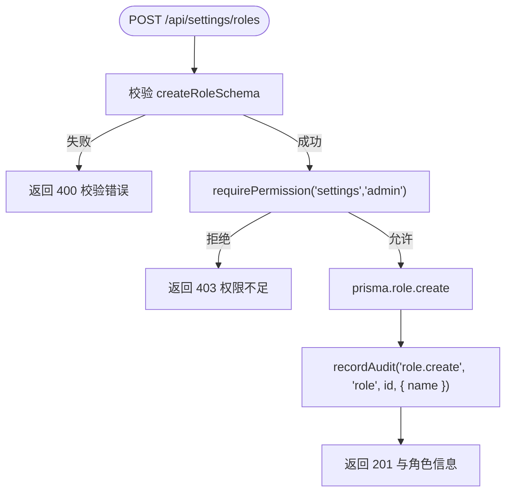
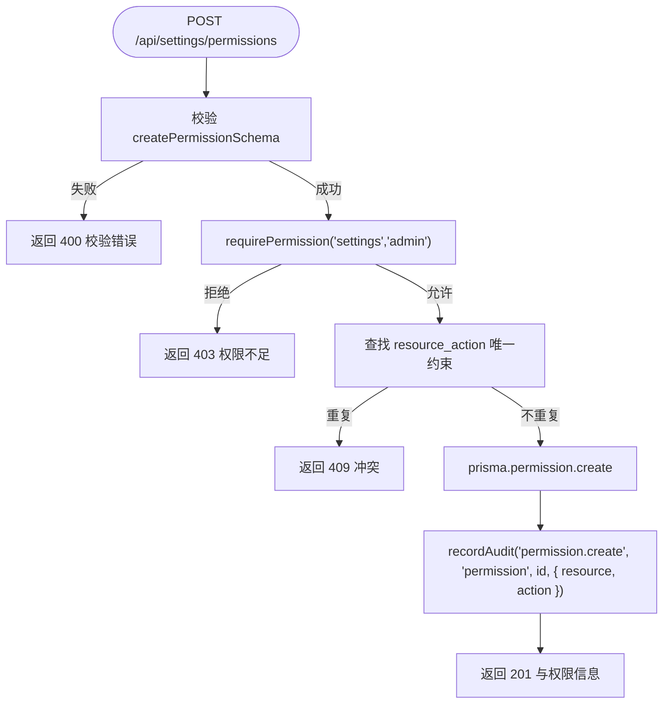
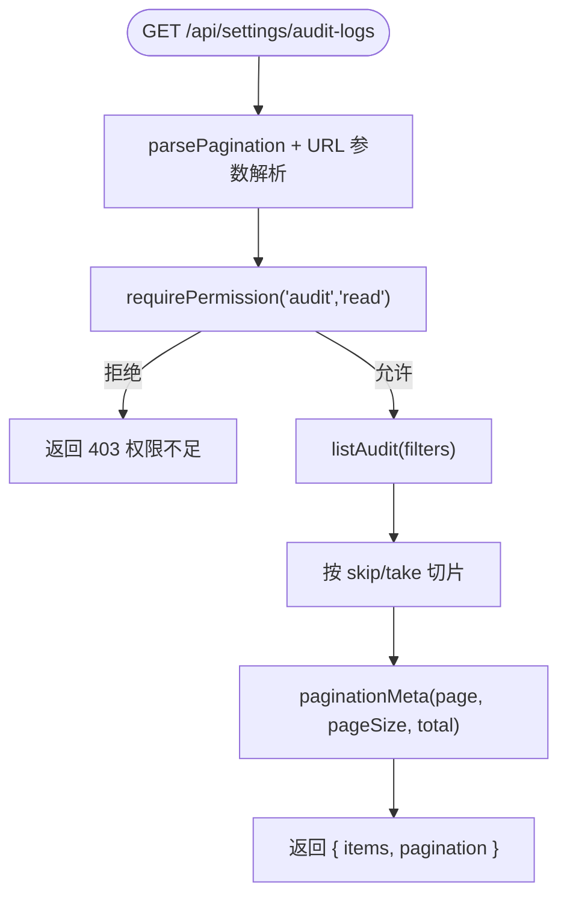
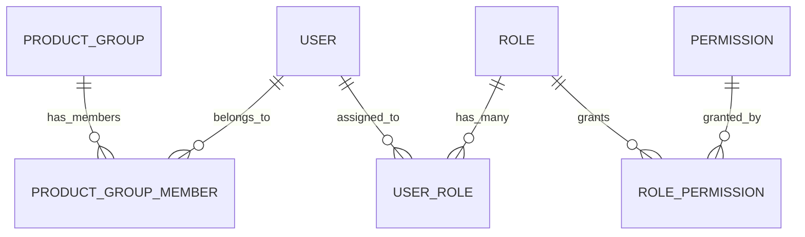

# 设置管理 API

<cite>
**本文引用的文件**   
- [apps/web/app/api/settings/roles/route.ts](file://apps/web/app/api/settings/roles/route.ts)
- [apps/web/app/api/settings/roles/[id]/route.ts](file://apps/web/app/api/settings/roles/[id]/route.ts)
- [apps/web/app/api/settings/permissions/route.ts](file://apps/web/app/api/settings/permissions/route.ts)
- [apps/web/app/api/settings/product-groups/route.ts](file://apps/web/app/api/settings/product-groups/route.ts)
- [apps/web/app/api/settings/audit-logs/route.ts](file://apps/web/app/api/settings/audit-logs/route.ts)
- [apps/web/lib/schemas.ts](file://apps/web/lib/schemas.ts)
- [apps/web/lib/services/rbac.ts](file://apps/web/lib/services/rbac.ts)
- [apps/web/lib/services/audit-service.ts](file://apps/web/lib/services/audit-service.ts)
- [packages/db/prisma/schema.prisma](file://packages/db/prisma/schema.prisma)
</cite>

## 目录
1. [简介](#简介)
2. [项目结构](#项目结构)
3. [核心组件](#核心组件)
4. [架构总览](#架构总览)
5. [详细组件分析](#详细组件分析)
6. [依赖关系分析](#依赖关系分析)
7. [性能与可扩展性](#性能与可扩展性)
8. [故障排查指南](#故障排查指南)
9. [结论](#结论)
10. [附录：API 参考](#附录api-参考)

## 简介
本文件为“设置管理”相关 API 的权威文档，覆盖角色管理、权限控制、产品分组、审计日志等端点。文档同时说明 RBAC 权限模型、角色与权限的关系、系统配置管理与安全策略实施要点，并提供可操作的调用示例路径与错误处理建议。

## 项目结构
设置管理 API 位于 Next.js App Router 的 `apps/web/app/api/settings` 下，按资源划分路由：
- `/api/settings/roles`：角色列表与创建
- `/api/settings/roles/:id`：角色更新与删除
- `/api/settings/permissions`：权限定义与创建
- `/api/settings/product-groups`：产品分组列表与创建
- `/api/settings/audit-logs`：审计日志查询



图表来源
- [apps/web/app/api/settings/roles/route.ts:1-68](file://apps/web/app/api/settings/roles/route.ts#L1-L68)
- [apps/web/app/api/settings/roles/[id]/route.ts:1-85](file://apps/web/app/api/settings/roles/[id]/route.ts#L1-L85)
- [apps/web/app/api/settings/permissions/route.ts:1-66](file://apps/web/app/api/settings/permissions/route.ts#L1-L66)
- [apps/web/app/api/settings/product-groups/route.ts:1-64](file://apps/web/app/api/settings/product-groups/route.ts#L1-L64)
- [apps/web/app/api/settings/audit-logs/route.ts:1-33](file://apps/web/app/api/settings/audit-logs/route.ts#L1-L33)

章节来源
- [apps/web/app/api/settings/roles/route.ts:1-68](file://apps/web/app/api/settings/roles/route.ts#L1-L68)
- [apps/web/app/api/settings/permissions/route.ts:1-66](file://apps/web/app/api/settings/permissions/route.ts#L1-L66)
- [apps/web/app/api/settings/product-groups/route.ts:1-64](file://apps/web/app/api/settings/product-groups/route.ts#L1-L64)
- [apps/web/app/api/settings/audit-logs/route.ts:1-33](file://apps/web/app/api/settings/audit-logs/route.ts#L1-L33)

## 核心组件
- 路由层：Next.js Route Handlers，负责参数校验、权限检查、数据持久化与审计记录。
- 校验层：Zod Schema（`lib/schemas.ts`），统一输入校验与类型推导。
- 权限层：RBAC 服务（`lib/services/rbac.ts`），基于数据库中的用户-角色-权限关系进行授权判断。
- 审计层：审计服务（`lib/services/audit-service.ts`），提供 append-only 审计写入与查询。
- 数据层：Prisma Schema（`packages/db/prisma/schema.prisma`），定义角色、权限、产品组、用户、审计日志等实体。

章节来源
- [apps/web/lib/schemas.ts:256-277](file://apps/web/lib/schemas.ts#L256-L277)
- [apps/web/lib/services/rbac.ts:1-52](file://apps/web/lib/services/rbac.ts#L1-L52)
- [apps/web/lib/services/audit-service.ts:1-120](file://apps/web/lib/services/audit-service.ts#L1-L120)
- [packages/db/prisma/schema.prisma:486-550](file://packages/db/prisma/schema.prisma#L486-L550)

## 架构总览
设置管理 API 采用分层架构：
- 请求进入 Next.js Route Handler，先做参数校验，再进入权限检查，最后访问数据库并记录审计日志。
- RBAC 以数据库为唯一事实源，不信任令牌中的角色字段；多角色取并集判定。
- 审计日志为 append-only，失败不阻塞业务操作。



图表来源
- [apps/web/lib/services/rbac.ts:21-51](file://apps/web/lib/services/rbac.ts#L21-L51)
- [apps/web/lib/services/audit-service.ts:43-84](file://apps/web/lib/services/audit-service.ts#L43-L84)
- [apps/web/app/api/settings/roles/route.ts:44-67](file://apps/web/app/api/settings/roles/route.ts#L44-L67)

## 详细组件分析

### 角色管理 API
- GET `/api/settings/roles`
  - 功能：返回所有角色及其关联权限数量与成员数。
  - 权限：无需鉴权（公开读取）。
  - 响应：包含 id、name、displayName、isSystem、description、_count.members、permissions 列表。
- POST `/api/settings/roles`
  - 功能：创建新角色。
  - 权限：settings:admin。
  - 入参校验：createRoleSchema（name、displayName、description）。
  - 行为：创建后记录审计日志 `role.create`。
  - 状态码：201 成功。
- PUT `/api/settings/roles/:id`
  - 功能：更新角色的 displayName 与 description。
  - 权限：settings:admin。
  - 入参校验：updateRoleSchema。
  - 行为：若不存在返回 404；更新后记录审计日志 `role.update`。
- DELETE `/api/settings/roles/:id`
  - 功能：删除角色。
  - 权限：settings:admin。
  - 行为：若不存在返回 404；系统角色不可删除；删除后记录审计日志 `role.delete`。



图表来源
- [apps/web/app/api/settings/roles/route.ts:44-67](file://apps/web/app/api/settings/roles/route.ts#L44-L67)
- [apps/web/lib/schemas.ts:256-260](file://apps/web/lib/schemas.ts#L256-L260)

章节来源
- [apps/web/app/api/settings/roles/route.ts:1-68](file://apps/web/app/api/settings/roles/route.ts#L1-L68)
- [apps/web/app/api/settings/roles/[id]/route.ts:1-85](file://apps/web/app/api/settings/roles/[id]/route.ts#L1-L85)
- [apps/web/lib/schemas.ts:256-265](file://apps/web/lib/schemas.ts#L256-L265)

### 权限管理 API
- GET `/api/settings/permissions`
  - 功能：列出所有权限及被多少角色引用。
  - 权限：无需鉴权（公开读取）。
  - 响应：包含 id、resource、action、description、_count.roles。
- POST `/api/settings/permissions`
  - 功能：新增权限定义。
  - 权限：settings:admin。
  - 入参校验：createPermissionSchema（resource、action、description）。
  - 行为：若 resource+action 已存在返回 409；创建后记录审计日志 `permission.create`。
  - 状态码：201 成功。



图表来源
- [apps/web/app/api/settings/permissions/route.ts:25-65](file://apps/web/app/api/settings/permissions/route.ts#L25-L65)
- [apps/web/lib/schemas.ts:267-271](file://apps/web/lib/schemas.ts#L267-L271)

章节来源
- [apps/web/app/api/settings/permissions/route.ts:1-66](file://apps/web/app/api/settings/permissions/route.ts#L1-L66)
- [apps/web/lib/schemas.ts:267-271](file://apps/web/lib/schemas.ts#L267-L271)

### 产品分组 API
- GET `/api/settings/product-groups`
  - 功能：列出所有产品分组及其 Agent 与成员计数。
  - 权限：无需鉴权（公开读取）。
  - 响应：包含 id、name、displayName、description、createdAt、updatedAt、_count.agents、_count.members。
- POST `/api/settings/product-groups`
  - 功能：创建产品分组。
  - 权限：settings:admin。
  - 入参校验：createProductGroupSchema（name、displayName、description）。
  - 行为：若 name 已存在返回 409；创建后记录审计日志 `product_group.create`。
  - 状态码：201 成功。

章节来源
- [apps/web/app/api/settings/product-groups/route.ts:1-64](file://apps/web/app/api/settings/product-groups/route.ts#L1-L64)
- [apps/web/lib/schemas.ts:273-277](file://apps/web/lib/schemas.ts#L273-L277)

### 审计日志 API
- GET `/api/settings/audit-logs`
  - 功能：分页查询审计日志。
  - 权限：audit:read（当前仅 platform_admin 持有）。
  - 查询参数：
    - page、pageSize、skip、take：分页参数。
    - action、resource、resourceId：按动作、资源、资源 ID 过滤。
    - userName 或 userId：按用户名或用户 ID 别名过滤。
  - 响应：items 数组与 pagination 元信息。
  - 注意：审计日志是问责数据，需具备 audit:read 权限。



图表来源
- [apps/web/app/api/settings/audit-logs/route.ts:7-32](file://apps/web/app/api/settings/audit-logs/route.ts#L7-L32)
- [apps/web/lib/services/audit-service.ts:87-119](file://apps/web/lib/services/audit-service.ts#L87-L119)

章节来源
- [apps/web/app/api/settings/audit-logs/route.ts:1-33](file://apps/web/app/api/settings/audit-logs/route.ts#L1-L33)
- [apps/web/lib/services/audit-service.ts:1-120](file://apps/web/lib/services/audit-service.ts#L1-L120)

## 依赖关系分析
- 路由层依赖：
  - lib/utils：success、handleApiError、validateBody、parsePagination、paginationMeta。
  - lib/schemas：Zod 校验规则。
  - lib/services/rbac：requirePermission。
  - lib/services/audit-service：recordAudit、listAudit。
  - @agent-up/db：Prisma 客户端与数据模型。
- 权限模型依赖：
  - requirePermission 从数据库查询 userRole → role → rolePermission → permission，多角色取并集。
  - actor.id === "system" 豁免（后台任务）。
- 审计日志依赖：
  - recordAudit 异步写入，失败不抛异常，避免影响主流程。
  - listAudit 支持 action/resource/resourceId/user 过滤，并按 createdAt 与 id 降序排序。

```mermaid
classDiagram
class RoleHandler {
+GET()
+POST(request)
}
class RoleIdHandler {
+PUT(request)
+DELETE(request)
}
class PermissionHandler {
+GET()
+POST(request)
}
class ProductGroupHandler {
+GET()
+POST(request)
}
class AuditLogHandler {
+GET(request)
}
class RBACService {
+requirePermission(resource, action)
}
class AuditService {
+recordAudit(action, resource, resourceId, details)
+listAudit(filters)
}
class PrismaClient {
+role
+permission
+productGroup
+auditLog
}
RoleHandler --> RBACService : "settings : admin"
RoleIdHandler --> RBACService : "settings : admin"
PermissionHandler --> RBACService : "settings : admin"
ProductGroupHandler --> RBACService : "settings : admin"
AuditLogHandler --> RBACService : "audit : read"
RoleHandler --> AuditService : "recordAudit"
RoleIdHandler --> AuditService : "recordAudit"
PermissionHandler --> AuditService : "recordAudit"
ProductGroupHandler --> AuditService : "recordAudit"
RoleHandler --> PrismaClient : "读写角色"
RoleIdHandler --> PrismaClient : "读写角色"
PermissionHandler --> PrismaClient : "读写权限"
ProductGroupHandler --> PrismaClient : "读写产品组"
AuditLogHandler --> AuditService : "listAudit"
```

图表来源
- [apps/web/app/api/settings/roles/route.ts:1-68](file://apps/web/app/api/settings/roles/route.ts#L1-L68)
- [apps/web/app/api/settings/roles/[id]/route.ts:1-85](file://apps/web/app/api/settings/roles/[id]/route.ts#L1-L85)
- [apps/web/app/api/settings/permissions/route.ts:1-66](file://apps/web/app/api/settings/permissions/route.ts#L1-L66)
- [apps/web/app/api/settings/product-groups/route.ts:1-64](file://apps/web/app/api/settings/product-groups/route.ts#L1-L64)
- [apps/web/app/api/settings/audit-logs/route.ts:1-33](file://apps/web/app/api/settings/audit-logs/route.ts#L1-L33)
- [apps/web/lib/services/rbac.ts:1-52](file://apps/web/lib/services/rbac.ts#L1-L52)
- [apps/web/lib/services/audit-service.ts:1-120](file://apps/web/lib/services/audit-service.ts#L1-L120)

章节来源
- [apps/web/lib/services/rbac.ts:1-52](file://apps/web/lib/services/rbac.ts#L1-L52)
- [apps/web/lib/services/audit-service.ts:1-120](file://apps/web/lib/services/audit-service.ts#L1-L120)

## 性能与可扩展性
- 权限查询：
  - requirePermission 使用一次 Prisma 查询获取用户的所有角色与权限，避免多次往返。
  - 建议在高频场景对常用权限组合建立缓存（如 Redis），但需注意一致性。
- 审计日志：
  - recordAudit 采用 fire-and-forget 语义，不阻塞主流程；在高并发下建议使用消息队列批量落库。
- 分页与索引：
  - 审计日志查询支持分页，数据库层已有 createdAt、action、resource、userId 等索引，利于高效检索。

[本节为通用指导，不涉及具体文件分析]

## 故障排查指南
- 403 权限不足：
  - 现象：调用需要 settings:admin 或 audit:read 的接口时返回 403。
  - 排查：确认当前 actor 是否拥有对应权限；检查 userRole → role → rolePermission → permission 链路是否正确。
  - 参考：requirePermission 实现。
- 404 角色不存在：
  - 现象：更新或删除角色时报错。
  - 排查：确认角色 id 是否存在；系统角色不可删除。
- 409 冲突：
  - 现象：创建权限或产品分组时提示重复。
  - 排查：检查 resource+action 唯一约束或 name 唯一约束。
- 审计日志未出现：
  - 现象：操作成功但审计日志缺失。
  - 排查：recordAudit 为异步写入，失败不会抛错；查看服务端日志中 audit 相关错误。

章节来源
- [apps/web/lib/services/rbac.ts:21-51](file://apps/web/lib/services/rbac.ts#L21-L51)
- [apps/web/app/api/settings/roles/[id]/route.ts:38-84](file://apps/web/app/api/settings/roles/[id]/route.ts#L38-L84)
- [apps/web/app/api/settings/permissions/route.ts:25-65](file://apps/web/app/api/settings/permissions/route.ts#L25-L65)
- [apps/web/app/api/settings/product-groups/route.ts:27-63](file://apps/web/app/api/settings/product-groups/route.ts#L27-L63)
- [apps/web/lib/services/audit-service.ts:43-84](file://apps/web/lib/services/audit-service.ts#L43-L84)

## 结论
设置管理 API 围绕 RBAC 权限模型构建，角色与权限通过数据库关系解耦，审计日志提供可追溯的行为记录。路由层职责清晰，校验、鉴权、持久化与审计分离，便于扩展与维护。建议在后续迭代中引入权限缓存与审计批处理以提升性能与吞吐。

[本节为总结性内容，不涉及具体文件分析]

## 附录：API 参考

### 角色管理
- GET `/api/settings/roles`
  - 权限：无
  - 响应字段：id、name、displayName、isSystem、description、_count.members、permissions[]
- POST `/api/settings/roles`
  - 权限：settings:admin
  - 请求体：name、displayName、description
  - 响应：201 与角色信息
  - 审计：role.create
- PUT `/api/settings/roles/:id`
  - 权限：settings:admin
  - 请求体：displayName、description
  - 响应：角色信息
  - 审计：role.update
- DELETE `/api/settings/roles/:id`
  - 权限：settings:admin
  - 响应：{ message }
  - 审计：role.delete

章节来源
- [apps/web/app/api/settings/roles/route.ts:1-68](file://apps/web/app/api/settings/roles/route.ts#L1-L68)
- [apps/web/app/api/settings/roles/[id]/route.ts:1-85](file://apps/web/app/api/settings/roles/[id]/route.ts#L1-L85)
- [apps/web/lib/schemas.ts:256-265](file://apps/web/lib/schemas.ts#L256-L265)

### 权限管理
- GET `/api/settings/permissions`
  - 权限：无
  - 响应字段：id、resource、action、description、_count.roles
- POST `/api/settings/permissions`
  - 权限：settings:admin
  - 请求体：resource、action、description
  - 响应：201 与权限信息
  - 审计：permission.create

章节来源
- [apps/web/app/api/settings/permissions/route.ts:1-66](file://apps/web/app/api/settings/permissions/route.ts#L1-L66)
- [apps/web/lib/schemas.ts:267-271](file://apps/web/lib/schemas.ts#L267-L271)

### 产品分组
- GET `/api/settings/product-groups`
  - 权限：无
  - 响应字段：id、name、displayName、description、createdAt、updatedAt、_count.agents、_count.members
- POST `/api/settings/product-groups`
  - 权限：settings:admin
  - 请求体：name、displayName、description
  - 响应：201 与产品分组信息
  - 审计：product_group.create

章节来源
- [apps/web/app/api/settings/product-groups/route.ts:1-64](file://apps/web/app/api/settings/product-groups/route.ts#L1-L64)
- [apps/web/lib/schemas.ts:273-277](file://apps/web/lib/schemas.ts#L273-L277)

### 审计日志
- GET `/api/settings/audit-logs`
  - 权限：audit:read
  - 查询参数：page、pageSize、skip、take、action、resource、resourceId、userName 或 userId
  - 响应：{ items[], pagination }

章节来源
- [apps/web/app/api/settings/audit-logs/route.ts:1-33](file://apps/web/app/api/settings/audit-logs/route.ts#L1-L33)
- [apps/web/lib/services/audit-service.ts:87-119](file://apps/web/lib/services/audit-service.ts#L87-L119)

### RBAC 权限模型与继承机制
- 模型关系：
  - User ↔ UserRole ↔ Role ↔ RolePermission ↔ Permission
  - 多角色取并集判定权限。
- 继承机制：
  - 代码未实现显式角色继承；权限通过 RolePermission 直接绑定到 Permission。
  - 如需继承，可在上层抽象出“父角色→子角色”映射并在 requirePermission 中合并权限集合。
- 系统豁免：
  - actor.id === "system" 跳过鉴权，用于后台任务。



图表来源
- [packages/db/prisma/schema.prisma:486-550](file://packages/db/prisma/schema.prisma#L486-L550)

章节来源
- [apps/web/lib/services/rbac.ts:1-52](file://apps/web/lib/services/rbac.ts#L1-L52)
- [packages/db/prisma/schema.prisma:486-550](file://packages/db/prisma/schema.prisma#L486-L550)