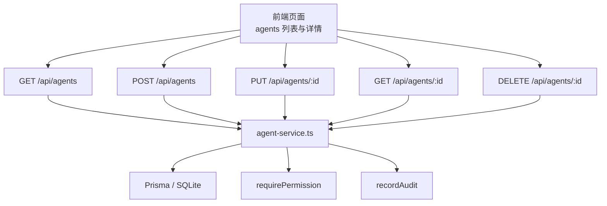
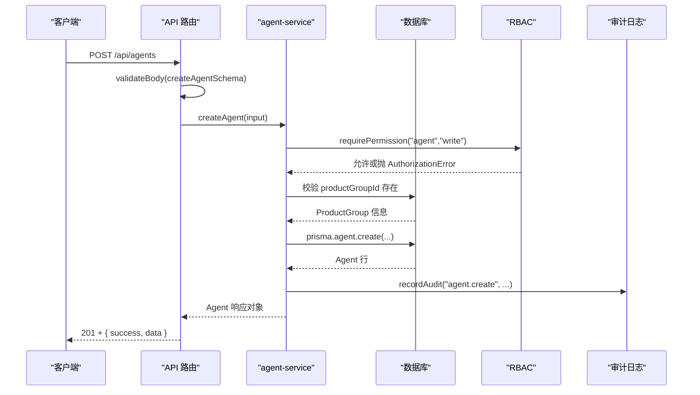
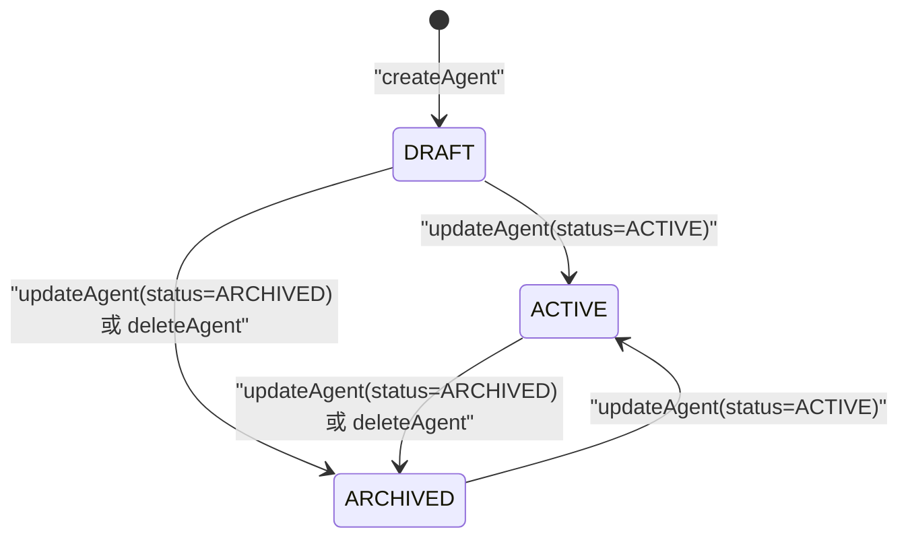
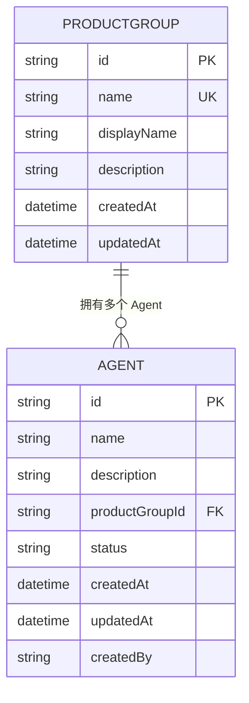
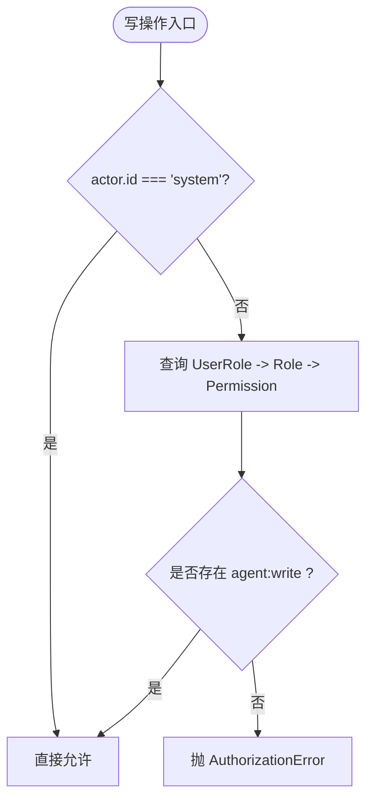
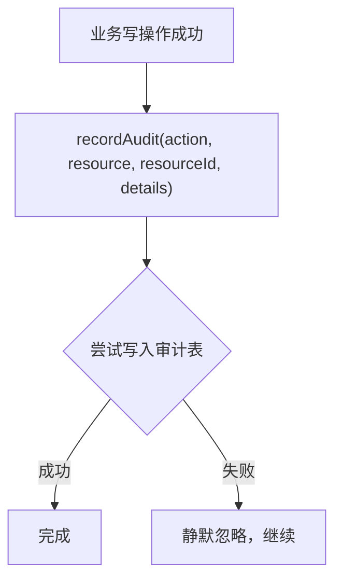
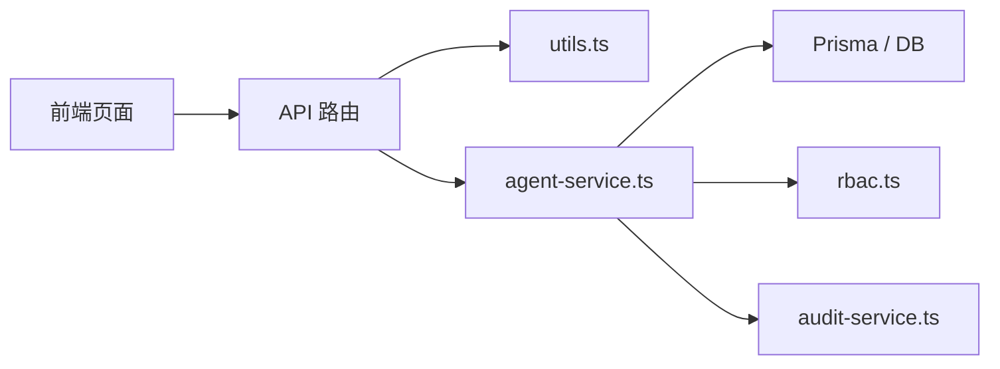

# Agent 生命周期管理

<cite>
**本文引用的文件**   
- [apps/web/app/api/agents/route.ts](file://apps/web/app/api/agents/route.ts)
- [apps/web/app/api/agents/[id]/route.ts](file://apps/web/app/api/agents/[id]/route.ts)
- [apps/web/lib/services/agent-service.ts](file://apps/web/lib/services/agent-service.ts)
- [apps/web/lib/schemas.ts](file://apps/web/lib/schemas.ts)
- [packages/db/prisma/schema.prisma](file://packages/db/prisma/schema.prisma)
- [apps/web/lib/context.ts](file://apps/web/lib/context.ts)
- [apps/web/lib/services/rbac.ts](file://apps/web/lib/services/rbac.ts)
- [apps/web/lib/utils.ts](file://apps/web/lib/utils.ts)
- [apps/web/lib/services/audit-service.ts](file://apps/web/lib/services/audit-service.ts)
- [apps/web/app/(dashboard)/agents/page.tsx](file://apps/web/app/(dashboard)/agents/page.tsx)
- [apps/web/app/(dashboard)/agents/[id]/agent-detail.tsx](file://apps/web/app/(dashboard)/agents/[id]/agent-detail.tsx)
- [apps/web/app/api/__tests__/agents.test.ts](file://apps/web/app/api/__tests__/agents.test.ts)
- [apps/web/lib/__tests__/agent-service.test.ts](file://apps/web/lib/__tests__/agent-service.test.ts)
</cite>

## 目录
1. [引言](#引言)
2. [项目结构](#项目结构)
3. [核心组件](#核心组件)
4. [架构总览](#架构总览)
5. [详细组件分析](#详细组件分析)
6. [依赖关系分析](#依赖关系分析)
7. [性能与扩展性](#性能与扩展性)
8. [故障排查指南](#故障排查指南)
9. [结论](#结论)
10. [附录：API 规范与前端使用要点](#附录api-规范与前端使用要点)

## 引言
本文面向 AgentUp 平台中 Agent 的生命周期管理，覆盖创建、更新、归档（软删除）和查询的完整实现机制。重点说明：
- Agent 状态流转规则与业务约束。
- Agent 与产品组（ProductGroup）的数据模型与关联关系。
- API 端点、请求参数校验、响应格式与错误处理策略。
- 权限控制（RBAC）与审计日志记录方式。
- 常见使用场景：批量操作、状态过滤、搜索。
- 前端页面如何调用这些接口并展示数据。

## 项目结构
Agent 生命周期相关代码主要分布在以下位置：
- API 路由层：`apps/web/app/api/agents/**`
- 服务层：`apps/web/lib/services/agent-service.ts`
- 参数校验：`apps/web/lib/schemas.ts`
- 数据库模型：`packages/db/prisma/schema.prisma`
- 身份与权限：`apps/web/lib/context.ts`、`apps/web/lib/services/rbac.ts`
- 通用工具：`apps/web/lib/utils.ts`
- 审计日志：`apps/web/lib/services/audit-service.ts`
- 前端页面：`apps/web/app/(dashboard)/agents/**`

**图表来源**
- [apps/web/app/api/agents/route.ts:7-42](file://apps/web/app/api/agents/route.ts#L7-L42)
- [apps/web/app/api/agents/[id]/route.ts:7-49](file://apps/web/app/api/agents/[id]/route.ts#L7-L49)
- [apps/web/lib/services/agent-service.ts:210-339](file://apps/web/lib/services/agent-service.ts#L210-L339)

**章节来源**
- [apps/web/app/api/agents/route.ts:1-43](file://apps/web/app/api/agents/route.ts#L1-L43)
- [apps/web/app/api/agents/[id]/route.ts:1-50](file://apps/web/app/api/agents/[id]/route.ts#L1-L50)

## 核心组件
- API 路由层负责解析请求、参数校验、调用服务层、统一返回成功或错误响应。
- 服务层封装 Agent 的业务逻辑：创建、查询、更新、归档、配置分区变更、配置变更记录等。
- 数据模型通过 Prisma Schema 定义 Agent、ProductGroup、Release、Version、SkillBinding 等实体关系。
- 权限控制通过 RBAC 服务层强制写操作授权；身份上下文通过 Actor 注入。
- 审计日志在服务层关键写操作后记录行为轨迹。

**章节来源**
- [apps/web/lib/services/agent-service.ts:210-339](file://apps/web/lib/services/agent-service.ts#L210-L339)
- [packages/db/prisma/schema.prisma:66-99](file://packages/db/prisma/schema.prisma#L66-L99)
- [apps/web/lib/services/rbac.ts:21-51](file://apps/web/lib/services/rbac.ts#L21-L51)
- [apps/web/lib/context.ts:22-90](file://apps/web/lib/context.ts#L22-L90)
- [apps/web/lib/services/audit-service.ts:13-37](file://apps/web/lib/services/audit-service.ts#L13-L37)

## 架构总览
Agent 生命周期在 Next.js App Router 中以 RESTful 风格暴露，服务层以函数式 API 组织，数据访问由 Prisma 完成，权限与审计贯穿写流程。

**图表来源**
- [apps/web/app/api/agents/route.ts:29-42](file://apps/web/app/api/agents/route.ts#L29-L42)
- [apps/web/lib/services/agent-service.ts:274-298](file://apps/web/lib/services/agent-service.ts#L274-L298)
- [apps/web/lib/services/rbac.ts:21-51](file://apps/web/lib/services/rbac.ts#L21-L51)
- [apps/web/lib/services/audit-service.ts:13-37](file://apps/web/lib/services/audit-service.ts#L13-L37)

## 详细组件分析

### Agent 状态流转与业务规则
Agent 的状态字段为字符串枚举值，当前支持三种状态：
- DRAFT：草稿态，新建 Agent 默认处于该状态。
- ACTIVE：活跃态，表示 Agent 可被正常使用。
- ARCHIVED：已归档态，对应“归档”操作，不物理删除。

状态转换规则如下：
- 创建时：status 初始化为 DRAFT。
- 更新时：可通过 updateAgent 显式设置 status，允许值为 DRAFT、ACTIVE、ARCHIVED。
- 归档时：deleteAgent 将 status 设置为 ARCHIVED，属于软删除语义。

注意：当前服务层未对状态机做严格的前置状态检查（例如从 DRAFT 到 ACTIVE 的强制顺序），而是接受任意合法枚举值。若需要更严格的业务约束，可在 service 层增加状态转换校验。

**图表来源**
- [apps/web/lib/services/agent-service.ts:274-298](file://apps/web/lib/services/agent-service.ts#L274-L298)
- [apps/web/lib/services/agent-service.ts:300-339](file://apps/web/lib/services/agent-service.ts#L300-L339)
- [apps/web/lib/schemas.ts:13-17](file://apps/web/lib/schemas.ts#L13-L17)

**章节来源**
- [apps/web/lib/services/agent-service.ts:274-339](file://apps/web/lib/services/agent-service.ts#L274-L339)
- [apps/web/lib/schemas.ts:13-17](file://apps/web/lib/schemas.ts#L13-L17)

### Agent 与产品组（ProductGroup）的关联关系
- 数据模型：Agent 通过 productGroupId 外键关联 ProductGroup。
- 创建 Agent 时必须提供有效的 productGroupId，服务层会先查询 ProductGroup，不存在则抛出 404。
- 列表与详情返回中包含 productGroup 摘要（id、name、displayName）。

**图表来源**
- [packages/db/prisma/schema.prisma:24-34](file://packages/db/prisma/schema.prisma#L24-L34)
- [packages/db/prisma/schema.prisma:66-99](file://packages/db/prisma/schema.prisma#L66-L99)
- [apps/web/lib/services/agent-service.ts:274-298](file://apps/web/lib/services/agent-service.ts#L274-L298)

**章节来源**
- [packages/db/prisma/schema.prisma:24-34](file://packages/db/prisma/schema.prisma#L24-L34)
- [packages/db/prisma/schema.prisma:66-99](file://packages/db/prisma/schema.prisma#L66-L99)
- [apps/web/lib/services/agent-service.ts:274-298](file://apps/web/lib/services/agent-service.ts#L274-L298)

### API 端点规范

#### 获取 Agent 列表
- 方法：GET
- 路径：/api/agents
- 查询参数：
  - page：页码，默认 1，最小 1。
  - pageSize：每页条数，默认 20，最大 100。
  - status：按状态过滤，可选值 DRAFT、ACTIVE、ARCHIVED；传 ALL 不过滤。
  - productGroupId：按产品组过滤。
  - search：模糊匹配名称或描述（内存过滤）。
- 响应体：
  - success: true
  - data.items: Agent 列表项数组
  - data.pagination: { page, pageSize, total, totalPages, hasMore }

**章节来源**
- [apps/web/app/api/agents/route.ts:7-27](file://apps/web/app/api/agents/route.ts#L7-L27)
- [apps/web/lib/utils.ts:27-47](file://apps/web/lib/utils.ts#L27-L47)
- [apps/web/lib/services/agent-service.ts:210-248](file://apps/web/lib/services/agent-service.ts#L210-L248)

#### 创建 Agent
- 方法：POST
- 路径：/api/agents
- 请求体：
  - name：必填，长度 1-100。
  - description：可选，最大 500。
  - productGroupId：必填，必须存在。
- 响应体：
  - 成功：201 + { success, data: Agent }
  - 失败：404（产品组不存在）、422（参数校验失败）、403（权限不足）

**章节来源**
- [apps/web/app/api/agents/route.ts:29-42](file://apps/web/app/api/agents/route.ts#L29-L42)
- [apps/web/lib/schemas.ts:7-11](file://apps/web/lib/schemas.ts#L7-L11)
- [apps/web/lib/services/agent-service.ts:274-298](file://apps/web/lib/services/agent-service.ts#L274-L298)

#### 获取 Agent 详情
- 方法：GET
- 路径：/api/agents/:id
- 响应体：
  - 成功：{ success, data: Agent 详情，包含 releases、versions、productGroup、_count 等 }
  - 失败：404（Agent 不存在）

**章节来源**
- [apps/web/app/api/agents/[id]/route.ts:7-16](file://apps/web/app/api/agents/[id]/route.ts#L7-L16)
- [apps/web/lib/services/agent-service.ts:250-272](file://apps/web/lib/services/agent-service.ts#L250-L272)

#### 更新 Agent
- 方法：PUT
- 路径：/api/agents/:id
- 请求体：
  - name：可选，长度 1-100。
  - description：可选，可为 null，最大 500。
  - status：可选，枚举 DRAFT、ACTIVE、ARCHIVED。
- 响应体：
  - 成功：{ success, data: Agent }
  - 失败：404（Agent 不存在）、422（参数校验失败）、403（权限不足）

**章节来源**
- [apps/web/app/api/agents/[id]/route.ts:18-35](file://apps/web/app/api/agents/[id]/route.ts#L18-L35)
- [apps/web/lib/schemas.ts:13-17](file://apps/web/lib/schemas.ts#L13-L17)
- [apps/web/lib/services/agent-service.ts:300-324](file://apps/web/lib/services/agent-service.ts#L300-L324)

#### 归档 Agent
- 方法：DELETE
- 路径：/api/agents/:id
- 行为：将 Agent 的 status 设置为 ARCHIVED（软删除）。
- 响应体：
  - 成功：{ success, data: { message: "Agent 已归档" } }
  - 失败：404（Agent 不存在）、403（权限不足）

**章节来源**
- [apps/web/app/api/agents/[id]/route.ts:37-49](file://apps/web/app/api/agents/[id]/route.ts#L37-L49)
- [apps/web/lib/services/agent-service.ts:326-339](file://apps/web/lib/services/agent-service.ts#L326-L339)

### 权限控制机制
- 所有写操作（createAgent、updateAgent、deleteAgent）均调用 requirePermission("agent", "write")。
- 权限判定依据数据库中的角色-权限关系，actor.id === "system" 豁免。
- 匿名或无权限用户会抛出 AuthorizationError，最终映射为 403 响应。

**图表来源**
- [apps/web/lib/services/rbac.ts:21-51](file://apps/web/lib/services/rbac.ts#L21-L51)
- [apps/web/lib/context.ts:22-90](file://apps/web/lib/context.ts#L22-L90)

**章节来源**
- [apps/web/lib/services/rbac.ts:21-51](file://apps/web/lib/services/rbac.ts#L21-L51)
- [apps/web/lib/context.ts:22-90](file://apps/web/lib/context.ts#L22-L90)

### 审计日志记录方式
- 关键写操作成功后调用 recordAudit，记录 action、resource、resourceId、details。
- 审计写入采用 append-only 模式，失败静默吞掉，不影响主流程。
- 测试中可通过 flushAudit 等待异步审计写入收口。

**图表来源**
- [apps/web/lib/services/audit-service.ts:13-37](file://apps/web/lib/services/audit-service.ts#L13-L37)
- [apps/web/lib/services/agent-service.ts:296-339](file://apps/web/lib/services/agent-service.ts#L296-L339)

**章节来源**
- [apps/web/lib/services/audit-service.ts:13-37](file://apps/web/lib/services/audit-service.ts#L13-L37)
- [apps/web/lib/services/agent-service.ts:296-339](file://apps/web/lib/services/agent-service.ts#L296-L339)

### 前端组件使用示例与最佳实践
- 列表页：
  - 提供搜索框与状态筛选下拉框，调用 GET /api/agents?search=&status=。
  - 分页控件绑定 page 与 pageSize，根据 pagination.hasMore 决定是否显示下一页。
- 详情页：
  - 调用 GET /api/agents/:id 获取 Agent 详情、releases、versions。
  - 对 404 进行空态渲染，其他错误提示网络或加载失败。
- 最佳实践：
  - 使用统一的 success/error 响应结构判断结果。
  - 对 422 参数校验错误，展示具体字段错误消息。
  - 对 403 权限不足，引导用户联系管理员或切换账号。

**章节来源**
- [apps/web/app/(dashboard)/agents/page.tsx:91-140](file://apps/web/app/(dashboard)/agents/page.tsx#L91-L140)
- [apps/web/app/(dashboard)/agents/[id]/agent-detail.tsx:83-118](file://apps/web/app/(dashboard)/agents/[id]/agent-detail.tsx#L83-L118)

## 依赖关系分析
- API 路由依赖 utils（success、error、validateBody、parsePagination、paginationMeta、handleApiError）。
- 服务层依赖 Prisma、RBAC、审计服务、Diff 工具。
- 数据模型依赖 Prisma Schema 定义的实体关系。
- 前端依赖 API 路由提供的 REST 接口。

**图表来源**
- [apps/web/app/api/agents/route.ts:1-6](file://apps/web/app/api/agents/route.ts#L1-L6)
- [apps/web/lib/services/agent-service.ts:1-21](file://apps/web/lib/services/agent-service.ts#L1-L21)
- [apps/web/lib/utils.ts:1-86](file://apps/web/lib/utils.ts#L1-L86)

**章节来源**
- [apps/web/app/api/agents/route.ts:1-6](file://apps/web/app/api/agents/route.ts#L1-L6)
- [apps/web/lib/services/agent-service.ts:1-21](file://apps/web/lib/services/agent-service.ts#L1-L21)
- [apps/web/lib/utils.ts:1-86](file://apps/web/lib/utils.ts#L1-L86)

## 性能与扩展性
- 列表查询在无 search 时使用数据库分页（skip/take）与 count 并行查询，提升性能。
- 有 search 时采用内存过滤，适用于演示规模；生产环境可考虑全文索引或后端模糊查询优化。
- 详情接口并发查询 releases 与 versions，减少往返次数。
- 审计日志异步写入，避免阻塞主流程。

[本节为通用性能讨论，不直接分析具体文件]

## 故障排查指南
- 404 产品组不存在：检查 productGroupId 是否有效。
- 404 Agent 不存在：确认 id 是否正确，或是否已被归档。
- 422 参数校验失败：检查 name、description、status 是否符合 schema。
- 403 权限不足：确认当前 actor 是否具有 agent:write 权限。
- 审计日志未出现：检查 flushAudit 是否在测试中调用；生产环境审计失败静默忽略。

**章节来源**
- [apps/web/lib/services/agent-service.ts:274-339](file://apps/web/lib/services/agent-service.ts#L274-L339)
- [apps/web/lib/services/rbac.ts:21-51](file://apps/web/lib/services/rbac.ts#L21-L51)
- [apps/web/lib/services/audit-service.ts:13-37](file://apps/web/lib/services/audit-service.ts#L13-L37)

## 结论
Agent 生命周期管理通过清晰的 API 路由与服务层职责分离实现，结合 Prisma 数据模型、RBAC 权限控制与审计日志，提供了完整的创建、更新、归档与查询能力。状态流转目前接受合法枚举值，建议后续引入更严格的状态机校验以满足复杂业务需求。前端页面通过标准响应结构与错误处理，实现了良好的用户体验。

[本节为总结性内容，不直接分析具体文件]

## 附录：API 规范与前端使用要点

### 请求参数验证
- createAgentSchema：
  - name：必填，1-100。
  - description：可选，≤500。
  - productGroupId：必填，非空。
- updateAgentSchema：
  - name：可选，1-100。
  - description：可选，nullable，≤500。
  - status：可选，枚举 DRAFT、ACTIVE、ARCHIVED。

**章节来源**
- [apps/web/lib/schemas.ts:7-17](file://apps/web/lib/schemas.ts#L7-L17)

### 响应格式
- 成功：{ success: true, data }
- 失败：{ success: false, error, errors? }

**章节来源**
- [apps/web/lib/utils.ts:5-16](file://apps/web/lib/utils.ts#L5-L16)

### 常见使用场景
- 批量操作：当前未提供批量创建/更新接口，可通过循环调用单条接口实现；建议在服务端增加批量接口以提升性能。
- 状态过滤：GET /api/agents?status=DRAFT|ACTIVE|ARCHIVED。
- 搜索功能：GET /api/agents?search=关键词；当前为内存过滤，适合小规模数据。

**章节来源**
- [apps/web/app/api/agents/route.ts:7-27](file://apps/web/app/api/agents/route.ts#L7-L27)
- [apps/web/lib/services/agent-service.ts:210-248](file://apps/web/lib/services/agent-service.ts#L210-L248)

### 测试用例参考
- 列表按状态过滤：验证 status 参数生效。
- 创建 Agent：验证 201 响应、默认状态 DRAFT、_count 字段、审计日志。
- 缺失产品组：验证 404。

**章节来源**
- [apps/web/app/api/__tests__/agents.test.ts:64-109](file://apps/web/app/api/__tests__/agents.test.ts#L64-L109)
- [apps/web/lib/__tests__/agent-service.test.ts:232-265](file://apps/web/lib/__tests__/agent-service.test.ts#L232-L265)