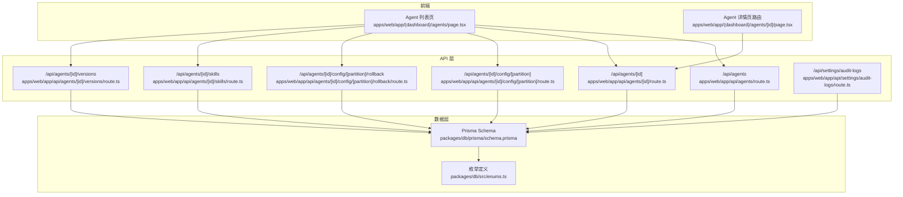
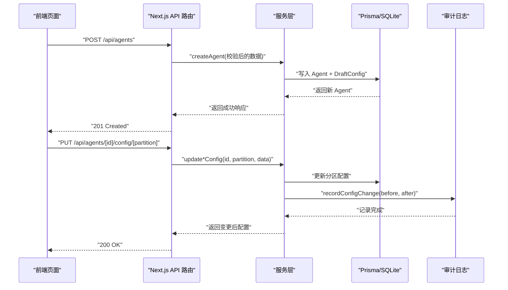
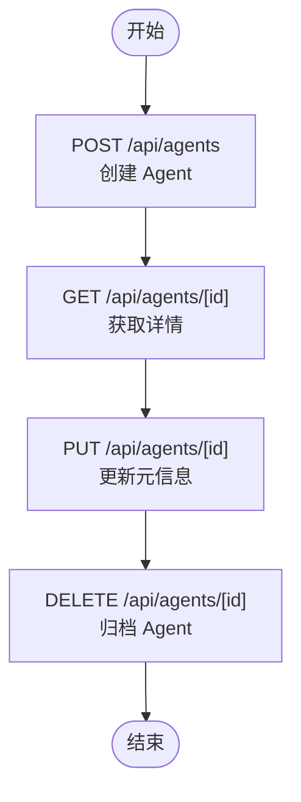
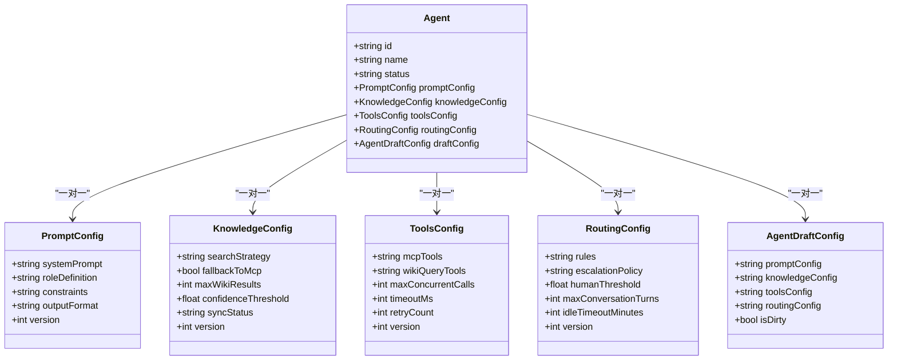
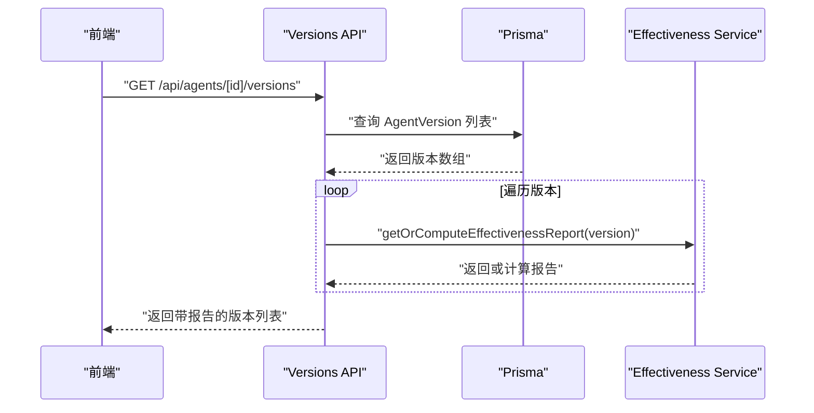
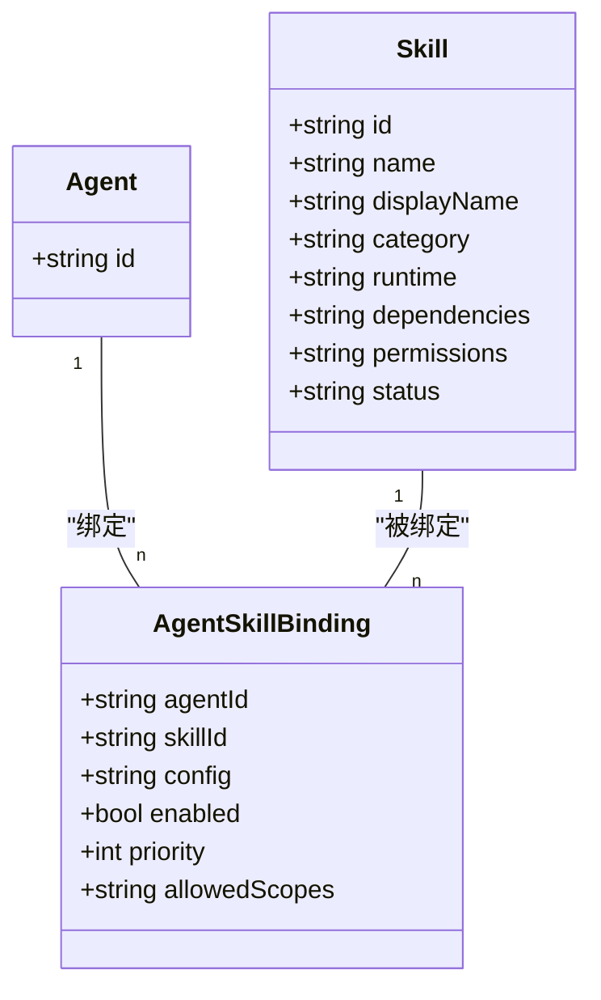
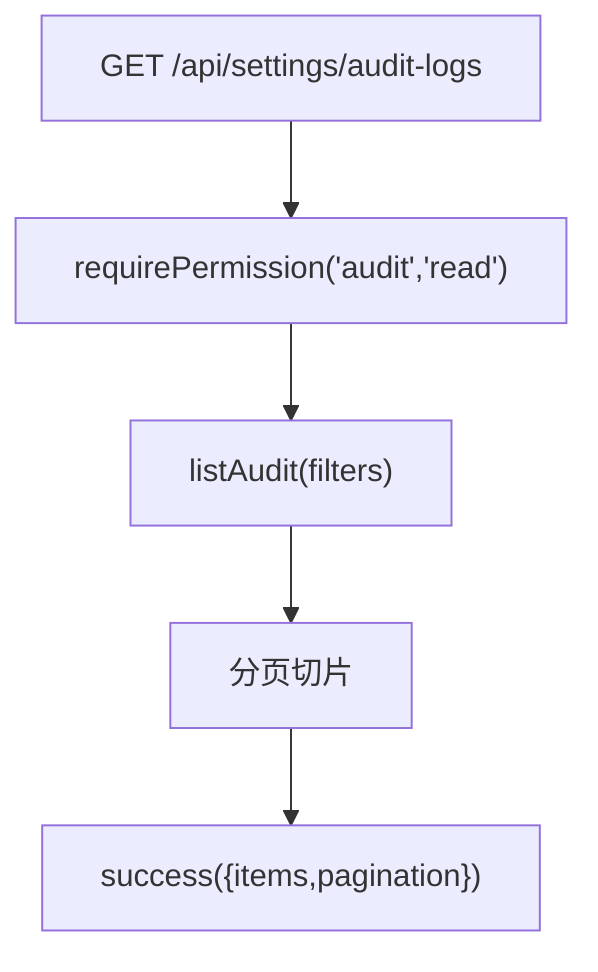
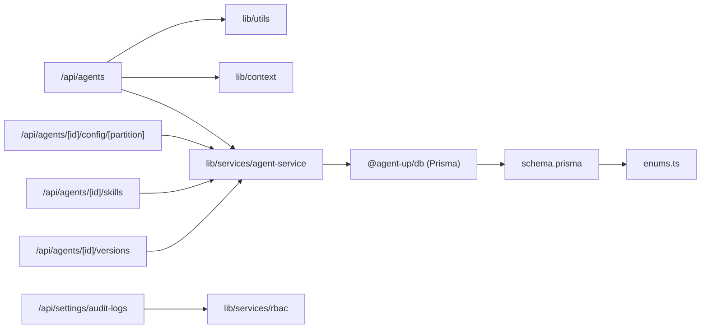

# Agent 管理系统

<cite>
**本文引用的文件**   
- [apps/web/app/api/agents/route.ts](file://apps/web/app/api/agents/route.ts)
- [apps/web/app/api/agents/[id]/route.ts](file://apps/web/app/api/agents/[id]/route.ts)
- [apps/web/app/api/agents/[id]/config/[partition]/route.ts](file://apps/web/app/api/agents/[id]/config/[partition]/route.ts)
- [apps/web/app/api/agents/[id]/config/[partition]/rollback/route.ts](file://apps/web/app/api/agents/[id]/config/[partition]/rollback/route.ts)
- [apps/web/app/api/agents/[id]/skills/route.ts](file://apps/web/app/api/agents/[id]/skills/route.ts)
- [apps/web/app/api/agents/[id]/versions/route.ts](file://apps/web/app/api/agents/[id]/versions/route.ts)
- [apps/web/app/api/settings/audit-logs/route.ts](file://apps/web/app/api/settings/audit-logs/route.ts)
- [apps/web/app/(dashboard)/agents/page.tsx](file://apps/web/app/(dashboard)/agents/page.tsx)
- [apps/web/app/(dashboard)/agents/[id]/page.tsx](file://apps/web/app/(dashboard)/agents/[id]/page.tsx)
- [packages/db/src/enums.ts](file://packages/db/src/enums.ts)
- [packages/db/prisma/schema.prisma](file://packages/db/prisma/schema.prisma)
</cite>

## 目录
1. [引言](#引言)
2. [项目结构](#项目结构)
3. [核心组件](#核心组件)
4. [架构总览](#架构总览)
5. [详细组件分析](#详细组件分析)
6. [依赖关系分析](#依赖关系分析)
7. [性能与可扩展性](#性能与可扩展性)
8. [故障排查指南](#故障排查指南)
9. [结论](#结论)
10. [附录：API 规范与使用示例](#附录api-规范与使用示例)

## 引言
本文件系统性地梳理 Agent 管理系统的功能与实现，重点覆盖以下方面：
- Agent 生命周期管理：创建、编辑、归档（软删除）、状态流转。
- 四分区配置系统：Prompt、Knowledge、Tools、Routing 的分区级 CRUD、变更追踪与草稿保存机制。
- Agent 与 Skills 绑定关系、依赖管理与权限控制。
- API 端点规范、请求响应格式与错误处理。
- 前端页面与组件的使用示例和最佳实践。
- 版本控制系统与审计日志集成方式。
- 常见使用场景与排错建议。

## 项目结构
Agent 管理系统采用 Next.js App Router 作为后端 API 入口，配合 Prisma 数据模型与 TypeScript 类型枚举，提供完整的 Agent 全生命周期管理能力。前端位于 apps/web 下，包含 Agent 列表页、详情页以及各 API 路由；数据库模型集中在 packages/db 中。

图表来源
- [apps/web/app/(dashboard)/agents/page.tsx:1-408](file://apps/web/app/(dashboard)/agents/page.tsx#L1-L408)
- [apps/web/app/(dashboard)/agents/[id]/page.tsx:1-18](file://apps/web/app/(dashboard)/agents/[id]/page.tsx#L1-L18)
- [apps/web/app/api/agents/route.ts:1-43](file://apps/web/app/api/agents/route.ts#L1-L43)
- [apps/web/app/api/agents/[id]/route.ts:1-50](file://apps/web/app/api/agents/[id]/route.ts#L1-L50)
- [apps/web/app/api/agents/[id]/config/[partition]/route.ts:1-86](file://apps/web/app/api/agents/[id]/config/[partition]/route.ts#L1-L86)
- [apps/web/app/api/agents/[id]/config/[partition]/rollback/route.ts:1-118](file://apps/web/app/api/agents/[id]/config/[partition]/rollback/route.ts#L1-L118)
- [apps/web/app/api/agents/[id]/skills/route.ts:1-48](file://apps/web/app/api/agents/[id]/skills/route.ts#L1-L48)
- [apps/web/app/api/agents/[id]/versions/route.ts:1-53](file://apps/web/app/api/agents/[id]/versions/route.ts#L1-L53)
- [apps/web/app/api/settings/audit-logs/route.ts:1-33](file://apps/web/app/api/settings/audit-logs/route.ts#L1-L33)
- [packages/db/prisma/schema.prisma:1-597](file://packages/db/prisma/schema.prisma#L1-L597)
- [packages/db/src/enums.ts:1-180](file://packages/db/src/enums.ts#L1-L180)

章节来源
- [apps/web/app/(dashboard)/agents/page.tsx:1-408](file://apps/web/app/(dashboard)/agents/page.tsx#L1-L408)
- [apps/web/app/(dashboard)/agents/[id]/page.tsx:1-18](file://apps/web/app/(dashboard)/agents/[id]/page.tsx#L1-L18)
- [packages/db/prisma/schema.prisma:1-597](file://packages/db/prisma/schema.prisma#L1-L597)
- [packages/db/src/enums.ts:1-180](file://packages/db/src/enums.ts#L1-L180)

## 核心组件
- Agent 实体与四分区配置：Agent 拥有 Prompt、Knowledge、Tools、Routing 四个分区配置，分别对应性格与纪律、知识检索策略、工具调用策略、对话路由策略。
- 草稿环境：AgentDraftConfig 用于保存未发布的分区配置草稿，支持脏标记与最后保存人/时间。
- 版本快照：AgentVersion 对每次发布生成不可变快照，包含四分区 snapshot，支持回滚。
- 配置变更记录：ConfigChange 记录每个分区的 before/after/diff，支持按分区与时间查询。
- Skill 绑定：AgentSkillBinding 维护 Agent 与 Skill 的多对多绑定，含优先级、启用状态、作用域等。
- 权限与审计：Role/Permission/UserRole/AuditLog 构成 RBAC 与审计体系，审计日志可分页查询并按资源过滤。

章节来源
- [packages/db/prisma/schema.prisma:66-205](file://packages/db/prisma/schema.prisma#L66-L205)
- [packages/db/prisma/schema.prisma:294-391](file://packages/db/prisma/schema.prisma#L294-L391)
- [packages/db/prisma/schema.prisma:486-550](file://packages/db/prisma/schema.prisma#L486-L550)
- [packages/db/src/enums.ts:19-50](file://packages/db/src/enums.ts#L19-L50)

## 架构总览
Agent 管理系统的运行时流程如下：
- 前端通过 Next.js API Routes 发起请求。
- API 层负责参数校验、身份解析、权限检查、业务调用与统一错误封装。
- 服务层调用 Prisma 客户端读写数据库。
- 数据库层由 SQLite 存储，所有复杂字段以 JSON 文本形式持久化，并通过 pack/unpack 函数安全读写。
- 审计与版本系统贯穿配置变更与发布流程，确保可追溯与可回滚。

图表来源
- [apps/web/app/api/agents/route.ts:29-42](file://apps/web/app/api/agents/route.ts#L29-L42)
- [apps/web/app/api/agents/[id]/config/[partition]/route.ts:46-85](file://apps/web/app/api/agents/[id]/config/[partition]/route.ts#L46-L85)
- [packages/db/prisma/schema.prisma:170-205](file://packages/db/prisma/schema.prisma#L170-L205)

## 详细组件分析

### Agent 生命周期管理
- 创建：POST /api/agents，校验 name、description、productGroupId，创建后状态为 DRAFT。
- 详情：GET /api/agents/[id]，不存在返回 404。
- 更新：PUT /api/agents/[id]，校验 updateAgentSchema，更新元信息。
- 归档：DELETE /api/agents/[id]，语义为归档而非物理删除，返回“已归档”消息。
- 状态枚举：DRAFT、ACTIVE、ARCHIVED。

图表来源
- [apps/web/app/api/agents/route.ts:7-42](file://apps/web/app/api/agents/route.ts#L7-L42)
- [apps/web/app/api/agents/[id]/route.ts:7-49](file://apps/web/app/api/agents/[id]/route.ts#L7-L49)
- [packages/db/src/enums.ts:19-24](file://packages/db/src/enums.ts#L19-L24)

章节来源
- [apps/web/app/api/agents/route.ts:7-42](file://apps/web/app/api/agents/route.ts#L7-L42)
- [apps/web/app/api/agents/[id]/route.ts:7-49](file://apps/web/app/api/agents/[id]/route.ts#L7-L49)
- [packages/db/src/enums.ts:19-24](file://packages/db/src/enums.ts#L19-L24)

### 四分区配置系统（Prompt、Knowledge、Tools、Routing）
- 分区枚举：PROMPT、KNOWLEDGE、TOOLS、ROUTING。
- 读取：GET /api/agents/[id]/config/[partition]，返回当前 active 配置。
- 更新：PUT /api/agents/[id]/config/[partition]，按分区调用对应 update*Config，并记录 ConfigChange。
- 回滚：POST /api/agents/[id]/config/[partition]/rollback，从指定 Version 的 snapshot 恢复该分区配置，并记录 ROLLBACK 变更。
- 草稿保存：AgentDraftConfig 支持分区级草稿字段与 isDirty 标记，便于暂存未发布配置。

图表来源
- [packages/db/prisma/schema.prisma:66-182](file://packages/db/prisma/schema.prisma#L66-L182)

章节来源
- [apps/web/app/api/agents/[id]/config/[partition]/route.ts:1-86](file://apps/web/app/api/agents/[id]/config/[partition]/route.ts#L1-L86)
- [apps/web/app/api/agents/[id]/config/[partition]/rollback/route.ts:1-118](file://apps/web/app/api/agents/[id]/config/[partition]/rollback/route.ts#L1-L118)
- [packages/db/prisma/schema.prisma:105-182](file://packages/db/prisma/schema.prisma#L105-L182)
- [packages/db/src/enums.ts:43-50](file://packages/db/src/enums.ts#L43-L50)

### 版本历史与回滚
- 版本列表：GET /api/agents/[id]/versions，返回按 publishedAt 倒序的版本集合，附带 effectivenessReport（必要时懒计算）。
- 分区回滚：POST /api/agents/[id]/config/[partition]/rollback，从指定 versionId 的 snapshot 恢复分区配置，并记录变更。

图表来源
- [apps/web/app/api/agents/[id]/versions/route.ts:1-53](file://apps/web/app/api/agents/[id]/versions/route.ts#L1-L53)

章节来源
- [apps/web/app/api/agents/[id]/versions/route.ts:1-53](file://apps/web/app/api/agents/[id]/versions/route.ts#L1-L53)
- [apps/web/app/api/agents/[id]/config/[partition]/rollback/route.ts:34-117](file://apps/web/app/api/agents/[id]/config/[partition]/rollback/route.ts#L34-L117)
- [packages/db/prisma/schema.prisma:294-318](file://packages/db/prisma/schema.prisma#L294-L318)

### Agent 与 Skills 绑定、依赖与权限
- 绑定列表：GET /api/agents/[id]/skills，返回 Agent 绑定的 Skill 列表。
- 新增绑定：POST /api/agents/[id]/skills，传入 skillId 与 config，创建绑定。
- 解除绑定：DELETE /api/agents/[id]/skills?agentId=...&skillId=...，移除绑定。
- Skill 模型包含 category、runtime、dependencies、permissions 等字段，用于描述技能分类、运行方式、依赖与权限要求。
- 绑定表包含 enabled、priority、allowedScopes，用于控制启用状态、优先级与作用域。

图表来源
- [apps/web/app/api/agents/[id]/skills/route.ts:1-48](file://apps/web/app/api/agents/[id]/skills/route.ts#L1-L48)
- [packages/db/prisma/schema.prisma:324-391](file://packages/db/prisma/schema.prisma#L324-L391)

章节来源
- [apps/web/app/api/agents/[id]/skills/route.ts:1-48](file://apps/web/app/api/agents/[id]/skills/route.ts#L1-L48)
- [packages/db/prisma/schema.prisma:324-391](file://packages/db/prisma/schema.prisma#L324-L391)

### 权限控制与审计日志
- 审计日志接口：GET /api/settings/audit-logs，需 audit:read 权限，支持 action/resource/resourceId/user 过滤与分页。
- RBAC：Role/Permission/UserRole 组合，用户角色可关联产品组，限制资源访问范围。
- 审计日志字段包括 action、resource、resourceId、details、userId、userName、userRole、ipAddress、userAgent、createdAt。

图表来源
- [apps/web/app/api/settings/audit-logs/route.ts:1-33](file://apps/web/app/api/settings/audit-logs/route.ts#L1-L33)
- [packages/db/prisma/schema.prisma:486-550](file://packages/db/prisma/schema.prisma#L486-L550)

章节来源
- [apps/web/app/api/settings/audit-logs/route.ts:1-33](file://apps/web/app/api/settings/audit-logs/route.ts#L1-L33)
- [packages/db/prisma/schema.prisma:486-550](file://packages/db/prisma/schema.prisma#L486-L550)

### 前端组件与最佳实践
- Agent 列表页：
  - 支持搜索与状态筛选，调用 GET /api/agents。
  - 新建 Agent 弹窗：调用 POST /api/agents，成功后刷新列表。
  - 展示 productGroup、反馈数、版本数、Skill 绑定数等统计信息。
- Agent 详情页路由：
  - 静态导出 generateStaticParams，预渲染种子与预留池 ID，保证新建后可直接导航。

最佳实践建议：
- 在列表页加载失败时清空旧数据，避免将上一批结果误当作当前筛选条件结果。
- 新建 Agent 时优先拉取产品组下拉选项，若失败则允许手动输入 ID。
- 使用统一的 success/error 包装器，保持前后端响应格式一致。

章节来源
- [apps/web/app/(dashboard)/agents/page.tsx:1-408](file://apps/web/app/(dashboard)/agents/page.tsx#L1-L408)
- [apps/web/app/(dashboard)/agents/[id]/page.tsx:1-18](file://apps/web/app/(dashboard)/agents/[id]/page.tsx#L1-L18)

## 依赖关系分析
- API 层依赖 lib/utils 进行统一响应封装、参数校验与错误处理。
- API 层依赖 lib/context 进行 Actor 解析与权限检查。
- API 层依赖 lib/services/* 进行业务逻辑与数据访问。
- 数据层依赖 Prisma Client，所有复杂字段经 packJson/unpackJson 安全序列化。
- 枚举定义集中于 packages/db/src/enums.ts，与 schema 中的字符串列值保持一致。

图表来源
- [apps/web/app/api/agents/route.ts:1-43](file://apps/web/app/api/agents/route.ts#L1-L43)
- [apps/web/app/api/agents/[id]/config/[partition]/route.ts:1-86](file://apps/web/app/api/agents/[id]/config/[partition]/route.ts#L1-L86)
- [apps/web/app/api/agents/[id]/skills/route.ts:1-48](file://apps/web/app/api/agents/[id]/skills/route.ts#L1-L48)
- [apps/web/app/api/agents/[id]/versions/route.ts:1-53](file://apps/web/app/api/agents/[id]/versions/route.ts#L1-L53)
- [apps/web/app/api/settings/audit-logs/route.ts:1-33](file://apps/web/app/api/settings/audit-logs/route.ts#L1-L33)
- [packages/db/prisma/schema.prisma:1-597](file://packages/db/prisma/schema.prisma#L1-L597)
- [packages/db/src/enums.ts:1-180](file://packages/db/src/enums.ts#L1-L180)

章节来源
- [apps/web/app/api/agents/route.ts:1-43](file://apps/web/app/api/agents/route.ts#L1-L43)
- [apps/web/app/api/agents/[id]/config/[partition]/route.ts:1-86](file://apps/web/app/api/agents/[id]/config/[partition]/route.ts#L1-L86)
- [apps/web/app/api/agents/[id]/skills/route.ts:1-48](file://apps/web/app/api/agents/[id]/skills/route.ts#L1-L48)
- [apps/web/app/api/agents/[id]/versions/route.ts:1-53](file://apps/web/app/api/agents/[id]/versions/route.ts#L1-L53)
- [apps/web/app/api/settings/audit-logs/route.ts:1-33](file://apps/web/app/api/settings/audit-logs/route.ts#L1-L33)
- [packages/db/prisma/schema.prisma:1-597](file://packages/db/prisma/schema.prisma#L1-L597)
- [packages/db/src/enums.ts:1-180](file://packages/db/src/enums.ts#L1-L180)

## 性能与可扩展性
- 列表与分页：所有列表接口均支持分页参数，减少单次传输数据量。
- 懒计算：版本有效性报告按需计算，避免重复开销。
- JSON 字段：复杂结构以 JSON 文本存储，读写经 pack/unpack 收口，提升兼容性。
- 索引优化：Agent、Feedback、ConfigChange、Skill 等关键表建立常用索引，提高查询效率。
- 扩展建议：
  - 引入缓存层（如 Redis）缓存热点 Agent 配置与版本列表。
  - 对大体积 JSON 字段考虑分片或对象存储。
  - 异步任务队列处理耗时操作（如有效性报告计算、知识库同步）。

[本节为通用指导，不直接分析具体文件]

## 故障排查指南
- 列表加载失败：
  - 现象：前端显示“加载失败”，清空列表。
  - 排查：确认数据库可用、网络连通；重试 GET /api/agents。
- 分区配置更新失败：
  - 现象：PUT /api/agents/[id]/config/[partition] 返回错误。
  - 排查：检查分区是否有效、请求体是否符合分区 schema；查看 recordConfigChange 是否成功。
- 回滚失败：
  - 现象：POST /api/agents/[id]/config/[partition]/rollback 报错。
  - 排查：确认 versionId 存在且属于该 Agent；检查 snapshot 是否存在；查看 before/after 记录。
- 权限不足：
  - 现象：审计日志接口返回无权限。
  - 排查：确认用户具备 audit:read 权限；检查 RBAC 配置。
- 版本报告缺失：
  - 现象：版本列表缺少 effectivenessReport。
  - 排查：触发懒计算；检查有效性服务可用性。

章节来源
- [apps/web/app/(dashboard)/agents/page.tsx:42-64](file://apps/web/app/(dashboard)/agents/page.tsx#L42-L64)
- [apps/web/app/api/agents/[id]/config/[partition]/route.ts:46-85](file://apps/web/app/api/agents/[id]/config/[partition]/route.ts#L46-L85)
- [apps/web/app/api/agents/[id]/config/[partition]/rollback/route.ts:55-117](file://apps/web/app/api/agents/[id]/config/[partition]/rollback/route.ts#L55-L117)
- [apps/web/app/api/settings/audit-logs/route.ts:7-32](file://apps/web/app/api/settings/audit-logs/route.ts#L7-L32)
- [apps/web/app/api/agents/[id]/versions/route.ts:33-46](file://apps/web/app/api/agents/[id]/versions/route.ts#L33-L46)

## 结论
Agent 管理系统围绕 Agent 生命周期与四分区配置展开，提供完善的 CRUD、版本快照、回滚、Skill 绑定与权限审计能力。通过统一的 API 层与数据模型设计，系统在可维护性与可扩展性上具备良好的基础。建议在后续迭代中引入缓存与异步任务队列，进一步提升性能与稳定性。

[本节为总结性内容，不直接分析具体文件]

## 附录：API 规范与使用示例

### API 端点总览
- GET /api/agents
  - 功能：获取 Agent 列表（支持分页、status、productGroupId、search）。
  - 响应：{ items, pagination }。
- POST /api/agents
  - 功能：创建 Agent。
  - 请求体：name、description、productGroupId。
  - 响应：新创建的 Agent。
- GET /api/agents/[id]
  - 功能：获取 Agent 详情。
  - 响应：Agent 对象。
- PUT /api/agents/[id]
  - 功能：更新 Agent 元信息。
  - 请求体：符合 updateAgentSchema。
  - 响应：更新后的 Agent。
- DELETE /api/agents/[id]
  - 功能：归档 Agent。
  - 响应：{ message: "Agent 已归档" }。
- GET /api/agents/[id]/config/[partition]
  - 功能：读取分区配置。
  - 分区：prompt、knowledge、tools、routing。
  - 响应：分区配置对象。
- PUT /api/agents/[id]/config/[partition]
  - 功能：更新分区配置。
  - 请求体：按分区 schema 校验。
  - 响应：更新后的分区配置。
- POST /api/agents/[id]/config/[partition]/rollback
  - 功能：分区级回滚。
  - 请求体：{ versionId }。
  - 响应：{ partition, restoredFromVersion, config }。
- GET /api/agents/[id]/skills
  - 功能：获取 Agent 的 Skill 绑定列表。
  - 响应：绑定数组。
- POST /api/agents/[id]/skills
  - 功能：新增 Skill 绑定。
  - 请求体：{ skillId, config }。
  - 响应：新绑定对象。
- DELETE /api/agents/[id]/skills?agentId=...&skillId=...
  - 功能：解除 Skill 绑定。
  - 响应：解绑结果。
- GET /api/agents/[id]/versions
  - 功能：获取版本历史（含有效性报告）。
  - 响应：{ items, total }。
- GET /api/settings/audit-logs
  - 功能：查询审计日志（需 audit:read）。
  - 查询参数：action、resource、resourceId、user。
  - 响应：{ items, pagination }。

章节来源
- [apps/web/app/api/agents/route.ts:7-42](file://apps/web/app/api/agents/route.ts#L7-L42)
- [apps/web/app/api/agents/[id]/route.ts:7-49](file://apps/web/app/api/agents/[id]/route.ts#L7-L49)
- [apps/web/app/api/agents/[id]/config/[partition]/route.ts:28-85](file://apps/web/app/api/agents/[id]/config/[partition]/route.ts#L28-L85)
- [apps/web/app/api/agents/[id]/config/[partition]/rollback/route.ts:34-117](file://apps/web/app/api/agents/[id]/config/[partition]/rollback/route.ts#L34-L117)
- [apps/web/app/api/agents/[id]/skills/route.ts:7-47](file://apps/web/app/api/agents/[id]/skills/route.ts#L7-L47)
- [apps/web/app/api/agents/[id]/versions/route.ts:8-52](file://apps/web/app/api/agents/[id]/versions/route.ts#L8-L52)
- [apps/web/app/api/settings/audit-logs/route.ts:7-32](file://apps/web/app/api/settings/audit-logs/route.ts#L7-L32)

### 前端使用示例与最佳实践
- 列表页：
  - 使用 URLSearchParams 拼接 search/statusFilter 参数。
  - 失败时清空 agents 列表并提示错误。
  - 新建弹窗优先拉取产品组列表，失败时允许手动输入 ID。
- 详情页：
  - 使用 generateStaticParams 预渲染种子与预留池 ID，确保导航稳定。
- 最佳实践：
  - 统一使用 success/error 包装器，避免分散的错误处理逻辑。
  - 对耗时操作（如有效性报告计算）采用懒计算与重试机制。
  - 在配置变更时始终记录审计日志，便于回溯与问责。

章节来源
- [apps/web/app/(dashboard)/agents/page.tsx:42-64](file://apps/web/app/(dashboard)/agents/page.tsx#L42-L64)
- [apps/web/app/(dashboard)/agents/page.tsx:273-303](file://apps/web/app/(dashboard)/agents/page.tsx#L273-L303)
- [apps/web/app/(dashboard)/agents/[id]/page.tsx:9-13](file://apps/web/app/(dashboard)/agents/[id]/page.tsx#L9-L13)