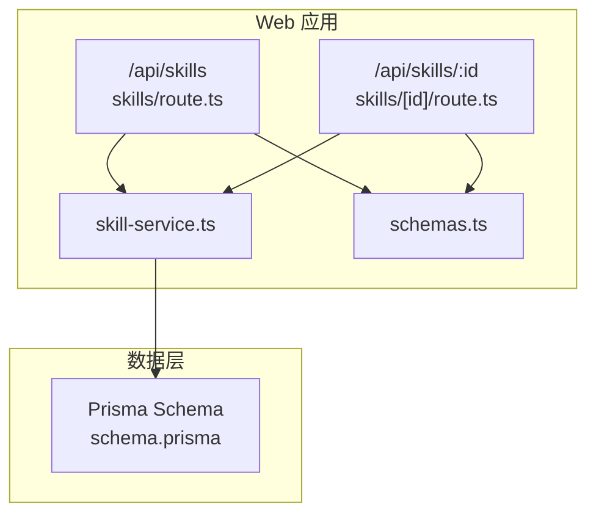
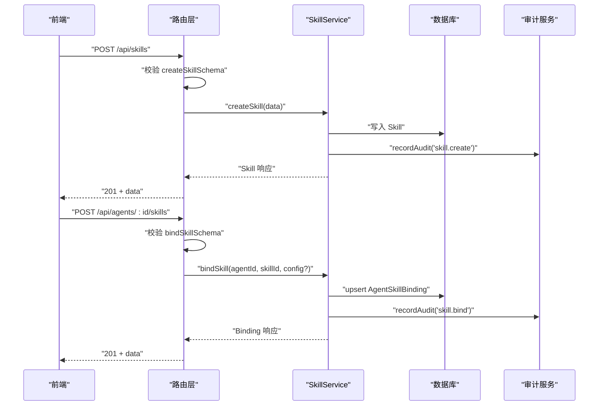
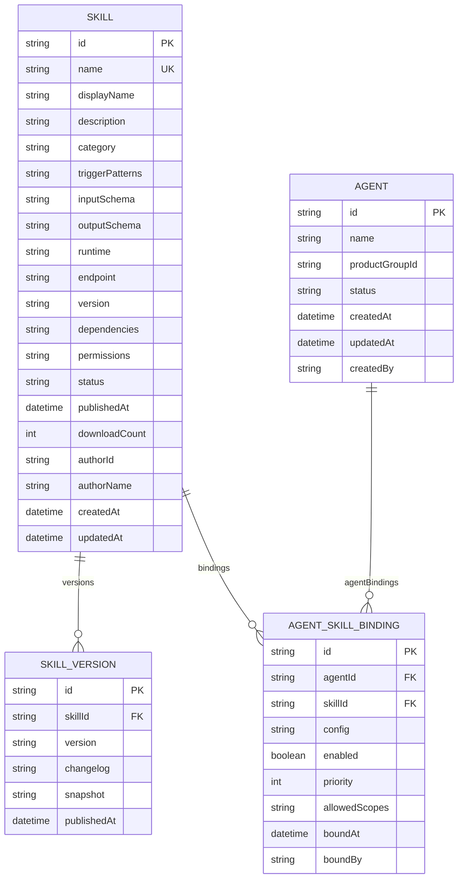
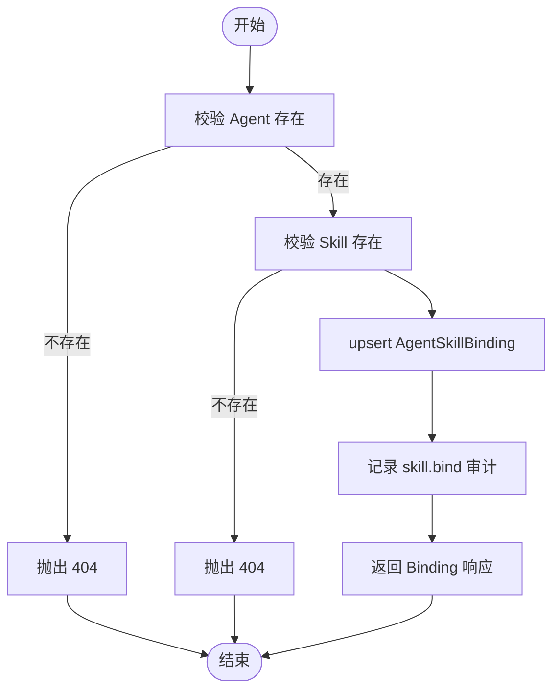
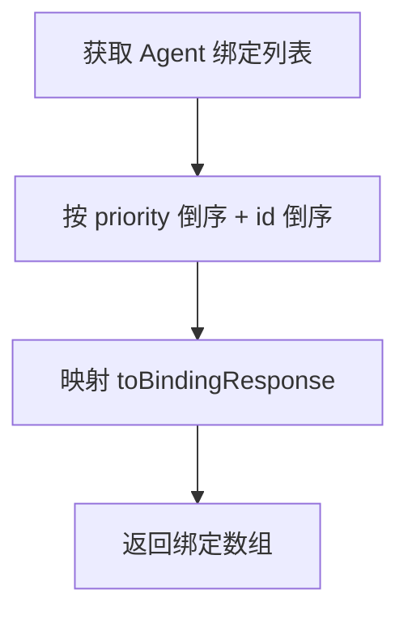
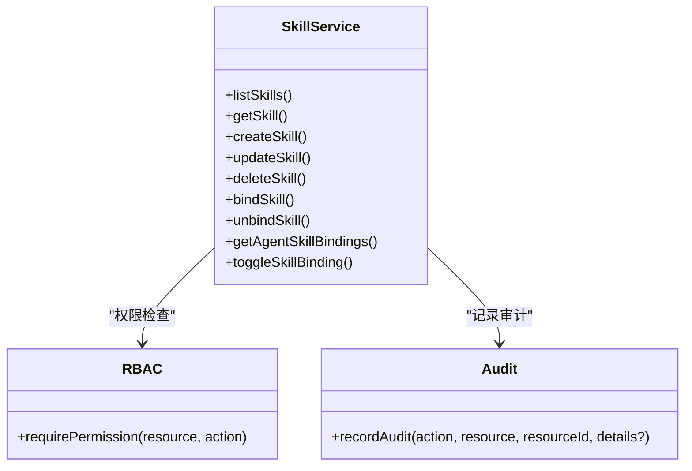
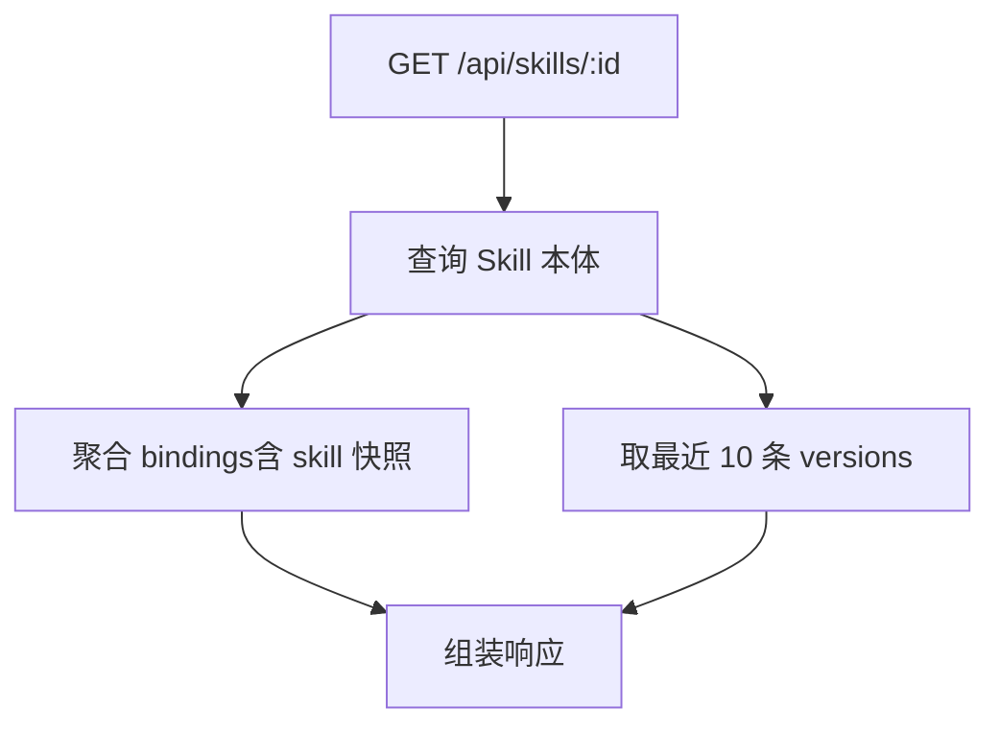
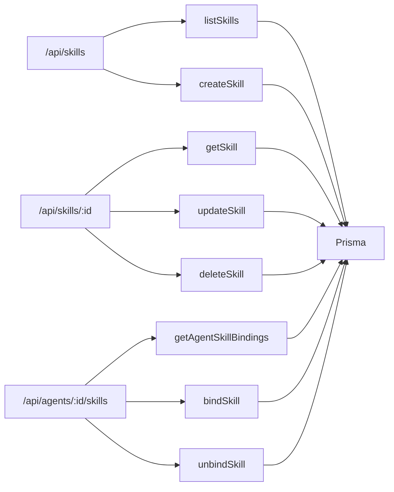

# Skills 绑定管理

<cite>
**本文引用的文件**   
- [apps/web/lib/services/skill-service.ts](file://apps/web/lib/services/skill-service.ts)
- [apps/web/app/api/skills/route.ts](file://apps/web/app/api/skills/route.ts)
- [apps/web/app/api/skills/[id]/route.ts](file://apps/web/app/api/skills/[id]/route.ts)
- [apps/web/lib/schemas.ts](file://apps/web/lib/schemas.ts)
- [packages/db/prisma/schema.prisma](file://packages/db/prisma/schema.prisma)
- [apps/web/lib/__tests__/skill-service.test.ts](file://apps/web/lib/__tests__/skill-service.test.ts)
- [apps/web/app/api/__tests__/skill-detail.test.ts](file://apps/web/app/api/__tests__/skill-detail.test.ts)
- [docs/distilled/skill-service.md](file://docs/distilled/skill-service.md)
</cite>

## 目录
1. [引言](#引言)
2. [项目结构](#项目结构)
3. [核心组件](#核心组件)
4. [架构总览](#架构总览)
5. [详细组件分析](#详细组件分析)
6. [依赖关系分析](#依赖关系分析)
7. [性能与扩展性](#性能与扩展性)
8. [故障排查指南](#故障排查指南)
9. [结论](#结论)
10. [附录：API 契约与前端实践](#附录api-契约与前端实践)

## 引言
本文聚焦 Agent 与 Skills 的绑定管理能力，覆盖数据模型、CRUD 流程、优先级排序与启用状态管理、权限控制与审计日志、版本快照与兼容性注意事项，并给出 API 接口规范与前端使用建议。当前实现以数据库持久化为主（Prisma + SQLite），Skill 列表/详情与绑定关系均通过服务层封装，路由层负责参数校验、权限上下文与错误包装。

## 项目结构
与 Skills 绑定直接相关的代码分布在以下位置：
- 领域服务：`apps/web/lib/services/skill-service.ts`
- 路由层：`apps/web/app/api/skills/route.ts`、`apps/web/app/api/skills/[id]/route.ts`
- 请求校验：`apps/web/lib/schemas.ts`
- 数据模型：`packages/db/prisma/schema.prisma`
- 测试用例：`apps/web/lib/__tests__/skill-service.test.ts`、`apps/web/app/api/__tests__/skill-detail.test.ts`
- 蒸馏文档：`docs/distilled/skill-service.md`

**图表来源**
- [apps/web/app/api/skills/route.ts:1-31](file://apps/web/app/api/skills/route.ts#L1-L31)
- [apps/web/app/api/skills/[id]/route.ts:1-47](file://apps/web/app/api/skills/[id]/route.ts#L1-L47)
- [apps/web/lib/services/skill-service.ts:1-296](file://apps/web/lib/services/skill-service.ts#L1-L296)
- [apps/web/lib/schemas.ts:151-186](file://apps/web/lib/schemas.ts#L151-L186)
- [packages/db/prisma/schema.prisma:324-391](file://packages/db/prisma/schema.prisma#L324-L391)

**章节来源**
- [apps/web/lib/services/skill-service.ts:1-296](file://apps/web/lib/services/skill-service.ts#L1-L296)
- [apps/web/app/api/skills/route.ts:1-31](file://apps/web/app/api/skills/route.ts#L1-L31)
- [apps/web/app/api/skills/[id]/route.ts:1-47](file://apps/web/app/api/skills/[id]/route.ts#L1-L47)
- [apps/web/lib/schemas.ts:151-186](file://apps/web/lib/schemas.ts#L151-L186)
- [packages/db/prisma/schema.prisma:324-391](file://packages/db/prisma/schema.prisma#L324-L391)

## 核心组件
- Skill 领域服务：提供技能目录 CRUD 与 Agent-Skill 绑定管理，统一处理权限、审计、序列化与响应转换。
- 路由层：暴露 REST 接口，完成分页解析、请求体验证、Actor 上下文注入与错误包装。
- 数据模型：Skill、SkillVersion、AgentSkillBinding 三表构成“技能-版本-绑定”主域；Agent 与 Skill 通过绑定关联。
- 校验层：Zod schema 约束创建/更新/绑定入参，枚举值在运行时保持一致。

关键职责边界：
- 列表与详情：Skill 列表支持 category/status/search 过滤与分页；详情聚合 bindings 与最近 10 个版本。
- 绑定关系：幂等 upsert、优先级倒序、enabled 开关、boundBy 审计快照。
- 权限与审计：Skill 管理归 settings.admin；Agent 绑定归 agent.write；写操作记录 skill.* 审计。

**章节来源**
- [apps/web/lib/services/skill-service.ts:14-296](file://apps/web/lib/services/skill-service.ts#L14-L296)
- [apps/web/app/api/skills/route.ts:1-31](file://apps/web/app/api/skills/route.ts#L1-L31)
- [apps/web/app/api/skills/[id]/route.ts:1-47](file://apps/web/app/api/skills/[id]/route.ts#L1-L47)
- [apps/web/lib/schemas.ts:151-186](file://apps/web/lib/schemas.ts#L151-L186)
- [packages/db/prisma/schema.prisma:324-391](file://packages/db/prisma/schema.prisma#L324-L391)

## 架构总览
Skills 绑定管理的端到端调用链如下：

**图表来源**
- [apps/web/app/api/skills/route.ts:18-30](file://apps/web/app/api/skills/route.ts#L18-L30)
- [apps/web/lib/services/skill-service.ts:144-179](file://apps/web/lib/services/skill-service.ts#L144-L179)
- [apps/web/lib/services/skill-service.ts:223-254](file://apps/web/lib/services/skill-service.ts#L223-L254)

## 详细组件分析

### 数据模型与关系
- Skill：技能元数据，包含分类、运行方式、版本、依赖、权限、作者快照等。
- SkillVersion：技能版本快照，含版本号、变更说明、发布时间。
- AgentSkillBinding：Agent 与 Skill 的绑定，含配置、优先级、启用状态、作用域、绑定人与时间。
- Agent：通过 AgentSkillBinding 与 Skill 多对多关联。

**图表来源**
- [packages/db/prisma/schema.prisma:324-391](file://packages/db/prisma/schema.prisma#L324-L391)

**章节来源**
- [packages/db/prisma/schema.prisma:324-391](file://packages/db/prisma/schema.prisma#L324-L391)

### 绑定关系设计要点
- 幂等绑定：重复绑定同一 skill 会合并 config 并将 enabled 置为 true，不新增行。
- 优先级排序：绑定列表按 priority 降序，次级按 id 降序。
- 启用状态：默认 enabled=true；可通过 toggleSkillBinding 切换（当前无生产路由暴露）。
- 绑定快照：binding 返回时附带 skill 摘要快照，便于展示免二次查询。
- 审计快照：boundBy 记录绑定人标识，用于审计追溯。

**图表来源**
- [apps/web/lib/services/skill-service.ts:223-254](file://apps/web/lib/services/skill-service.ts#L223-L254)

**章节来源**
- [apps/web/lib/services/skill-service.ts:223-254](file://apps/web/lib/services/skill-service.ts#L223-L254)

### 优先级与启用状态管理
- 优先级：getAgentSkillBindings 与 getSkill 中 bindings 均按 priority 倒序返回，确保高优先级技能优先生效。
- 启用状态：bindSkill 默认 enabled=true；toggleSkillBinding 可切换 enabled，但当前未对外暴露路由。
- 解绑行为：unbindSkill 静默成功（即使绑定不存在也返回 deleted:true），便于客户端幂等调用。

**图表来源**
- [apps/web/lib/services/skill-service.ts:267-277](file://apps/web/lib/services/skill-service.ts#L267-L277)

**章节来源**
- [apps/web/lib/services/skill-service.ts:267-277](file://apps/web/lib/services/skill-service.ts#L267-L277)

### 权限控制与审计日志
- 权限：
  - Skill 管理（创建/更新/归档）需要 settings.admin。
  - Agent 绑定（绑定/解绑/切换启用）需要 agent.write。
- 审计：
  - skill.create、skill.update、skill.archive、skill.bind、skill.unbind 均记录审计。
  - toggleSkillBinding 当前未记录审计（潜在改进点）。

**图表来源**
- [apps/web/lib/services/skill-service.ts:14-14](file://apps/web/lib/services/skill-service.ts#L14-L14)
- [apps/web/lib/services/skill-service.ts:155-156](file://apps/web/lib/services/skill-service.ts#L155-L156)
- [apps/web/lib/services/skill-service.ts:228-228](file://apps/web/lib/services/skill-service.ts#L228-L228)

**章节来源**
- [apps/web/lib/services/skill-service.ts:155-156](file://apps/web/lib/services/skill-service.ts#L155-L156)
- [apps/web/lib/services/skill-service.ts:228-228](file://apps/web/lib/services/skill-service.ts#L228-L228)
- [apps/web/lib/services/skill-service.ts:178-178](file://apps/web/lib/services/skill-service.ts#L178-L178)
- [apps/web/lib/services/skill-service.ts:252-252](file://apps/web/lib/services/skill-service.ts#L252-L252)

### 版本快照与兼容性
- SkillVersion：每个技能维护多个版本快照，包含版本号、变更说明、发布时间。
- 详情聚合：getSkill 返回最近 10 条版本，供前端展示历史与回滚参考。
- 兼容性注意：
  - updateSkillSchema 允许设置 status 为 PUBLISHED/DEPRECATED，但不接受 publishedAt 字段；运行时创建的 skill 该字段为空。
  - binding 返回的 skill 摘要是快照，不会随 skill 改名自动刷新。

**图表来源**
- [apps/web/lib/services/skill-service.ts:117-142](file://apps/web/lib/services/skill-service.ts#L117-L142)

**章节来源**
- [apps/web/lib/services/skill-service.ts:117-142](file://apps/web/lib/services/skill-service.ts#L117-L142)
- [apps/web/lib/schemas.ts:171-181](file://apps/web/lib/schemas.ts#L171-L181)

### 冲突检测与依赖解析
- 冲突检测：
  - 同名 Skill 创建时检测并抛冲突错误。
  - AgentSkillBinding 唯一键 (agentId, skillId) 保证同一 Agent 不重复绑定同一 Skill。
- 依赖解析：
  - Skill 模型包含 dependencies 字段（JSON 文本），但当前服务层未实现依赖解析或冲突解决逻辑。
  - 如需依赖图构建、循环依赖检测、自动降级策略，需在 Service 层扩展。

**章节来源**
- [apps/web/lib/services/skill-service.ts:157-158](file://apps/web/lib/services/skill-service.ts#L157-L158)
- [packages/db/prisma/schema.prisma:373-391](file://packages/db/prisma/schema.prisma#L373-L391)

## 依赖关系分析
- 路由到服务：
  - /api/skills → listSkills、createSkill
  - /api/skills/:id → getSkill、updateSkill、deleteSkill
  - /api/agents/:id/skills → getAgentSkillBindings、bindSkill、unbindSkill
- 服务到数据：
  - 读写 Skill、SkillVersion、AgentSkillBinding、Agent
- 外部依赖：
  - Prisma 客户端
  - RBAC requirePermission
  - 审计 recordAudit

**图表来源**
- [apps/web/app/api/skills/route.ts:7-30](file://apps/web/app/api/skills/route.ts#L7-L30)
- [apps/web/app/api/skills/[id]/route.ts:7-46](file://apps/web/app/api/skills/[id]/route.ts#L7-L46)
- [apps/web/lib/services/skill-service.ts:74-296](file://apps/web/lib/services/skill-service.ts#L74-L296)

**章节来源**
- [apps/web/app/api/skills/route.ts:7-30](file://apps/web/app/api/skills/route.ts#L7-L30)
- [apps/web/app/api/skills/[id]/route.ts:7-46](file://apps/web/app/api/skills/[id]/route.ts#L7-L46)
- [apps/web/lib/services/skill-service.ts:74-296](file://apps/web/lib/services/skill-service.ts#L74-L296)

## 性能与扩展性
- 列表查询：
  - 无搜索条件时使用数据库分页与计数；有搜索条件时内存过滤后切片。
- 详情聚合：
  - 一次查询包含 bindings 与 versions，避免多次往返。
- 绑定列表：
  - 按 priority 倒序 + id 倒序，索引优化良好。
- 扩展建议：
  - 若需依赖解析与冲突检测，可在 Service 层引入缓存与图算法。
  - 若需批量绑定/解绑，可增加事务与批处理接口。

[本节为通用指导，不涉及具体文件分析]

## 故障排查指南
- 绑定列表里 skill 名字是旧的：
  - binding 返回的是 skill 快照，不会随 skill 改名同步；重新绑定或修正数据。
- 解绑接口返回“已解绑”但绑定本来就不存在：
  - unbindSkill 静默成功设计；先 GET 绑定列表确认真实状态。
- Skill 详情接口慢：
  - 详情聚合包含 bindings 与 versions，数据量大时需关注索引与缓存。
- 通过 API 把 skill 设为 PUBLISHED 后 publishedAt 仍为空：
  - updateSkillSchema 不接受 publishedAt；需在服务层补充发布动作。
- 列表过滤不生效：
  - 传 "ALL" 视为不过滤；枚举值大小写敏感。

**章节来源**
- [apps/web/lib/services/skill-service.ts:256-265](file://apps/web/lib/services/skill-service.ts#L256-L265)
- [apps/web/lib/services/skill-service.ts:117-142](file://apps/web/lib/services/skill-service.ts#L117-L142)
- [apps/web/lib/schemas.ts:171-181](file://apps/web/lib/schemas.ts#L171-L181)

## 结论
Skills 绑定管理在当前实现中提供了稳定的 Skill 目录管理与 Agent-Skill 绑定能力，具备幂等绑定、优先级排序、启用状态控制、权限与审计基础。依赖解析与冲突检测尚未实现，建议在 Service 层扩展图算法与缓存机制。前端应遵循 API 契约，合理处理分页、过滤、错误与审计提示。

[本节为总结性内容，不涉及具体文件分析]

## 附录：API 契约与前端实践

### 接口定义

- 列表与创建
  - GET /api/skills
    - 查询参数：page、pageSize、skip、take、category、status、search
    - 响应：{ items: Skill[], pagination: { page, pageSize, total } }
  - POST /api/skills
    - 请求体：createSkillSchema
    - 响应：Skill（201）

- 详情与更新/归档
  - GET /api/skills/:id
    - 响应：Skill（含 bindings、versions、_count）
  - PUT /api/skills/:id
    - 请求体：updateSkillSchema
    - 响应：Skill
  - DELETE /api/skills/:id
    - 响应：{ message: "Skill 已归档" }

- 绑定管理
  - GET /api/agents/:id/skills
    - 响应：Binding[]（按 priority 倒序）
  - POST /api/agents/:id/skills
    - 请求体：bindSkillSchema
    - 响应：Binding（201）
  - DELETE /api/agents/:id/skills
    - 响应：{ deleted: true }

**章节来源**
- [apps/web/app/api/skills/route.ts:7-30](file://apps/web/app/api/skills/route.ts#L7-L30)
- [apps/web/app/api/skills/[id]/route.ts:7-46](file://apps/web/app/api/skills/[id]/route.ts#L7-L46)
- [apps/web/lib/schemas.ts:159-186](file://apps/web/lib/schemas.ts#L159-L186)
- [apps/web/lib/services/skill-service.ts:74-296](file://apps/web/lib/services/skill-service.ts#L74-L296)

### 前端使用示例与最佳实践
- 列表页：
  - 支持 category/status/search 过滤；当传 "ALL" 时等同于不过滤。
  - 分页使用 page/pageSize 或 skip/take；后端按 updatedAt 倒序。
- 详情页：
  - 展示 bindings 与 versions；注意 versions 仅返回最近 10 条。
  - 若显示旧版 skill 名称，提示用户重新绑定。
- 绑定管理：
  - 绑定前校验 skillId 与可选 config；重复绑定会自动合并 config 并启用。
  - 解绑接口幂等；若需区分“已解绑”与“原本未绑定”，请先 GET 绑定列表。
  - 启用/停用：toggleSkillBinding 可用但未暴露路由；如需开放，请补路由与审计。
- 权限与审计：
  - 创建/更新/归档 Skill 需要 settings.admin。
  - 绑定/解绑需要 agent.write。
  - 所有写操作均有审计记录；前端可展示审计日志中的操作者与时间。

**章节来源**
- [apps/web/lib/services/skill-service.ts:74-115](file://apps/web/lib/services/skill-service.ts#L74-L115)
- [apps/web/lib/services/skill-service.ts:117-142](file://apps/web/lib/services/skill-service.ts#L117-L142)
- [apps/web/lib/services/skill-service.ts:223-296](file://apps/web/lib/services/skill-service.ts#L223-L296)
- [apps/web/lib/__tests__/skill-service.test.ts:133-154](file://apps/web/lib/__tests__/skill-service.test.ts#L133-L154)
- [apps/web/app/api/__tests__/skill-detail.test.ts:53-73](file://apps/web/app/api/__tests__/skill-detail.test.ts#L53-L73)