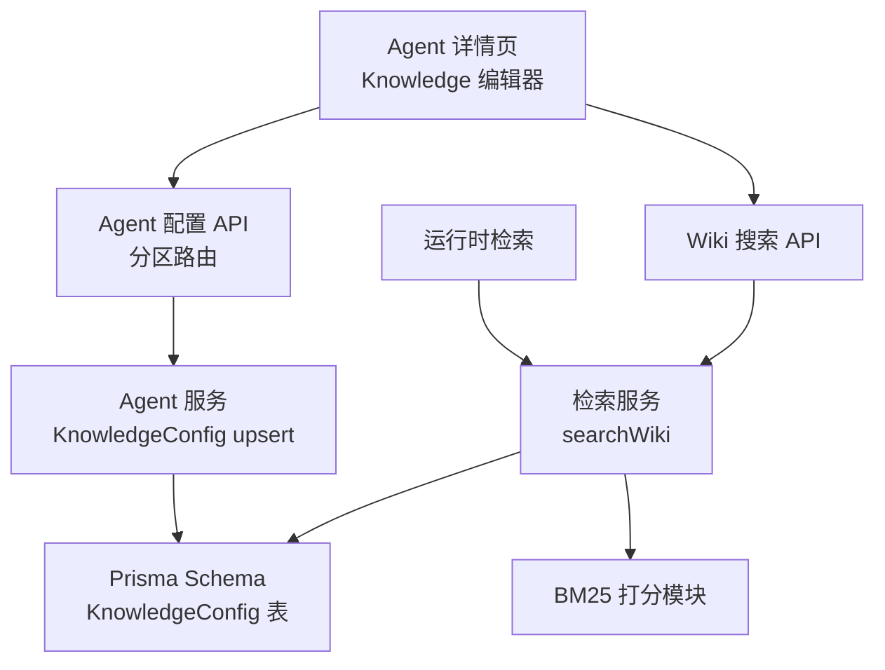
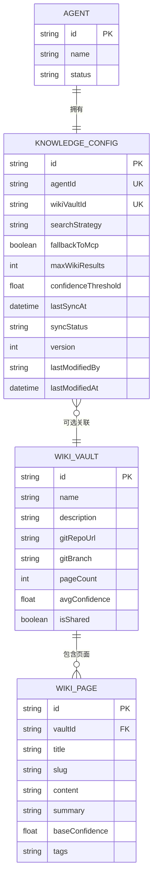
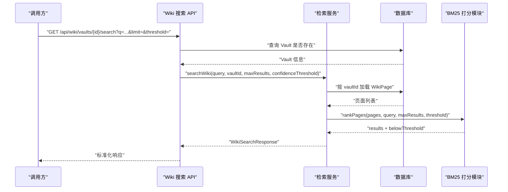
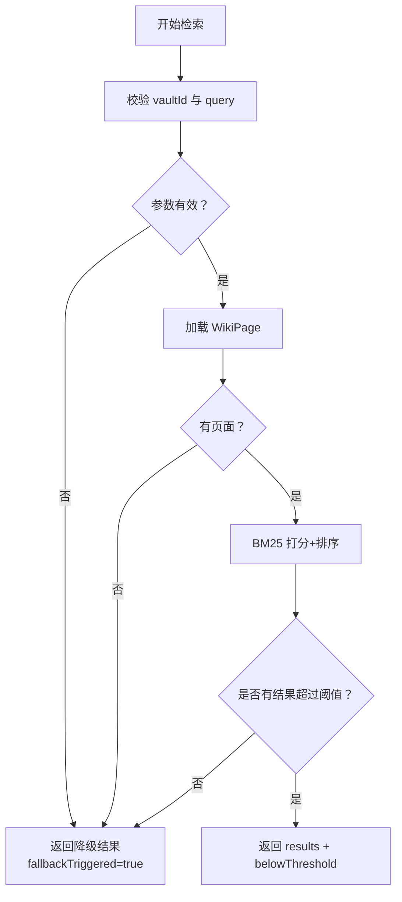
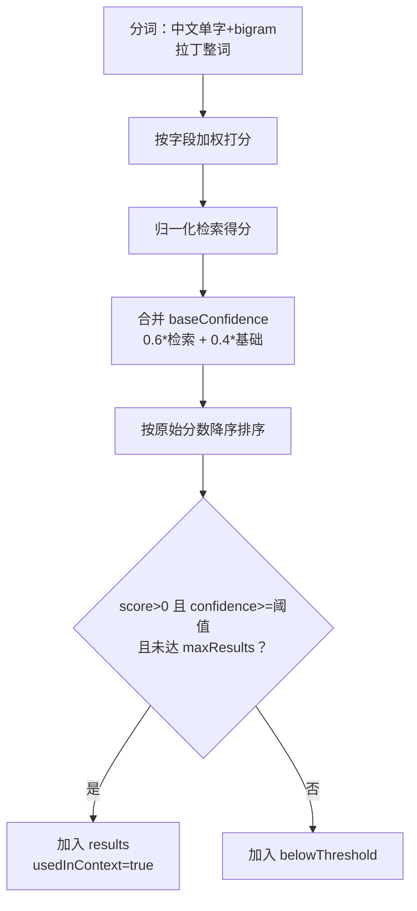

# Knowledge 配置分区

<cite>
**本文引用的文件**   
- [retrieval-service.ts](file://apps/web/lib/services/retrieval-service.ts)
- [retrieval-bm25.ts](file://apps/web/lib/retrieval-bm25.ts)
- [agent-detail.tsx](file://apps/web/app/(dashboard)/agents/[id]/agent-detail.tsx)
- [schemas.ts](file://apps/web/lib/schemas.ts)
- [agent-service.ts](file://apps/web/lib/services/agent-service.ts)
- [schema.prisma](file://packages/db/prisma/schema.prisma)
- [wiki-search route](file://apps/web/app/api/wiki/vaults/[id]/search/route.ts)
- [wiki-search.test.ts](file://apps/web/app/api/__tests__/wiki-search.test.ts)
- [retrieval-service.test.ts](file://apps/web/lib/__tests__/retrieval-service.test.ts)
</cite>

## 目录
1. [简介](#简介)
2. [项目结构定位](#项目结构定位)
3. [核心概念与数据模型](#核心概念与数据模型)
4. [知识库集成机制](#知识库集成机制)
5. [搜索策略与 MCP 降级](#搜索策略与-mcp-降级)
6. [配置字段详解](#配置字段详解)
7. [检索流程与算法](#检索流程与算法)
8. [性能优化与缓存](#性能优化与缓存)
9. [集成示例与配置模板](#集成示例与配置模板)
10. [故障排查指南](#故障排查指南)
11. [结论](#结论)

## 简介
Knowledge 配置分区用于描述 Agent 如何访问、排序和回退到知识库（Wiki Vault）以及外部 MCP 工具。它不是单纯的“开关”，而是把以下能力组合在一起：
- 关联一个 Wiki Vault，作为长期知识来源；
- 选择搜索策略，决定先查 Wiki、先调 MCP，还是两路并行；
- 控制是否允许在 Wiki 未命中或置信度不足时回退到 MCP；
- 限制返回的 Wiki 结果数量；
- 设置置信度阈值，过滤低质量上下文片段；
- 通过 BM25-lite 本地打分实现稳定、可复现的知识检索。

该分区的数据持久化在数据库的 `KnowledgeConfig` 表中，前端通过 Agent 详情页面的 Knowledge 编辑器进行可视化配置，后端服务负责校验、保存、版本化和对外暴露。

## 项目结构定位
Knowledge 配置涉及前端 UI、服务端 API、数据库 Schema、检索服务和测试用例五个层面：

**图表来源**
- [agent-detail.tsx:45-50](file://apps/web/app/(dashboard)/agents/[id]/agent-detail.tsx#L45-L50)
- [agent-service.ts:88-97](file://apps/web/lib/services/agent-service.ts#L88-L97)
- [schema.prisma:119-136](file://packages/db/prisma/schema.prisma#L119-L136)
- [retrieval-service.ts:19-49](file://apps/web/lib/services/retrieval-service.ts#L19-L49)
- [retrieval-bm25.ts:19-50](file://apps/web/lib/retrieval-bm25.ts#L19-L50)

**章节来源**
- [agent-detail.tsx:45-50](file://apps/web/app/(dashboard)/agents/[id]/agent-detail.tsx#L45-L50)
- [agent-service.ts:88-97](file://apps/web/lib/services/agent-service.ts#L88-L97)
- [schema.prisma:119-136](file://packages/db/prisma/schema.prisma#L119-L136)
- [retrieval-service.ts:19-49](file://apps/web/lib/services/retrieval-service.ts#L19-L49)

## 核心概念与数据模型
Knowledge 配置的核心是 `KnowledgeConfig` 实体。它与 Agent 一对一绑定，同时可选关联一个 Wiki Vault。关键字段包括：
- `wikiVaultId`：关联的 Wiki Vault ID；
- `searchStrategy`：搜索策略枚举值；
- `fallbackToMcp`：是否允许 Wiki 未命中时回退 MCP；
- `maxWikiResults`：最多返回多少条 Wiki 结果；
- `confidenceThreshold`：置信度阈值；
- `version`、`lastModifiedBy`、`lastModifiedAt`：配置版本与审计信息；
- `syncStatus`、`lastSyncAt`：知识库同步状态字段。

**图表来源**
- [schema.prisma:66-99](file://packages/db/prisma/schema.prisma#L66-L99)
- [schema.prisma:119-136](file://packages/db/prisma/schema.prisma#L119-L136)
- [schema.prisma:397-454](file://packages/db/prisma/schema.prisma#L397-L454)

**章节来源**
- [schema.prisma:119-136](file://packages/db/prisma/schema.prisma#L119-L136)
- [schema.prisma:397-454](file://packages/db/prisma/schema.prisma#L397-L454)

## 知识库集成机制
### Wiki Vault 关联
Knowledge 配置通过 `wikiVaultId` 与 `WikiVault` 建立关系。数据库中 `KnowledgeConfig.wikiVaultId` 是外键，指向 `WikiVault.id`，且为可选字段。这意味着：
- Agent 可以没有关联 Wiki Vault；
- 删除 Wiki Vault 不会强制删除 KnowledgeConfig，但会置空关联；
- 实际检索时，如果 `vaultId` 为空或对应 Vault 不存在，检索服务会直接返回降级结果。

### 页面加载与字段处理
检索服务从 `WikiPage` 中读取标题、摘要、内容、标签和基础置信度。由于 SQLite 迁移将数组字段存储为 JSON 文本，代码在加载时会把 `tags` 还原为数组，避免整段 JSON 被当作单个 tag 参与分词，从而保证打分语义正确。

**图表来源**
- [wiki-search route:8-34](file://apps/web/app/api/wiki/vaults/[id]/search/route.ts#L8-L34)
- [retrieval-service.ts:59-119](file://apps/web/lib/services/retrieval-service.ts#L59-L119)
- [retrieval-bm25.ts:143-197](file://apps/web/lib/retrieval-bm25.ts#L143-L197)

**章节来源**
- [schema.prisma:119-136](file://packages/db/prisma/schema.prisma#L119-L136)
- [retrieval-service.ts:59-119](file://apps/web/lib/services/retrieval-service.ts#L59-L119)

## 搜索策略与 MCP 降级
### SearchStrategy 取值
当前系统支持四种搜索策略：
- `WIKI_FIRST`：先查知识库，命中不足时再补 MCP 工具结果；
- `WIKI_ONLY`：只用知识库，不调用 MCP；
- `MCP_FIRST`：先调 MCP 工具拿实时数据，再用知识库补充解释；
- `HYBRID`：两路并行检索，取合集后重新排序。

这些值由 Zod schema 校验，并在前端下拉框中展示帮助说明。默认值为 `WIKI_FIRST`。

### 降级触发条件
知识库检索的降级主要由两个信号驱动：
1. 输入参数无效：缺少 `vaultId` 或查询为空；
2. 知识库无可用页面：Vault 存在但没有页面，或页面全部低于置信度阈值。

当上述情况发生时，检索服务返回 `fallbackTriggered = true`，并给出空结果集。上层逻辑可以根据该标志决定是否走 MCP 路径。

**图表来源**
- [retrieval-service.ts:91-119](file://apps/web/lib/services/retrieval-service.ts#L91-L119)
- [retrieval-bm25.ts:143-197](file://apps/web/lib/retrieval-bm25.ts#L143-L197)

**章节来源**
- [schemas.ts:30-35](file://apps/web/lib/schemas.ts#L30-L35)
- [agent-detail.tsx:913-949](file://apps/web/app/(dashboard)/agents/[id]/agent-detail.tsx#L913-L949)
- [retrieval-service.ts:91-119](file://apps/web/lib/services/retrieval-service.ts#L91-L119)

## 配置字段详解
### wikiVaultId
- 类型：字符串或空；
- 作用：指定 Agent 使用的知识库 Vault；
- 行为：若为空，检索服务会直接返回降级结果；
- 建议：生产环境应明确绑定业务相关的 Vault，避免误查共享库。

### searchStrategy
- 类型：枚举字符串；
- 可选值：`WIKI_FIRST`、`WIKI_ONLY`、`MCP_FIRST`、`HYBRID`；
- 默认值：`WIKI_FIRST`；
- 行为：决定知识库与 MCP 工具的调用顺序；
- 注意：前端对 `WIKI_ONLY` 有特殊提示，此时即使开启 `fallbackToMcp` 也不会生效。

### fallbackToMcp
- 类型：布尔值；
- 默认值：`true`；
- 作用：当 Wiki 未命中或所有结果低于置信度阈值时，是否允许改用 MCP 工具重试；
- 影响：开启可提高解决率，但会增加一次外部调用耗时；关闭则更可控、可审计。

### maxWikiResults
- 类型：整数；
- 校验范围：1 到 50；
- 默认值：5；
- 作用：限制进入最终上下文的 Wiki 结果数量；
- 性能意义：控制注入 LLM 的知识片段规模，避免上下文过长。

### confidenceThreshold
- 类型：浮点数；
- 校验范围：0 到 1；
- 默认值：0.6；
- 作用：过滤低置信度结果；
- 算法意义：最终置信度由检索得分归一化值与页面基础置信度加权计算，高于该阈值才可能进入上下文。

**章节来源**
- [schemas.ts:30-35](file://apps/web/lib/schemas.ts#L30-L35)
- [schema.prisma:119-136](file://packages/db/prisma/schema.prisma#L119-L136)
- [agent-detail.tsx:913-1011](file://apps/web/app/(dashboard)/agents/[id]/agent-detail.tsx#L913-L1011)

## 检索流程与算法
### BM25-lite 打分
检索服务使用零依赖的 BM25-lite 实现，主要特点如下：
- 中文分词：单字 + 相邻双字 bigram，停用虚词单字；
- 拉丁文：按整词；
- 字段权重：标题 ×3、标签 ×2、摘要 ×1、内容 ×0.5；
- TF 饱和：使用 `tf/(tf+1.2)`；
- 置信度：检索得分归一化占 0.6，页面基础置信度占 0.4；
- 零分页：无任何词面重叠的页面不进入 `results`，只进入 `belowThreshold`。

**图表来源**
- [retrieval-bm25.ts:77-133](file://apps/web/lib/retrieval-bm25.ts#L77-L133)
- [retrieval-bm25.ts:143-197](file://apps/web/lib/retrieval-bm25.ts#L143-L197)

**章节来源**
- [retrieval-bm25.ts:1-17](file://apps/web/lib/retrieval-bm25.ts#L1-L17)
- [retrieval-bm25.ts:77-133](file://apps/web/lib/retrieval-bm25.ts#L77-L133)
- [retrieval-bm25.ts:143-197](file://apps/web/lib/retrieval-bm25.ts#L143-L197)
- [retrieval-service.ts:1-15](file://apps/web/lib/services/retrieval-service.ts#L1-L15)

## 性能优化与缓存
### 当前实现特征
- 检索服务每次调用都会从数据库加载指定 Vault 的全部页面；
- 打分逻辑是纯函数，无外部依赖，适合在服务端和静态演示环境中复用；
- 没有显式内存缓存或 Redis 缓存层；
- 通过 `maxWikiResults` 控制最终上下文大小，间接降低 LLM 输入成本；
- 通过 `confidenceThreshold` 提前过滤低质量结果，减少无用片段进入上下文。

### 潜在优化方向
- 对高频 Vault 做页面列表缓存，缩短冷启动时间；
- 对热门查询做短期缓存，避免重复 BM25 打分；
- 对大 Vault 做增量更新缓存，仅刷新变更页面；
- 在数据库层增加基于 `vaultId`、`lifecycle`、`tier` 的索引利用，提高加载效率；
- 对 `belowThreshold` 较大的场景，考虑分页或采样策略，避免一次性返回过多诊断信息。

**章节来源**
- [retrieval-service.ts:59-119](file://apps/web/lib/services/retrieval-service.ts#L59-L119)
- [schema.prisma:421-454](file://packages/db/prisma/schema.prisma#L421-L454)

## 集成示例与配置模板
### 典型配置场景
- 语料较全、希望保留兜底能力：选择 `WIKI_FIRST`，开启 `fallbackToMcp`，`maxWikiResults` 设为 3~5，`confidenceThreshold` 设为 0.6；
- 回答范围必须可控、可审计：选择 `WIKI_ONLY`，关闭或忽略 `fallbackToMcp`，适当提高 `confidenceThreshold`；
- 状态查询类问题：选择 `MCP_FIRST`，先用 MCP 获取实时数据，再用 Wiki 补充解释；
- 疑难工单：选择 `HYBRID`，接受更高耗时与成本换取更高召回。

### 配置模板参考
以下为面向用户的配置结构示意，非代码片段：
- `wikiVaultId`：填写已创建的 Vault ID；
- `searchStrategy`：从 `WIKI_FIRST`、`WIKI_ONLY`、`MCP_FIRST`、`HYBRID` 中选择；
- `fallbackToMcp`：根据是否需要兜底 MCP 选择布尔值；
- `maxWikiResults`：设置为 1 到 50 的整数；
- `confidenceThreshold`：设置为 0 到 1 的小数。

### API 交互示例
- 前端保存 Knowledge 配置时，调用 Agent 配置分区接口，传入上述字段；
- 后端通过 Zod schema 校验字段类型与取值范围；
- 后端使用 Prisma upsert 写入 `KnowledgeConfig`，并维护版本号与修改人；
- 运行时检索调用 `/api/wiki/vaults/{id}/search`，传入查询、限制数量和阈值。

**章节来源**
- [agent-detail.tsx:913-1011](file://apps/web/app/(dashboard)/agents/[id]/agent-detail.tsx#L913-L1011)
- [schemas.ts:30-35](file://apps/web/lib/schemas.ts#L30-L35)
- [agent-service.ts:418-464](file://apps/web/lib/services/agent-service.ts#L418-L464)
- [wiki-search route:8-34](file://apps/web/app/api/wiki/vaults/[id]/search/route.ts#L8-L34)

## 故障排查指南
### 常见问题与定位方式
1. **检索结果为空且 `fallbackTriggered=true`**
   - 检查是否传入了有效的 `vaultId`；
   - 检查查询是否为空；
   - 检查该 Vault 下是否存在页面；
   - 检查 `confidenceThreshold` 是否过高，导致所有页面被过滤。

2. **Vault 不存在**
   - Wiki 搜索 API 会在 Vault 不存在时返回 404；
   - 前端测试用例验证了该行为。

3. **Wiki 优先但未回退 MCP**
   - 确认 `searchStrategy` 不是 `WIKI_ONLY`；
   - 确认 `fallbackToMcp` 已开启；
   - 确认检索确实返回了空结果或全部低于阈值。

4. **搜索结果排序不符合预期**
   - 检查页面 `baseConfidence` 是否异常；
   - 检查标签字段是否正确解析为数组；
   - 检查查询是否过于宽泛或过于模糊。

5. **配置未生效**
   - 确认 Knowledge 配置已保存；
   - 确认使用的是最新版本快照；
   - 确认发布审批已通过。

### 错误处理机制
- Wiki 搜索 API 对非法参数返回验证错误；
- Vault 不存在返回 404；
- 检索服务对空输入和无页面返回降级结果；
- 前端对网络错误、保存失败、版本历史加载失败分别展示友好提示。

**章节来源**
- [wiki-search route:8-34](file://apps/web/app/api/wiki/vaults/[id]/search/route.ts#L8-L34)
- [wiki-search.test.ts:46-79](file://apps/web/app/api/__tests__/wiki-search.test.ts#L46-L79)
- [retrieval-service.test.ts:43-132](file://apps/web/lib/__tests__/retrieval-service.test.ts#L43-L132)
- [retrieval-service.ts:91-119](file://apps/web/lib/services/retrieval-service.ts#L91-L119)

## 结论
Knowledge 配置分区是 Agent 知识能力的中枢：它把 Wiki Vault、搜索策略、MCP 降级、结果数量和置信度阈值统一到一个可配置、可审计、可回滚的配置对象中。当前实现以 BM25-lite 为核心，强调可复现、可解释和本地打分；同时通过 `fallbackTriggered` 等信号为上层 MCP 降级提供明确依据。

在实际使用中，建议：
- 明确每个 Agent 对应的 Wiki Vault；
- 根据业务场景选择合适的 `searchStrategy`；
- 谨慎调整 `confidenceThreshold`，避免过度过滤或噪声注入；
- 控制 `maxWikiResults`，平衡召回与上下文成本；
- 在知识库内容不完整时启用 `fallbackToMcp`，但需评估外部调用延迟；
- 结合版本历史和回滚机制，安全迭代 Knowledge 配置。