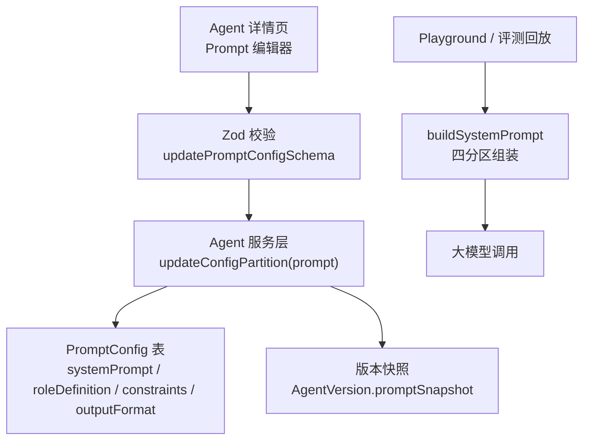
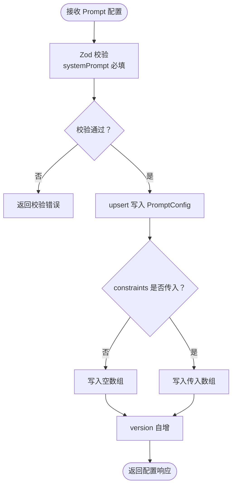
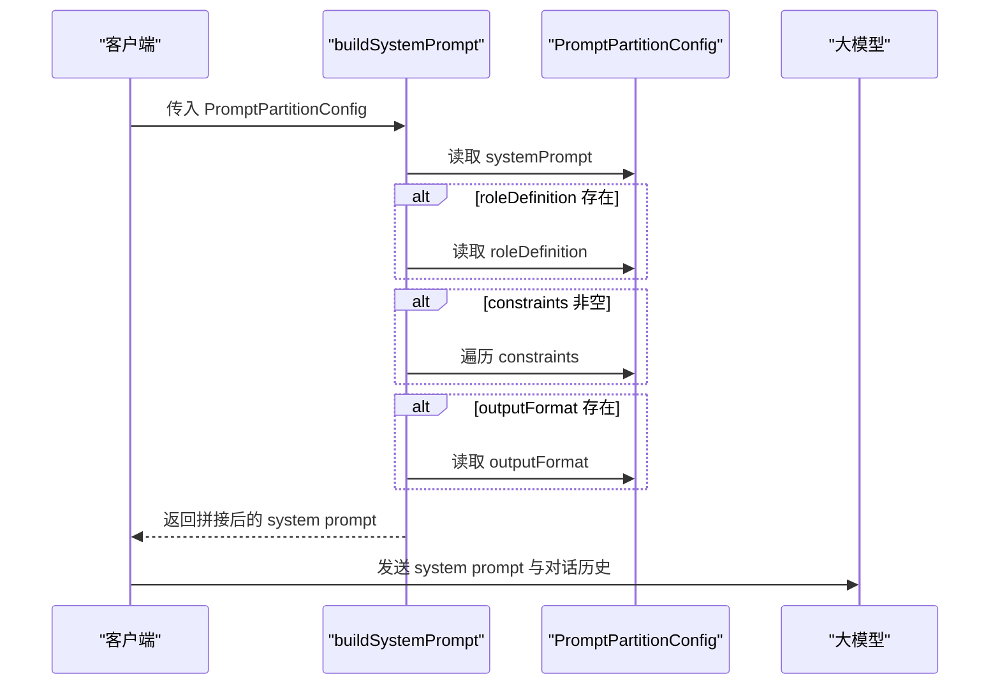
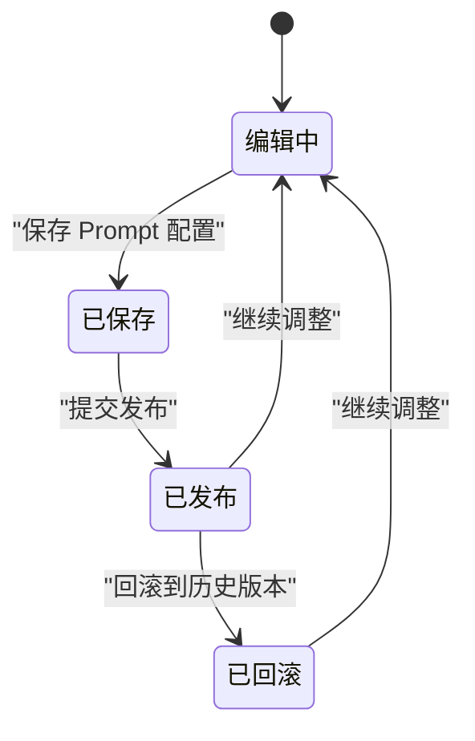
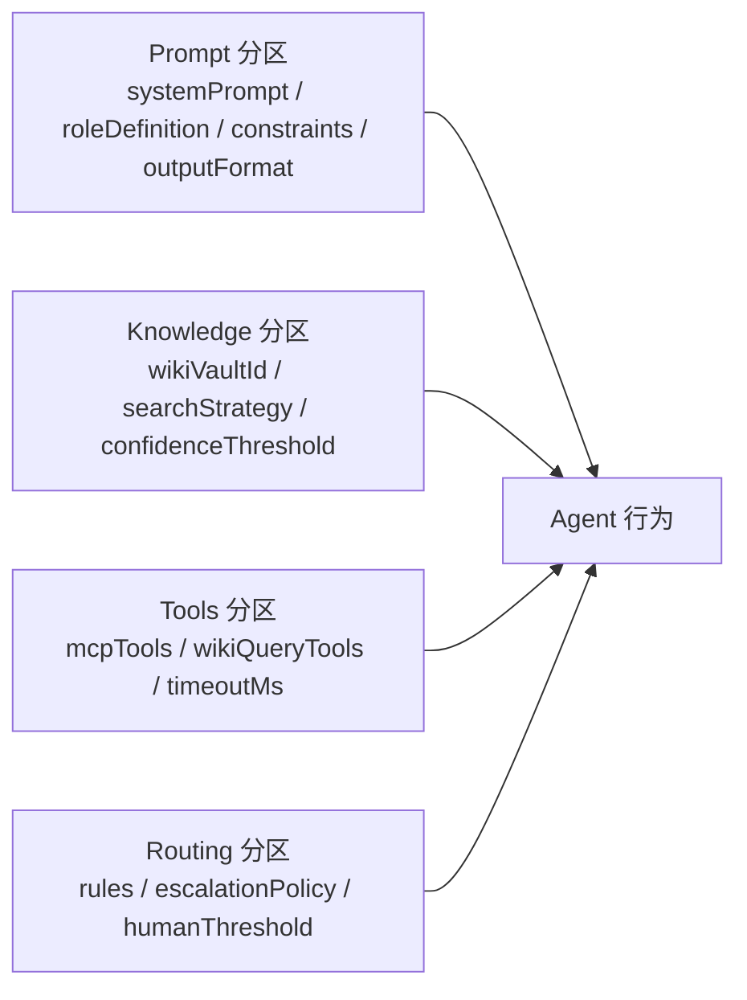

# Prompt 配置分区

<cite>
**本文引用的文件**   
- [apps/web/lib/schemas.ts](file://apps/web/lib/schemas.ts)
- [apps/web/lib/services/prompt-builder.ts](file://apps/web/lib/services/prompt-builder.ts)
- [apps/web/lib/services/agent-service.ts](file://apps/web/lib/services/agent-service.ts)
- [packages/db/prisma/migrations/20261005033611_init_sqlite/migration.sql](file://packages/db/prisma/migrations/20261005033611_init_sqlite/migration.sql)
- [apps/web/app/(dashboard)/agents/[id]/agent-detail.tsx](file://apps/web/app/(dashboard)/agents/[id]/agent-detail.tsx)
</cite>

## 目录
1. [引言](#引言)
2. [项目结构定位](#项目结构定位)
3. [核心概念与设计目标](#核心概念与设计目标)
4. [字段定义、验证规则与默认值](#字段定义验证规则与默认值)
5. [Prompt 组装机制](#prompt-组装机制)
6. [生命周期管理与版本控制](#生命周期管理与版本控制)
7. [与其他分区的协作关系](#与其他分区的协作关系)
8. [配置示例与最佳实践](#配置示例与最佳实践)
9. [常见问题与排错指南](#常见问题与排错指南)
10. [性能与可维护性建议](#性能与可维护性建议)
11. [结论](#结论)

## 引言
Prompt 配置分区是 Agent 配置体系中的“指令层”。它负责把系统提示词、角色定义、约束条件和输出格式组合成最终发送给大模型的 system prompt。该分区的设计目标是：
- 将“行为意图”和“表达形式”解耦，避免把所有指令混在一个长文本里。
- 通过结构化字段降低提示词漂移风险，让试聊、评测、发布和回滚保持一致。
- 为后续的版本快照、变更审计、回滚和 AI 评测提供稳定输入。

## 项目结构定位
Prompt 配置分区涉及前端校验、服务层持久化、数据库表结构和运行时组装四个层次：
- 前端表单与校验：由 Zod schema 定义，并在 Agent 详情页提供编辑器。
- 服务层写入：按分区路由到统一更新逻辑，使用 upsert 保证幂等。
- 数据层存储：Prisma 迁移中定义 PromptConfig 表及字段。
- 运行时组装：prompt-builder 将四分区字段拼接为 system prompt。

**图表来源**
- [apps/web/lib/schemas.ts:23-28](file://apps/web/lib/schemas.ts#L23-L28)
- [apps/web/lib/services/agent-service.ts:379-416](file://apps/web/lib/services/agent-service.ts#L379-L416)
- [packages/db/prisma/migrations/20261005033611_init_sqlite/migration.sql:47-58](file://packages/db/prisma/migrations/20261005033611_init_sqlite/migration.sql#L47-L58)
- [apps/web/lib/services/prompt-builder.ts:9-27](file://apps/web/lib/services/prompt-builder.ts#L9-L27)

**章节来源**
- [apps/web/lib/schemas.ts:19-60](file://apps/web/lib/schemas.ts#L19-L60)
- [apps/web/lib/services/agent-service.ts:370-416](file://apps/web/lib/services/agent-service.ts#L370-L416)
- [packages/db/prisma/migrations/20261005033611_init_sqlite/migration.sql:47-58](file://packages/db/prisma/migrations/20261005033611_init_sqlite/migration.sql#L47-L58)
- [apps/web/lib/services/prompt-builder.ts:1-27](file://apps/web/lib/services/prompt-builder.ts#L1-L27)

## 核心概念与设计目标
Prompt 配置分区采用“四分区”结构：
- systemPrompt：系统提示词，作为最高指令，每轮对话都会放在消息序列最前面。
- roleDefinition：角色定义，一句话概括 Agent 是谁、服务哪类用户，帮助模型更快锁定人称与专业领域。
- constraints：约束条件，以清单形式注入，强调“绝对不能做”的行为，比正文委婉措辞更有约束力。
- outputFormat：输出格式，规定回答的结构或语言风格。

设计要点包括：
- 每个字段都有明确职责，避免重复描述。
- 可选字段允许渐进式完善，但 systemPrompt 是必填项。
- 组装函数对空值和 null 做安全处理，保证即使部分字段缺失也能生成可用 system prompt。
- 同一组装函数被 Playground 和发布评测共用，确保真实试聊与评测 replay 一致。

**章节来源**
- [apps/web/lib/services/prompt-builder.ts:1-27](file://apps/web/lib/services/prompt-builder.ts#L1-L27)
- [apps/web/app/(dashboard)/agents/[id]/agent-detail.tsx:842-893](file://apps/web/app/(dashboard)/agents/[id]/agent-detail.tsx#L842-L893)

## 字段定义、验证规则与默认值
### 类型定义
Prompt 配置在运行时接口中定义为：
- systemPrompt：字符串，可为空对象属性，但业务上要求非空。
- roleDefinition：字符串或 null，可选。
- constraints：字符串数组或 null，可选。
- outputFormat：字符串或 null，可选。

### 校验规则
Zod schema 对 updatePromptConfigSchema 的定义如下：
- systemPrompt：必须是非空字符串。
- roleDefinition：可为 null 或省略。
- constraints：可为字符串数组或省略。
- outputFormat：可为 null 或省略。

这意味着前端提交时，如果缺少 systemPrompt，会被校验拒绝；其他字段可以留空。

### 默认值处理
- 数据库层 constraints 默认值为空数组的 JSON 字符串。
- 服务层在创建或更新 prompt 配置时，若 constraints 未传入，会写入空数组。
- 组装函数对 null、undefined、空数组都做了兼容，不会因缺字段而崩溃。

**图表来源**
- [apps/web/lib/schemas.ts:23-28](file://apps/web/lib/schemas.ts#L23-L28)
- [apps/web/lib/services/agent-service.ts:381-416](file://apps/web/lib/services/agent-service.ts#L381-L416)
- [packages/db/prisma/migrations/20261005033611_init_sqlite/migration.sql:47-58](file://packages/db/prisma/migrations/20261005033611_init_sqlite/migration.sql#L47-L58)

**章节来源**
- [apps/web/lib/schemas.ts:23-28](file://apps/web/lib/schemas.ts#L23-L28)
- [apps/web/lib/services/agent-service.ts:379-416](file://apps/web/lib/services/agent-service.ts#L379-L416)
- [packages/db/prisma/migrations/20261005033611_init_sqlite/migration.sql:47-58](file://packages/db/prisma/migrations/20261005033611_init_sqlite/migration.sql#L47-L58)

## Prompt 组装机制
组装函数 buildSystemPrompt 接收 PromptPartitionConfig，并按以下顺序拼接：
1. systemPrompt。
2. 如果存在 roleDefinition，追加“角色定义”段落。
3. 如果 constraints 非空，追加“约束条件”列表。
4. 如果存在 outputFormat，追加“输出格式”段落。

该函数的关键特性：
- 输入为空时返回空字符串，避免下游调用出错。
- 使用换行和标题分隔不同分区，便于模型理解结构。
- constraints 会转换为带短横线的项目列表，增强可读性和约束感。
- 所有字段都是可选的，因此任意子集都能生成有效 system prompt。

**图表来源**
- [apps/web/lib/services/prompt-builder.ts:9-27](file://apps/web/lib/services/prompt-builder.ts#L9-L27)

**章节来源**
- [apps/web/lib/services/prompt-builder.ts:1-27](file://apps/web/lib/services/prompt-builder.ts#L1-L27)

## 生命周期管理与版本控制
Prompt 配置的生命周期包含草稿编辑、保存、发布、快照、回滚和审计：

1. **草稿编辑**：用户在 Agent 详情页修改 systemPrompt、roleDefinition、constraints、outputFormat。
2. **保存**：调用 updatePromptConfig，服务层使用 upsert 写入 PromptConfig，并递增 version。
3. **发布**：发布流程会生成 AgentVersion，其中包含 promptSnapshot，用于评测回放和回滚。
4. **回滚**：回滚操作会恢复指定版本的 prompt 配置。
5. **审计**：每次分区变更会记录 ConfigChange，包含 before、after、diff、changedBy、changedAt。

**图表来源**
- [apps/web/lib/services/agent-service.ts:379-416](file://apps/web/lib/services/agent-service.ts#L379-L416)
- [packages/db/prisma/migrations/20261005033611_init_sqlite/migration.sql:187-207](file://packages/db/prisma/migrations/20261005033611_init_sqlite/migration.sql#L187-L207)
- [packages/db/prisma/migrations/20261005033611_init_sqlite/migration.sql:122-135](file://packages/db/prisma/migrations/20261005033611_init_sqlite/migration.sql#L122-L135)

**章节来源**
- [apps/web/lib/services/agent-service.ts:379-416](file://apps/web/lib/services/agent-service.ts#L379-L416)
- [packages/db/prisma/migrations/20261005033611_init_sqlite/migration.sql:122-135](file://packages/db/prisma/migrations/20261005033611_init_sqlite/migration.sql#L122-L135)
- [packages/db/prisma/migrations/20261005033611_init_sqlite/migration.sql:187-207](file://packages/db/prisma/migrations/20261005033611_init_sqlite/migration.sql#L187-L207)

## 与其他分区的协作关系
Prompt 配置分区不是孤立存在的，它与知识、工具、路由三个分区共同构成 Agent 的完整行为：
- knowledge：决定检索策略、知识库来源和置信度阈值。
- tools：决定 MCP 工具、Wiki 查询工具和并发、超时、重试参数。
- routing：决定规则、升级策略、人工介入阈值和会话长度限制。

Prompt 分区负责“说什么”，knowledge/tools/routing 分区负责“用什么资源、怎么决策”。它们共享同一个 agentId，并通过统一的分区更新接口管理。

**图表来源**
- [apps/web/lib/schemas.ts:23-60](file://apps/web/lib/schemas.ts#L23-L60)
- [apps/web/lib/services/agent-service.ts:418-547](file://apps/web/lib/services/agent-service.ts#L418-L547)

**章节来源**
- [apps/web/lib/schemas.ts:23-60](file://apps/web/lib/schemas.ts#L23-L60)
- [apps/web/lib/services/agent-service.ts:418-547](file://apps/web/lib/services/agent-service.ts#L418-L547)

## 配置示例与最佳实践
### 推荐字段组合
- 最小可用配置：只填写 systemPrompt。
- 标准配置：systemPrompt + roleDefinition + constraints。
- 强约束配置：systemPrompt + roleDefinition + constraints + outputFormat。

### 编写建议
- systemPrompt 应明确 Agent 的身份、语气、处理步骤和冲突优先级。
- roleDefinition 用一句话概括服务对象和专业领域，不要重复 systemPrompt 的详细内容。
- constraints 每行一条，聚焦“绝对禁止”的行为，例如不回答无关问题、价格相关提醒等。
- outputFormat 描述期望的输出结构，例如 Markdown、JSON、表格或固定模板。

### 前端交互提示
Agent 详情页的 Prompt 编辑器提供了字段说明：
- systemPrompt 被标记为必填，并提示这是最高指令。
- roleDefinition 提示留空则完全依赖 systemPrompt。
- constraints 提示每行一条，保存时会忽略空行。
- outputFormat 用于规范输出形式。

**章节来源**
- [apps/web/app/(dashboard)/agents/[id]/agent-detail.tsx:842-893](file://apps/web/app/(dashboard)/agents/[id]/agent-detail.tsx#L842-L893)
- [apps/web/lib/schemas.ts:23-28](file://apps/web/lib/schemas.ts#L23-L28)

## 常见问题与排错指南
### 问题一：systemPrompt 为空导致校验失败
- 现象：提交 Prompt 配置时报错。
- 原因：updatePromptConfigSchema 要求 systemPrompt 为非空字符串。
- 解决：确保前端表单至少填写 systemPrompt。

### 问题二：constraints 未生效
- 现象：模型仍然出现禁止行为。
- 可能原因：
  - constraints 为空数组或未传入。
  - constraints 内容不够具体，缺乏“绝对禁止”表述。
  - systemPrompt 与 constraints 冲突，systemPrompt 优先级更高。
- 排查路径：检查 PromptConfig 表中 constraints 字段是否为空数组，确认组装后 system prompt 是否包含约束段落。

### 问题三：roleDefinition 或 outputFormat 未显示
- 现象：生成的 system prompt 缺少角色定义或输出格式段落。
- 原因：这两个字段为可选且可为 null。
- 解决：在前端显式填写，并确保后端正确传递。

### 问题四：回滚后 Prompt 配置不符合预期
- 现象：回滚到某个版本后，systemPrompt 或 constraints 与预期不一致。
- 原因：回滚的是 AgentVersion 中的 promptSnapshot，而不是当前 PromptConfig。
- 解决：确认回滚的目标版本是否正确，并检查 release 的 configSnapshot 和 AgentVersion.promptSnapshot。

**章节来源**
- [apps/web/lib/schemas.ts:23-28](file://apps/web/lib/schemas.ts#L23-L28)
- [apps/web/lib/services/prompt-builder.ts:16-27](file://apps/web/lib/services/prompt-builder.ts#L16-L27)
- [packages/db/prisma/migrations/20261005033611_init_sqlite/migration.sql:187-207](file://packages/db/prisma/migrations/20261005033611_init_sqlite/migration.sql#L187-L207)

## 性能与可维护性建议
- 避免在 systemPrompt 中重复 constraints 的内容，减少 token 消耗。
- 将稳定的角色定义放入 roleDefinition，便于单独迭代。
- constraints 保持简洁、明确，避免过长列表影响模型注意力。
- 使用统一的 buildSystemPrompt 函数，避免 Playground 和评测逻辑漂移。
- 通过 ConfigChange 和 AgentVersion 保留变更轨迹，便于审计和回滚。

[本节为通用建议，不直接分析具体文件]

## 结论
Prompt 配置分区通过 systemPrompt、roleDefinition、constraints、outputFormat 四个字段，将 Agent 的指令结构化、可版本化、可回滚。它在前端校验、服务持久化、数据库存储和运行时组装之间形成清晰链路，并与 knowledge、tools、routing 分区协同工作。遵循本文的最佳实践，可以有效提升提示词的稳定性、可维护性和可观测性。

[本节为总结性内容，不直接分析具体文件]