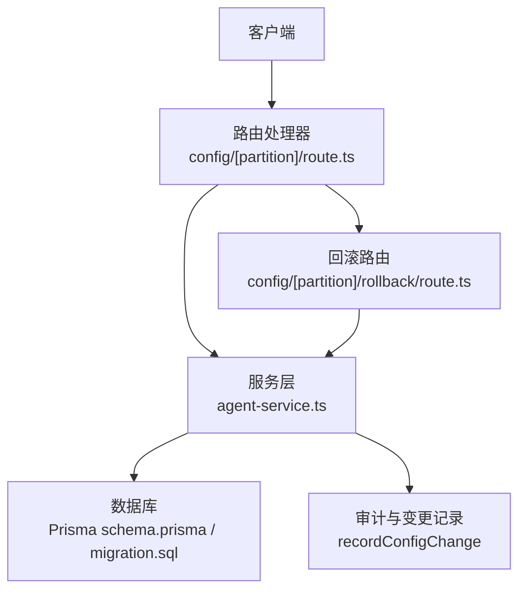
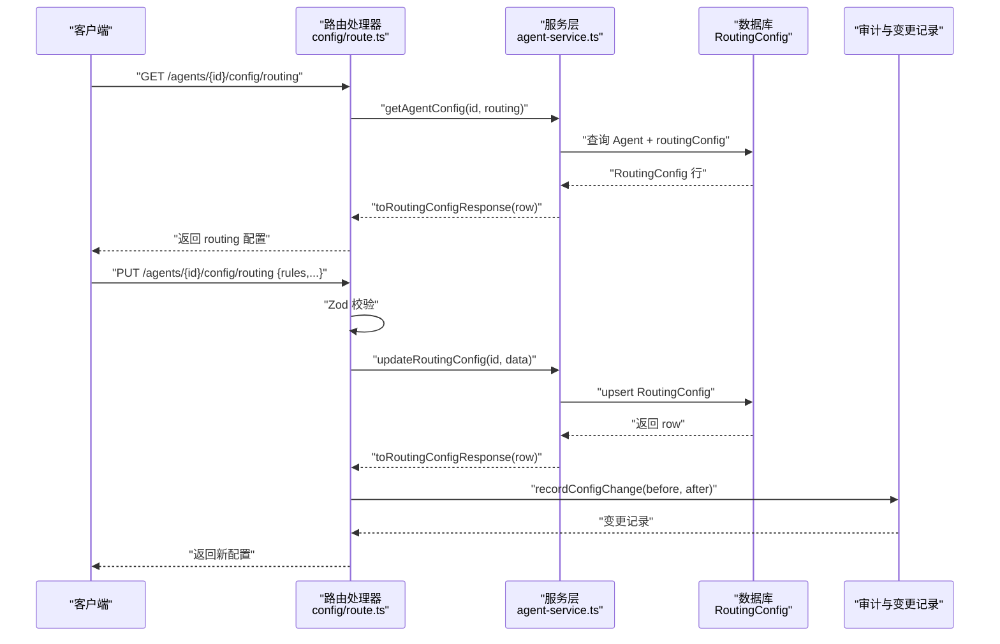
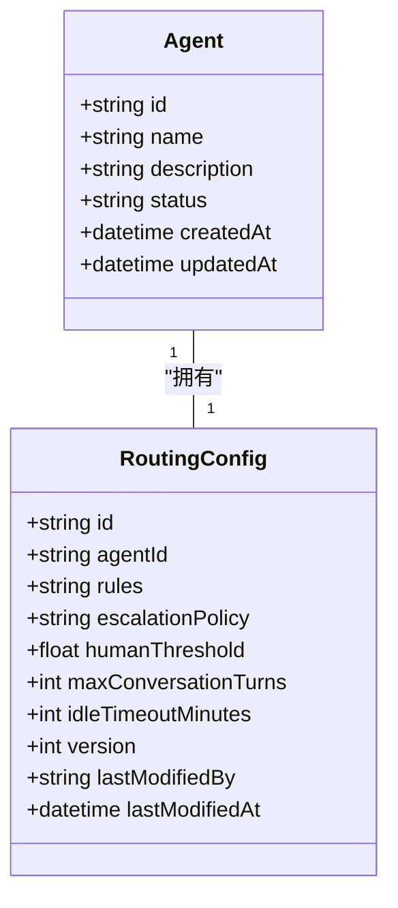
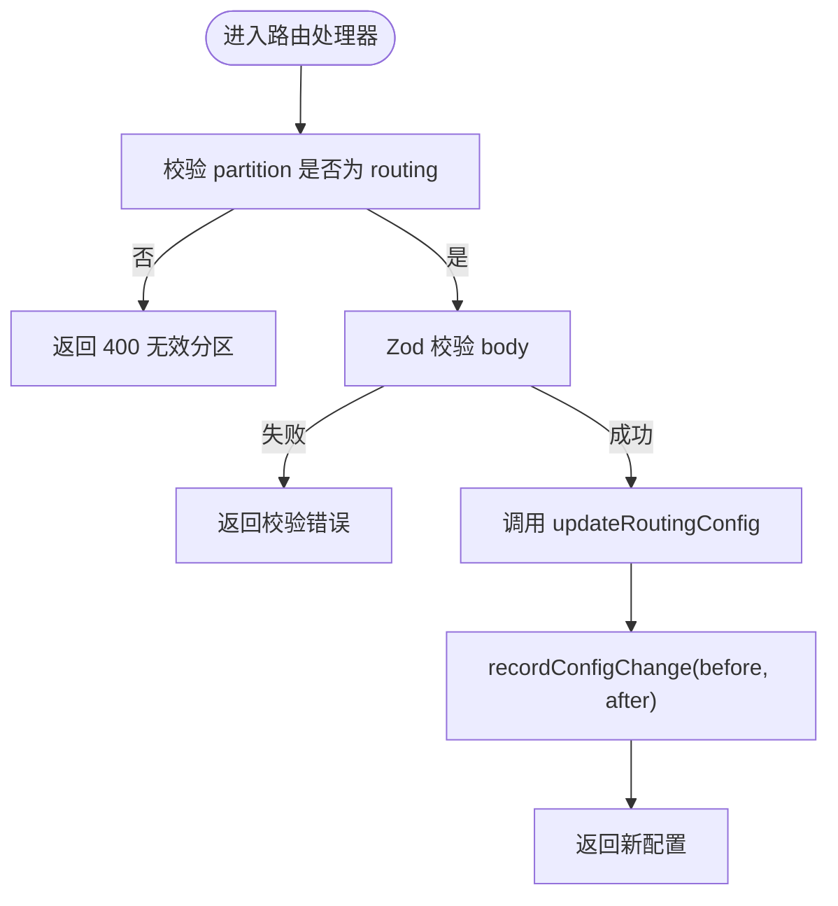
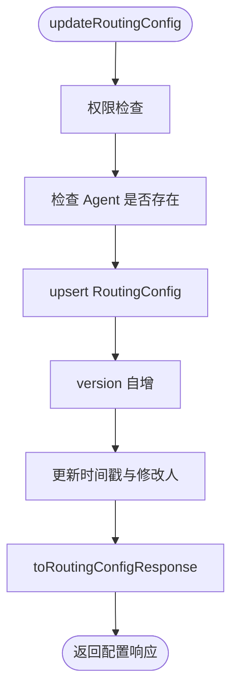
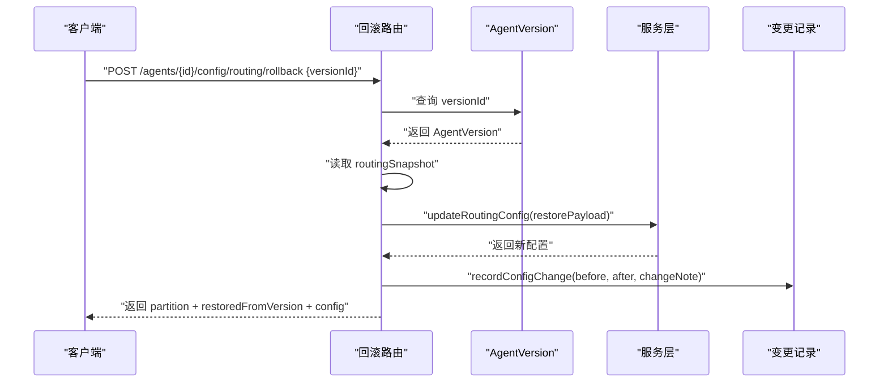
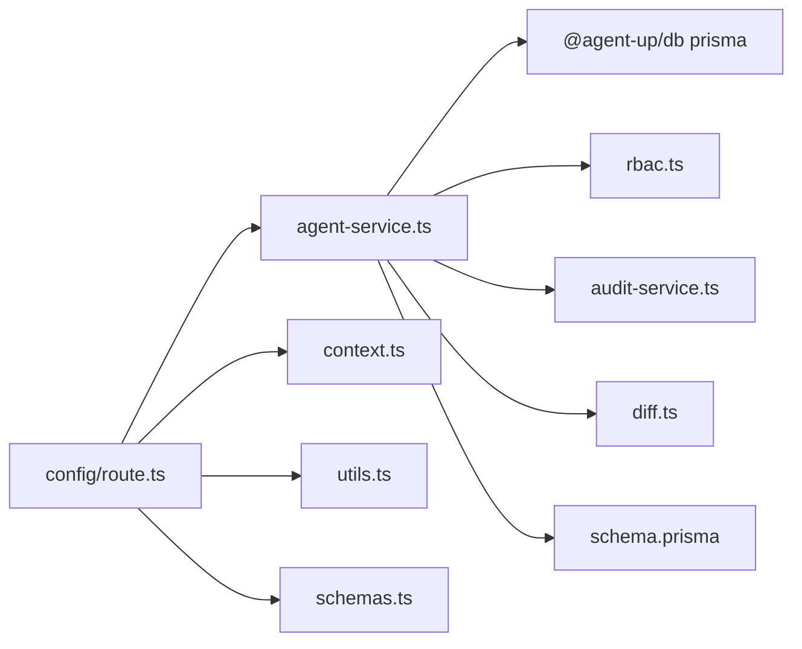

# Routing 配置分区

<cite>
**本文引用的文件**   
- [apps/web/app/api/agents/[id]/config/[partition]/route.ts](file://apps/web/app/api/agents/[id]/config/[partition]/route.ts)
- [apps/web/app/api/agents/[id]/config/[partition]/rollback/route.ts](file://apps/web/app/api/agents/[id]/config/[partition]/rollback/route.ts)
- [apps/web/lib/services/agent-service.ts](file://apps/web/lib/services/agent-service.ts)
- [apps/web/lib/schemas.ts](file://apps/web/lib/schemas.ts)
- [packages/db/prisma/schema.prisma](file://packages/db/prisma/schema.prisma)
- [packages/db/prisma/migrations/20261005033611_init_sqlite/migration.sql](file://packages/db/prisma/migrations/20261005033611_init_sqlite/migration.sql)
- [packages/db/prisma/seed.mjs](file://packages/db/prisma/seed.mjs)
</cite>

## 目录
1. [引言](#引言)
2. [项目结构定位](#项目结构定位)
3. [核心组件](#核心组件)
4. [架构总览](#架构总览)
5. [详细组件分析](#详细组件分析)
6. [依赖关系分析](#依赖关系分析)
7. [性能与行为特征](#性能与行为特征)
8. [故障排查指南](#故障排查指南)
9. [结论](#结论)
10. [附录：字段、校验与示例](#附录字段校验与示例)

## 引言
Routing 配置分区用于描述 Agent 的“智能路由”能力边界和会话控制策略。当前代码库中，Routing 分区提供以下能力：
- 规则列表：通过 `rules` 保存一组路由规则对象。
- 升级策略：通过 `escalationPolicy` 保存升级策略配置，支持显式置空。
- 人工介入阈值：通过 `humanThreshold` 控制何时需要人工介入。
- 会话管理：通过 `maxConversationTurns` 限制最大对话轮次，通过 `idleTimeoutMinutes` 控制空闲超时。
- 版本化与回滚：Routing 配置参与四分区统一更新流程，并可通过版本快照进行分区级回滚。
- 审计与变更追踪：每次更新都会记录 before/after/diff，并写入审计日志。

需要注意的是，当前仓库并未实现具体的“路由匹配算法”或“会话调度引擎”。Routing 配置是“可配置数据”，由外部消费方（例如运行时、Agent 编排层）读取后决定实际路由逻辑。

## 项目结构定位
Routing 配置在系统中的位置如下：
- API 入口：`/api/agents/[id]/config/[partition]`，其中 `partition=routing` 时处理 Routing 配置。
- 服务层：`agent-service.ts` 中的 `updateRoutingConfig`、`toRoutingConfigResponse`、`getAgentConfig`。
- 校验层：`schemas.ts` 中的 `updateRoutingConfigSchema`。
- 存储层：Prisma 模型 `RoutingConfig`，以及对应迁移 SQL。
- 回滚入口：`/api/agents/[id]/config/[partition]/rollback`，支持从指定 Version 的 `routingSnapshot` 恢复。

**图表来源**
- [apps/web/app/api/agents/[id]/config/[partition]/route.ts:14-80](file://apps/web/app/api/agents/[id]/config/[partition]/route.ts#L14-L80)
- [apps/web/app/api/agents/[id]/config/[partition]/rollback/route.ts:16-112](file://apps/web/app/api/agents/[id]/config/[partition]/rollback/route.ts#L16-L112)
- [apps/web/lib/services/agent-service.ts:341-565](file://apps/web/lib/services/agent-service.ts#L341-L565)
- [packages/db/prisma/schema.prisma:154-168](file://packages/db/prisma/schema.prisma#L154-L168)

**章节来源**
- [apps/web/app/api/agents/[id]/config/[partition]/route.ts:14-80](file://apps/web/app/api/agents/[id]/config/[partition]/route.ts#L14-L80)
- [apps/web/lib/services/agent-service.ts:341-565](file://apps/web/lib/services/agent-service.ts#L341-L565)
- [packages/db/prisma/schema.prisma:154-168](file://packages/db/prisma/schema.prisma#L154-L168)

## 核心组件
Routing 配置的核心由以下部分组成：
- 请求校验：`updateRoutingConfigSchema` 定义 rules、escalationPolicy、humanThreshold、maxConversationTurns、idleTimeoutMinutes 的类型与范围。
- 路由处理器：`GET/PUT` 分别用于读取和更新 Routing 配置；`partition=routing` 时调用 `updateRoutingConfig`。
- 服务层：`updateRoutingConfig` 使用 upsert 语义更新 `RoutingConfig`，并递增 version。
- 响应转换：`toRoutingConfigResponse` 将数据库 JSON 文本还原为前端可用的对象数组和可选策略。
- 回滚接口：从 `AgentVersion.routingSnapshot` 取出历史 Routing 配置，复用 `updateRoutingConfig` 覆盖当前配置。
- 变更记录：`recordConfigChange` 计算 diff 并落库，同时触发审计事件。

**章节来源**
- [apps/web/lib/schemas.ts:46-52](file://apps/web/lib/schemas.ts#L46-L52)
- [apps/web/app/api/agents/[id]/config/[partition]/route.ts:28-80](file://apps/web/app/api/agents/[id]/config/[partition]/route.ts#L28-L80)
- [apps/web/lib/services/agent-service.ts:112-122](file://apps/web/lib/services/agent-service.ts#L112-L122)
- [apps/web/lib/services/agent-service.ts:502-547](file://apps/web/lib/services/agent-service.ts#L502-L547)
- [apps/web/app/api/agents/[id]/config/[partition]/rollback/route.ts:42-112](file://apps/web/app/api/agents/[id]/config/[partition]/rollback/route.ts#L42-L112)

## 架构总览
Routing 配置的完整生命周期包括：
1. 客户端发起 GET 或 PUT 请求到 `/api/agents/{id}/config/routing`。
2. 路由处理器校验 partition，并使用 Zod 校验 body。
3. 服务层执行权限检查、upsert 更新、version 自增、时间戳更新。
4. 响应层将 JSON 文本反序列化为 rules 数组和 escalationPolicy 对象。
5. 路由处理器记录配置变更，生成 diff 并写入审计日志。
6. 如需回滚，客户端调用 `/api/agents/{id}/config/routing/rollback`，传入目标 versionId。

**图表来源**
- [apps/web/app/api/agents/[id]/config/[partition]/route.ts:28-80](file://apps/web/app/api/agents/[id]/config/[partition]/route.ts#L28-L80)
- [apps/web/lib/services/agent-service.ts:341-565](file://apps/web/lib/services/agent-service.ts#L341-L565)
- [apps/web/lib/services/agent-service.ts:571-614](file://apps/web/lib/services/agent-service.ts#L571-L614)

## 详细组件分析

### Routing 配置数据结构
Routing 配置在数据库中由 `RoutingConfig` 模型表示，关键字段如下：
- `rules`：JSON 文本，存储路由规则数组。
- `escalationPolicy`：可选 JSON 文本，存储升级策略；允许显式置空。
- `humanThreshold`：浮点数，默认值 0.3，表示人工介入阈值。
- `maxConversationTurns`：整数，默认值 10，表示最大对话轮次。
- `idleTimeoutMinutes`：整数，默认值 5，表示空闲超时分钟数。
- `version`：整数，每次更新自增。
- `lastModifiedBy`、`lastModifiedAt`：修改人与修改时间。

**图表来源**
- [packages/db/prisma/schema.prisma:154-168](file://packages/db/prisma/schema.prisma#L154-L168)
- [packages/db/prisma/schema.prisma:66-99](file://packages/db/prisma/schema.prisma#L66-L99)

**章节来源**
- [packages/db/prisma/schema.prisma:154-168](file://packages/db/prisma/schema.prisma#L154-L168)
- [packages/db/prisma/migrations/20261005033611_init_sqlite/migration.sql:93-106](file://packages/db/prisma/migrations/20261005033611_init_sqlite/migration.sql#L93-L106)

### 请求校验与约束
Routing 配置的输入由 `updateRoutingConfigSchema` 校验：
- `rules`：可选数组，元素类型未严格限定，便于扩展。
- `escalationPolicy`：可选且可为 null，支持清空升级策略。
- `humanThreshold`：可选数值，范围 0~1。
- `maxConversationTurns`：可选整数，范围 1~100。
- `idleTimeoutMinutes`：可选整数，范围 1~60。

这些约束确保 Routing 配置在写入前具备基本合法性，但不会验证规则内部结构。

**章节来源**
- [apps/web/lib/schemas.ts:46-52](file://apps/web/lib/schemas.ts#L46-L52)

### 路由处理器行为
`GET /agents/{id}/config/routing`：
- 校验 partition 是否为 routing。
- 调用 `getAgentConfig` 获取 Agent 及其 routingConfig。
- 返回 `toRoutingConfigResponse` 转换后的结果。

`PUT /agents/{id}/config/routing`：
- 校验 partition。
- 使用 `validateBody` 对 body 进行 Zod 校验。
- 在 actor 上下文中调用 `updateRoutingConfig`。
- 记录配置变更，包含 before/after/diff。

**图表来源**
- [apps/web/app/api/agents/[id]/config/[partition]/route.ts:28-80](file://apps/web/app/api/agents/[id]/config/[partition]/route.ts#L28-L80)

**章节来源**
- [apps/web/app/api/agents/[id]/config/[partition]/route.ts:28-80](file://apps/web/app/api/agents/[id]/config/[partition]/route.ts#L28-L80)

### 服务层更新逻辑
`updateRoutingConfig` 的核心逻辑：
- 权限检查：要求 agent.write 权限。
- Agent 存在性检查。
- 使用 Prisma upsert 更新 RoutingConfig：
  - create 分支：初始化 rules、escalationPolicy、humanThreshold、maxConversationTurns、idleTimeoutMinutes。
  - update 分支：仅更新传入字段，保持未传字段的原有值。
- 递增 version，更新时间戳，记录修改人。
- 返回 `toRoutingConfigResponse` 转换结果。

**图表来源**
- [apps/web/lib/services/agent-service.ts:502-547](file://apps/web/lib/services/agent-service.ts#L502-L547)

**章节来源**
- [apps/web/lib/services/agent-service.ts:502-547](file://apps/web/lib/services/agent-service.ts#L502-L547)

### 响应转换与 JSON 序列化
`toRoutingConfigResponse` 负责将数据库中的 JSON 文本转换为前端可用结构：
- `rules`：通过 `unpackJsonArray` 解析为对象数组，缺省为空数组。
- `escalationPolicy`：通过 `unpackJson` 解析为任意对象或 null。
- 其他字段直接映射。

这种设计保证即使底层存储为 String，上层契约仍表现为结构化数据。

**章节来源**
- [apps/web/lib/services/agent-service.ts:112-122](file://apps/web/lib/services/agent-service.ts#L112-L122)

### 分区级回滚机制
`POST /agents/{id}/config/routing/rollback`：
- 校验 partition 和 body（versionId）。
- 查找目标 AgentVersion，确认属于该 Agent。
- 从 `routingSnapshot` 中取出历史 Routing 配置。
- 去掉 snapshot 中的 version/lastModifiedAt，避免覆盖服务层生成的元数据。
- 复用 `updateRoutingConfig` 覆盖当前 active 配置。
- 记录变更，changeNote 包含回滚目标版本信息。

**图表来源**
- [apps/web/app/api/agents/[id]/config/[partition]/rollback/route.ts:42-112](file://apps/web/app/api/agents/[id]/config/[partition]/rollback/route.ts#L42-L112)

**章节来源**
- [apps/web/app/api/agents/[id]/config/[partition]/rollback/route.ts:42-112](file://apps/web/app/api/agents/[id]/config/[partition]/rollback/route.ts#L42-L112)

### 变更审计与差异对比
每次 Routing 配置更新都会：
- 计算 before 与 after 的差异。
- 写入 `config-changes` 表，包含 partition、before、after、diff、changedBy、changeNote。
- 触发审计事件 `agent.config.update`，记录分区、变更说明及 diff 摘要。

这为调试、回溯和发布审批提供了依据。

**章节来源**
- [apps/web/lib/services/agent-service.ts:571-614](file://apps/web/lib/services/agent-service.ts#L571-L614)

## 依赖关系分析
Routing 配置相关依赖如下：
- 路由层依赖服务层、上下文（actor）、工具函数（success/error/validateBody/handleApiError）。
- 服务层依赖 Prisma 客户端、权限检查、审计服务、Diff 工具。
- 存储层依赖 Prisma schema 与迁移 SQL。
- 校验层依赖 Zod。

**图表来源**
- [apps/web/app/api/agents/[id]/config/[partition]/route.ts:1-12](file://apps/web/app/api/agents/[id]/config/[partition]/route.ts#L1-L12)
- [apps/web/lib/services/agent-service.ts:1-21](file://apps/web/lib/services/agent-service.ts#L1-L21)
- [apps/web/lib/schemas.ts:1-52](file://apps/web/lib/schemas.ts#L1-L52)
- [packages/db/prisma/schema.prisma:154-168](file://packages/db/prisma/schema.prisma#L154-L168)

**章节来源**
- [apps/web/app/api/agents/[id]/config/[partition]/route.ts:1-12](file://apps/web/app/api/agents/[id]/config/[partition]/route.ts#L1-L12)
- [apps/web/lib/services/agent-service.ts:1-21](file://apps/web/lib/services/agent-service.ts#L1-L21)
- [apps/web/lib/schemas.ts:1-52](file://apps/web/lib/schemas.ts#L1-L52)

## 性能与行为特征
- 配置更新采用 upsert 语义，避免重复插入，减少锁竞争。
- version 字段自增，便于乐观并发控制和变更追踪。
- JSON 字段以 String 存储，读写经 pack/unpack 收口，降低复杂类型带来的序列化风险。
- 变更 diff 计算在服务层完成，便于审计与 UI 展示，但会增加少量 CPU 开销。
- 回滚操作复用现有更新逻辑，避免重复实现，保持一致性。

[本节为通用性能讨论，不直接分析具体代码片段]

## 故障排查指南
常见问题与排查建议：
- 无效分区：当 partition 不是 prompt/knowledge/tools/routing 之一时，路由处理器返回 400。
- 校验失败：body 不符合 `updateRoutingConfigSchema` 时会返回 Zod 校验错误。
- Agent 不存在：服务层会抛出 NotFoundError。
- 权限不足：缺少 agent.write 权限会拒绝更新。
- 回滚失败：versionId 不存在或不属于该 Agent 时返回错误；snapshot 缺失时提示无快照。
- 审计缺失：若未看到变更记录，检查 `recordConfigChange` 是否被调用，以及审计服务是否正常。

**章节来源**
- [apps/web/app/api/agents/[id]/config/[partition]/route.ts:34-57](file://apps/web/app/api/agents/[id]/config/[partition]/route.ts#L34-L57)
- [apps/web/lib/services/agent-service.ts:369-374](file://apps/web/lib/services/agent-service.ts#L369-L374)
- [apps/web/app/api/agents/[id]/config/[partition]/rollback/route.ts:56-74](file://apps/web/app/api/agents/[id]/config/[partition]/rollback/route.ts#L56-L74)

## 结论
Routing 配置分区在当前系统中承担“可配置数据”的角色，提供规则列表、升级策略、人工介入阈值和会话控制参数。其更新、回滚、审计流程已完善，但具体路由匹配算法和会话调度逻辑需由外部运行时代码实现。运维与开发应重点关注：
- 合理设置 `humanThreshold`、`maxConversationTurns`、`idleTimeoutMinutes`。
- 明确 `rules` 的结构约定，并在外部消费方实现匹配与优先级处理。
- 利用版本快照进行安全回滚。
- 通过变更记录与审计日志进行问题定位与合规追溯。

[本节为总结性内容，不直接分析具体代码片段]

## 附录：字段、校验与示例

### Routing 配置字段说明
- `rules`：路由规则数组，元素结构由业务约定决定。
- `escalationPolicy`：升级策略对象，可为 null。
- `humanThreshold`：人工介入阈值，范围 0~1。
- `maxConversationTurns`：最大对话轮次，范围 1~100。
- `idleTimeoutMinutes`：空闲超时分钟数，范围 1~60。

**章节来源**
- [apps/web/lib/schemas.ts:46-52](file://apps/web/lib/schemas.ts#L46-L52)
- [packages/db/prisma/schema.prisma:154-168](file://packages/db/prisma/schema.prisma#L154-L168)

### 路由规则示例（概念性）
以下为概念性示例，用于说明 rules 的典型结构。实际结构应由业务方定义并在外部消费方实现匹配逻辑。

- 关键词匹配规则：
  - match: 关键词或正则表达式。
  - target: 目标路由通道或技能。
  - priority: 优先级数字，越小越优先。
- 意图识别规则：
  - intent: 意图名称。
  - confidence: 置信度阈值。
  - fallback: 未命中时的降级策略。

[本节为概念性示例，不直接分析具体代码片段]

### 升级策略配置示例（概念性）
- 自动升级：达到 `humanThreshold` 后自动转交高级模型或工具。
- 人工升级：超过阈值后创建工单或通知人工处理。
- 条件升级：根据用户等级、渠道、地域等条件触发不同升级路径。

[本节为概念性示例，不直接分析具体代码片段]

### 调试方法
- 查看当前 Routing 配置：调用 GET `/api/agents/{id}/config/routing`。
- 更新 Routing 配置：调用 PUT `/api/agents/{id}/config/routing`，传入 rules、escalationPolicy、humanThreshold、maxConversationTurns、idleTimeoutMinutes。
- 查看变更记录：通过审计日志或 config-changes 表查看 before/after/diff。
- 回滚到历史版本：调用 POST `/api/agents/{id}/config/routing/rollback`，传入 versionId。
- 验证校验规则：故意传入超出范围的 humanThreshold、maxConversationTurns、idleTimeoutMinutes，观察 Zod 校验错误。

**章节来源**
- [apps/web/app/api/agents/[id]/config/[partition]/route.ts:28-80](file://apps/web/app/api/agents/[id]/config/[partition]/route.ts#L28-L80)
- [apps/web/app/api/agents/[id]/config/[partition]/rollback/route.ts:42-112](file://apps/web/app/api/agents/[id]/config/[partition]/rollback/route.ts#L42-L112)
- [apps/web/lib/services/agent-service.ts:571-614](file://apps/web/lib/services/agent-service.ts#L571-L614)