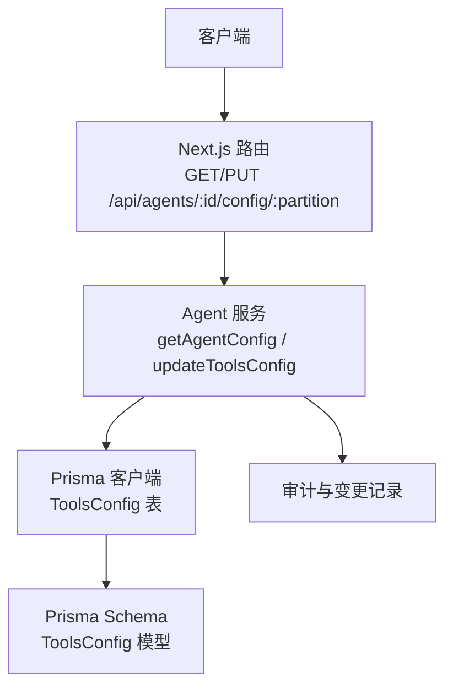
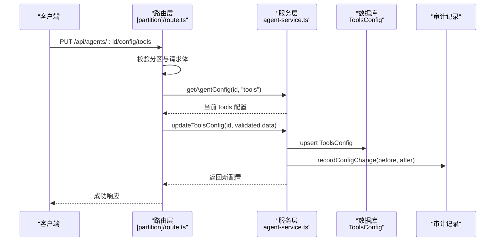
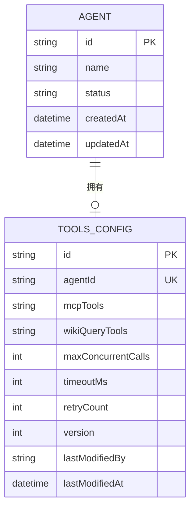
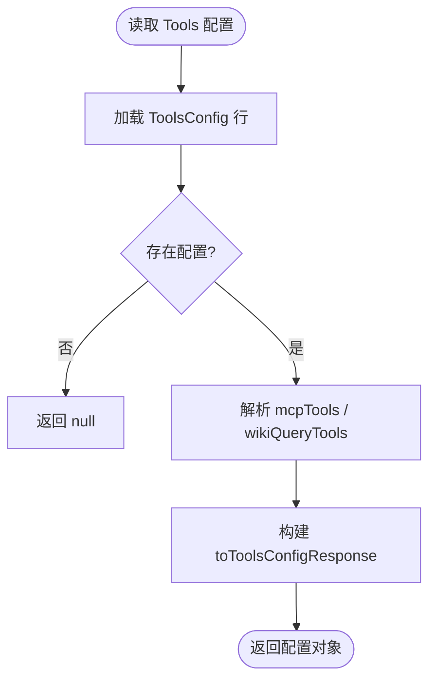
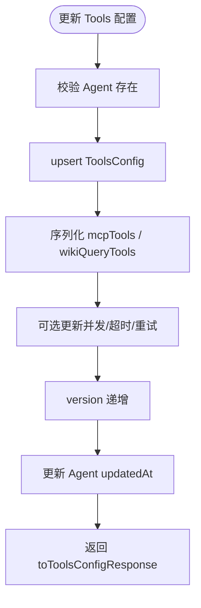
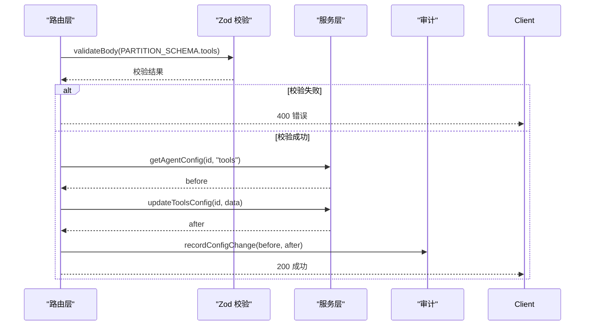
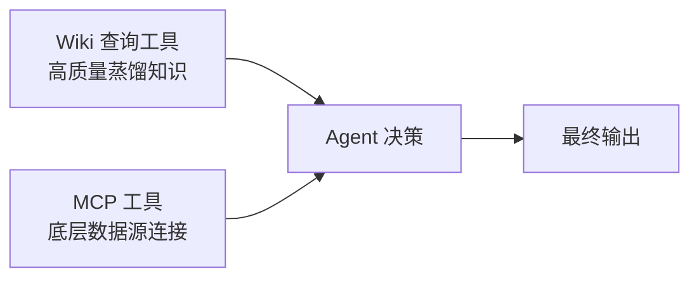
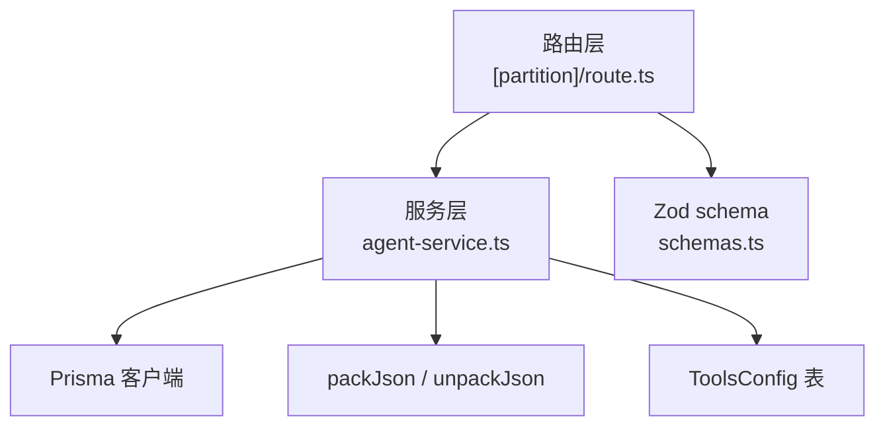
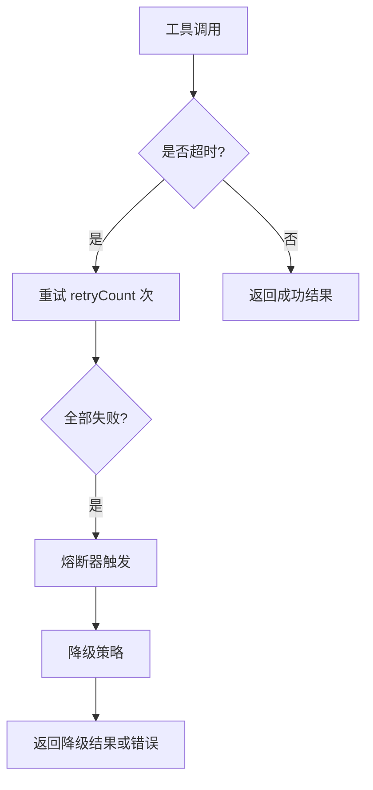

# Tools 配置分区

<cite>
**本文引用的文件**   
- [apps/web/lib/services/agent-service.ts](file://apps/web/lib/services/agent-service.ts)
- [apps/web/lib/schemas.ts](file://apps/web/lib/schemas.ts)
- [apps/web/app/api/agents/[id]/config/[partition]/route.ts](file://apps/web/app/api/agents/[id]/config/[partition]/route.ts)
- [packages/db/prisma/schema.prisma](file://packages/db/prisma/schema.prisma)
- [packages/db/prisma/migrations/20261005033611_init_sqlite/migration.sql](file://packages/db/prisma/migrations/20261005033611_init_sqlite/migration.sql)
- [docs/superpowers/specs/2026-07-06-agent-improvement-platform-mvp-design.md](file://docs/superpowers/specs/2026-07-06-agent-improvement-platform-mvp-design.md)
</cite>

## 目录
1. [引言](#引言)
2. [项目结构定位](#项目结构定位)
3. [核心组件](#核心组件)
4. [架构总览](#架构总览)
5. [详细组件分析](#详细组件分析)
6. [依赖关系分析](#依赖关系分析)
7. [性能与并发控制](#性能与并发控制)
8. [错误处理、熔断与降级](#错误处理熔断与降级)
9. [监控指标与排障指南](#监控指标与排障指南)
10. [结论](#结论)

## 引言
本文聚焦 Agent 的 **Tools 配置分区**，解释其工具集成架构、数据模型、API 读写流程、并发控制、超时与重试语义，以及工具注册、发现与调用的整体设计。需要特别说明的是：当前仓库中 Tools 分区主要承担“配置持久化与版本快照”的职责；实际的 MCP 工具执行、Wiki 查询调用、并发调度、熔断与降级等运行时逻辑并未在当前代码库中出现实现，因此本文对运行期行为以“基于现有配置的约束说明 + 建议”的方式呈现，避免臆造实现细节。

## 项目结构定位
Tools 配置分区在系统中的位置如下：
- 数据库层：`ToolsConfig` 表存储 `mcpTools`、`wikiQueryTools`、`maxConcurrentCalls`、`timeoutMs`、`retryCount` 等字段。
- 服务层：`agent-service.ts` 提供读取、更新、响应转换和变更审计。
- API 层：`[partition]/route.ts` 暴露统一的分区配置 GET/PUT 接口，并记录变更。
- 校验层：`schemas.ts` 定义 Zod schema，限制 Tools 分区字段的类型与取值范围。
- 设计文档：MVP 设计文档明确 Tools 分区包含两类工具——MCP 工具与 Wiki 查询工具，并描述两层知识架构下的协作关系。

**图表来源**
- [apps/web/app/api/agents/[id]/config/[partition]/route.ts:28-85](file://apps/web/app/api/agents/[id]/config/[partition]/route.ts#L28-L85)
- [apps/web/lib/services/agent-service.ts:341-358](file://apps/web/lib/services/agent-service.ts#L341-L358)
- [apps/web/lib/services/agent-service.ts:466-500](file://apps/web/lib/services/agent-service.ts#L466-L500)
- [packages/db/prisma/schema.prisma:138-152](file://packages/db/prisma/schema.prisma#L138-L152)

**章节来源**
- [apps/web/app/api/agents/[id]/config/[partition]/route.ts:1-86](file://apps/web/app/api/agents/[id]/config/[partition]/route.ts#L1-L86)
- [apps/web/lib/services/agent-service.ts:1-22](file://apps/web/lib/services/agent-service.ts#L1-L22)
- [packages/db/prisma/schema.prisma:78-82](file://packages/db/prisma/schema.prisma#L78-L82)

## 核心组件
- **Tools 配置数据模型**：`ToolsConfig` 表承载每个 Agent 的工具配置，包括两类工具数组和三个运行参数。
- **配置响应转换**：`toToolsConfigResponse` 将数据库行转换为对外 JSON，解析 JSON 文本为数组并保留版本与修改时间。
- **配置更新入口**：`updateToolsConfig` 通过 `updateConfigPartition` 统一处理 upsert、增量字段、版本号递增与审计。
- **API 路由**：`GET/PUT /api/agents/:id/config/tools` 负责参数校验、权限上下文、前后配置快照与变更记录。
- **输入校验**：`updateToolsConfigSchema` 使用 Zod 限定字段类型与取值范围。

**章节来源**
- [packages/db/prisma/schema.prisma:138-152](file://packages/db/prisma/schema.prisma#L138-L152)
- [apps/web/lib/services/agent-service.ts:100-110](file://apps/web/lib/services/agent-service.ts#L100-L110)
- [apps/web/lib/services/agent-service.ts:466-500](file://apps/web/lib/services/agent-service.ts#L466-L500)
- [apps/web/app/api/agents/[id]/config/[partition]/route.ts:46-85](file://apps/web/app/api/agents/[id]/config/[partition]/route.ts#L46-L85)
- [apps/web/lib/schemas.ts:38-44](file://apps/web/lib/schemas.ts#L38-L44)

## 架构总览
Tools 分区的整体职责是“可版本化的工具清单与运行参数”，而不是直接执行工具。其典型交互如下：

**图表来源**
- [apps/web/app/api/agents/[id]/config/[partition]/route.ts:46-85](file://apps/web/app/api/agents/[id]/config/[partition]/route.ts#L46-L85)
- [apps/web/lib/services/agent-service.ts:341-358](file://apps/web/lib/services/agent-service.ts#L341-L358)
- [apps/web/lib/services/agent-service.ts:466-500](file://apps/web/lib/services/agent-service.ts#L466-L500)
- [apps/web/lib/services/agent-service.ts:571-614](file://apps/web/lib/services/agent-service.ts#L571-L614)

## 详细组件分析

### 数据模型：ToolsConfig
`ToolsConfig` 是 Tools 分区的持久化实体，关键字段如下：
- `mcpTools`：JSON 文本，表示 MCP 工具列表。
- `wikiQueryTools`：JSON 文本，表示 Wiki 查询工具列表。
- `maxConcurrentCalls`：最大并发调用数，默认 3。
- `timeoutMs`：单次工具调用超时毫秒数，默认 30000。
- `retryCount`：失败重试次数，默认 2。
- `version`：配置版本号，每次更新递增。
- `lastModifiedBy`、`lastModifiedAt`：修改人与修改时间。

该模型与 Agent 一对一关联，并通过 Prisma 的 `@unique(agentId)` 保证每个 Agent 只有一份 Tools 配置。

**图表来源**
- [packages/db/prisma/schema.prisma:66-82](file://packages/db/prisma/schema.prisma#L66-L82)
- [packages/db/prisma/schema.prisma:138-152](file://packages/db/prisma/schema.prisma#L138-L152)

**章节来源**
- [packages/db/prisma/schema.prisma:138-152](file://packages/db/prisma/schema.prisma#L138-L152)
- [packages/db/prisma/migrations/20261005033611_init_sqlite/migration.sql:79-91](file://packages/db/prisma/migrations/20261005033611_init_sqlite/migration.sql#L79-L91)

### 配置读取与响应转换
`getAgentConfig` 支持按分区读取配置，当分区为 `tools` 时返回 `toolsConfig`。`toToolsConfigResponse` 负责：
- 将 `mcpTools`、`wikiQueryTools` 从 JSON 文本解析为数组。
- 透传 `maxConcurrentCalls`、`timeoutMs`、`retryCount`。
- 返回 `version` 与 `lastModifiedAt`。

**图表来源**
- [apps/web/lib/services/agent-service.ts:341-358](file://apps/web/lib/services/agent-service.ts#L341-L358)
- [apps/web/lib/services/agent-service.ts:100-110](file://apps/web/lib/services/agent-service.ts#L100-L110)

**章节来源**
- [apps/web/lib/services/agent-service.ts:341-358](file://apps/web/lib/services/agent-service.ts#L341-L358)
- [apps/web/lib/services/agent-service.ts:100-110](file://apps/web/lib/services/agent-service.ts#L100-L110)

### 配置更新流程
`updateToolsConfig` 委托给 `updateConfigPartition`，核心逻辑包括：
- 权限校验与 Agent 存在性检查。
- 使用 Prisma `upsert` 合并未传入字段，保持向后兼容。
- 对 `mcpTools`、`wikiQueryTools` 进行 JSON 序列化。
- 可选更新 `maxConcurrentCalls`、`timeoutMs`、`retryCount`。
- 版本号递增，更新时间戳，记录修改人。
- 最终返回转换后的配置对象。

**图表来源**
- [apps/web/lib/services/agent-service.ts:364-378](file://apps/web/lib/services/agent-service.ts#L364-L378)
- [apps/web/lib/services/agent-service.ts:466-500](file://apps/web/lib/services/agent-service.ts#L466-L500)

**章节来源**
- [apps/web/lib/services/agent-service.ts:364-378](file://apps/web/lib/services/agent-service.ts#L364-L378)
- [apps/web/lib/services/agent-service.ts:466-500](file://apps/web/lib/services/agent-service.ts#L466-L500)

### API 路由与校验
路由层对 Tools 分区的支持体现在：
- 白名单校验分区名。
- 使用 `PARTITION_SCHEMA.tools` 校验请求体。
- 先读取 before 快照，再写入 after，最后记录变更。

**图表来源**
- [apps/web/app/api/agents/[id]/config/[partition]/route.ts:14-26](file://apps/web/app/api/agents/[id]/config/[partition]/route.ts#L14-L26)
- [apps/web/app/api/agents/[id]/config/[partition]/route.ts:56-80](file://apps/web/app/api/agents/[id]/config/[partition]/route.ts#L56-L80)
- [apps/web/lib/schemas.ts:54-60](file://apps/web/lib/schemas.ts#L54-L60)

**章节来源**
- [apps/web/app/api/agents/[id]/config/[partition]/route.ts:1-86](file://apps/web/app/api/agents/[id]/config/[partition]/route.ts#L1-L86)
- [apps/web/lib/schemas.ts:38-60](file://apps/web/lib/schemas.ts#L38-L60)

### 工具分类与设计意图
根据 MVP 设计文档，Tools 分区包含两类工具：
- **MCP 工具**：连接传统知识库 API、底表查询、外部动作，作为“下层数据源连接”。
- **Wiki 查询工具**：让 Agent 运行时检索自己的 Wiki Vault，对应检索原语（索引预览、摘要、段落 grep、全页读取）。

两层配合逻辑为：优先走 Wiki 蒸馏知识；答不到再走 MCP 工具查活数据。

**图表来源**
- [docs/superpowers/specs/2026-07-06-agent-improvement-platform-mvp-design.md:97-104](file://docs/superpowers/specs/2026-07-06-agent-improvement-platform-mvp-design.md#L97-L104)

**章节来源**
- [docs/superpowers/specs/2026-07-06-agent-improvement-platform-mvp-design.md:97-104](file://docs/superpowers/specs/2026-07-06-agent-improvement-platform-mvp-design.md#L97-L104)

## 依赖关系分析
Tools 配置分区的关键依赖如下：
- API 路由依赖服务层的 `getAgentConfig`、`updateToolsConfig`、`recordConfigChange`。
- 服务层依赖 Prisma 客户端与 `packJson`/`unpackJson` 工具函数。
- 校验依赖 Zod schema。
- 数据库依赖 `ToolsConfig` 表及迁移脚本。

**图表来源**
- [apps/web/app/api/agents/[id]/config/[partition]/route.ts:1-11](file://apps/web/app/api/agents/[id]/config/[partition]/route.ts#L1-L11)
- [apps/web/lib/services/agent-service.ts:1-20](file://apps/web/lib/services/agent-service.ts#L1-L20)
- [apps/web/lib/schemas.ts:38-60](file://apps/web/lib/schemas.ts#L38-L60)
- [packages/db/prisma/schema.prisma:138-152](file://packages/db/prisma/schema.prisma#L138-L152)

**章节来源**
- [apps/web/app/api/agents/[id]/config/[partition]/route.ts:1-86](file://apps/web/app/api/agents/[id]/config/[partition]/route.ts#L1-L86)
- [apps/web/lib/services/agent-service.ts:1-22](file://apps/web/lib/services/agent-service.ts#L1-L22)
- [apps/web/lib/schemas.ts:38-60](file://apps/web/lib/schemas.ts#L38-L60)
- [packages/db/prisma/schema.prisma:138-152](file://packages/db/prisma/schema.prisma#L138-L152)

## 性能与并发控制
Tools 分区提供了三个关键运行参数：
- `maxConcurrentCalls`：控制同一时刻最多允许多少个工具调用并行执行。
- `timeoutMs`：控制单个工具调用的超时时间。
- `retryCount`：控制工具调用失败时的重试次数。

这些字段目前仅作为配置项持久化，并在响应中回显。当前代码库中没有实现具体的并发池、超时中断或重试循环逻辑。因此，实际运行时行为应由上层 Agent 执行器根据这些配置进行调度。

建议的实现原则：
- 使用令牌桶或信号量限制并发，上限为 `maxConcurrentCalls`。
- 使用 AbortSignal 或 Promise.race 实现 `timeoutMs` 超时。
- 使用指数退避重试，最多重试 `retryCount` 次，并对幂等与非幂等操作区分策略。
- 对 Wiki 查询与 MCP 工具分别统计成功率、延迟、超时率与重试率。

**章节来源**
- [packages/db/prisma/schema.prisma:146-148](file://packages/db/prisma/schema.prisma#L146-L148)
- [apps/web/lib/services/agent-service.ts:104-106](file://apps/web/lib/services/agent-service.ts#L104-L106)
- [apps/web/lib/schemas.ts:41-43](file://apps/web/lib/schemas.ts#L41-L43)

## 错误处理、熔断与降级
当前仓库中 Tools 配置分区的错误处理主要体现在：
- 路由层捕获异常并返回统一错误格式。
- 服务层对不存在的 Agent 抛出 `NotFoundError`。
- 配置变更通过 `recordConfigChange` 记录 before/after 与 diff，便于审计与回滚。

关于熔断与降级：
- 当前代码未实现熔断器或降级逻辑。
- 可基于 `timeoutMs`、`retryCount` 与外部依赖健康状态实现熔断。
- 可基于 `knowledgeConfig.fallbackToMcp` 与搜索策略实现 Wiki 到 MCP 的降级路径。

**图表来源**
- [apps/web/lib/services/agent-service.ts:341-358](file://apps/web/lib/services/agent-service.ts#L341-L358)
- [apps/web/lib/services/agent-service.ts:571-614](file://apps/web/lib/services/agent-service.ts#L571-L614)
- [packages/db/prisma/schema.prisma:119-136](file://packages/db/prisma/schema.prisma#L119-L136)

**章节来源**
- [apps/web/app/api/agents/[id]/config/[partition]/route.ts:41-43](file://apps/web/app/api/agents/[id]/config/[partition]/route.ts#L41-L43)
- [apps/web/lib/services/agent-service.ts:341-358](file://apps/web/lib/services/agent-service.ts#L341-L358)
- [apps/web/lib/services/agent-service.ts:571-614](file://apps/web/lib/services/agent-service.ts#L571-L614)
- [packages/db/prisma/schema.prisma:119-136](file://packages/db/prisma/schema.prisma#L119-L136)

## 监控指标与排障指南
建议监控以下指标：
- 工具调用成功率、失败率、超时率。
- 并发队列长度、等待时间、吞吐。
- 重试次数分布、熔断触发次数。
- Wiki 查询命中率、MCP 工具调用占比。
- Tools 配置版本变更频率与差异摘要。

排障步骤建议：
1. 确认 Tools 配置是否存在且版本最新。
2. 检查 `maxConcurrentCalls` 是否过小导致排队过长。
3. 检查 `timeoutMs` 是否过短导致频繁超时。
4. 检查 `retryCount` 是否过大导致雪崩。
5. 查看 `recordConfigChange` 的 diff，确认最近一次变更内容。
6. 结合反馈标签 `TOOL_FAILURE` 与 `ROUTING_ERROR` 定位问题。

**章节来源**
- [apps/web/lib/services/agent-service.ts:571-614](file://apps/web/lib/services/agent-service.ts#L571-L614)
- [apps/web/lib/schemas.ts:71-81](file://apps/web/lib/schemas.ts#L71-L81)

## 结论
Tools 配置分区在当前仓库中是一个清晰、可版本化、可审计的配置模块。它定义了 MCP 工具与 Wiki 查询工具的清单，以及并发、超时、重试等运行参数。虽然实际工具执行、并发调度、熔断与降级尚未在当前代码中实现，但配置层已经为上层运行时提供了明确的契约与边界。后续可在 Agent 执行器中消费这些配置，实现稳定的工具集成架构。