# 四分区配置系统

<cite>
**本文引用的文件**   
- [apps/web/lib/schemas.ts](file://apps/web/lib/schemas.ts)
- [apps/web/lib/diff.ts](file://apps/web/lib/diff.ts)
- [apps/web/lib/versioning.ts](file://apps/web/lib/versioning.ts)
- [packages/db/prisma/schema.prisma](file://packages/db/prisma/schema.prisma)
- [apps/web/app/api/agents/[id]/config/[partition]/route.ts](file://apps/web/app/api/agents/[id]/config/[partition]/route.ts)
- [apps/web/app/api/agents/[id]/config/[partition]/rollback/route.ts](file://apps/web/app/api/agents/[id]/config/[partition]/rollback/route.ts)
- [apps/web/app/api/agents/[id]/rollback/[versionId]/route.ts](file://apps/web/app/api/agents/[id]/rollback/[versionId]/route.ts)
- [apps/web/app/(dashboard)/architecture/page.tsx](file://apps/web/app/(dashboard)/architecture/page.tsx)
</cite>

## 目录
1. [引言](#引言)
2. [项目结构](#项目结构)
3. [核心组件](#核心组件)
4. [架构总览](#架构总览)
5. [详细组件分析](#详细组件分析)
6. [依赖关系分析](#依赖关系分析)
7. [性能与并发特性](#性能与并发特性)
8. [故障排查指南](#故障排查指南)
9. [结论](#结论)
10. [附录：API 与数据模型速查](#附录api-与数据模型速查)

## 引言
本技术文档围绕“四分区配置系统”展开，目标是帮助产品、运营和开发者理解 Agent 的配置模型、变更流程、版本机制与回滚能力。四分区包括 Prompt（提示词）、Knowledge（知识）、Tools（工具）、Routing（路由）。该模型既是 Agent 的配置结构，也是反馈归因的分类学：任何失败工单最终都可归因到其中一个分区，从而降低非开发人员的认知负担并提升问题定位效率。

## 项目结构
四分区配置在系统中由三层共同支撑：
- 接口层：Next.js Route Handler 暴露 GET/PUT 等 API，负责参数校验、Actor 注入、调用服务层并记录变更。
- 领域逻辑层：Zod Schema 定义各分区字段约束；diff 与 versioning 提供差异计算与语义化版本升级。
- 持久化层：Prisma Schema 定义 Agent、四分区配置表、AgentDraftConfig、ConfigChange、AgentVersion 等实体，以及 Wiki、Skill、Release 等关联实体。

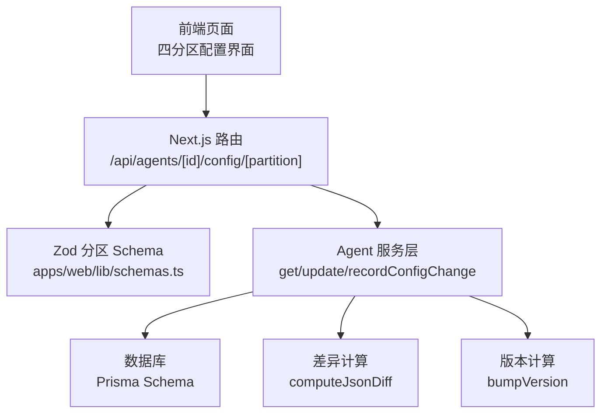

图表来源
- [apps/web/app/api/agents/[id]/config/[partition]/route.ts:1-86](file://apps/web/app/api/agents/[id]/config/[partition]/route.ts#L1-L86)
- [apps/web/lib/schemas.ts:23-60](file://apps/web/lib/schemas.ts#L23-L60)
- [packages/db/prisma/schema.prisma:66-168](file://packages/db/prisma/schema.prisma#L66-L168)

章节来源
- [apps/web/app/(dashboard)/architecture/page.tsx:186-224](file://apps/web/app/(dashboard)/architecture/page.tsx#L186-L224)
- [apps/web/app/api/agents/[id]/config/[partition]/route.ts:1-86](file://apps/web/app/api/agents/[id]/config/[partition]/route.ts#L1-L86)
- [packages/db/prisma/schema.prisma:66-168](file://packages/db/prisma/schema.prisma#L66-L168)

## 核心组件
- Prompt 分区：承载系统提示词、角色定义、约束条件与输出格式，决定 Agent 的“性格与纪律”。
- Knowledge 分区：绑定 Wiki vault，控制检索策略（WIKI_FIRST/WIKI_ONLY/MCP_FIRST/HYBRID）、降级开关、结果数量与置信度阈值。
- Tools 分区：管理 MCP 工具与 Wiki 查询工具列表，控制最大并发、超时与重试次数。
- Routing 分区：维护工单分类规则、升级策略、转人工阈值、会话轮次上限与空闲超时。

这些分区通过统一的 PUT /api/agents/[id]/config/[partition] 接口进行 upsert 更新，并在每次变更后记录 ConfigChange 审计日志。

章节来源
- [apps/web/lib/schemas.ts:23-52](file://apps/web/lib/schemas.ts#L23-L52)
- [apps/web/app/(dashboard)/architecture/page.tsx:186-224](file://apps/web/app/(dashboard)/architecture/page.tsx#L186-L224)

## 架构总览
四分区配置系统的运行时流程如下：客户端对某个分区发起 GET 或 PUT；服务端校验分区名与请求体；读取当前配置后执行更新；最后记录变更并返回新配置。

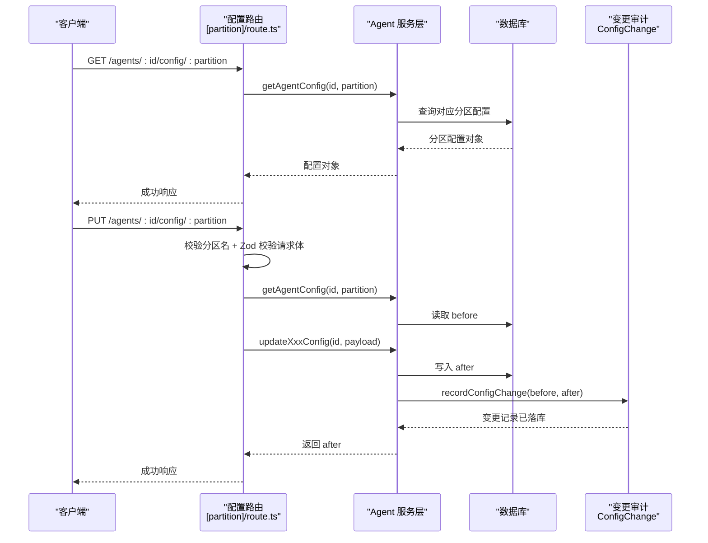

图表来源
- [apps/web/app/api/agents/[id]/config/[partition]/route.ts:28-85](file://apps/web/app/api/agents/[id]/config/[partition]/route.ts#L28-L85)
- [packages/db/prisma/schema.prisma:188-205](file://packages/db/prisma/schema.prisma#L188-L205)

## 详细组件分析

### Prompt 分区
Prompt 分区用于定义 Agent 的系统提示词、角色定义、约束条件和输出格式。其 Zod Schema 要求 systemPrompt 必填，roleDefinition/outputFormat 可选且可为空，constraints 为字符串数组。

- 字段含义
  - systemPrompt：系统提示词，必填。
  - roleDefinition：角色定义，可选。
  - constraints：约束条件数组，可选。
  - outputFormat：输出格式，可选。

- 业务用途
  - 回答风格、越界承诺、格式混乱等问题通常通过调整 Prompt 分区解决。
  - 作为 LLM 调用的系统上下文，直接影响 Agent 行为边界。

- 数据验证
  - systemPrompt 不能为空。
  - constraints 为字符串数组。
  - roleDefinition/outputFormat 允许 null。

- 存储映射
  - PromptConfig.systemPrompt 为 String。
  - PromptConfig.roleDefinition 为可空 String。
  - PromptConfig.constraints 以 JSON 文本存储。
  - PromptConfig.outputFormat 为可空 String。
  - 每个分区配置表均包含 version、lastModifiedBy、lastModifiedAt 等审计字段。

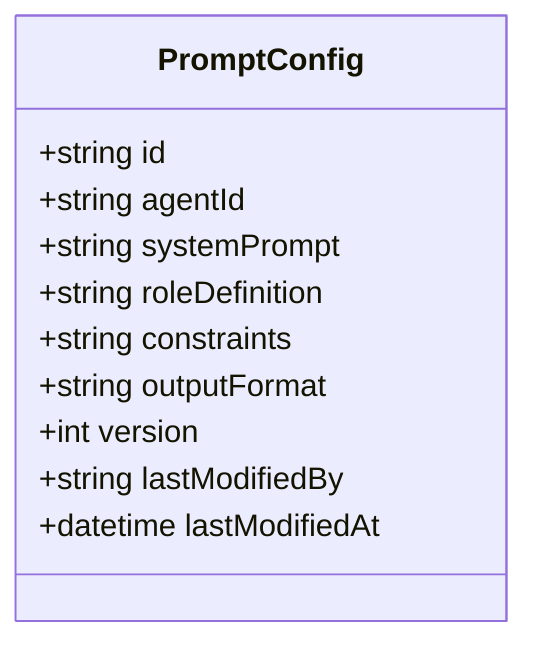

图表来源
- [packages/db/prisma/schema.prisma:105-117](file://packages/db/prisma/schema.prisma#L105-L117)

章节来源
- [apps/web/lib/schemas.ts:23-28](file://apps/web/lib/schemas.ts#L23-L28)
- [packages/db/prisma/schema.prisma:105-117](file://packages/db/prisma/schema.prisma#L105-L117)

### Knowledge 分区
Knowledge 分区负责知识库集成与检索策略，支持多种搜索模式与降级机制。

- 字段含义
  - wikiVaultId：绑定的 Wiki vault 标识，可选。
  - searchStrategy：检索策略，枚举 WIKI_FIRST/WIKI_ONLY/MCP_FIRST/HYBRID。
  - fallbackToMcp：是否降级到 MCP 工具获取实时数据。
  - maxWikiResults：最大 Wiki 结果数，范围 1-50。
  - confidenceThreshold：置信度阈值，范围 0-1。

- 业务用途
  - 知识缺失、知识过期、检索不中等问题可通过调整检索策略、阈值与降级开关解决。
  - 两层知识架构：蒸馏态知识优先检索，MCP 工具兜底查活数据。

- 数据验证
  - searchStrategy 必须为指定枚举之一。
  - maxWikiResults 为整数且在 1-50 之间。
  - confidenceThreshold 为浮点数且在 0-1 之间。

- 存储映射
  - KnowledgeConfig.searchStrategy 为 String（SQLite 下用文本列）。
  - KnowledgeConfig.fallbackToMcp 为 Boolean。
  - KnowledgeConfig.maxWikiResults 为 Int。
  - KnowledgeConfig.confidenceThreshold 为 Float。
  - 另有 lastSyncAt、syncStatus、version 等审计字段。

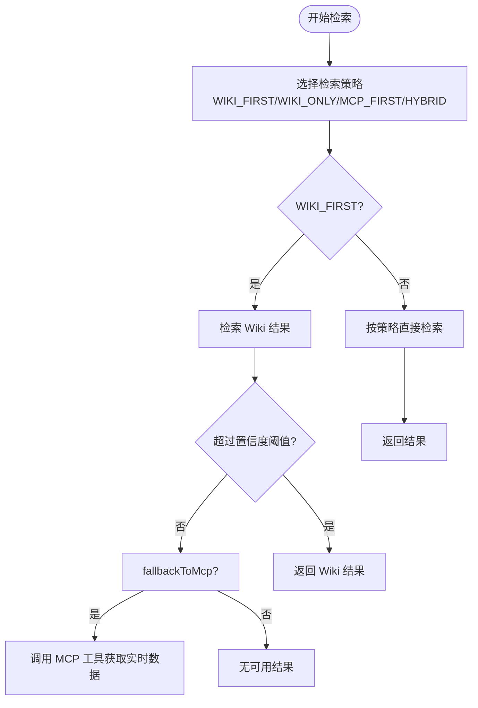

图表来源
- [apps/web/lib/schemas.ts:30-36](file://apps/web/lib/schemas.ts#L30-L36)
- [packages/db/prisma/schema.prisma:119-136](file://packages/db/prisma/schema.prisma#L119-L136)

章节来源
- [apps/web/lib/schemas.ts:30-36](file://apps/web/lib/schemas.ts#L30-L36)
- [packages/db/prisma/schema.prisma:119-136](file://packages/db/prisma/schema.prisma#L119-L136)

### Tools 分区
Tools 分区管理 MCP 工具与 Wiki 查询工具的启用与运行参数，并提供并发控制与超时保护。

- 字段含义
  - mcpTools：MCP 工具配置数组，可选。
  - wikiQueryTools：Wiki 查询工具配置数组，可选。
  - maxConcurrentCalls：最大并发调用数，范围 1-20。
  - timeoutMs：单次调用超时毫秒数，范围 1000-120000。
  - retryCount：重试次数，范围 0-5。

- 业务用途
  - 工具调用失败、缺少某类能力时，通过增删工具或调整并发/超时/重试参数修复。
  - Wiki 查询工具支持 index/summary/grep/全页读取逐级升级。

- 数据验证
  - maxConcurrentCalls 为整数且在 1-20 之间。
  - timeoutMs 为整数且在 1000-120000 之间。
  - retryCount 为整数且在 0-5 之间。

- 存储映射
  - ToolsConfig.mcpTools/wikiQueryTools 以 JSON 文本存储。
  - ToolsConfig.maxConcurrentCalls/timeoutMs/retryCount 为 Int。
  - 含 version、lastModifiedBy、lastModifiedAt 审计字段。

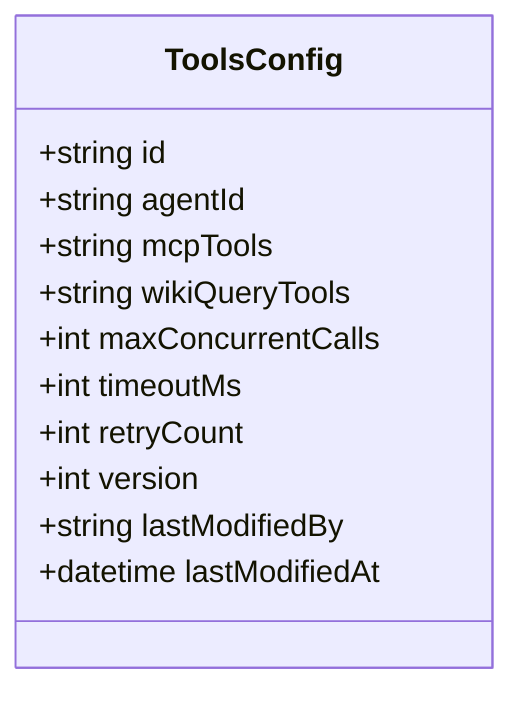

图表来源
- [packages/db/prisma/schema.prisma:138-152](file://packages/db/prisma/schema.prisma#L138-L152)

章节来源
- [apps/web/lib/schemas.ts:38-44](file://apps/web/lib/schemas.ts#L38-L44)
- [packages/db/prisma/schema.prisma:138-152](file://packages/db/prisma/schema.prisma#L138-L152)

### Routing 分区
Routing 分区负责工单分类规则、分派策略、转人工阈值、升级策略与会话管理。

- 字段含义
  - rules：路由规则数组，可选。
  - escalationPolicy：升级策略，可选且可为空。
  - humanThreshold：转人工阈值，范围 0-1。
  - maxConversationTurns：最大对话轮次，范围 1-100。
  - idleTimeoutMinutes：空闲超时分钟数，范围 1-60。

- 业务用途
  - 不该接的接了、该转人工没转等问题通过调整 rules/humanThreshold/escalationPolicy 解决。
  - 会话管理通过 maxConversationTurns/idleTimeoutMinutes 控制。

- 数据验证
  - humanThreshold 为浮点数且在 0-1 之间。
  - maxConversationTurns 为整数且在 1-100 之间。
  - idleTimeoutMinutes 为整数且在 1-60 之间。

- 存储映射
  - RoutingConfig.rules/escalationPolicy 以 JSON 文本存储。
  - RoutingConfig.humanThreshold 为 Float。
  - RoutingConfig.maxConversationTurns/idleTimeoutMinutes 为 Int。
  - 含 version、lastModifiedBy、lastModifiedAt 审计字段。

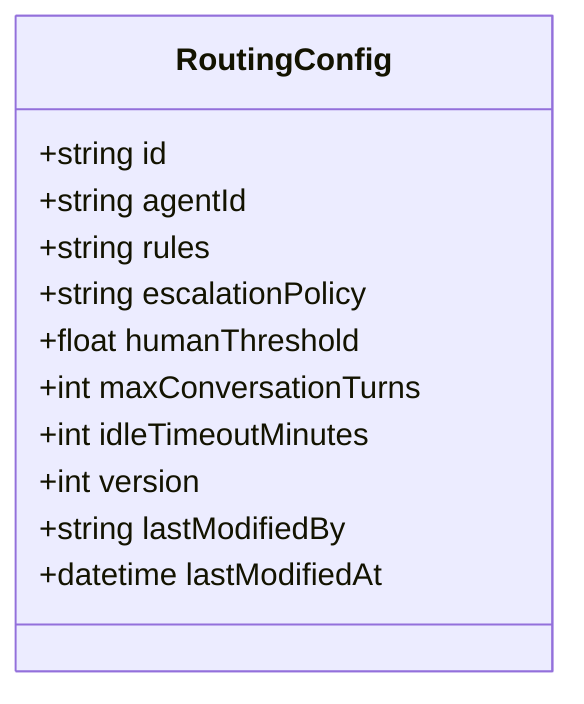

图表来源
- [packages/db/prisma/schema.prisma:154-168](file://packages/db/prisma/schema.prisma#L154-L168)

章节来源
- [apps/web/lib/schemas.ts:46-52](file://apps/web/lib/schemas.ts#L46-L52)
- [packages/db/prisma/schema.prisma:154-168](file://packages/db/prisma/schema.prisma#L154-L168)

### 分区配置的 upsert 合并语义
- 统一入口：所有分区通过 PUT /api/agents/[id]/config/[partition] 更新。
- 校验前置：路由层使用 PARTITION_SCHEMA 对请求体进行 Zod 校验。
- 读取 before：更新前先读取当前分区配置，用于变更审计。
- 应用更新：根据分区类型调用对应的 updateXxxConfig 函数，完成 upsert。
- 记录变更：调用 recordConfigChange 将 before/after 写入 ConfigChange。

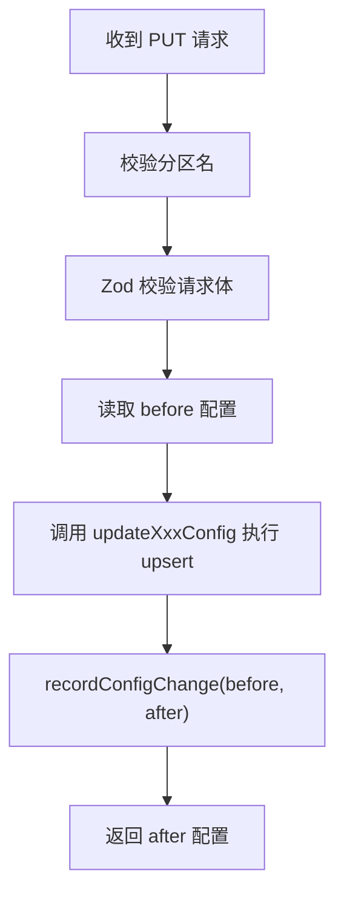

图表来源
- [apps/web/app/api/agents/[id]/config/[partition]/route.ts:46-85](file://apps/web/app/api/agents/[id]/config/[partition]/route.ts#L46-L85)
- [apps/web/lib/schemas.ts:54-60](file://apps/web/lib/schemas.ts#L54-L60)

章节来源
- [apps/web/app/api/agents/[id]/config/[partition]/route.ts:46-85](file://apps/web/app/api/agents/[id]/config/[partition]/route.ts#L46-L85)
- [apps/web/lib/schemas.ts:54-60](file://apps/web/lib/schemas.ts#L54-L60)

### 版本管理机制与语义化版本升级
版本机制基于变更分区集合计算下一个 SemVer：
- 首次发布：0.1.0。
- ROUTING 分区变更：minor。
- 任意 ≥2 个分区变更：minor。
- 单个非路由分区变更：patch。
- 同时变更全部 4 个分区：minor（不轻易 major，避免版本号膨胀）。

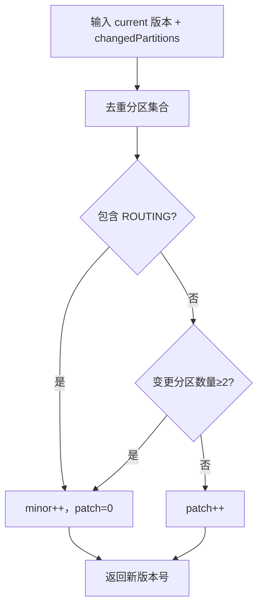

图表来源
- [apps/web/lib/versioning.ts:1-70](file://apps/web/lib/versioning.ts#L1-L70)

章节来源
- [apps/web/lib/versioning.ts:1-70](file://apps/web/lib/versioning.ts#L1-L70)

### 配置差异计算（diff）算法
computeJsonDiff 实现对象级差异计算，输出 added/removed/changed 三类变更：
- 遍历 before 对象的键，若不在 after 中则标记 removed。
- 若键存在但值不同（JSON.stringify 比较），则标记 changed 并记录 before/after。
- 遍历 after 对象的键，若不在 before 中则标记 added。

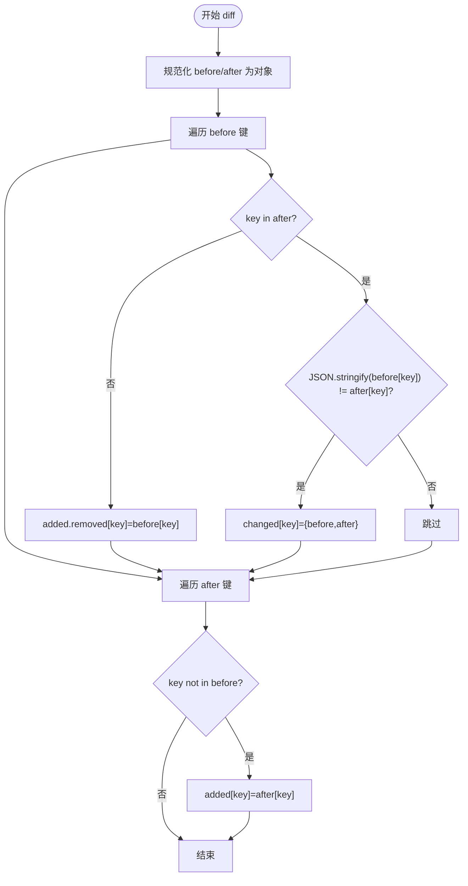

图表来源
- [apps/web/lib/diff.ts:1-35](file://apps/web/lib/diff.ts#L1-L35)

章节来源
- [apps/web/lib/diff.ts:1-35](file://apps/web/lib/diff.ts#L1-L35)

### 变更历史存储机制
ConfigChange 表记录每次分区变更的 before/after/diff/changedBy/changedAt/changeNote/releaseId 等信息，并按 agentId+partition 与 changedAt 建立索引，便于查询与审计。

- 关键字段
  - partition：变更分区（如 PROMPT/KNOWLEDGE/TOOLS/ROUTING，回滚场景可能带后缀）。
  - before/after：变更前后的配置快照（JSON 文本）。
  - diff：差异结果（JSON 文本）。
  - changedBy/changedAt：操作人与时间。
  - changeNote/releaseId：变更说明与关联发布单。

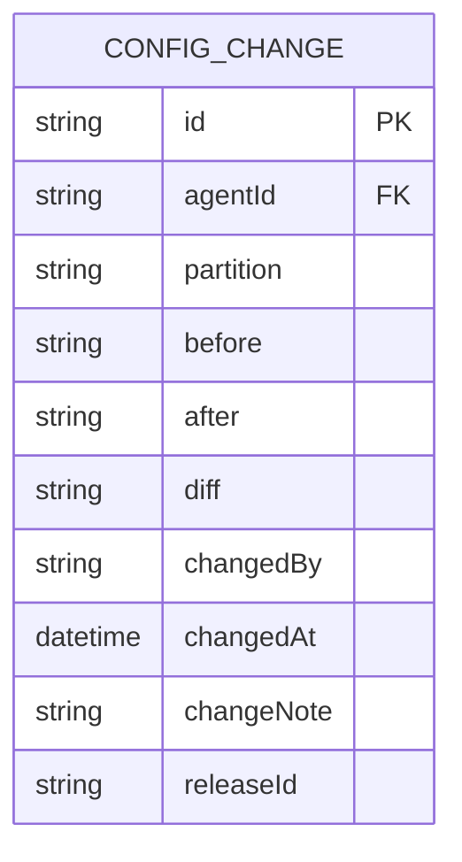

图表来源
- [packages/db/prisma/schema.prisma:188-205](file://packages/db/prisma/schema.prisma#L188-L205)

章节来源
- [packages/db/prisma/schema.prisma:188-205](file://packages/db/prisma/schema.prisma#L188-L205)

### 回滚机制
系统提供两种回滚方式：
- 分区级回滚：POST /api/agents/[id]/config/[partition]/rollback，从目标 Version 的 snapshot 中取出该分区配置覆盖当前 active 配置，并记录 _ROLLBACK 类型的变更。
- 整版本回滚：POST /api/agents/[id]/rollback/[versionId]，一次回滚全部 4 个分区，保证组合与历史快照完全一致，并创建 APPROVED 状态的 Release 与新的 Version。

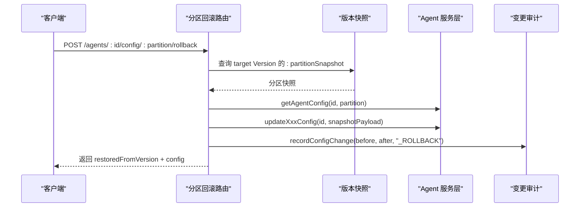

图表来源
- [apps/web/app/api/agents/[id]/config/[partition]/rollback/route.ts:34-117](file://apps/web/app/api/agents/[id]/config/[partition]/rollback/route.ts#L34-L117)

章节来源
- [apps/web/app/api/agents/[id]/config/[partition]/rollback/route.ts:34-117](file://apps/web/app/api/agents/[id]/config/[partition]/rollback/route.ts#L34-L117)
- [apps/web/app/api/agents/[id]/rollback/[versionId]/route.ts:6-36](file://apps/web/app/api/agents/[id]/rollback/[versionId]/route.ts#L6-L36)

## 依赖关系分析
- 路由层依赖：
  - Zod Schema（PARTITION_SCHEMA）进行请求体验证。
  - Agent 服务层（getAgentConfig/updateXxxConfig/recordConfigChange）。
  - Actor 上下文（withActor/resolveActor）注入操作人。
- 服务层依赖：
  - Prisma 客户端读写数据库。
  - diff 与 versioning 工具函数生成差异与版本号。
- 数据层依赖：
  - Prisma Schema 定义 Agent、四分区配置、ConfigChange、AgentVersion 等实体。
  - SQLite 下 JSON/enum 以 String 存储，读写经 pack/unpack 收口。

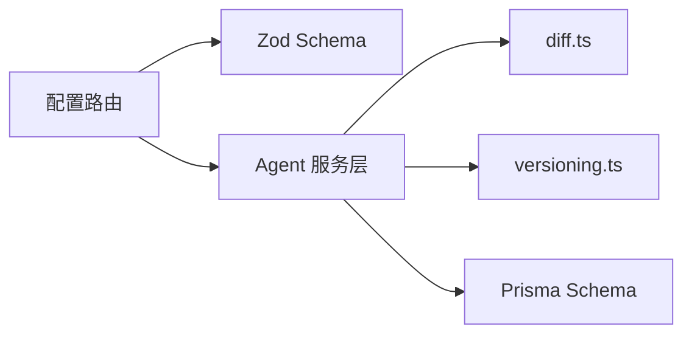

图表来源
- [apps/web/app/api/agents/[id]/config/[partition]/route.ts:1-86](file://apps/web/app/api/agents/[id]/config/[partition]/route.ts#L1-L86)
- [apps/web/lib/diff.ts:1-35](file://apps/web/lib/diff.ts#L1-L35)
- [apps/web/lib/versioning.ts:1-70](file://apps/web/lib/versioning.ts#L1-L70)
- [packages/db/prisma/schema.prisma:66-205](file://packages/db/prisma/schema.prisma#L66-L205)

章节来源
- [apps/web/app/api/agents/[id]/config/[partition]/route.ts:1-86](file://apps/web/app/api/agents/[id]/config/[partition]/route.ts#L1-L86)
- [packages/db/prisma/schema.prisma:66-205](file://packages/db/prisma/schema.prisma#L66-L205)

## 性能与并发特性
- Tools 分区提供 maxConcurrentCalls 控制并发调用上限，防止外部工具过载。
- timeoutMs 限制单次工具调用超时，避免长尾阻塞。
- retryCount 控制失败重试次数，平衡可靠性与资源消耗。
- Knowledge 分区的 maxWikiResults 与 confidenceThreshold 控制检索结果规模与质量，减少无效召回。
- 建议在高频调用场景中合理设置并发与超时，并结合监控指标观察工具链路的延迟与错误率。

[本节为通用性能建议，不直接分析具体文件]

## 故障排查指南
- 分区名无效：路由层会拒绝未知分区，检查 URL 中的 partition 是否为 prompt/knowledge/tools/routing。
- 请求体验证失败：根据 Zod 错误信息修正字段类型与取值范围，例如 systemPrompt 必填、humanThreshold 范围 0-1。
- 回滚失败：确认 versionId 是否存在且属于当前 Agent；检查对应分区快照是否存在。
- 变更未记录：确认 recordConfigChange 是否被调用；检查 ConfigChange 表是否有新增记录。
- 版本计算异常：核对 changedPartitions 是否正确传入 bumpVersion；确保分区名称为大写枚举值。

章节来源
- [apps/web/app/api/agents/[id]/config/[partition]/route.ts:28-57](file://apps/web/app/api/agents/[id]/config/[partition]/route.ts#L28-L57)
- [apps/web/app/api/agents/[id]/config/[partition]/rollback/route.ts:42-74](file://apps/web/app/api/agents/[id]/config/[partition]/rollback/route.ts#L42-L74)
- [apps/web/lib/versioning.ts:46-69](file://apps/web/lib/versioning.ts#L46-L69)

## 结论
四分区配置系统将 Agent 的可变项收敛为 Prompt/Knowledge/Tools/Routing 四个清晰边界，既简化了非开发人员的配置负担，也为问题归因提供了稳定分类学。通过统一的 upsert 接口、严格的 Zod 校验、ConfigChange 审计日志、语义化版本管理与分区/整版本回滚能力，系统在可观测性、可追溯性与可恢复性方面具备良好基础。未来可在检索策略、工具编排与升级策略上进一步扩展，同时保持分区边界的稳定性。

[本节为总结性内容，不直接分析具体文件]

## 附录：API 与数据模型速查

### API 速查
- GET /api/agents/[id]/config/[partition]
  - 作用：读取指定分区的当前配置。
  - 分区枚举：prompt/knowledge/tools/routing。
- PUT /api/agents/[id]/config/[partition]
  - 作用：upsert 指定分区配置，自动记录变更。
  - 请求体验证：使用 PARTITION_SCHEMA。
- POST /api/agents/[id]/config/[partition]/rollback
  - 作用：从指定 Version 的快照回滚单个分区。
  - 请求体：{ versionId }。
- POST /api/agents/[id]/rollback/[versionId]
  - 作用：整版本回滚，覆盖 4 个分区并创建 Release 与新版 Version。

章节来源
- [apps/web/app/api/agents/[id]/config/[partition]/route.ts:28-85](file://apps/web/app/api/agents/[id]/config/[partition]/route.ts#L28-L85)
- [apps/web/app/api/agents/[id]/config/[partition]/rollback/route.ts:34-117](file://apps/web/app/api/agents/[id]/config/[partition]/rollback/route.ts#L34-L117)
- [apps/web/app/api/agents/[id]/rollback/[versionId]/route.ts:6-36](file://apps/web/app/api/agents/[id]/rollback/[versionId]/route.ts#L6-L36)

### 数据模型速查
- Agent：主体实体，关联四分区配置、Draft 环境、Feedback、Release、Version、SkillBinding、Trace、EvalCase、ConfigChange。
- PromptConfig/KnowledgeConfig/ToolsConfig/RoutingConfig：四分区配置表，均含 version、lastModifiedBy、lastModifiedAt。
- AgentDraftConfig：草稿环境，暂存四分区配置。
- ConfigChange：变更审计表，记录 before/after/diff/changedBy/changedAt/changeNote/releaseId。
- AgentVersion：版本快照，保存四分区快照及发布信息。

章节来源
- [packages/db/prisma/schema.prisma:66-205](file://packages/db/prisma/schema.prisma#L66-L205)