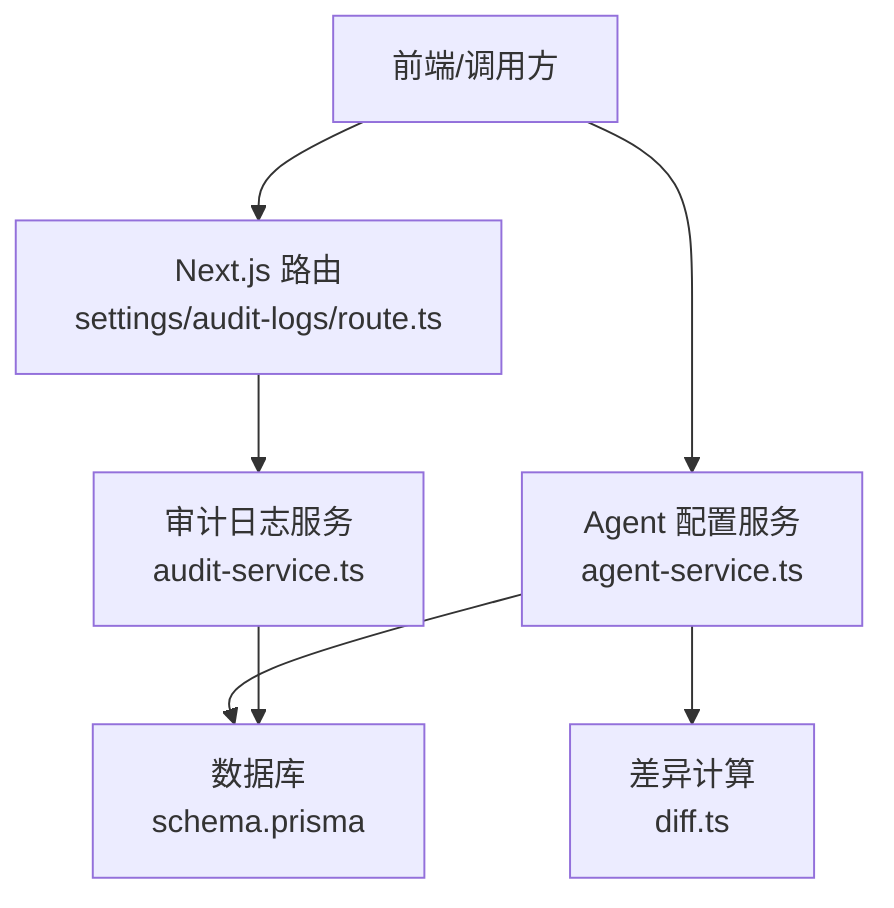
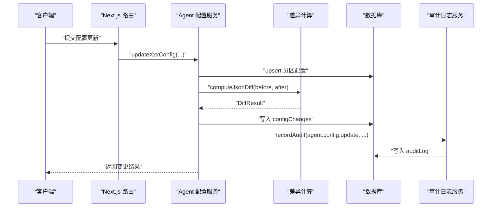
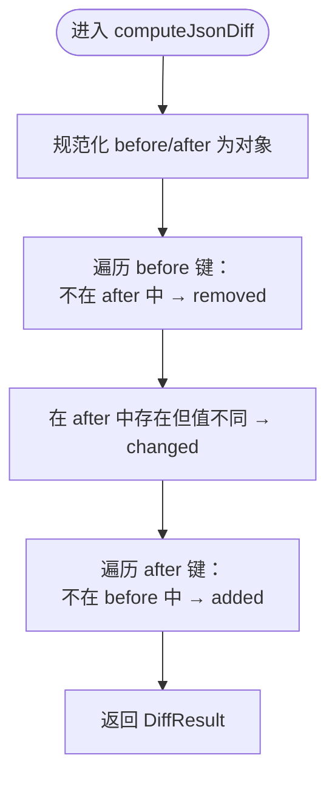
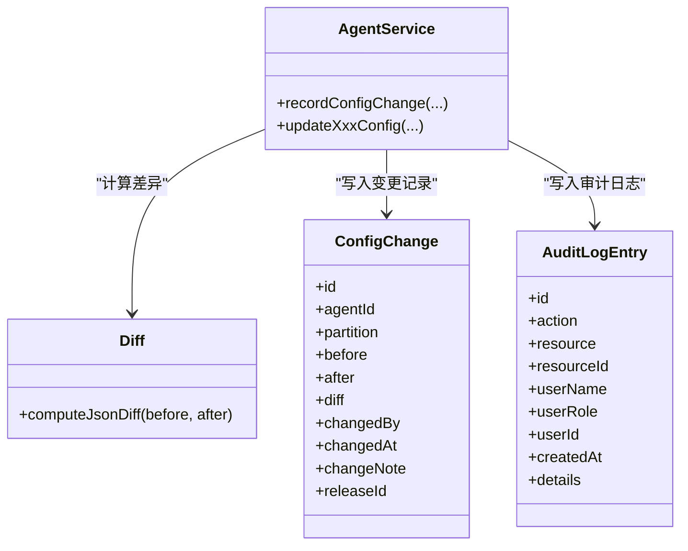
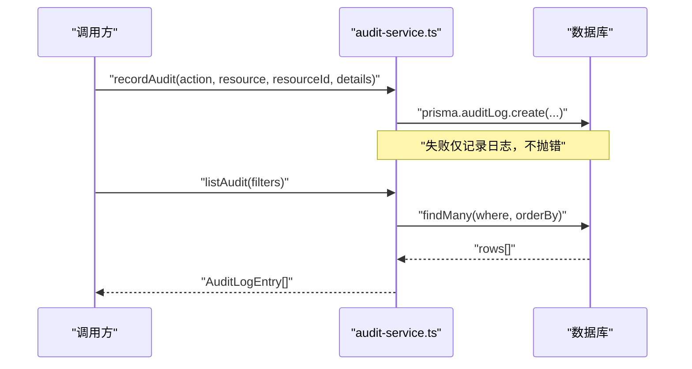
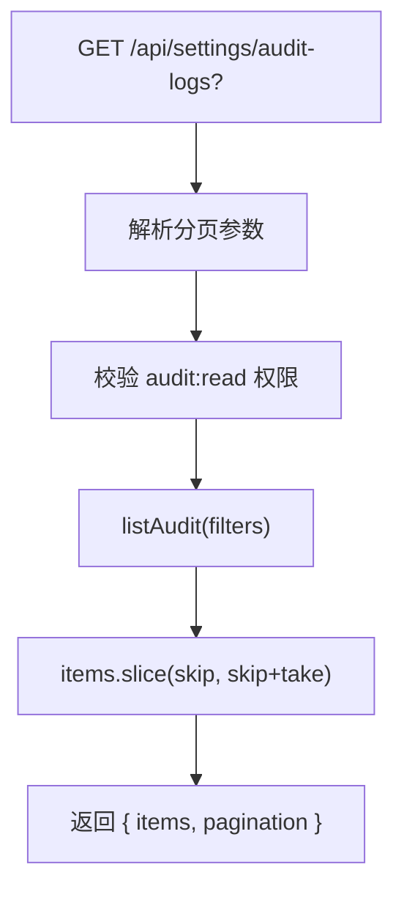
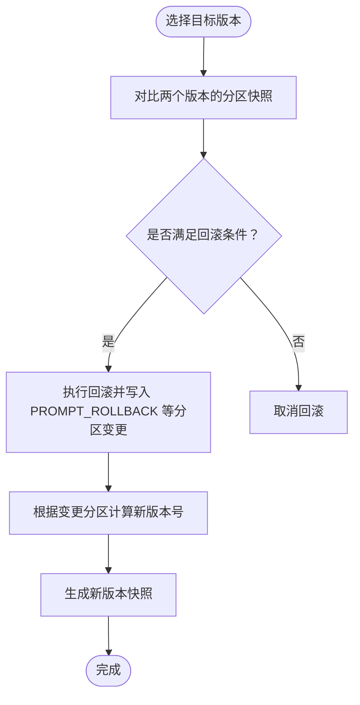
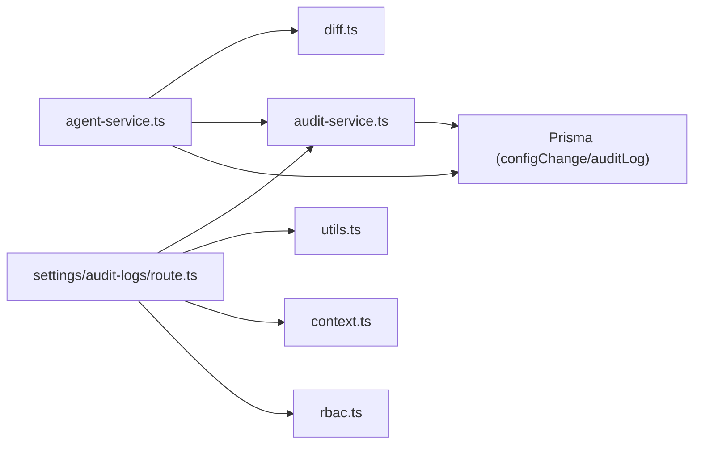

# 配置变更追踪

<cite>
**本文引用的文件**   
- [diff.ts](file://apps/web/lib/diff.ts)
- [agent-service.ts](file://apps/web/lib/services/agent-service.ts)
- [audit-service.ts](file://apps/web/lib/services/audit-service.ts)
- [route.ts（审计日志接口）](file://apps/web/app/api/settings/audit-logs/route.ts)
- [schema.prisma](file://packages/db/prisma/schema.prisma)
- [versioning.ts](file://apps/web/lib/versioning.ts)
- [diff.test.ts](file://apps/web/lib/__tests__/diff.test.ts)
- [agent-service.test.ts](file://apps/web/lib/__tests__/agent-service.test.ts)
</cite>

## 目录
1. [引言](#引言)
2. [项目结构](#项目结构)
3. [核心组件](#核心组件)
4. [架构总览](#架构总览)
5. [详细组件分析](#详细组件分析)
6. [依赖关系分析](#依赖关系分析)
7. [性能与可扩展性](#性能与可扩展性)
8. [故障排查指南](#故障排查指南)
9. [结论](#结论)
10. [附录：API 契约与最佳实践](#附录api-契约与最佳实践)

## 引言
本文件面向“配置变更追踪系统”，聚焦以下目标：
- 配置变更的捕获机制、差异计算算法 computeJsonDiff 与变更记录存储。
- 变更记录字段结构、时间戳管理与用户追踪。
- diff 数据结构与可视化展示方案。
- 变更记录 API、查询过滤与分页处理。
- 变更回滚机制与版本对比功能。
- 变更审计最佳实践与安全考虑。
- 变更通知机制与实时监控方案。

该系统由三层组成：
- 业务层：Agent 分区配置更新与变更记录写入。
- 差异层：computeJsonDiff 提供结构化 diff。
- 审计层：append-only 审计日志，回答“谁在何时做了什么”。

## 项目结构
围绕配置变更追踪的关键代码分布如下：
- 差异计算：apps/web/lib/diff.ts
- 配置服务与变更记录：apps/web/lib/services/agent-service.ts
- 审计日志服务：apps/web/lib/services/audit-service.ts
- 审计日志接口：apps/web/app/api/settings/audit-logs/route.ts
- 数据模型：packages/db/prisma/schema.prisma
- 语义化版本与分区枚举：apps/web/lib/versioning.ts

图表来源
- [route.ts（审计日志接口）:1-33](file://apps/web/app/api/settings/audit-logs/route.ts#L1-L33)
- [audit-service.ts:1-120](file://apps/web/lib/services/audit-service.ts#L1-L120)
- [agent-service.ts:567-614](file://apps/web/lib/services/agent-service.ts#L567-L614)
- [diff.ts:1-35](file://apps/web/lib/diff.ts#L1-L35)
- [schema.prisma:188-205](file://packages/db/prisma/schema.prisma#L188-L205)

章节来源
- [diff.ts:1-35](file://apps/web/lib/diff.ts#L1-L35)
- [agent-service.ts:567-614](file://apps/web/lib/services/agent-service.ts#L567-L614)
- [audit-service.ts:1-120](file://apps/web/lib/services/audit-service.ts#L1-L120)
- [route.ts（审计日志接口）:1-33](file://apps/web/app/api/settings/audit-logs/route.ts#L1-L33)
- [schema.prisma:188-205](file://packages/db/prisma/schema.prisma#L188-L205)

## 核心组件
- 差异计算 computeJsonDiff：对 before/after 对象进行键级比较，输出 added/removed/changed 三类变更。
- 配置变更记录 recordConfigChange：封装 before/after/diff/changedBy/changeNote/createdAt，落库 configChanges 表，并触发审计事件。
- 审计日志 recordAudit：append-only 写入 auditLog 表，包含 action/resource/resourceId/userName/userRole/createdAt/details。
- 审计日志列表 listAudit + GET /api/settings/audit-logs：支持按 action/resource/resourceId/user 过滤，返回分页结果。
- 数据模型 ConfigChange/AuditLog：定义变更与审计的持久化结构。

章节来源
- [diff.ts:1-35](file://apps/web/lib/diff.ts#L1-L35)
- [agent-service.ts:567-614](file://apps/web/lib/services/agent-service.ts#L567-L614)
- [audit-service.ts:1-120](file://apps/web/lib/services/audit-service.ts#L1-L120)
- [schema.prisma:188-205](file://packages/db/prisma/schema.prisma#L188-L205)
- [schema.prisma:530-550](file://packages/db/prisma/schema.prisma#L530-L550)

## 架构总览
配置变更从“写操作”到“可观测性”的完整链路如下：

图表来源
- [agent-service.ts:364-549](file://apps/web/lib/services/agent-service.ts#L364-L549)
- [agent-service.ts:567-614](file://apps/web/lib/services/agent-service.ts#L567-L614)
- [diff.ts:1-35](file://apps/web/lib/diff.ts#L1-L35)
- [audit-service.ts:43-85](file://apps/web/lib/services/audit-service.ts#L43-L85)
- [schema.prisma:188-205](file://packages/db/prisma/schema.prisma#L188-L205)
- [schema.prisma:530-550](file://packages/db/prisma/schema.prisma#L530-L550)

## 详细组件分析

### 差异计算 computeJsonDiff
- 输入：before/after 任意值；非对象或数组时视为空对象。
- 输出：DiffResult = { added, removed, changed }。
- 比较策略：基于 JSON.stringify 的深等判断，避免引用相等导致的误判。
- 复杂度：O(n+m)，n/m 分别为 before/after 的顶层键数量。

图表来源
- [diff.ts:1-35](file://apps/web/lib/diff.ts#L1-L35)

章节来源
- [diff.ts:1-35](file://apps/web/lib/diff.ts#L1-L35)
- [diff.test.ts:1-54](file://apps/web/lib/__tests__/diff.test.ts#L1-L54)

### 配置变更捕获与存储
- 捕获入口：recordConfigChange(agentId, partition, before, after, changeNote)。
- 关键步骤：
  - 通过 getActor() 获取当前操作者。
  - 使用 computeJsonDiff 生成结构化 diff。
  - 将 before/after/diff 经 packJson 序列化后写入 configChanges。
  - 同时写入审计日志，附带 partition/changeNote/diffSummary。
- 时间戳：changedAt 由数据库默认 now() 填充；对外暴露 createdAt 为 ISO 字符串。
- 用户追踪：changedBy 保存 actor.id；审计日志固化 userName/userRole。

图表来源
- [agent-service.ts:567-614](file://apps/web/lib/services/agent-service.ts#L567-L614)
- [diff.ts:1-35](file://apps/web/lib/diff.ts#L1-L35)
- [schema.prisma:188-205](file://packages/db/prisma/schema.prisma#L188-L205)
- [schema.prisma:530-550](file://packages/db/prisma/schema.prisma#L530-L550)

章节来源
- [agent-service.ts:567-614](file://apps/web/lib/services/agent-service.ts#L567-L614)
- [schema.prisma:188-205](file://packages/db/prisma/schema.prisma#L188-L205)
- [schema.prisma:530-550](file://packages/db/prisma/schema.prisma#L530-L550)

### 审计日志与用户追踪
- append-only 设计：审计失败不抛错，不影响主业务流程。
- 用户快照：写入时点固化 userName/userRole，避免后续改名导致历史失真。
- 异步写入：track/pendingWrites 用于测试收敛 fire-and-forget 写入。
- 列表查询：listAudit 支持 action/resource/resourceId/user 过滤，按 createdAt 降序。

图表来源
- [audit-service.ts:43-85](file://apps/web/lib/services/audit-service.ts#L43-L85)
- [audit-service.ts:87-120](file://apps/web/lib/services/audit-service.ts#L87-L120)
- [schema.prisma:530-550](file://packages/db/prisma/schema.prisma#L530-L550)

章节来源
- [audit-service.ts:1-120](file://apps/web/lib/services/audit-service.ts#L1-L120)
- [schema.prisma:530-550](file://packages/db/prisma/schema.prisma#L530-L550)

### 变更记录 API、查询过滤与分页
- 接口：GET /api/settings/audit-logs
- 权限：需要 audit:read（平台管理员）。
- 过滤参数：action、resource、resourceId、userName/userId（兼容别名）。
- 分页：复用 parsePagination，返回 items + paginationMeta。
- 排序：服务端按 createdAt 降序，再按 id 降序。

图表来源
- [route.ts（审计日志接口）:1-33](file://apps/web/app/api/settings/audit-logs/route.ts#L1-L33)
- [audit-service.ts:87-120](file://apps/web/lib/services/audit-service.ts#L87-L120)

章节来源
- [route.ts（审计日志接口）:1-33](file://apps/web/app/api/settings/audit-logs/route.ts#L1-L33)
- [audit-service.ts:87-120](file://apps/web/lib/services/audit-service.ts#L87-L120)

### 变更回滚机制与版本对比
- 回滚留痕：分区回滚会写入 partition 带后缀的值（如 PROMPT_ROLLBACK），便于区分普通更新与回滚。
- 版本管理：bumpVersion 根据变更分区集合决定 minor/patch 升级规则；ROUTING 或 ≥2 个分区变更触发 minor。
- 版本快照：AgentVersion 保存四分区快照，支持发布后的版本对比与回溯。

图表来源
- [agent-service.ts:567-614](file://apps/web/lib/services/agent-service.ts#L567-L614)
- [versioning.ts:1-70](file://apps/web/lib/versioning.ts#L1-L70)
- [schema.prisma:294-318](file://packages/db/prisma/schema.prisma#L294-L318)

章节来源
- [agent-service.ts:567-614](file://apps/web/lib/services/agent-service.ts#L567-L614)
- [versioning.ts:1-70](file://apps/web/lib/versioning.ts#L1-L70)
- [schema.prisma:294-318](file://packages/db/prisma/schema.prisma#L294-L318)

### diff 的数据结构与可视化展示方案
- 数据结构：DiffResult.added/removed/changed，changed 内嵌 before/after。
- 可视化建议：
  - 行级高亮：新增用绿色、删除用红色、修改用黄色。
  - 折叠面板：按 key 分组，展开查看 before/after 差异。
  - 摘要视图：显示 added/removed/changed 的键名列表，便于快速定位。
  - 大对象优化：对深层嵌套对象采用懒加载与增量渲染。

[本节为概念性说明，不涉及具体源码]

## 依赖关系分析
- agent-service.ts 依赖：
  - diff.ts：computeJsonDiff
  - audit-service.ts：recordAudit
  - prisma：configChange/auditLog 写入
- audit-service.ts 依赖：
  - prisma：auditLog 写入
  - context：getActor 获取操作者身份
- route.ts（审计日志接口）依赖：
  - audit-service.ts：listAudit
  - utils：parsePagination/paginationMeta
  - context：withActor/resolveActor
  - rbac：requirePermission("audit", "read")

图表来源
- [agent-service.ts:1-21](file://apps/web/lib/services/agent-service.ts#L1-L21)
- [agent-service.ts:567-614](file://apps/web/lib/services/agent-service.ts#L567-L614)
- [audit-service.ts:1-4](file://apps/web/lib/services/audit-service.ts#L1-L4)
- [route.ts（审计日志接口）:1-6](file://apps/web/app/api/settings/audit-logs/route.ts#L1-L6)

章节来源
- [agent-service.ts:1-21](file://apps/web/lib/services/agent-service.ts#L1-L21)
- [audit-service.ts:1-4](file://apps/web/lib/services/audit-service.ts#L1-L4)
- [route.ts（审计日志接口）:1-6](file://apps/web/app/api/settings/audit-logs/route.ts#L1-L6)

## 性能与可扩展性
- 差异计算：
  - 时间复杂度 O(n+m)，空间复杂度 O(k)（k 为变更键数）。
  - 对于大型对象，建议在前端做分块渲染与懒加载。
- 变更记录写入：
  - configChanges 表已建立索引（agentId, partition; changedAt），适合按 Agent 与时间范围查询。
- 审计日志：
  - append-only 且 fire-and-forget，避免阻塞主流程。
  - 建议在大数据量场景下增加归档策略（按月/年拆分表或冷存储）。
- 分页与过滤：
  - 审计日志接口在服务端排序后内存切片，适用于中等规模数据；若数据量增长，应改为数据库侧分页。

[本节为通用指导，不涉及具体源码]

## 故障排查指南
- 审计日志未写入：
  - 检查 NODE_ENV 是否为 test（测试环境不打印错误）。
  - 确认 audit:read 权限是否正确授予。
  - 使用 flushAudit 等待异步写入完成（测试场景）。
- 变更记录缺失：
  - 确认 recordConfigChange 是否被调用。
  - 检查 partition 值是否合法（含回滚后缀）。
  - 验证 before/after 是否有效对象。
- 差异异常：
  - 检查 computeJsonDiff 输入类型（非对象会被当作空对象）。
  - 注意 JSON.stringify 的比较语义（函数、循环引用不适用）。

章节来源
- [audit-service.ts:77-85](file://apps/web/lib/services/audit-service.ts#L77-L85)
- [agent-service.ts:567-614](file://apps/web/lib/services/agent-service.ts#L567-L614)
- [diff.ts:1-35](file://apps/web/lib/diff.ts#L1-L35)

## 结论
该配置变更追踪系统以“差异计算 + 变更记录 + 审计日志”为核心，实现了：
- 精确的结构化 diff 与可追溯的变更记录。
- 安全的 append-only 审计流与用户行为快照。
- 清晰的 API 与过滤能力，支撑审计与合规需求。
- 版本管理与回滚留痕，保障变更的可逆性与可对比性。

在生产环境中，建议结合归档、监控告警与可视化增强，进一步提升可观测性与运维效率。

## 附录：API 契约与最佳实践

### 变更记录字段结构（configChanges）
- id：唯一标识
- agentId：关联 Agent
- partition：分区名称（含回滚后缀）
- before：变更前内容（可为 null）
- after：变更后内容
- diff：结构化差异（added/removed/changed）
- changedBy：操作者 ID
- changedAt：变更时间
- changeNote：变更说明
- releaseId：关联发布单（可选）

章节来源
- [schema.prisma:188-205](file://packages/db/prisma/schema.prisma#L188-L205)
- [agent-service.ts:567-614](file://apps/web/lib/services/agent-service.ts#L567-L614)

### 审计日志字段结构（auditLog）
- id：唯一标识
- action：动作（如 agent.config.update）
- resource：资源类型（如 agent）
- resourceId：资源 ID
- userName：操作者用户名（快照）
- userRole：操作者角色（快照）
- userId：操作者 ID（别名，兼容查询）
- ipAddress/userAgent：请求上下文（可选）
- createdAt：创建时间
- details：扩展详情（JSON 文本）

章节来源
- [schema.prisma:530-550](file://packages/db/prisma/schema.prisma#L530-L550)
- [audit-service.ts:13-24](file://apps/web/lib/services/audit-service.ts#L13-L24)

### 变更记录 API
- GET /api/settings/audit-logs
- 查询参数：
  - page/pageSize/skip/take：分页
  - action/resource/resourceId/user：过滤
- 响应体：
  - items：审计日志条目数组
  - pagination：分页元信息

章节来源
- [route.ts（审计日志接口）:1-33](file://apps/web/app/api/settings/audit-logs/route.ts#L1-L33)
- [audit-service.ts:87-120](file://apps/web/lib/services/audit-service.ts#L87-L120)

### 变更审计最佳实践与安全考虑
- 最小权限原则：审计日志读取需 audit:read。
- 不可篡改：append-only 设计，审计失败静默吞掉，不影响业务。
- 用户快照：固化 userName/userRole，避免历史失真。
- 敏感信息脱敏：details 中避免写入敏感数据。
- 访问控制：所有写操作前置 RBAC 校验。

章节来源
- [audit-service.ts:43-85](file://apps/web/lib/services/audit-service.ts#L43-L85)
- [route.ts（审计日志接口）:1-33](file://apps/web/app/api/settings/audit-logs/route.ts#L1-L33)

### 变更通知机制与实时监控方案
- 实时推送：可在 recordAudit/recordConfigChange 成功后触发 WebSocket/SSE 事件。
- 指标采集：统计变更频率、回滚率、分区分布。
- 告警规则：针对高风险分区（ROUTING）或高频变更设置阈值告警。
- 可视化看板：聚合审计日志与变更记录，提供时间线视图。

[本节为概念性说明，不涉及具体源码]