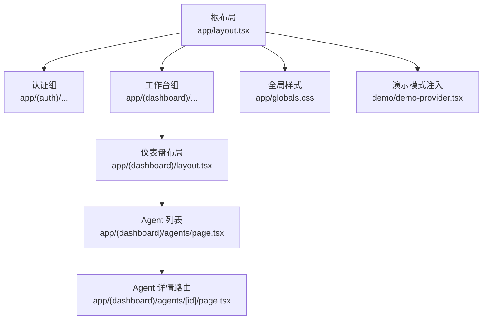
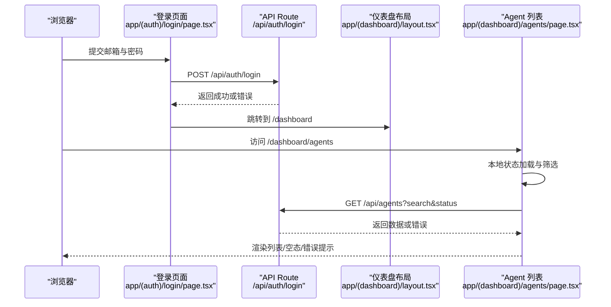
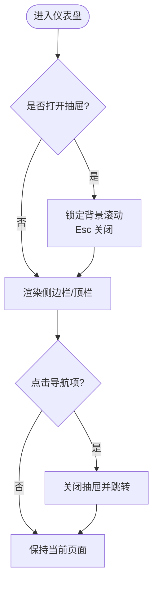
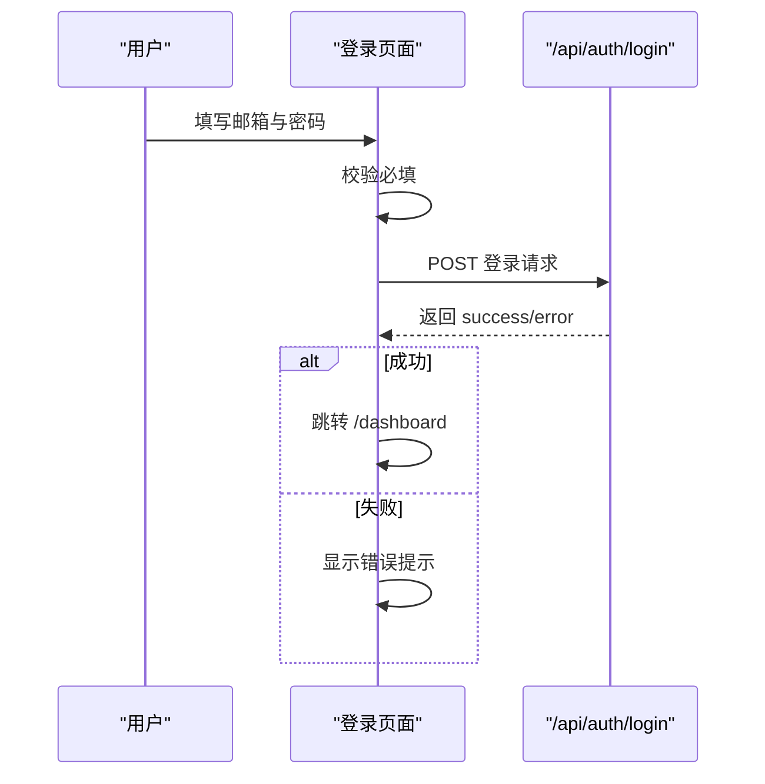
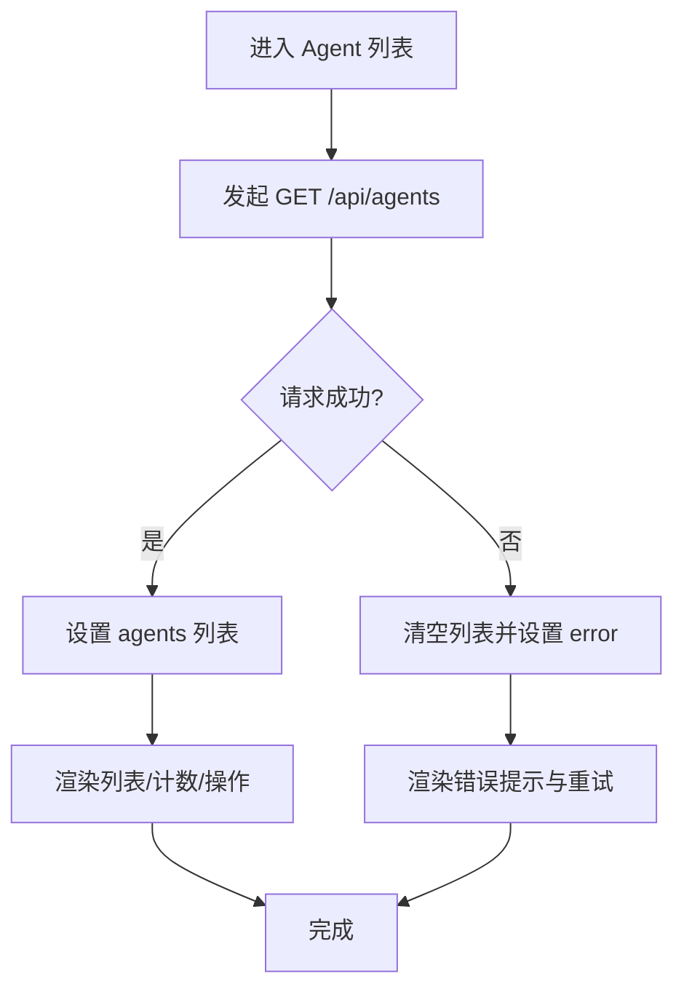
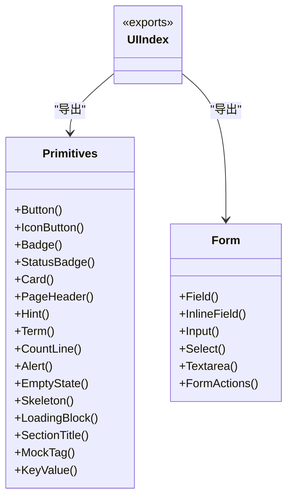
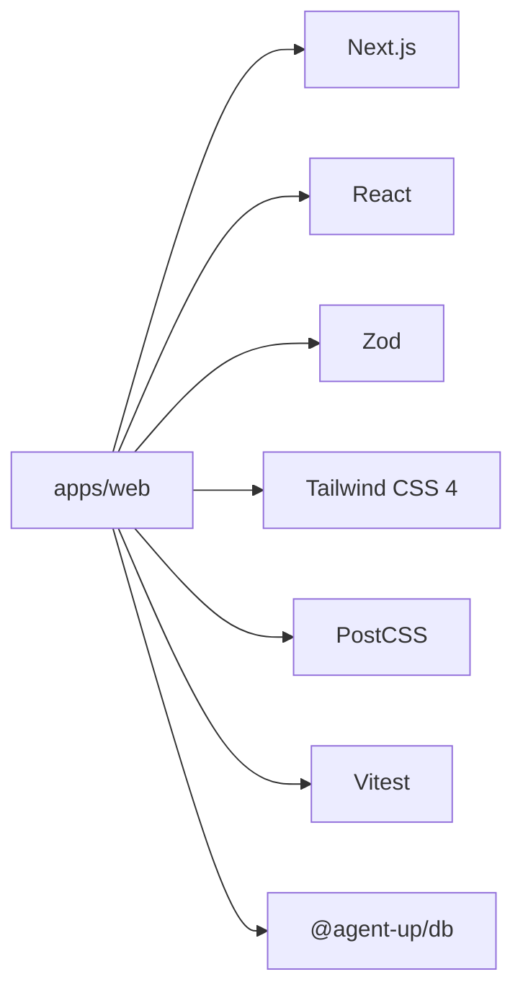
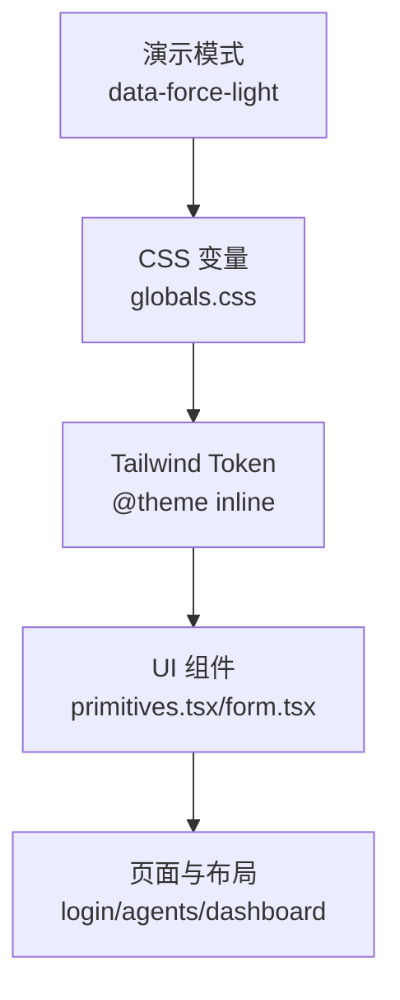
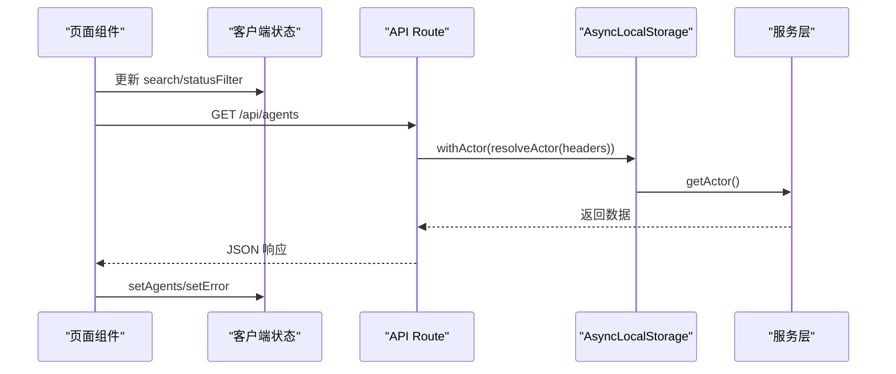

# 前端架构

<cite>
**本文引用的文件**   
- [apps/web/package.json](file://apps/web/package.json)
- [apps/web/next.config.ts](file://apps/web/next.config.ts)
- [apps/web/postcss.config.mjs](file://apps/web/postcss.config.mjs)
- [apps/web/app/layout.tsx](file://apps/web/app/layout.tsx)
- [apps/web/app/globals.css](file://apps/web/app/globals.css)
- [apps/web/app/(dashboard)/layout.tsx](file://apps/web/app/(dashboard)/layout.tsx)
- [apps/web/app/(auth)/login/page.tsx](file://apps/web/app/(auth)/login/page.tsx)
- [apps/web/app/(dashboard)/agents/page.tsx](file://apps/web/app/(dashboard)/agents/page.tsx)
- [apps/web/app/(dashboard)/agents/[id]/page.tsx](file://apps/web/app/(dashboard)/agents/[id]/page.tsx)
- [apps/web/components/ui/index.ts](file://apps/web/components/ui/index.ts)
- [apps/web/components/ui/primitives.tsx](file://apps/web/components/ui/primitives.tsx)
- [apps/web/components/ui/form.tsx](file://apps/web/components/ui/form.tsx)
- [apps/web/lib/context.ts](file://apps/web/lib/context.ts)
- [apps/web/demo/demo-provider.tsx](file://apps/web/demo/demo-provider.tsx)
</cite>

## 目录
1. [简介](#简介)
2. [项目结构](#项目结构)
3. [核心组件](#核心组件)
4. [架构总览](#架构总览)
5. [详细组件分析](#详细组件分析)
6. [依赖关系分析](#依赖关系分析)
7. [性能与可访问性](#性能与可访问性)
8. [样式系统与主题定制](#样式系统与主题定制)
9. [状态管理与数据流](#状态管理与数据流)
10. [开发工具链、构建配置与部署](#开发工具链构建配置与部署)
11. [故障排查指南](#故障排查指南)
12. [结论](#结论)

## 简介
本文件面向 AgentUp 平台的前端工程，系统性说明基于 Next.js App Router 的路由组织、页面与布局嵌套、共享 UI 组件库、服务层调用模式、客户端状态管理、Tailwind CSS 4 主题体系、响应式与可访问性策略，以及开发、构建与部署实践。文档以仓库中实际代码为依据，重点覆盖：
- 路由分组 `(auth)` 与 `(dashboard)` 的职责边界与导航体验。
- 根布局与仪表盘布局的嵌套关系、侧边栏与移动端抽屉交互。
- 共享 UI 组件库的设计原则与使用方式。
- 登录流程、Agent 列表页与服务端 API 的交互序列。
- 演示模式（静态导出）与生产模式的差异。
- 主题变量、暗色模式、对比度与无障碍支持。
- 服务端 Actor 上下文对审计与权限的影响。

## 项目结构
前端位于 `apps/web`，采用 Next.js App Router 的文件系统路由：
- `app/`：应用入口、全局布局、页面与 API Route。
- `components/ui/`：共享 UI 基元与表单控件。
- `lib/`：服务端上下文、鉴权、领域服务等。
- `demo/`：演示模式注入点与拦截逻辑。
- `public/`：静态资源。

**图表来源**
- [apps/web/app/layout.tsx:1-32](file://apps/web/app/layout.tsx#L1-L32)
- [apps/web/app/(dashboard)/layout.tsx:1-273](file://apps/web/app/(dashboard)/layout.tsx#L1-L273)
- [apps/web/app/(auth)/login/page.tsx:1-139](file://apps/web/app/(auth)/login/page.tsx#L1-L139)
- [apps/web/app/(dashboard)/agents/page.tsx:1-408](file://apps/web/app/(dashboard)/agents/page.tsx#L1-L408)
- [apps/web/app/(dashboard)/agents/[id]/page.tsx:1-18](file://apps/web/app/(dashboard)/agents/[id]/page.tsx#L1-L18)
- [apps/web/app/globals.css:1-158](file://apps/web/app/globals.css#L1-L158)
- [apps/web/demo/demo-provider.tsx:1-18](file://apps/web/demo/demo-provider.tsx#L1-L18)

**章节来源**
- [apps/web/app/layout.tsx:1-32](file://apps/web/app/layout.tsx#L1-L32)
- [apps/web/app/(dashboard)/layout.tsx:1-273](file://apps/web/app/(dashboard)/layout.tsx#L1-L273)

## 核心组件
- 根布局负责站点元信息、语言设置、演示模式注入与全局样式引入。
- 仪表盘布局提供侧边栏导航、移动端抽屉、登出流程与错误边界包裹。
- 登录页面实现邮箱密码校验、调用 `/api/auth/login`、成功后跳转工作台。
- Agent 列表页实现搜索、状态筛选、分页展示、创建弹窗与服务端数据同步。
- 共享 UI 组件库统一按钮、卡片、徽章、表单字段、空状态、骨架屏等基础能力。

**章节来源**
- [apps/web/app/layout.tsx:1-32](file://apps/web/app/layout.tsx#L1-L32)
- [apps/web/app/(dashboard)/layout.tsx:1-273](file://apps/web/app/(dashboard)/layout.tsx#L1-L273)
- [apps/web/app/(auth)/login/page.tsx:1-139](file://apps/web/app/(auth)/login/page.tsx#L1-L139)
- [apps/web/app/(dashboard)/agents/page.tsx:1-408](file://apps/web/app/(dashboard)/agents/page.tsx#L1-L408)
- [apps/web/components/ui/index.ts:1-10](file://apps/web/components/ui/index.ts#L1-L10)
- [apps/web/components/ui/primitives.tsx:1-487](file://apps/web/components/ui/primitives.tsx#L1-L487)
- [apps/web/components/ui/form.tsx:1-139](file://apps/web/components/ui/form.tsx#L1-L139)

## 架构总览
Next.js App Router 将认证与工作区按路由分组隔离；根布局挂载演示模式 Provider；仪表盘布局承载业务页面并处理导航与登出；页面组件通过 `fetch` 直接调用同仓 API Route，形成“页面 → API Route → 服务层 → 数据库”的数据通路。

**图表来源**
- [apps/web/app/(auth)/login/page.tsx:15-41](file://apps/web/app/(auth)/login/page.tsx#L15-L41)
- [apps/web/app/(dashboard)/layout.tsx:92-101](file://apps/web/app/(dashboard)/layout.tsx#L92-L101)
- [apps/web/app/(dashboard)/agents/page.tsx:42-68](file://apps/web/app/(dashboard)/agents/page.tsx#L42-L68)

## 详细组件分析

### 路由与布局嵌套
- 根布局定义站点标题、描述、语言与演示模式开关，并在演示模式下注入 `DemoProvider`。
- 仪表盘布局包含：
  - 桌面端固定侧边栏与移动端全屏抽屉。
  - 导航项高亮逻辑，区分精确匹配与前缀匹配。
  - 登出流程：调用 `/api/auth/logout`，无论成功失败均跳转登录页。
  - 键盘与屏幕阅读器支持：跳过链接、`aria-modal`、`role="dialog"`、焦点环。
  - 内容区域包裹 `ErrorBoundary`，保证子页面崩溃不破坏整体布局。

**图表来源**
- [apps/web/app/(dashboard)/layout.tsx:107-120](file://apps/web/app/(dashboard)/layout.tsx#L107-L120)
- [apps/web/app/(dashboard)/layout.tsx:144-177](file://apps/web/app/(dashboard)/layout.tsx#L144-L177)
- [apps/web/app/(dashboard)/layout.tsx:221-238](file://apps/web/app/(dashboard)/layout.tsx#L221-L238)

**章节来源**
- [apps/web/app/layout.tsx:1-32](file://apps/web/app/layout.tsx#L1-L32)
- [apps/web/app/(dashboard)/layout.tsx:1-273](file://apps/web/app/(dashboard)/layout.tsx#L1-L273)

### 登录流程
- 表单校验：必填检查、禁用提交、显示错误提示。
- 调用 `/api/auth/login`，成功后跳转 `/dashboard`。
- 错误分支：网络异常或服务端错误时给出用户可读提示。
- 可访问性：输入框关联 label、hint、error，使用 `aria-describedby`。

**图表来源**
- [apps/web/app/(auth)/login/page.tsx:15-41](file://apps/web/app/(auth)/login/page.tsx#L15-L41)

**章节来源**
- [apps/web/app/(auth)/login/page.tsx:1-139](file://apps/web/app/(auth)/login/page.tsx#L1-L139)

### Agent 列表与详情页
- 列表页：
  - 本地状态管理 loading、error、search、statusFilter。
  - 根据筛选条件拼接 URLSearchParams 调用 `/api/agents`。
  - 失败时清空列表并显示带重试的 Alert。
  - 空态与计数行使用统一组件，避免“取不到数据”被误读为“没有数据”。
- 详情页路由：
  - 使用 `generateStaticParams` 预生成静态参数，满足静态导出需求。
  - 详情页本身仍为客户端渲染。

**图表来源**
- [apps/web/app/(dashboard)/agents/page.tsx:42-68](file://apps/web/app/(dashboard)/agents/page.tsx#L42-L68)
- [apps/web/app/(dashboard)/agents/page.tsx:126-140](file://apps/web/app/(dashboard)/agents/page.tsx#L126-L140)
- [apps/web/app/(dashboard)/agents/[id]/page.tsx:9-13](file://apps/web/app/(dashboard)/agents/[id]/page.tsx#L9-L13)

**章节来源**
- [apps/web/app/(dashboard)/agents/page.tsx:1-408](file://apps/web/app/(dashboard)/agents/page.tsx#L1-L408)
- [apps/web/app/(dashboard)/agents/[id]/page.tsx:1-18](file://apps/web/app/(dashboard)/agents/[id]/page.tsx#L1-L18)

### 共享 UI 组件库
- 统一出口：`@/components/ui` 集中导出状态、基元、表单与模态组件。
- 基元组件：
  - Button/IconButton：变体、尺寸、loading 状态、无障碍标签。
  - Badge/StatusBadge：语义 tone、原始枚举码保留、悬浮解释。
  - Card/PageHeader/Hint/Term/CountLine/Alert/EmptyState/Skeleton/LoadingBlock/SectionTitle/MockTag/KeyValue。
- 表单组件：
  - Field/InlineField：label ↔ control id 关联、hint、error、required、隐藏 label 但保留读屏。
  - Input/Select/Textarea/FormActions：统一样式与可访问性。

**图表来源**
- [apps/web/components/ui/index.ts:1-10](file://apps/web/components/ui/index.ts#L1-L10)
- [apps/web/components/ui/primitives.tsx:1-487](file://apps/web/components/ui/primitives.tsx#L1-L487)
- [apps/web/components/ui/form.tsx:1-139](file://apps/web/components/ui/form.tsx#L1-L139)

**章节来源**
- [apps/web/components/ui/index.ts:1-10](file://apps/web/components/ui/index.ts#L1-L10)
- [apps/web/components/ui/primitives.tsx:1-487](file://apps/web/components/ui/primitives.tsx#L1-L487)
- [apps/web/components/ui/form.tsx:1-139](file://apps/web/components/ui/form.tsx#L1-L139)

## 依赖关系分析
- 运行时依赖：Next.js、React、Zod、Mermaid、Workspace DB。
- 开发依赖：Tailwind CSS 4、PostCSS、TypeScript、ESLint、Vitest。
- 构建产物：正常模式为 Node 服务；演示模式启用 `output: "export"` 输出静态站点。

**图表来源**
- [apps/web/package.json:15-35](file://apps/web/package.json#L15-L35)

**章节来源**
- [apps/web/package.json:1-37](file://apps/web/package.json#L1-L37)

## 性能与可访问性
- 性能优化要点：
  - 列表加载失败时清空旧数据，避免把上一批结果误当作当前筛选结果。
  - 使用 Skeleton 与 LoadingBlock 提升感知性能。
  - 静态导出场景下预生成动态路由参数，减少首次导航失败。
  - 使用 `data-numeric` 与 tabular-nums 防止数字跳动。
- 可访问性要点：
  - 所有输入控件通过 Field 关联 label、hint、error。
  - 图标按钮强制要求 `label`，避免裸图标不可读。
  - 抽屉使用 `aria-modal`、`role="dialog"`，并提供 Esc 关闭。
  - 跳过链接直达主要内容，主内容区域设置 `tabIndex`。
  - 暗色模式与对比度经过 WCAG AA 验证。

**章节来源**
- [apps/web/app/(dashboard)/agents/page.tsx:42-68](file://apps/web/app/(dashboard)/agents/page.tsx#L42-L68)
- [apps/web/components/ui/primitives.tsx:99-124](file://apps/web/components/ui/primitives.tsx#L99-L124)
- [apps/web/app/(dashboard)/layout.tsx:107-120](file://apps/web/app/(dashboard)/layout.tsx#L107-L120)
- [apps/web/app/(dashboard)/layout.tsx:209-214](file://apps/web/app/(dashboard)/layout.tsx#L209-L214)
- [apps/web/app/globals.css:145-158](file://apps/web/app/globals.css#L145-L158)

## 样式系统与主题定制
- 使用 Tailwind CSS 4，通过 `@import "tailwindcss"` 引入。
- 在 `globals.css` 中定义语义化 CSS 变量，映射到 Tailwind 颜色 token。
- 亮色与暗色两套主题，确保文字与状态色对比度达标。
- 演示模式通过 `data-force-light` 强制浅色，避免原生控件与滚动条主题不一致。
- 全局焦点环、光标颜色、滚动条样式统一，减少跨浏览器差异。

**图表来源**
- [apps/web/app/globals.css:1-85](file://apps/web/app/globals.css#L1-L85)
- [apps/web/components/ui/primitives.tsx:20-41](file://apps/web/components/ui/primitives.tsx#L20-L41)
- [apps/web/postcss.config.mjs:1-8](file://apps/web/postcss.config.mjs#L1-L8)

**章节来源**
- [apps/web/app/globals.css:1-158](file://apps/web/app/globals.css#L1-L158)
- [apps/web/postcss.config.mjs:1-8](file://apps/web/postcss.config.mjs#L1-L8)

## 状态管理与数据流
- 客户端状态：
  - 登录页：email、password、error、submitting。
  - Agent 列表：agents、loading、error、search、statusFilter、showCreate。
  - 仪表盘布局：drawerOpen、loggingOut。
- 服务端数据：
  - 通过 `fetch` 直接调用同仓 API Route，无额外缓存层。
  - 列表页在筛选变化时重新请求，失败时清空列表并提示重试。
- 服务端上下文：
  - `lib/context.ts` 使用 AsyncLocalStorage 维护请求级 actor。
  - 身份优先级：签名会话令牌 > 受信任明文头 > 匿名。
  - 写操作应通过 `getActor()` 获取 actor，用于审计署名与权限判断。

**图表来源**
- [apps/web/app/(dashboard)/agents/page.tsx:42-68](file://apps/web/app/(dashboard)/agents/page.tsx#L42-L68)
- [apps/web/lib/context.ts:48-90](file://apps/web/lib/context.ts#L48-L90)

**章节来源**
- [apps/web/app/(dashboard)/agents/page.tsx:1-408](file://apps/web/app/(dashboard)/agents/page.tsx#L1-L408)
- [apps/web/lib/context.ts:1-97](file://apps/web/lib/context.ts#L1-L97)

## 开发工具链、构建配置与部署
- 脚本：
  - `dev`：使用 Turbopack 加速开发。
  - `build`：标准构建。
  - `build:demo`：演示模式构建，启用静态导出。
  - `test`：Vitest 测试。
- 构建配置：
  - 演示模式开启 `output: "export"` 与 `trailingSlash: true`，便于 CDN 静态托管。
  - 注入 `NEXT_PUBLIC_DEMO_MODE=1`，使 demo fetch 拦截层生效。
- 部署策略：
  - 演示环境：纯静态站点，无需 Node 服务。
  - 生产环境：Next.js 服务，结合环境变量控制 Actor 头信任与审计署名。

**章节来源**
- [apps/web/package.json:5-14](file://apps/web/package.json#L5-L14)
- [apps/web/next.config.ts:1-22](file://apps/web/next.config.ts#L1-L22)
- [apps/web/demo/demo-provider.tsx:1-18](file://apps/web/demo/demo-provider.tsx#L1-L18)

## 故障排查指南
- 登录失败：
  - 检查邮箱与密码是否为种子数据中的有效账号。
  - 确认 `/api/auth/login` 返回结构与错误消息。
  - 若网络异常，页面会显示“网络错误，请重试”。
- Agent 列表加载失败：
  - 检查 `/api/agents` 接口可用性。
  - 查看 Alert 的重试提示，点击重试仅重新拉取列表。
  - 注意筛选条件变化后失败会清空列表，避免显示旧数据。
- 静态导出问题：
  - 动态路由需通过 `generateStaticParams` 预生成参数。
  - 演示模式新建 Agent 的 ID 来自预留池，确保详情页可导航。
- 主题与可访问性：
  - 暗色模式下检查对比度是否符合 WCAG AA。
  - 确保所有交互元素具备可见焦点环与无障碍名称。

**章节来源**
- [apps/web/app/(auth)/login/page.tsx:15-41](file://apps/web/app/(auth)/login/page.tsx#L15-L41)
- [apps/web/app/(dashboard)/agents/page.tsx:126-140](file://apps/web/app/(dashboard)/agents/page.tsx#L126-L140)
- [apps/web/app/(dashboard)/agents/[id]/page.tsx:9-13](file://apps/web/app/(dashboard)/agents/[id]/page.tsx#L9-L13)
- [apps/web/app/globals.css:52-79](file://apps/web/app/globals.css#L52-L79)

## 结论
该前端工程以 Next.js App Router 为核心，通过路由分组清晰划分认证与工作区；仪表盘布局提供一致的导航与可访问性体验；共享 UI 组件库收敛样式与交互语义；页面组件通过直连 API Route 获取数据，配合 AsyncLocalStorage 的服务端 actor 上下文保障审计与权限一致性；Tailwind CSS 4 的主题变量体系支撑亮暗双主题与演示模式；整体架构兼顾可维护性、可访问性与部署灵活性。后续可在服务层引入更完善的缓存策略与错误恢复机制，进一步提升用户体验与系统韧性。