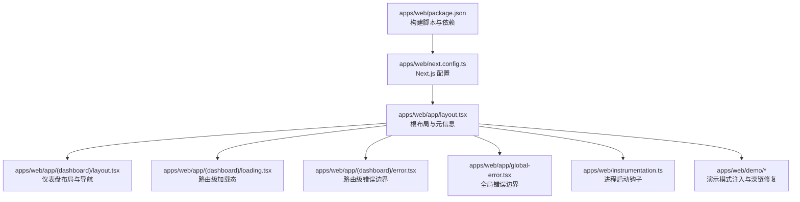
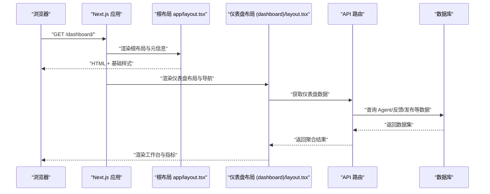
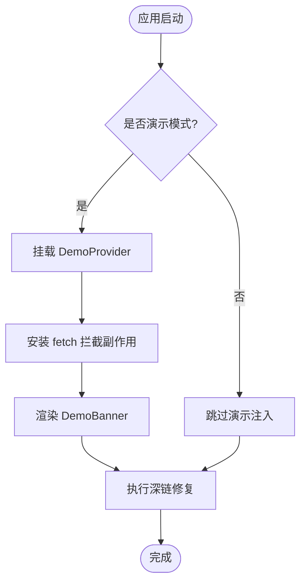
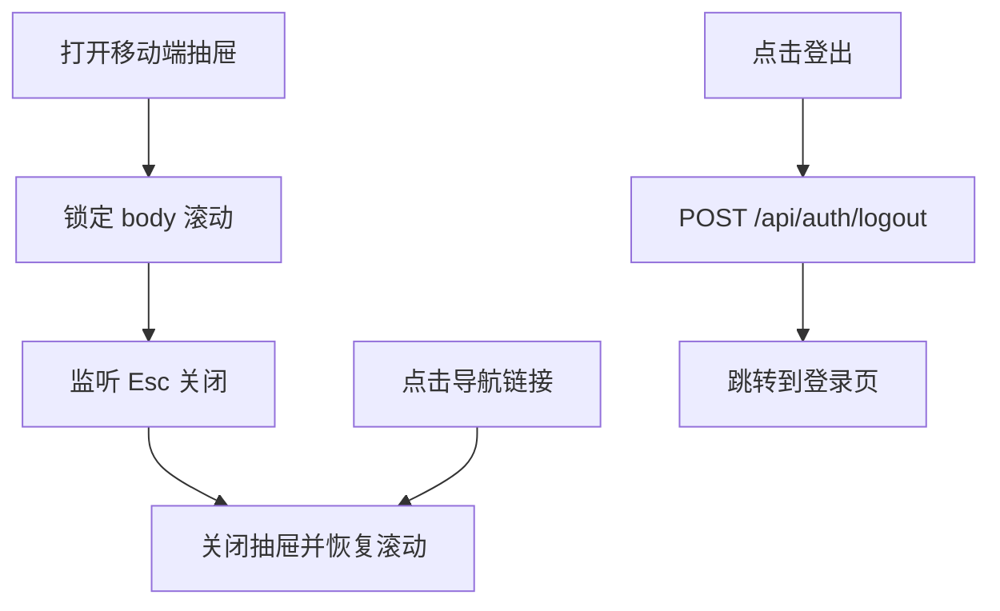
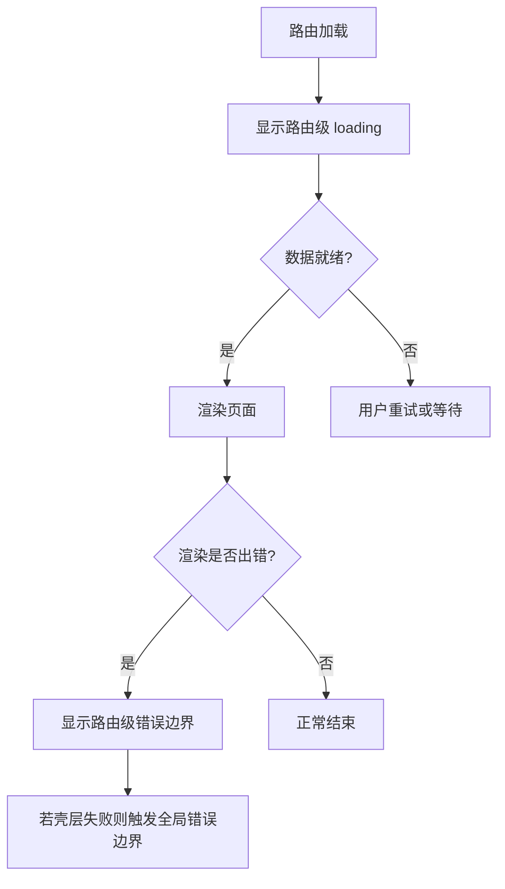
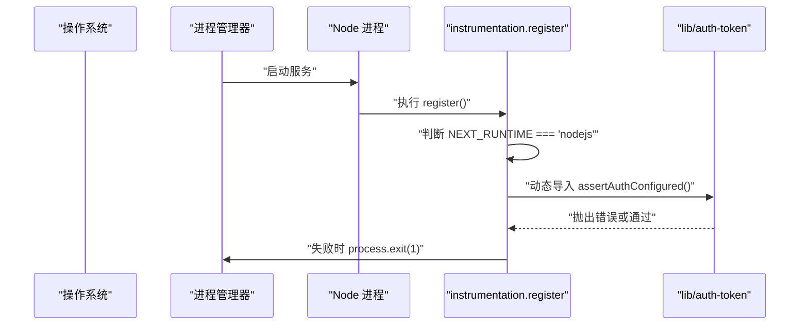
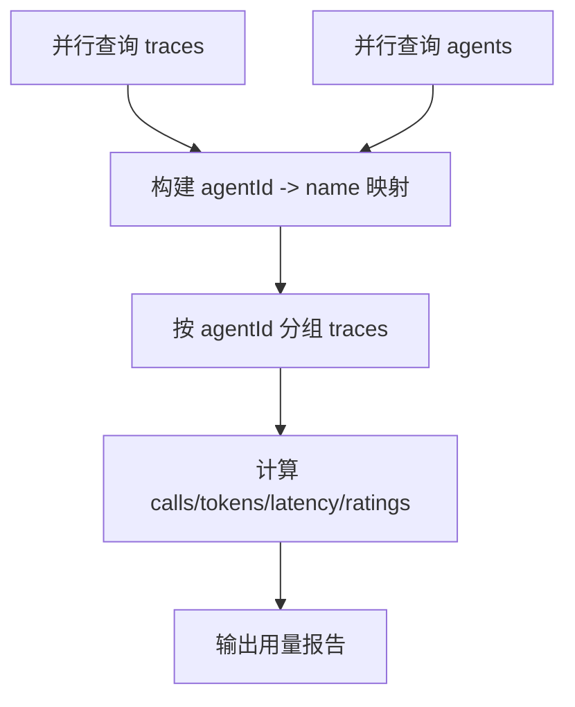
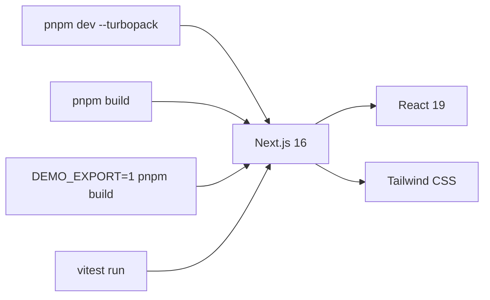

# 性能优化

<cite>
**本文引用的文件**   
- [apps/web/next.config.ts](file://apps/web/next.config.ts)
- [apps/web/package.json](file://apps/web/package.json)
- [apps/web/app/layout.tsx](file://apps/web/app/layout.tsx)
- [apps/web/instrumentation.ts](file://apps/web/instrumentation.ts)
- [apps/web/app/(dashboard)/layout.tsx](file://apps/web/app/(dashboard)/layout.tsx)
- [apps/web/app/(dashboard)/loading.tsx](file://apps/web/app/(dashboard)/loading.tsx)
- [apps/web/app/(dashboard)/error.tsx](file://apps/web/app/(dashboard)/error.tsx)
- [apps/web/app/global-error.tsx](file://apps/web/app/global-error.tsx)
- [apps/web/demo/demo-deep-link-redirect.tsx](file://apps/web/demo/demo-deep-link-redirect.tsx)
- [apps/web/demo/demo-provider.tsx](file://apps/web/demo/demo-provider.tsx)
- [apps/web/lib/services/maas-usage-service.ts](file://apps/web/lib/services/maas-usage-service.ts)
</cite>

## 目录
1. [引言](#引言)
2. [项目结构](#项目结构)
3. [核心组件](#核心组件)
4. [架构总览](#架构总览)
5. [详细组件分析](#详细组件分析)
6. [依赖关系分析](#依赖关系分析)
7. [性能考量](#性能考量)
8. [故障排查指南](#故障排查指南)
9. [结论](#结论)
10. [附录](#附录)

## 引言
本文件面向前端与全栈工程师，围绕 Next.js 应用的性能优化展开，覆盖图片与字体、代码分割与缓存、启动与关键路径优化、运行时监控与错误追踪、移动端与网络优化、内存管理、测试与基准、以及诊断与调优方法。文档结合仓库中实际代码，给出可落地的优化建议与排障流程，帮助在现有工程基础上持续提升首屏速度、交互流畅度与稳定性。

## 项目结构
本项目采用 Next.js App Router 组织页面与布局，包含演示模式（静态导出）、仪表盘段路由、全局错误边界、服务启动钩子等。构建脚本使用 Turbopack 开发体验，生产构建走标准 Next.js 构建流程；演示模式通过环境变量切换为纯静态站点输出。

图示来源
- [apps/web/package.json:5-13](file://apps/web/package.json#L5-L13)
- [apps/web/next.config.ts:10-21](file://apps/web/next.config.ts#L10-L21)
- [apps/web/app/layout.tsx:6-31](file://apps/web/app/layout.tsx#L6-L31)
- [apps/web/app/(dashboard)/layout.tsx:80-272](file://apps/web/app/(dashboard)/layout.tsx#L80-L272)
- [apps/web/app/(dashboard)/loading.tsx:7-17](file://apps/web/app/(dashboard)/loading.tsx#L7-L17)
- [apps/web/app/(dashboard)/error.tsx:11-76](file://apps/web/app/(dashboard)/error.tsx#L11-L76)
- [apps/web/app/global-error.tsx:3-46](file://apps/web/app/global-error.tsx#L3-L46)
- [apps/web/instrumentation.ts:12-22](file://apps/web/instrumentation.ts#L12-L22)
- [apps/web/demo/demo-deep-link-redirect.tsx:7-17](file://apps/web/demo/demo-deep-link-redirect.tsx#L7-L17)
- [apps/web/demo/demo-provider.tsx:10-16](file://apps/web/demo/demo-provider.tsx#L10-L16)

章节来源
- [apps/web/package.json:5-13](file://apps/web/package.json#L5-L13)
- [apps/web/next.config.ts:10-21](file://apps/web/next.config.ts#L10-L21)
- [apps/web/app/layout.tsx:6-31](file://apps/web/app/layout.tsx#L6-L31)

## 核心组件
- 构建与运行入口：package.json 定义 dev/build/start 脚本，dev 使用 Turbopack 加速开发体验；build 走标准 Next.js 构建；提供 demo 构建命令以生成静态站点。
- Next.js 配置：根据 DEMO_EXPORT 环境变量启用静态导出与 trailingSlash，便于 CDN 托管；同时注入 NEXT_PUBLIC_DEMO_MODE 用于客户端分支逻辑。
- 根布局：设置站点标题与描述，按演示模式条件挂载 DemoProvider 与深链修复组件，控制 html lang 与数据属性。
- 仪表盘布局：实现侧边栏与移动端抽屉导航、键盘与无障碍支持、登出流程、滚动锁定与 Esc 关闭、主内容区包裹 ErrorBoundary。
- 加载与错误边界：路由级 loading 与 error 组件提升用户体验；全局 global-error 兜底应用壳层失败场景。
- 启动钩子：instrumentation.register 在服务进程启动时校验认证配置，缺失则主动退出进程，避免“假存活”。

章节来源
- [apps/web/package.json:5-13](file://apps/web/package.json#L5-L13)
- [apps/web/next.config.ts:10-21](file://apps/web/next.config.ts#L10-L21)
- [apps/web/app/layout.tsx:6-31](file://apps/web/app/layout.tsx#L6-L31)
- [apps/web/app/(dashboard)/layout.tsx:80-272](file://apps/web/app/(dashboard)/layout.tsx#L80-L272)
- [apps/web/app/(dashboard)/loading.tsx:7-17](file://apps/web/app/(dashboard)/loading.tsx#L7-L17)
- [apps/web/app/(dashboard)/error.tsx:11-76](file://apps/web/app/(dashboard)/error.tsx#L11-L76)
- [apps/web/app/global-error.tsx:3-46](file://apps/web/app/global-error.tsx#L3-L46)
- [apps/web/instrumentation.ts:12-22](file://apps/web/instrumentation.ts#L12-L22)

## 架构总览
下图展示从浏览器到服务端的关键路径：浏览器请求由 Next.js 处理，根布局渲染元信息与演示模式注入，仪表盘段负责导航与业务 UI，API 路由聚合数据，数据库提供持久化。

图示来源
- [apps/web/app/layout.tsx:6-31](file://apps/web/app/layout.tsx#L6-L31)
- [apps/web/app/(dashboard)/layout.tsx:80-272](file://apps/web/app/(dashboard)/layout.tsx#L80-L272)

## 详细组件分析

### 构建与运行脚本（Turbopack 与静态导出）
- 开发环境使用 Turbopack 提升热更新与编译速度。
- 构建命令支持常规构建与演示静态导出；演示模式开启后输出纯静态站点并启用 trailingSlash，适配 CDN 子路径直连 index.html。
- 建议在 CI 中增加产物体积与构建时间基线检查，防止回归。

章节来源
- [apps/web/package.json:5-13](file://apps/web/package.json#L5-L13)
- [apps/web/next.config.ts:10-21](file://apps/web/next.config.ts#L10-L21)

### 根布局与演示模式注入
- 根布局设置站点元信息，并根据 NEXT_PUBLIC_DEMO_MODE 决定是否挂载演示相关组件。
- 演示模式下，DemoProvider 先安装 fetch 拦截副作用，再渲染 DemoBanner；DemoDeepLinkRedirect 修复 CDN 回退导致的深链问题。
- 该设计将演示能力与主应用解耦，避免影响生产构建与运行时。

图示来源
- [apps/web/app/layout.tsx:16-31](file://apps/web/app/layout.tsx#L16-L31)
- [apps/web/demo/demo-provider.tsx:10-16](file://apps/web/demo/demo-provider.tsx#L10-L16)
- [apps/web/demo/demo-deep-link-redirect.tsx:7-17](file://apps/web/demo/demo-deep-link-redirect.tsx#L7-L17)

章节来源
- [apps/web/app/layout.tsx:6-31](file://apps/web/app/layout.tsx#L6-L31)
- [apps/web/demo/demo-provider.tsx:10-16](file://apps/web/demo/demo-provider.tsx#L10-L16)
- [apps/web/demo/demo-deep-link-redirect.tsx:7-17](file://apps/web/demo/demo-deep-link-redirect.tsx#L7-L17)

### 仪表盘布局与导航
- 桌面端常驻侧边栏，移动端使用抽屉导航；打开抽屉时锁定背景滚动并监听 Esc 关闭。
- 导航项含 label 与 desc，增强可访问性与新手引导；活跃态通过左侧标记与配色双重传达。
- 登出流程调用后端接口后无条件跳转登录页，避免用户重复点击。
- 主内容区包裹 ErrorBoundary，确保局部渲染异常不影响整体导航。

图示来源
- [apps/web/app/(dashboard)/layout.tsx:107-120](file://apps/web/app/(dashboard)/layout.tsx#L107-L120)
- [apps/web/app/(dashboard)/layout.tsx:92-101](file://apps/web/app/(dashboard)/layout.tsx#L92-L101)
- [apps/web/app/(dashboard)/layout.tsx:206-272](file://apps/web/app/(dashboard)/layout.tsx#L206-L272)

章节来源
- [apps/web/app/(dashboard)/layout.tsx:80-272](file://apps/web/app/(dashboard)/layout.tsx#L80-L272)

### 加载与错误边界
- 路由级 loading 组件在首次进入或数据未就绪时显示骨架与提示，缓解空白闪烁。
- 路由级 error 组件捕获渲染期异常，打印控制台日志并提供重试与返回首页操作。
- 全局 global-error 作为应用壳层失败的最后一道防线，提示错误编号与排查步骤。

图示来源
- [apps/web/app/(dashboard)/loading.tsx:7-17](file://apps/web/app/(dashboard)/loading.tsx#L7-L17)
- [apps/web/app/(dashboard)/error.tsx:11-76](file://apps/web/app/(dashboard)/error.tsx#L11-L76)
- [apps/web/app/global-error.tsx:3-46](file://apps/web/app/global-error.tsx#L3-L46)

章节来源
- [apps/web/app/(dashboard)/loading.tsx:7-17](file://apps/web/app/(dashboard)/loading.tsx#L7-L17)
- [apps/web/app/(dashboard)/error.tsx:11-76](file://apps/web/app/(dashboard)/error.tsx#L11-L76)
- [apps/web/app/global-error.tsx:3-46](file://apps/web/app/global-error.tsx#L3-L46)

### 服务启动钩子与健壮性
- instrumentation.register 在服务进程启动时仅对 nodejs 运行时生效，动态导入认证模块进行配置校验。
- 若缺少必要配置，记录错误并主动 process.exit(1)，交由进程管理器重启与告警，避免“假存活”导致令牌签发失败。

图示来源
- [apps/web/instrumentation.ts:12-22](file://apps/web/instrumentation.ts#L12-L22)

章节来源
- [apps/web/instrumentation.ts:12-22](file://apps/web/instrumentation.ts#L12-L22)

### 模型服务用量聚合（示例数据流）
- 服务层并行查询 trace 与 agent 列表，建立名称映射并按 agentId 分组统计调用量、Token 用量、平均时延与评分分布。
- 该聚合逻辑可用于性能与成本分析，也可作为前端图表的数据源。

图示来源
- [apps/web/lib/services/maas-usage-service.ts:46-58](file://apps/web/lib/services/maas-usage-service.ts#L46-L58)

章节来源
- [apps/web/lib/services/maas-usage-service.ts:46-58](file://apps/web/lib/services/maas-usage-service.ts#L46-L58)

## 依赖关系分析
- 构建工具链：Next.js 16 + React 19 + Tailwind CSS + Vitest + ESLint。
- 开发体验：dev 脚本使用 Turbopack，显著提升本地编译与热更新速度。
- 演示模式：通过环境变量切换静态导出与客户端行为，避免在生产环境引入额外开销。

图示来源
- [apps/web/package.json:5-13](file://apps/web/package.json#L5-L13)
- [apps/web/package.json:15-35](file://apps/web/package.json#L15-L35)

章节来源
- [apps/web/package.json:5-13](file://apps/web/package.json#L5-L13)
- [apps/web/package.json:15-35](file://apps/web/package.json#L15-L35)

## 性能考量

### 图片优化
- 建议使用 Next.js Image 组件替代原生 img，以获得自动格式转换、尺寸裁剪、懒加载与响应式图片能力。
- 对静态资源统一放置于 public 目录，并通过 next/image 的 loader 或自定义优化策略减少带宽占用。
- 对高频展示的图片优先使用 WebP/AVIF，并在 CDN 层开启缓存与压缩。

### 字体加载
- 使用 next/font 预加载与自托管字体，避免第三方字体阻塞渲染。
- 对非关键字体设置 display=swap 与可变字体以减少重排与抖动。
- 在根布局中尽早声明字体变量，避免运行时动态加载造成闪烁。

### 代码分割与按需加载
- 利用 Next.js 路由级代码分割，将大组件与第三方库拆分为独立 chunk。
- 对重型可视化库（如 Mermaid）采用动态 import 与 Suspense 延迟加载，降低首屏包体。
- 对仪表盘中的图表与表格组件按需加载，避免无关功能拖慢初始渲染。

### 缓存策略
- 静态资源与 API 响应合理设置 Cache-Control，CDN 层开启强缓存与协商缓存。
- 对频繁读取但变化不频繁的数据（如系统配置、字典表）使用浏览器缓存与服务端缓存分层。
- 演示模式下的静态导出应配合 CDN 的 trailingSlash 与版本化文件名，提高命中率和刷新效率。

### 应用启动与关键路径优化
- 根布局只渲染最小必要 DOM 与样式，避免在 HTML 阶段执行昂贵逻辑。
- 将演示模式注入点放在根布局末尾，确保主内容优先渲染。
- 使用 Suspense 与过渡动画平滑展示异步数据，避免白屏。

### 运行时性能监控
- 在关键用户路径埋点收集 FCP/LCP/CLS/INP/TTFB 等指标，上报至监控平台。
- 结合 instrumentation.register 做进程级健康检查与告警，避免静默失败。
- 对长耗时任务（如大数据聚合）使用 Web Worker 或分片处理，避免阻塞主线程。

### 移动端优化
- 使用响应式布局与触摸友好的交互，避免在小屏上出现横向滚动与误触。
- 对移动端禁用不必要的动画与特效，降低 GPU/CPU 压力。
- 使用 viewport-fit=cover 与 safe-area 适配刘海屏与底部横条。

### 网络请求优化
- 合并小请求为批量接口，减少握手与头部开销。
- 对 GET 请求启用缓存与条件请求（ETag/Last-Modified）。
- 对 POST/PUT 请求增加幂等键与重试退避策略，提升弱网稳定性。

### 内存管理
- 避免在组件内创建大型对象与闭包引用 DOM，及时释放事件监听器与定时器。
- 对长列表使用虚拟滚动与分页加载，减少 DOM 节点数量。
- 对图表与地图组件在卸载时销毁实例，避免内存泄漏。

### 性能测试与基准
- 使用 Lighthouse、WebPageTest、Chrome DevTools Performance 面板进行端到端与单页性能评测。
- 在 CI 中加入性能预算与回归阈值，阻止包体与关键指标退化。
- 对热点页面编写基准用例，对比不同优化方案的收益。

### 持续监控方案
- 接入前端监控 SDK，采集真实用户性能与错误堆栈。
- 对关键 API 添加服务端计时与采样日志，定位慢查询与瓶颈。
- 建立性能看板与告警规则，定期复盘与优化。

### 诊断工具与调优技巧
- 使用 Chrome Coverage 面板识别未使用代码，清理冗余依赖。
- 使用 Bundle Analyzer 分析包体构成，拆分第三方库与公共模块。
- 针对 LCP 与 CLS 专项优化：预加载关键资源、固定元素尺寸、避免布局抖动。

[本节为通用指导，不直接分析具体文件]

## 故障排查指南
- 仪表盘页面渲染失败：查看路由级 error 组件输出的错误编号与控制台日志，确认数据库连接与种子数据是否正确。
- 应用壳层失败：全局 global-error 会提示错误编号与基本排查步骤，优先检查本地开发服务与终端日志。
- 演示模式深链无法直达：确认 DemoDeepLinkRedirect 已挂载且 CDN 回退行为符合预期。
- 服务“假存活”：检查 instrumentation.register 是否正常退出进程，确保进程管理器能重启并告警。

章节来源
- [apps/web/app/(dashboard)/error.tsx:11-76](file://apps/web/app/(dashboard)/error.tsx#L11-L76)
- [apps/web/app/global-error.tsx:3-46](file://apps/web/app/global-error.tsx#L3-L46)
- [apps/web/demo/demo-deep-link-redirect.tsx:7-17](file://apps/web/demo/demo-deep-link-redirect.tsx#L7-L17)
- [apps/web/instrumentation.ts:12-22](file://apps/web/instrumentation.ts#L12-L22)

## 结论
本项目在构建与运行层面具备良好基础：Turbopack 加速开发、演示模式静态导出适配 CDN、根布局与仪表盘布局职责清晰、加载与错误边界完善、启动钩子保障健壮性。在此基础上，建议逐步落地图片与字体优化、代码分割与按需加载、缓存策略与运行时监控，并结合移动端与网络优化、内存管理与性能测试，形成闭环的性能治理体系。

[本节为总结性内容，不直接分析具体文件]

## 附录
- 常用命令
  - 开发：pnpm dev（Turbopack）
  - 构建：pnpm build
  - 演示构建：DEMO_EXPORT=1 pnpm build
  - 启动：pnpm start
  - 测试：pnpm test
- 关键环境变量
  - DEMO_EXPORT：启用静态导出与 trailingSlash
  - NEXT_PUBLIC_DEMO_MODE：客户端演示模式开关
  - AUTH_SECRET：认证密钥（由 instrumentation.register 校验）

章节来源
- [apps/web/package.json:5-13](file://apps/web/package.json#L5-L13)
- [apps/web/next.config.ts:10-21](file://apps/web/next.config.ts#L10-L21)
- [apps/web/instrumentation.ts:12-22](file://apps/web/instrumentation.ts#L12-L22)