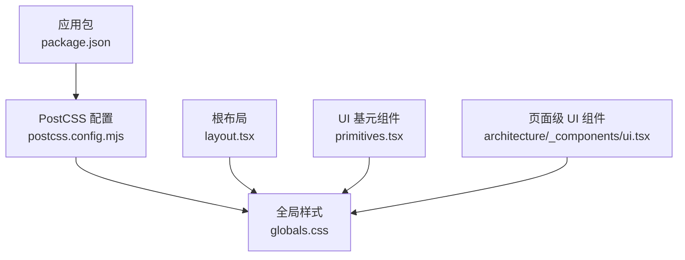
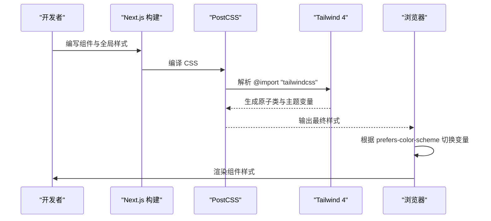
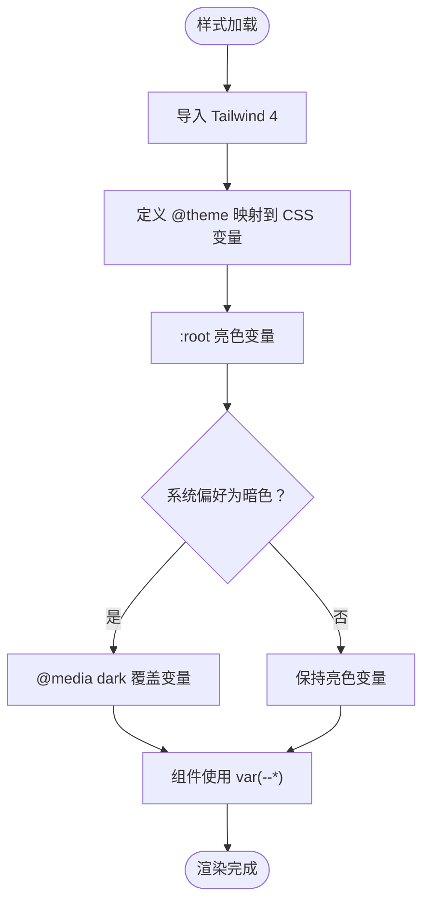
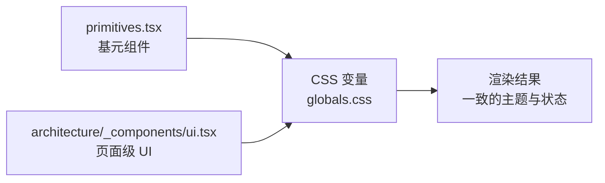
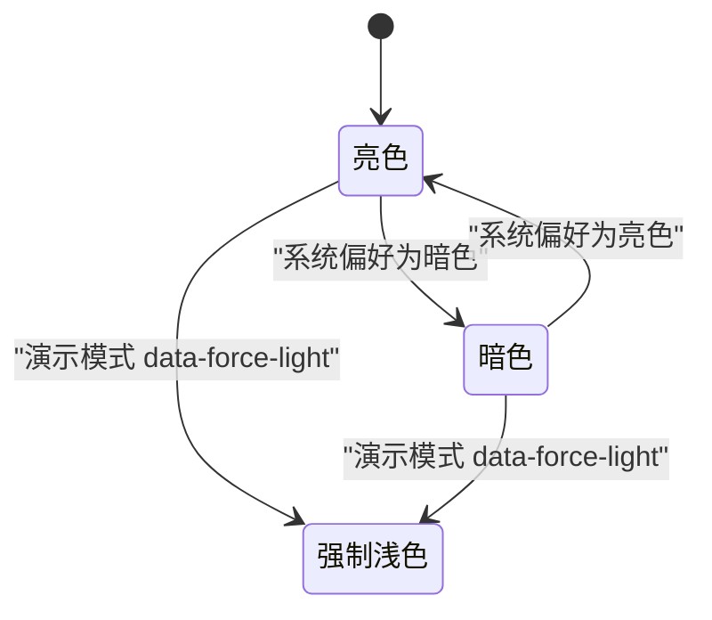
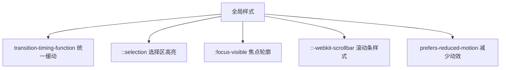
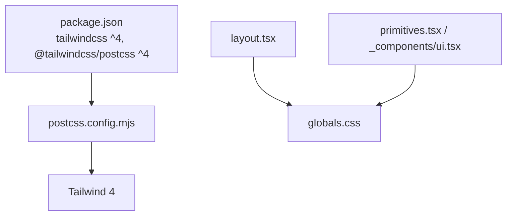

# 样式系统

<cite>
**本文引用的文件**   
- [apps/web/package.json](file://apps/web/package.json)
- [apps/web/postcss.config.mjs](file://apps/web/postcss.config.mjs)
- [apps/web/app/globals.css](file://apps/web/app/globals.css)
- [apps/web/app/layout.tsx](file://apps/web/app/layout.tsx)
- [apps/web/components/ui/primitives.tsx](file://apps/web/components/ui/primitives.tsx)
- [apps/web/app/(dashboard)/architecture/_components/ui.tsx](file://apps/web/app/(dashboard)/architecture/_components/ui.tsx)
</cite>

## 目录
1. [简介](#简介)
2. [项目结构](#项目结构)
3. [核心组件](#核心组件)
4. [架构总览](#架构总览)
5. [详细组件分析](#详细组件分析)
6. [依赖关系分析](#依赖关系分析)
7. [性能与构建优化](#性能与构建优化)
8. [故障排查指南](#故障排查指南)
9. [结论](#结论)
10. [附录：设计系统集成与最佳实践](#附录设计系统集成与最佳实践)

## 简介
本技术文档聚焦于该项目的样式系统，围绕 Tailwind CSS 4、CSS 变量主题、暗色模式、响应式布局、组件样式组织、可访问性与动画、以及构建与部署配置展开。该项目采用 Next.js 16 + Tailwind CSS 4（通过 `@tailwindcss/postcss`）的现代化前端栈，样式以“全局语义化 CSS 变量 + Tailwind 原子类”为主，强调对比度达标、暗色模式一致性和组件级样式收敛。

## 项目结构
样式相关的关键位置如下：
- 包管理与依赖：Tailwind 4 与 PostCSS 插件在应用包中声明。
- PostCSS 配置：仅启用 Tailwind 4 的 PostCSS 插件。
- 全局样式入口：定义 Tailwind 导入、主题变量、暗色模式、基础排版、滚动条、焦点可见性、减少动效等。
- 根布局：注入演示模式标记，控制全局浅色强制行为。
- 组件库：统一按钮、卡片、徽章、空状态等基元组件，全部使用语义化 CSS 变量。
- 页面级 UI 组件：面向特定页面的轻量 UI，同样遵循语义变量策略。



**图表来源**
- [apps/web/package.json:15-34](file://apps/web/package.json#L15-L34)
- [apps/web/postcss.config.mjs:1-8](file://apps/web/postcss.config.mjs#L1-L8)
- [apps/web/app/globals.css:1-20](file://apps/web/app/globals.css#L1-L20)
- [apps/web/app/layout.tsx:11-31](file://apps/web/app/layout.tsx#L11-L31)
- [apps/web/components/ui/primitives.tsx:1-10](file://apps/web/components/ui/primitives.tsx#L1-L10)
- [apps/web/app/(dashboard)/architecture/_components/ui.tsx:1-30](file://apps/web/app/(dashboard)/architecture/_components/ui.tsx#L1-L30)

**章节来源**
- [apps/web/package.json:15-34](file://apps/web/package.json#L15-L34)
- [apps/web/postcss.config.mjs:1-8](file://apps/web/postcss.config.mjs#L1-L8)
- [apps/web/app/globals.css:1-20](file://apps/web/app/globals.css#L1-L20)
- [apps/web/app/layout.tsx:11-31](file://apps/web/app/layout.tsx#L11-L31)

## 核心组件
- 主题与颜色系统：通过 `:root` 与 `@media (prefers-color-scheme: dark)` 提供亮/暗两套语义色值；所有组件通过 `var(--*)` 引用，避免硬编码色值。
- 字体与排版：定义无衬线/等宽字体族，并在 body 上应用；数字列使用等宽数字特性保证对齐稳定。
- 可访问性与交互：统一的 `:focus-visible` 轮廓、输入框光标色、滚动条样式、选择区高亮。
- 动画与动效：全局缓动函数、减少动效媒体查询适配、骨架屏与旋转加载。
- 组件样式：按钮、卡片、徽章、空状态、提示、计数行等基元组件集中管理，统一间距、圆角、边框与状态色。

**章节来源**
- [apps/web/app/globals.css:1-158](file://apps/web/app/globals.css#L1-L158)
- [apps/web/components/ui/primitives.tsx:1-487](file://apps/web/components/ui/primitives.tsx#L1-L487)

## 架构总览
样式系统的运行流程从 Next.js 根布局引入全局样式开始，由 PostCSS 调用 Tailwind 4 处理 CSS，最终输出包含语义变量的样式表。组件通过 className 组合 Tailwind 原子类与 CSS 变量，实现主题、状态与布局的统一。



**图表来源**
- [apps/web/app/layout.tsx:1-31](file://apps/web/app/layout.tsx#L1-L31)
- [apps/web/postcss.config.mjs:1-8](file://apps/web/postcss.config.mjs#L1-L8)
- [apps/web/app/globals.css:1-20](file://apps/web/app/globals.css#L1-L20)

## 详细组件分析

### 主题系统与颜色模型
- 语义变量命名：背景、前景、表面、悬浮表面、边框、强调色、强调底色、次要文字、三级文字、危险/成功/警告及其背景与边框。
- 亮色模式：默认浅色背景与深色文字，状态色使用较深阶以保证浅色底上的可读性。
- 暗色模式：通过 `prefers-color-scheme: dark` 覆盖变量，状态色使用较浅阶以保证深色底上的可读性。
- 强制浅色：演示构建通过 `<html data-force-light>` 强制浅色，并设置 `color-scheme: light` 使原生控件与滚动条同步。



**图表来源**
- [apps/web/app/globals.css:1-79](file://apps/web/app/globals.css#L1-L79)

**章节来源**
- [apps/web/app/globals.css:1-79](file://apps/web/app/globals.css#L1-L79)

### 响应式设计与布局
- 栅格与断点：使用 Tailwind 的响应式前缀（如 `md:`、`lg:`）进行多列布局。
- 表格与横向滚动：表格容器支持窄屏横向滚动，并通过 `tabIndex` 与 `role="region"` 提升键盘导航体验。
- 文本层级：标题、副标题、说明文案使用一致的字号与行高，确保信息层次清晰。

```mermaid
classDiagram
class Table {
+head : string[]
+rows : ReactNode[][]
+caption? : string
+render()
}
class NavGrid {
+items : {title, description, href, tag}[]
+render()
}
Table --> "使用" : "CSS 变量与 Tailwind 原子类"
NavGrid --> "使用" : "CSS 变量与 Tailwind 原子类"
```

**图表来源**
- [apps/web/app/(dashboard)/architecture/_components/ui.tsx:81-135](file://apps/web/app/(dashboard)/architecture/_components/ui.tsx#L81-L135)
- [apps/web/app/(dashboard)/architecture/_components/ui.tsx:189-214](file://apps/web/app/(dashboard)/architecture/_components/ui.tsx#L189-L214)

**章节来源**
- [apps/web/app/(dashboard)/architecture/_components/ui.tsx:81-135](file://apps/web/app/(dashboard)/architecture/_components/ui.tsx#L81-L135)
- [apps/web/app/(dashboard)/architecture/_components/ui.tsx:189-214](file://apps/web/app/(dashboard)/architecture/_components/ui.tsx#L189-L214)

### 组件样式模块化策略
- 基元组件集中：按钮、图标按钮、徽章、卡片、空状态、提示、计数行、键值对等集中在 `primitives.tsx`，统一样式与可访问性。
- 页面级 UI 收敛：针对架构展示页的轻量 UI 组件（页面头、分区、卡片、表格、标签、评分点、导航网格、洞察框、参考来源）集中在 `_components/ui.tsx`，复用语义变量。
- 颜色与状态：所有颜色与状态均通过 CSS 变量引用，避免在各组件内重复定义或出现不一致的色值。



**图表来源**
- [apps/web/components/ui/primitives.tsx:1-487](file://apps/web/components/ui/primitives.tsx#L1-L487)
- [apps/web/app/(dashboard)/architecture/_components/ui.tsx:1-265](file://apps/web/app/(dashboard)/architecture/_components/ui.tsx#L1-L265)
- [apps/web/app/globals.css:1-158](file://apps/web/app/globals.css#L1-L158)

**章节来源**
- [apps/web/components/ui/primitives.tsx:1-487](file://apps/web/components/ui/primitives.tsx#L1-L487)
- [apps/web/app/(dashboard)/architecture/_components/ui.tsx:1-265](file://apps/web/app/(dashboard)/architecture/_components/ui.tsx#L1-L265)

### 暗色模式支持与主题切换机制
- 系统偏好驱动：通过 `prefers-color-scheme: dark` 自动切换变量。
- 演示模式强制浅色：根布局根据环境变量注入 `data-force-light`，配合 `:root[data-force-light]` 与 `color-scheme: light` 强制浅色。
- 组件层面无需额外逻辑：组件直接使用 CSS 变量，无需在 JS 中判断主题。



**图表来源**
- [apps/web/app/globals.css:52-85](file://apps/web/app/globals.css#L52-L85)
- [apps/web/app/layout.tsx:16-19](file://apps/web/app/layout.tsx#L16-L19)

**章节来源**
- [apps/web/app/globals.css:52-85](file://apps/web/app/globals.css#L52-L85)
- [apps/web/app/layout.tsx:16-19](file://apps/web/app/layout.tsx#L16-L19)

### 动画效果与可访问性
- 全局缓动：为所有元素设置统一的缓动函数，提升过渡一致性。
- 减少动效：通过 `prefers-reduced-motion` 禁用动画与滚动平滑，满足可访问性要求。
- 焦点可见性：统一焦点轮廓与偏移，输入框保留焦点环，确保键盘用户可用。
- 滚动条与选择区：自定义滚动条颜色与选择区高亮，增强视觉一致性。



**图表来源**
- [apps/web/app/globals.css:87-158](file://apps/web/app/globals.css#L87-L158)

**章节来源**
- [apps/web/app/globals.css:87-158](file://apps/web/app/globals.css#L87-L158)

## 依赖关系分析
- Tailwind 4 与 PostCSS：通过 `@tailwindcss/postcss` 集成，无需传统 `tailwind.config.js`。
- Next.js 根布局：引入全局样式，并根据环境变量注入演示模式标记。
- 组件依赖：所有组件依赖 `globals.css` 中的 CSS 变量，不直接依赖 Tailwind 内置色板。



**图表来源**
- [apps/web/package.json:23-34](file://apps/web/package.json#L23-L34)
- [apps/web/postcss.config.mjs:1-8](file://apps/web/postcss.config.mjs#L1-L8)
- [apps/web/app/layout.tsx:1-31](file://apps/web/app/layout.tsx#L1-L31)
- [apps/web/app/globals.css:1-20](file://apps/web/app/globals.css#L1-L20)
- [apps/web/components/ui/primitives.tsx:1-10](file://apps/web/components/ui/primitives.tsx#L1-L10)
- [apps/web/app/(dashboard)/architecture/_components/ui.tsx:1-30](file://apps/web/app/(dashboard)/architecture/_components/ui.tsx#L1-L30)

**章节来源**
- [apps/web/package.json:23-34](file://apps/web/package.json#L23-L34)
- [apps/web/postcss.config.mjs:1-8](file://apps/web/postcss.config.mjs#L1-L8)
- [apps/web/app/layout.tsx:1-31](file://apps/web/app/layout.tsx#L1-L31)
- [apps/web/app/globals.css:1-20](file://apps/web/app/globals.css#L1-L20)
- [apps/web/components/ui/primitives.tsx:1-10](file://apps/web/components/ui/primitives.tsx#L1-L10)
- [apps/web/app/(dashboard)/architecture/_components/ui.tsx:1-30](file://apps/web/app/(dashboard)/architecture/_components/ui.tsx#L1-L30)

## 性能与构建优化
- 构建工具链：Next.js 构建脚本与 Turbopack 开发服务器；Tailwind 4 通过 PostCSS 插件处理，避免传统配置开销。
- 样式体积：通过语义变量与原子类组合，减少重复样式；组件样式收敛降低冗余。
- 运行时开销：主题切换基于 CSS 变量与媒体查询，JS 侧无需频繁计算样式。
- 建议：
  - 保持 CSS 变量集中管理，避免新增硬编码色值。
  - 谨慎添加新的全局规则，优先使用 Tailwind 原子类与现有组件。
  - 在大型页面中使用按需加载与代码分割，减少首屏样式体积。

[本节为通用指导，不直接分析具体文件]

## 故障排查指南
- 颜色对比度不达标：检查是否绕过 CSS 变量直接使用 Tailwind 内置色；优先使用 `var(--danger)`、`var(--success)` 等语义变量。
- 暗色模式异常：确认未使用 `dark:` 变体覆盖语义变量；必要时检查 `prefers-color-scheme` 与 `data-force-light` 标记。
- 焦点不可见：检查是否被全局 `:focus-visible` 规则覆盖；确保输入类元素保留焦点环。
- 滚动条样式无效：确认浏览器支持 `::-webkit-scrollbar` 与 `scrollbar-color`；必要时降级处理。
- 动画过多导致不适：检查 `prefers-reduced-motion` 是否生效；必要时在组件层禁用动画。

**章节来源**
- [apps/web/app/globals.css:52-158](file://apps/web/app/globals.css#L52-L158)
- [apps/web/components/ui/primitives.tsx:48-65](file://apps/web/components/ui/primitives.tsx#L48-L65)

## 结论
该样式系统以 Tailwind 4 与 CSS 变量为核心，实现了主题一致、可访问性强、组件样式收敛的设计目标。通过全局语义变量与原子类的结合，项目在亮/暗模式下保持一致的视觉与交互体验，同时具备良好的可维护性与扩展性。建议在后续迭代中继续坚持语义变量优先、组件样式集中、可访问性优先的原则，并持续优化构建与样式体积。

[本节为总结性内容，不直接分析具体文件]

## 附录：设计系统集成与最佳实践
- 设计令牌映射：将设计系统中的颜色、字体、间距映射到 CSS 变量，组件只引用变量名。
- 组件 API 设计：为组件暴露可控的变体与尺寸属性，内部样式通过常量映射到 Tailwind 原子类与 CSS 变量。
- 可访问性规范：所有交互元素需提供焦点可见性、语义角色与辅助文本；避免裸图标按钮。
- 主题切换策略：优先使用系统偏好与数据标记控制主题，避免在 JS 中频繁操作 DOM 样式。
- 构建与部署：保持 PostCSS 配置简洁，使用 Next.js 构建脚本；在生产环境开启压缩与缓存。

[本节为通用指导，不直接分析具体文件]