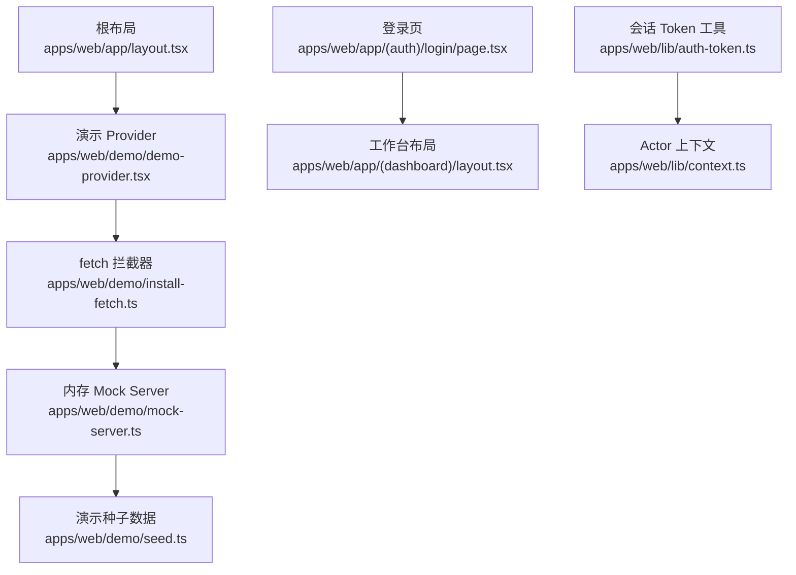
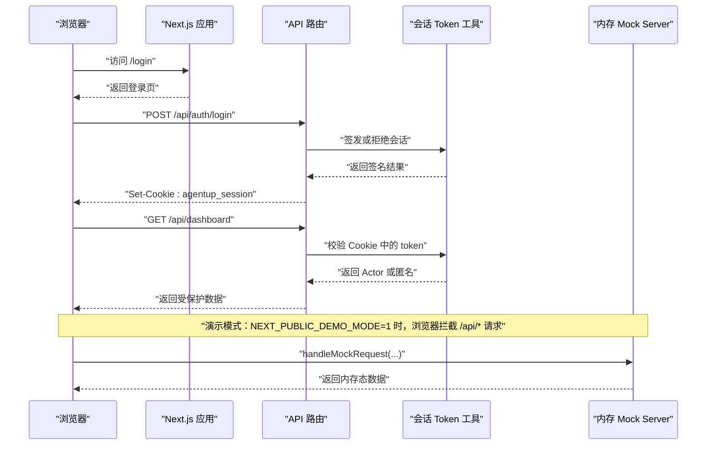
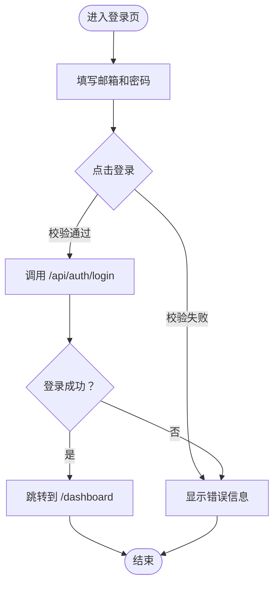
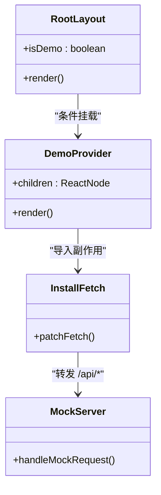
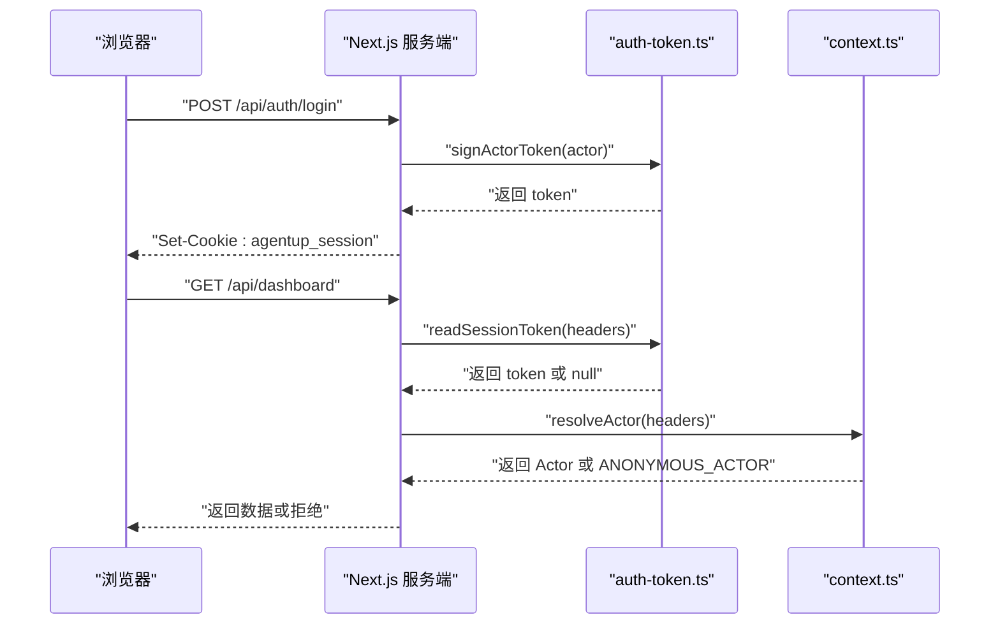
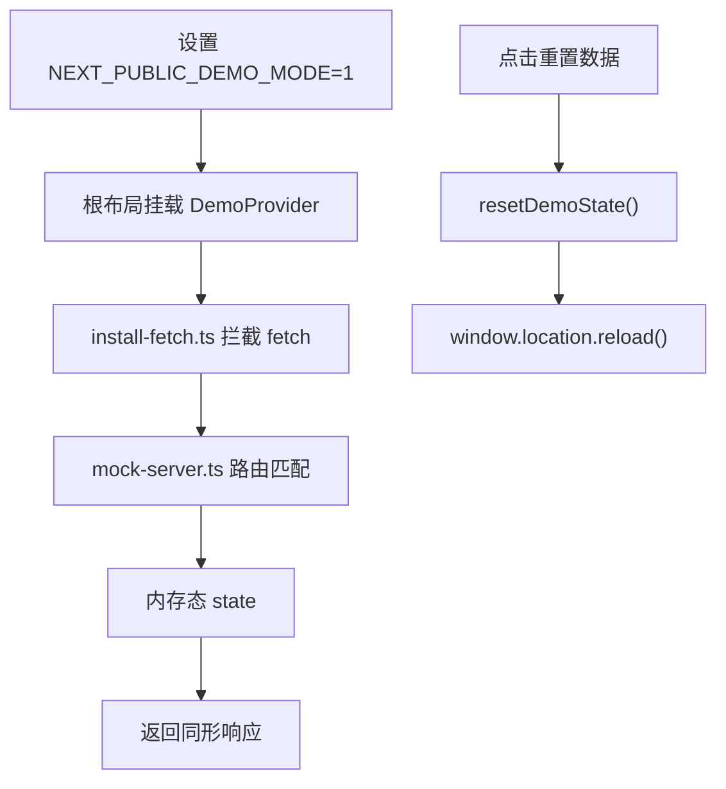
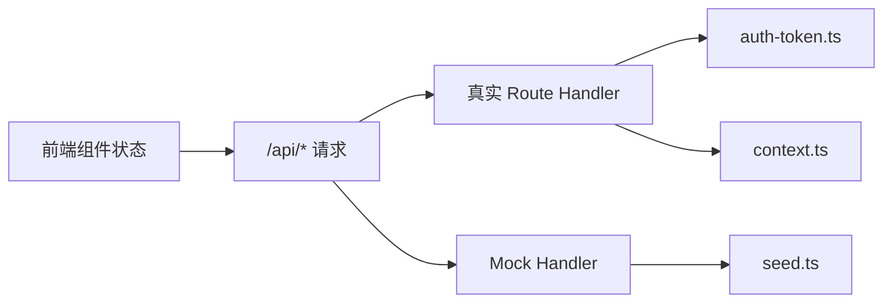

# 状态管理

<cite>
**本文引用的文件**   
- [apps/web/app/layout.tsx](file://apps/web/app/layout.tsx)
- [apps/web/app/(auth)/login/page.tsx](file://apps/web/app/(auth)/login/page.tsx)
- [apps/web/app/(dashboard)/layout.tsx](file://apps/web/app/(dashboard)/layout.tsx)
- [apps/web/lib/context.ts](file://apps/web/lib/context.ts)
- [apps/web/lib/auth-token.ts](file://apps/web/lib/auth-token.ts)
- [apps/web/demo/demo-provider.tsx](file://apps/web/demo/demo-provider.tsx)
- [apps/web/demo/install-fetch.ts](file://apps/web/demo/install-fetch.ts)
- [apps/web/demo/mock-server.ts](file://apps/web/demo/mock-server.ts)
- [apps/web/demo/seed.ts](file://apps/web/demo/seed.ts)
- [apps/web/demo/demo-banner.tsx](file://apps/web/demo/demo-banner.tsx)
</cite>

## 目录
1. [引言](#引言)
2. [项目结构](#项目结构)
3. [核心组件](#核心组件)
4. [架构总览](#架构总览)
5. [详细组件分析](#详细组件分析)
6. [依赖关系分析](#依赖关系分析)
7. [性能与缓存策略](#性能与缓存策略)
8. [调试与排错指南](#调试与排错指南)
9. [最佳实践](#最佳实践)
10. [结论](#结论)

## 引言
本文件面向前端状态管理与认证体系，聚焦以下目标：
- 解释多层次 state 管理策略：组件本地状态、全局上下文状态、服务端数据与演示态的边界。
- 说明 Context API 的使用模式，包括 Provider 设计与状态更新策略。
- 梳理认证状态管理：token 存储、会话生命周期、权限状态同步。
- 解析演示模式的特殊状态处理和数据模拟机制。
- 给出状态持久化、缓存策略和性能优化建议。
- 提供状态调试工具使用方法和可落地的最佳实践。

本项目的前端基于 Next.js 应用，认证与会话主要在服务端完成；浏览器侧通过 HttpOnly Cookie 维持会话，页面内状态以 React 组件本地状态为主，演示模式通过内存 mock server 拦截 `/api/*` 请求，形成独立的数据流。

## 项目结构
从状态管理视角，关键目录与职责如下：
- `apps/web/app/layout.tsx`：根布局，根据环境变量决定是否启用演示模式，并挂载演示 Provider。
- `apps/web/app/(auth)/login/page.tsx`：登录页，维护表单输入、提交状态与错误提示等组件本地状态。
- `apps/web/app/(dashboard)/layout.tsx`：工作台布局，维护导航抽屉、登出流程等局部 UI 状态。
- `apps/web/lib/context.ts`：服务端 actor 上下文（非前端 Context），用于服务层身份传播。
- `apps/web/lib/auth-token.ts`：会话 token 签发、校验、Cookie 值生成。
- `apps/web/demo/demo-provider.tsx`：演示模式注入点，安装 fetch 拦截器并渲染演示角标。
- `apps/web/demo/install-fetch.ts`：浏览器端拦截同源 `/api/*` 请求，转发到内存 mock server。
- `apps/web/demo/mock-server.ts`：内存态 API 路由，镜像真实 route handler 的请求/响应形状。
- `apps/web/demo/seed.ts`：演示初始状态种子数据。
- `apps/web/demo/demo-banner.tsx`：演示模式角标，提供一键重置内存数据。

**图表来源**
- [apps/web/app/layout.tsx:11-31](file://apps/web/app/layout.tsx#L11-L31)
- [apps/web/demo/demo-provider.tsx:10-17](file://apps/web/demo/demo-provider.tsx#L10-L17)
- [apps/web/demo/install-fetch.ts:17-69](file://apps/web/demo/install-fetch.ts#L17-L69)
- [apps/web/demo/mock-server.ts:1-25](file://apps/web/demo/mock-server.ts#L1-L25)
- [apps/web/demo/seed.ts:79-99](file://apps/web/demo/seed.ts#L79-L99)
- [apps/web/lib/auth-token.ts:14-18](file://apps/web/lib/auth-token.ts#L14-L18)
- [apps/web/lib/context.ts:22-51](file://apps/web/lib/context.ts#L22-L51)

**章节来源**
- [apps/web/app/layout.tsx:11-31](file://apps/web/app/layout.tsx#L11-L31)
- [apps/web/app/(auth)/login/page.tsx:8-41](file://apps/web/app/(auth)/login/page.tsx#L8-L41)
- [apps/web/app/(dashboard)/layout.tsx:80-101](file://apps/web/app/(dashboard)/layout.tsx#L80-L101)
- [apps/web/lib/context.ts:1-97](file://apps/web/lib/context.ts#L1-L97)
- [apps/web/lib/auth-token.ts:1-164](file://apps/web/lib/auth-token.ts#L1-L164)
- [apps/web/demo/demo-provider.tsx:1-18](file://apps/web/demo/demo-provider.tsx#L1-L18)
- [apps/web/demo/install-fetch.ts:1-70](file://apps/web/demo/install-fetch.ts#L1-L70)
- [apps/web/demo/mock-server.ts:1-800](file://apps/web/demo/mock-server.ts#L1-L800)
- [apps/web/demo/seed.ts:79-99](file://apps/web/demo/seed.ts#L79-L99)

## 核心组件
本节从“状态层次”角度拆解核心模块：
- 组件本地状态：登录页表单字段、提交中标志、错误信息；工作台布局的导航抽屉开关、登出按钮禁用状态。
- 全局上下文状态：当前仓库未在前端使用 React Context 作为全局状态容器；全局行为由根布局条件挂载演示 Provider 控制。
- 服务端数据：通过 `/api/*` 获取；演示模式下被 `install-fetch.ts` 拦截，走 `mock-server.ts` 内存态。
- 认证状态：会话 token 存储在 HttpOnly Cookie，浏览器无法直接读取；登录成功由服务端写入 Cookie，后续请求自动携带。
- 演示模式：通过环境变量开启，在浏览器侧拦截 fetch，将 `/api/*` 请求映射到内存数据结构，刷新即重置。

**章节来源**
- [apps/web/app/(auth)/login/page.tsx:8-41](file://apps/web/app/(auth)/login/page.tsx#L8-L41)
- [apps/web/app/(dashboard)/layout.tsx:80-101](file://apps/web/app/(dashboard)/layout.tsx#L80-L101)
- [apps/web/app/layout.tsx:11-31](file://apps/web/app/layout.tsx#L11-L31)
- [apps/web/demo/install-fetch.ts:17-69](file://apps/web/demo/install-fetch.ts#L17-L69)
- [apps/web/demo/mock-server.ts:1-25](file://apps/web/demo/mock-server.ts#L1-L25)
- [apps/web/lib/auth-token.ts:14-18](file://apps/web/lib/auth-token.ts#L14-L18)

## 架构总览
下图展示浏览器、Next.js 应用、服务端认证与会话、以及演示模式之间的交互关系。

**图表来源**
- [apps/web/app/(auth)/login/page.tsx:24-41](file://apps/web/app/(auth)/login/page.tsx#L24-L41)
- [apps/web/lib/auth-token.ts:68-81](file://apps/web/lib/auth-token.ts#L68-L81)
- [apps/web/lib/auth-token.ts:137-143](file://apps/web/lib/auth-token.ts#L137-L143)
- [apps/web/demo/install-fetch.ts:25-69](file://apps/web/demo/install-fetch.ts#L25-L69)
- [apps/web/demo/mock-server.ts:691-740](file://apps/web/demo/mock-server.ts#L691-L740)

## 详细组件分析

### 组件本地状态：登录页与工作台区
- 登录页使用 `useState` 管理邮箱、密码、错误信息和提交中状态；提交时调用 `/api/auth/login`，成功后跳转工作台，失败时显示错误。
- 工作台布局使用 `useState` 管理导航抽屉开关和登出按钮禁用状态；登出时调用 `/api/auth/logout`，无论请求是否成功都跳转到登录页，避免用户重复点击。

**图表来源**
- [apps/web/app/(auth)/login/page.tsx:8-41](file://apps/web/app/(auth)/login/page.tsx#L8-L41)

**章节来源**
- [apps/web/app/(auth)/login/page.tsx:8-41](file://apps/web/app/(auth)/login/page.tsx#L8-L41)
- [apps/web/app/(dashboard)/layout.tsx:80-101](file://apps/web/app/(dashboard)/layout.tsx#L80-L101)

### 全局上下文状态：演示 Provider 与环境变量
- 根布局根据 `NEXT_PUBLIC_DEMO_MODE` 决定是否挂载 `DemoProvider`。
- `DemoProvider` 引入副作用模块 `install-fetch.ts`，在浏览器环境且演示模式开启时 patch `window.fetch`，仅拦截同源 `/api/*` 请求。
- 该模式不改变业务组件的状态结构，而是改变数据源：从真实 API 切换到内存 mock server。

**图表来源**
- [apps/web/app/layout.tsx:11-31](file://apps/web/app/layout.tsx#L11-L31)
- [apps/web/demo/demo-provider.tsx:10-17](file://apps/web/demo/demo-provider.tsx#L10-L17)
- [apps/web/demo/install-fetch.ts:17-69](file://apps/web/demo/install-fetch.ts#L17-L69)
- [apps/web/demo/mock-server.ts:691-707](file://apps/web/demo/mock-server.ts#L691-L707)

**章节来源**
- [apps/web/app/layout.tsx:11-31](file://apps/web/app/layout.tsx#L11-L31)
- [apps/web/demo/demo-provider.tsx:1-18](file://apps/web/demo/demo-provider.tsx#L1-L18)
- [apps/web/demo/install-fetch.ts:1-70](file://apps/web/demo/install-fetch.ts#L1-L70)

### 认证状态管理：Token 存储、会话与权限
- 会话 token 使用 HMAC-SHA256 签名，格式为 `v1.<base64url(payload)>.<base64url(sig)>`，包含用户 id、name、role、iat、exp。
- 生产环境要求配置 `AUTH_SECRET`，否则启动期抛错，防止审计署名静默落到匿名。
- Cookie 名固定为 `agentup_session`，同时支持 `x-actor-token` 头供非浏览器客户端使用。
- 服务端通过 `readSessionToken` 取 token，再通过 `verifyActorToken` 校验，最终由 `resolveActor` 决定 Actor。
- 浏览器侧无法直接操作 HttpOnly Cookie，登出由服务端清除 Cookie，前端只负责跳转。

**图表来源**
- [apps/web/lib/auth-token.ts:68-81](file://apps/web/lib/auth-token.ts#L68-L81)
- [apps/web/lib/auth-token.ts:137-143](file://apps/web/lib/auth-token.ts#L137-L143)
- [apps/web/lib/context.ts:65-80](file://apps/web/lib/context.ts#L65-L80)

**章节来源**
- [apps/web/lib/auth-token.ts:1-164](file://apps/web/lib/auth-token.ts#L1-L164)
- [apps/web/lib/context.ts:1-97](file://apps/web/lib/context.ts#L1-L97)

### 演示模式：数据模拟与状态重置
- 演示模式通过 `NEXT_PUBLIC_DEMO_MODE=1` 开启，根布局挂载 `DemoProvider`。
- `install-fetch.ts` 在浏览器环境 patch `window.fetch`，仅拦截 `/api/*` 请求。
- `mock-server.ts` 维护内存态 `state`，提供分页、join、版本演进、证据链、MaaS 用量等逻辑。
- `seed.ts` 提供初始种子数据，`resetDemoState` 可重置内存态。
- `demo-banner.tsx` 提供“重置数据”按钮，点击后刷新页面。

**图表来源**
- [apps/web/app/layout.tsx:16-27](file://apps/web/app/layout.tsx#L16-L27)
- [apps/web/demo/demo-provider.tsx:10-17](file://apps/web/demo/demo-provider.tsx#L10-L17)
- [apps/web/demo/install-fetch.ts:17-69](file://apps/web/demo/install-fetch.ts#L17-L69)
- [apps/web/demo/mock-server.ts:21-25](file://apps/web/demo/mock-server.ts#L21-L25)
- [apps/web/demo/seed.ts:79-99](file://apps/web/demo/seed.ts#L79-L99)
- [apps/web/demo/demo-banner.tsx:12-16](file://apps/web/demo/demo-banner.tsx#L12-L16)

**章节来源**
- [apps/web/demo/demo-provider.tsx:1-18](file://apps/web/demo/demo-provider.tsx#L1-L18)
- [apps/web/demo/install-fetch.ts:1-70](file://apps/web/demo/install-fetch.ts#L1-L70)
- [apps/web/demo/mock-server.ts:1-800](file://apps/web/demo/mock-server.ts#L1-L800)
- [apps/web/demo/seed.ts:79-99](file://apps/web/demo/seed.ts#L79-L99)
- [apps/web/demo/demo-banner.tsx:1-32](file://apps/web/demo/demo-banner.tsx#L1-L32)

## 依赖关系分析
- 前端状态与后端认证解耦：浏览器不直接持有认证状态，而是依赖 Cookie；页面状态以组件本地状态为主。
- 演示模式与服务端认证互斥：演示模式绕过真实 API，使用内存态；生产环境应关闭演示模式。
- Actor 上下文仅用于服务端，不影响前端状态；但前端需理解其语义，以便正确设计权限相关 UI。

**图表来源**
- [apps/web/app/(auth)/login/page.tsx:24-41](file://apps/web/app/(auth)/login/page.tsx#L24-L41)
- [apps/web/lib/auth-token.ts:1-164](file://apps/web/lib/auth-token.ts#L1-L164)
- [apps/web/lib/context.ts:1-97](file://apps/web/lib/context.ts#L1-L97)
- [apps/web/demo/mock-server.ts:1-800](file://apps/web/demo/mock-server.ts#L1-L800)
- [apps/web/demo/seed.ts:79-99](file://apps/web/demo/seed.ts#L79-L99)

**章节来源**
- [apps/web/app/(auth)/login/page.tsx:24-41](file://apps/web/app/(auth)/login/page.tsx#L24-L41)
- [apps/web/lib/auth-token.ts:1-164](file://apps/web/lib/auth-token.ts#L1-L164)
- [apps/web/lib/context.ts:1-97](file://apps/web/lib/context.ts#L1-L97)
- [apps/web/demo/mock-server.ts:1-800](file://apps/web/demo/mock-server.ts#L1-L800)
- [apps/web/demo/seed.ts:79-99](file://apps/web/demo/seed.ts#L79-L99)

## 性能与缓存策略
- 组件本地状态最小化：仅保存必要 UI 状态，避免全局状态膨胀。
- 演示模式内存态：适合快速验证，但不具备持久化能力；刷新即重置。
- 服务端会话 Cookie：HttpOnly 提升安全性，减少前端对敏感状态的直接操作。
- 建议：
  - 对于频繁读取的数据，考虑在组件层做简单缓存（如 `useMemo`）。
  - 对于跨页面共享的用户信息，可在登录后拉取一次并缓存于组件树顶部。
  - 避免在演示模式中误用真实 API，确保环境变量正确配置。

[本节为通用指导，不直接分析具体文件]

## 调试与排错指南
- 登录失败：检查邮箱密码是否正确；演示环境有固定账号；生产环境检查后端日志。
- 登出不生效：确认服务端已返回正确的 Set-Cookie；浏览器控制台查看 Cookie 是否被清除。
- 演示模式数据异常：点击“重置数据”按钮，或刷新页面；检查 `mock-server.ts` 中的内存态。
- 权限问题：确认 Actor 是否被正确解析；检查 `AUTH_TRUST_ACTOR_HEADERS` 和 `AUTH_SECRET` 配置。

**章节来源**
- [apps/web/app/(auth)/login/page.tsx:24-41](file://apps/web/app/(auth)/login/page.tsx#L24-L41)
- [apps/web/app/(dashboard)/layout.tsx:92-101](file://apps/web/app/(dashboard)/layout.tsx#L92-L101)
- [apps/web/demo/demo-banner.tsx:12-16](file://apps/web/demo/demo-banner.tsx#L12-L16)
- [apps/web/lib/context.ts:53-59](file://apps/web/lib/context.ts#L53-L59)
- [apps/web/lib/auth-token.ts:46-54](file://apps/web/lib/auth-token.ts#L46-L54)

## 最佳实践
- 明确状态边界：组件本地状态用于 UI，服务端数据通过 API 获取，认证状态由服务端管理。
- 谨慎使用全局状态：当前项目未使用 React Context 作为全局状态容器，避免不必要的状态提升。
- 演示模式隔离：确保演示模式不会污染真实数据；使用内存态而非真实数据库。
- 安全优先：生产环境必须配置 `AUTH_SECRET`；不要在前端存储敏感 token。
- 可测试性：为关键状态逻辑编写单元测试，尤其是认证和演示模式。

[本节为通用指导，不直接分析具体文件]

## 结论
本项目的前端状态管理以组件本地状态为主，结合服务端会话认证和演示模式内存态，形成清晰的数据流。认证状态由服务端管理，浏览器通过 HttpOnly Cookie 维持会话；演示模式通过环境变量和 fetch 拦截实现数据模拟。未来若需要更复杂的全局状态，可考虑引入轻量级状态库，但应保持与现有架构的一致性。

[本节为总结性内容，不直接分析具体文件]