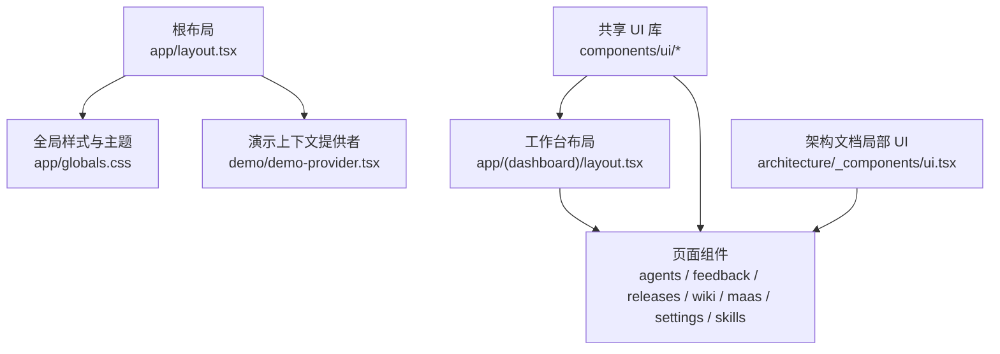
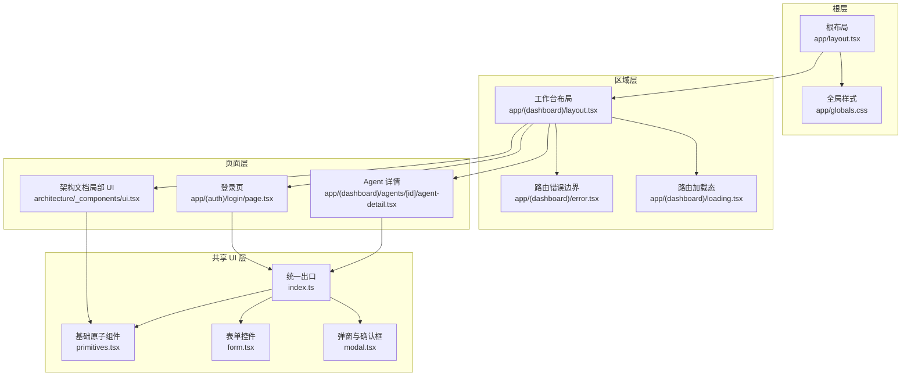
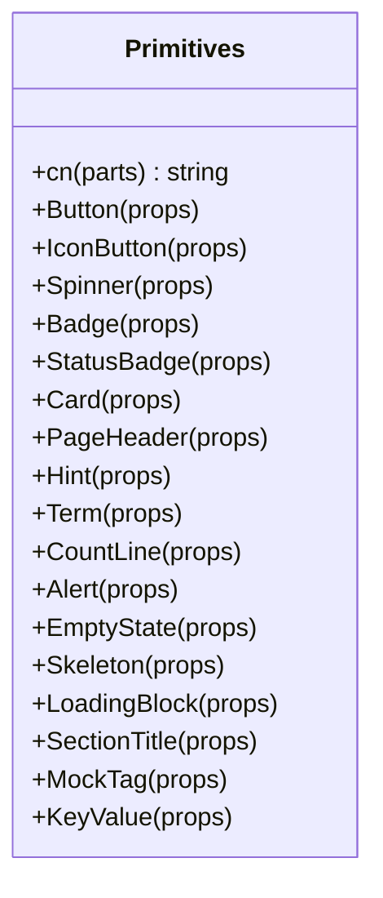
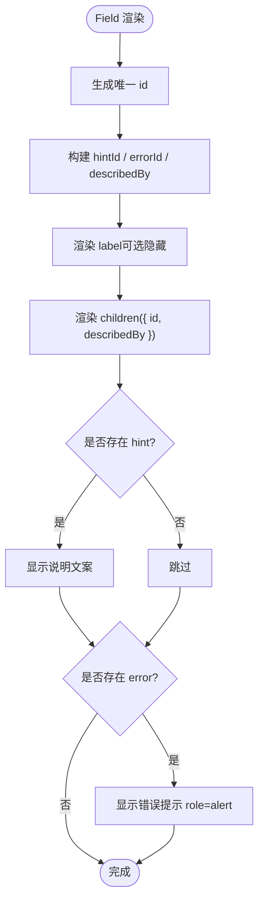
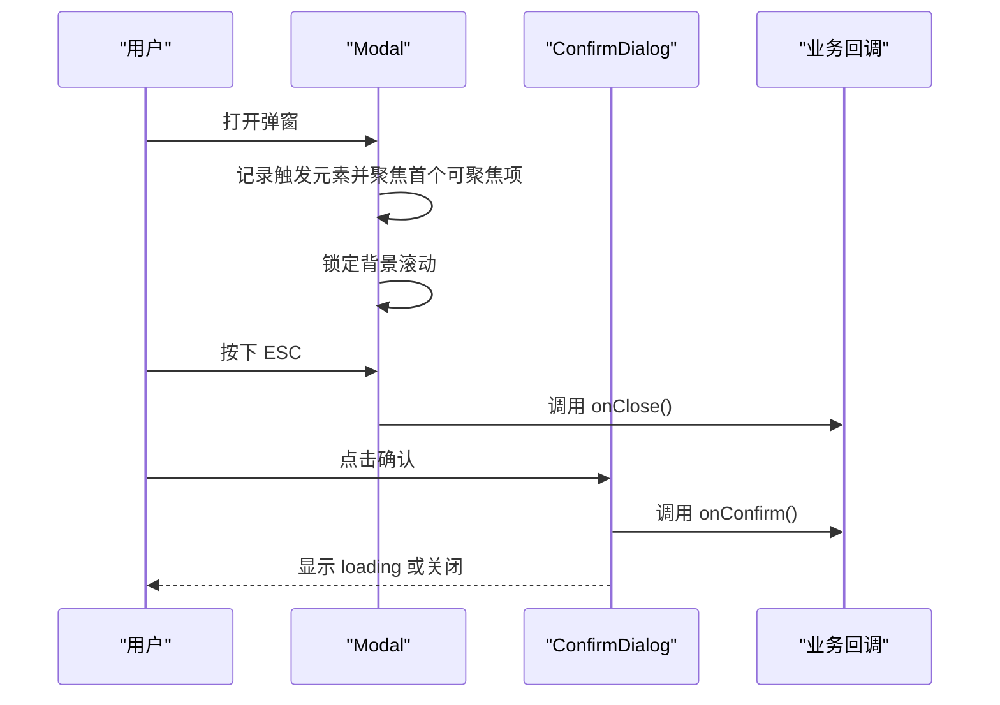
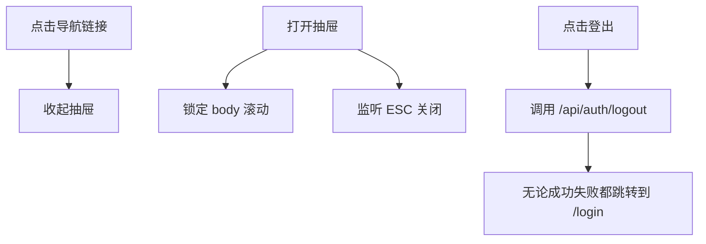
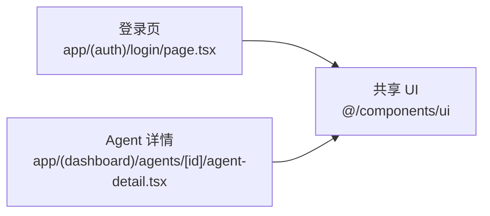
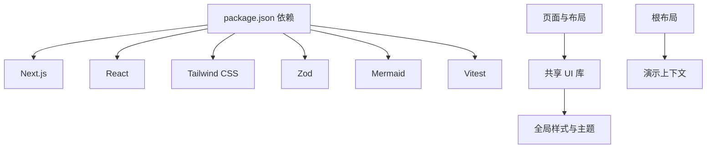

# 组件架构

<cite>
**本文引用的文件**   
- [apps/web/package.json](file://apps/web/package.json)
- [apps/web/app/layout.tsx](file://apps/web/app/layout.tsx)
- [apps/web/app/globals.css](file://apps/web/app/globals.css)
- [apps/web/components/ui/index.ts](file://apps/web/components/ui/index.ts)
- [apps/web/components/ui/primitives.tsx](file://apps/web/components/ui/primitives.tsx)
- [apps/web/components/ui/form.tsx](file://apps/web/components/ui/form.tsx)
- [apps/web/components/ui/modal.tsx](file://apps/web/components/ui/modal.tsx)
- [apps/web/app/(dashboard)/layout.tsx](file://apps/web/app/(dashboard)/layout.tsx)
- [apps/web/app/(dashboard)/loading.tsx](file://apps/web/app/(dashboard)/loading.tsx)
- [apps/web/app/(dashboard)/error.tsx](file://apps/web/app/(dashboard)/error.tsx)
- [apps/web/app/(auth)/login/page.tsx](file://apps/web/app/(auth)/login/page.tsx)
- [apps/web/app/(dashboard)/agents/[id]/agent-detail.tsx](file://apps/web/app/(dashboard)/agents/[id]/agent-detail.tsx)
- [apps/web/app/(dashboard)/architecture/_components/ui.tsx](file://apps/web/app/(dashboard)/architecture/_components/ui.tsx)
</cite>

## 目录
1. [引言](#引言)
2. [项目结构](#项目结构)
3. [核心组件](#核心组件)
4. [架构总览](#架构总览)
5. [详细组件分析](#详细组件分析)
6. [依赖关系分析](#依赖关系分析)
7. [性能与可访问性](#性能与可访问性)
8. [测试、文档与版本管理](#测试文档与版本管理)
9. [故障排查指南](#故障排查指南)
10. [结论](#结论)

## 引言
本文件面向 React/Next.js 前端工程，系统化梳理 AgentUp 应用的前端组件架构。重点说明三层职责划分：基础 UI 组件、业务组件与页面组件；统一共享 UI 库的设计原则、API 约定、样式主题与无障碍规范；组件组合模式、复用策略（高阶组件、自定义 Hooks、上下文）；以及测试、文档生成与版本管理的实践建议。同时给出具体开发示例、样式封装方案、主题定制路径和性能优化策略。

## 项目结构
当前 Web 应用基于 Next.js App Router，采用“按功能域组织页面 + 集中式共享 UI”的结构：
- 根布局与全局样式：定义站点元信息、演示模式注入、CSS 变量与主题。
- 共享 UI 层：位于 `apps/web/components/ui`，提供按钮、表单控件、弹窗等基元组件，并通过 `index.ts` 统一导出。
- 页面与布局：位于 `apps/web/app/(dashboard)` 与 `apps/web/app/(auth)`，负责路由级布局、导航、错误与加载态。
- 领域子模块局部 UI：例如架构文档页的 `_components/ui.tsx`，用于该页面的展示型小部件。

**图表来源**
- [apps/web/app/layout.tsx:11-31](file://apps/web/app/layout.tsx#L11-L31)
- [apps/web/app/globals.css:1-20](file://apps/web/app/globals.css#L1-L20)
- [apps/web/app/(dashboard)/layout.tsx:80-101](file://apps/web/app/(dashboard)/layout.tsx#L80-L101)
- [apps/web/components/ui/index.ts:1-10](file://apps/web/components/ui/index.ts#L1-L10)
- [apps/web/app/(dashboard)/architecture/_components/ui.tsx:1-30](file://apps/web/app/(dashboard)/architecture/_components/ui.tsx#L1-L30)

**章节来源**
- [apps/web/app/layout.tsx:1-31](file://apps/web/app/layout.tsx#L1-L31)
- [apps/web/app/globals.css:1-20](file://apps/web/app/globals.css#L1-L20)
- [apps/web/components/ui/index.ts:1-10](file://apps/web/components/ui/index.ts#L1-L10)
- [apps/web/app/(dashboard)/layout.tsx:1-30](file://apps/web/app/(dashboard)/layout.tsx#L1-L30)

## 核心组件
共享 UI 库承担全站一致的视觉与交互契约，核心包括：
- 基础原子组件：Button、IconButton、Spinner、Badge、StatusBadge、Card、PageHeader、Hint、Term、CountLine、Alert、EmptyState、Skeleton、LoadingBlock、SectionTitle、MockTag、KeyValue。
- 表单控件：Field、Input、Select、Textarea、FormActions、InlineField。
- 弹窗与确认框：Modal、ConfirmDialog。
- 状态语义：Tone、StatusMeta、metaOf（在 status 模块中定义，由 primitives 使用）。

设计要点：
- 所有颜色通过 CSS 变量与 Tailwind 语义 token 映射，避免硬编码色值。
- 统一的 className 合并工具 `cn`，过滤 false/null/undefined，减少第三方依赖。
- 可访问性优先：焦点环、键盘事件、aria-* 属性、读屏文案、标题层级约束。
- Props 类型明确，区分展示型与行为型参数，默认值收敛到组件内部。

**章节来源**
- [apps/web/components/ui/primitives.tsx:15-18](file://apps/web/components/ui/primitives.tsx#L15-L18)
- [apps/web/components/ui/primitives.tsx:22-41](file://apps/web/components/ui/primitives.tsx#L22-L41)
- [apps/web/components/ui/primitives.tsx:67-97](file://apps/web/components/ui/primitives.tsx#L67-L97)
- [apps/web/components/ui/primitives.tsx:140-190](file://apps/web/components/ui/primitives.tsx#L140-L190)
- [apps/web/components/ui/primitives.tsx:203-218](file://apps/web/components/ui/primitives.tsx#L203-L218)
- [apps/web/components/ui/primitives.tsx:233-251](file://apps/web/components/ui/primitives.tsx#L233-L251)
- [apps/web/components/ui/primitives.tsx:301-350](file://apps/web/components/ui/primitives.tsx#L301-L350)
- [apps/web/components/ui/primitives.tsx:354-399](file://apps/web/components/ui/primitives.tsx#L354-L399)
- [apps/web/components/ui/primitives.tsx:403-427](file://apps/web/components/ui/primitives.tsx#L403-L427)
- [apps/web/components/ui/form.tsx:26-83](file://apps/web/components/ui/form.tsx#L26-L83)
- [apps/web/components/ui/form.tsx:85-139](file://apps/web/components/ui/form.tsx#L85-L139)
- [apps/web/components/ui/modal.tsx:19-41](file://apps/web/components/ui/modal.tsx#L19-L41)
- [apps/web/components/ui/modal.tsx:151-213](file://apps/web/components/ui/modal.tsx#L151-L213)

## 架构总览
整体架构遵循“根布局 → 区域布局 → 页面 → 共享 UI”的分层模型：
- 根布局负责站点元数据、演示模式注入与全局样式。
- 工作台布局提供侧边导航、移动端抽屉、登出流程与错误边界包裹。
- 页面组件组合共享 UI 与领域局部 UI，完成数据展示与用户交互。
- 共享 UI 库作为唯一视觉与交互契约，被各层复用。

**图表来源**
- [apps/web/app/layout.tsx:11-31](file://apps/web/app/layout.tsx#L11-L31)
- [apps/web/app/globals.css:1-20](file://apps/web/app/globals.css#L1-L20)
- [apps/web/app/(dashboard)/layout.tsx:80-101](file://apps/web/app/(dashboard)/layout.tsx#L80-L101)
- [apps/web/app/(dashboard)/error.tsx:11-41](file://apps/web/app/(dashboard)/error.tsx#L11-L41)
- [apps/web/app/(dashboard)/loading.tsx:1-17](file://apps/web/app/(dashboard)/loading.tsx#L1-L17)
- [apps/web/app/(auth)/login/page.tsx:1-20](file://apps/web/app/(auth)/login/page.tsx#L1-L20)
- [apps/web/app/(dashboard)/agents/[id]/agent-detail.tsx:1-30](file://apps/web/app/(dashboard)/agents/[id]/agent-detail.tsx#L1-L30)
- [apps/web/app/(dashboard)/architecture/_components/ui.tsx:1-30](file://apps/web/app/(dashboard)/architecture/_components/ui.tsx#L1-L30)
- [apps/web/components/ui/index.ts:1-10](file://apps/web/components/ui/index.ts#L1-L10)

## 详细组件分析

### 基础 UI 组件（primitives）
- 设计目标：统一按钮、卡片、徽章、空状态、提示、骨架屏等展示型基元，消除多套 Tailwind 写法。
- 关键实现：
  - `cn` 工具函数：轻量 className 合并。
  - Tone 语义色映射：文字色与底色成对，保证亮暗主题对比度达标。
  - Button/IconButton/Spinner：支持变体、尺寸、禁用、加载中、无障碍标签。
  - Badge/StatusBadge：中文标签为主，保留原始枚举码后缀，提供解释 tooltip。
  - Card/PageHeader/Hint/Term/CountLine：统一间距、层级与可读性。
  - Alert/EmptyState/Skeleton/LoadingBlock：错误与空态、加载骨架的统一表达。
  - SectionTitle/MockTag/KeyValue：页面内分节、演示标注与键值展示。

**图表来源**
- [apps/web/components/ui/primitives.tsx:15-18](file://apps/web/components/ui/primitives.tsx#L15-L18)
- [apps/web/components/ui/primitives.tsx:67-97](file://apps/web/components/ui/primitives.tsx#L67-L97)
- [apps/web/components/ui/primitives.tsx:140-190](file://apps/web/components/ui/primitives.tsx#L140-L190)
- [apps/web/components/ui/primitives.tsx:203-218](file://apps/web/components/ui/primitives.tsx#L203-L218)
- [apps/web/components/ui/primitives.tsx:233-251](file://apps/web/components/ui/primitives.tsx#L233-L251)
- [apps/web/components/ui/primitives.tsx:301-350](file://apps/web/components/ui/primitives.tsx#L301-L350)
- [apps/web/components/ui/primitives.tsx:354-399](file://apps/web/components/ui/primitives.tsx#L354-L399)
- [apps/web/components/ui/primitives.tsx:403-427](file://apps/web/components/ui/primitives.tsx#L403-L427)
- [apps/web/components/ui/primitives.tsx:432-487](file://apps/web/components/ui/primitives.tsx#L432-L487)

**章节来源**
- [apps/web/components/ui/primitives.tsx:1-487](file://apps/web/components/ui/primitives.tsx#L1-L487)

### 表单组件（form）
- 设计目标：统一 label ↔ 控件 id 关联、必填标记、说明文案位、错误提示位，提升可访问性与一致性。
- 关键实现：
  - Field：接收 children 渲染控件，自动分配 id/describedBy，支持隐藏 label。
  - Input/Select/Textarea：统一控制样式与禁用态。
  - FormActions：右对齐动作区，支持提交前提示。
  - InlineField：工具栏短标签筛选控件外壳。

**图表来源**
- [apps/web/components/ui/form.tsx:26-83](file://apps/web/components/ui/form.tsx#L26-L83)

**章节来源**
- [apps/web/components/ui/form.tsx:1-139](file://apps/web/components/ui/form.tsx#L1-L139)

### 弹窗与确认框（modal）
- 设计目标：替代原生 confirm()，提供可解释、可键盘操作、样式一致且无障碍的弹窗。
- 关键实现：
  - Modal：焦点陷阱、ESC 关闭、滚动锁定、aria-modal、尺寸档位、描述与底部动作区。
  - ConfirmDialog：封装取消/确认按钮，支持危险/主色调、加载中状态与警告提示。

**图表来源**
- [apps/web/components/ui/modal.tsx:33-88](file://apps/web/components/ui/modal.tsx#L33-L88)
- [apps/web/components/ui/modal.tsx:167-213](file://apps/web/components/ui/modal.tsx#L167-L213)

**章节来源**
- [apps/web/components/ui/modal.tsx:1-214](file://apps/web/components/ui/modal.tsx#L1-L214)

### 工作台布局（dashboard layout）
- 职责：侧边导航、移动端抽屉、登出流程、错误边界包裹、Mock 标注。
- 关键点：
  - 导航高亮逻辑处理前缀包含关系，避免总览与子页同时高亮。
  - 移动端抽屉打开时锁定滚动、支持 ESC 关闭。
  - 登出请求失败也跳转登录页，避免用户重复点击。

**图表来源**
- [apps/web/app/(dashboard)/layout.tsx:32-38](file://apps/web/app/(dashboard)/layout.tsx#L32-L38)
- [apps/web/app/(dashboard)/layout.tsx:92-101](file://apps/web/app/(dashboard)/layout.tsx#L92-L101)
- [apps/web/app/(dashboard)/layout.tsx:107-120](file://apps/web/app/(dashboard)/layout.tsx#L107-L120)

**章节来源**
- [apps/web/app/(dashboard)/layout.tsx:1-273](file://apps/web/app/(dashboard)/layout.tsx#L1-L273)

### 页面组件示例
- 登录页：使用共享 UI 的 Alert、Button、Field、Input，确保表单可访问性与错误提示一致。
- Agent 详情页：组合共享 UI 的表格、状态徽章、空状态、骨架屏等，承载复杂业务数据展示。

**图表来源**
- [apps/web/app/(auth)/login/page.tsx:1-20](file://apps/web/app/(auth)/login/page.tsx#L1-L20)
- [apps/web/app/(dashboard)/agents/[id]/agent-detail.tsx:1-30](file://apps/web/app/(dashboard)/agents/[id]/agent-detail.tsx#L1-L30)

**章节来源**
- [apps/web/app/(auth)/login/page.tsx:1-20](file://apps/web/app/(auth)/login/page.tsx#L1-L20)
- [apps/web/app/(dashboard)/agents/[id]/agent-detail.tsx:1-30](file://apps/web/app/(dashboard)/agents/[id]/agent-detail.tsx#L1-L30)

### 架构文档局部 UI
- 目的：为架构文档类页面提供轻量展示组件（PageHeader、Section、Card、Table、Pill、ScoreDots、NavGrid、Insight、References），保持只读文档风格与可访问性。
- 特点：强调语义 token、窄屏滚动容器、读屏 caption、外链新标签页提示。

**章节来源**
- [apps/web/app/(dashboard)/architecture/_components/ui.tsx:1-265](file://apps/web/app/(dashboard)/architecture/_components/ui.tsx#L1-L265)

## 依赖关系分析
- 包依赖：React 19、Next.js 16、Tailwind v4、Zod、Mermaid、Vitest 等。
- 模块依赖：
  - 页面与布局依赖共享 UI 库（`@/components/ui`）。
  - 共享 UI 库依赖全局 CSS 变量与 Tailwind 主题。
  - 根布局注入演示模式上下文，影响主题与行为。

**图表来源**
- [apps/web/package.json:15-35](file://apps/web/package.json#L15-L35)
- [apps/web/app/layout.tsx:11-31](file://apps/web/app/layout.tsx#L11-L31)
- [apps/web/app/globals.css:1-20](file://apps/web/app/globals.css#L1-L20)

**章节来源**
- [apps/web/package.json:1-37](file://apps/web/package.json#L1-L37)
- [apps/web/app/layout.tsx:11-31](file://apps/web/app/layout.tsx#L11-L31)
- [apps/web/app/globals.css:1-20](file://apps/web/app/globals.css#L1-L20)

## 性能与可访问性
- 性能优化：
  - 骨架屏与 LoadingBlock：在数据未就绪时提供稳定占位，避免布局抖动。
  - 懒加载与代码分割：利用 Next.js 路由级加载态与动态导入（按需引入大型库如 Mermaid）。
  - 动画与过渡：全局 transition-timing-function 与 prefers-reduced-motion 适配，降低动画开销。
- 可访问性：
  - 焦点可见：focus-visible 统一描边，输入控件覆盖旧浏览器行为。
  - 键盘交互：Modal 焦点陷阱、ESC 关闭；抽屉 ESC 关闭。
  - 读屏友好：role/alert/status、aria-modal、aria-label、sr-only、caption。
  - 语义层级：PageHeader 与 EmptyState 标题层级约束，避免多 h1。

**章节来源**
- [apps/web/app/globals.css:93-158](file://apps/web/app/globals.css#L93-L158)
- [apps/web/components/ui/modal.tsx:66-88](file://apps/web/components/ui/modal.tsx#L66-L88)
- [apps/web/components/ui/primitives.tsx:354-399](file://apps/web/components/ui/primitives.tsx#L354-L399)
- [apps/web/app/(dashboard)/loading.tsx:1-17](file://apps/web/app/(dashboard)/loading.tsx#L1-L17)

## 测试、文档与版本管理
- 测试策略：
  - 单元测试：使用 Vitest 对 API 路由与工具函数进行测试（参考 apps/web/app/api/__tests__ 下的测试文件）。
  - 组件测试：对共享 UI 组件进行快照与交互测试，验证无障碍属性与键盘行为。
  - 集成测试：模拟页面加载与错误边界，校验路由级错误与加载态。
- 文档生成：
  - 组件文档：基于 Props 类型与 JSDoc 注释，结合 Storybook 或自建文档站点生成 API 参考。
  - 架构文档：使用 architecture/_components/ui.tsx 中的展示组件，统一只读文档排版。
- 版本管理：
  - 包版本：Next.js、React、Tailwind 等依赖在 package.json 中固定版本，配合 pnpm workspace 管理 monorepo。
  - 变更日志：建议为共享 UI 库维护 CHANGELOG，记录 Breaking Changes 与新增 Props。

**章节来源**
- [apps/web/package.json:1-37](file://apps/web/package.json#L1-L37)
- [apps/web/app/(dashboard)/architecture/_components/ui.tsx:1-265](file://apps/web/app/(dashboard)/architecture/_components/ui.tsx#L1-L265)

## 故障排查指南
- 页面无法加载：
  - 检查路由级错误边界（DashboardError）是否捕获异常，查看控制台输出与错误编号。
  - 确认 ErrorBoundary 包裹了子树，Server Component 抛错需在此层接住。
- 弹窗不可用：
  - 检查 Modal 的 open 状态与 onClose 回调是否正确传递。
  - 确认焦点陷阱与 ESC 事件未被其他组件拦截。
- 表单错误不显示：
  - 检查 Field 的 error 属性是否为字符串或 null，describedBy 是否正确关联。
  - 确认 label htmlFor 与控件 id 匹配。

**章节来源**
- [apps/web/app/(dashboard)/error.tsx:11-41](file://apps/web/app/(dashboard)/error.tsx#L11-L41)
- [apps/web/components/ui/modal.tsx:33-88](file://apps/web/components/ui/modal.tsx#L33-L88)
- [apps/web/components/ui/form.tsx:26-83](file://apps/web/components/ui/form.tsx#L26-L83)

## 结论
本项目的组件架构以共享 UI 库为核心，通过严格的 Props 类型、语义化样式与可访问性规范，统一了基础原子组件、表单控件与弹窗的行为与外观。页面与布局层在此基础上组合业务逻辑，形成清晰的分层职责。建议在后续迭代中继续强化组件测试覆盖率、完善文档站点，并通过动态导入与路由级加载优化首屏性能。