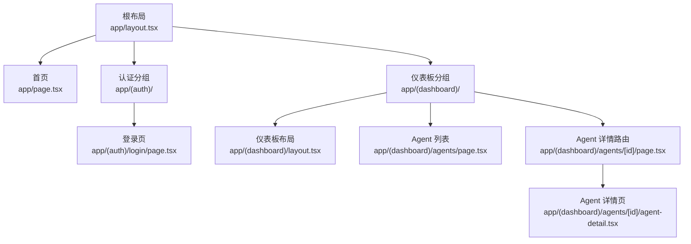
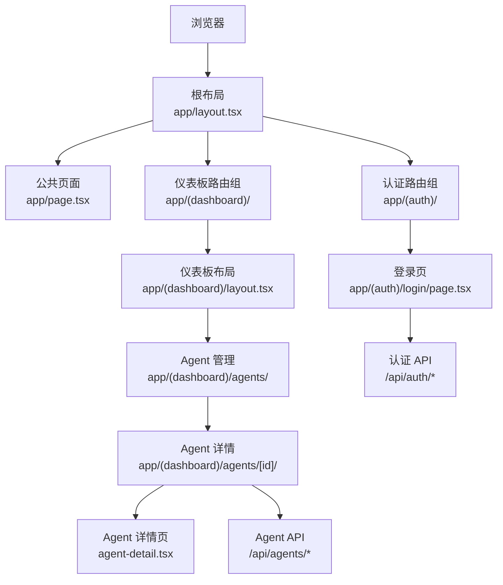
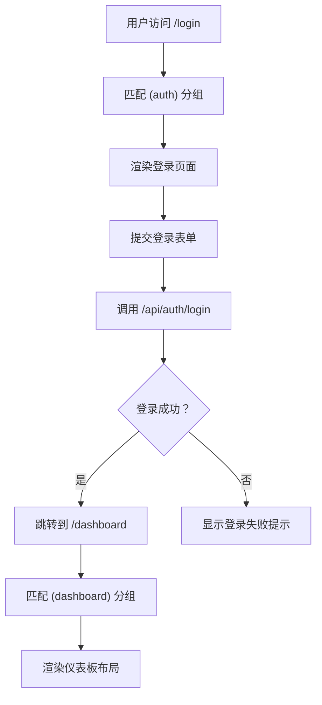
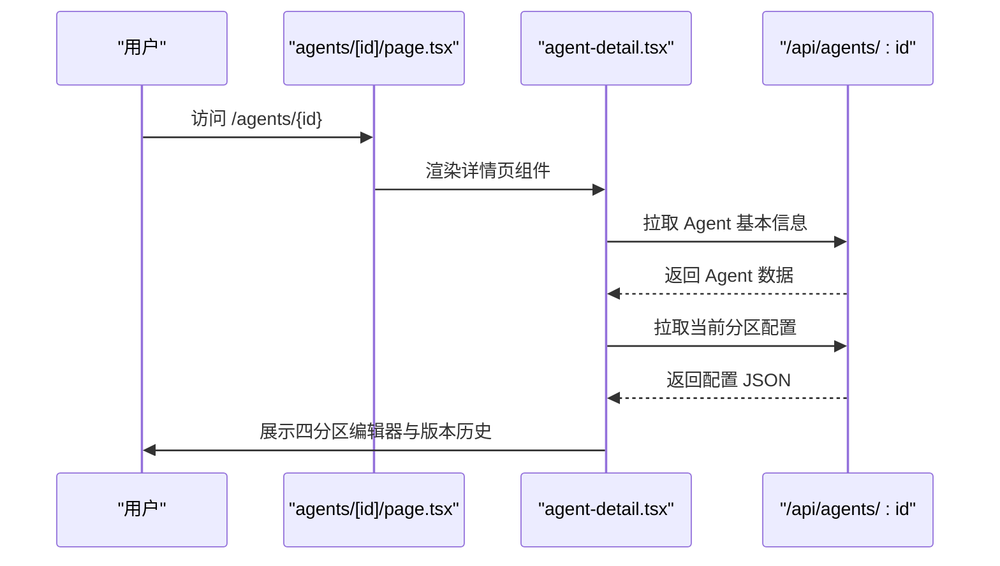
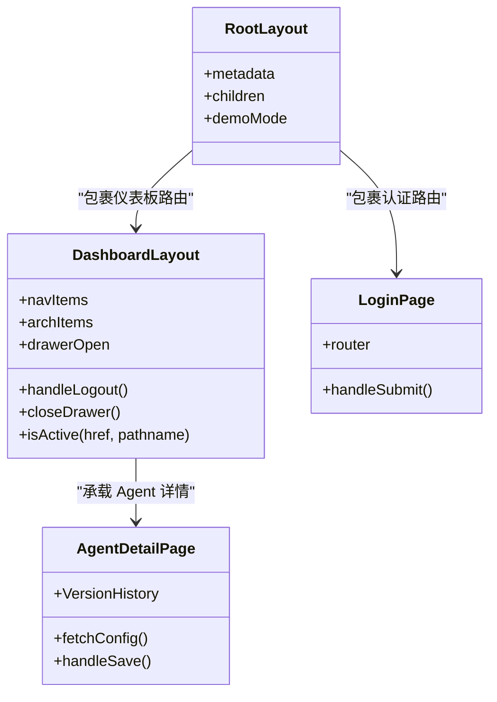
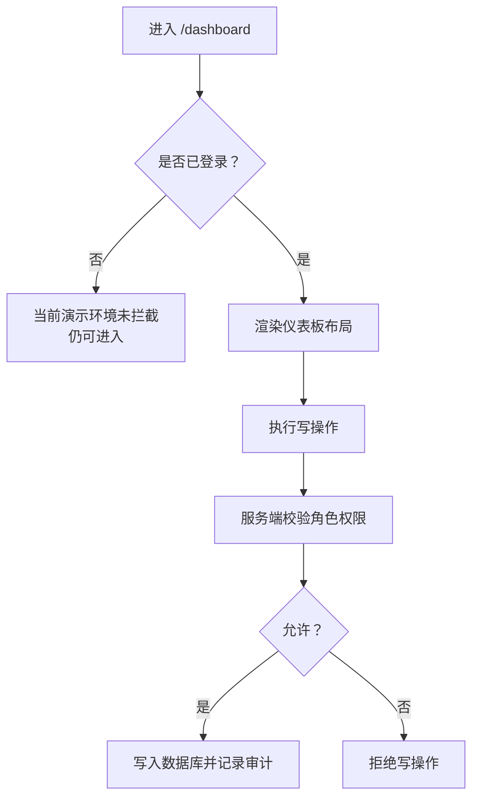
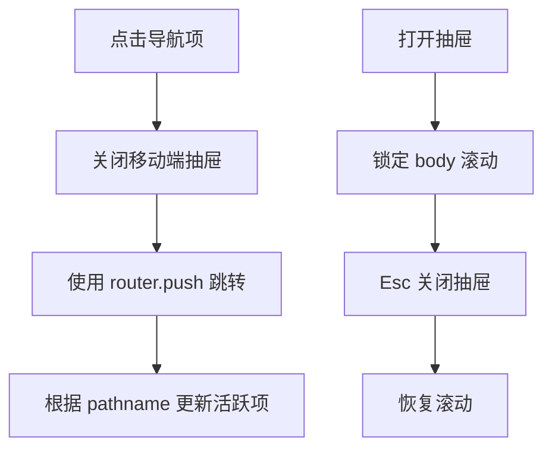
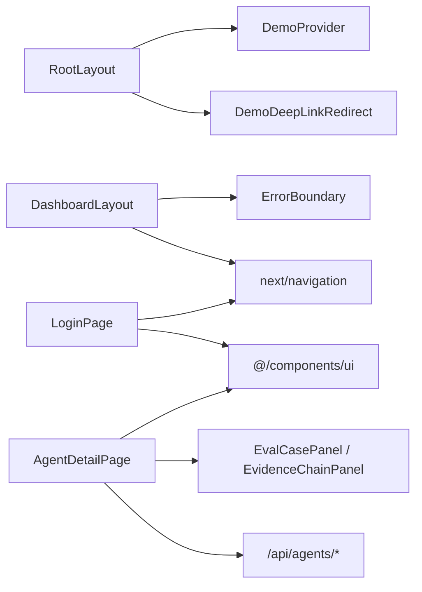
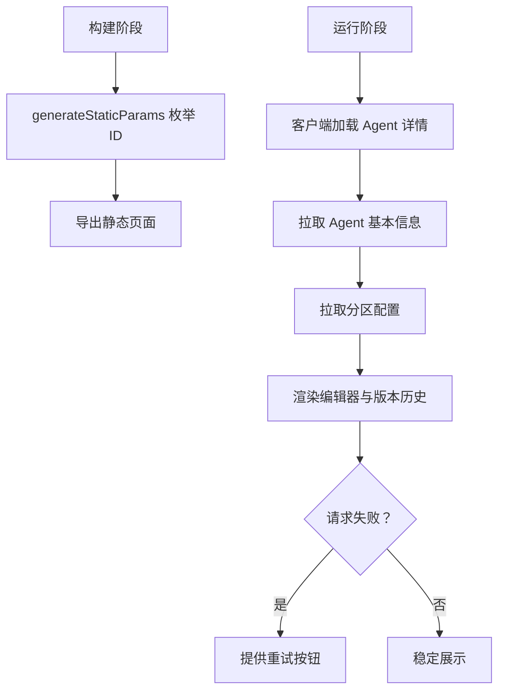

# 路由设计

<cite>
**本文引用的文件**   
- [根布局](file://apps/web/app/layout.tsx)
- [首页](file://apps/web/app/page.tsx)
- [仪表板布局](file://apps/web/app/(dashboard)/layout.tsx)
- [登录页面](file://apps/web/app/(auth)/login/page.tsx)
- [Agent 动态路由入口](file://apps/web/app/(dashboard)/agents/[id]/page.tsx)
- [Agent 详情页实现](file://apps/web/app/(dashboard)/agents/[id]/agent-detail.tsx)
</cite>

## 目录
1. [引言](#引言)
2. [项目结构](#项目结构)
3. [核心组件](#核心组件)
4. [架构总览](#架构总览)
5. [详细组件分析](#详细组件分析)
6. [依赖关系分析](#依赖关系分析)
7. [性能与渲染策略](#性能与渲染策略)
8. [SEO 与元数据](#seo-与元数据)
9. [权限控制与路由守卫](#权限控制与路由守卫)
10. [导航模式与最佳实践](#导航模式与最佳实践)
11. [故障排查](#故障排查)
12. [结论](#结论)

## 引言
本文围绕 Next.js App Router 在该仓库中的实际使用方式，系统化梳理路由分组、页面组织、嵌套路由、动态参数、布局层次、权限控制、SEO 与渲染策略。目标是帮助读者理解：
- `(auth)` 和 `(dashboard)` 这类括号分组如何影响 URL 与 UI 边界；
- 根布局与仪表板布局如何为不同功能模块提供共享 UI 与状态；
- 如何通过 API Route 与客户端组件配合完成认证、导航与数据加载；
- 如何在演示环境中平衡“可访问性”和“安全边界”。

## 项目结构
该应用采用 App Router 的目录即路由约定，关键路径如下：
- `app/layout.tsx`：根布局，定义全局 HTML、语言、主题开关与演示环境注入。
- `app/page.tsx`：公共落地页 `/`，对外解释平台并引导进入工作台或登录。
- `app/(auth)/login/page.tsx`：登录页面，属于认证分组，URL 中不包含 `(auth)`。
- `app/(dashboard)/layout.tsx`：仪表板布局，包含侧边栏、移动端抽屉、登出逻辑与错误边界。
- `app/(dashboard)/agents/[id]/page.tsx`：Agent 详情动态路由入口，负责静态参数枚举。
- `app/(dashboard)/agents/[id]/agent-detail.tsx`：Agent 详情主逻辑，包含四分区配置、版本历史与回滚等复杂交互。

**图示来源**
- [根布局:1-32](file://apps/web/app/layout.tsx#L1-L32)
- [首页:1-132](file://apps/web/app/page.tsx#L1-L132)
- [登录页面:1-139](file://apps/web/app/(auth)/login/page.tsx#L1-L139)
- [仪表板布局:1-273](file://apps/web/app/(dashboard)/layout.tsx#L1-L273)
- [Agent 动态路由入口:1-18](file://apps/web/app/(dashboard)/agents/[id]/page.tsx#L1-L18)
- [Agent 详情页实现:1-800](file://apps/web/app/(dashboard)/agents/[id]/agent-detail.tsx#L1-L800)

**章节来源**
- [根布局:1-32](file://apps/web/app/layout.tsx#L1-L32)
- [首页:1-132](file://apps/web/app/page.tsx#L1-L132)
- [仪表板布局:1-273](file://apps/web/app/(dashboard)/layout.tsx#L1-L273)
- [登录页面:1-139](file://apps/web/app/(auth)/login/page.tsx#L1-L139)
- [Agent 动态路由入口:1-18](file://apps/web/app/(dashboard)/agents/[id]/page.tsx#L1-L18)
- [Agent 详情页实现:1-800](file://apps/web/app/(dashboard)/agents/[id]/agent-detail.tsx#L1-L800)

## 核心组件
- 根布局：承担站点级元数据、HTML 属性、演示模式下的深度链接跳转与上下文提供者。
- 仪表板布局：承担仪表板区域的全局导航、移动端抽屉、登出流程、键盘无障碍与错误边界。
- 登录页面：处理邮箱密码输入、调用服务端登录接口、成功后跳转到仪表板。
- Agent 动态路由：通过 `generateStaticParams` 预生成静态参数，使构建期可导出静态页面。
- Agent 详情页：封装 Agent 基本信息、四分区配置编辑、版本历史、回滚与效果评估展示。

**章节来源**
- [根布局:6-30](file://apps/web/app/layout.tsx#L6-L30)
- [仪表板布局:80-273](file://apps/web/app/(dashboard)/layout.tsx#L80-L273)
- [登录页面:8-41](file://apps/web/app/(auth)/login/page.tsx#L8-L41)
- [Agent 动态路由入口:9-17](file://apps/web/app/(dashboard)/agents/[id]/page.tsx#L9-L17)
- [Agent 详情页实现:62-453](file://apps/web/app/(dashboard)/agents/[id]/agent-detail.tsx#L62-L453)

## 架构总览
App Router 将“路由”“布局”“页面”“API Route”解耦：
- 路由由目录结构决定，括号分组用于逻辑分组而不影响 URL。
- 布局用于包裹子路由，提供共享 UI 与行为。
- 页面是具体业务视图，可与 API Route 协作完成数据读写。
- 根布局负责站点级样式、语言、演示环境与全局元数据。

**图示来源**
- [根布局:1-32](file://apps/web/app/layout.tsx#L1-L32)
- [首页:1-132](file://apps/web/app/page.tsx#L1-L132)
- [登录页面:1-139](file://apps/web/app/(auth)/login/page.tsx#L1-L139)
- [仪表板布局:1-273](file://apps/web/app/(dashboard)/layout.tsx#L1-L273)
- [Agent 动态路由入口:1-18](file://apps/web/app/(dashboard)/agents/[id]/page.tsx#L1-L18)
- [Agent 详情页实现:1-800](file://apps/web/app/(dashboard)/agents/[id]/agent-detail.tsx#L1-L800)

## 详细组件分析

### 路由分组机制：`(auth)` 与 `(dashboard)`
- `(auth)` 表示认证相关路由的逻辑分组，最终 URL 不包含括号内容。例如登录页对应 `/login`。
- `(dashboard)` 表示需要仪表板布局与导航的工作台相关路由，最终 URL 也不包含括号内容。
- 分组不改变 URL，但能清晰划分“公开入口”和“受保护工作区”，便于在布局层统一注入导航、权限提示与错误边界。

**图示来源**
- [登录页面:15-41](file://apps/web/app/(auth)/login/page.tsx#L15-L41)
- [仪表板布局:80-273](file://apps/web/app/(dashboard)/layout.tsx#L80-L273)

**章节来源**
- [登录页面:1-139](file://apps/web/app/(auth)/login/page.tsx#L1-L139)
- [仪表板布局:1-273](file://apps/web/app/(dashboard)/layout.tsx#L1-L273)

### 页面结构组织：嵌套路由与动态路由参数
- 嵌套路由通过目录层级表达，例如 `agents/[id]` 表示 Agent 列表下的详情路由。
- 动态路由 `[id]` 通过 `useParams` 获取参数，并在详情页中发起数据请求。
- 静态导出要求动态路由在构建期枚举所有可能参数，本项目通过 `generateStaticParams` 返回种子 ID 与预留池 ID，保证新建 Agent 后详情页可直接导航。

**图示来源**
- [Agent 动态路由入口:9-17](file://apps/web/app/(dashboard)/agents/[id]/page.tsx#L9-L17)
- [Agent 详情页实现:84-122](file://apps/web/app/(dashboard)/agents/[id]/agent-detail.tsx#L84-L122)

**章节来源**
- [Agent 动态路由入口:1-18](file://apps/web/app/(dashboard)/agents/[id]/page.tsx#L1-L18)
- [Agent 详情页实现:62-122](file://apps/web/app/(dashboard)/agents/[id]/agent-detail.tsx#L62-L122)

### 根布局与仪表板布局的层次结构
- 根布局位于最外层，负责站点级 HTML、语言、演示模式注入与全局元数据。
- 仪表板布局位于 `(dashboard)` 分组下，负责：
  - 桌面端常驻侧边栏与移动端抽屉导航；
  - 活跃路由高亮；
  - 登出时调用 `/api/auth/logout` 并跳转登录页；
  - 使用错误边界包裹子页面，避免局部崩溃影响整个仪表板。

**图示来源**
- [根布局:1-32](file://apps/web/app/layout.tsx#L1-L32)
- [仪表板布局:14-273](file://apps/web/app/(dashboard)/layout.tsx#L14-L273)
- [登录页面:8-41](file://apps/web/app/(auth)/login/page.tsx#L8-L41)
- [Agent 详情页实现:62-453](file://apps/web/app/(dashboard)/agents/[id]/agent-detail.tsx#L62-L453)

**章节来源**
- [根布局:1-32](file://apps/web/app/layout.tsx#L1-L32)
- [仪表板布局:14-273](file://apps/web/app/(dashboard)/layout.tsx#L14-L273)

### 路由守卫与权限控制现状
当前代码中存在“认证流程”和“写操作权限校验”的说明，但页面级访问拦截尚未完全实现：
- 登录页面明确标注：演示环境未启用访问拦截，直接访问 `/dashboard` 也能进入。
- 写操作的权限校验在服务层进行，页面级访问授权仍未做。
- 仪表板布局的登出逻辑会调用 `/api/auth/logout`，但前端没有统一的中间件或路由守卫强制检查会话。

因此，当前“路由守卫”更多体现在：
- 登录成功后才跳转到仪表板；
- 登出后跳转到登录页；
- 注释明确说明后续应加强页面级访问授权。

**图示来源**
- [登录页面:51-68](file://apps/web/app/(auth)/login/page.tsx#L51-L68)
- [仪表板布局:92-101](file://apps/web/app/(dashboard)/layout.tsx#L92-L101)

**章节来源**
- [登录页面:51-68](file://apps/web/app/(auth)/login/page.tsx#L51-L68)
- [仪表板布局:92-101](file://apps/web/app/(dashboard)/layout.tsx#L92-L101)

### 导航模式与用户体验
- 仪表板布局维护导航项数组，包括操作型页面与只读架构参考文档。
- 活跃路由判断逻辑区分精确匹配与前缀匹配，避免 `/architecture` 与 `/architecture/loop` 同时高亮。
- 移动端抽屉打开时锁定滚动、支持 Esc 关闭，并通过 `aria-*` 提升无障碍体验。
- 登出按钮在请求失败时仍跳转登录页，避免用户重复点击。

**图示来源**
- [仪表板布局:32-78](file://apps/web/app/(dashboard)/layout.tsx#L32-L78)
- [仪表板布局:107-120](file://apps/web/app/(dashboard)/layout.tsx#L107-L120)
- [仪表板布局:144-176](file://apps/web/app/(dashboard)/layout.tsx#L144-L176)
- [仪表板布局:221-237](file://apps/web/app/(dashboard)/layout.tsx#L221-L237)

**章节来源**
- [仪表板布局:32-120](file://apps/web/app/(dashboard)/layout.tsx#L32-L120)
- [仪表板布局:144-237](file://apps/web/app/(dashboard)/layout.tsx#L144-L237)

## 依赖关系分析
- 根布局依赖演示环境提供者与深度链接跳转组件，用于演示模式下注入全局行为。
- 仪表板布局依赖 Next Navigation API 与自定义错误边界组件。
- 登录页面依赖 UI 组件库与路由跳转。
- Agent 详情页依赖多个面板组件与 UI 组件库，并与 `/api/agents/*` 系列 API 交互。

**图示来源**
- [根布局:3-4](file://apps/web/app/layout.tsx#L3-L4)
- [仪表板布局:3-7](file://apps/web/app/(dashboard)/layout.tsx#L3-L7)
- [登录页面:3-6](file://apps/web/app/(auth)/login/page.tsx#L3-L6)
- [Agent 详情页实现:3-26](file://apps/web/app/(dashboard)/agents/[id]/agent-detail.tsx#L3-L26)

**章节来源**
- [根布局:1-32](file://apps/web/app/layout.tsx#L1-L32)
- [仪表板布局:1-273](file://apps/web/app/(dashboard)/layout.tsx#L1-L273)
- [登录页面:1-139](file://apps/web/app/(auth)/login/page.tsx#L1-L139)
- [Agent 详情页实现:1-800](file://apps/web/app/(dashboard)/agents/[id]/agent-detail.tsx#L1-L800)

## 性能与渲染策略
- 根布局与仪表板布局均为 React 组件，仪表板布局标记为客户端组件，以支持导航、状态与事件。
- Agent 详情页为客户端组件，负责大量交互与异步数据加载。
- Agent 动态路由入口使用 `generateStaticParams` 预生成静态参数，满足静态导出要求，提高构建期可预测性与首屏稳定性。
- 详情页内部对网络请求做了取消守卫与重试机制，避免旧响应覆盖新状态，并在查询失败时提供重试入口。

**图示来源**
- [Agent 动态路由入口:9-17](file://apps/web/app/(dashboard)/agents/[id]/page.tsx#L9-L17)
- [Agent 详情页实现:84-122](file://apps/web/app/(dashboard)/agents/[id]/agent-detail.tsx#L84-L122)

**章节来源**
- [Agent 动态路由入口:1-18](file://apps/web/app/(dashboard)/agents/[id]/page.tsx#L1-L18)
- [Agent 详情页实现:84-122](file://apps/web/app/(dashboard)/agents/[id]/agent-detail.tsx#L84-L122)

## SEO 与元数据
- 根布局定义了站点标题与描述，作为全站默认元数据。
- 首页作为公共入口，承担平台介绍与导航引导，适合搜索引擎抓取与分享。
- 仪表板布局与 Agent 详情页主要面向已登录用户，SEO 优先级低于公共页面。

建议：
- 为重要仪表板子页面（如 Agent 列表、发布页）补充页面级元数据，提升搜索可见性。
- 为架构参考等只读文档页面补充结构化描述，利于知识检索。

**章节来源**
- [根布局:6-9](file://apps/web/app/layout.tsx#L6-L9)
- [首页:1-132](file://apps/web/app/page.tsx#L1-L132)

## 权限控制与路由守卫
当前实现特点：
- 登录流程存在，但演示环境未强制拦截未登录访问。
- 写操作权限在服务层校验，页面级访问授权尚未完善。
- 仪表板布局登出逻辑可靠，但缺少统一的前端路由守卫。

推荐改进方向：
- 在仪表板布局或路由中间件中增加会话检查，未登录时重定向到登录页。
- 对敏感路由（设置、发布、回滚）增加角色或权限校验。
- 将“演示环境无拦截”的说明从页面注释迁移至配置化开关，便于生产环境禁用。

**章节来源**
- [登录页面:51-68](file://apps/web/app/(auth)/login/page.tsx#L51-L68)
- [仪表板布局:92-101](file://apps/web/app/(dashboard)/layout.tsx#L92-L101)

## 导航模式与最佳实践
- 使用括号分组划分逻辑域，保持 URL 简洁且语义清晰。
- 在布局层集中处理导航、登出、错误边界与无障碍支持。
- 动态路由结合 `generateStaticParams` 提升构建期稳定性。
- 客户端组件负责交互与数据加载，服务端 API 负责权限与持久化。
- 对失败场景提供明确提示与重试入口，避免把“网络错误”误判为“资源不存在”。

**章节来源**
- [仪表板布局:32-120](file://apps/web/app/(dashboard)/layout.tsx#L32-L120)
- [Agent 动态路由入口:9-17](file://apps/web/app/(dashboard)/agents/[id]/page.tsx#L9-L17)
- [Agent 详情页实现:177-203](file://apps/web/app/(dashboard)/agents/[id]/agent-detail.tsx#L177-L203)

## 故障排查
常见问题与建议：
- 登录后仍无法访问仪表板：检查演示环境是否启用了访问拦截；确认服务端会话 cookie 是否有效。
- 动态路由详情页无法导航：确认 `generateStaticParams` 是否包含目标 ID；检查 API 是否返回 404 或网络错误。
- 配置保存失败：检查 JSON 格式是否正确；查看保存结果提示并修正后重试。
- 版本历史加载失败：查看加载错误提示，使用重试按钮重新拉取；确认数据库与服务可用。

**章节来源**
- [登录页面:24-41](file://apps/web/app/(auth)/login/page.tsx#L24-L41)
- [Agent 详情页实现:84-122](file://apps/web/app/(dashboard)/agents/[id]/agent-detail.tsx#L84-L122)
- [Agent 详情页实现:177-203](file://apps/web/app/(dashboard)/agents/[id]/agent-detail.tsx#L177-L203)

## 结论
该项目的 Next.js App Router 路由设计以“逻辑分组 + 布局层次 + 客户端交互 + 服务端权限”为核心：
- `(auth)` 与 `(dashboard)` 清晰划分公开入口与工作区；
- 根布局与仪表板布局分别承担站点级与功能域级共享 UI；
- 动态路由与静态参数枚举兼顾灵活性与构建期稳定性；
- 当前权限控制集中在服务层，页面级路由守卫仍有增强空间；
- SEO 与元数据在根布局与首页得到基础实现，可在重要子页面进一步扩展。