# AI 归因分析

<cite>
**本文引用的文件**   
- [apps/web/app/api/feedback/[id]/insight/route.ts](file://apps/web/app/api/feedback/[id]/insight/route.ts)
- [apps/web/lib/services/llm-service.ts](file://apps/web/lib/services/llm-service.ts)
- [apps/web/app/api/releases/[id]/summary/route.ts](file://apps/web/app/api/releases/[id]/summary/route.ts)
- [apps/web/app/api/maas/probe/route.ts](file://apps/web/app/api/maas/probe/route.ts)
- [apps/web/demo/mock-server.ts](file://apps/web/demo/mock-server.ts)
- [apps/web/app/(dashboard)/agents/[id]/evidence-chain-panel.tsx](file://apps/web/app/(dashboard)/agents/[id]/evidence-chain-panel.tsx)
- [apps/web/app/(dashboard)/feedback/page.tsx](file://apps/web/app/(dashboard)/feedback/page.tsx)
- [docs/distilled/llm-service.md](file://docs/distilled/llm-service.md)
- [docs/distilled/feedback-service.md](file://docs/distilled/feedback-service.md)
</cite>

## 目录
1. [引言](#引言)
2. [项目结构定位](#项目结构定位)
3. [核心组件](#核心组件)
4. [架构总览](#架构总览)
5. [详细组件分析](#详细组件分析)
6. [依赖关系分析](#依赖关系分析)
7. [性能与扩展策略](#性能与扩展策略)
8. [故障排查指南](#故障排查指南)
9. [结论](#结论)
10. [附录：调用示例与参数说明](#附录调用示例与参数说明)

## 引言
本技术文档聚焦 Agent 改进平台中的 **AI 归因分析能力**，重点解释以下目标：
- 与小米 MiMo LLM 的集成机制。
- 基于反馈工单的归因算法流程，包括问题定位与改进建议生成。
- `sessionData` 与试聊 trace 数据在归因链路中的作用。
- `targetPartition` 的四分区语义：PROMPT、KNOWLEDGE、TOOLS、ROUTING。
- 归因结果的存储结构与展示格式。
- 调用示例、参数配置、准确率评估方法与人工修正流程。

该能力属于 L2 层治理闭环的一部分：从用户反馈出发，借助 LLM 输出“归因分析 + 改进建议”，再进入发布审批、版本快照、回滚与效果观测。

## 项目结构定位
AI 归因分析主要涉及三类代码位置：
- **API 路由层**：暴露 `/api/feedback/[id]/insight` 等端点，负责读取业务数据并调用 LLM。
- **LLM 网关层**：封装小米 MiMo 的 OpenAI 兼容调用，统一超时、错误与用量统计。
- **前端展示层**：反馈列表页、证据链面板等，负责渲染归因结果、分区标签与时间线。

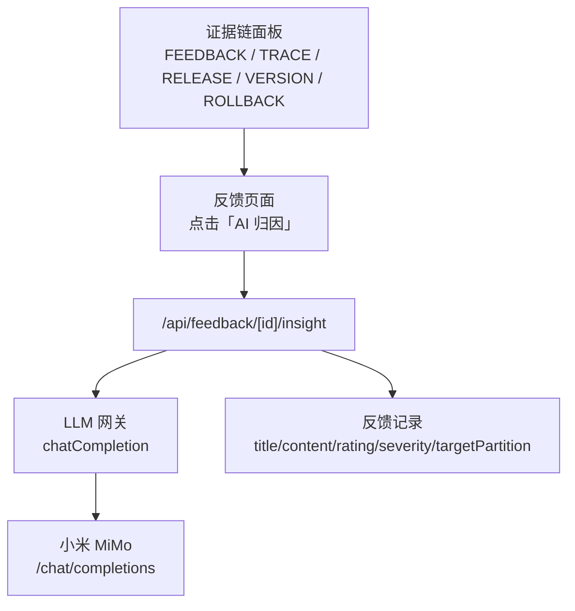

**图表来源**
- [apps/web/app/api/feedback/[id]/insight/route.ts:13-54](file://apps/web/app/api/feedback/[id]/insight/route.ts#L13-L54)
- [apps/web/lib/services/llm-service.ts:67-138](file://apps/web/lib/services/llm-service.ts#L67-L138)
- [apps/web/app/(dashboard)/agents/[id]/evidence-chain-panel.tsx:11-33](file://apps/web/app/(dashboard)/agents/[id]/evidence-chain-panel.tsx#L11-L33)

**章节来源**
- [apps/web/app/api/feedback/[id]/insight/route.ts:1-59](file://apps/web/app/api/feedback/[id]/insight/route.ts#L1-L59)
- [apps/web/lib/services/llm-service.ts:1-140](file://apps/web/lib/services/llm-service.ts#L1-L140)
- [apps/web/app/(dashboard)/agents/[id]/evidence-chain-panel.tsx:1-180](file://apps/web/app/(dashboard)/agents/[id]/evidence-chain-panel.tsx#L1-L180)

## 核心组件
本节梳理 AI 归因分析的关键组件及其职责。

| 组件 | 职责 | 关键行为 |
|---|---|---|
| 反馈洞察路由 | 接收反馈 ID，读取反馈详情，调用 LLM 生成归因分析 | 无状态调用，不落库；返回 insight、model、latencyMs |
| LLM 网关 | 封装 MiMo 调用、超时、结构化错误、token 用量 | 默认模型 `mimo-v2.5-pro`，默认超时 120 秒 |
| 反馈服务 | 提供反馈查询、多渠道接入、字段合并与状态机 | 支持 `targetPartition` 等通用字段 |
| 证据链面板 | 聚合反馈、试聊 trace、发布、版本、回滚节点 | 展示关联事件，不宣称因果关系 |
| Mock 服务器 | 演示环境预置归因文案与分区标签 | 用于离线验证 UI 与交互 |

**章节来源**
- [apps/web/app/api/feedback/[id]/insight/route.ts:7-12](file://apps/web/app/api/feedback/[id]/insight/route.ts#L7-L12)
- [apps/web/lib/services/llm-service.ts:1-8](file://apps/web/lib/services/llm-service.ts#L1-L8)
- [docs/distilled/feedback-service.md:98-102](file://docs/distilled/feedback-service.md#L98-L102)
- [apps/web/app/(dashboard)/agents/[id]/evidence-chain-panel.tsx:3-7](file://apps/web/app/(dashboard)/agents/[id]/evidence-chain-panel.tsx#L3-L7)
- [apps/web/demo/mock-server.ts:570-611](file://apps/web/demo/mock-server.ts#L570-L611)

## 架构总览
AI 归因分析的整体调用链如下：

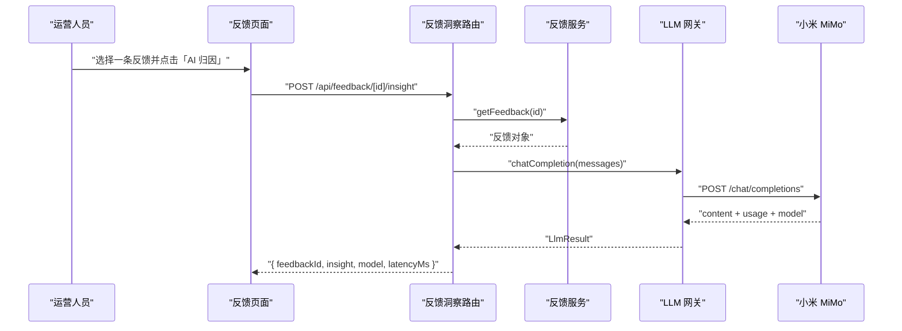

**图表来源**
- [apps/web/app/api/feedback/[id]/insight/route.ts:13-54](file://apps/web/app/api/feedback/[id]/insight/route.ts#L13-L54)
- [apps/web/lib/services/llm-service.ts:67-138](file://apps/web/lib/services/llm-service.ts#L67-L138)

## 详细组件分析

### 反馈洞察路由：AI 归因入口
该路由是 AI 归因分析的对外入口。其处理逻辑可概括为：
1. 解析路径参数中的反馈 ID。
2. 通过反馈服务获取反馈详情。
3. 构造系统提示词，明确四分区分类框架。
4. 将 Agent 名称、标题、内容、评级、严重程度以及可选的 `targetPartition` 拼接到用户消息中。
5. 调用 LLM 网关生成中文归因分析。
6. 返回 insight、模型名与延迟，不持久化到数据库。

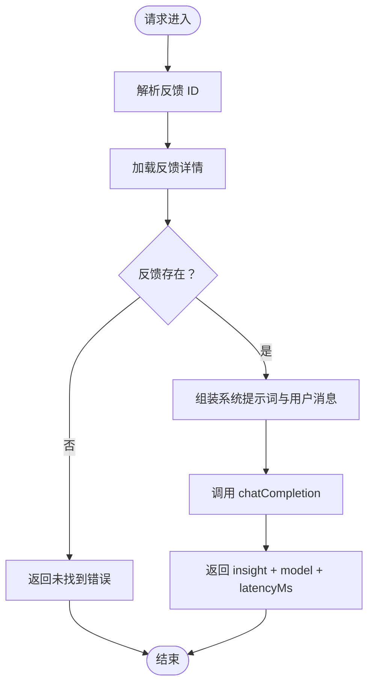

**图表来源**
- [apps/web/app/api/feedback/[id]/insight/route.ts:13-54](file://apps/web/app/api/feedback/[id]/insight/route.ts#L13-L54)

**章节来源**
- [apps/web/app/api/feedback/[id]/insight/route.ts:7-54](file://apps/web/app/api/feedback/[id]/insight/route.ts#L7-L54)

### LLM 网关：与小米 MiMo 的集成
LLM 网关是平台所有 LLM 能力的统一出口，包括：
- 试聊对话。
- 反馈 AI 归因。
- 发布变更摘要。
- 连通性探测。

关键设计要点：
- 凭据来自环境变量：`MIMO_API_KEY`、`MIMO_BASE_URL`、`MIMO_MODEL`。
- 使用原生 fetch 直连 OpenAI 兼容协议，默认 Base URL 指向小米 MiMo。
- 默认模型为 `mimo-v2.5-pro`。
- 默认超时 120 秒，适配推理模型响应较慢的场景。
- 对空 content 进行保护：若上游返回空内容，抛出上游错误，避免下游误判为成功。
- 返回统一结构：content、model、usage、latencyMs。

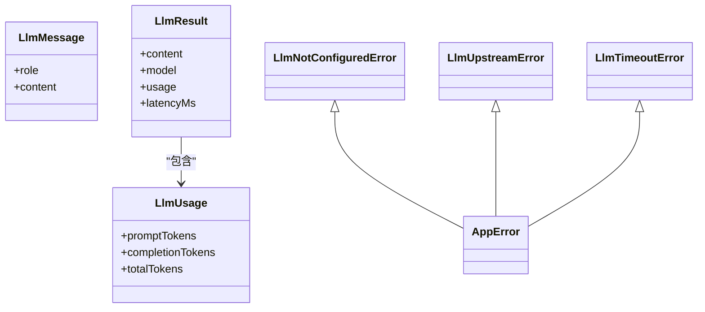

**图表来源**
- [apps/web/lib/services/llm-service.ts:11-27](file://apps/web/lib/services/llm-service.ts#L11-L27)
- [apps/web/lib/services/llm-service.ts:29-48](file://apps/web/lib/services/llm-service.ts#L29-L48)

**章节来源**
- [apps/web/lib/services/llm-service.ts:1-140](file://apps/web/lib/services/llm-service.ts#L1-L140)
- [docs/distilled/llm-service.md:39-79](file://docs/distilled/llm-service.md#L39-L79)

### 四分区模型与 targetPartition
Agent 的配置采用四分区模型：**PROMPT、KNOWLEDGE、TOOLS、ROUTING**。该模型既是配置结构，也是反馈归因的分类学。每条问题最终要落到其中一个分区上。

在反馈数据中，`targetPartition` 表示用户或系统认为该反馈最可能影响的分区。它的作用包括：
- 作为 LLM 归因的参考输入。
- 作为效果报告中按分区统计的基础维度。
- 作为证据链和前端展示的辅助信息。

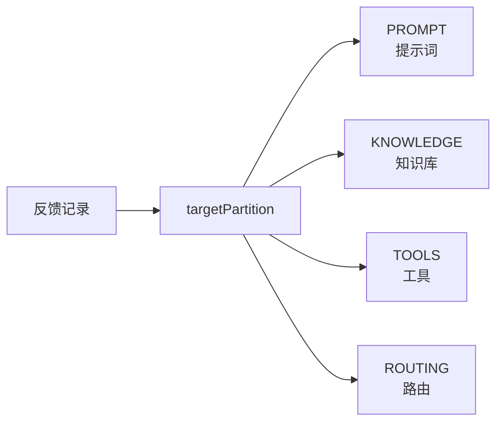

**图表来源**
- [apps/web/demo/mock-server.ts:131-136](file://apps/web/demo/mock-server.ts#L131-L136)
- [apps/web/app/(dashboard)/agents/[id]/evidence-chain-panel.tsx:39-43](file://apps/web/app/(dashboard)/agents/[id]/evidence-chain-panel.tsx#L39-L43)

**章节来源**
- [apps/web/app/(dashboard)/feedback/page.tsx:342-347](file://apps/web/app/(dashboard)/feedback/page.tsx#L342-L347)
- [docs/distilled/feedback-service.md:98-102](file://docs/distilled/feedback-service.md#L98-L102)
- [apps/web/demo/mock-server.ts:570-611](file://apps/web/demo/mock-server.ts#L570-L611)

### sessionData 与试聊 trace 数据
当前 AI 归因分析的直接输入是反馈对象，而不是完整的 `sessionData`。但项目整体具备试聊 trace 能力，trace 数据会参与以下环节：
- 每 Agent 模型用量聚合。
- 证据链中的“试聊”节点。
- 评测用例沉淀与回放。
- 未来可能的会话上下文增强归因。

在 mock 环境中，trace 数据被聚合为调用次数、tokens、平均时延、点赞点踩数等指标；在真实环境中，这些指标来源于实际调用的 trace 落盘。

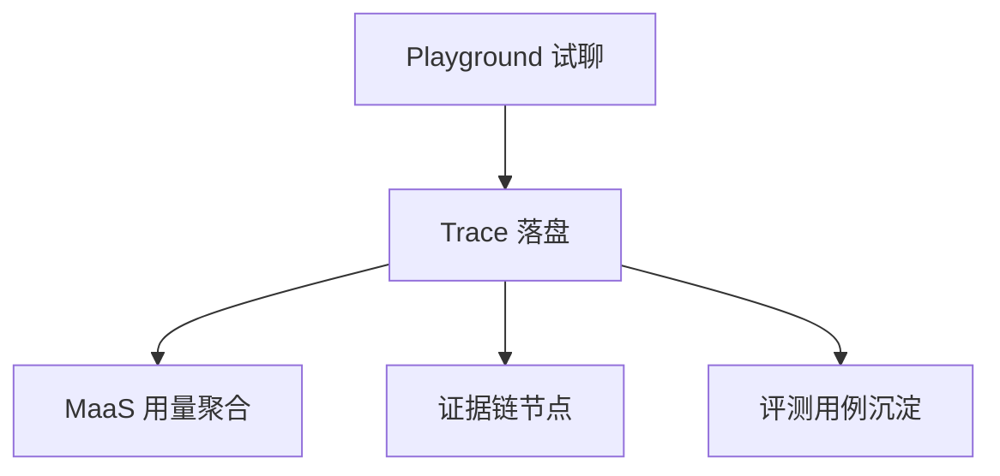

**图表来源**
- [apps/web/demo/mock-server.ts:151-200](file://apps/web/demo/mock-server.ts#L151-L200)
- [apps/web/app/(dashboard)/agents/[id]/evidence-chain-panel.tsx:27-33](file://apps/web/app/(dashboard)/agents/[id]/evidence-chain-panel.tsx#L27-L33)

**章节来源**
- [apps/web/demo/mock-server.ts:151-200](file://apps/web/demo/mock-server.ts#L151-L200)
- [apps/web/app/(dashboard)/agents/[id]/evidence-chain-panel.tsx:27-49](file://apps/web/app/(dashboard)/agents/[id]/evidence-chain-panel.tsx#L27-L49)

### 归因结果存储结构与展示格式
当前实现中，AI 归因结果是**无状态**的：
- 路由不会把 insight 写入数据库。
- 返回体包含 `feedbackId`、`insight`、`model`、`latencyMs`。
- 前端可在本地缓存最近一次归因结果，但不改变服务端语义。

展示格式方面，LLM 输出的 insight 通常包含两个部分：
- **归因分析**：指出问题最可能落在哪个分区，并给出理由。
- **改进建议**：给出 1 到 3 条可执行的配置改进动作。

在演示环境中，mock 服务器会根据 `rating` 和 `targetPartition` 生成固定格式的归因文案，便于前端验证。

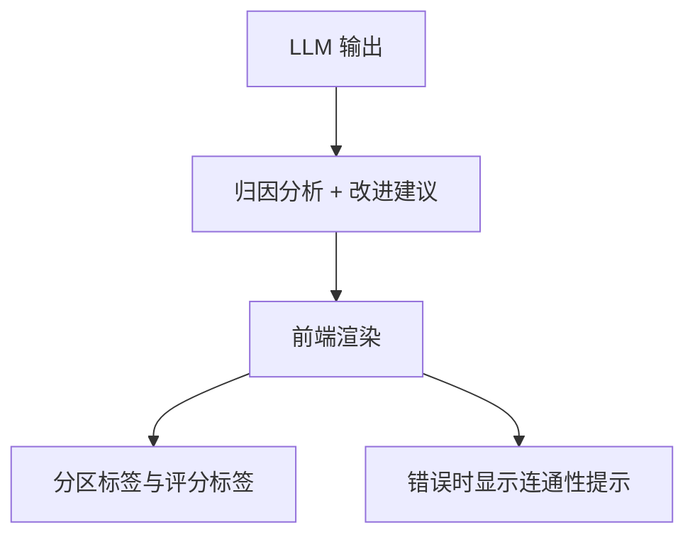

**图表来源**
- [apps/web/app/api/feedback/[id]/insight/route.ts:49-54](file://apps/web/app/api/feedback/[id]/insight/route.ts#L49-L54)
- [apps/web/demo/mock-server.ts:577-611](file://apps/web/demo/mock-server.ts#L577-L611)
- [apps/web/app/(dashboard)/feedback/page.tsx:423-430](file://apps/web/app/(dashboard)/feedback/page.tsx#L423-L430)

**章节来源**
- [apps/web/app/api/feedback/[id]/insight/route.ts:49-54](file://apps/web/app/api/feedback/[id]/insight/route.ts#L49-L54)
- [apps/web/demo/mock-server.ts:577-611](file://apps/web/demo/mock-server.ts#L577-L611)
- [apps/web/app/(dashboard)/feedback/page.tsx:423-430](file://apps/web/app/(dashboard)/feedback/page.tsx#L423-L430)

### 其他 LLM 集成点
除反馈归因外，平台还有两个重要 LLM 集成点：
- **发布变更摘要**：对比 release 的 configSnapshot 与上一版本 baseline，让 MiMo 总结变更影响面与风险。
- **连通性探测**：GET 返回配置状态，POST 真实调用 MiMo 验证连接、模型、时延与 token 用量。

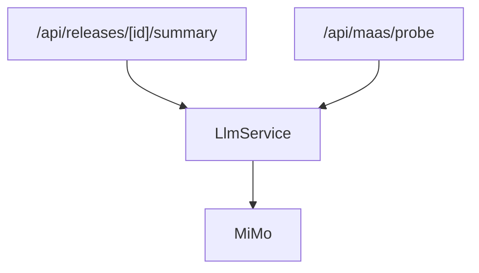

**图表来源**
- [apps/web/app/api/releases/[id]/summary/route.ts:58-82](file://apps/web/app/api/releases/[id]/summary/route.ts#L58-L82)
- [apps/web/app/api/maas/probe/route.ts:13-41](file://apps/web/app/api/maas/probe/route.ts#L13-L41)

**章节来源**
- [apps/web/app/api/releases/[id]/summary/route.ts:7-82](file://apps/web/app/api/releases/[id]/summary/route.ts#L7-L82)
- [apps/web/app/api/maas/probe/route.ts:9-41](file://apps/web/app/api/maas/probe/route.ts#L9-L41)

## 依赖关系分析
AI 归因分析的核心依赖关系如下：

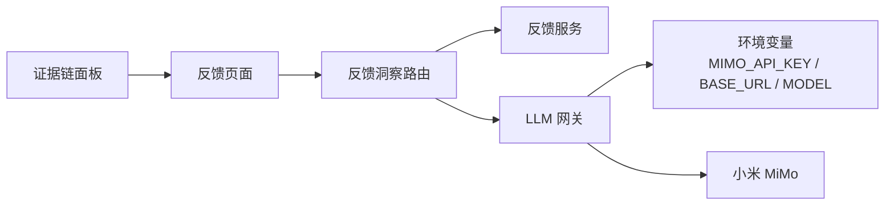

**图表来源**
- [apps/web/app/api/feedback/[id]/insight/route.ts:1-5](file://apps/web/app/api/feedback/[id]/insight/route.ts#L1-L5)
- [apps/web/lib/services/llm-service.ts:55-65](file://apps/web/lib/services/llm-service.ts#L55-L65)
- [apps/web/app/(dashboard)/feedback/page.tsx:324-478](file://apps/web/app/(dashboard)/feedback/page.tsx#L324-L478)

**章节来源**
- [apps/web/app/api/feedback/[id]/insight/route.ts:1-59](file://apps/web/app/api/feedback/[id]/insight/route.ts#L1-L59)
- [apps/web/lib/services/llm-service.ts:55-65](file://apps/web/lib/services/llm-service.ts#L55-L65)
- [apps/web/app/(dashboard)/feedback/page.tsx:324-478](file://apps/web/app/(dashboard)/feedback/page.tsx#L324-L478)

## 性能与扩展策略
当前实现以简单可靠为主，尚未引入后端队列或分布式缓存。可从以下方向优化：

| 优化方向 | 现状 | 建议 |
|---|---|---|
| 异步处理 | 每次点击“AI 归因”同步调用 LLM | 引入后台任务队列，先返回“分析中”，完成后推送结果 |
| 缓存机制 | 无服务端缓存 | 对相同 feedbackId 的 insight 做短期缓存，避免重复调用 |
| 并发控制 | 直接调用 MiMo | 增加限流与重试，防止突发流量打满上游 |
| Token 预算 | 默认 2048 | 根据 prompt 长度动态调整 max_completion_tokens |
| 可观测性 | 返回 latencyMs 与 usage | 增加 tracing、错误码分布、模型命中率统计 |
| 多模型切换 | 通过环境变量切换 | 增加灰度模型、A/B 测试与回退策略 |

**章节来源**
- [apps/web/lib/services/llm-service.ts:50-53](file://apps/web/lib/services/llm-service.ts#L50-L53)
- [apps/web/lib/services/llm-service.ts:87-93](file://apps/web/lib/services/llm-service.ts#L87-L93)
- [docs/distilled/llm-service.md:21-25](file://docs/distilled/llm-service.md#L21-L25)

## 故障排查指南
当 AI 归因失败时，可按以下顺序排查：

1. **检查 LLM 是否已配置**  
   如果未设置 `MIMO_API_KEY`，网关会抛出 503 错误。可通过 `/api/maas/probe` 的 GET 接口查看配置状态。

2. **检查网络与上游可用性**  
   如果 fetch 超时、鉴权失败、限流或非 2xx 响应，网关会抛出 504 或 502 错误，并在 details 中携带原始原因。

3. **检查模型返回是否为空**  
   如果上游返回空 content，可能是 reasoning tokens 超出 `max_completion_tokens`，需要提高预算或精简 prompt。

4. **检查反馈数据是否完整**  
   如果反馈不存在，路由会返回未找到错误；如果缺少 agent 名称，会使用 agentId 作为降级值。

5. **检查前端展示错误提示**  
   前端会在归因失败时显示“AI 归因未完成”，并引导用户到模型服务页做连通性探测。

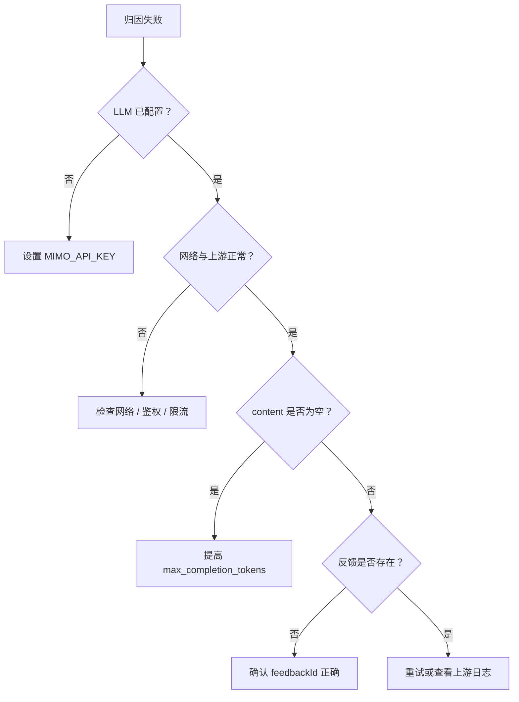

**图表来源**
- [apps/web/lib/services/llm-service.ts:75-127](file://apps/web/lib/services/llm-service.ts#L75-L127)
- [apps/web/app/api/maas/probe/route.ts:13-41](file://apps/web/app/api/maas/probe/route.ts#L13-L41)
- [apps/web/app/(dashboard)/feedback/page.tsx:423-430](file://apps/web/app/(dashboard)/feedback/page.tsx#L423-L430)

**章节来源**
- [apps/web/lib/services/llm-service.ts:29-48](file://apps/web/lib/services/llm-service.ts#L29-L48)
- [apps/web/lib/services/llm-service.ts:75-127](file://apps/web/lib/services/llm-service.ts#L75-L127)
- [apps/web/app/api/maas/probe/route.ts:13-41](file://apps/web/app/api/maas/probe/route.ts#L13-L41)
- [apps/web/app/(dashboard)/feedback/page.tsx:423-430](file://apps/web/app/(dashboard)/feedback/page.tsx#L423-L430)

## 结论
AI 归因分析在当前仓库中是一个轻量但关键的 LLM 集成点：它以反馈工单为输入，以四分区模型为分类框架，以小米 MiMo 为推理引擎，输出可操作的归因分析与改进建议。虽然当前实现是无状态的，但它已经打通了“反馈 → 归因 → 改配置 → 发布 → 版本 → 回滚 → 效果报告”的叙事主线。后续可通过异步任务、缓存、限流、可观测性与多模型灰度进一步提升稳定性与准确率。

## 附录：调用示例与参数说明

### 触发 AI 归因
- **接口**：`POST /api/feedback/[id]/insight`
- **用途**：根据反馈 ID 调用 MiMo 生成归因分析。
- **返回字段**：
  - `feedbackId`：反馈 ID。
  - `insight`：LLM 生成的归因分析文本。
  - `model`：使用的模型名称。
  - `latencyMs`：本次 LLM 调用耗时。

**章节来源**
- [apps/web/app/api/feedback/[id]/insight/route.ts:13-54](file://apps/web/app/api/feedback/[id]/insight/route.ts#L13-L54)

### 配置 LLM 网关
- **环境变量**：
  - `MIMO_API_KEY`：MiMo API Key。
  - `MIMO_BASE_URL`：MiMo Base URL，默认指向小米 MiMo。
  - `MIMO_MODEL`：模型名称，默认 `mimo-v2.5-pro`。
- **校验接口**：`GET /api/maas/probe`
- **连通性测试**：`POST /api/maas/probe`

**章节来源**
- [apps/web/lib/services/llm-service.ts:50-65](file://apps/web/lib/services/llm-service.ts#L50-L65)
- [apps/web/app/api/maas/probe/route.ts:13-41](file://apps/web/app/api/maas/probe/route.ts#L13-L41)

### 四分区与 targetPartition
- **分区枚举**：PROMPT、KNOWLEDGE、TOOLS、ROUTING。
- **作用**：
  - 作为 LLM 归因的分类依据。
  - 作为效果统计维度。
  - 作为证据链与前端展示的辅助信息。
- **注意事项**：
  - `targetPartition` 是字符串枚举，没有数据库外键约束。
  - 终态反馈仍可修改 `targetPartition`，因此不能仅凭状态判断数据不可变。

**章节来源**
- [apps/web/demo/mock-server.ts:131-136](file://apps/web/demo/mock-server.ts#L131-L136)
- [docs/distilled/feedback-service.md:98-102](file://docs/distilled/feedback-service.md#L98-L102)

### 准确率评估与人工修正流程
当前仓库没有内置自动准确率评估模块，但已有支撑人工评估与修正的结构基础：

| 步骤 | 说明 | 对应实现 |
|---|---|---|
| 收集反馈 | 用户提交反馈，可附带 `targetPartition` | 反馈服务与 ingest 接口 |
| 生成归因 | 调用 LLM 输出归因分析 | 反馈洞察路由 |
| 人工确认 | 运营人员查看 insight 并决定是否采纳 | 前端展示与后续发布流程 |
| 配置修改 | 修改对应分区配置 | 分区更新与审计日志 |
| 发布与版本 | 提交发布、生成不可变版本快照 | 发布与版本服务 |
| 效果观察 | 通过效果报告与证据链观察变化 | 效果报告与证据链面板 |

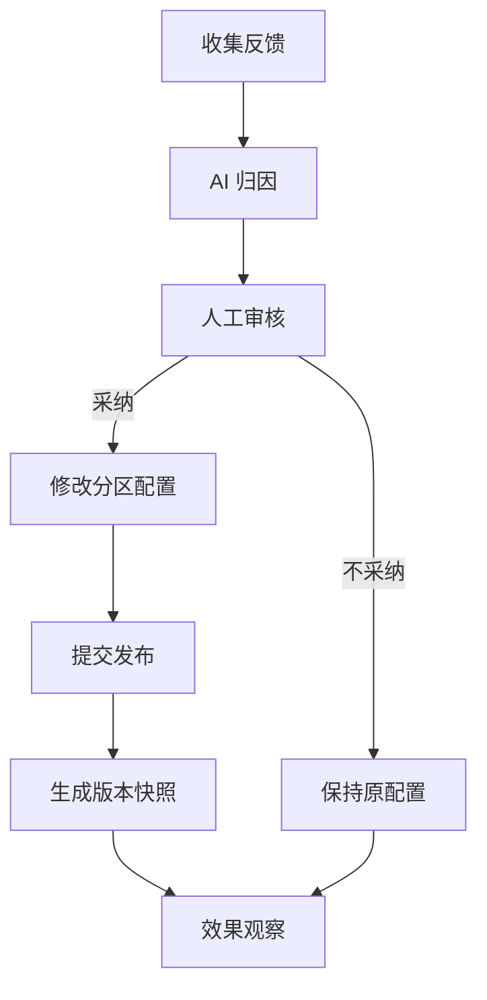

**图表来源**
- [apps/web/app/(dashboard)/agents/[id]/evidence-chain-panel.tsx:3-7](file://apps/web/app/(dashboard)/agents/[id]/evidence-chain-panel.tsx#L3-L7)
- [apps/web/demo/mock-server.ts:202-329](file://apps/web/demo/mock-server.ts#L202-L329)

**章节来源**
- [apps/web/app/(dashboard)/agents/[id]/evidence-chain-panel.tsx:3-7](file://apps/web/app/(dashboard)/agents/[id]/evidence-chain-panel.tsx#L3-L7)
- [apps/web/demo/mock-server.ts:202-329](file://apps/web/demo/mock-server.ts#L202-L329)