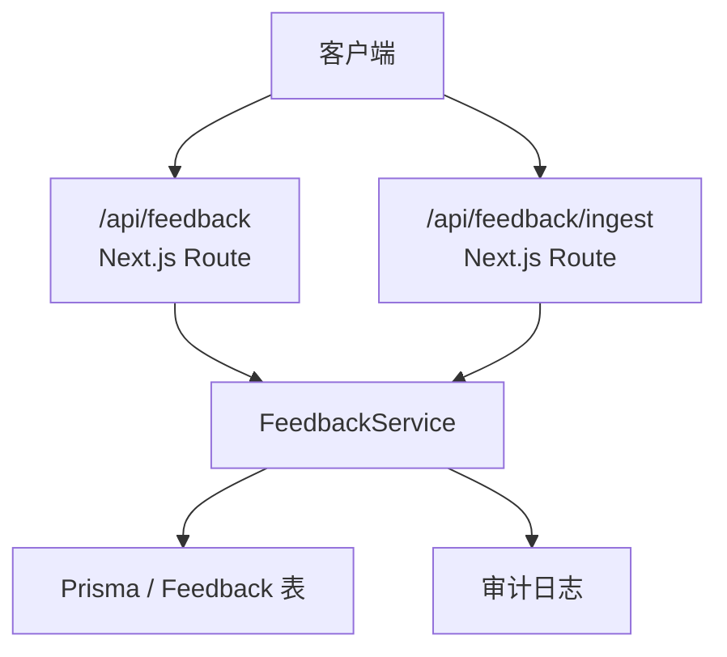
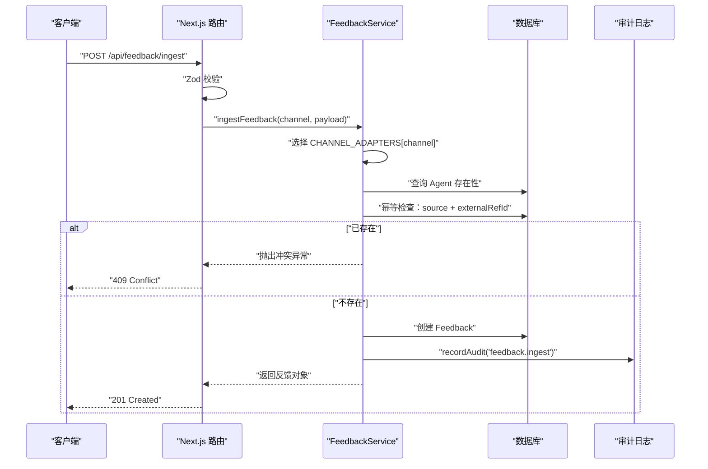
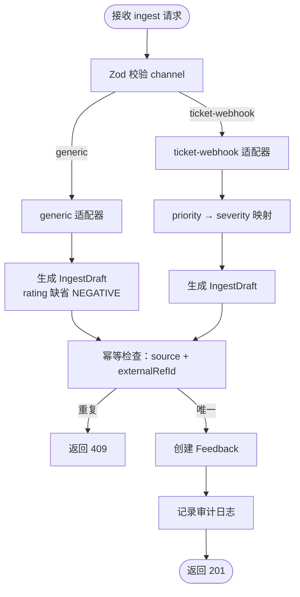
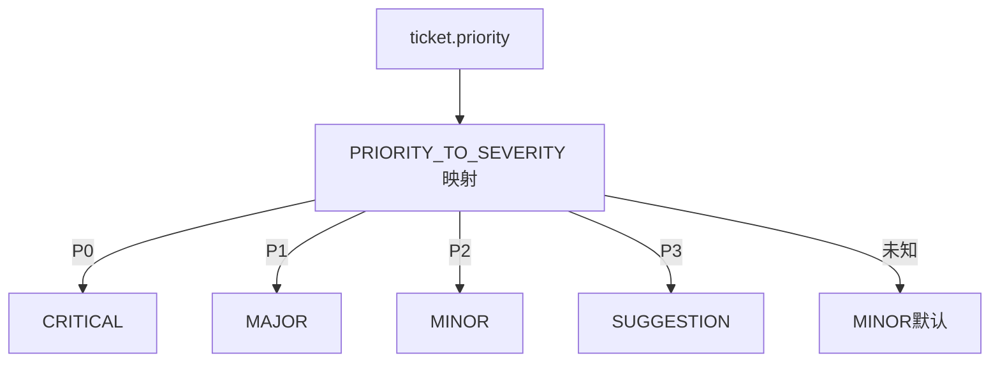
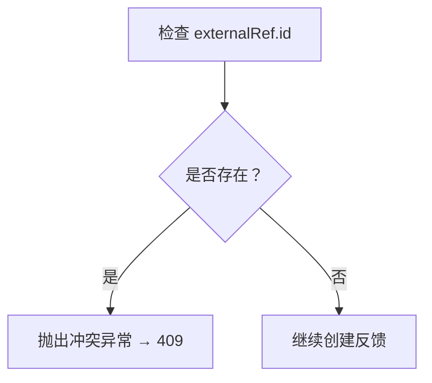
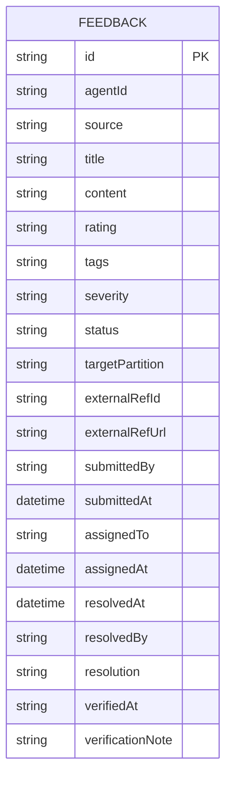
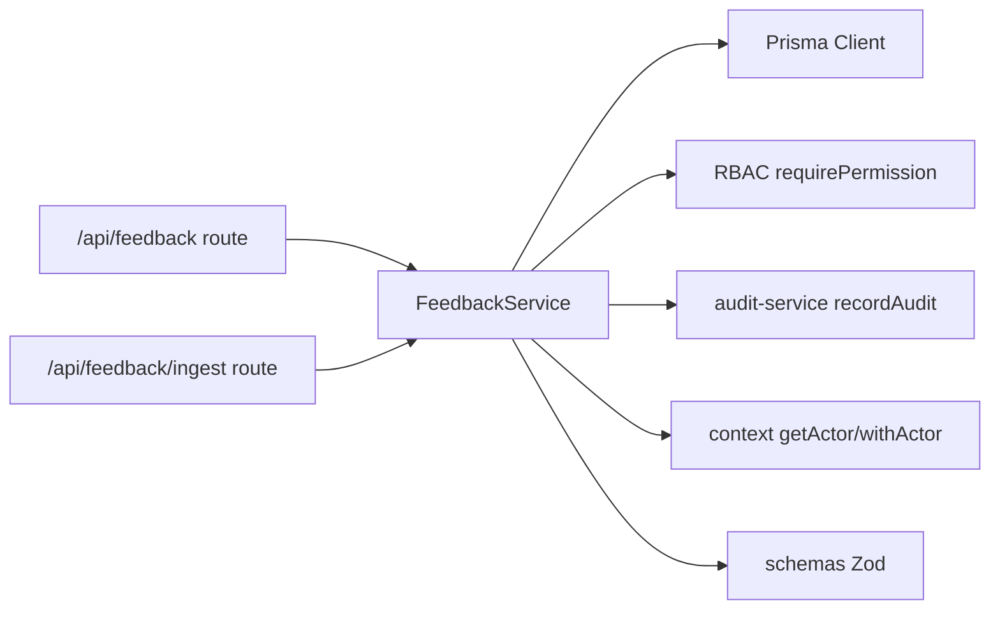

# 反馈收集与接入

<cite>
**本文引用的文件**   
- [apps/web/app/api/feedback/route.ts](file://apps/web/app/api/feedback/route.ts)
- [apps/web/app/api/feedback/ingest/route.ts](file://apps/web/app/api/feedback/ingest/route.ts)
- [apps/web/lib/services/feedback-service.ts](file://apps/web/lib/services/feedback-service.ts)
- [apps/web/lib/schemas.ts](file://apps/web/lib/schemas.ts)
- [packages/db/prisma/schema.prisma](file://packages/db/prisma/schema.prisma)
- [apps/web/app/api/__tests__/feedback-ingest.test.ts](file://apps/web/app/api/__tests__/feedback-ingest.test.ts)
- [apps/web/demo/mock-server.ts](file://apps/web/demo/mock-server.ts)
</cite>

## 目录
1. [简介](#简介)
2. [项目结构](#项目结构)
3. [核心组件](#核心组件)
4. [架构总览](#架构总览)
5. [详细组件分析](#详细组件分析)
6. [依赖关系分析](#依赖关系分析)
7. [性能考虑](#性能考虑)
8. [故障排查指南](#故障排查指南)
9. [结论](#结论)
10. [附录：API 端点规范](#附录api-端点规范)

## 简介
本模块为“反馈收集与接入”子系统，提供两类入口：
- 面向人的反馈录入：POST /api/feedback。
- 面向工单系统的多渠道机器接入：POST /api/feedback/ingest。

重点能力包括：
- 多渠道工单适配器：generic、ticket-webhook 两种渠道的数据规范化。
- 优先级映射机制：P0→CRITICAL、P1→MAJOR、P2→MINOR、P3→SUGGESTION。
- 幂等性设计：同渠道 + 同外部单号重复检测，冲突返回 409。
- 反馈数据模型：title、content、rating、severity、tags、sessionData 等字段的含义与约束。
- 错误处理策略与审计日志记录机制。

## 项目结构
反馈相关代码主要分布在 Next.js App Router 路由层、服务层、Schema 校验层以及数据库 Schema 中：
- 路由层：定义 REST 接口并调用服务层。
- 服务层：实现业务逻辑（创建、更新、多渠道适配、幂等检查、审计）。
- Schema 层：使用 Zod 对请求体进行强类型校验。
- 数据库层：Prisma Schema 定义 Feedback 实体及索引。

**图表来源**
- [apps/web/app/api/feedback/route.ts:11-73](file://apps/web/app/api/feedback/route.ts#L11-L73)
- [apps/web/app/api/feedback/ingest/route.ts:7-32](file://apps/web/app/api/feedback/ingest/route.ts#L7-L32)
- [apps/web/lib/services/feedback-service.ts:135-174](file://apps/web/lib/services/feedback-service.ts#L135-L174)
- [apps/web/lib/services/feedback-service.ts:244-294](file://apps/web/lib/services/feedback-service.ts#L244-L294)

**章节来源**
- [apps/web/app/api/feedback/route.ts:11-73](file://apps/web/app/api/feedback/route.ts#L11-L73)
- [apps/web/app/api/feedback/ingest/route.ts:7-32](file://apps/web/app/api/feedback/ingest/route.ts#L7-L32)

## 核心组件
- 路由控制器：
  - GET /api/feedback：分页查询反馈列表。
  - POST /api/feedback：创建人工反馈。
  - PUT /api/feedback：更新反馈状态、严重度等。
  - POST /api/feedback/ingest：多渠道工单适配器接入。
- 服务层：
  - listFeedback：列表查询与标签过滤。
  - createFeedback：人工反馈创建与审计。
  - ingestFeedback：多渠道适配、幂等检查、创建与审计。
  - updateFeedback：带状态机校验的更新。
- Schema 校验：
  - createFeedbackSchema、updateFeedbackSchema。
  - feedbackIngestGenericSchema、feedbackIngestTicketSchema、feedbackIngestSchema。
- 数据模型：
  - Prisma Feedback 模型，包含 source、externalRefId、externalRefUrl 等字段。

**章节来源**
- [apps/web/lib/services/feedback-service.ts:85-127](file://apps/web/lib/services/feedback-service.ts#L85-L127)
- [apps/web/lib/services/feedback-service.ts:135-174](file://apps/web/lib/services/feedback-service.ts#L135-L174)
- [apps/web/lib/services/feedback-service.ts:244-294](file://apps/web/lib/services/feedback-service.ts#L244-L294)
- [apps/web/lib/services/feedback-service.ts:296-336](file://apps/web/lib/services/feedback-service.ts#L296-L336)
- [apps/web/lib/schemas.ts:66-134](file://apps/web/lib/schemas.ts#L66-L134)
- [packages/db/prisma/schema.prisma:211-251](file://packages/db/prisma/schema.prisma#L211-L251)

## 架构总览
反馈接入的整体流程如下：
- 人通过 Web 表单或插件调用 POST /api/feedback，服务层写入 Feedback 并记录审计。
- 工单系统通过 POST /api/feedback/ingest 调用，服务层根据 channel 选择适配器进行数据规范化，再进行幂等检查后写入 Feedback 并记录审计。

**图表来源**
- [apps/web/app/api/feedback/ingest/route.ts:7-32](file://apps/web/app/api/feedback/ingest/route.ts#L7-L32)
- [apps/web/lib/services/feedback-service.ts:244-294](file://apps/web/lib/services/feedback-service.ts#L244-L294)

## 详细组件分析

### 多渠道工单适配器
适配器注册表 CHANNEL_ADAPTERS 将不同渠道的外部原生 payload 规范化为统一的 IngestDraft 结构，再持久化为 Feedback。

- generic 渠道：
  - 输入字段：agentId、title、content、rating、severity、tags、externalId、externalUrl。
  - rating 缺省为 NEGATIVE；severity 可空；externalRef.id/url 来自 externalId/externalUrl。
- ticket-webhook 渠道：
  - 输入字段：agentId、ticket.key、ticket.subject、ticket.description、ticket.priority、ticket.url。
  - title=subject、content=description、rating=NEGATIVE、severity=PRIORITY_TO_SEVERITY[priority]，externalRef.id=key。

**图表来源**
- [apps/web/lib/services/feedback-service.ts:197-242](file://apps/web/lib/services/feedback-service.ts#L197-L242)
- [apps/web/lib/services/feedback-service.ts:244-294](file://apps/web/lib/services/feedback-service.ts#L244-L294)

**章节来源**
- [apps/web/lib/services/feedback-service.ts:197-242](file://apps/web/lib/services/feedback-service.ts#L197-L242)
- [apps/web/lib/schemas.ts:97-134](file://apps/web/lib/schemas.ts#L97-L134)

### 优先级映射机制
ticket-webhook 渠道使用 PRIORITY_TO_SEVERITY 映射表将外部优先级转换为内部严重度：
- P0 → CRITICAL
- P1 → MAJOR
- P2 → MINOR
- P3 → SUGGESTION

未知优先级默认降级为 MINOR。

**图表来源**
- [apps/web/lib/services/feedback-service.ts:197-203](file://apps/web/lib/services/feedback-service.ts#L197-L203)

**章节来源**
- [apps/web/lib/services/feedback-service.ts:197-203](file://apps/web/lib/services/feedback-service.ts#L197-L203)
- [apps/web/app/api/__tests__/feedback-ingest.test.ts:64-93](file://apps/web/app/api/__tests__/feedback-ingest.test.ts#L64-L93)

### 幂等性与 409 冲突处理
当 draft.externalRef.id 存在时，服务层按「source + externalRefId」查询是否已有反馈：
- 若存在，抛出冲突异常，路由层返回 409。
- 若不存在，继续创建反馈。

该设计用于保护 webhook 重试场景，避免重复工单。

**图表来源**
- [apps/web/lib/services/feedback-service.ts:258-270](file://apps/web/lib/services/feedback-service.ts#L258-L270)

**章节来源**
- [apps/web/lib/services/feedback-service.ts:258-270](file://apps/web/lib/services/feedback-service.ts#L258-L270)
- [apps/web/app/api/__tests__/feedback-ingest.test.ts:95-110](file://apps/web/app/api/__tests__/feedback-ingest.test.ts#L95-L110)

### 反馈数据模型定义
Feedback 实体关键字段及其含义与约束：
- title：标题，必填，最大长度 200。
- content：内容，必填。
- rating：评价，枚举 POSITIVE/NEGATIVE/NEUTRAL。
- severity：严重度，枚举 CRITICAL/MAJOR/MINOR/SUGGESTION，缺省 MINOR。
- tags：标签数组，枚举值限定，JSON 文本存储。
- sessionData：会话数据，任意 JSON，可选。
- source：来源渠道，MANUAL/generic/ticket-webhook 等。
- externalRefId/externalRefUrl：外部单号与链接，用于幂等键与溯源。
- status：状态，NEW/TRIAGED/ASSIGNED/IN_PROGRESS/RESOLVED/VERIFIED/CLOSED/WONTFIX。
- assignedTo/assignedAt/resolvedAt/resolvedBy/resolution/targetPartition/verifiedAt/verificationNote：流程与归属信息。

**图表来源**
- [packages/db/prisma/schema.prisma:211-251](file://packages/db/prisma/schema.prisma#L211-L251)

**章节来源**
- [packages/db/prisma/schema.prisma:211-251](file://packages/db/prisma/schema.prisma#L211-L251)
- [apps/web/lib/schemas.ts:66-93](file://apps/web/lib/schemas.ts#L66-L93)

### 错误处理策略
- 参数校验失败：返回 422，附带 Zod 错误消息。
- Agent 不存在：返回 404。
- 未知渠道：返回 422。
- 重复接入：返回 409。
- 非法状态转移：返回 422。
- 通用错误：由 handleApiError 统一处理。

**章节来源**
- [apps/web/app/api/feedback/route.ts:31-49](file://apps/web/app/api/feedback/route.ts#L31-L49)
- [apps/web/app/api/feedback/ingest/route.ts:15-31](file://apps/web/app/api/feedback/ingest/route.ts#L15-L31)
- [apps/web/lib/services/feedback-service.ts:32-41](file://apps/web/lib/services/feedback-service.ts#L32-L41)
- [apps/web/lib/services/feedback-service.ts:244-294](file://apps/web/lib/services/feedback-service.ts#L244-L294)

### 审计日志记录机制
- createFeedback：记录 action="feedback.create"，包含 agentId、rating、severity。
- ingestFeedback：记录 action="feedback.ingest"，包含 channel、externalRefId、severity。
- updateFeedback：记录 action="feedback.update"，包含 from/to 状态。

审计日志通过 recordAudit 写入，测试用例可通过 listAudit 验证。

**章节来源**
- [apps/web/lib/services/feedback-service.ts:168-173](file://apps/web/lib/services/feedback-service.ts#L168-L173)
- [apps/web/lib/services/feedback-service.ts:288-293](file://apps/web/lib/services/feedback-service.ts#L288-L293)
- [apps/web/lib/services/feedback-service.ts:331-335](file://apps/web/lib/services/feedback-service.ts#L331-L335)
- [apps/web/app/api/__tests__/feedback-ingest.test.ts:58-62](file://apps/web/app/api/__tests__/feedback-ingest.test.ts#L58-L62)

## 依赖关系分析
- 路由层依赖服务层与工具函数（success/error/parseBody/handleApiError）。
- 服务层依赖 Prisma 客户端、RBAC 权限校验、审计服务、上下文 actor。
- Schema 层集中定义所有输入校验规则，保证前后端契约一致。
- 数据库层通过 Prisma 管理 Feedback 实体与索引。

**图表来源**
- [apps/web/app/api/feedback/route.ts:1-10](file://apps/web/app/api/feedback/route.ts#L1-L10)
- [apps/web/app/api/feedback/ingest/route.ts:1-6](file://apps/web/app/api/feedback/ingest/route.ts#L1-L6)
- [apps/web/lib/services/feedback-service.ts:1-14](file://apps/web/lib/services/feedback-service.ts#L1-L14)
- [apps/web/lib/schemas.ts:1-10](file://apps/web/lib/schemas.ts#L1-L10)

**章节来源**
- [apps/web/app/api/feedback/route.ts:1-10](file://apps/web/app/api/feedback/route.ts#L1-L10)
- [apps/web/app/api/feedback/ingest/route.ts:1-6](file://apps/web/app/api/feedback/ingest/route.ts#L1-L6)
- [apps/web/lib/services/feedback-service.ts:1-14](file://apps/web/lib/services/feedback-service.ts#L1-L14)

## 性能考虑
- 列表查询：SQLite 下标签过滤采用内存过滤，total 取过滤后口径，适合演示规模。
- 并发与幂等：幂等检查在写入前进行，避免重复写入；建议在高并发场景下结合数据库唯一索引增强一致性。
- 响应序列化：toFeedbackResponse 按需输出可选字段，减少冗余数据传输。

[本节为一般性指导，不直接分析具体文件]

## 故障排查指南
- 422 参数校验失败：
  - 检查 channel 是否为 generic 或 ticket-webhook。
  - 检查 ticket-webhook 是否缺少 subject/description/priority。
  - 检查 rating/severity/tags 是否符合枚举。
- 404 Agent 不存在：
  - 确认 agentId 已在系统中建档。
- 409 重复接入：
  - 检查 externalRef.id 是否重复；webhook 重试需确保幂等键稳定。
- 审计日志缺失：
  - 确认 recordAudit 被调用；测试环境可通过 listAudit 验证。

**章节来源**
- [apps/web/app/api/__tests__/feedback-ingest.test.ts:112-131](file://apps/web/app/api/__tests__/feedback-ingest.test.ts#L112-L131)
- [apps/web/lib/services/feedback-service.ts:244-294](file://apps/web/lib/services/feedback-service.ts#L244-L294)

## 结论
反馈收集与接入模块通过清晰的分层设计与严格的 Schema 校验，实现了人用与机器用两条通道的一致体验。多渠道适配器以可扩展方式接入新渠道，优先级映射与幂等机制保障了数据质量与稳定性。配合审计日志与错误处理策略，便于问题定位与合规追溯。

[本节为总结性内容，不直接分析具体文件]

## 附录：API 端点规范

### POST /api/feedback（人工反馈）
- 方法：POST
- 路径：/api/feedback
- 认证：需要反馈写入权限（RBAC）
- 请求体字段：
  - agentId：字符串，必填。
  - title：字符串，必填，最大 200。
  - content：字符串，必填。
  - rating：枚举 POSITIVE/NEGATIVE/NEUTRAL。
  - tags：枚举数组，可选。
  - severity：枚举 CRITICAL/MAJOR/MINOR/SUGGESTION，可选。
  - sessionData：任意 JSON，可选。
  - targetPartition：枚举 PROMPT/KNOWLEDGE/TOOLS/ROUTING 或 null，可选。
- 成功响应：201，data 为反馈对象。
- 错误响应：
  - 422：参数校验失败。
  - 404：Agent 不存在。
  - 其他：handleApiError 统一处理。

**章节来源**
- [apps/web/app/api/feedback/route.ts:31-49](file://apps/web/app/api/feedback/route.ts#L31-L49)
- [apps/web/lib/schemas.ts:66-81](file://apps/web/lib/schemas.ts#L66-L81)
- [apps/web/lib/services/feedback-service.ts:135-174](file://apps/web/lib/services/feedback-service.ts#L135-L174)

### POST /api/feedback/ingest（多渠道工单适配器）
- 方法：POST
- 路径：/api/feedback/ingest
- 认证：需要反馈写入权限（RBAC），x-actor-id 头标识来源系统，缺省 system。
- 请求体字段（discriminatedUnion by channel）：
  - channel：literal "generic" 或 "ticket-webhook"。
  - generic：
    - agentId：字符串，必填。
    - title：字符串，必填，最大 200。
    - content：字符串，必填。
    - rating：枚举 POSITIVE/NEGATIVE/NEUTRAL，缺省 NEGATIVE。
    - severity：枚举 CRITICAL/MAJOR/MINOR/SUGGESTION，可选。
    - tags：枚举数组，可选。
    - externalId：字符串，可选，作为幂等键。
    - externalUrl：URL，可选。
  - ticket-webhook：
    - agentId：字符串，必填。
    - ticket.key：字符串，必填，最大 100。
    - ticket.subject：字符串，必填，最大 200。
    - ticket.description：字符串，必填。
    - ticket.priority：枚举 P0/P1/P2/P3。
    - ticket.url：URL，可选。
- 成功响应：201，data 为反馈对象，source 为 channel，externalRef 包含 id/url。
- 错误响应：
  - 422：参数校验失败（未知渠道或缺少必要字段）。
  - 404：Agent 不存在。
  - 409：同渠道同外部单号重复接入。

**章节来源**
- [apps/web/app/api/feedback/ingest/route.ts:7-32](file://apps/web/app/api/feedback/ingest/route.ts#L7-L32)
- [apps/web/lib/schemas.ts:97-134](file://apps/web/lib/schemas.ts#L97-L134)
- [apps/web/lib/services/feedback-service.ts:244-294](file://apps/web/lib/services/feedback-service.ts#L244-L294)
- [apps/web/app/api/__tests__/feedback-ingest.test.ts:39-132](file://apps/web/app/api/__tests__/feedback-ingest.test.ts#L39-L132)