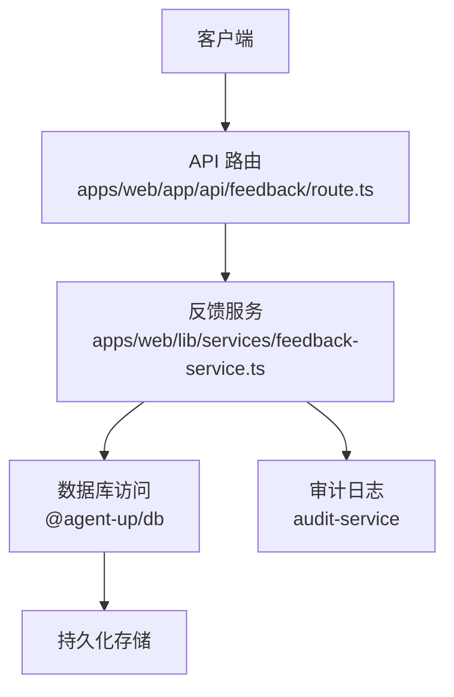
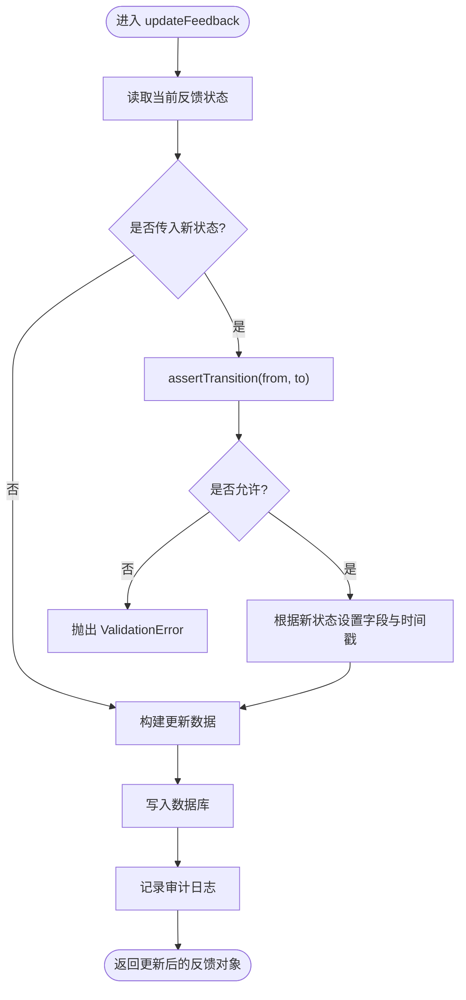
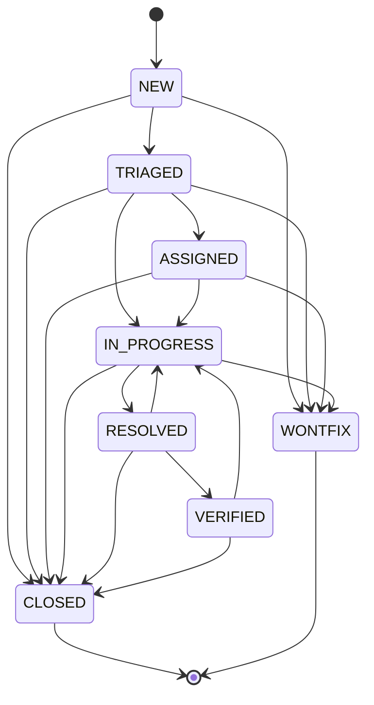
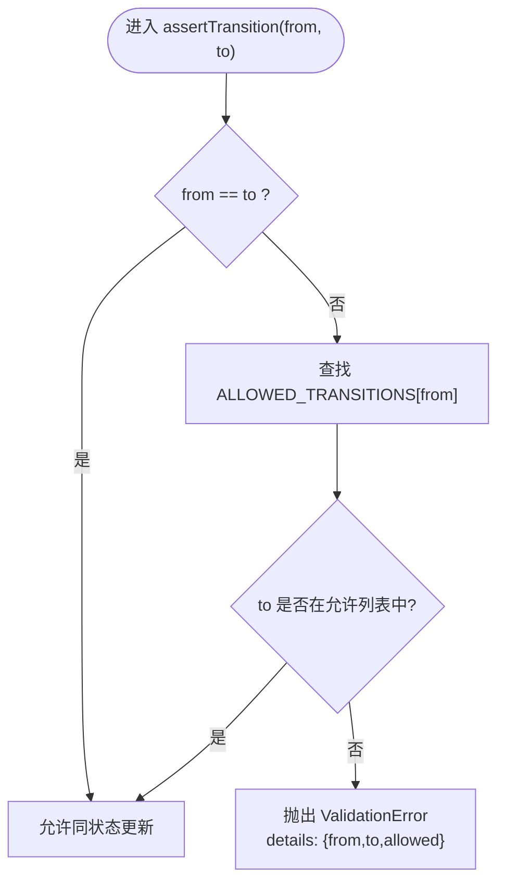
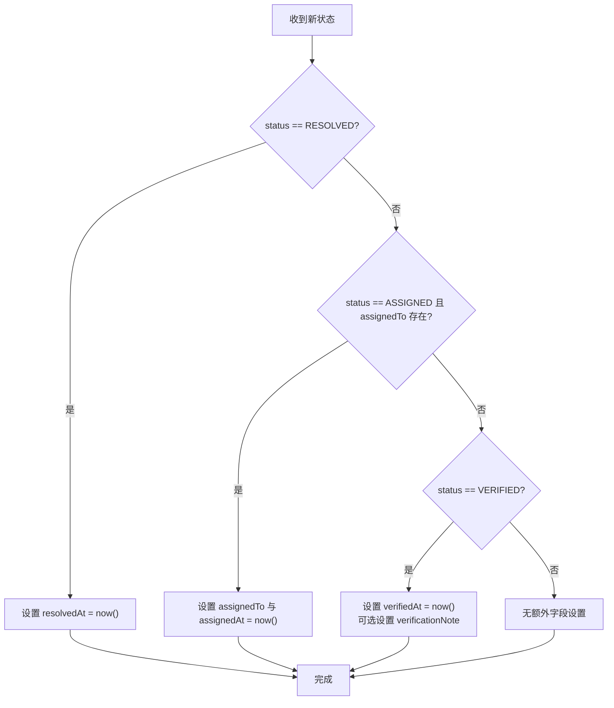
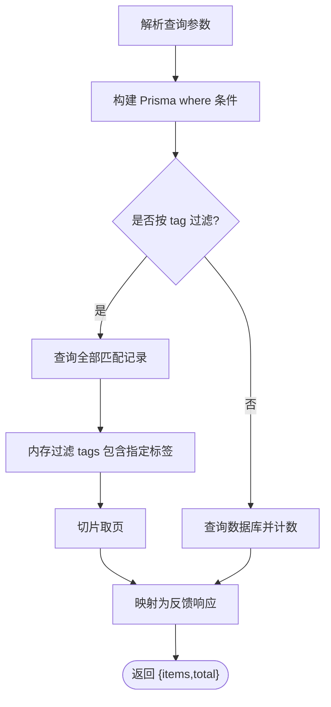
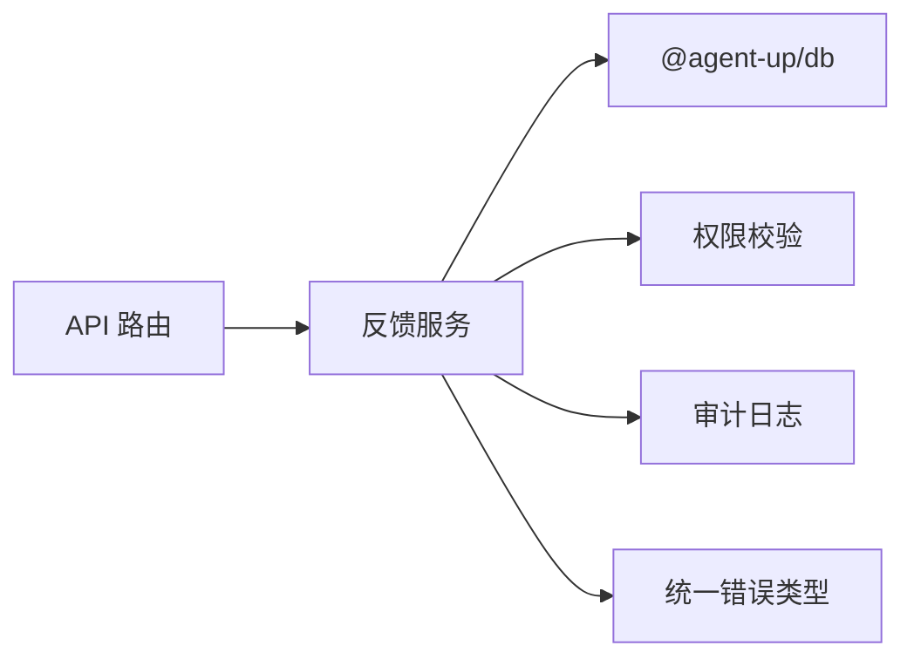

# 反馈状态机管理

<cite>
**本文引用的文件**   
- [apps/web/lib/services/feedback-service.ts](file://apps/web/lib/services/feedback-service.ts)
- [apps/web/app/api/feedback/route.ts](file://apps/web/app/api/feedback/route.ts)
- [packages/db/src/enums.ts](file://packages/db/src/enums.ts)
- [apps/web/lib/__tests__/feedback-service.test.ts](file://apps/web/lib/__tests__/feedback-service.test.ts)
</cite>

## 目录
1. [简介](#简介)
2. [项目结构中的位置](#项目结构中的位置)
3. [核心组件](#核心组件)
4. [架构总览](#架构总览)
5. [详细组件分析](#详细组件分析)
6. [依赖关系分析](#依赖关系分析)
7. [性能与一致性考虑](#性能与一致性考虑)
8. [故障排查指南](#故障排查指南)
9. [结论](#结论)

## 简介
本文聚焦反馈单的状态机管理，围绕以下目标展开：
- 解释合法转移表 ALLOWED_TRANSITIONS 的设计与实现。
- 说明完整流转路径 NEW → TRIAGED → ASSIGNED → IN_PROGRESS → RESOLVED → VERIFIED → CLOSED。
- 深入解析 assertTransition 的验证逻辑、非法转移拒绝机制与错误信息返回。
- 说明终态 CLOSED 与 WONTFIX 的特殊处理及不可再转约束。
- 梳理状态变更时的自动字段更新逻辑，包括 resolvedAt、assignedAt、verifiedAt 的时间戳设置。
- 提供状态流转图和数据流图，帮助开发者理解状态变化过程。
- 补充状态查询与过滤功能的实现细节。

## 项目结构中的位置
反馈状态机相关代码位于 Next.js Web 应用的服务层与 API 路由层：
- 状态机常量与校验逻辑集中在服务文件 feedback-service.ts。
- API 路由 apps/web/app/api/feedback/route.ts 负责接收请求并调用服务层方法。
- 枚举类型 FeedbackStatus 定义在 packages/db/src/enums.ts，作为状态值的权威来源。
- 单元测试 apps/web/lib/__tests__/feedback-service.test.ts 覆盖了关键流转与终态约束。

**图表来源**
- [apps/web/app/api/feedback/route.ts:11-73](file://apps/web/app/api/feedback/route.ts#L11-L73)
- [apps/web/lib/services/feedback-service.ts:85-127](file://apps/web/lib/services/feedback-service.ts#L85-L127)
- [apps/web/lib/services/feedback-service.ts:296-336](file://apps/web/lib/services/feedback-service.ts#L296-L336)

**章节来源**
- [apps/web/app/api/feedback/route.ts:11-73](file://apps/web/app/api/feedback/route.ts#L11-L73)
- [apps/web/lib/services/feedback-service.ts:16-41](file://apps/web/lib/services/feedback-service.ts#L16-L41)
- [packages/db/src/enums.ts:82-93](file://packages/db/src/enums.ts#L82-L93)

## 核心组件
- 状态枚举 FeedbackStatus：定义 8 个状态值，包括 NEW、TRIAGED、ASSIGNED、IN_PROGRESS、RESOLVED、VERIFIED、CLOSED、WONTFIX。
- 合法转移表 ALLOWED_TRANSITIONS：以当前状态为键，列出允许的目标状态数组。
- 断言函数 assertTransition：校验 from → to 是否合法；同状态更新允许。
- 更新入口 updateFeedback：读取当前状态、执行断言、根据新状态设置时间戳等副作用字段、写回数据并记录审计日志。
- 列表与详情接口 listFeedback / getFeedback：支持按 agentId、status、severity、rating、tag 过滤。

**章节来源**
- [packages/db/src/enums.ts:82-93](file://packages/db/src/enums.ts#L82-L93)
- [apps/web/lib/services/feedback-service.ts:21-41](file://apps/web/lib/services/feedback-service.ts#L21-L41)
- [apps/web/lib/services/feedback-service.ts:296-336](file://apps/web/lib/services/feedback-service.ts#L296-L336)
- [apps/web/lib/services/feedback-service.ts:85-133](file://apps/web/lib/services/feedback-service.ts#L85-L133)

## 架构总览
反馈状态机采用“显式状态机 + 转移表”设计，将业务规则集中到 ALLOWED_TRANSITIONS，避免分散的条件判断。updateFeedback 是状态变更的唯一入口，确保所有状态变更都经过断言与副作用处理。

**图表来源**
- [apps/web/lib/services/feedback-service.ts:296-336](file://apps/web/lib/services/feedback-service.ts#L296-L336)
- [apps/web/lib/services/feedback-service.ts:32-41](file://apps/web/lib/services/feedback-service.ts#L32-L41)

## 详细组件分析

### 合法转移表 ALLOWED_TRANSITIONS
ALLOWED_TRANSITIONS 定义了每个状态的允许去向，构成状态机的唯一事实源：
- NEW 可转移到 TRIAGED、WONTFIX、CLOSED。
- TRIAGED 可转移到 ASSIGNED、IN_PROGRESS、WONTFIX、CLOSED。
- ASSIGNED 可转移到 IN_PROGRESS、WONTFIX、CLOSED。
- IN_PROGRESS 可转移到 RESOLVED、WONTFIX、CLOSED。
- RESOLVED 可转移到 VERIFIED、IN_PROGRESS、CLOSED（支持回退）。
- VERIFIED 可转移到 CLOSED、IN_PROGRESS（支持回退）。
- CLOSED 与 WONTFIX 为空数组，表示终态，不可再转移。

该设计保证了状态机规则集中、易维护，新增状态或边只需修改此表。

**图表来源**
- [apps/web/lib/services/feedback-service.ts:21-30](file://apps/web/lib/services/feedback-service.ts#L21-L30)

**章节来源**
- [apps/web/lib/services/feedback-service.ts:21-30](file://apps/web/lib/services/feedback-service.ts#L21-L30)

### 断言函数 assertTransition 的验证逻辑
assertTransition 的核心职责：
- 若 from === to，视为同状态更新（例如仅改 severity），直接允许。
- 否则从 ALLOWED_TRANSITIONS[from] 查找允许的目标状态集合。
- 若 to 不在允许集合中，抛出 ValidationError，并在 details 中包含 from、to、allowed，便于调用方诊断。

这种设计让非法转移被明确拒绝，同时提供足够的上下文信息用于前端提示或日志分析。

**图表来源**
- [apps/web/lib/services/feedback-service.ts:32-41](file://apps/web/lib/services/feedback-service.ts#L32-L41)

**章节来源**
- [apps/web/lib/services/feedback-service.ts:32-41](file://apps/web/lib/services/feedback-service.ts#L32-L41)

### 终态 CLOSED 与 WONTFIX 的特殊处理
- CLOSED 与 WONTFIX 的允许转移列表为空数组，意味着一旦进入终态，任何后续状态变更都会被 assertTransition 拒绝。
- 测试用例覆盖 CLOSED 的终态约束，尝试从 CLOSED 回到 NEW 会触发 ValidationError。
- WONTFIX 同样不可再转移，适用于决定不修复的场景。

这确保了业务上“已关闭”和“决定不修复”的反馈单不会被意外再次激活。

**章节来源**
- [apps/web/lib/services/feedback-service.ts:28-30](file://apps/web/lib/services/feedback-service.ts#L28-L30)
- [apps/web/lib/__tests__/feedback-service.test.ts:146-152](file://apps/web/lib/__tests__/feedback-service.test.ts#L146-L152)

### 状态变更时的自动字段更新逻辑
updateFeedback 在状态变更时设置相应的自动字段：
- 当 status 变为 RESOLVED：设置 resolvedAt 时间戳。
- 当 status 变为 ASSIGNED 且传入 assignedTo：设置 assignedTo 与 assignedAt 时间戳。
- 当 status 变为 VERIFIED：设置 verifiedAt 时间戳，并可附带 verificationNote。

这些字段通过 toFeedbackResponse 序列化输出，仅在对应字段非空时出现，保持响应形状一致且向后兼容。

**图表来源**
- [apps/web/lib/services/feedback-service.ts:314-325](file://apps/web/lib/services/feedback-service.ts#L314-L325)
- [apps/web/lib/services/feedback-service.ts:53-81](file://apps/web/lib/services/feedback-service.ts#L53-L81)

**章节来源**
- [apps/web/lib/services/feedback-service.ts:314-325](file://apps/web/lib/services/feedback-service.ts#L314-L325)
- [apps/web/lib/services/feedback-service.ts:53-81](file://apps/web/lib/services/feedback-service.ts#L53-L81)

### 完整流转路径示例
典型处理流程如下：
- NEW → TRIAGED：初步分类。
- TRIAGED → ASSIGNED：分配负责人，设置 assignedAt。
- ASSIGNED → IN_PROGRESS：开始处理。
- IN_PROGRESS → RESOLVED：问题解决，设置 resolvedAt。
- RESOLVED → VERIFIED：验证通过，设置 verifiedAt。
- VERIFIED → CLOSED：最终关闭。

测试用例覆盖了这一完整路径，并验证了各时间戳字段的正确性。

**章节来源**
- [apps/web/lib/__tests__/feedback-service.test.ts:126-144](file://apps/web/lib/__tests__/feedback-service.test.ts#L126-L144)

### 状态查询与过滤功能
listFeedback 支持多种过滤条件：
- agentId：按代理筛选。
- status：按状态筛选，ALL 表示不过滤。
- severity：按严重等级筛选，ALL 表示不过滤。
- rating：按评分筛选，ALL 表示不过滤。
- tag：按标签筛选，由于 SQLite 不支持 JSON 列的 has 操作，采用内存过滤方式。

返回结果包含 items 与 total，分页参数由 parsePagination 解析。

**图表来源**
- [apps/web/lib/services/feedback-service.ts:85-127](file://apps/web/lib/services/feedback-service.ts#L85-L127)

**章节来源**
- [apps/web/lib/services/feedback-service.ts:85-127](file://apps/web/lib/services/feedback-service.ts#L85-L127)

## 依赖关系分析
- API 路由依赖服务层方法 createFeedback、updateFeedback、listFeedback。
- 服务层依赖 @agent-up/db 提供的 prisma 客户端与枚举类型。
- 服务层依赖权限校验 requirePermission 与审计记录 recordAudit。
- 错误类型 NotFoundError、ValidationError、ConflictError 来自统一错误模块。

**图表来源**
- [apps/web/app/api/feedback/route.ts:1-10](file://apps/web/app/api/feedback/route.ts#L1-L10)
- [apps/web/lib/services/feedback-service.ts:1-15](file://apps/web/lib/services/feedback-service.ts#L1-L15)

**章节来源**
- [apps/web/app/api/feedback/route.ts:1-10](file://apps/web/app/api/feedback/route.ts#L1-L10)
- [apps/web/lib/services/feedback-service.ts:1-15](file://apps/web/lib/services/feedback-service.ts#L1-L15)

## 性能与一致性考虑
- 状态机规则集中于 ALLOWED_TRANSITIONS，减少分散条件分支带来的维护成本与不一致风险。
- 列表查询在 SQLite 环境下对 tag 过滤采用内存过滤，适合演示规模；生产环境如需高性能可按需引入全文索引或结构化标签表。
- 时间戳字段仅在相应状态变更时设置，避免不必要的写放大。
- 审计日志记录每次状态变更的 from/to，便于追踪与回溯。

[本节为通用指导，不涉及具体文件分析]

## 故障排查指南
常见问题与定位要点：
- 422 非法状态转移：检查 assertTransition 抛出的 ValidationError，查看 details.allowed 确认当前状态的合法去向。
- CLOSED/WONTFIX 无法再转移：这是预期行为，终态不可再变更。
- 时间戳未设置：确认是否触发了对应状态分支（RESOLVED/ASSIGNED/VERIFIED）。
- 标签过滤无效：SQLite 不支持 JSON has，当前实现为内存过滤，注意数据量影响。

**章节来源**
- [apps/web/lib/services/feedback-service.ts:32-41](file://apps/web/lib/services/feedback-service.ts#L32-L41)
- [apps/web/lib/services/feedback-service.ts:101-114](file://apps/web/lib/services/feedback-service.ts#L101-L114)

## 结论
反馈状态机通过显式的 ALLOWED_TRANSITIONS 与 assertTransition 断言，实现了严格的状态流转控制。终态 CLOSED 与 WONTFIX 不可再转移，保障了业务流程的稳定性。updateFeedback 在状态变更时自动设置相关时间戳字段，配合审计日志形成完整的变更追踪链。查询与过滤功能满足常见使用场景，同时在 SQLite 环境下对标签过滤做了适配。整体设计清晰、可维护性强，适合持续演进。