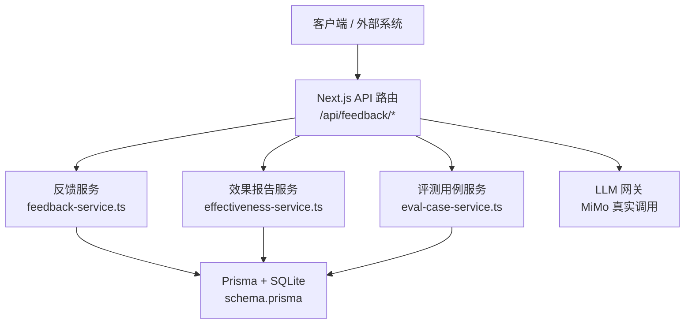
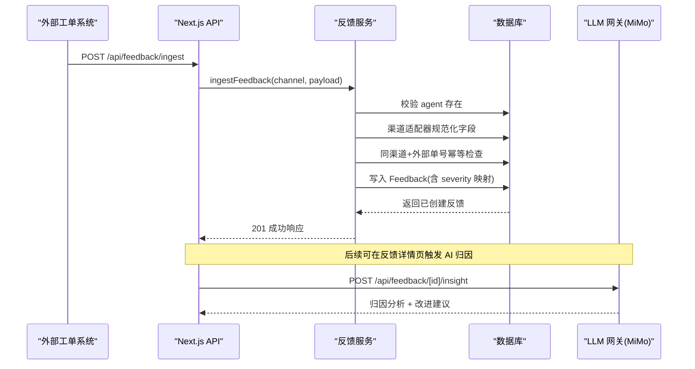
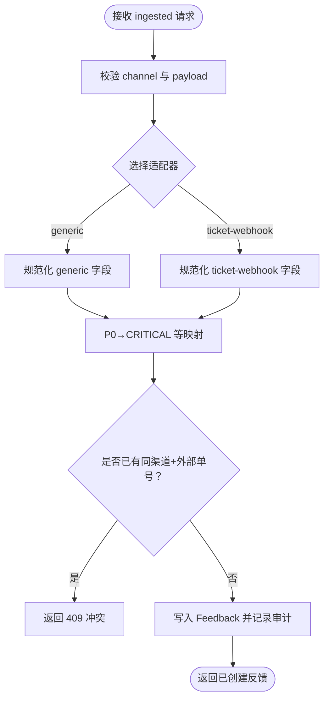
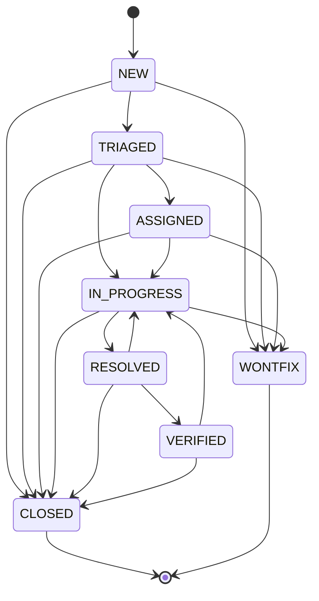
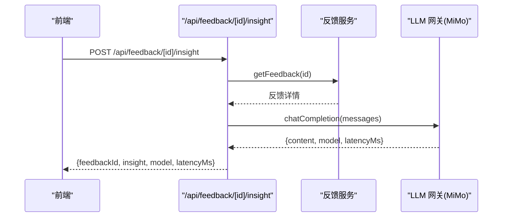
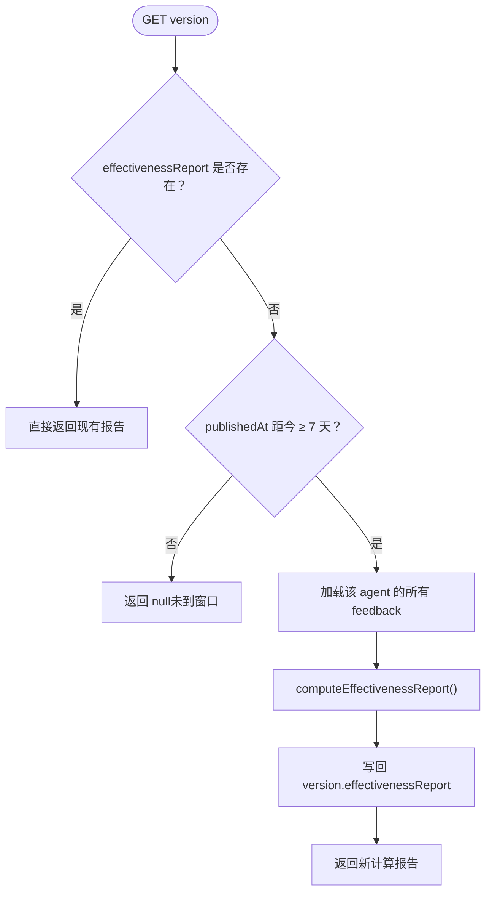
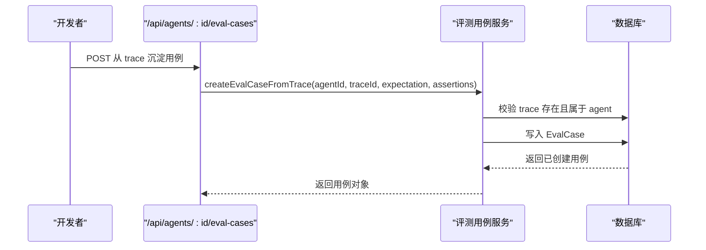
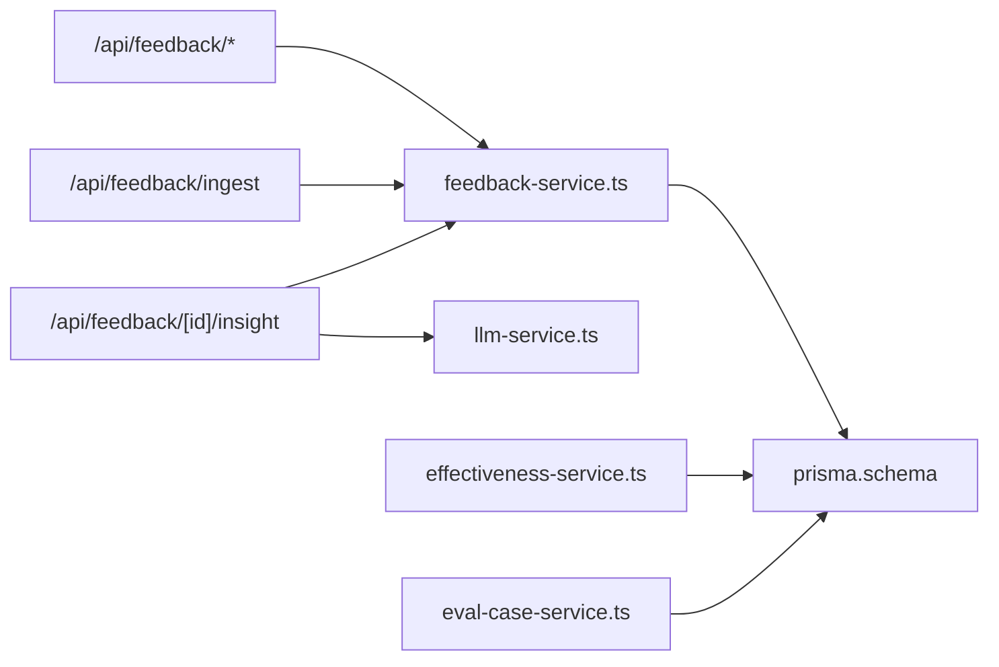

# 反馈评估系统

<cite>
**本文引用的文件**   
- [apps/web/app/api/feedback/route.ts](file://apps/web/app/api/feedback/route.ts)
- [apps/web/app/api/feedback/ingest/route.ts](file://apps/web/app/api/feedback/ingest/route.ts)
- [apps/web/app/api/feedback/[id]/insight/route.ts](file://apps/web/app/api/feedback/[id]/insight/route.ts)
- [apps/web/lib/services/feedback-service.ts](file://apps/web/lib/services/feedback-service.ts)
- [apps/web/lib/services/effectiveness-service.ts](file://apps/web/lib/services/effectiveness-service.ts)
- [apps/web/lib/schemas.ts](file://apps/web/lib/schemas.ts)
- [packages/db/src/enums.ts](file://packages/db/src/enums.ts)
- [packages/db/prisma/schema.prisma](file://packages/db/prisma/schema.prisma)
- [apps/web/lib/services/eval-case-service.ts](file://apps/web/lib/services/eval-case-service.ts)
- [apps/web/app/api/eval-cases/[id]/route.ts](file://apps/web/app/api/eval-cases/[id]/route.ts)
- [docs/reports/2026-08-25-mimo-llm-integration-delivery.md](file://docs/reports/2026-08-25-mimo-llm-integration-delivery.md)
- [docs/api/api-reference.md](file://docs/api/api-reference.md)
- [README.md](file://README.md)
</cite>

## 目录
1. [引言](#引言)
2. [项目结构](#项目结构)
3. [核心组件](#核心组件)
4. [架构总览](#架构总览)
5. [详细组件分析](#详细组件分析)
6. [依赖关系分析](#依赖关系分析)
7. [性能与可扩展性](#性能与可扩展性)
8. [故障排查指南](#故障排查指南)
9. [结论](#结论)
10. [附录：API 端点、数据模型与使用示例](#附录api-端点数据模型与使用示例)

## 引言
本技术文档聚焦“反馈评估系统”，覆盖以下目标：
- 多渠道工单接入与自动分诊（严重程度映射、幂等保护）。
- 反馈状态机实现，包括合法转移规则与非法流转拒绝。
- AI 归因能力：基于小米 MiMo LLM 的问题定位与改进建议生成。
- 效果报告自动生成：发布后 7 天懒计算与关键指标聚合。
- 评测用例库管理：从试聊 trace 沉淀到发布前 AI 评测回放。
- API 端点规范、数据模型定义与使用示例。

该系统以 Next.js API Routes 为入口，通过服务层完成业务逻辑，持久化由 Prisma + SQLite 承担；AI 能力统一走 LLM 网关对接小米 MiMo。

## 项目结构
反馈评估相关代码主要分布在以下位置：
- API 路由：`apps/web/app/api/feedback/**`、`apps/web/app/api/eval-cases/**`。
- 服务层：`apps/web/lib/services/feedback-service.ts`、`effectiveness-service.ts`、`eval-case-service.ts`。
- 校验 Schema：`apps/web/lib/schemas.ts`。
- 枚举与数据库模型：`packages/db/src/enums.ts`、`packages/db/prisma/schema.prisma`。
- LLM 集成说明：`docs/reports/2026-08-25-mimo-llm-integration-delivery.md`、`docs/api/api-reference.md`、`README.md`。

**图表来源**
- [apps/web/app/api/feedback/route.ts:11-73](file://apps/web/app/api/feedback/route.ts#L11-L73)
- [apps/web/app/api/feedback/ingest/route.ts:7-32](file://apps/web/app/api/feedback/ingest/route.ts#L7-L32)
- [apps/web/lib/services/feedback-service.ts:16-41](file://apps/web/lib/services/feedback-service.ts#L16-L41)
- [apps/web/lib/services/effectiveness-service.ts:4-28](file://apps/web/lib/services/effectiveness-service.ts#L4-L28)
- [packages/db/prisma/schema.prisma:208-251](file://packages/db/prisma/schema.prisma#L208-L251)

**章节来源**
- [apps/web/app/api/feedback/route.ts:11-73](file://apps/web/app/api/feedback/route.ts#L11-L73)
- [apps/web/app/api/feedback/ingest/route.ts:7-32](file://apps/web/app/api/feedback/ingest/route.ts#L7-L32)
- [packages/db/prisma/schema.prisma:208-251](file://packages/db/prisma/schema.prisma#L208-L251)

## 核心组件
- 反馈 API 路由：提供列表查询、创建、更新以及多渠道工单接入。
- 反馈服务：封装状态机、多渠道适配、严重级别映射、审计记录。
- 效果报告服务：按版本发布后 7 天窗口懒计算反馈效果报告。
- 评测用例服务：从 Trace 沉淀评测用例，支持断言与删除。
- 数据模型与枚举：Feedback、AgentVersion、Trace、EvalCase 等实体及枚举值。
- LLM 集成：反馈 AI 归因与 Agent 试聊均通过 LLM 网关调用 MiMo。

**章节来源**
- [apps/web/lib/services/feedback-service.ts:16-41](file://apps/web/lib/services/feedback-service.ts#L16-L41)
- [apps/web/lib/services/effectiveness-service.ts:4-28](file://apps/web/lib/services/effectiveness-service.ts#L4-L28)
- [apps/web/lib/services/eval-case-service.ts:85-130](file://apps/web/lib/services/eval-case-service.ts#L85-L130)
- [packages/db/src/enums.ts:52-93](file://packages/db/src/enums.ts#L52-L93)

## 架构总览
反馈评估系统的关键交互如下：
- 人工提交或外部工单接入进入 `/api/feedback` 或 `/api/feedback/ingest`。
- 反馈服务执行权限校验、渠道适配、严重级别映射、幂等检查与状态机校验。
- 反馈详情可触发 AI 归因，调用 LLM 网关生成问题定位和改进建议。
- 版本发布后，读取版本时若满足时间窗口则懒计算效果报告并写回。
- 试聊 Trace 可沉淀为评测用例，发布前进行 AI 评测回放。

**图表来源**
- [apps/web/app/api/feedback/ingest/route.ts:7-32](file://apps/web/app/api/feedback/ingest/route.ts#L7-L32)
- [apps/web/lib/services/feedback-service.ts:185-294](file://apps/web/lib/services/feedback-service.ts#L185-L294)
- [apps/web/app/api/feedback/[id]/insight/route.ts:7-58](file://apps/web/app/api/feedback/[id]/insight/route.ts#L7-L58)

## 详细组件分析

### 反馈收集与处理流程
- 多渠道接入：
  - `generic`：外部系统自行映射字段直传。
  - `ticket-webhook`：典型工单 webhook 原生字段，由适配器规范化。
- 自动分诊：
  - 将 P0/P1/P2/P3 映射为 CRITICAL/MAJOR/MINOR/SUGGESTION。
  - 默认 rating 为 NEGATIVE，severity 缺省为 MINOR。
- 幂等保护：
  - 同渠道 + 同 externalRefId 重复接入返回冲突错误，防止 webhook 重试造成重复工单。
- 审计记录：
  - 创建和更新操作均记录审计日志，包含 from/to 状态、channel、externalRefId 等上下文。

**图表来源**
- [apps/web/lib/services/feedback-service.ts:197-242](file://apps/web/lib/services/feedback-service.ts#L197-L242)
- [apps/web/lib/services/feedback-service.ts:244-294](file://apps/web/lib/services/feedback-service.ts#L244-L294)

**章节来源**
- [apps/web/app/api/feedback/ingest/route.ts:7-32](file://apps/web/app/api/feedback/ingest/route.ts#L7-L32)
- [apps/web/lib/services/feedback-service.ts:185-294](file://apps/web/lib/services/feedback-service.ts#L185-L294)

### 反馈状态机与非法流转拒绝
- 合法转移表：
  - NEW → TRIAGED / WONTFIX / CLOSED
  - TRIAGED → ASSIGNED / IN_PROGRESS / WONTFIX / CLOSED
  - ASSIGNED → IN_PROGRESS / WONTFIX / CLOSED
  - IN_PROGRESS → RESOLVED / WONTFIX / CLOSED
  - RESOLVED → VERIFIED / IN_PROGRESS / CLOSED
  - VERIFIED → CLOSED / IN_PROGRESS
  - CLOSED / WONTFIX 为终态，不可再转。
- 非法流转拒绝：
  - 当尝试从当前状态跳转到不在允许列表中的状态时，抛出验证错误，包含 allowed 去向。
- 副作用字段：
  - 状态变为 RESOLVED 时设置 resolvedAt。
  - 状态变为 ASSIGNED 且传入 assignedTo 时设置 assignedAt。
  - 状态变为 VERIFIED 时设置 verifiedAt 并可附带 verificationNote。

**图表来源**
- [apps/web/lib/services/feedback-service.ts:21-30](file://apps/web/lib/services/feedback-service.ts#L21-L30)

**章节来源**
- [apps/web/lib/services/feedback-service.ts:21-41](file://apps/web/lib/services/feedback-service.ts#L21-L41)
- [apps/web/lib/services/feedback-service.ts:296-336](file://apps/web/lib/services/feedback-service.ts#L296-L336)

### AI 归因功能与 MiMo LLM 集成
- 触发方式：POST `/api/feedback/[id]/insight`。
- 行为：
  - 读取反馈详情，构造 system/user 消息。
  - 调用 LLM 网关生成「归因分析 + 改进建议」。
  - 返回 insight、model、latencyMs，不落库。
- MiMo 集成要点：
  - 使用 OpenAI 兼容协议，Base URL 与 API Key 来自环境变量。
  - 未配置返回 503；上游错误 502；超时 504。
  - 响应包含 model 与 latencyMs。

**图表来源**
- [apps/web/app/api/feedback/[id]/insight/route.ts:7-58](file://apps/web/app/api/feedback/[id]/insight/route.ts#L7-L58)
- [docs/api/api-reference.md:122-137](file://docs/api/api-reference.md#L122-L137)
- [docs/reports/2026-08-25-mimo-llm-integration-delivery.md:15-21](file://docs/reports/2026-08-25-mimo-llm-integration-delivery.md#L15-L21)

**章节来源**
- [apps/web/app/api/feedback/[id]/insight/route.ts:7-58](file://apps/web/app/api/feedback/[id]/insight/route.ts#L7-L58)
- [docs/api/api-reference.md:122-137](file://docs/api/api-reference.md#L122-L137)
- [docs/reports/2026-08-25-mimo-llm-integration-delivery.md:15-21](file://docs/reports/2026-08-25-mimo-llm-integration-delivery.md#L15-L21)

### 效果报告自动生成机制（发布后 7 天懒计算）
- 触发时机：读取 version 时，若 publishedAt 距今 ≥ windowDays 且 effectivenessReport 为空，则现场计算并写回。
- 窗口语义：windowEnd = publishedAt + windowDays；只统计 publishedAt ≤ submittedAt ≤ windowEnd 的 feedback，且 agentId 匹配。
- 聚合维度：
  - byRating：POSITIVE / NEGATIVE / NEUTRAL。
  - bySeverity：CRITICAL / MAJOR / MINOR / SUGGESTION。
  - byPartition：PROMPT / KNOWLEDGE / TOOLS / ROUTING。
- 幂等短路：
  - 已存在报告直接返回；并发场景先 refetch PG，避免重复算。
- 纯函数设计：
  - computeEffectivenessReport 不读 store、不写副作用，便于单测；now 可注入。

**图表来源**
- [apps/web/lib/services/effectiveness-service.ts:72-126](file://apps/web/lib/services/effectiveness-service.ts#L72-L126)
- [apps/web/lib/services/effectiveness-service.ts:128-187](file://apps/web/lib/services/effectiveness-service.ts#L128-L187)

**章节来源**
- [apps/web/lib/services/effectiveness-service.ts:4-28](file://apps/web/lib/services/effectiveness-service.ts#L4-L28)
- [apps/web/lib/services/effectiveness-service.ts:72-126](file://apps/web/lib/services/effectiveness-service.ts#L72-L126)
- [apps/web/lib/services/effectiveness-service.ts:128-187](file://apps/web/lib/services/effectiveness-service.ts#L128-L187)

### 评测用例库管理（从试聊 trace 沉淀到发布前 AI 评测回放）
- 沉淀路径：
  - 从 Trace 表读取历史对话，校验属于目标 Agent。
  - 创建 EvalCase，保存 expectation、assertions、systemPrompt、history、message、referenceReply。
- 断言类型：
  - contains / not_contains / regex（正则需合法）。
- 生命周期：
  - 删除 EvalCase 仅移除评测语料，不影响原始 Trace。
  - 发布前可进行 AI 评测回放：先跑确定性断言，全过再由判官逐条 PASS/FAIL。

**图表来源**
- [apps/web/lib/services/eval-case-service.ts:85-130](file://apps/web/lib/services/eval-case-service.ts#L85-L130)
- [apps/web/app/api/eval-cases/[id]/route.ts:6-23](file://apps/web/app/api/eval-cases/[id]/route.ts#L6-L23)

**章节来源**
- [apps/web/lib/services/eval-case-service.ts:85-130](file://apps/web/lib/services/eval-case-service.ts#L85-L130)
- [apps/web/app/api/eval-cases/[id]/route.ts:6-23](file://apps/web/app/api/eval-cases/[id]/route.ts#L6-L23)

## 依赖关系分析
- API 路由依赖服务层：
  - feedback/route.ts → feedback-service.ts
  - feedback/ingest/route.ts → feedback-service.ts
  - feedback/[id]/insight/route.ts → feedback-service.ts + llm-service.ts
- 服务层依赖：
  - feedback-service.ts → prisma、audit-service、rbac
  - effectiveness-service.ts → prisma、audit-service
  - eval-case-service.ts → prisma、audit-service、rbac
- 数据模型依赖：
  - Feedback 关联 Agent、Release、Trace、EvalCase。
  - AgentVersion 存储 effectivenessReport JSON。
  - Trace 与 EvalCase 共享 Agent 上下文。

**图表来源**
- [apps/web/app/api/feedback/route.ts:1-9](file://apps/web/app/api/feedback/route.ts#L1-L9)
- [apps/web/app/api/feedback/ingest/route.ts:1-5](file://apps/web/app/api/feedback/ingest/route.ts#L1-L5)
- [apps/web/app/api/feedback/[id]/insight/route.ts:1-5](file://apps/web/app/api/feedback/[id]/insight/route.ts#L1-L5)
- [packages/db/prisma/schema.prisma:208-251](file://packages/db/prisma/schema.prisma#L208-L251)

**章节来源**
- [apps/web/app/api/feedback/route.ts:1-9](file://apps/web/app/api/feedback/route.ts#L1-L9)
- [apps/web/app/api/feedback/ingest/route.ts:1-5](file://apps/web/app/api/feedback/ingest/route.ts#L1-L5)
- [apps/web/app/api/feedback/[id]/insight/route.ts:1-5](file://apps/web/app/api/feedback/[id]/insight/route.ts#L1-L5)
- [packages/db/prisma/schema.prisma:208-251](file://packages/db/prisma/schema.prisma#L208-L251)

## 性能与可扩展性
- 懒计算策略：
  - 效果报告在首次访问版本时计算，避免引入定时任务；代价为首读延迟。
- 标签过滤优化：
  - SQLite 无标量列表 has 过滤，tags 过滤取数后内存做，total 取过滤后口径。
- 并发安全：
  - 效果报告计算前先 refetch PG，避免重复计算；update 整列覆盖，最后写入胜出。
- 扩展性：
  - 新增渠道只需在 CHANNEL_ADAPTERS 添加适配器，不改路由与存储。
  - 枚举值与 Zod schema 对齐，运行时校验权威在 schemas.ts。

[本节为通用指导，无需特定文件引用]

## 故障排查指南
- 非法状态转移：
  - 检查 ALLOWED_TRANSITIONS 与当前状态；allowed 字段给出合法去向。
- assignedTo 或 verificationNote 未生效：
  - 确认 PUT 是否同时把 status 转到 ASSIGNED 或 VERIFIED；单独传字段被丢弃。
- tag 过滤返回空：
  - ALL 豁免只覆盖 status/severity/rating，tag 需前端单独处理。
- 创建反馈报 404：
  - 确认 agentId 指向的 Agent 存在且未归档。
- 终态反馈仍可改非状态字段：
  - CLOSED/WONTFIX 转移表为空，但同状态放行意味着非状态字段仍可变。

**章节来源**
- [apps/web/lib/services/feedback-service.ts:21-41](file://apps/web/lib/services/feedback-service.ts#L21-L41)
- [apps/web/lib/services/feedback-service.ts:296-336](file://apps/web/lib/services/feedback-service.ts#L296-L336)

## 结论
反馈评估系统通过清晰的状态机、多渠道接入、AI 归因与懒计算效果报告，构建了从反馈收集到改进闭环的完整链路。结合评测用例库管理，系统在发布前具备可回溯、可验证的质量保障能力。未来可进一步扩展渠道适配器、增强 AI 归因提示词工程，并优化首读延迟下的用户体验。

[本节为总结性内容，无需特定文件引用]

## 附录：API 端点、数据模型与使用示例

### API 端点规范
- 反馈列表与 CRUD：
  - GET /api/feedback：分页查询，支持 agentId/status/severity/rating/tag 过滤。
  - POST /api/feedback：创建反馈，必填 agentId/title/content/rating。
  - PUT /api/feedback：更新反馈，可选 status/severity/assignedTo/resolution/targetPartition/verificationNote。
- 多渠道工单接入：
  - POST /api/feedback/ingest：channel=generic 或 ticket-webhook，payload 经适配器规范化。
- AI 归因：
  - POST /api/feedback/[id]/insight：返回 insight/model/latencyMs，不落库。

**章节来源**
- [apps/web/app/api/feedback/route.ts:11-73](file://apps/web/app/api/feedback/route.ts#L11-L73)
- [apps/web/app/api/feedback/ingest/route.ts:7-32](file://apps/web/app/api/feedback/ingest/route.ts#L7-L32)
- [apps/web/app/api/feedback/[id]/insight/route.ts:7-58](file://apps/web/app/api/feedback/[id]/insight/route.ts#L7-L58)
- [docs/api/api-reference.md:122-137](file://docs/api/api-reference.md#L122-L137)

### 数据模型定义
- Feedback：
  - 关键字段：agentId/source/title/content/rating/tags/severity/status/targetPartition/externalRefId/externalRefUrl/submittedBy/submittedAt。
  - 索引：agentId+status、submittedAt、severity+status。
- AgentVersion：
  - 关键字段：agentId/version/publishedAt/effectivenessReport。
- Trace：
  - 关键字段：agentId/systemPrompt/history/message/reply/model/usage/latencyMs/rating/note。
- EvalCase：
  - 关键字段：agentId/sourceTraceId/title/expectation/assertions/systemPrompt/history/message/referenceReply/status/createdBy。

**章节来源**
- [packages/db/prisma/schema.prisma:208-251](file://packages/db/prisma/schema.prisma#L208-L251)
- [packages/db/prisma/schema.prisma:294-318](file://packages/db/prisma/schema.prisma#L294-L318)
- [packages/db/prisma/schema.prisma:556-596](file://packages/db/prisma/schema.prisma#L556-L596)

### 使用示例
- 多渠道接入示例（ticket-webhook）：
  - channel: "ticket-webhook"
  - agentId: "<agent-id>"
  - ticket: { key, subject, description, priority: "P0"|"P1"|"P2"|"P3", url }
  - 预期：severity 映射为 CRITICAL/MAJOR/MINOR/SUGGESTION，rating 默认 NEGATIVE。
- 状态转移示例：
  - 从 NEW 转移到 TRIAGED 合法。
  - 从 NEW 直接跳到 RESOLVED 非法，返回 422 并附 allowed 列表。
- 效果报告示例：
  - 发布后第 8 天首次访问版本，返回 computedAt/versionPublishedAt/windowDays/byRating/bySeverity/byPartition。
- 评测用例沉淀示例：
  - 从 traceId 沉淀用例，附带 expectation 与 assertions（contains/not_contains/regex）。

**章节来源**
- [apps/web/lib/services/feedback-service.ts:197-242](file://apps/web/lib/services/feedback-service.ts#L197-L242)
- [apps/web/lib/services/feedback-service.ts:296-336](file://apps/web/lib/services/feedback-service.ts#L296-L336)
- [apps/web/lib/services/effectiveness-service.ts:72-126](file://apps/web/lib/services/effectiveness-service.ts#L72-L126)
- [apps/web/lib/services/eval-case-service.ts:85-130](file://apps/web/lib/services/eval-case-service.ts#L85-L130)