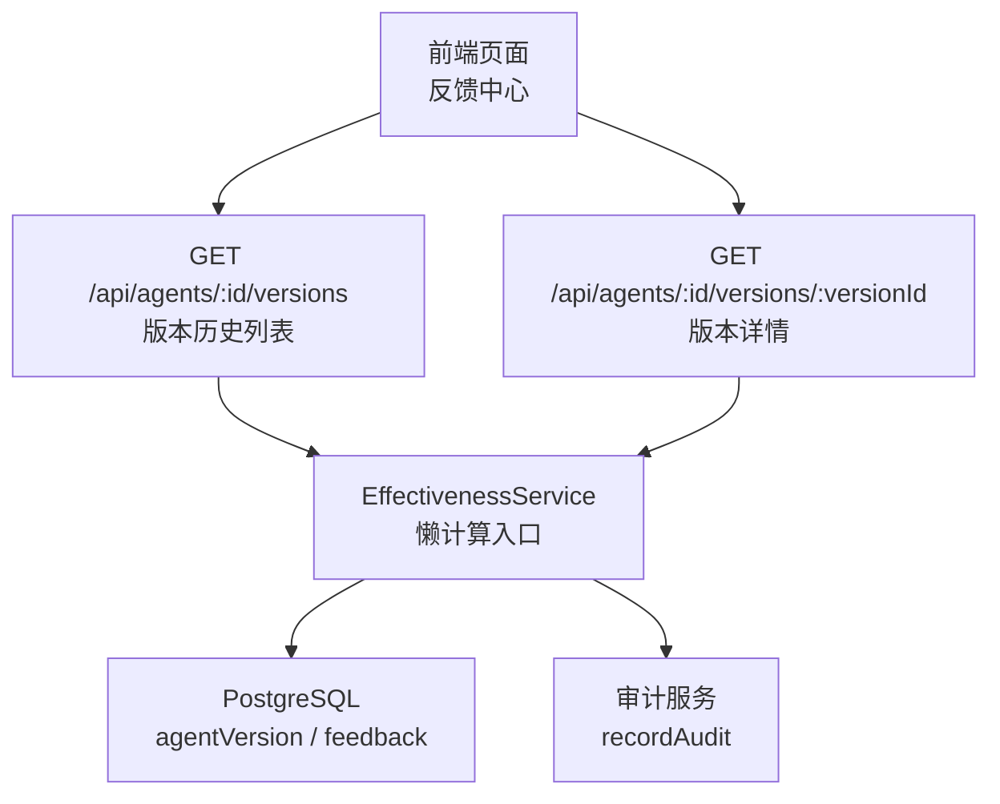
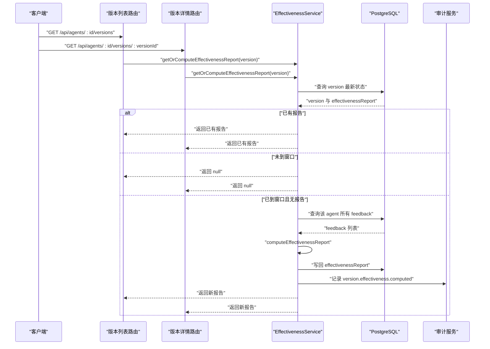
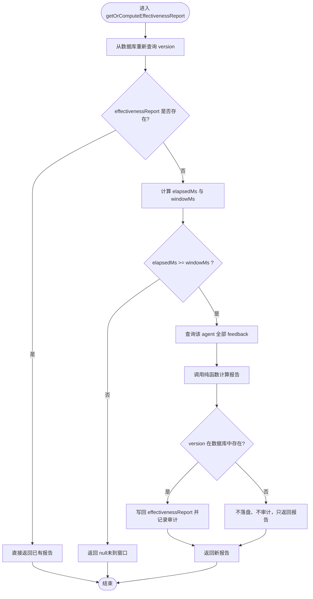
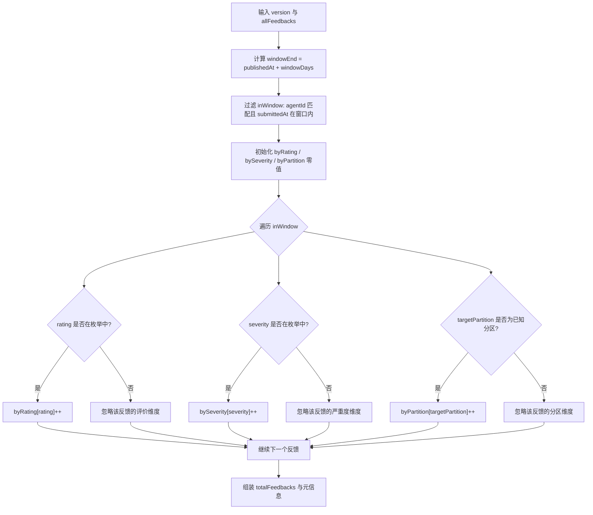
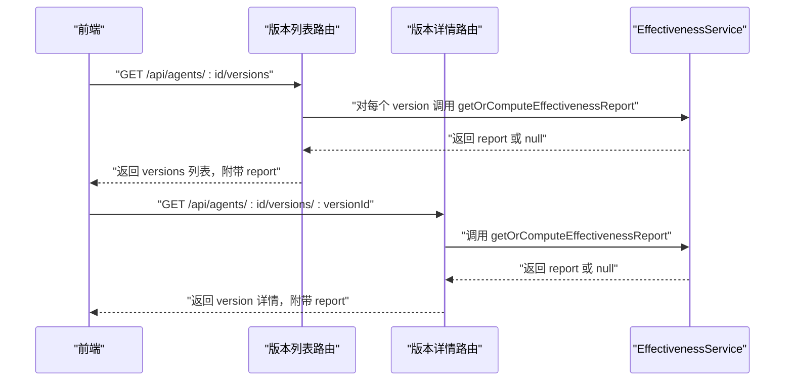
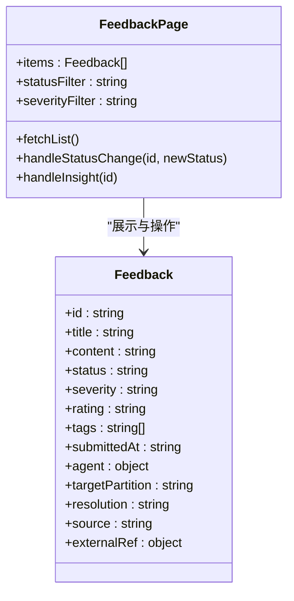
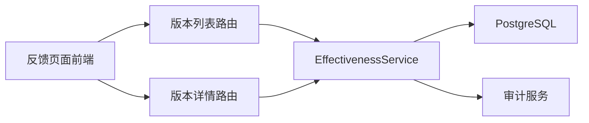

# 效果报告生成

<cite>
**本文引用的文件**   
- [effectiveness-service.ts](file://apps/web/lib/services/effectiveness-service.ts)
- [versions 列表路由](file://apps/web/app/api/agents/[id]/versions/route.ts)
- [版本详情路由](file://apps/web/app/api/agents/[id]/versions/[versionId]/route.ts)
- [反馈页面前端](file://apps/web/app/(dashboard)/feedback/page.tsx)
- [effectiveness-service 设计文档](file://docs/distilled/effectiveness-service.md)
</cite>

## 目录
1. [引言](#引言)
2. [项目结构定位](#项目结构定位)
3. [核心组件](#核心组件)
4. [架构总览](#架构总览)
5. [详细组件分析](#详细组件分析)
6. [依赖关系分析](#依赖关系分析)
7. [性能与扩展性](#性能与扩展性)
8. [故障排查指南](#故障排查指南)
9. [结论](#结论)

## 引言
本文件面向“效果报告生成”能力，聚焦以下目标：
- 解释发布后 7 天的懒计算触发条件、延迟机制与幂等语义。
- 说明关键指标定义与聚合口径，包括反馈数量、按评价、严重程度、目标分区的统计方式。
- 梳理报告数据的聚合逻辑、存储格式、API 暴露方式以及前端展示位置。
- 给出当前实现中的性能特征、优化建议与可定制扩展点。
- 明确该功能在整体 Agent 平台中的职责边界：它基于反馈数据对已发布版本做事后效果评估，不直接提供“解决率”“平均解决时间”“用户满意度”等业务指标的计算实现。

## 项目结构定位
效果报告生成功能位于 Next.js Web 应用中，采用“服务层 + API 路由 + 前端页面”的常见分层：
- 服务层：`apps/web/lib/services/effectiveness-service.ts`，封装纯计算逻辑与懒填充入口。
- API 层：两个 GET 路由在读取 Version 时触发懒计算。
- 前端：反馈中心页面负责录入和跟踪反馈；效果报告本身由版本历史/版本详情接口返回，供对应页面消费。

**图表来源** 
- [versions 列表路由:1-53](file://apps/web/app/api/agents/[id]/versions/route.ts#L1-L53)
- [版本详情路由:1-40](file://apps/web/app/api/agents/[id]/versions/[versionId]/route.ts#L1-L40)
- [effectiveness-service.ts:1-187](file://apps/web/lib/services/effectiveness-service.ts#L1-L187)

**章节来源**
- [effectiveness-service.ts:1-28](file://apps/web/lib/services/effectiveness-service.ts#L1-L28)
- [versions 列表路由:8-17](file://apps/web/app/api/agents/[id]/versions/route.ts#L8-L17)
- [版本详情路由:9-14](file://apps/web/app/api/agents/[id]/versions/[versionId]/route.ts#L9-L14)

## 核心组件
### EffectivenessReport 数据结构
效果报告是一个结构化快照，包含以下字段：
- `totalFeedbacks`：窗口内反馈总数。
- `byRating`：按评价维度聚合，枚举为 POSITIVE、NEGATIVE、NEUTRAL。
- `bySeverity`：按严重程度聚合，枚举为 CRITICAL、MAJOR、MINOR、SUGGESTION。
- `byPartition`：按目标分区聚合，枚举为 PROMPT、KNOWLEDGE、TOOLS、ROUTING。
- `computedAt`：本次计算时间。
- `versionPublishedAt`：关联版本的发布时间。
- `windowDays`：计算窗口天数，默认 7。

该类型定义与服务注释共同构成报告的契约，API 响应中若满足懒计算条件，会将该对象合并进 Version 响应。

**章节来源**
- [effectiveness-service.ts:30-40](file://apps/web/lib/services/effectiveness-service.ts#L30-L40)
- [effectiveness-service.ts:117-125](file://apps/web/lib/services/effectiveness-service.ts#L117-L125)

### 纯计算函数 computeEffectivenessReport
该函数是效果报告的核心算法：
- 接收一个 Version 对象、某个 Agent 的全部反馈集合，以及可选窗口天数和时间基准。
- 计算窗口结束时间：以 `publishedAt` 为起点，加上 `windowDays`。
- 过滤窗口内反馈：要求 `submittedAt` 落在 `[publishedAt, windowEnd]`，且 `agentId` 必须匹配。
- 三维聚合：分别统计 rating、severity、targetPartition 的计数；不在已知枚举的值会被静默丢弃，不会报错。
- 返回不可变的报告对象，包含汇总数、三个维度的零值基线、计算时间与窗口元信息。

该函数被刻意设计为纯函数：不读数据库、不写副作用、时间基准可注入，便于单元测试覆盖不同时间场景。

**章节来源**
- [effectiveness-service.ts:72-126](file://apps/web/lib/services/effectiveness-service.ts#L72-L126)

### 懒计算入口 getOrComputeEffectivenessReport
该异步函数承担 IO 与调度职责：
1. 先从数据库重新查询目标 version，拿到最新状态并解析其中的 `effectivenessReport`。
2. 如果已有报告，直接短路返回，不再计算。
3. 判断是否已过窗口：用当前时间与 `publishedAt` 比较，未达 7 天则返回 null。
4. 全量读取该 agent 的所有 feedback，调用纯函数计算报告。
5. 若磁盘上确实存在该 version，则写回 `effectivenessReport` 并记录审计事件。
6. 返回报告对象；若未到窗口或不存在 version，则返回 null。

并发保护方面，先 refetch 再判空可减少重复计算；但判断与写回之间没有分布式锁，极端并发可能产生多条审计记录，不过最终写入的报告内容相同，属于幂等覆盖。

**章节来源**
- [effectiveness-service.ts:128-186](file://apps/web/lib/services/effectiveness-service.ts#L128-L186)

## 架构总览
效果报告生成的控制流如下：

**图表来源**
- [versions 列表路由:18-48](file://apps/web/app/api/agents/[id]/versions/route.ts#L18-L48)
- [版本详情路由:15-35](file://apps/web/app/api/agents/[id]/versions/[versionId]/route.ts#L15-L35)
- [effectiveness-service.ts:134-186](file://apps/web/lib/services/effectiveness-service.ts#L134-L186)

## 详细组件分析

### 懒计算触发条件与延迟机制
- **触发条件**：
  - 版本已发布，且 `publishedAt` 距今 ≥ `windowDays`（默认 7 天）。
  - 数据库中该 version 的 `effectivenessReport` 为空。
- **延迟机制**：
  - 不引入定时任务或 cron；首次读取版本时才会触发计算。
  - 若未到窗口，API 返回 null，前端通常不展示效果标签。
  - 一旦计算完成并写回，后续请求直接复用缓存结果，不再重算。
- **幂等语义**：
  - 已存在报告直接返回。
  - 并发下多次计算的结果相同，最终写入覆盖前一次，数据无害但可能产生多条审计记录。

**图表来源**
- [effectiveness-service.ts:134-186](file://apps/web/lib/services/effectiveness-service.ts#L134-L186)

**章节来源**
- [effectiveness-service.ts:10-18](file://apps/web/lib/services/effectiveness-service.ts#L10-L18)
- [effectiveness-service.ts:156-163](file://apps/web/lib/services/effectiveness-service.ts#L156-L163)
- [effectiveness-service.ts:172-183](file://apps/web/lib/services/effectiveness-service.ts#L172-L183)

### 关键指标定义与计算方法
当前实现并未直接计算“反馈解决率”“平均解决时间”“用户满意度”这类业务指标，而是围绕反馈数据做维度统计：

- **反馈总数 totalFeedbacks**：窗口内且 agentId 匹配的反馈条数。
- **按评价 byRating**：POSITIVE、NEGATIVE、NEUTRAL 三类计数。
- **按严重程度 bySeverity**：CRITICAL、MAJOR、MINOR、SUGGESTION 四类计数。
- **按目标分区 byPartition**：PROMPT、KNOWLEDGE、TOOLS、ROUTING 四类计数。

这些指标适合用于“这个版本上线一周内反馈分布如何”的分析，但不等同于运营层面的解决率或满意度。若需要后者，应在现有报告之上增加二次计算层，结合反馈状态、解决时间、评分等业务字段进行衍生统计。

**章节来源**
- [effectiveness-service.ts:32-40](file://apps/web/lib/services/effectiveness-service.ts#L32-L40)
- [effectiveness-service.ts:94-125](file://apps/web/lib/services/effectiveness-service.ts#L94-L125)

### 报告数据的聚合与统计逻辑
聚合逻辑集中在纯函数中，核心规则如下：
- **窗口过滤**：仅统计 `submittedAt` 在 `[publishedAt, publishedAt + windowDays]` 范围内的反馈。
- **Agent 匹配**：仅统计与 version 所属 agentId 一致的反馈。
- **未知枚举值处理**：rating、severity、targetPartition 不在预定义枚举内的值不会计入任何桶，也不会抛出错误。
- **零值基线**：每个维度都有初始零值对象，保证即使没有反馈也能返回完整结构。

**图表来源**
- [effectiveness-service.ts:81-126](file://apps/web/lib/services/effectiveness-service.ts#L81-L126)

**章节来源**
- [effectiveness-service.ts:58-70](file://apps/web/lib/services/effectiveness-service.ts#L58-L70)
- [effectiveness-service.ts:94-125](file://apps/web/lib/services/effectiveness-service.ts#L94-L125)

### 报告的存储格式与导出
- **存储位置**：报告以 JSON 形式存储在 PostgreSQL 的 `agentVersion` 表中，字段名为 `effectivenessReport`。
- **读写方式**：服务层通过 Prisma 查询 version，并使用打包/解包工具处理 JSON 字段。
- **导出能力**：当前代码未提供专门的“导出报告”接口；报告随版本详情或版本历史接口返回，前端可自行下载或转发给外部系统。
- **审计记录**：每次成功写回会记录 `version.effectiveness.computed`，包含 agentId、totalFeedbacks、windowDays 等上下文。

**章节来源**
- [effectiveness-service.ts:139-150](file://apps/web/lib/services/effectiveness-service.ts#L139-L150)
- [effectiveness-service.ts:172-183](file://apps/web/lib/services/effectiveness-service.ts#L172-L183)

### API 接口规范
#### 获取版本历史列表
- **路径**：`GET /api/agents/:id/versions`
- **行为**：
  - 返回该 Agent 的所有已发布版本，按发布时间倒序。
  - 对每个 version 调用懒计算；若已过窗口且无报告，则现场计算并写回。
  - 响应中包含 `items` 数组，每个 item 可能附带 `effectivenessReport`。
- **副作用**：GET 请求可能触发写操作，属于设计取舍。

#### 获取单个版本详情
- **路径**：`GET /api/agents/:id/versions/:versionId`
- **行为**：
  - 校验 version 归属。
  - 调用懒计算；若满足条件则生成报告并写回。
  - 响应中包含 version 详情及可能的 `effectivenessReport`。

**图表来源**
- [versions 列表路由:18-48](file://apps/web/app/api/agents/[id]/versions/route.ts#L18-L48)
- [版本详情路由:15-35](file://apps/web/app/api/agents/[id]/versions/[versionId]/route.ts#L15-L35)

**章节来源**
- [versions 列表路由:8-17](file://apps/web/app/api/agents/[id]/versions/route.ts#L8-L17)
- [版本详情路由:9-14](file://apps/web/app/api/agents/[id]/versions/[versionId]/route.ts#L9-L14)

### 前端展示组件
反馈中心页面负责反馈的录入、筛选、状态流转与 AI 归因展示。它与效果报告的关系在于：
- 反馈数据是效果报告的数据源。
- 效果报告本身并不在该页面直接渲染，而是由版本历史/版本详情接口返回，供 Agent 详情页或版本历史页消费。
- 该页面展示了反馈的生命周期、严重程度、评价、目标分区等字段，这些字段正是效果报告聚合所依赖的维度。

**图表来源**
- [反馈页面前端:31-48](file://apps/web/app/(dashboard)/feedback/page.tsx#L31-L48)
- [反馈页面前端:69-142](file://apps/web/app/(dashboard)/feedback/page.tsx#L69-L142)

**章节来源**
- [反馈页面前端:69-142](file://apps/web/app/(dashboard)/feedback/page.tsx#L69-L142)
- [反馈页面前端:146-446](file://apps/web/app/(dashboard)/feedback/page.tsx#L146-L446)

## 依赖关系分析
效果报告生成涉及以下依赖：
- **数据库**：Prisma 访问 `agentVersion` 与 `feedback` 表。
- **审计服务**：写回成功后记录 `version.effectiveness.computed`。
- **API 路由**：版本列表与版本详情两个 GET 路由作为入口。
- **前端**：反馈页面提供数据录入与交互，效果报告由版本相关页面消费。

**图表来源**
- [effectiveness-service.ts:1-2](file://apps/web/lib/services/effectiveness-service.ts#L1-L2)
- [versions 列表路由:1-6](file://apps/web/app/api/agents/[id]/versions/route.ts#L1-L6)
- [版本详情路由:1-7](file://apps/web/app/api/agents/[id]/versions/[versionId]/route.ts#L1-L7)

**章节来源**
- [effectiveness-service.ts:1-2](file://apps/web/lib/services/effectiveness-service.ts#L1-L2)
- [effectiveness-service.ts:165-183](file://apps/web/lib/services/effectiveness-service.ts#L165-L183)

## 性能与扩展性

### 当前性能特征
- **懒计算避免后台任务**：无需维护 cron 或定时任务，降低运维成本。
- **首读延迟**：首次访问过窗口的版本时会触发数据库查询与聚合计算。
- **全量扫描反馈**：每次计算都读取该 agent 的全部 feedback，时间复杂度与反馈数量线性相关。
- **版本历史最坏情况**：一次 GET versions 可能对多个 version 各触发一轮 feedback 扫描，复杂度近似 O(版本数 × 反馈数)。
- **幂等写回**：报告已存在则短路，减少重复计算。

### 优化建议
- **增量计算**：
  - 为 feedback 增加版本号或生效范围索引，避免每次全量扫描。
  - 在反馈提交或状态变更时，增量更新对应版本的报告缓存。
- **缓存机制**：
  - 使用应用级缓存（如内存缓存或 Redis）暂存最近计算的报告，设置过期策略。
  - 对版本历史列表接口增加聚合缓存，避免对每个 version 重复触发懒计算。
- **分页与分批**：
  - 对 feedback 查询增加分页或流式处理，避免单次加载过大数据集。
- **并发安全**：
  - 在判断与写回之间引入分布式锁或数据库行级锁，避免并发双写导致多条审计记录。
- **指标扩展**：
  - 在现有报告之上增加“解决率”“平均解决时间”“用户满意度”等衍生指标计算层，结合反馈状态、解决时间、评分等字段。

**章节来源**
- [effectiveness-service.ts:165-170](file://apps/web/lib/services/effectiveness-service.ts#L165-L170)
- [effectiveness-service.ts:172-183](file://apps/web/lib/services/effectiveness-service.ts#L172-L183)
- [effectiveness-service 设计文档:87-104](file://docs/distilled/effectiveness-service.md#L87-L104)

### 可定制性与扩展性设计
- **窗口天数可配置**：`DEFAULT_WINDOW_DAYS` 为 7，但 `getOrComputeEffectivenessReport` 支持传入自定义窗口天数。
- **时间基准可注入**：`now` 参数允许测试注入固定时间，也可用于模拟不同时间场景。
- **维度枚举可扩展**：当前 rating、severity、targetPartition 使用硬编码枚举；如需新增维度，可在纯函数中扩展零值基线与成员检查逻辑。
- **报告结构可扩展**：`EffectivenessReport` 类型可新增字段，例如衍生指标、数据来源、计算版本等。
- **审计字段可扩展**：`recordAudit` 的 details 可追加更多上下文，便于追踪计算来源与参数。

**章节来源**
- [effectiveness-service.ts:30-40](file://apps/web/lib/services/effectiveness-service.ts#L30-L40)
- [effectiveness-service.ts:81-85](file://apps/web/lib/services/effectiveness-service.ts#L81-L85)
- [effectiveness-service.ts:134-137](file://apps/web/lib/services/effectiveness-service.ts#L134-L137)

## 故障排查指南
常见问题与排查方向：
- **版本详情页不显示效果标签**：
  - 确认版本发布时间距今是否已满 7 天。
  - 确认版本历史或版本详情接口曾被调用过一次，因为懒计算只在读时触发。
- **报告数字与预期不符**：
  - 检查反馈的 `submittedAt` 是否落在窗口内。
  - 检查反馈的 `agentId` 是否与 version 所属 agent 一致。
  - 检查 rating、severity、targetPartition 是否为已知枚举值。
- **审计流中出现“系统”操作者**：
  - 这是预期行为：懒计算由 GET 触发，审计记录的操作者为系统。
- **需要强制重算**：
  - 当前实现不支持重算；报告一旦写回即永久冻结。
  - 可通过删除数据库中 `effectivenessReport` 字段后再触发 GET 来间接重算。

**章节来源**
- [effectiveness-service 设计文档:89-104](file://docs/distilled/effectiveness-service.md#L89-L104)

## 结论
效果报告生成功能以懒计算为核心策略，在不引入定时任务的前提下，于首次读取版本时自动计算并发布后 7 天窗口内的反馈统计。其优势是零运维、幂等、纯计算与 IO 分离；代价是首读延迟、全量扫描反馈、GET 带写副作用以及报告永不重算。

对于更丰富的业务指标如“反馈解决率”“平均解决时间”“用户满意度”，建议在现有报告基础上增加衍生计算层，并结合反馈生命周期字段进行二次聚合。同时，应优先考虑增量计算、缓存、分页与并发安全等优化手段，以提升系统在大规模反馈与多版本场景下的性能与稳定性。