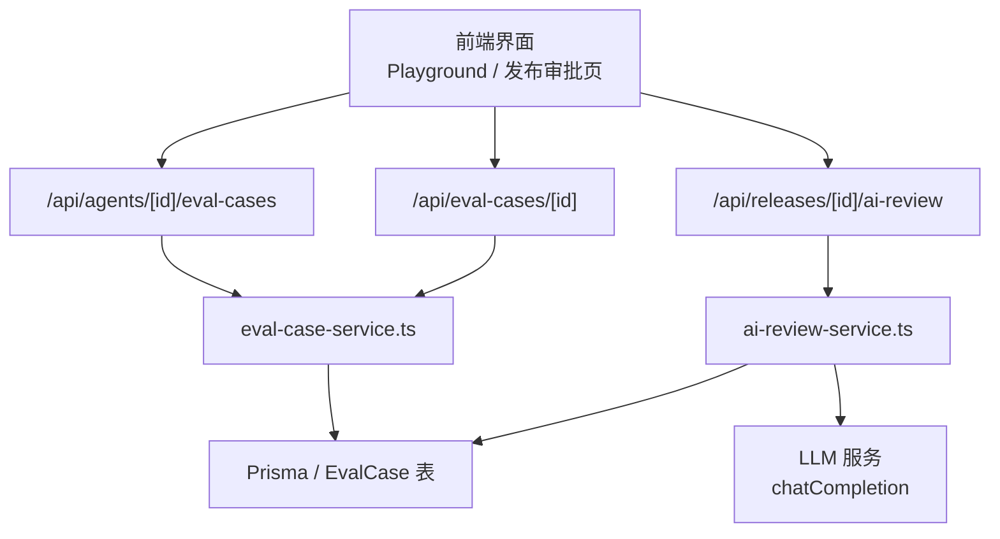
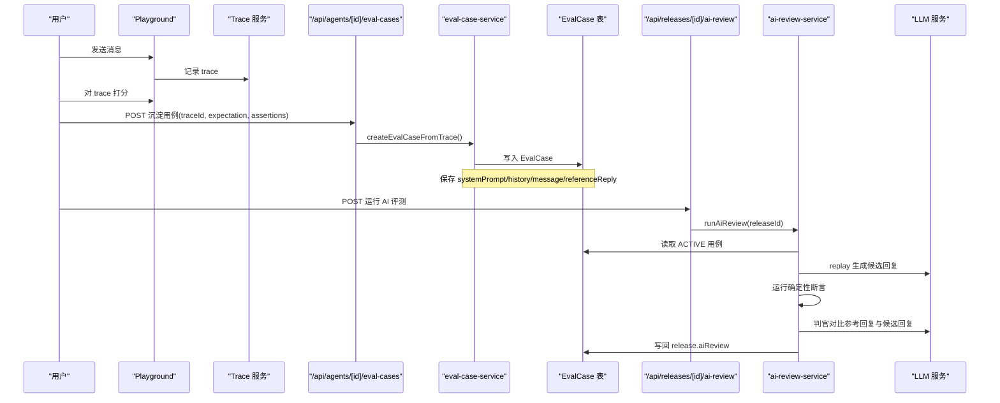
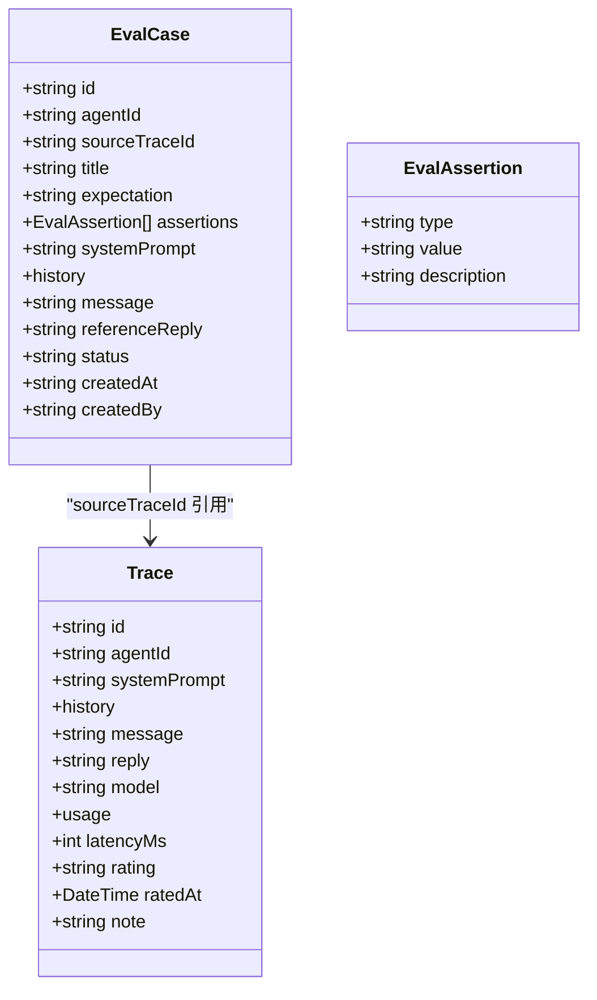
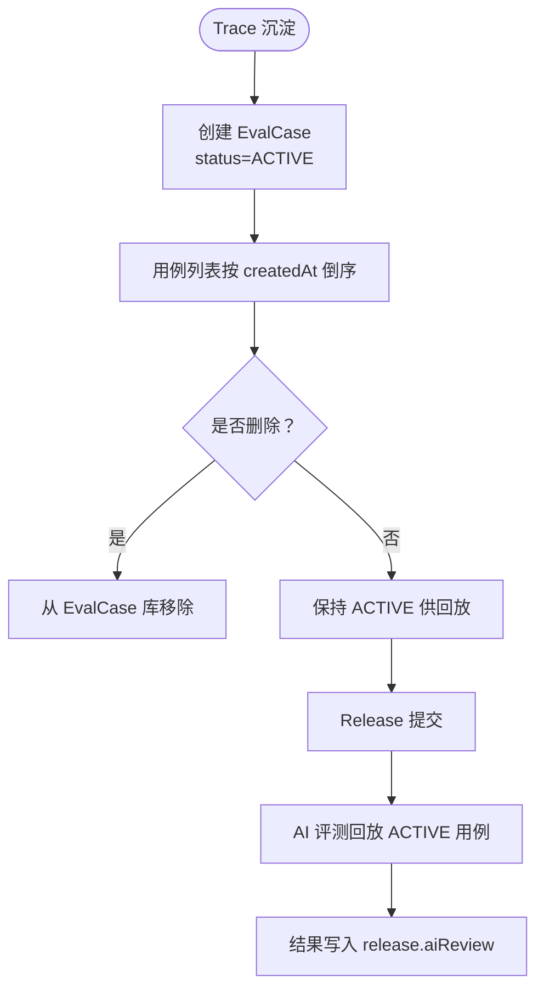
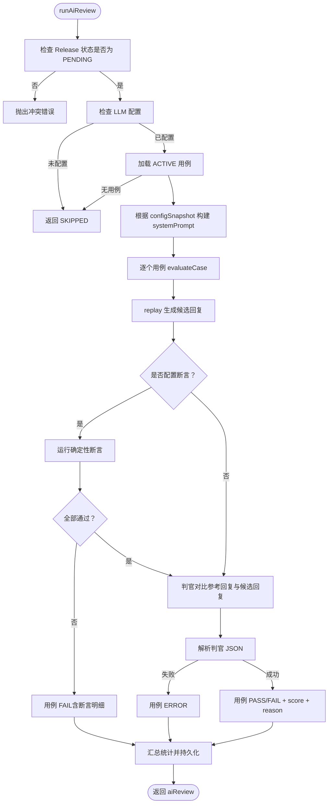
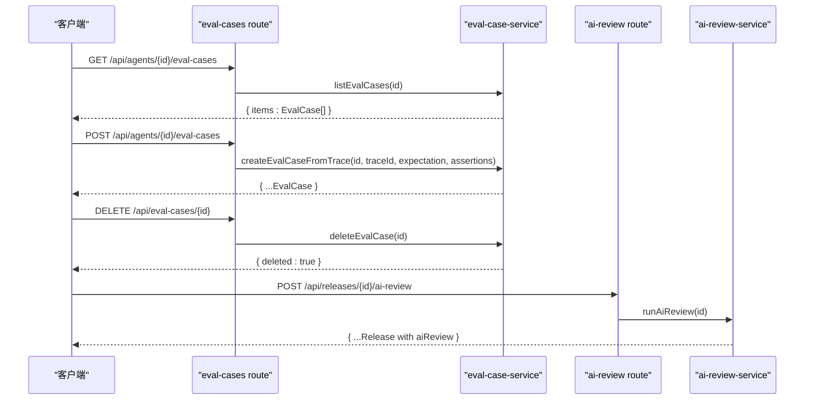
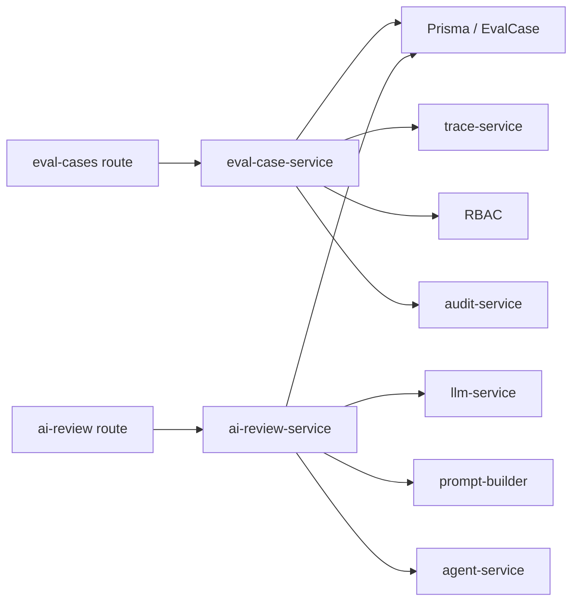

# 评测用例管理

<cite>
**本文引用的文件**   
- [apps/web/app/api/agents/[id]/eval-cases/route.ts](file://apps/web/app/api/agents/[id]/eval-cases/route.ts)
- [apps/web/app/api/eval-cases/[id]/route.ts](file://apps/web/app/api/eval-cases/[id]/route.ts)
- [apps/web/app/api/releases/[id]/ai-review/route.ts](file://apps/web/app/api/releases/[id]/ai-review/route.ts)
- [apps/web/lib/services/eval-case-service.ts](file://apps/web/lib/services/eval-case-service.ts)
- [apps/web/lib/services/ai-review-service.ts](file://apps/web/lib/services/ai-review-service.ts)
- [packages/db/prisma/schema.prisma](file://packages/db/prisma/schema.prisma)
- [apps/web/lib/schemas.ts](file://apps/web/lib/schemas.ts)
- [apps/web/demo/mock-server.ts](file://apps/web/demo/mock-server.ts)
- [apps/web/app/api/__tests__/trace-eval-ai-review.test.ts](file://apps/web/app/api/__tests__/trace-eval-ai-review.test.ts)
</cite>

## 目录
1. [引言](#引言)
2. [项目结构定位](#项目结构定位)
3. [核心组件](#核心组件)
4. [架构总览](#架构总览)
5. [详细组件分析](#详细组件分析)
6. [依赖关系分析](#依赖关系分析)
7. [性能与可扩展性](#性能与可扩展性)
8. [故障排查指南](#故障排查指南)
9. [结论](#结论)
10. [附录：API 规范](#附录api-规范)

## 引言
本技术文档聚焦“评测用例管理”能力，覆盖从试聊 trace 沉淀为可回放评测用例，到发布前 AI 评测回放的完整闭环。重点说明：
- 评测用例的数据结构（输入、参考回复、期望行为、断言等）
- 评测用例的版本管理与复用策略
- AI 评测回放机制（自动化执行 + 结果比对）
- API 接口规范（用例 CRUD、评测执行）
- 评测结果可视化与趋势分析建议
- 评测覆盖率统计与质量门禁机制设计建议

## 项目结构定位
评测用例管理涉及 Next.js App Router 的 API 路由、领域服务层、数据库 schema 以及测试与 mock 数据。关键路径如下：
- API 路由：
  - 按 Agent 维度管理评测用例库：`/api/agents/[id]/eval-cases`
  - 删除单条评测用例：`/api/eval-cases/[id]`
  - 对 Release 运行 AI 评测：`/api/releases/[id]/ai-review`
- 领域服务：
  - `eval-case-service.ts`：评测用例创建、查询、删除
  - `ai-review-service.ts`：发布前 AI 评测回放与判官打分
- 数据模型：
  - `schema.prisma` 中的 `Trace` 与 `EvalCase` 表
- 校验与类型：
  - `schemas.ts` 中 `createEvalCaseSchema`、`evalAssertionSchema`
- 测试与 Mock：
  - `trace-eval-ai-review.test.ts`
  - `mock-server.ts`

**图表来源**
- [apps/web/app/api/agents/[id]/eval-cases/route.ts:12-56](file://apps/web/app/api/agents/[id]/eval-cases/route.ts#L12-L56)
- [apps/web/app/api/eval-cases/[id]/route.ts:6-23](file://apps/web/app/api/eval-cases/[id]/route.ts#L6-L23)
- [apps/web/app/api/releases/[id]/ai-review/route.ts:6-26](file://apps/web/app/api/releases/[id]/ai-review/route.ts#L6-L26)
- [apps/web/lib/services/eval-case-service.ts:1-131](file://apps/web/lib/services/eval-case-service.ts#L1-L131)
- [apps/web/lib/services/ai-review-service.ts:1-330](file://apps/web/lib/services/ai-review-service.ts#L1-L330)

**章节来源**
- [apps/web/app/api/agents/[id]/eval-cases/route.ts:12-56](file://apps/web/app/api/agents/[id]/eval-cases/route.ts#L12-L56)
- [apps/web/app/api/eval-cases/[id]/route.ts:6-23](file://apps/web/app/api/eval-cases/[id]/route.ts#L6-L23)
- [apps/web/app/api/releases/[id]/ai-review/route.ts:6-26](file://apps/web/app/api/releases/[id]/ai-review/route.ts#L6-L26)
- [packages/db/prisma/schema.prisma:556-596](file://packages/db/prisma/schema.prisma#L556-L596)

## 核心组件
- 评测用例服务（eval-case-service.ts）
  - 负责把已打分的试聊 trace 沉淀为评测用例
  - 提供用例列表、删除用例
  - 维护用例标题、期望行为、确定性断言、系统提示词、历史消息、用户问题、参考回复等
- AI 评测服务（ai-review-service.ts）
  - 在 Release 待审批状态下运行 AI 评测
  - 用提交快照配置 replay 每个用例，生成候选回复
  - 先跑确定性断言，再调用 LLM 判官对比参考回复与候选回复
  - 汇总 PASS/FAIL/ERROR 并写回 release.aiReview
- 数据模型（schema.prisma）
  - Trace：记录一次试聊的系统提示词、对话历史、用户问题、模型回复、使用量、延迟、评分等
  - EvalCase：从 Trace 沉淀的可回放评测用例，包含 sourceTraceId、referenceReply 等关键字段

**章节来源**
- [apps/web/lib/services/eval-case-service.ts:1-131](file://apps/web/lib/services/eval-case-service.ts#L1-L131)
- [apps/web/lib/services/ai-review-service.ts:1-330](file://apps/web/lib/services/ai-review-service.ts#L1-L330)
- [packages/db/prisma/schema.prisma:556-596](file://packages/db/prisma/schema.prisma#L556-L596)

## 架构总览
评测用例管理的端到端流程分为两条主线：
1. 用例沉淀线：试聊 → 打分 → 沉淀为评测用例
2. 发布评测线：Release 提交 → 触发 AI 评测 → 回放 + 判官打分 → 结果写入 Release

**图表来源**
- [apps/web/app/api/agents/[id]/eval-cases/route.ts:12-56](file://apps/web/app/api/agents/[id]/eval-cases/route.ts#L12-L56)
- [apps/web/lib/services/eval-case-service.ts:85-122](file://apps/web/lib/services/eval-case-service.ts#L85-L122)
- [apps/web/app/api/releases/[id]/ai-review/route.ts:6-26](file://apps/web/app/api/releases/[id]/ai-review/route.ts#L6-L26)
- [apps/web/lib/services/ai-review-service.ts:222-329](file://apps/web/lib/services/ai-review-service.ts#L222-L329)

## 详细组件分析

### 评测用例数据结构
评测用例是“回归评测语料”，锚定 agentId，来源于 Trace，并在 Release 阶段被回放。

- 关键字段
  - id：用例主键
  - agentId：所属 Agent
  - sourceTraceId：来源 Trace ID
  - title：用例标题（由 message 首行摘要）
  - expectation：期望行为描述（沉淀时可填；缺省有兜底文案）
  - assertions：确定性断言数组（contains/not_contains/regex）
  - systemPrompt：沉淀时的系统提示词
  - history：沉淀时的对话历史
  - message：用户问题
  - referenceReply：沉淀时刻的模型回复（作为参考基准）
  - status：固定为 ACTIVE
  - createdAt / createdBy：审计字段

- 断言类型
  - contains：候选回复需包含关键词
  - not_contains：候选回复不得出现关键词
  - regex：正则匹配

- 复杂度
  - 列表查询 O(n)，排序按 createdAt 倒序后 id 倒序
  - 沉淀时读取 Trace 并写入 EvalCase，O(1) 写入
  - 断言评估 O(k)，k 为断言数量（最多 5 条）

**图表来源**
- [apps/web/lib/services/eval-case-service.ts:19-45](file://apps/web/lib/services/eval-case-service.ts#L19-L45)
- [packages/db/prisma/schema.prisma:556-596](file://packages/db/prisma/schema.prisma#L556-L596)

**章节来源**
- [apps/web/lib/services/eval-case-service.ts:19-45](file://apps/web/lib/services/eval-case-service.ts#L19-L45)
- [apps/web/lib/schemas.ts:311-338](file://apps/web/lib/schemas.ts#L311-L338)
- [packages/db/prisma/schema.prisma:556-596](file://packages/db/prisma/schema.prisma#L556-L596)

### 评测用例生命周期与版本管理
- 生命周期
  - 沉淀：从 Trace 创建 EvalCase，status=ACTIVE
  - 删除：可从评测用例库移除，但原始 Trace 保留
  - 复用：Release 阶段自动选取该 Agent 下所有 ACTIVE 用例进行回放
- 版本管理
  - EvalCase 本身不携带版本字段，通过 createdAt 与 id 排序体现沉淀顺序
  - 与 Release 的关系：Release 的 configSnapshot 决定回放时使用的 prompt 分区，从而保证“测的就是发布的版本”
  - 与 AgentVersion 的关系：AgentVersion 保存四分区快照，Release 关联某个 AgentVersion；评测回放基于 Release.configSnapshot 而非 EvalCase 的版本

**图表来源**
- [apps/web/lib/services/eval-case-service.ts:77-131](file://apps/web/lib/services/eval-case-service.ts#L77-L131)
- [apps/web/lib/services/ai-review-service.ts:273-293](file://apps/web/lib/services/ai-review-service.ts#L273-L293)

**章节来源**
- [apps/web/lib/services/eval-case-service.ts:77-131](file://apps/web/lib/services/eval-case-service.ts#L77-L131)
- [apps/web/lib/services/ai-review-service.ts:273-293](file://apps/web/lib/services/ai-review-service.ts#L273-L293)

### AI 评测回放机制
AI 评测回放的核心逻辑：
- 前置条件
  - Release 状态必须为 PENDING
  - LLM 必须配置（否则跳过评测）
  - 至少存在一个 ACTIVE 用例（否则跳过评测）
- 回放步骤
  - 读取 Release 的 configSnapshot.prompt 构建 systemPrompt
  - 遍历 ACTIVE 用例，构造 replay 消息（system + history + user）
  - 调用 chatCompletion 生成候选回复
  - 若用例配置了断言，先运行确定性断言；任一失败直接 FAIL，不调判官
  - 调用判官 LLM，对比参考回复与候选回复，输出 verdict/score/reason
  - 汇总 PASS/FAIL/ERROR，计算整体 status（PASSED/FAILED/SKIPPED），写回 release.aiReview

**图表来源**
- [apps/web/lib/services/ai-review-service.ts:151-220](file://apps/web/lib/services/ai-review-service.ts#L151-L220)
- [apps/web/lib/services/ai-review-service.ts:222-329](file://apps/web/lib/services/ai-review-service.ts#L222-L329)

**章节来源**
- [apps/web/lib/services/ai-review-service.ts:151-220](file://apps/web/lib/services/ai-review-service.ts#L151-L220)
- [apps/web/lib/services/ai-review-service.ts:222-329](file://apps/web/lib/services/ai-review-service.ts#L222-L329)

### API 接口规范
- 列出或沉淀评测用例
  - 方法：GET/POST
  - 路径：/api/agents/[id]/eval-cases
  - GET：返回该 Agent 的全部用例（按 createdAt 倒序）
  - POST：从 trace 沉淀用例，body 包含 traceId、可选 expectation、可选 assertions
- 删除评测用例
  - 方法：DELETE
  - 路径：/api/eval-cases/[id]
  - 删除后不再参与回放，但不影响 Trace
- 运行 AI 评测
  - 方法：POST
  - 路径：/api/releases/[id]/ai-review
  - 仅允许 PENDING Release；结果写回 release.aiReview

**图表来源**
- [apps/web/app/api/agents/[id]/eval-cases/route.ts:12-56](file://apps/web/app/api/agents/[id]/eval-cases/route.ts#L12-L56)
- [apps/web/app/api/eval-cases/[id]/route.ts:6-23](file://apps/web/app/api/eval-cases/[id]/route.ts#L6-L23)
- [apps/web/app/api/releases/[id]/ai-review/route.ts:6-26](file://apps/web/app/api/releases/[id]/ai-review/route.ts#L6-L26)

**章节来源**
- [apps/web/app/api/agents/[id]/eval-cases/route.ts:12-56](file://apps/web/app/api/agents/[id]/eval-cases/route.ts#L12-L56)
- [apps/web/app/api/eval-cases/[id]/route.ts:6-23](file://apps/web/app/api/eval-cases/[id]/route.ts#L6-L23)
- [apps/web/app/api/releases/[id]/ai-review/route.ts:6-26](file://apps/web/app/api/releases/[id]/ai-review/route.ts#L6-L26)

### 评测结果可视化与趋势分析
- 当前实现
  - AI 评测结果以 AiReviewResult 形式持久化到 release.aiReview，包含 status、model、totalCases、passed、failed、errorCases、summary、results
  - results 中每条用例包含 caseId、title、verdict、score、reason、可选 assertions
- 可视化建议
  - 在发布审批页展示 summary、passed/failed/errorCases 比例
  - 逐条展开 results，显示断言明细与判官理由
  - 支持按 Agent 维度查看历史 Release 的 aiReview 趋势（通过率、平均分数、失败原因分布）
- 趋势分析建议
  - 统计不同断言类型的失败率
  - 统计不同用例类别（如工单类、安装类）的通过率
  - 结合 AgentVersion 与 Release.changeNote 分析变更对通过率的影响

[本节为概念性内容，不直接分析具体文件]

### 评测覆盖率统计与质量门禁
- 覆盖率统计
  - 当前代码未实现显式覆盖率指标；可按 Agent 维度统计 ACTIVE 用例数与 Release 总数，估算“已覆盖用例占比”
  - 建议在 Release 提交时强制要求至少 N 个 ACTIVE 用例，否则不允许提交
- 质量门禁
  - 当前 AI 评测结果为“参考信号”，不硬性阻断审批
  - 可增强门禁：当 FAILED 用例超过阈值或存在 ERROR 用例时，禁止批准 Release
  - 可将断言失败视为强门禁（例如任何断言失败即拒绝发布）

[本节为概念性内容，不直接分析具体文件]

## 依赖关系分析
- API 路由依赖领域服务
  - eval-cases route 依赖 eval-case-service
  - ai-review route 依赖 ai-review-service
- 领域服务依赖
  - eval-case-service 依赖 Prisma、trace-service、RBAC、audit-service
  - ai-review-service 依赖 Prisma、llm-service、prompt-builder、agent-service
- 数据模型依赖
  - EvalCase 与 Trace 通过 sourceTraceId 建立语义关联
  - Release 与 AgentVersion 通过 releaseId 关联，configSnapshot 决定回放配置

**图表来源**
- [apps/web/app/api/agents/[id]/eval-cases/route.ts:1-10](file://apps/web/app/api/agents/[id]/eval-cases/route.ts#L1-L10)
- [apps/web/app/api/releases/[id]/ai-review/route.ts:1-5](file://apps/web/app/api/releases/[id]/ai-review/route.ts#L1-L5)
- [apps/web/lib/services/eval-case-service.ts:12-17](file://apps/web/lib/services/eval-case-service.ts#L12-L17)
- [apps/web/lib/services/ai-review-service.ts:15-28](file://apps/web/lib/services/ai-review-service.ts#L15-L28)

**章节来源**
- [apps/web/lib/services/eval-case-service.ts:12-17](file://apps/web/lib/services/eval-case-service.ts#L12-L17)
- [apps/web/lib/services/ai-review-service.ts:15-28](file://apps/web/lib/services/ai-review-service.ts#L15-L28)

## 性能与可扩展性
- 性能特征
  - 用例列表查询为 O(n)，适合中等规模用例库
  - AI 评测为串行处理每个用例，时间复杂度 O(m)，m 为 ACTIVE 用例数
  - 判官 LLM 调用次数 = 用例数（若断言全过），可能成为瓶颈
- 优化建议
  - 对长回复进行截断（已在判官输入中使用 clip）
  - 并行化用例评测（注意 LLM 并发限制与成本）
  - 缓存常用 systemPrompt 构建结果
  - 增加重试与超时控制（上游 LLM 异常捕获已存在）

[本节为通用指导，不直接分析具体文件]

## 故障排查指南
- 常见错误
  - Trace 不存在：沉淀用例时报 NotFoundError
  - Trace 不属于该 Agent：ValidationError
  - Release 非 PENDING：ConflictError
  - LLM 未配置：返回 SKIPPED
  - 无 ACTIVE 用例：返回 SKIPPED
  - 判官输出无法解析：用例 verdict=ERROR
- 排查步骤
  - 确认 Trace 是否存在且属于目标 Agent
  - 确认 Release 状态为 PENDING
  - 检查 MIMO_API_KEY 是否配置
  - 检查 EvalCase 是否存在且 status=ACTIVE
  - 查看 release.aiReview.results 中每条用例的 reason 与 assertions 明细

**章节来源**
- [apps/web/lib/services/eval-case-service.ts:92-97](file://apps/web/lib/services/eval-case-service.ts#L92-L97)
- [apps/web/lib/services/ai-review-service.ts:236-279](file://apps/web/lib/services/ai-review-service.ts#L236-L279)
- [apps/web/lib/services/ai-review-service.ts:196-219](file://apps/web/lib/services/ai-review-service.ts#L196-L219)

## 结论
评测用例管理将“试聊反馈”转化为“可回放回归语料”，并通过 AI 评测在发布前提供自动化质量信号。其核心价值在于：
- 沉淀真实用户问题与参考回复，形成稳定回归基线
- 通过断言与判官双通道提升评测准确性与可解释性
- 与 Release 快照解耦，确保“测的就是发布的版本”
未来可在覆盖率统计、质量门禁、可视化与趋势分析方面进一步增强，使评测用例真正成为发布质量的守门员。

[本节为总结性内容，不直接分析具体文件]

## 附录：API 规范

### 列出评测用例
- 方法：GET
- 路径：/api/agents/{id}/eval-cases
- 响应：{ success: true, data: { items: EvalCase[] } }

**章节来源**
- [apps/web/app/api/agents/[id]/eval-cases/route.ts:20-32](file://apps/web/app/api/agents/[id]/eval-cases/route.ts#L20-L32)

### 沉淀评测用例
- 方法：POST
- 路径：/api/agents/{id}/eval-cases
- 请求体：
  - traceId：必填
  - expectation：可选，最大 1000 字符
  - assertions：可选，最多 5 条，每项包含 type/value/description
- 响应：{ success: true, data: EvalCase }

**章节来源**
- [apps/web/app/api/agents/[id]/eval-cases/route.ts:34-56](file://apps/web/app/api/agents/[id]/eval-cases/route.ts#L34-L56)
- [apps/web/lib/schemas.ts:332-338](file://apps/web/lib/schemas.ts#L332-L338)

### 删除评测用例
- 方法：DELETE
- 路径：/api/eval-cases/{id}
- 响应：{ success: true, data: { deleted: true } }

**章节来源**
- [apps/web/app/api/eval-cases/[id]/route.ts:12-23](file://apps/web/app/api/eval-cases/[id]/route.ts#L12-L23)

### 运行 AI 评测
- 方法：POST
- 路径：/api/releases/{id}/ai-review
- 响应：{ success: true, data: Release with aiReview }

**章节来源**
- [apps/web/app/api/releases/[id]/ai-review/route.ts:13-26](file://apps/web/app/api/releases/[id]/ai-review/route.ts#L13-L26)