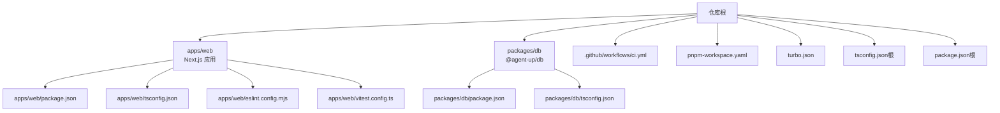
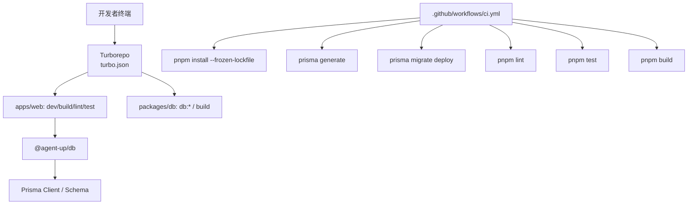
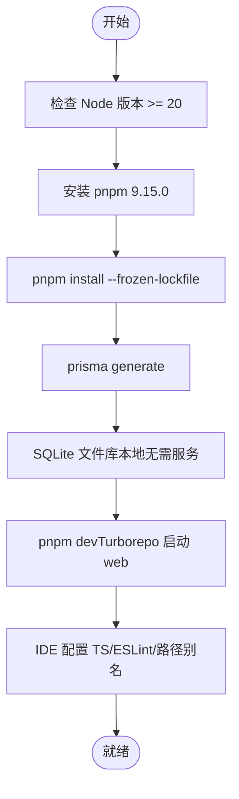
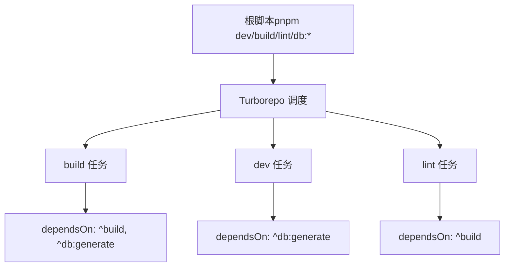
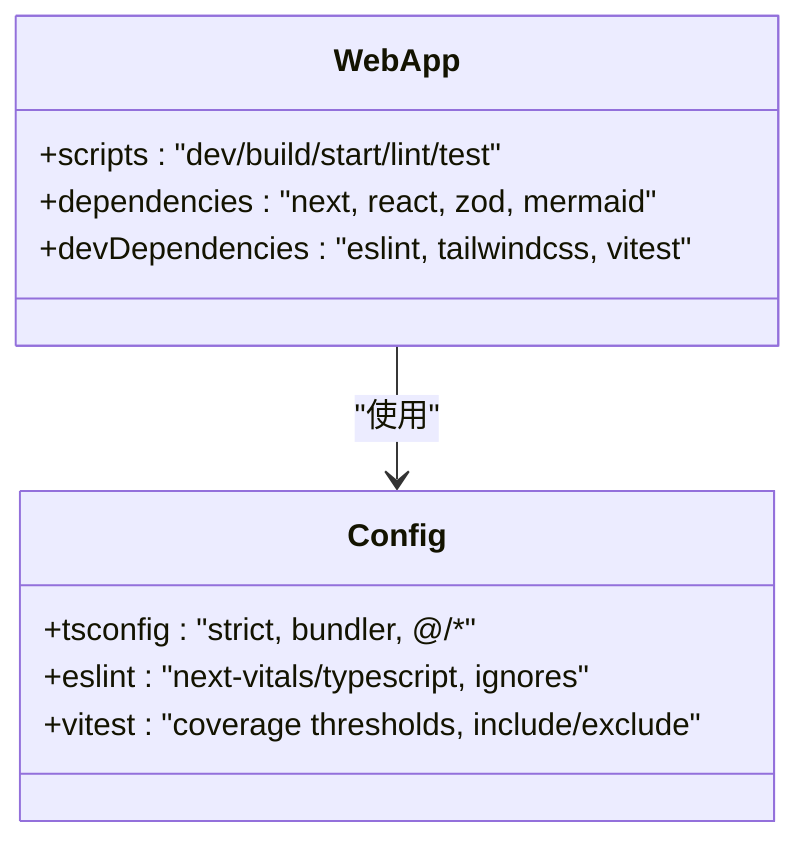
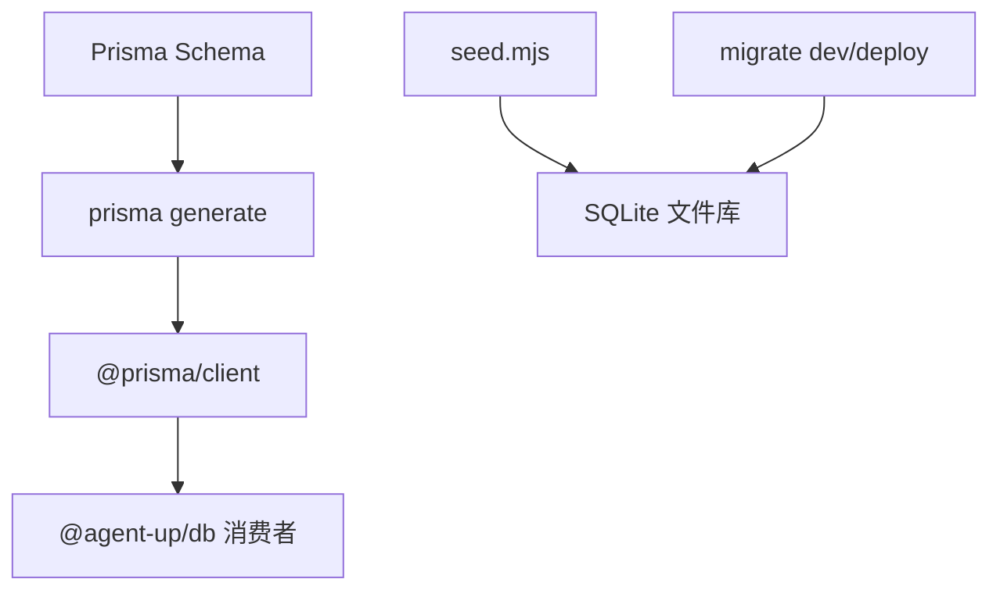
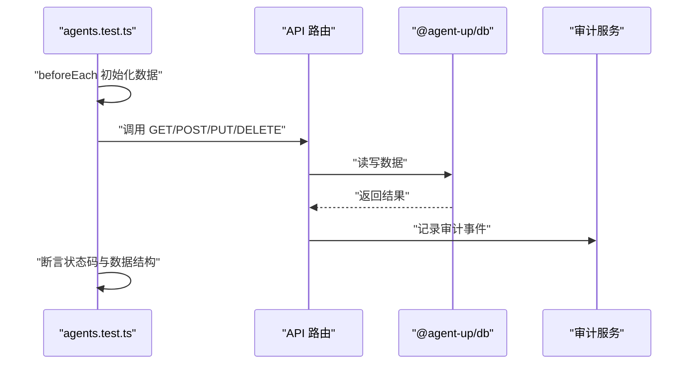
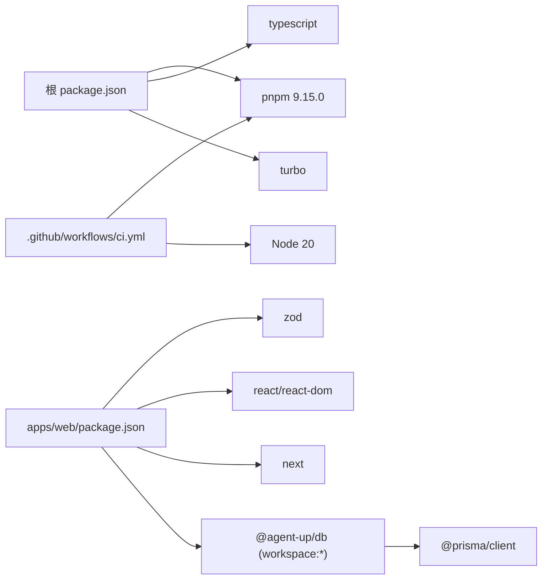
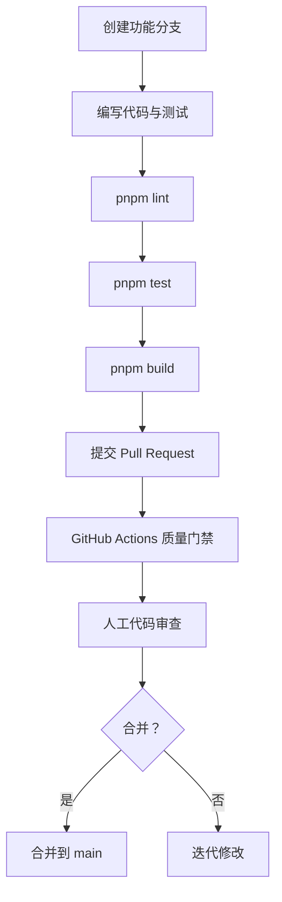

# 开发指南

<cite>
**本文引用的文件**   
- [package.json](file://package.json)
- [pnpm-workspace.yaml](file://pnpm-workspace.yaml)
- [turbo.json](file://turbo.json)
- [apps/web/package.json](file://apps/web/package.json)
- [packages/db/package.json](file://packages/db/package.json)
- [.github/workflows/ci.yml](file://.github/workflows/ci.yml)
- [apps/web/eslint.config.mjs](file://apps/web/eslint.config.mjs)
- [apps/web/tsconfig.json](file://apps/web/tsconfig.json)
- [tsconfig.json](file://tsconfig.json)
- [packages/db/tsconfig.json](file://packages/db/tsconfig.json)
- [apps/web/vitest.config.ts](file://apps/web/vitest.config.ts)
- [apps/web/app/api/__tests__/agents.test.ts](file://apps/web/app/api/__tests__/agents.test.ts)
</cite>

## 目录
1. [简介](#简介)
2. [项目结构](#项目结构)
3. [核心组件](#核心组件)
4. [架构总览](#架构总览)
5. [详细组件分析](#详细组件分析)
6. [依赖关系分析](#依赖关系分析)
7. [性能与构建优化](#性能与构建优化)
8. [调试与排障](#调试与排障)
9. [新功能开发与代码审查](#新功能开发与代码审查)
10. [贡献指南、Issue 与 Pull Request](#贡献指南issue-与-pull-request)
11. [结论](#结论)

## 简介
本指南面向参与 agent-up 项目的开发者，覆盖开发环境搭建、Monorepo 工作区配置、代码风格约定、Git 工作流程、调试技巧、性能分析与质量门禁，以及新功能开发流程与贡献规范。项目采用 pnpm workspaces + Turborepo 的 Monorepo 架构，前端应用基于 Next.js，数据库访问通过 Prisma 封装为内部包 @agent-up/db，测试使用 Vitest，持续集成在 GitHub Actions 中完成 lint、测试与构建的质量门禁。

## 项目结构
仓库根目录包含：
- apps/web：Next.js Web 应用，包含页面、API 路由、组件、共享库与测试。
- packages/db：Prisma 数据模型、客户端生成脚本与种子数据，对外暴露类型与客户端。
- .github/workflows：CI 流水线定义。
- 根级配置文件：pnpm-workspace.yaml、turbo.json、根 tsconfig.json、根 package.json。

**图表来源**
- [pnpm-workspace.yaml:1-4](file://pnpm-workspace.yaml#L1-L4)
- [turbo.json:1-35](file://turbo.json#L1-L35)
- [package.json:1-23](file://package.json#L1-L23)
- [apps/web/package.json:1-37](file://apps/web/package.json#L1-L37)
- [packages/db/package.json:1-29](file://packages/db/package.json#L1-L29)

**章节来源**
- [pnpm-workspace.yaml:1-4](file://pnpm-workspace.yaml#L1-L4)
- [turbo.json:1-35](file://turbo.json#L1-L35)
- [package.json:1-23](file://package.json#L1-L23)

## 核心组件
- 包管理器与工作区：pnpm 9.15.0，工作区包含 apps/* 与 packages/*。
- 任务编排：Turborepo 统一编排 dev/build/lint/db:* 等任务，并定义缓存与依赖顺序。
- 前端应用：Next.js 16 + React 19，启用 Turbopack 开发模式，ESLint 基于 eslint-config-next，TypeScript 严格模式。
- 数据层：Prisma 6，提供 generate/push/migrate/studio/seed 等脚本；对外导出类型与客户端。
- 测试：Vitest 3，覆盖率阈值由 vitest.config.ts 约束，API 路由与核心库均有用例。
- CI：GitHub Actions 固定 Node 20 与 pnpm 9.15.0，执行安装、Prisma 生成与迁移、lint、test、build。

**章节来源**
- [package.json:14-21](file://package.json#L14-L21)
- [pnpm-workspace.yaml:1-4](file://pnpm-workspace.yaml#L1-L4)
- [turbo.json:4-32](file://turbo.json#L4-L32)
- [apps/web/package.json:1-37](file://apps/web/package.json#L1-L37)
- [packages/db/package.json:1-29](file://packages/db/package.json#L1-L29)
- [apps/web/vitest.config.ts:1-64](file://apps/web/vitest.config.ts#L1-L64)
- [.github/workflows/ci.yml:1-58](file://.github/workflows/ci.yml#L1-L58)

## 架构总览
下图展示 Monorepo 内关键模块的职责与交互：根任务通过 Turborepo 调度各子任务；web 应用依赖 @agent-up/db；CI 在云端复现本地开发的关键步骤以保证一致性。

**图表来源**
- [turbo.json:4-32](file://turbo.json#L4-L32)
- [apps/web/package.json:5-14](file://apps/web/package.json#L5-L14)
- [packages/db/package.json:7-16](file://packages/db/package.json#L7-L16)
- [.github/workflows/ci.yml:18-57](file://.github/workflows/ci.yml#L18-L57)

## 详细组件分析

### 开发环境与工具链
- Node.js 版本要求：根 package.json 声明 engines.node >= 20；CI 固定使用 Node 20。
- 包管理器：pnpm 9.15.0，锁文件 pnpm-lock.yaml 作为唯一事实源。
- IDE 推荐设置：
  - TypeScript：启用严格模式，使用 bundler 解析器，开启增量编译。
  - ESLint：使用 Next.js 官方规则集，忽略构建产物与覆盖率目录。
  - Prettier：仓库未引入 Prettier，格式化以 ESLint 为主；如需统一格式建议新增 Prettier 并与 ESLint 集成。
  - 路径别名：web 应用支持 @/* 指向根目录。

**图表来源**
- [package.json:19-21](file://package.json#L19-L21)
- [package.json:14-18](file://package.json#L14-L18)
- [apps/web/tsconfig.json:1-35](file://apps/web/tsconfig.json#L1-L35)
- [apps/web/eslint.config.mjs:1-35](file://apps/web/eslint.config.mjs#L1-L35)

**章节来源**
- [package.json:14-21](file://package.json#L14-L21)
- [apps/web/tsconfig.json:1-35](file://apps/web/tsconfig.json#L1-L35)
- [apps/web/eslint.config.mjs:1-35](file://apps/web/eslint.config.mjs#L1-L35)

### Monorepo 工作区与任务编排
- pnpm workspace：包含 apps/* 与 packages/*，实现跨包引用与统一安装。
- Turborepo 任务：
  - build：依赖上游包的 build 与 db:generate，输出 .next 与 dist。
  - dev：依赖上游 db:generate，禁用缓存且持久运行。
  - lint：依赖上游 build。
  - db:* 与 clean：禁用缓存，保证状态正确。
- 根脚本：dev/build/lint/db:* 均通过 turbo run 转发到子包。

**图表来源**
- [turbo.json:4-32](file://turbo.json#L4-L32)
- [package.json:4-12](file://package.json#L4-L12)

**章节来源**
- [pnpm-workspace.yaml:1-4](file://pnpm-workspace.yaml#L1-L4)
- [turbo.json:4-32](file://turbo.json#L4-L32)
- [package.json:4-12](file://package.json#L4-L12)

### 前端应用（apps/web）
- 技术栈：Next.js 16、React 19、Tailwind CSS v4、Zod 校验、Mermaid 可视化。
- 开发命令：dev 使用 Turbopack；build 与 start 遵循 Next.js 标准。
- 测试：vitest run 与 watch 模式；覆盖率阈值 lines/functions/statements 80%，branches 70%。
- 类型与路径：strict 模式，moduleResolution bundler，@/* 路径别名。
- ESLint：继承 next-vitals 与 typescript 规则，忽略构建产物与覆盖率目录；对 no-unused-vars 放宽 _ 前缀参数与 rest 解构兄弟字段。

**图表来源**
- [apps/web/package.json:1-37](file://apps/web/package.json#L1-L37)
- [apps/web/tsconfig.json:1-35](file://apps/web/tsconfig.json#L1-L35)
- [apps/web/eslint.config.mjs:1-35](file://apps/web/eslint.config.mjs#L1-L35)
- [apps/web/vitest.config.ts:1-64](file://apps/web/vitest.config.ts#L1-L64)

**章节来源**
- [apps/web/package.json:1-37](file://apps/web/package.json#L1-L37)
- [apps/web/tsconfig.json:1-35](file://apps/web/tsconfig.json#L1-L35)
- [apps/web/eslint.config.mjs:1-35](file://apps/web/eslint.config.mjs#L1-L35)
- [apps/web/vitest.config.ts:1-64](file://apps/web/vitest.config.ts#L1-L64)

### 数据层（packages/db）
- 职责：维护 Prisma schema、生成客户端、执行迁移与种子数据，对外暴露类型与客户端。
- 脚本：build（prisma generate && tsc）、db:generate、db:push、db:migrate、db:studio、db:seed。
- 依赖：@prisma/client 运行时；devDependencies 含 prisma 与 TypeScript。
- 类型输出：main 与 types 指向 src/index.ts，便于上层按类型消费。

**图表来源**
- [packages/db/package.json:1-29](file://packages/db/package.json#L1-L29)

**章节来源**
- [packages/db/package.json:1-29](file://packages/db/package.json#L1-L29)

### 测试体系与 API 用例
- 测试框架：Vitest，环境 node，包含 lib/__tests__ 与 app/api/__tests__。
- 覆盖率：v8 提供者，include 指定核心库与 route.ts，exclude 测试目录；阈值已设定。
- 示例用例：agents.test.ts 演示了 NextRequest 构造、前置数据准备、断言响应结构与审计日志写入。

**图表来源**
- [apps/web/app/api/__tests__/agents.test.ts:1-212](file://apps/web/app/api/__tests__/agents.test.ts#L1-L212)
- [apps/web/vitest.config.ts:1-64](file://apps/web/vitest.config.ts#L1-L64)

**章节来源**
- [apps/web/vitest.config.ts:1-64](file://apps/web/vitest.config.ts#L1-L64)
- [apps/web/app/api/__tests__/agents.test.ts:1-212](file://apps/web/app/api/__tests__/agents.test.ts#L1-L212)

## 依赖关系分析
- 根依赖：turbo 与 typescript 作为开发依赖；packageManager 锁定 pnpm 9.15.0；engines.node >= 20。
- web 依赖：workspace:* 引用 @agent-up/db；Next.js 生态与 Tailwind、Vitest 等开发依赖。
- db 依赖：@prisma/client 运行时；prisma CLI 用于生成与迁移。
- CI 依赖：Actions 固定 Node 20 与 pnpm 9.15.0，确保与本地一致。

**图表来源**
- [package.json:14-21](file://package.json#L14-L21)
- [apps/web/package.json:15-35](file://apps/web/package.json#L15-L35)
- [packages/db/package.json:17-24](file://packages/db/package.json#L17-L24)
- [.github/workflows/ci.yml:21-34](file://.github/workflows/ci.yml#L21-L34)

**章节来源**
- [package.json:14-21](file://package.json#L14-L21)
- [apps/web/package.json:15-35](file://apps/web/package.json#L15-L35)
- [packages/db/package.json:17-24](file://packages/db/package.json#L17-L24)
- [.github/workflows/ci.yml:21-34](file://.github/workflows/ci.yml#L21-L34)

## 性能与构建优化
- 开发体验：web 应用 dev 使用 Turbopack，提升热更新速度。
- 构建缓存：Turborepo 对 build 与 dev 任务进行缓存控制；db:* 与 clean 禁用缓存以避免状态污染。
- 增量编译：TS 启用 incremental；Next 插件与 isolatedModules 提升编译效率。
- 测试并行：Vitest 根据 worker 数量与独立测试库数调整并发，缩短测试时间。
- 覆盖率门槛：lines/functions/statements 80%，branches 70%，防止低质量代码进入主干。

[本节为通用指导，不直接分析具体文件]

## 调试与排障
- 数据库：
  - 本地使用 SQLite 文件库，无需外部服务；CI 也使用 SQLite 文件库。
  - 常用命令：pnpm db:generate、pnpm db:push、pnpm db:migrate、pnpm db:seed。
- 前端调试：
  - 使用 Next.js 内置调试能力；结合浏览器开发者工具与网络面板排查 API 请求。
  - 使用 Vitest watch 模式快速迭代测试。
- 常见问题：
  - Prisma Client 未生成：需先执行 prisma generate；CI 中显式执行该步骤。
  - 环境变量：DATABASE_URL 在 CI 中以 job 级 env 注入；本地可通过 .env 或 shell 注入。
  - 构建产物干扰：ESLint 忽略 .next、dist、coverage 等目录，避免误报。

**章节来源**
- [.github/workflows/ci.yml:14-17](file://.github/workflows/ci.yml#L14-L17)
- [.github/workflows/ci.yml:36-43](file://.github/workflows/ci.yml#L36-L43)
- [apps/web/eslint.config.mjs:8-20](file://apps/web/eslint.config.mjs#L8-L20)

## 新功能开发与代码审查
- 分支策略：
  - 主干分支：main（CI 在 push main 时触发）。
  - 功能分支：建议使用 feature/<描述> 命名；提交 PR 至 main。
- 提交消息规范：
  - 推荐使用 Conventional Commits（如 feat、fix、docs、refactor、test、chore），便于变更日志与自动化。
- 代码审查标准：
  - 必须通过 lint、test、build 三项门禁。
  - 新增逻辑应补充单元测试或集成测试，保持覆盖率不低于阈值。
  - 涉及数据模型的变更需同步更新 Prisma schema 与迁移。
- 质量门禁：
  - CI 固定 Node 20 与 pnpm 9.15.0，安装依赖后执行 prisma generate 与 migrate deploy，再跑 lint、test、build。
  - 任何破坏性变更需在 PR 中说明影响范围与回滚方案。

**图表来源**
- [.github/workflows/ci.yml:3-7](file://.github/workflows/ci.yml#L3-L7)
- [.github/workflows/ci.yml:45-57](file://.github/workflows/ci.yml#L45-L57)

**章节来源**
- [.github/workflows/ci.yml:3-7](file://.github/workflows/ci.yml#L3-L7)
- [.github/workflows/ci.yml:45-57](file://.github/workflows/ci.yml#L45-L57)

## 贡献指南、Issue 与 Pull Request
- 贡献流程：
  - Fork 仓库，克隆本地，安装依赖（pnpm install）。
  - 创建功能分支，提交符合规范的 commit。
  - 本地运行 pnpm lint、pnpm test、pnpm build，确保全部通过。
  - 提交 PR，填写变更说明、影响范围与测试情况。
- Issue 报告：
  - 提供复现步骤、预期行为与实际行为、环境信息（Node、pnpm、操作系统）。
  - 如涉及数据库，提供相关表结构与迁移信息。
- Pull Request 要求：
  - 通过 CI 质量门禁。
  - 包含必要的测试用例与文档更新。
  - 变更影响面清晰，必要时提供回滚方案。

[本节为通用指导，不直接分析具体文件]

## 结论
本项目通过 pnpm workspaces 与 Turborepo 构建了高效的 Monorepo 开发体验，配合严格的 TypeScript 与 ESLint 规则、Vitest 覆盖率门禁与 GitHub Actions 持续集成，确保了代码质量与交付稳定性。开发者应遵循本指南的环境与流程规范，在本地充分验证后再提交 PR，共同维护高质量工程基线。