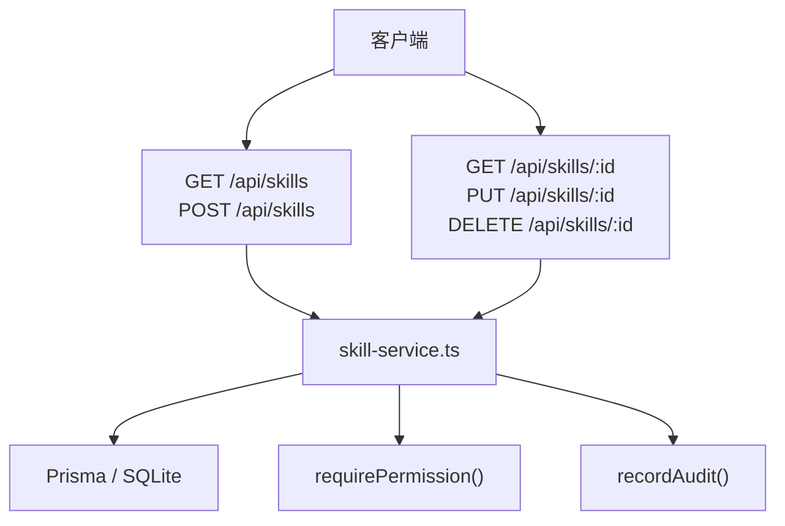
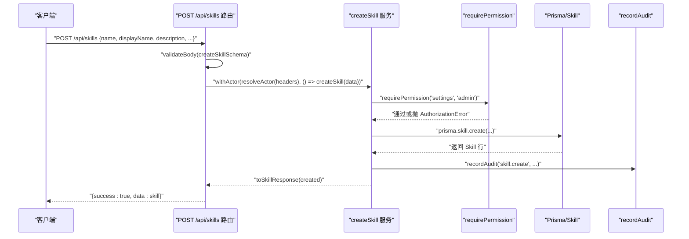
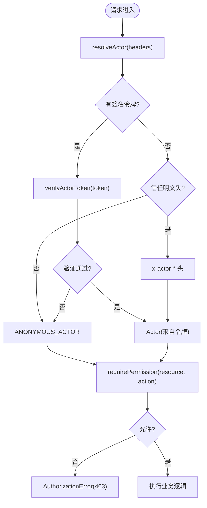
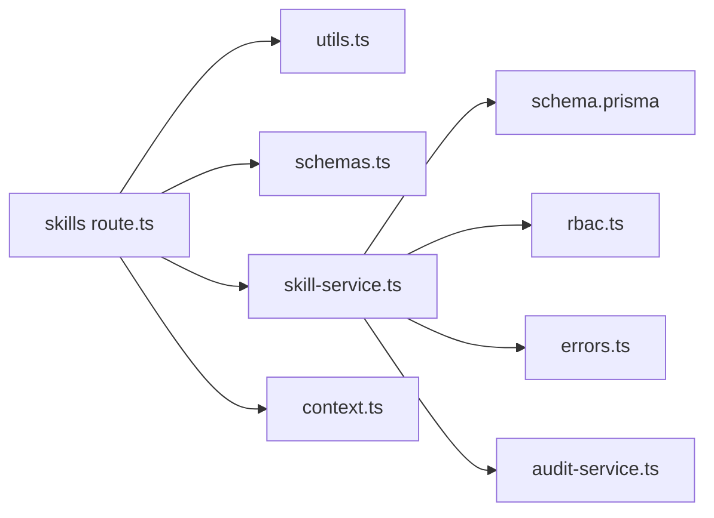

# API 接口参考

<cite>
**本文引用的文件**   
- [apps/web/app/api/skills/route.ts](file://apps/web/app/api/skills/route.ts)
- [apps/web/app/api/skills/[id]/route.ts](file://apps/web/app/api/skills/[id]/route.ts)
- [apps/web/lib/services/skill-service.ts](file://apps/web/lib/services/skill-service.ts)
- [apps/web/lib/schemas.ts](file://apps/web/lib/schemas.ts)
- [apps/web/lib/context.ts](file://apps/web/lib/context.ts)
- [apps/web/lib/utils.ts](file://apps/web/lib/utils.ts)
- [apps/web/lib/errors.ts](file://apps/web/lib/errors.ts)
- [apps/web/lib/services/rbac.ts](file://apps/web/lib/services/rbac.ts)
- [packages/db/prisma/schema.prisma](file://packages/db/prisma/schema.prisma)
- [apps/web/app/api/__tests__/skill-detail.test.ts](file://apps/web/app/api/__tests__/skill-detail.test.ts)
- [apps/web/lib/__tests__/skill-service.test.ts](file://apps/web/lib/__tests__/skill-service.test.ts)
</cite>

## 目录
1. [简介](#简介)
2. [项目结构](#项目结构)
3. [核心组件](#核心组件)
4. [架构总览](#架构总览)
5. [接口详细参考](#接口详细参考)
6. [认证与授权（RBAC）](#认证与授权rbac)
7. [依赖关系分析](#依赖关系分析)
8. [性能与最佳实践](#性能与最佳实践)
9. [故障排查指南](#故障排查指南)
10. [版本策略与兼容性](#版本策略与兼容性)
11. [结论](#结论)

## 简介
本参考文档面向调用方与维护者，系统化说明技能系统 RESTful API：包括列表、创建、详情、更新、归档等端点；请求参数、响应结构、状态码与错误语义；认证与 RBAC 权限控制；批量操作支持情况；错误处理最佳实践；以及性能调优建议。

## 项目结构
技能系统的 API 位于 Next.js App Router 下，采用“路由层 → 服务层 → 数据层”的分层结构：
- 路由层：`apps/web/app/api/skills/**/route.ts`，负责解析请求、校验参数、统一成功/错误响应。
- 服务层：`apps/web/lib/services/skill-service.ts`，封装业务逻辑、权限检查、审计记录与数据库访问。
- 数据层：Prisma Schema 定义在 `packages/db/prisma/schema.prisma`，Skill、SkillVersion、AgentSkillBinding 等实体在此建模。
- 通用工具：`lib/utils.ts` 提供分页、JSON 校验、统一响应体；`lib/errors.ts` 定义结构化错误类型；`lib/context.ts` 提供 Actor 上下文；`lib/services/rbac.ts` 实现 RBAC 权限校验。

**图表来源**
- [apps/web/app/api/skills/route.ts:7-30](file://apps/web/app/api/skills/route.ts#L7-L30)
- [apps/web/app/api/skills/[id]/route.ts:7-46](file://apps/web/app/api/skills/[id]/route.ts#L7-L46)
- [apps/web/lib/services/skill-service.ts:74-221](file://apps/web/lib/services/skill-service.ts#L74-L221)
- [apps/web/lib/services/rbac.ts:21-51](file://apps/web/lib/services/rbac.ts#L21-L51)
- [packages/db/prisma/schema.prisma:324-391](file://packages/db/prisma/schema.prisma#L324-L391)

**章节来源**
- [apps/web/app/api/skills/route.ts:1-31](file://apps/web/app/api/skills/route.ts#L1-L31)
- [apps/web/app/api/skills/[id]/route.ts:1-47](file://apps/web/app/api/skills/[id]/route.ts#L1-L47)
- [packages/db/prisma/schema.prisma:324-391](file://packages/db/prisma/schema.prisma#L324-L391)

## 核心组件
- 路由处理器：
  - GET /api/skills：分页列表，支持 category、status、search 过滤。
  - POST /api/skills：创建 Skill，需 settings:admin 权限。
  - GET /api/skills/:id：获取 Skill 详情，包含 bindings、versions 与计数。
  - PUT /api/skills/:id：更新 Skill，需 settings:admin 权限。
  - DELETE /api/skills/:id：归档 Skill（非物理删除），需 settings:admin 权限。
- 服务层：
  - listSkills/getSkill/createSkill/updateSkill/deleteSkill：封装查询、写入、权限与审计。
- 校验与响应：
  - createSkillSchema/updateSkillSchema：Zod 校验规则。
  - success/error/handleApiError：统一响应结构与错误映射。
- 认证与权限：
  - resolveActor/withActor/getActor：Actor 上下文。
  - requirePermission：基于数据库角色-权限的 RBAC 校验。

**章节来源**
- [apps/web/lib/services/skill-service.ts:74-221](file://apps/web/lib/services/skill-service.ts#L74-L221)
- [apps/web/lib/schemas.ts:154-181](file://apps/web/lib/schemas.ts#L154-L181)
- [apps/web/lib/utils.ts:5-25](file://apps/web/lib/utils.ts#L5-L25)
- [apps/web/lib/context.ts:22-90](file://apps/web/lib/context.ts#L22-L90)
- [apps/web/lib/services/rbac.ts:21-51](file://apps/web/lib/services/rbac.ts#L21-L51)

## 架构总览
以下序列图展示一次典型的 Skill 创建流程，体现路由层、服务层、RBAC、审计与数据库之间的交互。

**图表来源**
- [apps/web/app/api/skills/route.ts:18-30](file://apps/web/app/api/skills/route.ts#L18-L30)
- [apps/web/lib/services/skill-service.ts:144-180](file://apps/web/lib/services/skill-service.ts#L144-L180)
- [apps/web/lib/services/rbac.ts:21-51](file://apps/web/lib/services/rbac.ts#L21-L51)
- [packages/db/prisma/schema.prisma:324-357](file://packages/db/prisma/schema.prisma#L324-L357)

## 接口详细参考

### 通用约定
- 成功响应：`{ success: true, data }`
- 错误响应：`{ success: false, error, code?, details? }`
- 分页元信息：`{ page, pageSize, total, totalPages, hasMore }`
- 时间字段：ISO 字符串（如 createdAt、updatedAt、publishedAt）。
- JSON 列：triggerPatterns、inputSchema、outputSchema、dependencies、permissions 等在数据库中为文本存储，API 层以数组/对象形式收发。

**章节来源**
- [apps/web/lib/utils.ts:5-47](file://apps/web/lib/utils.ts#L5-L47)
- [apps/web/lib/errors.ts:68-94](file://apps/web/lib/errors.ts#L68-L94)
- [apps/web/lib/services/skill-service.ts:28-50](file://apps/web/lib/services/skill-service.ts#L28-L50)

---

### GET /api/skills
- 功能：分页列出 Skill，支持按分类、状态、关键词搜索。
- 查询参数：
  - page：页码，默认 1，最小 1。
  - pageSize：每页数量，默认 20，最大 100。
  - category：枚举值之一，或 ALL（不过滤）。
  - status：枚举值之一，或 ALL（不过滤）。
  - search：模糊匹配 name/displayName/description（不区分大小写）。
- 响应体：
  - data.items：Skill 数组。
  - data.pagination：分页元信息。
- 状态码：
  - 200：成功。
  - 422：参数校验失败（由 validateBody 返回）。
  - 其他错误：由 handleApiError 映射。

Skill 字段（列表项）：
- id、name、displayName、description、category、triggerPatterns、inputSchema、outputSchema、runtime、endpoint、version、status、publishedAt、downloadCount、authorId、authorName、createdAt、updatedAt、_count.bindings、_count.versions。

示例请求：
- GET /api/skills?page=1&pageSize=20&category=DATA_FETCH&status=DRAFT&search=test

示例响应：
- {
    "success": true,
    "data": {
      "items": [/* Skill 对象数组 */],
      "pagination": {
        "page": 1,
        "pageSize": 20,
        "total": 120,
        "totalPages": 6,
        "hasMore": true
      }
    }
  }

**章节来源**
- [apps/web/app/api/skills/route.ts:7-16](file://apps/web/app/api/skills/route.ts#L7-L16)
- [apps/web/lib/services/skill-service.ts:74-115](file://apps/web/lib/services/skill-service.ts#L74-L115)
- [apps/web/lib/utils.ts:27-47](file://apps/web/lib/utils.ts#L27-L47)
- [apps/web/lib/services/skill-service.ts:28-50](file://apps/web/lib/services/skill-service.ts#L28-L50)

---

### POST /api/skills
- 功能：创建新 Skill。
- 权限：settings:admin。
- 请求体（Zod 校验）：
  - name：必填，长度 1-100。
  - displayName：必填，长度 1-200。
  - description：必填，长度 1-2000。
  - category：可选，枚举 KNOWLEDGE_QUERY/DATA_FETCH/ACTION/TRANSFORM/GENERAL。
  - triggerPatterns：可选，字符串数组。
  - inputSchema：可选，任意对象。
  - outputSchema：可选，任意对象。
  - runtime：可选，枚举 HTTP/FUNCTION/MCP/WORKFLOW。
  - endpoint：可选，字符串。
- 响应体：
  - data：创建的 Skill 对象（含 _count 与时间字段）。
- 状态码：
  - 201：创建成功。
  - 409：同名 Skill 已存在。
  - 403：权限不足。
  - 422：参数校验失败。
  - 500：服务器内部错误。

示例请求：
- POST /api/skills
- Body：
  - {
      "name": "data-fetcher",
      "displayName": "数据抓取器",
      "description": "用于抓取外部数据的技能",
      "category": "DATA_FETCH",
      "runtime": "MCP",
      "triggerPatterns": ["fetch_data"],
      "inputSchema": {"type":"object","properties":{"url":{"type":"string"}}},
      "outputSchema": {"type":"object","properties":{"result":{"type":"string"}}}
    }

示例响应：
- {
    "success": true,
    "data": {
      "id": "...",
      "name": "data-fetcher",
      "displayName": "数据抓取器",
      "description": "用于抓取外部数据的技能",
      "category": "DATA_FETCH",
      "runtime": "MCP",
      "triggerPatterns": ["fetch_data"],
      "inputSchema": {...},
      "outputSchema": {...},
      "version": "1.0.0",
      "status": "DRAFT",
      "downloadCount": 0,
      "authorId": "...",
      "authorName": "...",
      "createdAt": "2026-01-01T00:00:00.000Z",
      "updatedAt": "2026-01-01T00:00:00.000Z",
      "_count": {"bindings": 0, "versions": 0}
    }
  }

**章节来源**
- [apps/web/app/api/skills/route.ts:18-30](file://apps/web/app/api/skills/route.ts#L18-L30)
- [apps/web/lib/schemas.ts:154-169](file://apps/web/lib/schemas.ts#L154-L169)
- [apps/web/lib/services/skill-service.ts:144-180](file://apps/web/lib/services/skill-service.ts#L144-L180)
- [apps/web/lib/errors.ts:50-55](file://apps/web/lib/errors.ts#L50-L55)

---

### GET /api/skills/:id
- 功能：获取单个 Skill 详情，包含绑定信息与最近版本。
- 路径参数：
  - id：Skill 标识符。
- 响应体：
  - data：Skill 详情对象，额外包含：
    - bindings：绑定到 Agent 的技能列表（含 agent 摘要）。
    - versions：最近 10 个版本快照（id、skillId、version、changelog、publishedAt）。
    - _count：bindings 与 versions 计数。
- 状态码：
  - 200：成功。
  - 404：Skill 不存在。
  - 其他错误：由 handleApiError 映射。

示例请求：
- GET /api/skills/{id}

示例响应：
- {
    "success": true,
    "data": {
      "id": "...",
      "name": "data-fetcher",
      "displayName": "数据抓取器",
      "description": "用于抓取外部数据的技能",
      "category": "DATA_FETCH",
      "runtime": "MCP",
      "triggerPatterns": ["fetch_data"],
      "inputSchema": {...},
      "outputSchema": {...},
      "version": "1.0.0",
      "status": "DRAFT",
      "publishedAt": null,
      "downloadCount": 0,
      "authorId": "...",
      "authorName": "...",
      "createdAt": "2026-01-01T00:00:00.000Z",
      "updatedAt": "2026-01-01T00:00:00.000Z",
      "bindings": [],
      "versions": [],
      "_count": {"bindings": 0, "versions": 0}
    }
  }

**章节来源**
- [apps/web/app/api/skills/[id]/route.ts:7-15](file://apps/web/app/api/skills/[id]/route.ts#L7-L15)
- [apps/web/lib/services/skill-service.ts:117-142](file://apps/web/lib/services/skill-service.ts#L117-L142)
- [apps/web/lib/errors.ts:36-41](file://apps/web/lib/errors.ts#L36-L41)

---

### PUT /api/skills/:id
- 功能：更新 Skill 的部分字段。
- 权限：settings:admin。
- 路径参数：
  - id：Skill 标识符。
- 请求体（Zod 校验）：
  - displayName、description、category、triggerPatterns、inputSchema、outputSchema、runtime、endpoint、status（DRAFT/PUBLISHED/DEPRECATED）。
- 响应体：
  - data：更新后的 Skill 对象。
- 状态码：
  - 200：更新成功。
  - 404：Skill 不存在。
  - 403：权限不足。
  - 422：参数校验失败。
  - 500：服务器内部错误。

示例请求：
- PUT /api/skills/{id}
- Body：
  - {
      "displayName": "数据抓取器 v2",
      "description": "增强版数据抓取能力",
      "status": "PUBLISHED"
    }

示例响应：
- {
    "success": true,
    "data": {
      "id": "...",
      "displayName": "数据抓取器 v2",
      "description": "增强版数据抓取能力",
      "status": "PUBLISHED",
      "updatedAt": "2026-01-01T00:00:00.000Z",
      "_count": {"bindings": 0, "versions": 0}
    }
  }

**章节来源**
- [apps/web/app/api/skills/[id]/route.ts:17-33](file://apps/web/app/api/skills/[id]/route.ts#L17-L33)
- [apps/web/lib/schemas.ts:171-181](file://apps/web/lib/schemas.ts#L171-L181)
- [apps/web/lib/services/skill-service.ts:182-207](file://apps/web/lib/services/skill-service.ts#L182-L207)

---

### DELETE /api/skills/:id
- 功能：归档 Skill（将 status 设置为 ARCHIVED），并非物理删除。
- 权限：settings:admin。
- 路径参数：
  - id：Skill 标识符。
- 响应体：
  - data：{ message: "Skill 已归档" }。
- 状态码：
  - 200：归档成功。
  - 404：Skill 不存在。
  - 403：权限不足。
  - 500：服务器内部错误。

示例请求：
- DELETE /api/skills/{id}

示例响应：
- {
    "success": true,
    "data": {
      "message": "Skill 已归档"
    }
  }

**章节来源**
- [apps/web/app/api/skills/[id]/route.ts:35-46](file://apps/web/app/api/skills/[id]/route.ts#L35-L46)
- [apps/web/lib/services/skill-service.ts:209-221](file://apps/web/lib/services/skill-service.ts#L209-L221)

---

### 批量操作支持情况
- 当前未提供批量创建、批量更新、批量删除端点。
- 如需批量操作，可多次调用上述单资源接口；服务端对重复键（name）会返回 409 冲突。
- 若未来引入批量接口，建议遵循现有幂等与错误模型（409/403/422/500）。

[本节为概念性说明，不涉及具体代码片段]

## 认证与授权（RBAC）
- 身份来源优先级：
  - 签名会话令牌（cookie 或 x-actor-token）优先，不可伪造。
  - 明文头 x-actor-id/x-actor-name/x-actor-role 仅在显式信任时采纳（生产环境需 AUTH_TRUST_ACTOR_HEADERS=1）。
  - 均不可信则视为匿名用户。
- Actor 上下文：
  - withActor 包裹异步作用域，getActor 在服务层读取当前 Actor。
- RBAC 权限：
  - requirePermission(resource, action) 从数据库 UserRole→Role→RolePermission→Permission 链查询并判断。
  - system 用户豁免（后台任务）。
  - 匿名/未知用户一律拒绝。
- Skill 管理权限：
  - 创建/更新/归档 Skill 需要 settings:admin。
  - 绑定/解绑 Skill 到 Agent 需要 agent:write。

**图表来源**
- [apps/web/lib/context.ts:65-90](file://apps/web/lib/context.ts#L65-L90)
- [apps/web/lib/services/rbac.ts:21-51](file://apps/web/lib/services/rbac.ts#L21-L51)

**章节来源**
- [apps/web/lib/context.ts:1-97](file://apps/web/lib/context.ts#L1-L97)
- [apps/web/lib/services/rbac.ts:1-52](file://apps/web/lib/services/rbac.ts#L1-L52)
- [apps/web/lib/services/skill-service.ts:155-156](file://apps/web/lib/services/skill-service.ts#L155-L156)

## 依赖关系分析
- 路由层依赖：
  - utils.success/error/handleApiError/parsePagination/validateBody。
  - schemas.createSkillSchema/updateSkillSchema。
  - services.listSkills/createSkill/getSkill/updateSkill/deleteSkill。
  - context.withActor/resolveActor。
- 服务层依赖：
  - prisma（Skill/SkillVersion/AgentSkillBinding）。
  - rbac.requirePermission。
  - audit.recordAudit。
  - errors.NotFoundError/ConflictError。

**图表来源**
- [apps/web/app/api/skills/route.ts:1-30](file://apps/web/app/api/skills/route.ts#L1-L30)
- [apps/web/lib/services/skill-service.ts:1-15](file://apps/web/lib/services/skill-service.ts#L1-L15)
- [apps/web/lib/services/rbac.ts:1-52](file://apps/web/lib/services/rbac.ts#L1-L52)
- [packages/db/prisma/schema.prisma:324-391](file://packages/db/prisma/schema.prisma#L324-L391)

**章节来源**
- [apps/web/app/api/skills/route.ts:1-31](file://apps/web/app/api/skills/route.ts#L1-L31)
- [apps/web/lib/services/skill-service.ts:1-296](file://apps/web/lib/services/skill-service.ts#L1-L296)

## 性能与最佳实践
- 分页与搜索：
  - 使用 page/pageSize 控制返回量，避免大结果集。
  - search 在当前实现中先取数再内存过滤，适合演示规模；大数据量时应考虑后端全文检索或索引优化。
- 关联查询：
  - GET /api/skills/:id 包含 bindings 与 versions（最多 10 条），注意 N+1 风险；必要时可限制 bindings 数量或按需加载。
- JSON 列序列化：
  - triggerPatterns/inputSchema/outputSchema 等字段在服务层进行 pack/unpack，避免直接暴露底层文本格式。
- 权限检查：
  - requirePermission 每次都会查询 UserRole→Role→Permission，建议在高频路径上缓存角色-权限映射（例如按 actor.id 缓存）。
- 审计日志：
  - 写操作记录审计，注意日志写入的性能影响；可考虑异步落盘或批处理。

[本节为通用指导，不涉及具体代码片段]

## 故障排查指南
- 404 资源不存在：
  - GET /api/skills/:id 找不到对应 Skill。
  - 解决：确认 id 是否存在，或先调用列表接口查找。
- 409 冲突：
  - POST /api/skills 时 name 已存在。
  - 解决：更换唯一 name，或在更新时使用 PUT。
- 403 权限不足：
  - 缺少 settings:admin 或 agent:write 权限。
  - 解决：为用户分配相应角色与权限。
- 422 参数校验失败：
  - 请求体不符合 Zod schema。
  - 解决：根据 errors 数组修正字段类型与长度。
- 500 服务器内部错误：
  - 未知异常被捕获并脱敏。
  - 解决：查看服务端日志定位根因。

**章节来源**
- [apps/web/lib/errors.ts:8-94](file://apps/web/lib/errors.ts#L8-L94)
- [apps/web/lib/utils.ts:63-85](file://apps/web/lib/utils.ts#L63-L85)
- [apps/web/app/api/__tests__/skill-detail.test.ts:53-73](file://apps/web/app/api/__tests__/skill-detail.test.ts#L53-L73)

## 版本策略与兼容性
- 公开契约：
  - Skill 字段与枚举值由 Zod schema 与 Prisma Schema 共同约束，变更需谨慎。
  - 时间字段统一为 ISO 字符串，便于跨语言消费。
- 向后兼容：
  - 列表与详情接口返回 _count 与关联数组（bindings、versions），保持旧契约稳定。
  - JSON 列在服务层透明转换，调用方无需感知底层文本存储。
- 版本化建议：
  - 当前 API 未带 URL 版本前缀；若未来引入破坏性变更，建议增加 /api/v1/skills 等版本路径，并通过网关或中间件转发。

[本节为概念性说明，不涉及具体代码片段]

## 结论
本参考文档全面梳理了技能系统的 RESTful API，涵盖端点规范、参数与响应结构、认证与 RBAC、错误模型、性能建议与兼容性策略。调用方应严格遵循校验规则与权限要求，并结合分页与搜索参数优化查询性能；维护者可依据服务层与 Schema 变更公共契约，确保接口稳定性与可扩展性。