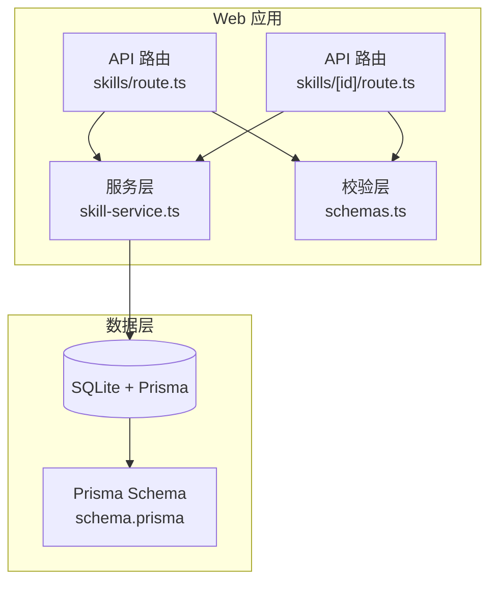
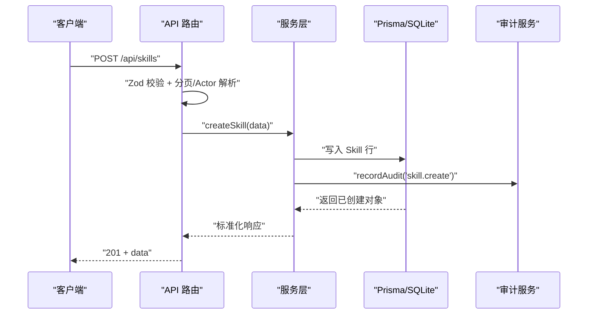
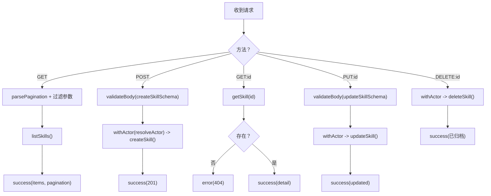
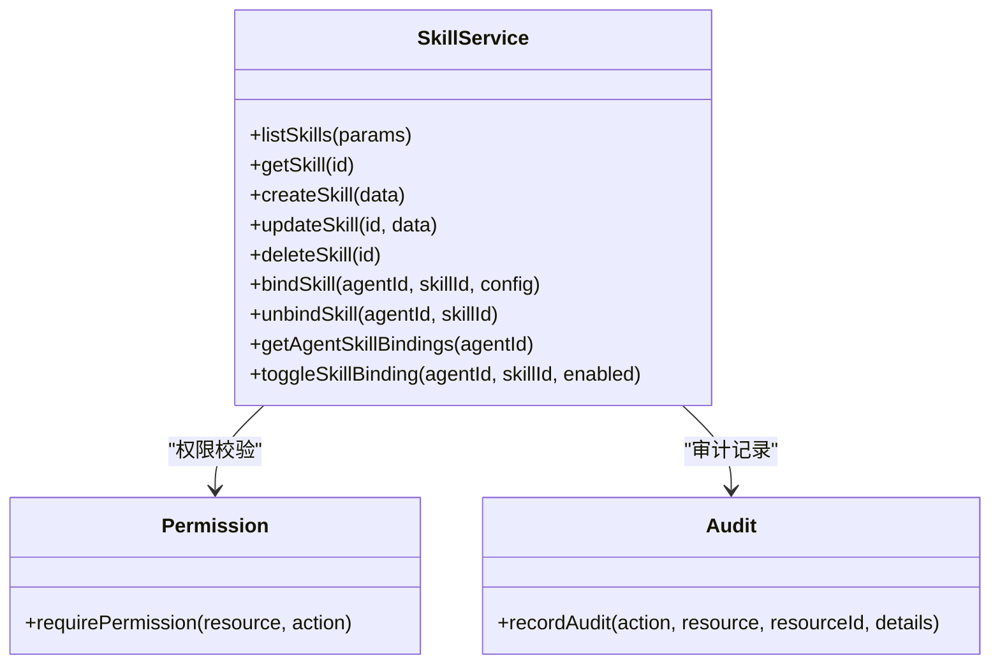
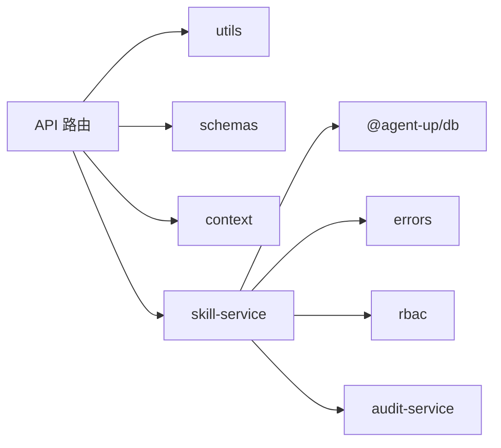
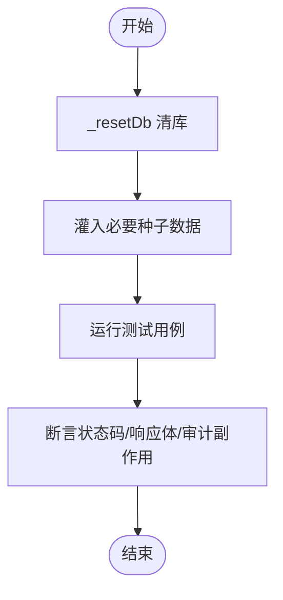
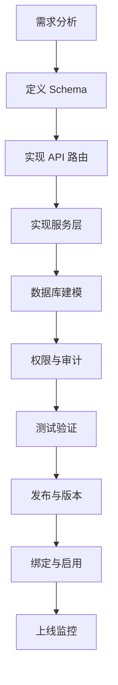

# 开发指南

<cite>
**本文引用的文件**   
- [README.md](file://README.md)
- [package.json](file://package.json)
- [apps/web/app/api/skills/route.ts](file://apps/web/app/api/skills/route.ts)
- [apps/web/app/api/skills/[id]/route.ts](file://apps/web/app/api/skills/[id]/route.ts)
- [apps/web/lib/services/skill-service.ts](file://apps/web/lib/services/skill-service.ts)
- [apps/web/lib/schemas.ts](file://apps/web/lib/schemas.ts)
- [packages/db/prisma/schema.prisma](file://packages/db/prisma/schema.prisma)
- [docs/skills/agent-up-services/SKILL.md](file://docs/skills/agent-up-services/SKILL.md)
- [docs/skills/agent-up-services/references/skill-service-component.md](file://docs/skills/agent-up-services/references/skill-service-component.md)
- [apps/web/app/api/__tests__/skill-detail.test.ts](file://apps/web/app/api/__tests__/skill-detail.test.ts)
</cite>

## 目录
1. [引言](#引言)
2. [项目结构](#项目结构)
3. [核心组件](#核心组件)
4. [架构总览](#架构总览)
5. [详细组件分析](#详细组件分析)
6. [依赖关系分析](#依赖关系分析)
7. [性能与扩展性](#性能与扩展性)
8. [测试策略](#测试策略)
9. [调试与排障](#调试与排障)
10. [发布与版本管理](#发布与版本管理)
11. [从零到一：完整技能开发示例](#从零到一完整技能开发示例)
12. [结论](#结论)

## 引言
本指南面向需要在 agent-up 平台中开发、集成和发布“技能（Skill）”的工程师。文档覆盖从需求分析、设计建模、编码实现、测试验证、调试排障，到发布上线与回滚的全流程；同时给出命名约定、代码结构、注释规范、权限与审计集成、性能优化建议以及可观测性与回滚策略。

## 项目结构
agent-up 是 Next.js 全栈应用，采用 Turborepo + pnpm workspaces 组织。技能相关能力集中在以下位置：
- API 路由层：`apps/web/app/api/skills/**`
- 服务层：`apps/web/lib/services/skill-service.ts`
- 校验 Schema：`apps/web/lib/schemas.ts`
- 数据库模型：`packages/db/prisma/schema.prisma`
- 技能知识库与参考：`docs/skills/agent-up-services/**`

图表来源
- [apps/web/app/api/skills/route.ts:1-31](file://apps/web/app/api/skills/route.ts#L1-L31)
- [apps/web/app/api/skills/[id]/route.ts:1-47](file://apps/web/app/api/skills/[id]/route.ts#L1-L47)
- [apps/web/lib/services/skill-service.ts:1-296](file://apps/web/lib/services/skill-service.ts#L1-L296)
- [apps/web/lib/schemas.ts:151-186](file://apps/web/lib/schemas.ts#L151-L186)
- [packages/db/prisma/schema.prisma:324-391](file://packages/db/prisma/schema.prisma#L324-L391)

章节来源
- [README.md:76-135](file://README.md#L76-L135)
- [package.json:1-23](file://package.json#L1-L23)

## 核心组件
- API 路由层
  - `GET /api/skills`：分页查询、分类/状态过滤、模糊搜索。
  - `POST /api/skills`：创建技能，带 Actor 上下文与审计记录。
  - `GET /api/skills/:id`：详情聚合（bindings、versions、_count）。
  - `PUT /api/skills/:id`：更新技能元信息与 JSON 字段。
  - `DELETE /api/skills/:id`：软删除（归档），保留历史绑定与版本引用。
- 服务层
  - 列表查询：支持 SQLite 内存过滤与分页；按更新时间倒序。
  - 详情聚合：包含 Agent 侧绑定快照与最近 10 个版本。
  - 创建/更新/归档：统一权限校验、JSON 序列化、审计落盘。
  - 绑定/解绑：幂等 upsert、优先级排序、Actor 快照。
- 校验层
  - Skill 分类、运行时、触发模式、输入输出 Schema 等字段均有 Zod 约束。
- 数据层
  - Skill、SkillVersion、AgentSkillBinding 三表构成“技能—版本—绑定”主域。
  - 枚举与数组以 String 存储，由 pack/unpack 工具与 Zod 共同保证一致性。

章节来源
- [apps/web/app/api/skills/route.ts:1-31](file://apps/web/app/api/skills/route.ts#L1-L31)
- [apps/web/app/api/skills/[id]/route.ts:1-47](file://apps/web/app/api/skills/[id]/route.ts#L1-L47)
- [apps/web/lib/services/skill-service.ts:74-296](file://apps/web/lib/services/skill-service.ts#L74-L296)
- [apps/web/lib/schemas.ts:151-186](file://apps/web/lib/schemas.ts#L151-L186)
- [packages/db/prisma/schema.prisma:324-391](file://packages/db/prisma/schema.prisma#L324-L391)

## 架构总览
技能生命周期遵循“平台级资产 + 权限控制 + 审计留痕 + 软删除”的设计原则。请求进入 API 路由后，先做参数校验与 Actor 解析，再调用服务层完成业务逻辑，最终通过 Prisma 写入 SQLite，并异步记录审计日志。

图表来源
- [apps/web/app/api/skills/route.ts:18-30](file://apps/web/app/api/skills/route.ts#L18-L30)
- [apps/web/lib/services/skill-service.ts:144-179](file://apps/web/lib/services/skill-service.ts#L144-L179)

## 详细组件分析

### 技能 API 路由
- GET /api/skills
  - 解析分页参数与 category/status/search 过滤条件，调用服务层 listSkills。
  - 返回 items 与 paginationMeta。
- POST /api/skills
  - 使用 createSkillSchema 校验请求体，withActor 包裹 createSkill，成功后返回 201。
- GET /api/skills/:id
  - 不存在时返回 404，存在则返回详情聚合。
- PUT /api/skills/:id
  - 使用 updateSkillSchema 校验，withActor 包裹 updateSkill。
- DELETE /api/skills/:id
  - withActor 包裹 deleteSkill，返回归档成功消息。

图表来源
- [apps/web/app/api/skills/route.ts:7-30](file://apps/web/app/api/skills/route.ts#L7-L30)
- [apps/web/app/api/skills/[id]/route.ts:7-46](file://apps/web/app/api/skills/[id]/route.ts#L7-L46)

章节来源
- [apps/web/app/api/skills/route.ts:1-31](file://apps/web/app/api/skills/route.ts#L1-L31)
- [apps/web/app/api/skills/[id]/route.ts:1-47](file://apps/web/app/api/skills/[id]/route.ts#L1-L47)

### 技能服务层
- 列表查询
  - 当 search 存在时，先查全量再内存过滤，随后切片分页；否则直接走 skip/take。
  - 结果经 toSkillResponse 标准化，包含 _count(bindings, versions)。
- 详情聚合
  - include bindings（含 skill 快照与 agent 摘要）、versions（最新 10 条），并计算 _count。
- 创建
  - 权限校验 settings/admin；同名冲突抛 ConflictError；actor 快照 authorId/authorName；JSON 字段 packJson 后落库；写审计。
- 更新
  - 权限校验；若不存在抛 NotFoundError；对 triggerPatterns/dependencies/permissions/inputSchema/outputSchema 进行 packJson 处理；写审计。
- 删除（归档）
  - 权限校验；将 status 置为 ARCHIVED；写审计。
- 绑定/解绑
  - bindSkill：幂等 upsert，重复绑定合并 config 并启用；boundBy 快照；写审计。
  - unbindSkill：兼容旧契约，即使绑定不存在也静默成功；写审计。
- 其他
  - getAgentSkillBindings、toggleSkillBinding 用于 Agent 侧绑定管理与开关。

图表来源
- [apps/web/lib/services/skill-service.ts:144-296](file://apps/web/lib/services/skill-service.ts#L144-L296)

章节来源
- [apps/web/lib/services/skill-service.ts:74-296](file://apps/web/lib/services/skill-service.ts#L74-L296)
- [docs/skills/agent-up-services/references/skill-service-component.md:30-36](file://docs/skills/agent-up-services/references/skill-service-component.md#L30-L36)

### 校验 Schema
- Skill 分类：KNOWLEDGE_QUERY、DATA_FETCH、ACTION、TRANSFORM、GENERAL。
- 运行时：HTTP、FUNCTION、MCP、WORKFLOW。
- createSkill/updateSkill/bindSkill 均提供严格校验，确保 UI 与服务端一致。

章节来源
- [apps/web/lib/schemas.ts:151-186](file://apps/web/lib/schemas.ts#L151-L186)

### 数据模型
- Skill：平台级可复用技能，包含名称、显示名、描述、分类、触发模式、输入/输出 Schema、运行时、端点、版本、依赖、权限、状态、作者快照、发布时间、下载计数等。
- SkillVersion：技能版本快照，含版本号、变更说明、快照内容、发布时间。
- AgentSkillBinding：Agent 与 Skill 的绑定关系，含配置、启用标志、优先级、作用域、绑定人、绑定时间。

章节来源
- [packages/db/prisma/schema.prisma:324-391](file://packages/db/prisma/schema.prisma#L324-L391)

## 依赖关系分析
- API 路由依赖：
  - utils（success/error/pagination/validateBody/handleApiError）
  - schemas（createSkillSchema/updateSkillSchema）
  - context（withActor/resolveActor）
  - services（skill-service）
- 服务层依赖：
  - @agent-up/db（prisma client、pack/unpack、类型）
  - errors（NotFoundError/ConflictError）
  - rbac（requirePermission）
  - audit-service（recordAudit）

图表来源
- [apps/web/app/api/skills/route.ts:1-30](file://apps/web/app/api/skills/route.ts#L1-L30)
- [apps/web/lib/services/skill-service.ts:1-15](file://apps/web/lib/services/skill-service.ts#L1-L15)

章节来源
- [apps/web/app/api/skills/route.ts:1-31](file://apps/web/app/api/skills/route.ts#L1-L31)
- [apps/web/lib/services/skill-service.ts:1-296](file://apps/web/lib/services/skill-service.ts#L1-L296)

## 性能与扩展性
- 列表查询
  - 无 search 时走数据库分页；有 search 时 SQLite 内存过滤+切片，适合演示规模。
  - 建议：在大数据集场景下引入全文索引或后端分词检索，避免全表扫描。
- 详情聚合
  - include bindings 与 versions 一次性拉取，减少 N+1 查询；versions 限制 top 10。
- JSON 列
  - 所有 Json/数组列以 String 存储，读写经 pack/unpack 收口，避免解析异常影响主流程。
- 扩展点
  - runtime 与 category 枚举可扩展新值；endpoint 预留外部服务接入；permissions 字段可用于细粒度授权。

章节来源
- [apps/web/lib/services/skill-service.ts:74-115](file://apps/web/lib/services/skill-service.ts#L74-L115)
- [packages/db/prisma/schema.prisma:324-391](file://packages/db/prisma/schema.prisma#L324-L391)

## 测试策略
- 单元测试
  - 服务层函数（如 skill-service）应覆盖正常路径、边界条件与错误分支。
- API 集成测试
  - 针对 /api/skills 与 /api/skills/:id 的路径，验证状态码、响应结构与副作用（如审计）。
  - 使用 `_resetDb` 清库隔离，每个 worker 独立 SQLite 文件。
- 端到端测试
  - 结合前端页面操作（创建/编辑/归档/绑定/解绑），验证 UI 与服务端一致性。

图表来源
- [apps/web/app/api/__tests__/skill-detail.test.ts:33-73](file://apps/web/app/api/__tests__/skill-detail.test.ts#L33-L73)

章节来源
- [apps/web/app/api/__tests__/skill-detail.test.ts:33-73](file://apps/web/app/api/__tests__/skill-detail.test.ts#L33-L73)
- [README.md:190-197](file://README.md#L190-L197)

## 调试与排障
- 常见问题
  - 同名 Skill 已存在：检查 createSkillSchema 与唯一键冲突。
  - Skill 不存在：GET/PUT/DELETE 前需确认 id 有效性。
  - 绑定不生效：检查 Agent 是否存在、binding 是否被禁用、priority 排序。
  - 归档后仍可见：归档为软删除，列表过滤需排除 ARCHIVED。
- 排查步骤
  - 查看 API 响应与错误码（404/409/422）。
  - 核对 Actor 上下文与权限（settings/admin 或 agent/write）。
  - 检查审计日志是否记录对应 action。
  - 确认 JSON 字段序列化是否正确（triggerPatterns/inputSchema/outputSchema）。

章节来源
- [apps/web/lib/services/skill-service.ts:155-220](file://apps/web/lib/services/skill-service.ts#L155-L220)
- [docs/skills/agent-up-services/SKILL.md:1-60](file://docs/skills/agent-up-services/SKILL.md#L1-L60)

## 发布与版本管理
- 版本管理
  - Skill 本身维护 version 字段；SkillVersion 表记录每次发布的快照与变更说明。
- 变更管理
  - 所有写操作通过 recordAudit 记录 action/resource/resourceId/details。
- 回滚策略
  - 技能归档（软删除）保留历史绑定与版本；如需恢复，可通过重新启用绑定或重建 Skill。
- 最佳实践
  - 发布前执行 lint 与测试；变更说明清晰；版本语义化；灰度发布配合权限与产品组。

章节来源
- [packages/db/prisma/schema.prisma:324-391](file://packages/db/prisma/schema.prisma#L324-L391)
- [apps/web/lib/services/skill-service.ts:178-220](file://apps/web/lib/services/skill-service.ts#L178-L220)

## 从零到一：完整技能开发示例
目标：创建一个“数据抓取类（DATA_FETCH）”技能，暴露 HTTP 端点，供 Agent 绑定使用。

步骤概览
1. 需求分析与设计
   - 明确技能用途、分类（DATA_FETCH）、运行时（HTTP）、触发模式、输入输出 Schema。
2. 定义校验 Schema
   - 在 schemas.ts 中新增或复用 createSkillSchema/updateSkillSchema，确保字段合法。
3. 实现 API 路由
   - 在 skills/route.ts 与 skills/[id]/route.ts 中实现 CRUD 接口。
4. 实现服务层
   - 在 skill-service.ts 中实现 list/get/create/update/delete/bind/unbind 等方法。
5. 数据库建模
   - 在 schema.prisma 中确认 Skill/SkillVersion/AgentSkillBinding 字段满足需求。
6. 权限与审计
   - 使用 requirePermission 与 recordAudit 确保合规。
7. 测试
   - 编写 API 集成测试，覆盖创建、更新、归档、绑定、解绑。
8. 发布与版本
   - 创建 Skill 后生成版本快照，记录变更说明，归档旧版本。
9. 绑定与启用
   - 在 Agent 侧绑定该 Skill，设置优先级与作用域，启用后生效。

图表来源
- [apps/web/lib/schemas.ts:151-186](file://apps/web/lib/schemas.ts#L151-L186)
- [apps/web/app/api/skills/route.ts:1-31](file://apps/web/app/api/skills/route.ts#L1-L31)
- [apps/web/app/api/skills/[id]/route.ts:1-47](file://apps/web/app/api/skills/[id]/route.ts#L1-L47)
- [apps/web/lib/services/skill-service.ts:144-296](file://apps/web/lib/services/skill-service.ts#L144-L296)
- [packages/db/prisma/schema.prisma:324-391](file://packages/db/prisma/schema.prisma#L324-L391)

## 结论
本指南基于 agent-up 平台的现有实现，系统性地梳理了技能开发的完整流程与关键要点。通过 API 路由、服务层、校验层与数据层的协同，技能具备清晰的职责边界、严格的权限控制与完整的审计留痕。建议在后续迭代中持续完善检索性能、扩展运行时类型，并加强端到端测试与可观测性，以提升技能的稳定性与可维护性。