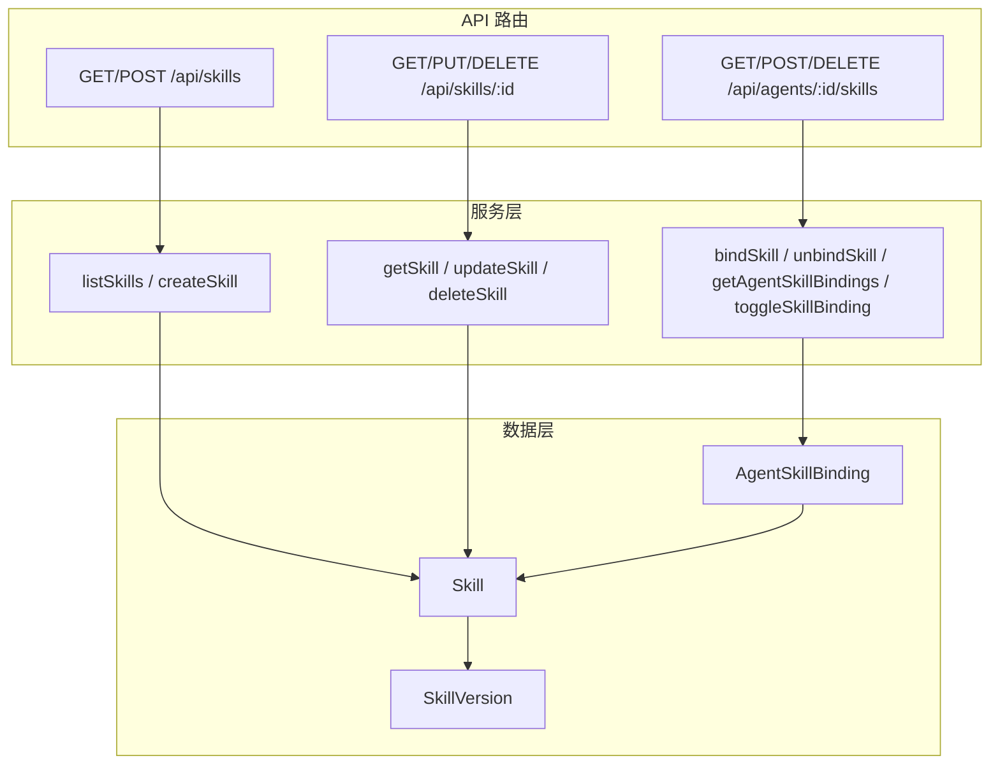
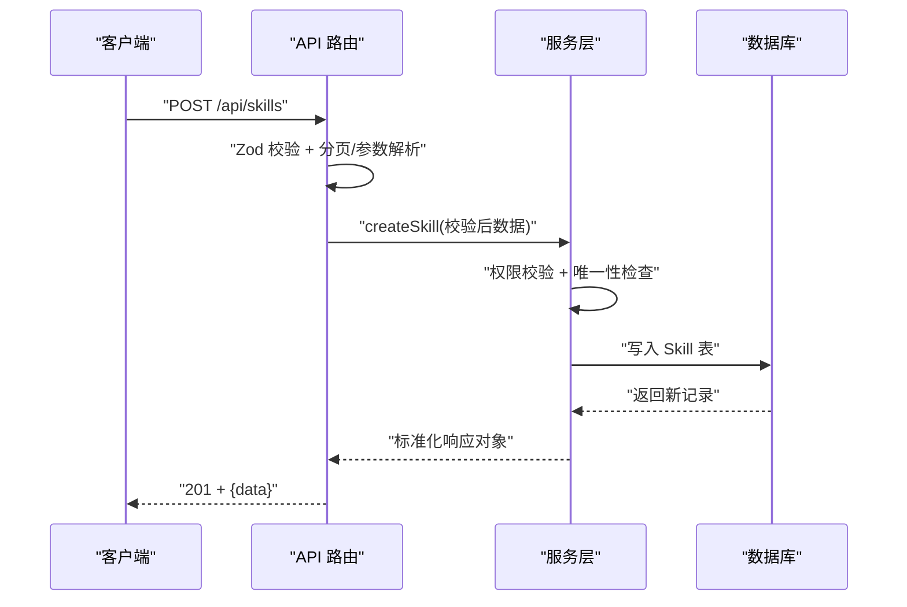
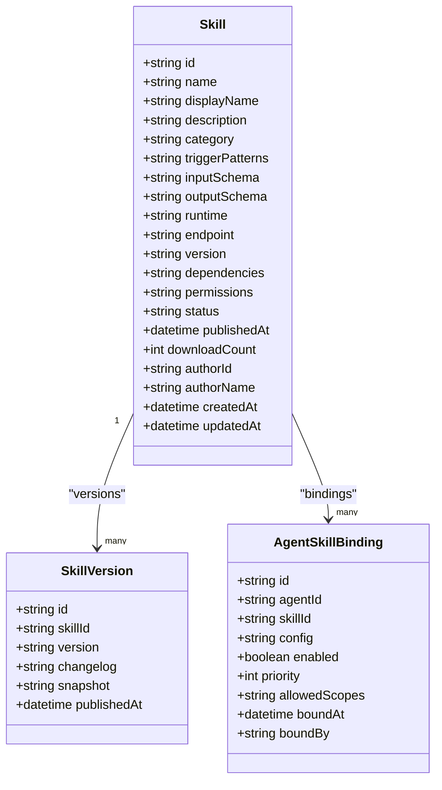
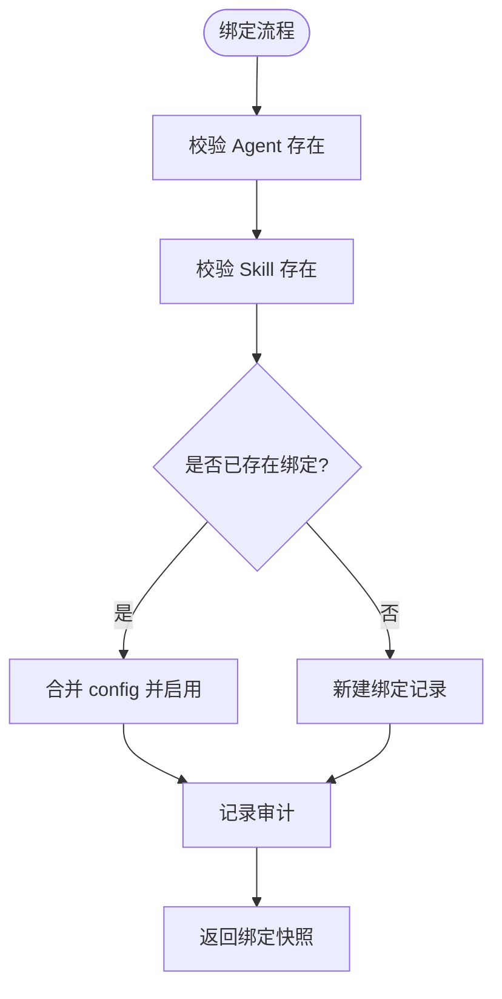
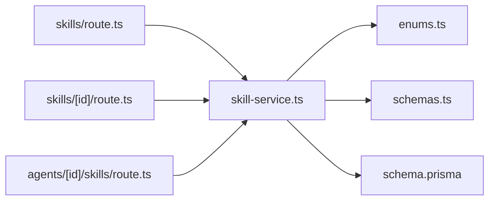

# 技能插件系统

<cite>
**本文引用的文件**   
- [README.md](file://README.md)
- [schema.prisma](file://packages/db/prisma/schema.prisma)
- [enums.ts](file://packages/db/src/enums.ts)
- [skill-service.ts](file://apps/web/lib/services/skill-service.ts)
- [schemas.ts](file://apps/web/lib/schemas.ts)
- [skills/route.ts](file://apps/web/app/api/skills/route.ts)
- [skills/[id]/route.ts](file://apps/web/app/api/skills/[id]/route.ts)
- [agents/[id]/skills/route.ts](file://apps/web/app/api/agents/[id]/skills/route.ts)
- [skill-detail.test.ts](file://apps/web/app/api/__tests__/skill-detail.test.ts)
- [agent-skills.test.ts](file://apps/web/app/api/__tests__/agent-skills.test.ts)
- [mock-server.ts](file://apps/web/demo/mock-server.ts)
- [skill-service.md](file://docs/distilled/skill-service.md)
</cite>

## 目录
1. [引言](#引言)
2. [项目结构](#项目结构)
3. [核心组件](#核心组件)
4. [架构总览](#架构总览)
5. [详细组件分析](#详细组件分析)
6. [依赖关系分析](#依赖关系分析)
7. [性能与可扩展性](#性能与可扩展性)
8. [故障排查指南](#故障排查指南)
9. [结论](#结论)
10. [附录：API 规范与使用示例](#附录api-规范与使用示例)

## 引言
本技术文档聚焦“技能插件系统”，围绕 Skill 实体定义、插件注册机制、动态加载原理、与 Agent 的绑定管理、依赖解析与冲突检测、分类体系与元数据、版本控制、生命周期（创建/更新/禁用/删除）、权限控制，以及与 Agent 配置系统的集成方式展开。同时给出 API 端点规范、数据结构定义、使用示例、开发最佳实践与调试技巧，帮助开发者快速理解并扩展该子系统。

## 项目结构
技能插件系统横跨数据库模型、服务层、API 路由、校验 Schema、测试与 Mock 服务器等模块，采用 Next.js App Router + Prisma + SQLite 的典型分层架构：
- 数据层：Prisma schema 定义 Skill、SkillVersion、AgentSkillBinding 等实体及关系。
- 服务层：skill-service.ts 封装 CRUD、绑定、开关、计数聚合、审计记录等逻辑。
- 路由层：skills 与 agents/[id]/skills 两个资源域的路由处理请求、参数校验、错误包装。
- 校验层：schemas.ts 提供 create/update/bind 等 Zod schema。
- 类型与枚举：enums.ts 提供 SkillCategory/SkillRuntime/SkillStatus 等运行时枚举。
- 测试与演示：单元测试覆盖关键路径；Mock 服务器镜像 API 行为用于静态演示。

图表来源
- [skills/route.ts:7-30](file://apps/web/app/api/skills/route.ts#L7-L30)
- [skills/[id]/route.ts:7-46](file://apps/web/app/api/skills/[id]/route.ts#L7-L46)
- [agents/[id]/skills/route.ts:7-47](file://apps/web/app/api/agents/[id]/skills/route.ts#L7-L47)
- [skill-service.ts:74-295](file://apps/web/lib/services/skill-service.ts#L74-L295)
- [schema.prisma:324-391](file://packages/db/prisma/schema.prisma#L324-L391)

章节来源
- [README.md:76-135](file://README.md#L76-L135)
- [schema.prisma:324-391](file://packages/db/prisma/schema.prisma#L324-L391)

## 核心组件
- Skill 实体与版本：Skill 表承载技能元数据（名称、显示名、描述、分类、触发模式、输入/输出 Schema、运行时代码位置或端点、版本号、依赖、权限、状态、作者、时间戳等），SkillVersion 表保存不可变快照与变更说明。
- Agent-Skill 绑定：AgentSkillBinding 表维护 Agent 与 Skill 的多对多绑定，支持 per-binding 配置、启用开关、优先级、作用域白名单、绑定人与时间。
- 服务层能力：列表分页过滤、详情聚合（含绑定与最近版本）、创建/更新/归档、绑定/解绑/开关、审计记录、权限校验。
- 校验与类型：Zod schema 约束入参；enums.ts 提供 SkillCategory/SkillRuntime/SkillStatus 等枚举类型。

章节来源
- [schema.prisma:324-391](file://packages/db/prisma/schema.prisma#L324-L391)
- [skill-service.ts:16-295](file://apps/web/lib/services/skill-service.ts#L16-L295)
- [enums.ts:104-128](file://packages/db/src/enums.ts#L104-L128)
- [schemas.ts:154-186](file://apps/web/lib/schemas.ts#L154-L186)

## 架构总览
技能插件系统遵循“路由适配 → 服务逻辑 → 持久化”的分层原则：
- 路由层仅做协议适配（参数解析、Zod 校验、Actor 上下文注入、统一响应包装）。
- 服务层实现业务规则（权限、唯一性、软删除归档、幂等 upsert、审计）。
- 数据层通过 Prisma 访问 SQLite，JSON 字段以字符串存储并通过 pack/unpack 工具序列化。

图表来源
- [skills/route.ts:18-30](file://apps/web/app/api/skills/route.ts#L18-L30)
- [skill-service.ts:144-179](file://apps/web/lib/services/skill-service.ts#L144-L179)
- [schema.prisma:324-357](file://packages/db/prisma/schema.prisma#L324-L357)

## 详细组件分析

### Skill 实体与版本控制
- 字段设计：name 唯一键；category/runtime/status 为字符串列，值域由 Zod 与 enums.ts 共同约束；triggerPatterns/dependencies/permissions/inputSchema/outputSchema 以 JSON 文本存储，读写经 packJson/unpackJson 收口。
- 版本控制：SkillVersion 表按 skillId+version 唯一，保存 snapshot 与 changelog，publishedAt 记录发布时间；getSkill 返回最近 10 条版本摘要。
- 状态机：status 支持 DRAFT/PUBLISHED/DEPRECATED/ARCHIVED；deleteSkill 不物理删除，改为 ARCHIVED 软删，保留历史绑定与版本引用不断链。

图表来源
- [schema.prisma:324-391](file://packages/db/prisma/schema.prisma#L324-L391)

章节来源
- [schema.prisma:324-391](file://packages/db/prisma/schema.prisma#L324-L391)
- [skill-service.ts:117-142](file://apps/web/lib/services/skill-service.ts#L117-L142)
- [skill-service.ts:209-220](file://apps/web/lib/services/skill-service.ts#L209-L220)

### 插件注册与动态加载
- 注册入口：POST /api/skills 调用 createSkill，要求 settings.admin 权限，校验 name 唯一性，落库并记录审计。
- 动态加载：当前代码未实现运行时加载器；Skill 作为平台资产被 Agent 通过绑定引用。未来可在 Agent 执行时根据 binding.enabled/priority/config 动态装配技能。
- 元数据与分类：category 支持 KNOWLEDGE_QUERY/DATA_FETCH/ACTION/TRANSFORM/GENERAL；runtime 支持 HTTP/FUNCTION/MCP/WORKFLOW；endpoint/codeRef 指向外部实现或代码位置。

章节来源
- [schemas.ts:154-169](file://apps/web/lib/schemas.ts#L154-L169)
- [skill-service.ts:144-179](file://apps/web/lib/services/skill-service.ts#L144-L179)
- [enums.ts:104-120](file://packages/db/src/enums.ts#L104-L120)

### 与 Agent 的绑定关系管理
- 绑定接口：GET/POST/DELETE /api/agents/:id/skills 分别用于查询绑定、新增绑定、解绑。
- 幂等 upsert：重复绑定同一 skill 会合并 config 并重新启用，避免重复行。
- 排序与快照：绑定按 priority 降序、id 降序返回；binding 中附带 skill 快照（id/name/displayName）便于前端展示。
- 开关控制：toggleSkillBinding 可切换 enabled 状态，缺失绑定抛 NotFoundError。

图表来源
- [skill-service.ts:223-254](file://apps/web/lib/services/skill-service.ts#L223-L254)
- [agents/[id]/skills/route.ts:16-32](file://apps/web/app/api/agents/[id]/skills/route.ts#L16-L32)

章节来源
- [skill-service.ts:223-295](file://apps/web/lib/services/skill-service.ts#L223-L295)
- [agents/[id]/skills/route.ts:7-47](file://apps/web/app/api/agents/[id]/skills/route.ts#L7-L47)

### 依赖解析与冲突检测
- 依赖声明：Skill.dependencies 字段以 JSON 数组形式声明依赖的其他 Skill。
- 冲突检测：当前服务层未实现依赖图解析与循环依赖检测；建议在 bindSkill 或发布前校验阶段加入拓扑排序与冲突告警。
- 建议方案：在 Service 层增加 resolveDependencies(skillId) 函数，构建依赖有向图，检测环与缺失依赖，返回冲突清单供上层拒绝或提示。

章节来源
- [schema.prisma:324-357](file://packages/db/prisma/schema.prisma#L324-L357)
- [skill-service.ts:182-207](file://apps/web/lib/services/skill-service.ts#L182-L207)

### 权限控制机制
- 权限策略：Skill 管理（创建/更新/归档）要求 settings.admin；Agent 绑定操作要求 agent.write。
- Actor 上下文：路由层通过 withActor(resolveActor(...)) 注入 Actor，服务层读取 actor.id/name 用于审计与快照。
- 审计日志：所有写操作均调用 recordAudit 记录 action/resource/resourceId/details。

章节来源
- [skill-service.ts:144-179](file://apps/web/lib/services/skill-service.ts#L144-L179)
- [skill-service.ts:223-295](file://apps/web/lib/services/skill-service.ts#L223-L295)
- [skills/route.ts:18-30](file://apps/web/app/api/skills/route.ts#L18-L30)

### 生命周期管理
- 创建：POST /api/skills，校验通过后写入 Skill 表，默认 category=GENERAL、runtime=HTTP、version=1.0.0、status=DRAFT。
- 更新：PUT /api/skills/:id，支持更新 displayName/description/category/triggerPatterns/inputSchema/outputSchema/runtime/endpoint/status。
- 禁用/归档：DELETE /api/skills/:id 将 status 置为 ARCHIVED，非物理删除，保留历史绑定与版本。
- 绑定/解绑：POST/DELETE /api/agents/:id/skills 管理绑定关系；GET 获取绑定列表。

章节来源
- [skill-service.ts:144-220](file://apps/web/lib/services/skill-service.ts#L144-L220)
- [skills/[id]/route.ts:7-46](file://apps/web/app/api/skills/[id]/route.ts#L7-L46)
- [agents/[id]/skills/route.ts:7-47](file://apps/web/app/api/agents/[id]/skills/route.ts#L7-L47)

### 与 Agent 配置系统的集成
- 绑定即集成：Agent 通过 AgentSkillBinding 引用 Skill，并在运行时依据 enabled/priority/config 决定调用顺序与参数。
- 运行时注入：当前未实现运行时注入器；建议在 Agent 执行管线中读取绑定列表，按 priority 排序，注入到 Tools/Routing 分区或作为独立执行单元。
- 参数传递：binding.config 为任意 JSON，可由上游传入（如 MCP 连接信息、HTTP 超时等），在服务层序列化为字符串存储。

章节来源
- [schema.prisma:373-391](file://packages/db/prisma/schema.prisma#L373-L391)
- [skill-service.ts:223-254](file://apps/web/lib/services/skill-service.ts#L223-L254)

## 依赖关系分析
- 路由与服务：skills 路由依赖 listSkills/createSkill；skills/[id] 路由依赖 getSkill/updateSkill/deleteSkill；agents/[id]/skills 路由依赖 bindSkill/unbindSkill/getAgentSkillBindings/toggleSkillBinding。
- 服务与数据：service 层通过 Prisma 访问 Skill/SkillVersion/AgentSkillBinding 表；JSON 字段通过 packJson/unpackJson 转换。
- 类型与校验：enums.ts 提供枚举常量与类型；schemas.ts 提供 Zod schema 校验。

图表来源
- [skills/route.ts:1-30](file://apps/web/app/api/skills/route.ts#L1-L30)
- [skills/[id]/route.ts:1-46](file://apps/web/app/api/skills/[id]/route.ts#L1-L46)
- [agents/[id]/skills/route.ts:1-47](file://apps/web/app/api/agents/[id]/skills/route.ts#L1-L47)
- [skill-service.ts:1-295](file://apps/web/lib/services/skill-service.ts#L1-L295)
- [enums.ts:104-128](file://packages/db/src/enums.ts#L104-L128)
- [schemas.ts:154-186](file://apps/web/lib/schemas.ts#L154-L186)
- [schema.prisma:324-391](file://packages/db/prisma/schema.prisma#L324-L391)

章节来源
- [skill-service.md:48-93](file://docs/distilled/skill-service.md#L48-L93)

## 性能与可扩展性
- 列表查询优化：无搜索条件时使用 Prisma 分页 skip/take；有搜索条件时在内存过滤后切片，适合演示规模。
- 详情聚合：一次 include bindings/versions/_count，减少 N+1 查询。
- 绑定排序：按 priority 降序、id 降序，保证稳定顺序。
- 可扩展点：
  - 依赖解析：引入拓扑排序检测循环依赖。
  - 动态加载：在 Agent 执行管线中按 binding.priority 动态装配。
  - 缓存：热点 Skill 详情与绑定列表可加短期缓存。

[本节为通用指导，无需具体文件引用]

## 故障排查指南
- 404 不存在：GET /api/skills/:id 找不到记录时返回 404；测试用例验证了此行为。
- 同名冲突：createSkill 对 name 唯一性进行校验，重复创建抛 ConflictError。
- 绑定不存在：toggleSkillBinding 对缺失绑定抛 NotFoundError；unbindSkill 对缺失绑定静默成功（兼容旧契约）。
- JSON 字段类型：SQLite 下 JSON 字段为 TEXT，需确保 GET 返回仍为数组/对象（测试覆盖）。

章节来源
- [skill-detail.test.ts:53-73](file://apps/web/app/api/__tests__/skill-detail.test.ts#L53-L73)
- [skill-service.ts:157-158](file://apps/web/lib/services/skill-service.ts#L157-L158)
- [skill-service.ts:279-295](file://apps/web/lib/services/skill-service.ts#L279-L295)
- [skill-service.ts:256-265](file://apps/web/lib/services/skill-service.ts#L256-L265)

## 结论
技能插件系统以 Skill 为核心资产，通过 AgentSkillBinding 与 Agent 建立灵活绑定关系，具备完善的权限控制与审计追踪。当前实现了完整的 CRUD、绑定管理与版本快照，尚未实现依赖解析与运行时动态加载。建议在后续迭代中补充依赖图校验与运行时装配逻辑，以提升插件生态的可维护性与扩展性。

[本节为总结性内容，无需具体文件引用]

## 附录：API 规范与使用示例

### API 端点总览
- Skills 管理
  - GET /api/skills：列表（支持 category/status/search 过滤与分页）
  - POST /api/skills：创建（settings.admin 权限）
  - GET /api/skills/:id：详情（含 bindings/versions/_count）
  - PUT /api/skills/:id：更新（settings.admin 权限）
  - DELETE /api/skills/:id：归档（settings.admin 权限）
- Agent-Skill 绑定
  - GET /api/agents/:id/skills：查询绑定列表
  - POST /api/agents/:id/skills：绑定（agent.write 权限）
  - DELETE /api/agents/:id/skills?agentId=&skillId=：解绑（agent.write 权限）

章节来源
- [skills/route.ts:7-30](file://apps/web/app/api/skills/route.ts#L7-L30)
- [skills/[id]/route.ts:7-46](file://apps/web/app/api/skills/[id]/route.ts#L7-L46)
- [agents/[id]/skills/route.ts:7-47](file://apps/web/app/api/agents/[id]/skills/route.ts#L7-L47)

### 数据结构定义
- Skill 关键字段：id/name/displayName/description/category/triggerPatterns/inputSchema/outputSchema/runtime/endpoint/version/dependencies/permissions/status/publishedAt/downloadCount/authorId/authorName/createdAt/updatedAt
- SkillVersion 关键字段：id/skillId/version/changelog/snapshot/publishedAt
- AgentSkillBinding 关键字段：id/agentId/skillId/config/enabled/priority/allowedScopes/boundAt/boundBy

章节来源
- [schema.prisma:324-391](file://packages/db/prisma/schema.prisma#L324-L391)

### 使用示例（步骤式）
- 创建 Skill
  - 调用 POST /api/skills，携带 name/displayName/description/category/runtime/endpoint 等字段。
  - 成功后返回 201 与 Skill 摘要。
- 绑定 Skill 到 Agent
  - 调用 POST /api/agents/:id/skills，携带 skillId 与可选 config。
  - 若已存在绑定，则合并 config 并启用。
- 查询绑定列表
  - 调用 GET /api/agents/:id/skills，返回按 priority 降序的绑定快照。
- 归档 Skill
  - 调用 DELETE /api/skills/:id，将 status 置为 ARCHIVED。

章节来源
- [skill-service.ts:144-220](file://apps/web/lib/services/skill-service.ts#L144-L220)
- [skill-service.ts:223-295](file://apps/web/lib/services/skill-service.ts#L223-L295)

### 开发与调试要点
- 本地全栈：pnpm dev，真实 Next.js route handler + SQLite（Prisma）。
- 静态 Demo：pnpm build:demo，浏览器端拦截同源 /api/* 请求，使用 mock-server.ts 提供的内存态数据。
- 测试隔离：每个测试先 _resetDb 清库，再灌入种子数据，互不干扰。
- LLM 相关：Skill 本身不涉及 LLM；LLM 网关与试聊 Playground 位于其他端点。

章节来源
- [README.md:155-207](file://README.md#L155-L207)
- [mock-server.ts:1643-1696](file://apps/web/demo/mock-server.ts#L1643-L1696)