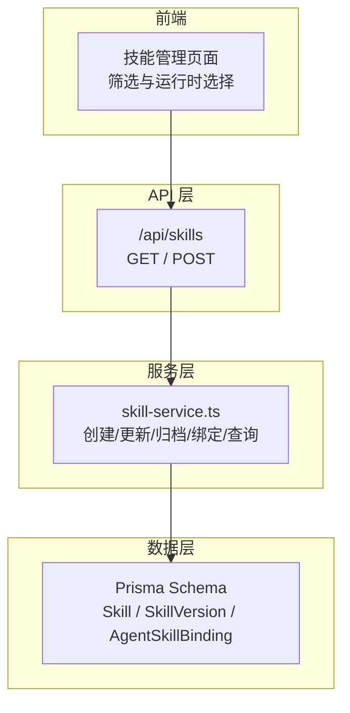
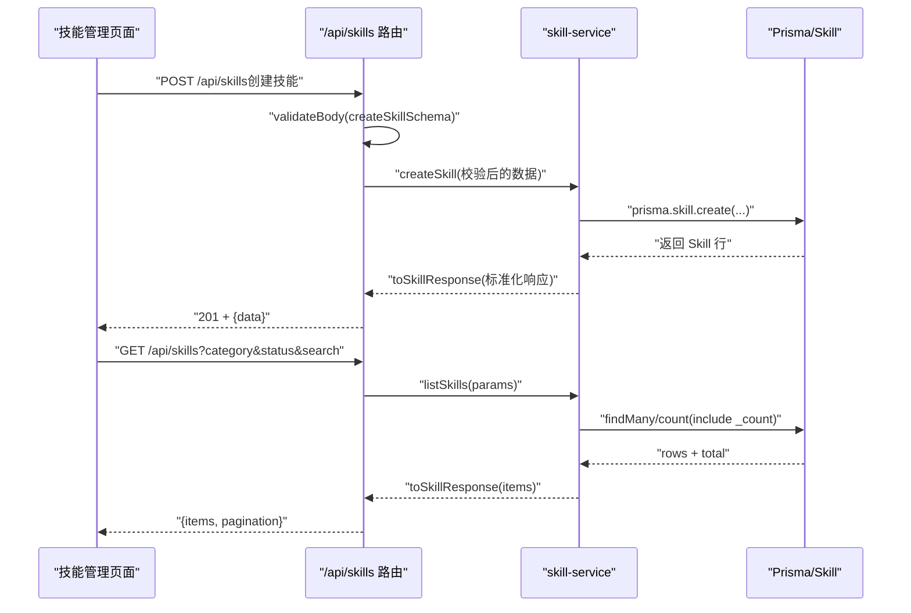
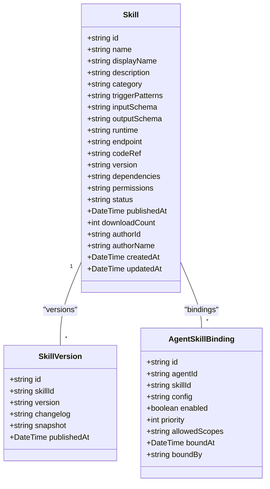
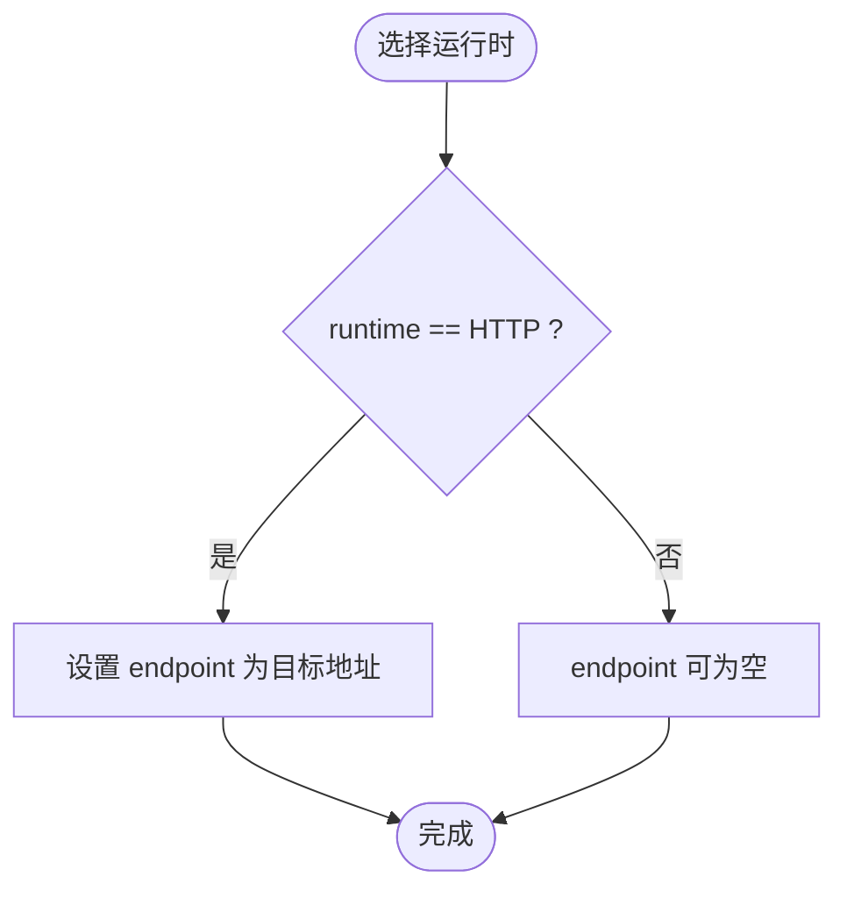
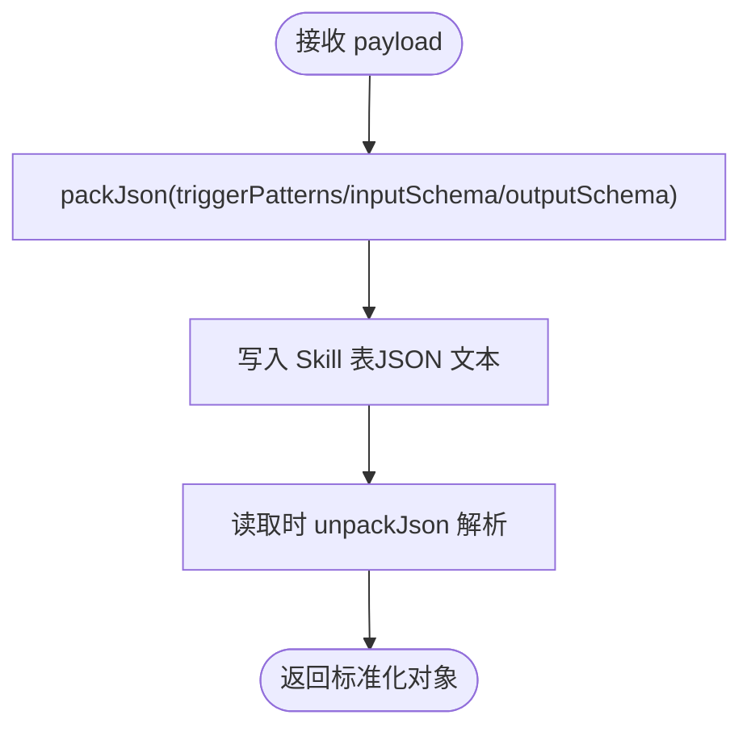
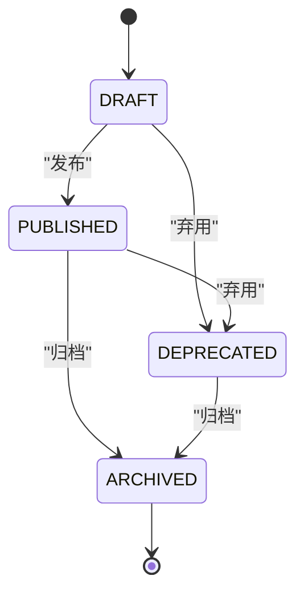
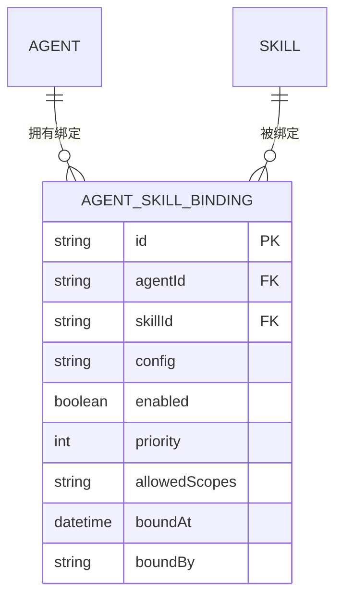
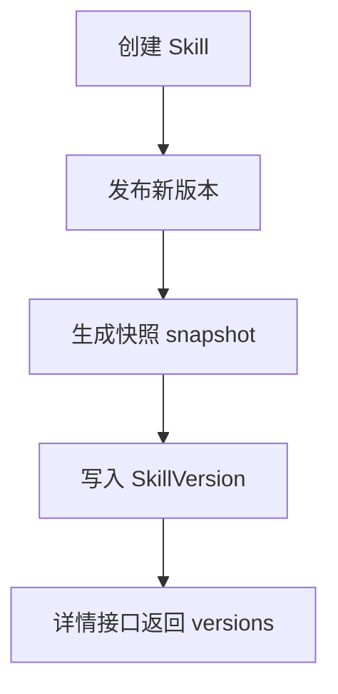
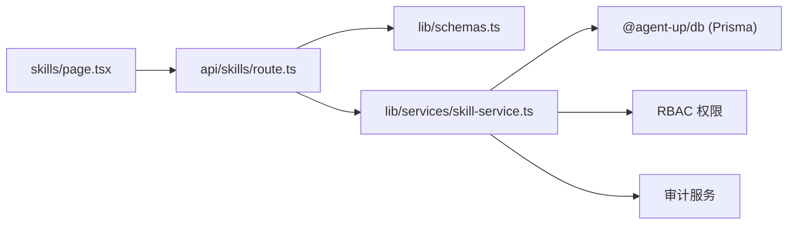

# 技能架构设计

<cite>
**本文引用的文件**   
- [packages/db/prisma/schema.prisma](file://packages/db/prisma/schema.prisma)
- [apps/web/lib/schemas.ts](file://apps/web/lib/schemas.ts)
- [apps/web/app/api/skills/route.ts](file://apps/web/app/api/skills/route.ts)
- [apps/web/lib/services/skill-service.ts](file://apps/web/lib/services/skill-service.ts)
- [apps/web/app/(dashboard)/skills/page.tsx](file://apps/web/app/(dashboard)/skills/page.tsx)
- [apps/web/demo/mock-server.ts](file://apps/web/demo/mock-server.ts)
- [packages/db/prisma/seed.mjs](file://packages/db/prisma/seed.mjs)
</cite>

## 目录
1. [引言](#引言)
2. [项目结构](#项目结构)
3. [核心组件](#核心组件)
4. [架构总览](#架构总览)
5. [详细组件分析](#详细组件分析)
6. [依赖关系分析](#依赖关系分析)
7. [性能与可扩展性](#性能与可扩展性)
8. [故障排查指南](#故障排查指南)
9. [结论](#结论)

## 引言
本文件面向“技能（Skill）”这一平台级可复用能力单元，系统性说明其数据模型、分类体系、运行时类型、元数据机制、生命周期状态、版本控制以及与 Agent 的绑定关系。文档同时给出端到端调用流程、关键数据结构与约束、以及常见问题的定位方法，帮助开发者快速理解并正确使用技能实体。

## 项目结构
围绕技能的核心代码分布在以下位置：
- 数据库模型定义：packages/db/prisma/schema.prisma
- 输入校验与枚举契约：apps/web/lib/schemas.ts
- API 路由层：apps/web/app/api/skills/route.ts
- 服务层（业务逻辑与持久化）：apps/web/lib/services/skill-service.ts
- 前端筛选与运行时选择 UI：apps/web/app/(dashboard)/skills/page.tsx
- 演示用 Mock 服务：apps/web/demo/mock-server.ts
- 种子数据与版本快照写入：packages/db/prisma/seed.mjs

**图表来源** 
- [apps/web/app/(dashboard)/skills/page.tsx:117-181](file://apps/web/app/(dashboard)/skills/page.tsx#L117-L181)
- [apps/web/app/api/skills/route.ts:1-31](file://apps/web/app/api/skills/route.ts#L1-L31)
- [apps/web/lib/services/skill-service.ts:1-296](file://apps/web/lib/services/skill-service.ts#L1-L296)
- [packages/db/prisma/schema.prisma:320-391](file://packages/db/prisma/schema.prisma#L320-L391)

**章节来源**
- [apps/web/app/(dashboard)/skills/page.tsx:117-181](file://apps/web/app/(dashboard)/skills/page.tsx#L117-L181)
- [apps/web/app/api/skills/route.ts:1-31](file://apps/web/app/api/skills/route.ts#L1-L31)
- [apps/web/lib/services/skill-service.ts:1-296](file://apps/web/lib/services/skill-service.ts#L1-L296)
- [packages/db/prisma/schema.prisma:320-391](file://packages/db/prisma/schema.prisma#L320-L391)

## 核心组件
本节聚焦 Skill 实体的关键字段、分类与运行时、元数据、状态与版本、以及与 Agent 的关系。

- Skill 实体字段与用途
  - name：技能的唯一标识名，用于全局唯一性与引用键。
  - displayName：面向用户的显示名称。
  - description：技能的功能描述。
  - category：技能分类，影响筛选与模型偏好。
  - triggerPatterns：触发模式数组，用于匹配用户意图或事件。
  - inputSchema / outputSchema：输入/输出 JSON Schema，作为对外契约。
  - runtime：运行时类型，决定如何被调用执行。
  - endpoint：当 runtime 为 HTTP 时，指向外部接口地址。
  - codeRef：可选的代码引用（如仓库路径）。
  - version：当前主版本字符串。
  - dependencies / permissions：依赖与权限声明（JSON 文本存储）。
  - status：生命周期状态，如 DRAFT、PUBLISHED、DEPRECATED、ARCHIVED。
  - publishedAt / downloadCount / authorId / authorName / createdAt / updatedAt：发布与审计相关元信息。

- 分类体系（SkillCategory）
  - 取值：KNOWLEDGE_QUERY、DATA_FETCH、ACTION、TRANSFORM、GENERAL。
  - 作用：对技能进行能力维度归类，便于列表筛选与策略选择。

- 运行时类型（SkillRuntime）
  - 取值：HTTP、FUNCTION、MCP、WORKFLOW。
  - HTTP：通过 endpoint 调用外部 HTTP 接口。
  - FUNCTION / MCP / WORKFLOW：由系统或其他运行时调度执行。

- 元数据管理机制
  - triggerPatterns：字符串数组，用于意图匹配或事件触发。
  - inputSchema / outputSchema：JSON Schema 对象，作为输入输出契约；在 SQLite 中以 JSON 文本存储，读写经 packJson/unpackJson 收口。

- 生命周期状态（SkillStatus）
  - 典型状态：DRAFT（草稿）、PUBLISHED（已发布）、DEPRECATED（已弃用）、ARCHIVED（已归档）。
  - 流转规则：
    - 新建默认 DRAFT。
    - 可通过更新接口将状态改为 PUBLISHED 或 DEPRECATED。
    - 删除操作实际为软删除，将状态置为 ARCHIVED，保留历史绑定与审计记录。

- 版本控制机制
  - SkillVersion：以 skillId + version 唯一索引保存每次发布的快照 snapshot。
  - 支持 changelog、publishedAt 等元信息，便于回滚与审计。
  - 种子脚本中会按 skillId 建立版本快照，供后续版本线追溯。

- 与 Agent 的关系模型
  - AgentSkillBinding：多对多关联表，记录 agentId 与 skillId 的绑定关系。
  - 包含 config（绑定配置）、enabled（是否启用）、priority（优先级）、allowedScopes（允许范围）、boundBy/boundAt（审计信息）。
  - 提供 upsert 语义：重复绑定同一 skill 会合并配置并重新启用。

**章节来源**
- [packages/db/prisma/schema.prisma:320-391](file://packages/db/prisma/schema.prisma#L320-L391)
- [apps/web/lib/schemas.ts:154-186](file://apps/web/lib/schemas.ts#L154-L186)
- [apps/web/lib/services/skill-service.ts:28-50](file://apps/web/lib/services/skill-service.ts#L28-L50)
- [apps/web/lib/services/skill-service.ts:144-221](file://apps/web/lib/services/skill-service.ts#L144-L221)
- [apps/web/lib/services/skill-service.ts:223-295](file://apps/web/lib/services/skill-service.ts#L223-L295)
- [packages/db/prisma/seed.mjs:184-209](file://packages/db/prisma/seed.mjs#L184-L209)

## 架构总览
技能从前端到数据库的完整链路如下：

**图表来源** 
- [apps/web/app/api/skills/route.ts:7-30](file://apps/web/app/api/skills/route.ts#L7-L30)
- [apps/web/lib/services/skill-service.ts:74-115](file://apps/web/lib/services/skill-service.ts#L74-L115)
- [apps/web/lib/services/skill-service.ts:144-180](file://apps/web/lib/services/skill-service.ts#L144-L180)

## 详细组件分析

### 数据模型与字段语义
- Skill 表关键字段映射与约束
  - 所有枚举列在 SQLite 中以 String 存储，值域校验由 Zod schema 承担。
  - JSON 与数组列统一以 JSON 文本存储，读写经 packJson/unpackJson 收口。
- 关键字段语义
  - name：唯一标识，不可重复。
  - displayName/description：展示与说明。
  - category/runtime/status：分类、运行时、状态三要素。
  - triggerPatterns/inputSchema/outputSchema：触发与契约元数据。
  - endpoint：HTTP 运行时的目标地址。
  - version：主版本号。
  - dependencies/permissions：依赖与权限声明。
  - authorId/authorName/createdAt/updatedAt：审计与时间戳。

**图表来源** 
- [packages/db/prisma/schema.prisma:320-391](file://packages/db/prisma/schema.prisma#L320-L391)

**章节来源**
- [packages/db/prisma/schema.prisma:320-391](file://packages/db/prisma/schema.prisma#L320-L391)

### 分类体系与运行时类型
- 分类（SkillCategory）
  - 枚举值：KNOWLEDGE_QUERY、DATA_FETCH、ACTION、TRANSFORM、GENERAL。
  - 前端筛选器支持 ALL 与具体分类，后端根据 category 过滤。
- 运行时（SkillRuntime）
  - 枚举值：HTTP、FUNCTION、MCP、WORKFLOW。
  - HTTP 模式下需填写 endpoint；其他运行时由系统或外部运行时调度。

**图表来源** 
- [apps/web/lib/schemas.ts:154-169](file://apps/web/lib/schemas.ts#L154-L169)
- [apps/web/app/(dashboard)/skills/page.tsx:414-436](file://apps/web/app/(dashboard)/skills/page.tsx#L414-L436)

**章节来源**
- [apps/web/lib/schemas.ts:154-169](file://apps/web/lib/schemas.ts#L154-L169)
- [apps/web/app/(dashboard)/skills/page.tsx:393-437](file://apps/web/app/(dashboard)/skills/page.tsx#L393-L437)

### 元数据管理机制（triggerPatterns、inputSchema、outputSchema）
- triggerPatterns：字符串数组，用于意图匹配或事件触发。
- inputSchema/outputSchema：JSON Schema 对象，作为输入输出契约；在 SQLite 中以 JSON 文本存储，读取时 unpackJson 解析，失败回退默认值。
- 创建与更新时，服务层使用 packJson 序列化后落库，保证类型安全与兼容性。

**图表来源** 
- [apps/web/lib/services/skill-service.ts:160-179](file://apps/web/lib/services/skill-service.ts#L160-L179)
- [apps/web/lib/services/skill-service.ts:182-207](file://apps/web/lib/services/skill-service.ts#L182-L207)
- [apps/web/lib/services/skill-service.ts:28-50](file://apps/web/lib/services/skill-service.ts#L28-L50)

**章节来源**
- [apps/web/lib/services/skill-service.ts:28-50](file://apps/web/lib/services/skill-service.ts#L28-L50)
- [apps/web/lib/services/skill-service.ts:160-207](file://apps/web/lib/services/skill-service.ts#L160-L207)

### 生命周期状态管理（SkillStatus）
- 状态集合：DRAFT、PUBLISHED、DEPRECATED、ARCHIVED。
- 流转规则：
  - 新建默认 DRAFT。
  - 更新接口支持修改为 PUBLISHED 或 DEPRECATED。
  - 删除接口不物理删除，而是将 status 置为 ARCHIVED，保留历史绑定与审计。
- 前端筛选支持 ALL/DRAFT/PUBLISHED/DEPRECATED/ARCHIVED。

**图表来源** 
- [apps/web/lib/schemas.ts:171-181](file://apps/web/lib/schemas.ts#L171-L181)
- [apps/web/lib/services/skill-service.ts:209-221](file://apps/web/lib/services/skill-service.ts#L209-L221)
- [apps/web/app/(dashboard)/skills/page.tsx:149-163](file://apps/web/app/(dashboard)/skills/page.tsx#L149-L163)

**章节来源**
- [apps/web/lib/schemas.ts:171-181](file://apps/web/lib/schemas.ts#L171-L181)
- [apps/web/lib/services/skill-service.ts:209-221](file://apps/web/lib/services/skill-service.ts#L209-L221)
- [apps/web/app/(dashboard)/skills/page.tsx:149-163](file://apps/web/app/(dashboard)/skills/page.tsx#L149-L163)

### 技能与 Agent 的关系模型
- AgentSkillBinding 表示 Agent 与 Skill 的多对多绑定。
- 绑定属性：
  - config：绑定配置（JSON 文本）。
  - enabled：是否启用。
  - priority：优先级（数值越大越优先）。
  - allowedScopes：允许的作用域（JSON 文本）。
  - boundBy/boundAt：审计信息。
- 绑定行为：
  - bindSkill：幂等 upsert，重复绑定合并配置并重新启用。
  - unbindSkill：删除绑定（旧契约下不存在也静默成功）。
  - toggleSkillBinding：切换 enabled 状态。
  - getAgentSkillBindings：获取某 Agent 的所有绑定。

**图表来源** 
- [packages/db/prisma/schema.prisma:373-391](file://packages/db/prisma/schema.prisma#L373-L391)
- [apps/web/lib/services/skill-service.ts:223-295](file://apps/web/lib/services/skill-service.ts#L223-L295)

**章节来源**
- [packages/db/prisma/schema.prisma:373-391](file://packages/db/prisma/schema.prisma#L373-L391)
- [apps/web/lib/services/skill-service.ts:223-295](file://apps/web/lib/services/skill-service.ts#L223-L295)

### 版本控制机制
- SkillVersion 表保存每个版本的快照 snapshot（JSON 文本），并记录 changelog 与发布时间。
- 种子脚本中按 skillId 写入版本快照，便于后续版本线追溯与回滚。
- 详情接口返回 versions 列表（最近 10 条），便于前端展示版本历史。

**图表来源** 
- [packages/db/prisma/schema.prisma:359-371](file://packages/db/prisma/schema.prisma#L359-L371)
- [packages/db/prisma/seed.mjs:198-203](file://packages/db/prisma/seed.mjs#L198-L203)
- [apps/web/lib/services/skill-service.ts:117-142](file://apps/web/lib/services/skill-service.ts#L117-L142)

**章节来源**
- [packages/db/prisma/schema.prisma:359-371](file://packages/db/prisma/schema.prisma#L359-L371)
- [packages/db/prisma/seed.mjs:198-203](file://packages/db/prisma/seed.mjs#L198-L203)
- [apps/web/lib/services/skill-service.ts:117-142](file://apps/web/lib/services/skill-service.ts#L117-L142)

### 代码示例（路径指引）
- 创建技能（POST /api/skills）
  - 请求体字段参考：[apps/web/lib/schemas.ts:159-169](file://apps/web/lib/schemas.ts#L159-L169)
  - 路由处理：[apps/web/app/api/skills/route.ts:18-30](file://apps/web/app/api/skills/route.ts#L18-L30)
  - 服务层实现：[apps/web/lib/services/skill-service.ts:144-180](file://apps/web/lib/services/skill-service.ts#L144-L180)
- 更新技能（PUT /api/skills/[id]）
  - 更新字段与状态：[apps/web/lib/schemas.ts:171-181](file://apps/web/lib/schemas.ts#L171-L181)
  - 服务层更新逻辑：[apps/web/lib/services/skill-service.ts:182-207](file://apps/web/lib/services/skill-service.ts#L182-L207)
- 归档技能（DELETE /api/skills/[id]）
  - 软删除逻辑：[apps/web/lib/services/skill-service.ts:209-221](file://apps/web/lib/services/skill-service.ts#L209-L221)
- 绑定技能到 Agent
  - 绑定接口与服务层：[apps/web/lib/services/skill-service.ts:223-254](file://apps/web/lib/services/skill-service.ts#L223-L254)
- 查询技能列表与详情
  - 列表查询：[apps/web/lib/services/skill-service.ts:74-115](file://apps/web/lib/services/skill-service.ts#L74-L115)
  - 详情查询（含 bindings/versions）：[apps/web/lib/services/skill-service.ts:117-142](file://apps/web/lib/services/skill-service.ts#L117-L142)

**章节来源**
- [apps/web/lib/schemas.ts:159-181](file://apps/web/lib/schemas.ts#L159-L181)
- [apps/web/app/api/skills/route.ts:18-30](file://apps/web/app/api/skills/route.ts#L18-L30)
- [apps/web/lib/services/skill-service.ts:74-221](file://apps/web/lib/services/skill-service.ts#L74-L221)

## 依赖关系分析
- 模块耦合
  - route.ts 依赖 schemas.ts 做入参校验，依赖 service.ts 执行业务逻辑。
  - service.ts 依赖 @agent-up/db（Prisma 客户端与枚举类型），并调用 RBAC 与审计服务。
  - 前端 page.tsx 仅负责筛选与运行时选择，不直接访问数据库。
- 外部依赖
  - Prisma 客户端与 SQLite 存储。
  - Zod 校验与 JSON 序列化/反序列化工具。

**图表来源** 
- [apps/web/app/(dashboard)/skills/page.tsx:117-181](file://apps/web/app/(dashboard)/skills/page.tsx#L117-L181)
- [apps/web/app/api/skills/route.ts:1-31](file://apps/web/app/api/skills/route.ts#L1-L31)
- [apps/web/lib/schemas.ts:154-186](file://apps/web/lib/schemas.ts#L154-L186)
- [apps/web/lib/services/skill-service.ts:1-296](file://apps/web/lib/services/skill-service.ts#L1-L296)

**章节来源**
- [apps/web/app/(dashboard)/skills/page.tsx:117-181](file://apps/web/app/(dashboard)/skills/page.tsx#L117-L181)
- [apps/web/app/api/skills/route.ts:1-31](file://apps/web/app/api/skills/route.ts#L1-L31)
- [apps/web/lib/schemas.ts:154-186](file://apps/web/lib/schemas.ts#L154-L186)
- [apps/web/lib/services/skill-service.ts:1-296](file://apps/web/lib/services/skill-service.ts#L1-L296)

## 性能与可扩展性
- 列表查询优化
  - 使用 Promise.all 并行获取 rows 与 total，减少往返延迟。
  - 搜索在 SQLite 环境下采用内存过滤（因不支持 insensitive 模式），分页下沉至服务端。
- JSON 字段处理
  - 统一使用 packJson/unpackJson 收口，避免异常传播，提升健壮性。
- 扩展点
  - 新增运行时类型只需扩展 zod enum 与前端选项。
  - 新增分类仅需扩展 zod enum 与前端筛选项。
  - 版本快照可在发布流程中自动生成，便于回滚与审计。

[本节为通用指导，不涉及具体文件分析]

## 故障排查指南
- 常见问题
  - 同名 Skill 冲突：创建时会检查 name 唯一性，重复则抛出冲突错误。
  - Skill 不存在：更新/删除/绑定时若找不到对应记录，返回未找到错误。
  - 运行时非法：zod 校验拒绝不在枚举中的 runtime 值。
  - 分类非法：zod 校验拒绝不在枚举中的 category 值。
- 定位建议
  - 查看路由层的 validateBody 返回值与 handleApiError 处理。
  - 检查服务层的 requirePermission 与 NotFoundError/ConflictError 抛出处。
  - 确认前端表单选择的 runtime/category 是否在枚举范围内。

**章节来源**
- [apps/web/app/api/skills/route.ts:18-30](file://apps/web/app/api/skills/route.ts#L18-L30)
- [apps/web/lib/services/skill-service.ts:156-180](file://apps/web/lib/services/skill-service.ts#L156-L180)
- [apps/web/lib/services/skill-service.ts:182-221](file://apps/web/lib/services/skill-service.ts#L182-L221)
- [apps/web/lib/__tests__/schemas.test.ts:57-76](file://apps/web/lib/__tests__/schemas.test.ts#L57-L76)

## 结论
本架构以 Skill 为核心，通过分类与运行时抽象出可复用的能力单元，借助 JSON Schema 明确输入输出契约，并以版本快照与绑定关系支撑 Agent 的动态编排。SQLite 兼容层通过 packJson/unpackJson 与 Zod 校验保障数据一致性与类型安全。整体设计兼顾扩展性与可维护性，适合在多 Agent 场景下灵活组合与演进。