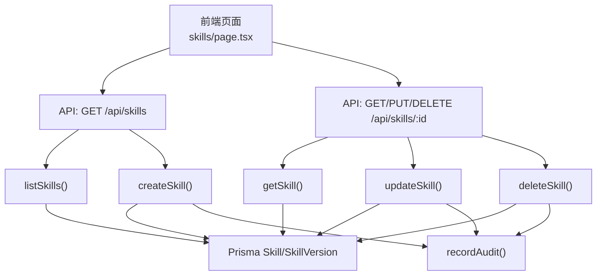
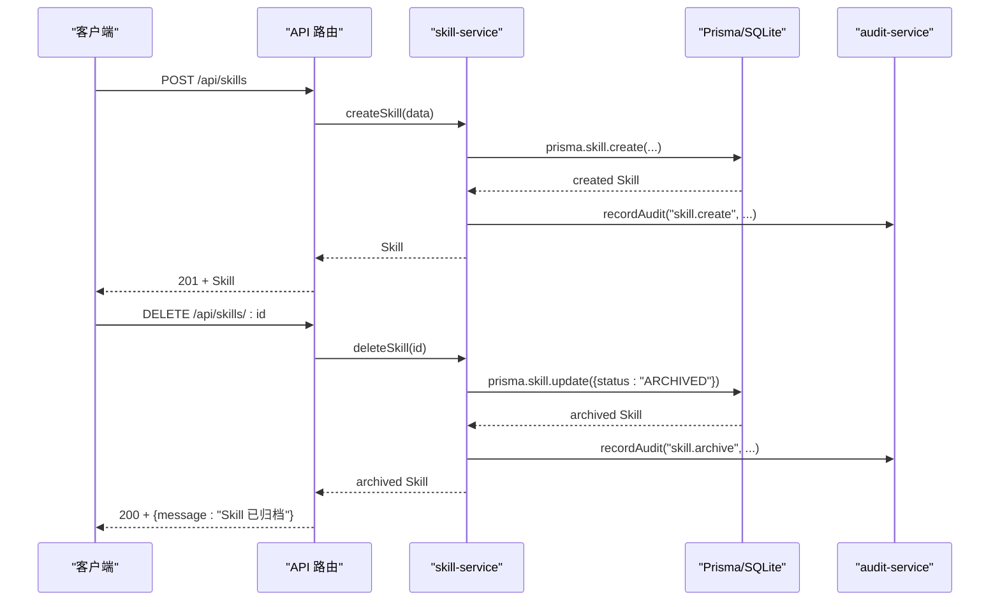
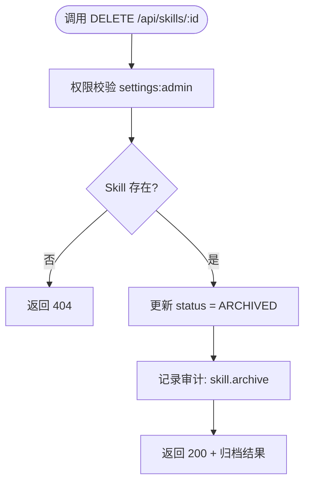
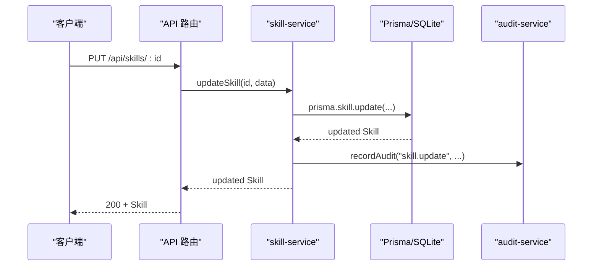
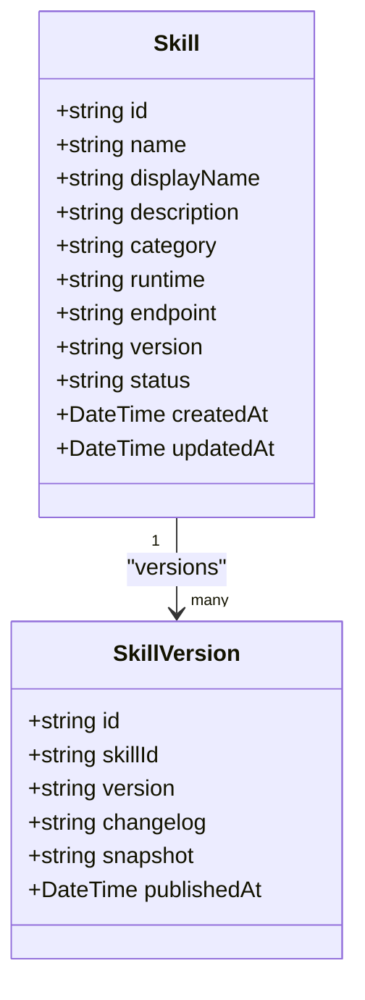
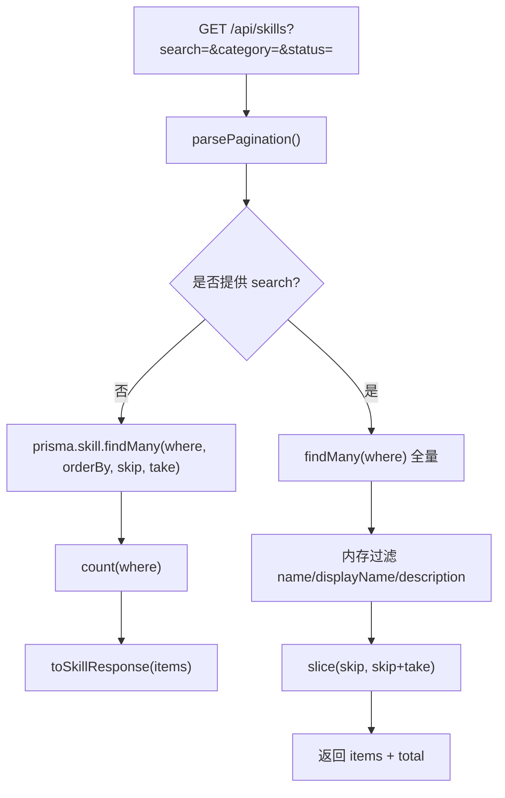
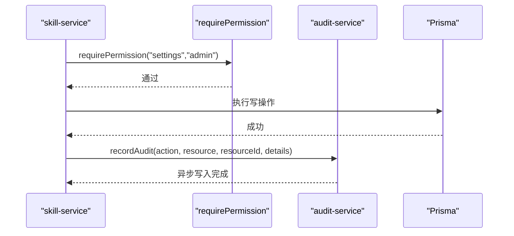
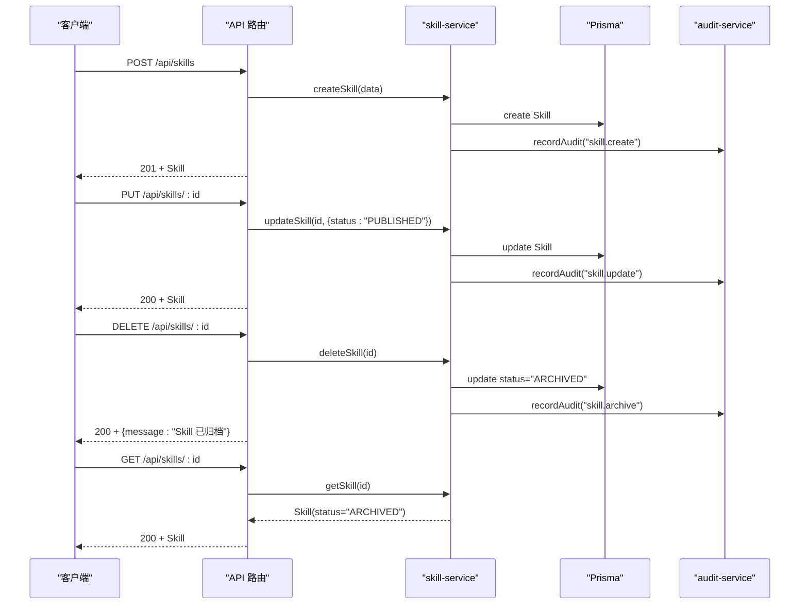
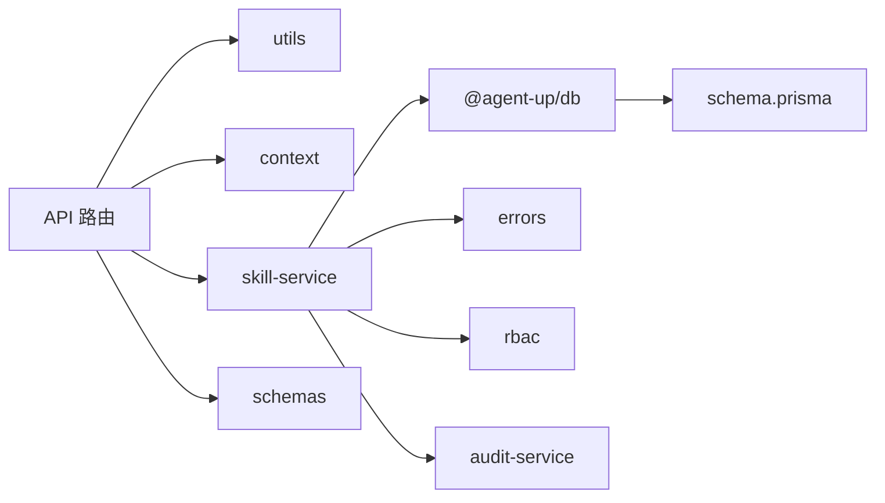
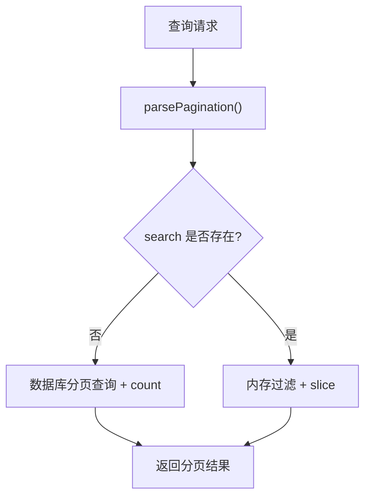

# 技能生命周期管理

<cite>
**本文引用的文件**   
- [apps/web/app/api/skills/route.ts](file://apps/web/app/api/skills/route.ts)
- [apps/web/app/api/skills/[id]/route.ts](file://apps/web/app/api/skills/[id]/route.ts)
- [apps/web/lib/services/skill-service.ts](file://apps/web/lib/services/skill-service.ts)
- [apps/web/lib/schemas.ts](file://apps/web/lib/schemas.ts)
- [packages/db/prisma/schema.prisma](file://packages/db/prisma/schema.prisma)
- [apps/web/lib/services/audit-service.ts](file://apps/web/lib/services/audit-service.ts)
- [apps/web/app/(dashboard)/skills/page.tsx](file://apps/web/app/(dashboard)/skills/page.tsx)
- [apps/web/app/api/__tests__/skill-detail.test.ts](file://apps/web/app/api/__tests__/skill-detail.test.ts)
</cite>

## 目录
1. [引言](#引言)
2. [项目结构](#项目结构)
3. [核心组件](#核心组件)
4. [架构总览](#架构总览)
5. [详细组件分析](#详细组件分析)
6. [依赖关系分析](#依赖关系分析)
7. [性能与索引优化](#性能与索引优化)
8. [故障排查指南](#故障排查指南)
9. [结论](#结论)

## 引言
本文面向“技能（Skill）”这一平台级可复用资产，系统性说明其完整生命周期：创建、更新、归档、删除（软删除）、版本管理与变更日志、搜索与过滤、分页查询、权限与审计集成。重点解释为何采用 status=ARCHIVED 的软删除机制，以及该设计对历史绑定、审计追踪和回滚能力的优势。

## 项目结构
技能相关代码集中在 Next.js API Routes 与服务层，数据模型由 Prisma Schema 定义，权限与审计通过独立服务注入。

**图表来源**
- [apps/web/app/(dashboard)/skills/page.tsx:117-181](file://apps/web/app/(dashboard)/skills/page.tsx#L117-L181)
- [apps/web/app/api/skills/route.ts:7-30](file://apps/web/app/api/skills/route.ts#L7-L30)
- [apps/web/app/api/skills/[id]/route.ts:7-46](file://apps/web/app/api/skills/[id]/route.ts#L7-L46)
- [apps/web/lib/services/skill-service.ts:74-221](file://apps/web/lib/services/skill-service.ts#L74-L221)
- [packages/db/prisma/schema.prisma:324-371](file://packages/db/prisma/schema.prisma#L324-L371)
- [apps/web/lib/services/audit-service.ts:43-84](file://apps/web/lib/services/audit-service.ts#L43-L84)

**章节来源**
- [apps/web/app/api/skills/route.ts:1-31](file://apps/web/app/api/skills/route.ts#L1-L31)
- [apps/web/app/api/skills/[id]/route.ts:1-46](file://apps/web/app/api/skills/[id]/route.ts#L1-L46)
- [apps/web/lib/services/skill-service.ts:1-296](file://apps/web/lib/services/skill-service.ts#L1-L296)
- [packages/db/prisma/schema.prisma:324-371](file://packages/db/prisma/schema.prisma#L324-L371)

## 核心组件
- API 路由层
  - GET/POST /api/skills：列表分页查询与创建。
  - GET/PUT/DELETE /api/skills/:id：详情、更新、归档（软删除）。
- 服务层 skill-service.ts
  - listSkills/getSkill/createSkill/updateSkill/deleteSkill/bind/unbind 等。
- 数据模型
  - Skill、SkillVersion、AgentSkillBinding。
- 校验与枚举
  - createSkillSchema/updateSkillSchema、category/runtime/status 枚举。
- 权限与审计
  - requirePermission("settings","admin")；recordAudit 记录行为。

**章节来源**
- [apps/web/app/api/skills/route.ts:7-30](file://apps/web/app/api/skills/route.ts#L7-L30)
- [apps/web/app/api/skills/[id]/route.ts:7-46](file://apps/web/app/api/skills/[id]/route.ts#L7-L46)
- [apps/web/lib/services/skill-service.ts:74-221](file://apps/web/lib/services/skill-service.ts#L74-L221)
- [apps/web/lib/schemas.ts:154-181](file://apps/web/lib/schemas.ts#L154-L181)
- [packages/db/prisma/schema.prisma:324-371](file://packages/db/prisma/schema.prisma#L324-L371)

## 架构总览
技能生命周期在 API 路由中暴露，服务层负责业务规则、权限校验、数据持久化与审计记录。数据库使用 SQLite（Prisma），Skill 表包含 status 字段用于状态机控制，SkillVersion 表保存版本快照与变更日志。

**图表来源**
- [apps/web/app/api/skills/route.ts:18-30](file://apps/web/app/api/skills/route.ts#L18-L30)
- [apps/web/app/api/skills/[id]/route.ts:35-46](file://apps/web/app/api/skills/[id]/route.ts#L35-L46)
- [apps/web/lib/services/skill-service.ts:144-179](file://apps/web/lib/services/skill-service.ts#L144-L179)
- [apps/web/lib/services/skill-service.ts:209-221](file://apps/web/lib/services/skill-service.ts#L209-L221)
- [apps/web/lib/services/audit-service.ts:43-84](file://apps/web/lib/services/audit-service.ts#L43-L84)

## 详细组件分析

### 生命周期状态与软删除机制
- 状态字段
  - Skill.status 默认 DRAFT，支持 PUBLISHED、DEPRECATED、ARCHIVED。
  - updateSkillSchema 允许更新 status 为 DRAFT/PUBLISHED/DEPRECATED。
- 软删除实现
  - DELETE /api/skills/:id 不物理删除，而是将 status 更新为 ARCHIVED。
  - 归档后仍可 GET 到该 Skill，便于审计与历史追溯。
- 优势
  - 保留历史绑定 AgentSkillBinding 与审计记录。
  - 避免外键约束破坏与数据丢失风险。
  - 便于恢复或重新启用（通过更新 status）。

**图表来源**
- [apps/web/app/api/skills/[id]/route.ts:35-46](file://apps/web/app/api/skills/[id]/route.ts#L35-L46)
- [apps/web/lib/services/skill-service.ts:209-221](file://apps/web/lib/services/skill-service.ts#L209-L221)

**章节来源**
- [apps/web/lib/schemas.ts:171-181](file://apps/web/lib/schemas.ts#L171-L181)
- [apps/web/lib/services/skill-service.ts:209-221](file://apps/web/lib/services/skill-service.ts#L209-L221)
- [apps/web/app/api/__tests__/skill-detail.test.ts:138-146](file://apps/web/app/api/__tests__/skill-detail.test.ts#L138-L146)

### 创建与更新流程
- 创建
  - 校验：createSkillSchema 校验 name/displayName/description/category/runtime/endpoint 等。
  - 权限：requirePermission("settings","admin")。
  - 唯一性：name 全局唯一。
  - 写入：prisma.skill.create，并记录审计。
- 更新
  - 校验：updateSkillSchema 允许部分字段更新，包括 status。
  - JSON/数组列处理：triggerPatterns/dependencies/permissions/inputSchema/outputSchema 统一序列化存储。
  - 审计：记录更新内容。

**图表来源**
- [apps/web/app/api/skills/[id]/route.ts:17-33](file://apps/web/app/api/skills/[id]/route.ts#L17-L33)
- [apps/web/lib/services/skill-service.ts:182-207](file://apps/web/lib/services/skill-service.ts#L182-L207)
- [apps/web/lib/services/audit-service.ts:43-84](file://apps/web/lib/services/audit-service.ts#L43-L84)

**章节来源**
- [apps/web/lib/schemas.ts:159-181](file://apps/web/lib/schemas.ts#L159-L181)
- [apps/web/lib/services/skill-service.ts:144-207](file://apps/web/lib/services/skill-service.ts#L144-L207)

### 版本管理与变更日志
- 数据模型
  - SkillVersion 表包含 version、changelog、snapshot、publishedAt。
  - 与 Skill 一对多关联，按 publishedAt 降序取最近 10 条。
- 当前实现
  - getSkill 返回 versions 列表，包含 id/skillId/version/changelog/publishedAt。
  - 未在当前 service 中自动创建版本；版本创建逻辑位于发布/版本管线（Agent Version 有语义化版本策略，但 Skill 版本需另行扩展）。
- 建议
  - 在 updateSkill 时根据变更范围生成新版本（如 patch/minor/major），并记录 changelog。
  - 引入版本号策略（如语义化版本）与变更日志模板。

**图表来源**
- [packages/db/prisma/schema.prisma:324-371](file://packages/db/prisma/schema.prisma#L324-L371)
- [apps/web/lib/services/skill-service.ts:117-142](file://apps/web/lib/services/skill-service.ts#L117-L142)

**章节来源**
- [packages/db/prisma/schema.prisma:324-371](file://packages/db/prisma/schema.prisma#L324-L371)
- [apps/web/lib/services/skill-service.ts:117-142](file://apps/web/lib/services/skill-service.ts#L117-L142)

### 搜索与过滤
- 前端筛选
  - 支持按名称/显示名/描述模糊搜索、分类筛选、状态筛选。
- 后端实现
  - listSkills 支持 category/status/search 参数。
  - 无 search 时走数据库分页；有 search 时先全量读取再内存过滤（SQLite 不支持 insensitive 模式）。
- 分页
  - parsePagination 解析 page/pageSize/skip/take，返回 paginationMeta。

**图表来源**
- [apps/web/app/api/skills/route.ts:7-15](file://apps/web/app/api/skills/route.ts#L7-L15)
- [apps/web/lib/services/skill-service.ts:74-115](file://apps/web/lib/services/skill-service.ts#L74-L115)
- [apps/web/app/(dashboard)/skills/page.tsx:117-181](file://apps/web/app/(dashboard)/skills/page.tsx#L117-L181)

**章节来源**
- [apps/web/app/api/skills/route.ts:7-15](file://apps/web/app/api/skills/route.ts#L7-L15)
- [apps/web/lib/services/skill-service.ts:74-115](file://apps/web/lib/services/skill-service.ts#L74-L115)
- [apps/web/app/(dashboard)/skills/page.tsx:117-181](file://apps/web/app/(dashboard)/skills/page.tsx#L117-L181)

### 权限控制与审计日志集成
- 权限
  - 所有写操作（create/update/delete/bind/unbind）均调用 requirePermission 进行资源/动作校验。
  - Skill 管理归 settings:admin。
- 审计
  - recordAudit 以 fire-and-forget 方式写入 auditLog，失败不影响主流程。
  - 记录 action/resource/resourceId/details，并附带 actor 信息（userName/userRole/userId）。

**图表来源**
- [apps/web/lib/services/skill-service.ts:144-179](file://apps/web/lib/services/skill-service.ts#L144-L179)
- [apps/web/lib/services/skill-service.ts:182-207](file://apps/web/lib/services/skill-service.ts#L182-L207)
- [apps/web/lib/services/skill-service.ts:209-221](file://apps/web/lib/services/skill-service.ts#L209-L221)
- [apps/web/lib/services/audit-service.ts:43-84](file://apps/web/lib/services/audit-service.ts#L43-L84)

**章节来源**
- [apps/web/lib/services/skill-service.ts:144-221](file://apps/web/lib/services/skill-service.ts#L144-L221)
- [apps/web/lib/services/audit-service.ts:43-84](file://apps/web/lib/services/audit-service.ts#L43-L84)

### 端到端示例：从创建到归档
- 步骤
  1. 调用 POST /api/skills 创建 Skill（校验、权限、写入、审计）。
  2. 调用 PUT /api/skills/:id 更新 Skill（可选更新 status 为 PUBLISHED/DEPRECATED）。
  3. 调用 DELETE /api/skills/:id 归档 Skill（status=ARCHIVED，非物理删除）。
  4. 调用 GET /api/skills/:id 确认归档状态。
- 测试覆盖
  - 单元测试验证归档后仍可 GET，且 status=ARCHIVED。

**图表来源**
- [apps/web/app/api/skills/route.ts:18-30](file://apps/web/app/api/skills/route.ts#L18-L30)
- [apps/web/app/api/skills/[id]/route.ts:7-46](file://apps/web/app/api/skills/[id]/route.ts#L7-L46)
- [apps/web/lib/services/skill-service.ts:144-221](file://apps/web/lib/services/skill-service.ts#L144-L221)
- [apps/web/app/api/__tests__/skill-detail.test.ts:138-146](file://apps/web/app/api/__tests__/skill-detail.test.ts#L138-L146)

**章节来源**
- [apps/web/app/api/__tests__/skill-detail.test.ts:138-146](file://apps/web/app/api/__tests__/skill-detail.test.ts#L138-L146)

## 依赖关系分析
- API 路由依赖
  - utils.success/error/pagination/validateBody/handleApiError。
  - context.withActor/resolveActor。
  - services.skill-service。
  - schemas.createSkillSchema/updateSkillSchema。
- 服务层依赖
  - @agent-up/db（prisma、packJson/unpackJson、类型）。
  - lib.context.getActor。
  - lib.errors.NotFoundError/ConflictError。
  - lib.services.rbac.requirePermission。
  - lib.services.audit-service.recordAudit。
- 数据模型依赖
  - Skill 与 SkillVersion、AgentSkillBinding 的关系。

**图表来源**
- [apps/web/app/api/skills/route.ts:1-6](file://apps/web/app/api/skills/route.ts#L1-L6)
- [apps/web/app/api/skills/[id]/route.ts:1-6](file://apps/web/app/api/skills/[id]/route.ts#L1-L6)
- [apps/web/lib/services/skill-service.ts:1-15](file://apps/web/lib/services/skill-service.ts#L1-L15)
- [packages/db/prisma/schema.prisma:324-371](file://packages/db/prisma/schema.prisma#L324-L371)

**章节来源**
- [apps/web/app/api/skills/route.ts:1-31](file://apps/web/app/api/skills/route.ts#L1-L31)
- [apps/web/app/api/skills/[id]/route.ts:1-46](file://apps/web/app/api/skills/[id]/route.ts#L1-L46)
- [apps/web/lib/services/skill-service.ts:1-296](file://apps/web/lib/services/skill-service.ts#L1-L296)

## 性能与索引优化
- 数据库索引
  - Skill.category + status 复合索引，加速分类与状态过滤。
  - SkillVersion.skillId 索引，加速版本查询。
- 分页查询
  - 无 search 时直接使用 skip/take 分页，减少数据传输。
  - count(where) 并行计算总数。
- 内存过滤
  - 当 search 存在时，先全量读取再内存过滤（SQLite 限制），适合演示规模；生产环境建议引入全文检索或外部搜索引擎。
- 并发与吞吐
  - Promise.all([findMany, count]) 提升列表接口响应速度。
  - 审计写入 fire-and-forget，不阻塞主流程。

**图表来源**
- [apps/web/lib/services/skill-service.ts:74-115](file://apps/web/lib/services/skill-service.ts#L74-L115)
- [packages/db/prisma/schema.prisma:356-371](file://packages/db/prisma/schema.prisma#L356-L371)

**章节来源**
- [apps/web/lib/services/skill-service.ts:74-115](file://apps/web/lib/services/skill-service.ts#L74-L115)
- [packages/db/prisma/schema.prisma:356-371](file://packages/db/prisma/schema.prisma#L356-L371)

## 故障排查指南
- 常见问题
  - 归档后仍可见：这是预期行为（软删除），如需隐藏可在列表过滤中排除 ARCHIVED。
  - 同名冲突：创建时 name 唯一，重复会抛 ConflictError。
  - 权限不足：缺少 settings:admin 权限会拒绝写操作。
  - 审计缺失：检查 audit-service 写入是否成功（fire-and-forget，失败不抛错）。
- 定位方法
  - 查看审计日志：GET /api/settings/audit-logs，过滤 action/resource/resourceId。
  - 检查数据库状态：确认 Skill.status 是否为 ARCHIVED。
  - 校验输入：使用 createSkillSchema/updateSkillSchema 校验错误信息。

**章节来源**
- [apps/web/lib/services/audit-service.ts:87-119](file://apps/web/lib/services/audit-service.ts#L87-L119)
- [apps/web/lib/services/skill-service.ts:144-221](file://apps/web/lib/services/skill-service.ts#L144-L221)
- [apps/web/lib/schemas.ts:159-181](file://apps/web/lib/schemas.ts#L159-L181)

## 结论
本方案通过 status=ARCHIVED 的软删除机制，确保技能的生命周期可追溯、可恢复，并与权限控制和审计日志无缝集成。列表查询支持多维度过滤与分页，满足常见使用场景。未来可扩展版本自动创建与语义化版本策略，进一步提升变更可观测性与回滚能力。