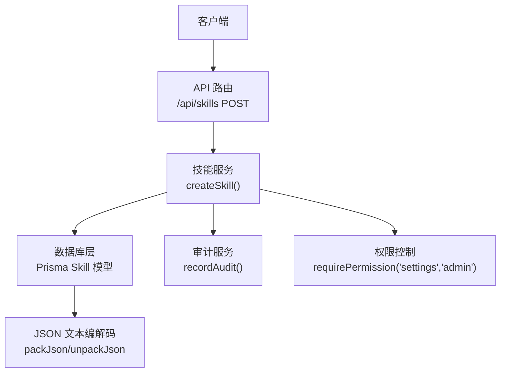
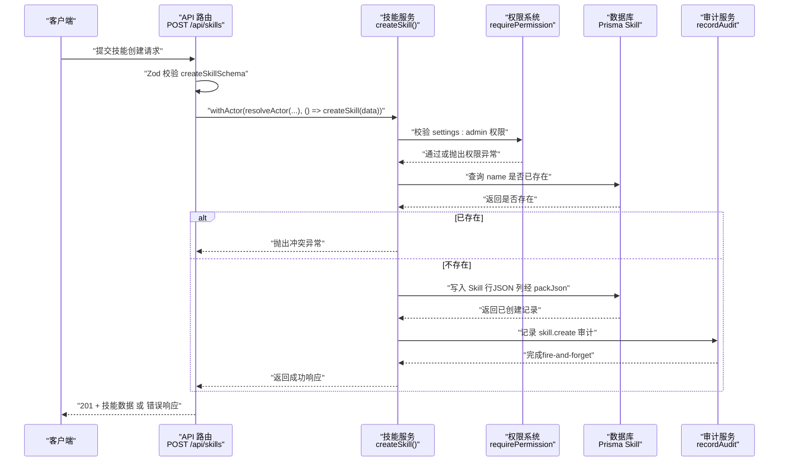
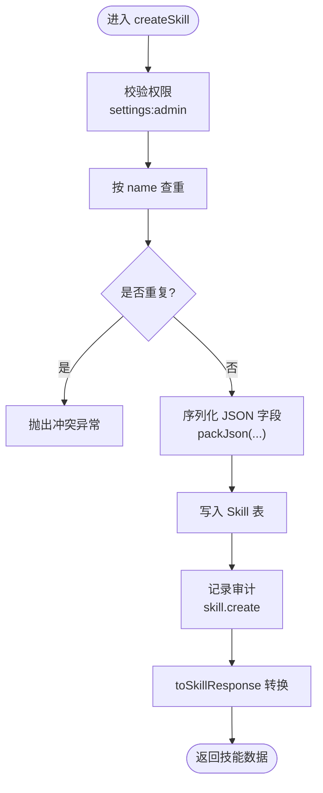
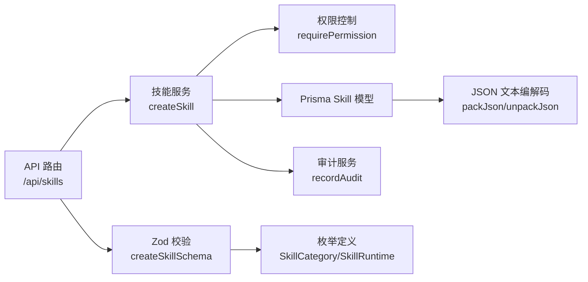

# 插件注册机制

<cite>
**本文引用的文件**   
- [apps/web/app/api/skills/route.ts](file://apps/web/app/api/skills/route.ts)
- [apps/web/lib/services/skill-service.ts](file://apps/web/lib/services/skill-service.ts)
- [apps/web/lib/schemas.ts](file://apps/web/lib/schemas.ts)
- [packages/db/src/json-text.ts](file://packages/db/src/json-text.ts)
- [packages/db/prisma/schema.prisma](file://packages/db/prisma/schema.prisma)
- [packages/db/src/enums.ts](file://packages/db/src/enums.ts)
- [apps/web/lib/__tests__/skill-service.test.ts](file://apps/web/lib/__tests__/skill-service.test.ts)
- [apps/web/app/api/__tests__/skill-detail.test.ts](file://apps/web/app/api/__tests__/skill-detail.test.ts)
- [apps/web/app/(dashboard)/skills/page.tsx](file://apps/web/app/(dashboard)/skills/page.tsx)
</cite>

## 目录
1. [引言](#引言)
2. [项目结构](#项目结构)
3. [核心组件](#核心组件)
4. [架构总览](#架构总览)
5. [详细组件分析](#详细组件分析)
6. [依赖关系分析](#依赖关系分析)
7. [性能与最佳实践](#性能与最佳实践)
8. [故障排查指南](#故障排查指南)
9. [结论](#结论)

## 引言
本文聚焦“技能（Skill）”这一平台级插件资产的注册机制，围绕 createSkill 函数的实现、数据校验、唯一性约束、权限控制、审计日志、JSON 字段序列化以及 API 调用与错误处理进行系统化说明。读者无需深入代码即可理解技能从请求到落库的完整链路，并掌握在生产环境中注册技能的注意事项与排错方法。

## 项目结构
技能注册能力由三层组成：
- 路由层：接收 HTTP 请求，做参数校验与统一响应封装。
- 服务层：承载业务规则，包括权限检查、唯一性校验、持久化与审计记录。
- 数据层：Prisma 模型定义与 SQLite 兼容的 JSON 文本编解码工具。

图表来源
- [apps/web/app/api/skills/route.ts:18-30](file://apps/web/app/api/skills/route.ts#L18-L30)
- [apps/web/lib/services/skill-service.ts:144-180](file://apps/web/lib/services/skill-service.ts#L144-L180)
- [packages/db/prisma/schema.prisma:324-357](file://packages/db/prisma/schema.prisma#L324-L357)
- [packages/db/src/json-text.ts:12-37](file://packages/db/src/json-text.ts#L12-L37)

章节来源
- [apps/web/app/api/skills/route.ts:1-31](file://apps/web/app/api/skills/route.ts#L1-L31)
- [apps/web/lib/services/skill-service.ts:1-20](file://apps/web/lib/services/skill-service.ts#L1-L20)
- [packages/db/prisma/schema.prisma:324-357](file://packages/db/prisma/schema.prisma#L324-L357)

## 核心组件
- API 路由 POST /api/skills：负责请求体校验、Actor 注入、调用服务层并返回统一成功/失败响应。
- 技能服务 createSkill：权限校验、同名冲突检测、持久化写入、审计记录、结果转换。
- 输入校验 createSkillSchema：基于 Zod 的字段类型、长度、枚举值校验。
- JSON 文本编解码 packJson/unpackJson：SQLite 下将 JSON 对象序列化为字符串存储，读取时安全解析并回退默认值。
- Prisma Skill 模型：定义 name 唯一索引、triggerPatterns/inputSchema/outputSchema 等列的类型与默认值。

章节来源
- [apps/web/app/api/skills/route.ts:18-30](file://apps/web/app/api/skills/route.ts#L18-L30)
- [apps/web/lib/services/skill-service.ts:144-180](file://apps/web/lib/services/skill-service.ts#L144-L180)
- [apps/web/lib/schemas.ts:154-169](file://apps/web/lib/schemas.ts#L154-L169)
- [packages/db/src/json-text.ts:12-37](file://packages/db/src/json-text.ts#L12-L37)
- [packages/db/prisma/schema.prisma:324-357](file://packages/db/prisma/schema.prisma#L324-L357)

## 架构总览
技能注册的端到端流程如下：

图表来源
- [apps/web/app/api/skills/route.ts:18-30](file://apps/web/app/api/skills/route.ts#L18-L30)
- [apps/web/lib/services/skill-service.ts:144-180](file://apps/web/lib/services/skill-service.ts#L144-L180)

## 详细组件分析

### API 路由层：POST /api/skills
职责
- 使用 validateBody 对请求体执行 createSkillSchema 校验。
- 通过 withActor(resolveActor(request.headers), ...) 注入当前 Actor。
- 调用服务层 createSkill，捕获异常并通过 handleApiError 统一返回。

关键点
- 成功返回 201 状态码与统一 success 包装。
- 校验失败直接返回校验错误响应，不进入服务层。

章节来源
- [apps/web/app/api/skills/route.ts:18-30](file://apps/web/app/api/skills/route.ts#L18-L30)

### 服务层：createSkill 函数
职责
- 权限控制：要求 settings:admin 权限。
- 唯一性约束：按 name 查询是否已存在，若存在则抛冲突异常。
- 数据持久化：写入 Skill 表，JSON 字段经 packJson 序列化。
- 审计记录：记录 skill.create 事件。
- 结果转换：toSkillResponse 将数据库行转换为对外响应结构。

实现要点
- 权限检查在持久化之前，避免无效写操作。
- 唯一性检查使用 findUnique 精确匹配 name，避免误判。
- JSON 字段默认值兜底：未提供时使用空数组/空对象，再经 packJson 转为字符串。
- 审计记录在写入成功后触发，不影响主流程。

图表来源
- [apps/web/lib/services/skill-service.ts:144-180](file://apps/web/lib/services/skill-service.ts#L144-L180)

章节来源
- [apps/web/lib/services/skill-service.ts:144-180](file://apps/web/lib/services/skill-service.ts#L144-L180)

### 输入校验：createSkillSchema
职责
- 校验必填字段 name、displayName、description 的长度与格式。
- 校验可选字段 category、runtime 的枚举值。
- 允许 triggerPatterns 为字符串数组，inputSchema/outputSchema 为任意对象。
- 允许 endpoint 为空字符串或省略。

设计考量
- 使用 Zod 集中管理前端与服务端一致的校验规则。
- 枚举值与数据库 String 列保持一致，避免运行时类型漂移。

章节来源
- [apps/web/lib/schemas.ts:154-169](file://apps/web/lib/schemas.ts#L154-L169)

### 权限控制系统
策略
- 技能属于平台级资产，归入 settings 资源域，需要 admin 动作权限。
- 权限检查在服务层入口处执行，确保所有写路径受控。

影响
- 非管理员用户尝试创建技能将被拒绝。
- 与角色/权限/产品组同域，便于统一管理。

章节来源
- [apps/web/lib/services/skill-service.ts:155-156](file://apps/web/lib/services/skill-service.ts#L155-L156)

### 唯一性约束与冲突防护
机制
- 在写入前通过 name 字段查询是否存在。
- 若存在，抛出 ConflictError，由路由层统一转换为错误响应。

数据库侧
- Skill.name 定义为唯一索引，双重保障。

章节来源
- [apps/web/lib/services/skill-service.ts:157-158](file://apps/web/lib/services/skill-service.ts#L157-L158)
- [packages/db/prisma/schema.prisma:324-327](file://packages/db/prisma/schema.prisma#L324-L327)

### 审计日志记录
行为
- 成功创建后调用 recordAudit("skill.create", "skill", created.id, { name })。
- 审计采用 fire-and-forget 语义：即使审计写入失败也不回滚业务。

意义
- 可追踪谁在何时创建了哪个技能，便于合规与回溯。

章节来源
- [apps/web/lib/services/skill-service.ts:178-179](file://apps/web/lib/services/skill-service.ts#L178-L179)
- [docs/skills/agent-up-services/references/audit-service-component.md:17-27](file://docs/skills/agent-up-services/references/audit-service-component.md#L17-L27)

### JSON 字段序列化与存储优化
涉及字段
- triggerPatterns：字符串数组，默认空数组。
- inputSchema：对象，默认空对象。
- outputSchema：对象，默认空对象。

序列化策略
- 写入时用 packJson 将对象/数组序列化为字符串。
- 读取时用 unpackJson/unpackJsonArray 安全解析，解析失败回退默认值，避免脏数据导致请求失败。

数据库适配
- SQLite 不支持 Json 列，因此这些列以 String 存储 JSON 文本。
- 枚举类字段（category、runtime、status）同样以 String 存储，值域由 Zod 校验。

章节来源
- [apps/web/lib/services/skill-service.ts:167-169](file://apps/web/lib/services/skill-service.ts#L167-L169)
- [packages/db/src/json-text.ts:12-37](file://packages/db/src/json-text.ts#L12-L37)
- [packages/db/prisma/schema.prisma:324-357](file://packages/db/prisma/schema.prisma#L324-L357)
- [packages/db/src/enums.ts:104-128](file://packages/db/src/enums.ts#L104-L128)

### 对外 API 调用示例
以下示例描述请求与响应的结构与状态码，不包含具体代码内容。

- 创建技能
  - 方法：POST
  - 路径：/api/skills
  - 请求头：Content-Type: application/json；包含 Actor 身份头（用于权限与审计）。
  - 请求体字段：
    - name：必填，字符串，长度限制。
    - displayName：必填，字符串，长度限制。
    - description：必填，字符串，长度限制。
    - category：可选，枚举值之一。
    - triggerPatterns：可选，字符串数组。
    - inputSchema：可选，对象。
    - outputSchema：可选，对象。
    - runtime：可选，枚举值之一。
    - endpoint：可选，字符串。
  - 成功响应：201，success 包装的技能对象。
  - 失败响应：
    - 400：参数校验失败。
    - 401/403：无 settings:admin 权限。
    - 409：同名技能已存在。

- 获取技能详情
  - 方法：GET
  - 路径：/api/skills/[id]
  - 成功响应：200，技能详情（含 bindings、versions 与 _count）。
  - 失败响应：404，当技能不存在。

- 更新技能
  - 方法：PUT
  - 路径：/api/skills/[id]
  - 权限：settings:admin
  - 成功响应：200，更新后的技能对象。
  - 失败响应：404 或 400。

- 删除技能（归档）
  - 方法：DELETE
  - 路径：/api/skills/[id]
  - 权限：settings:admin
  - 成功响应：200，归档成功消息。
  - 失败响应：404。

章节来源
- [apps/web/app/api/skills/route.ts:18-30](file://apps/web/app/api/skills/route.ts#L18-L30)
- [apps/web/app/api/skills/[id]/route.ts:1-46](file://apps/web/app/api/skills/[id]/route.ts#L1-L46)
- [apps/web/app/(dashboard)/skills/page.tsx:297-312](file://apps/web/app/(dashboard)/skills/page.tsx#L297-L312)

### 错误处理策略
- 参数校验失败：由 validateBody 返回结构化错误，路由直接响应。
- 权限不足：服务层抛出权限异常，路由层统一处理。
- 冲突：同名技能抛出 ConflictError，路由层返回 409。
- 未找到：getSkill 等读接口返回 404。
- 网络或未知异常：handleApiError 统一包装错误响应。

章节来源
- [apps/web/app/api/skills/route.ts:18-30](file://apps/web/app/api/skills/route.ts#L18-L30)
- [apps/web/lib/services/skill-service.ts:157-158](file://apps/web/lib/services/skill-service.ts#L157-L158)
- [apps/web/app/api/__tests__/skill-detail.test.ts:66-72](file://apps/web/app/api/__tests__/skill-detail.test.ts#L66-L72)

## 依赖关系分析
技能注册涉及的模块依赖如下：

图表来源
- [apps/web/app/api/skills/route.ts:1-6](file://apps/web/app/api/skills/route.ts#L1-L6)
- [apps/web/lib/services/skill-service.ts:1-14](file://apps/web/lib/services/skill-service.ts#L1-L14)
- [apps/web/lib/schemas.ts:154-169](file://apps/web/lib/schemas.ts#L154-L169)
- [packages/db/src/enums.ts:104-128](file://packages/db/src/enums.ts#L104-L128)
- [packages/db/src/json-text.ts:12-37](file://packages/db/src/json-text.ts#L12-L37)

章节来源
- [apps/web/app/api/skills/route.ts:1-31](file://apps/web/app/api/skills/route.ts#L1-L31)
- [apps/web/lib/services/skill-service.ts:1-20](file://apps/web/lib/services/skill-service.ts#L1-L20)
- [apps/web/lib/schemas.ts:154-169](file://apps/web/lib/schemas.ts#L154-L169)
- [packages/db/src/enums.ts:104-128](file://packages/db/src/enums.ts#L104-L128)
- [packages/db/src/json-text.ts:12-37](file://packages/db/src/json-text.ts#L12-L37)

## 性能与最佳实践
- 幂等与并发
  - 唯一性检查在写入前进行，结合数据库 name 唯一索引，避免并发重复插入。
  - 建议在高频场景中对 name 加缓存（如 Redis），减少数据库查询压力。
- JSON 字段优化
  - 仅序列化必要字段，避免过大 payload。
  - 对 triggerPatterns 等数组字段，尽量精简条目数量。
- 权限与审计开销
  - 权限检查前置，尽早失败。
  - 审计为 fire-and-forget，不影响主流程；在高吞吐场景建议异步批处理审计写入。
- 分页与搜索
  - 列表接口支持分页与过滤；搜索在 SQLite 下内存过滤，适合演示规模。
- 错误快速失败
  - 参数校验失败立即返回，避免不必要的数据库访问。
- 测试覆盖
  - 单元测试覆盖 createSkill 的基本流程与冲突场景，确保回归稳定。

章节来源
- [apps/web/lib/services/skill-service.ts:144-180](file://apps/web/lib/services/skill-service.ts#L144-L180)
- [apps/web/lib/__tests__/skill-service.test.ts:39-62](file://apps/web/lib/__tests__/skill-service.test.ts#L39-L62)

## 故障排查指南
常见问题与定位步骤
- 400 参数校验失败
  - 检查 name、displayName、description 是否为空或超长。
  - 检查 category、runtime 是否为允许枚举值。
  - 参考校验规则位置。
- 401/403 权限不足
  - 确认当前 Actor 具备 settings:admin 权限。
  - 检查 Actor 头是否正确传递。
- 409 同名冲突
  - 检查 name 是否已存在。
  - 参考冲突抛出位置。
- 404 技能不存在
  - 检查 id 是否正确。
  - 参考 GET 接口的 404 处理。
- JSON 字段异常
  - 检查 inputSchema/outputSchema/triggerPatterns 是否为合法 JSON。
  - 参考 packJson/unpackJson 的安全解析逻辑。

章节来源
- [apps/web/lib/schemas.ts:154-169](file://apps/web/lib/schemas.ts#L154-L169)
- [apps/web/lib/services/skill-service.ts:155-158](file://apps/web/lib/services/skill-service.ts#L155-L158)
- [apps/web/app/api/__tests__/skill-detail.test.ts:66-72](file://apps/web/app/api/__tests__/skill-detail.test.ts#L66-L72)
- [packages/db/src/json-text.ts:12-37](file://packages/db/src/json-text.ts#L12-L37)

## 结论
技能注册机制通过路由层校验、服务层权限与唯一性控制、数据库唯一索引与 JSON 文本编解码、以及审计日志记录，形成了安全、可靠且可追溯的插件注册流程。遵循本文的最佳实践与排错指南，可在生产环境中稳定地创建与管理技能插件。