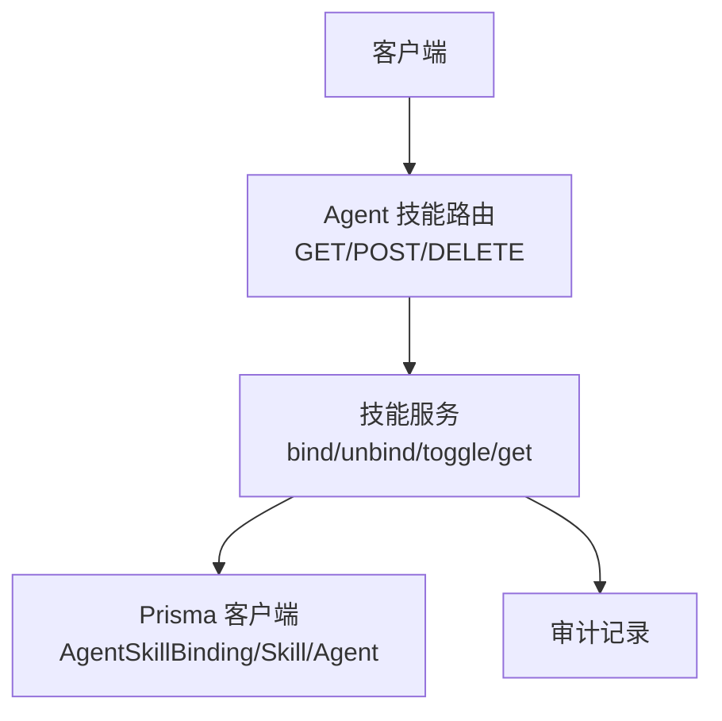
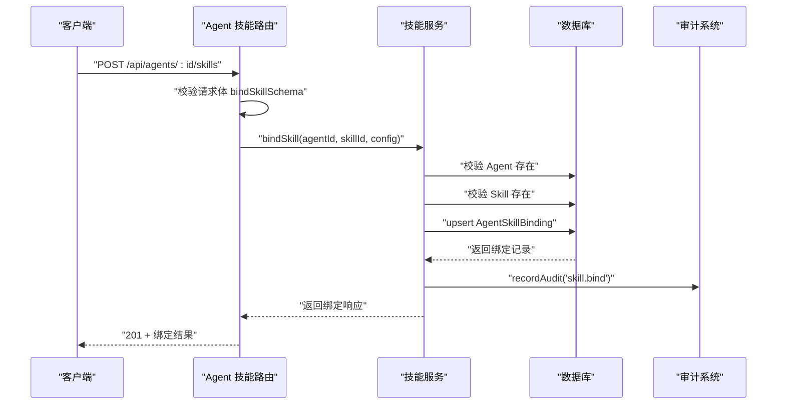
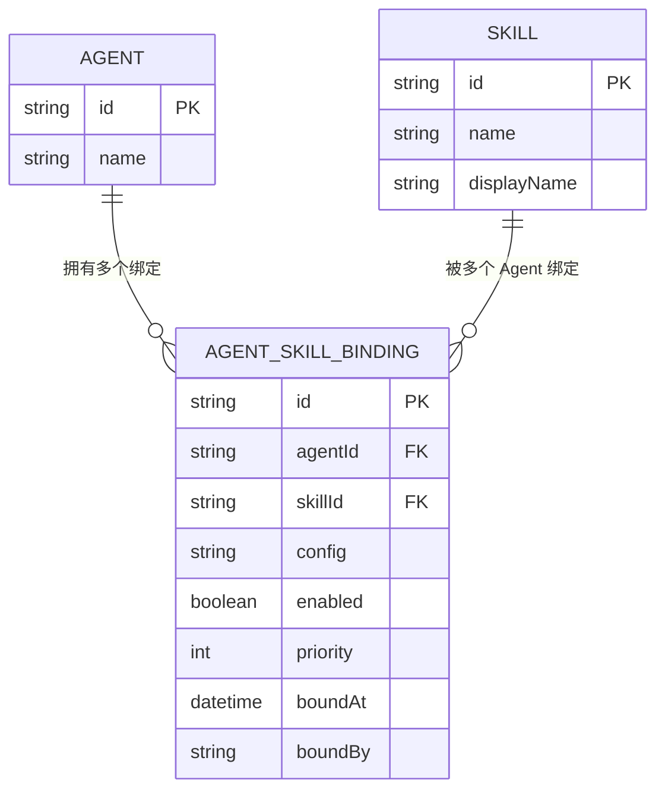
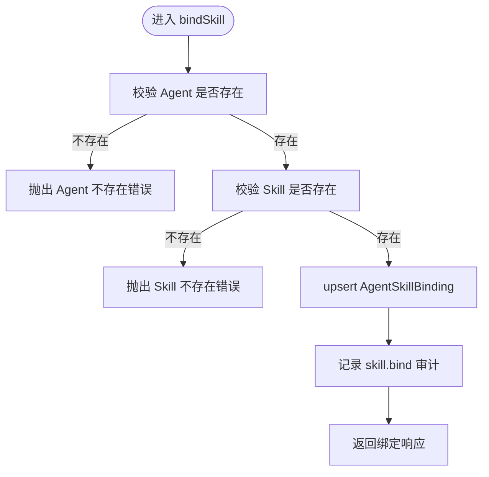
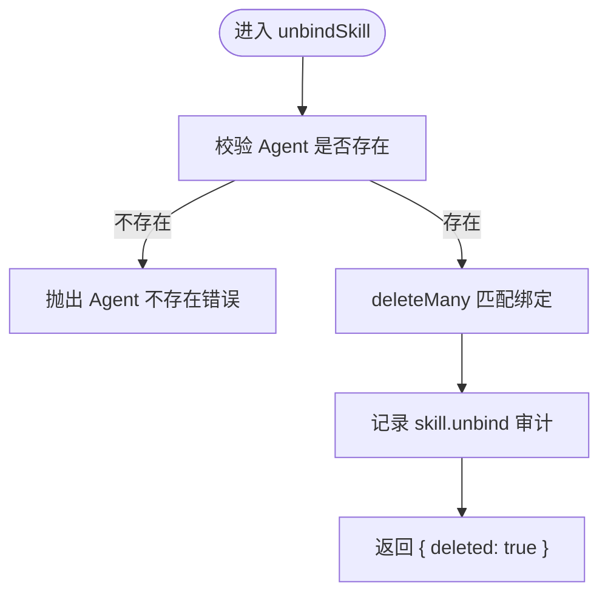
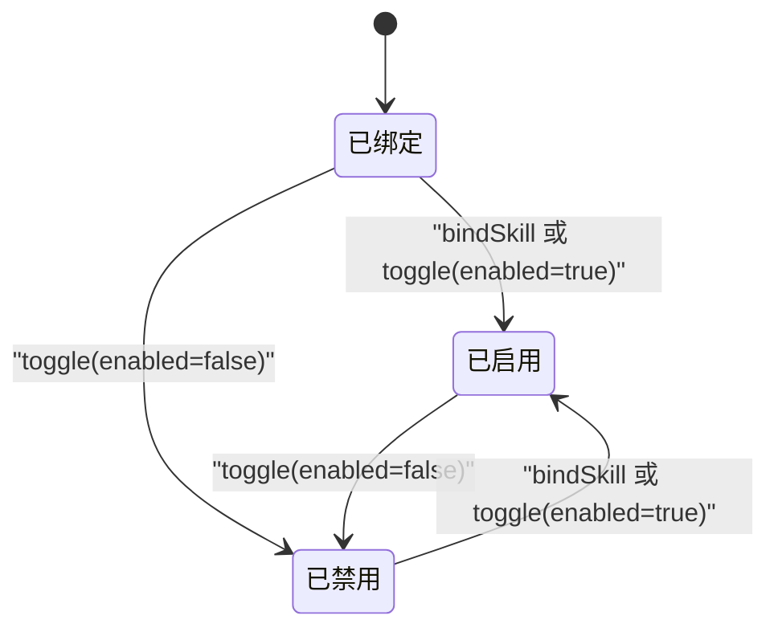
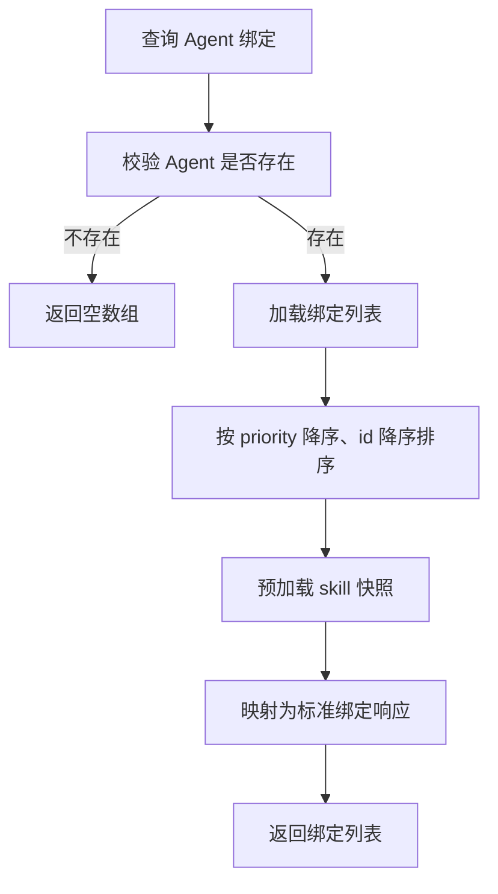
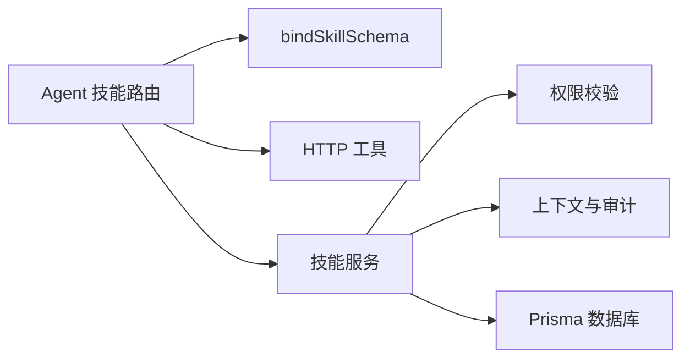

# 绑定管理

<cite>
**本文引用的文件**   
- [skill-service.ts](file://apps/web/lib/services/skill-service.ts)
- [route.ts（Agent 技能路由）](file://apps/web/app/api/agents/[id]/skills/route.ts)
- [schemas.ts](file://apps/web/lib/schemas.ts)
- [schema.prisma](file://packages/db/prisma/schema.prisma)
- [skill-service.test.ts](file://apps/web/lib/__tests__/skill-service.test.ts)
- [agent-skills.test.ts](file://apps/web/app/api/__tests__/agent-skills.test.ts)
- [skill-service.md（蒸馏文档）](file://docs/distilled/skill-service.md)
</cite>

## 目录
1. [引言](#引言)
2. [项目结构中的绑定相关位置](#项目结构中的绑定相关位置)
3. [核心组件与职责](#核心组件与职责)
4. [架构总览](#架构总览)
5. [绑定关系数据模型](#绑定关系数据模型)
6. [核心绑定操作详解](#核心绑定操作详解)
7. [幂等性与 upsert 设计](#幂等性与-upsert-设计)
8. [绑定配置合并策略与优先级机制](#绑定配置合并策略与优先级机制)
9. [启用禁用状态管理](#启用禁用状态管理)
10. [绑定查询与执行顺序](#绑定查询与执行顺序)
11. [删除策略与级联行为](#删除策略与级联行为)
12. [典型使用场景示例](#典型使用场景示例)
13. [依赖关系分析](#依赖关系分析)
14. [性能与优化建议](#性能与优化建议)
15. [故障排查指南](#故障排查指南)
16. [结论](#结论)

## 引言
本文聚焦 Agent 与 Skill 的绑定管理能力，围绕 `bindSkill`、`unbindSkill`、`toggleSkillBinding`、`getAgentSkillBindings` 等核心函数展开。文档说明绑定关系的创建、更新、启用/禁用、查询排序、配置合并、幂等性设计、删除语义以及 API 层调用路径，帮助读者从“接口 → 服务 → 数据库”完整理解绑定管理的实现方式。

## 项目结构中的绑定相关位置
绑定能力分布在三层：
- **API 路由层**：暴露 Agent 技能的 GET / POST / DELETE 接口。
- **领域服务层**：封装权限校验、业务规则、审计记录、数据库操作。
- **数据模型层**：通过 Prisma schema 定义 Agent、Skill、AgentSkillBinding 实体及关联。

**图表来源**
- [route.ts（Agent 技能路由）:7-47](file://apps/web/app/api/agents/[id]/skills/route.ts#L7-L47)
- [skill-service.ts:223-295](file://apps/web/lib/services/skill-service.ts#L223-L295)
- [schema.prisma:373-391](file://packages/db/prisma/schema.prisma#L373-L391)

**章节来源**
- [route.ts（Agent 技能路由）:1-48](file://apps/web/app/api/agents/[id]/skills/route.ts#L1-L48)
- [skill-service.ts:1-296](file://apps/web/lib/services/skill-service.ts#L1-L296)
- [schema.prisma:324-391](file://packages/db/prisma/schema.prisma#L324-L391)

## 核心组件与职责
- **Agent 技能路由**
  - GET：返回指定 Agent 的所有技能绑定。
  - POST：绑定技能，支持传入可选 config。
  - DELETE：解绑技能。
- **技能服务**
  - `bindSkill`：校验 Agent/Skill 存在后 upsert 绑定。
  - `unbindSkill`：删除绑定，兼容“不存在也成功”的旧契约。
  - `getAgentSkillBindings`：按优先级和 id 倒序查询并预加载 skill 快照。
  - `toggleSkillBinding`：切换 enabled 状态，缺失绑定抛错。
- **输入校验**
  - `bindSkillSchema`：要求 skillId，config 可选。
- **数据模型**
  - `AgentSkillBinding`：唯一键 `(agentId, skillId)`，包含 config、enabled、priority、boundBy 等字段。

**章节来源**
- [route.ts（Agent 技能路由）:7-47](file://apps/web/app/api/agents/[id]/skills/route.ts#L7-L47)
- [skill-service.ts:223-295](file://apps/web/lib/services/skill-service.ts#L223-L295)
- [schemas.ts:183-186](file://apps/web/lib/schemas.ts#L183-L186)
- [schema.prisma:373-391](file://packages/db/prisma/schema.prisma#L373-L391)

## 架构总览
绑定操作的端到端流程如下：

**图表来源**
- [route.ts（Agent 技能路由）:16-32](file://apps/web/app/api/agents/[id]/skills/route.ts#L16-L32)
- [skill-service.ts:223-254](file://apps/web/lib/services/skill-service.ts#L223-L254)

**章节来源**
- [route.ts（Agent 技能路由）:16-32](file://apps/web/app/api/agents/[id]/skills/route.ts#L16-L32)
- [skill-service.ts:223-254](file://apps/web/lib/services/skill-service.ts#L223-L254)

## 绑定关系数据模型
`AgentSkillBinding` 是绑定关系的核心表，关键字段包括：
- `agentId`、`skillId`：外键分别指向 Agent 与 Skill。
- `config`：JSON 文本存储的绑定配置。
- `enabled`：是否启用该绑定。
- `priority`：优先级，用于决定执行顺序。
- `boundAt`、`boundBy`：绑定时间与绑定人。
- 唯一约束：`(agentId, skillId)` 保证同一 Agent 对同一 Skill 仅有一条绑定。

**图表来源**
- [schema.prisma:66-99](file://packages/db/prisma/schema.prisma#L66-L99)
- [schema.prisma:324-357](file://packages/db/prisma/schema.prisma#L324-L357)
- [schema.prisma:373-391](file://packages/db/prisma/schema.prisma#L373-L391)

**章节来源**
- [schema.prisma:373-391](file://packages/db/prisma/schema.prisma#L373-L391)

## 核心绑定操作详解

### 绑定技能：bindSkill
- 权限：需要 Agent 写权限。
- 前置校验：
  - Agent 不存在则抛 NotFoundError。
  - Skill 不存在则抛 NotFoundError。
- 核心逻辑：
  - 使用 upsert，若已存在则更新 enabled 为 true，并按条件写入 config。
  - 新建时默认 enabled=true、priority=0。
- 审计：记录 skill.bind。
- 返回：标准化后的绑定响应，包含 skill 快照。

**图表来源**
- [skill-service.ts:223-254](file://apps/web/lib/services/skill-service.ts#L223-L254)

**章节来源**
- [skill-service.ts:223-254](file://apps/web/lib/services/skill-service.ts#L223-L254)

### 解绑技能：unbindSkill
- 权限：需要 Agent 写权限。
- 前置校验：
  - Agent 不存在则抛 NotFoundError。
- 删除逻辑：
  - 使用 deleteMany 删除匹配 (agentId, skillId) 的记录。
  - 即使没有匹配记录也返回成功，兼容旧契约。
- 审计：记录 skill.unbind。
- 返回：`{ deleted: true }`。

**图表来源**
- [skill-service.ts:256-265](file://apps/web/lib/services/skill-service.ts#L256-L265)

**章节来源**
- [skill-service.ts:256-265](file://apps/web/lib/services/skill-service.ts#L256-L265)

### 切换绑定启用状态：toggleSkillBinding
- 权限：需要 Agent 写权限。
- 前置校验：
  - Agent 不存在则抛 NotFoundError。
  - 绑定不存在则抛 NotFoundError。
- 更新逻辑：
  - 根据传入 enabled 值更新绑定。
- 返回：标准化后的绑定响应。

注意：当前生产路由未暴露 toggleSkillBinding，属于服务层能力但未被 API 直接调用。

**章节来源**
- [skill-service.ts:279-295](file://apps/web/lib/services/skill-service.ts#L279-L295)

### 查询绑定：getAgentSkillBindings
- 前置校验：
  - Agent 不存在则返回空数组。
- 查询逻辑：
  - 按 priority 降序、id 降序排序。
  - include skill 快照，减少后续聚合开销。
- 返回：标准化后的绑定列表。

**章节来源**
- [skill-service.ts:267-277](file://apps/web/lib/services/skill-service.ts#L267-L277)

## 幂等性与 upsert 设计
- 唯一键：`(agentId, skillId)` 确保同一 Agent 对同一 Skill 只有一条绑定。
- upsert 行为：
  - 若绑定已存在：将 enabled 设为 true；如果传入 config，则覆盖写入 config。
  - 若绑定不存在：创建新绑定，默认 enabled=true、priority=0。
- 幂等性体现：
  - 重复调用 bindSkill 不会新增重复行。
  - 第二次调用会覆盖 config，并重新启用绑定。

测试用例验证了：
- 重复绑定同一 skill 只会保留一条记录。
- 第二次 bind 会覆盖 config。
- unbind 后再次查询不再包含该绑定。

**章节来源**
- [skill-service.ts:237-250](file://apps/web/lib/services/skill-service.ts#L237-L250)
- [skill-service.test.ts:123-144](file://apps/web/lib/__tests__/skill-service.test.ts#L123-L144)

## 绑定配置合并策略与优先级机制

### 配置合并策略
- 当前实现不是“浅合并”，而是“覆盖式写入”。
- 当 bindSkill 传入 config 且绑定已存在时，会将新的 config 整体覆盖到数据库。
- 如果未传入 config，则不更新已有 config。

这意味着：
- 如果需要增量合并，应在调用方先读取现有 config，再合并后传回。
- 如果希望每次 bind 都强制覆盖，可直接传入新 config。

**章节来源**
- [skill-service.ts:238-240](file://apps/web/lib/services/skill-service.ts#L238-L240)

### 优先级机制
- 新建绑定默认 priority=0。
- 查询时按 priority 降序排序，因此更高优先级的绑定排在前面。
- 当前 API 未提供修改 priority 的能力；如需调整执行顺序，需扩展接口或直接在数据库层调整。

**章节来源**
- [skill-service.ts:246-247](file://apps/web/lib/services/skill-service.ts#L246-L247)
- [skill-service.ts:271-274](file://apps/web/lib/services/skill-service.ts#L271-L274)

## 启用禁用状态管理
- 新建绑定默认 enabled=true。
- 重复 bind 会将 enabled 重置为 true。
- toggleSkillBinding 可显式切换 enabled 值。
- 查询返回 enabled 字段，供上层决定是否执行该技能。

**图表来源**
- [skill-service.ts:238-240](file://apps/web/lib/services/skill-service.ts#L238-L240)
- [skill-service.ts:289-293](file://apps/web/lib/services/skill-service.ts#L289-L293)

**章节来源**
- [skill-service.ts:238-240](file://apps/web/lib/services/skill-service.ts#L238-L240)
- [skill-service.ts:279-295](file://apps/web/lib/services/skill-service.ts#L279-L295)

## 绑定查询与执行顺序
- 查询接口 `getAgentSkillBindings` 返回按 priority 降序、id 降序排列的结果。
- 同时 include skill 快照，避免上层二次查询。
- 对于 Skill 详情中的 bindings，同样按 priority 降序、id 降序返回，并包含 agent 信息。

**图表来源**
- [skill-service.ts:267-277](file://apps/web/lib/services/skill-service.ts#L267-L277)

**章节来源**
- [skill-service.ts:267-277](file://apps/web/lib/services/skill-service.ts#L267-L277)

## 删除策略与级联行为
- `unbindSkill` 使用 deleteMany，删除所有匹配 (agentId, skillId) 的绑定。
- 即使没有匹配记录，也返回成功，这是为了兼容旧行为。
- 数据库层面，AgentSkillBinding 与 Agent、Skill 是普通关联，没有显式 onDelete=Cascade 配置。
- 因此，“删除 Agent 或 Skill 是否自动删除绑定”取决于 Prisma 或数据库外键约束的实际配置；当前代码未依赖级联删除来保证一致性。

**章节来源**
- [skill-service.ts:256-265](file://apps/web/lib/services/skill-service.ts#L256-L265)
- [schema.prisma:373-391](file://packages/db/prisma/schema.prisma#L373-L391)

## 典型使用场景示例

### 场景一：首次绑定技能
- 调用 POST `/api/agents/:id/skills`，传入 skillId 和可选 config。
- 服务层校验 Agent 和 Skill 存在后创建绑定。
- 返回包含 skill 快照的绑定对象。

参考路径：
- [route.ts（Agent 技能路由）:16-32](file://apps/web/app/api/agents/[id]/skills/route.ts#L16-L32)
- [skill-service.ts:223-254](file://apps/web/lib/services/skill-service.ts#L223-L254)

### 场景二：重复绑定并覆盖配置
- 多次调用 bindSkill，传入不同 config。
- 最终只保留一条绑定，config 为最后一次传入的值。
- enabled 始终为 true。

参考路径：
- [skill-service.ts:237-250](file://apps/web/lib/services/skill-service.ts#L237-L250)
- [skill-service.test.ts:133-137](file://apps/web/lib/__tests__/skill-service.test.ts#L133-L137)

### 场景三：解绑技能
- 调用 DELETE `/api/agents/:id/skills?agentId=...&skillId=...`。
- 即使之前没有绑定，也返回成功。
- 之后查询该 Agent 的绑定列表不再包含该 skill。

参考路径：
- [route.ts（Agent 技能路由）:34-47](file://apps/web/app/api/agents/[id]/skills/route.ts#L34-L47)
- [skill-service.ts:256-265](file://apps/web/lib/services/skill-service.ts#L256-L265)
- [skill-service.test.ts:139-144](file://apps/web/lib/__tests__/skill-service.test.ts#L139-L144)

### 场景四：切换启用状态
- 调用 toggleSkillBinding，传入 enabled=false 或 true。
- 若绑定不存在，抛 NotFoundError。
- 成功后返回最新绑定状态。

参考路径：
- [skill-service.ts:279-295](file://apps/web/lib/services/skill-service.ts#L279-L295)
- [skill-service.test.ts:146-150](file://apps/web/lib/__tests__/skill-service.test.ts#L146-L150)

### 场景五：查询绑定并按优先级执行
- 调用 GET `/api/agents/:id/skills`。
- 返回按 priority 降序排列的绑定列表。
- 上层可按顺序执行 enabled=true 的技能。

参考路径：
- [route.ts（Agent 技能路由）:7-14](file://apps/web/app/api/agents/[id]/skills/route.ts#L7-L14)
- [skill-service.ts:267-277](file://apps/web/lib/services/skill-service.ts#L267-L277)

## 依赖关系分析
绑定能力依赖以下模块：
- **权限控制**：requirePermission 校验 Agent 写权限。
- **上下文与审计**：getActor、recordAudit。
- **数据库访问**：prisma.agent、prisma.skill、prisma.agentSkillBinding。
- **输入校验**：bindSkillSchema。
- **API 工具**：success、error、validateBody、handleApiError。

**图表来源**
- [route.ts（Agent 技能路由）:1-6](file://apps/web/app/api/agents/[id]/skills/route.ts#L1-L6)
- [skill-service.ts:1-14](file://apps/web/lib/services/skill-service.ts#L1-L14)
- [schemas.ts:183-186](file://apps/web/lib/schemas.ts#L183-L186)

**章节来源**
- [route.ts（Agent 技能路由）:1-6](file://apps/web/app/api/agents/[id]/skills/route.ts#L1-L6)
- [skill-service.ts:1-14](file://apps/web/lib/services/skill-service.ts#L1-L14)
- [schemas.ts:183-186](file://apps/web/lib/schemas.ts#L183-L186)

## 性能与优化建议
- 查询优化现状：
  - `getAgentSkillBindings` 使用 orderBy 和 include，避免 N+1 查询。
  - Skill 详情中 bindings 也按 priority 排序并 include agent。
- 潜在瓶颈：
  - 如果未来需要反向查询“哪些 Agent 绑定了某个 Skill”，当前实现可能退化为全量扫描。
  - 如果 Agent 数量很大，频繁查询绑定列表会增加数据库压力。
- 优化方向：
  - 如需高频反向查询，可增加索引或维护缓存。
  - 如需动态调整 priority，应提供专用接口并在事务中保证一致性。
  - 如需增量合并 config，可在服务层增加合并策略，避免调用方自行处理。

[本节为通用性能讨论，不直接分析具体代码片段]

## 故障排查指南

### 常见问题
1. **绑定不存在却返回成功**
   - unbindSkill 对不存在的绑定静默成功，返回 `{ deleted: true }`。
   - 客户端无法区分“本来就没绑”和“解绑成功”。
   - 排查重点：调用方是否需要强一致语义。

2. **toggleSkillBinding 未暴露**
   - 服务层实现了 toggleSkillBinding，但当前路由未暴露该能力。
   - 若需要启用/停用绑定，需新增路由并补充审计。

3. **重复绑定未新增记录**
   - 这是预期行为：upsert 保证幂等。
   - 如果期望覆盖 config，请确认传入的新 config。

4. **优先级未生效**
   - 默认 priority=0，API 未提供修改 priority 的能力。
   - 如需调整执行顺序，需扩展接口或在数据库层调整。

**章节来源**
- [skill-service.ts:256-265](file://apps/web/lib/services/skill-service.ts#L256-L265)
- [skill-service.ts:279-295](file://apps/web/lib/services/skill-service.ts#L279-L295)
- [skill-service.md:106-113](file://docs/distilled/skill-service.md#L106-L113)

## 结论
绑定管理以 `AgentSkillBinding` 为核心，通过 `bindSkill` 的 upsert 实现幂等创建与配置覆盖，通过 `unbindSkill` 提供兼容旧行为的解绑语义，通过 `toggleSkillBinding` 提供启用/禁用能力。查询接口按 priority 降序返回绑定列表，便于上层按优先级执行技能。当前实现简洁清晰，但在配置合并、优先级调整、反向查询和审计覆盖方面仍有扩展空间。