# Schema 概览

<cite>
**本文引用的文件**   
- [schema.prisma](file://packages/db/prisma/schema.prisma)
- [enums.ts](file://packages/db/src/enums.ts)
- [json-text.ts](file://packages/db/src/json-text.ts)
- [migration.sql](file://packages/db/prisma/migrations/20261005033611_init_sqlite/migration.sql)
- [批0迁移计划](file://docs/superpowers/plans/2026-09-09-prisma-persistence-batch0.md)
- [项目评估与修复报告（SQLite 迁移部分）](file://docs/reports/2026-10-04-project-evaluation-and-remediation.md)
</cite>

## 目录
1. [引言](#引言)
2. [项目结构](#项目结构)
3. [核心组件](#核心组件)
4. [架构总览](#架构总览)
5. [详细组件分析](#详细组件分析)
6. [依赖关系分析](#依赖关系分析)
7. [性能与索引设计](#性能与索引设计)
8. [故障排查指南](#故障排查指南)
9. [结论](#结论)
10. [附录：命名约定与设计原则](#附录命名约定与设计原则)

## 引言
本文件面向 AgentUp 的数据库层，聚焦 `packages/db` 中的 Prisma SQLite 版本 schema。该版本于 2026-10-05 从 PostgreSQL 迁移而来，核心目标是：在保持业务语义不变的前提下，适配 Prisma SQLite 连接器对枚举、JSON 和标量数组的限制；同时为组织权限、Agent 四分区配置、版本控制、技能插件、知识库、审计日志、试聊 Trace 与评测用例等模块提供清晰的数据边界。

文档重点包括：
- SQLite 版本的架构决策与 PG 迁移取舍。
- 枚举类型、JSON 字段、标量数组的处理策略。
- 实体分组与模块边界。
- 数据模型设计原则、命名约定与关系约束。
- 实体关系图与关键数据流示意。

## 项目结构
AgentUp 的数据库定义集中在 `packages/db`：
- `prisma/schema.prisma`：当前 SQLite 版 Prisma 模型定义。
- `prisma/migrations/.../migration.sql`：SQLite 基线建表与索引 SQL。
- `src/enums.ts`：以 TypeScript const + union type 重建的 18 个枚举。
- `src/json-text.ts`：JSON 文本列的统一编解码工具。
- `src/client.ts`、`src/index.ts`：Prisma Client 导出入口（本概览不展开）。

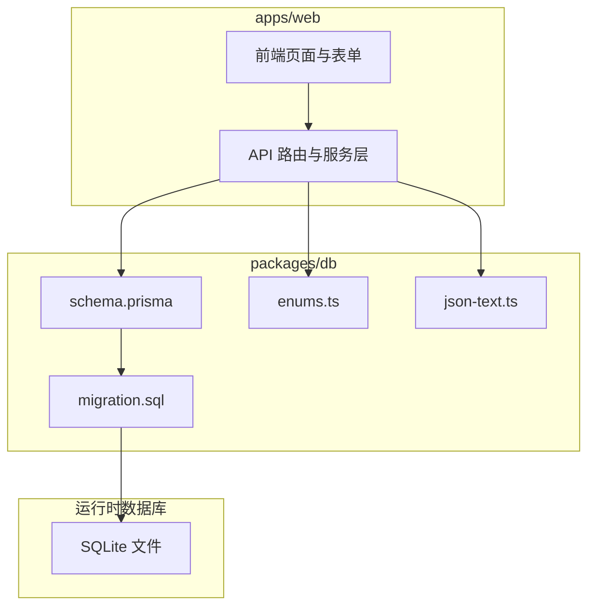

**图表来源**
- [schema.prisma:1-18](file://packages/db/prisma/schema.prisma#L1-L18)
- [migration.sql:1-547](file://packages/db/prisma/migrations/20261005033611_init_sqlite/migration.sql#L1-L547)

**章节来源**
- [schema.prisma:1-18](file://packages/db/prisma/schema.prisma#L1-L18)
- [migration.sql:1-547](file://packages/db/prisma/migrations/20261005033611_init_sqlite/migration.sql#L1-L547)

## 核心组件
SQLite 版 schema 围绕以下核心能力构建：
- 组织与用户管理：产品组、成员、用户、角色、权限、用户-角色关联。
- Agent 核心与四分区配置：Prompt、Knowledge、Tools、Routing 四个独立配置实体，以及 Draft 环境快照。
- 配置变更与发布审批：ConfigChange 记录分区级变更，Release 承载发布流程与回滚标记。
- 版本控制：AgentVersion 保存四分区 JSON 快照，并与 Release 一对一绑定。
- 技能插件系统：Skill、SkillVersion、AgentSkillBinding 描述可插拔技能及其绑定。
- 知识库：WikiVault、WikiPage、WikiIngestJob 构成 wiki 仓库、页面与入库任务。
- 反馈与评测：Feedback、Trace、EvalCase 支撑运行期反馈、试聊追踪与评测用例。
- 权限与审计：Role、Permission、UserRole、AuditLog 提供 RBAC 与操作审计。

这些组件共同形成“Agent 为中心”的数据模型：Agent 聚合四分区配置、版本、技能绑定、反馈、发布、版本、wiki 与运行期 trace/eval。

**章节来源**
- [schema.prisma:20-597](file://packages/db/prisma/schema.prisma#L20-L597)

## 架构总览
下图展示 SQLite 版 schema 的核心实体关系。图中省略了部分可选关系与只读字段，突出主实体之间的强关联。

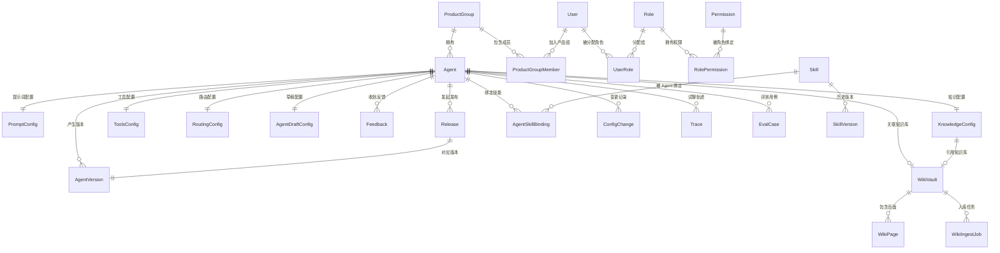

**图表来源**
- [schema.prisma:24-597](file://packages/db/prisma/schema.prisma#L24-L597)
- [migration.sql:2-547](file://packages/db/prisma/migrations/20261005033611_init_sqlite/migration.sql#L2-L547)

## 详细组件分析

### SQLite 迁移与架构决策
SQLite 版 schema 是 PostgreSQL 版的等价实现，但做了三类必要转换：
- 枚举类型：原 18 个数据库 enum 移至 `enums.ts`，以 const 对象 + 同名 union type 重建，列统一改为 String，值域校验由 `lib/schemas.ts` 的 Zod 承担。
- JSON 字段：原 Json 列改为 String，存储 `JSON.stringify` 产物，读写经 `packJson` / `unpackJson` 收口，解析失败返回 fallback，避免脏数据导致请求崩溃。
- 标量数组：原 String[] 等标量数组列改为 String（JSON 文本），读取时使用 `unpackJsonArray` 确保数组形态。

这些决策在 schema 注释与迁移报告中均有明确说明，并体现在所有相关列的类型与默认值上。

**章节来源**
- [schema.prisma:1-9](file://packages/db/prisma/schema.prisma#L1-L9)
- [enums.ts:1-11](file://packages/db/src/enums.ts#L1-L11)
- [json-text.ts:1-9](file://packages/db/src/json-text.ts#L1-L9)
- [项目评估与修复报告（SQLite 迁移部分）:611-641](file://docs/reports/2026-10-04-project-evaluation-and-remediation.md#L611-L641)

### 枚举处理策略
`enums.ts` 重建了 18 个枚举，覆盖产品组成员角色、Agent 状态、搜索策略、同步状态、配置分区、反馈评分/标签/严重性/状态、发布状态、技能分类/运行时/状态、wiki 来源/生命周期/层级、wiki 任务类型与任务状态等。TypeScript 侧使用 `as const` 对象与同名 union type，既保留类型安全，又保证与迁移前数据库枚举值逐字一致，存量字符串无需转换。

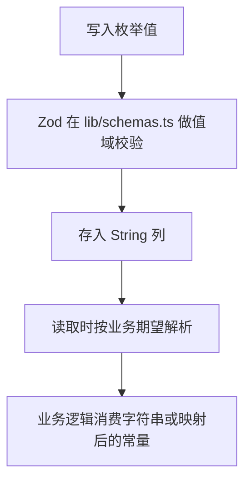

**图表来源**
- [enums.ts:13-180](file://packages/db/src/enums.ts#L13-L180)
- [schema.prisma:42-44](file://packages/db/prisma/schema.prisma#L42-L44)

**章节来源**
- [enums.ts:1-180](file://packages/db/src/enums.ts#L1-L180)
- [schema.prisma:42-44](file://packages/db/prisma/schema.prisma#L42-L44)

### JSON 字段与标量数组处理方案
所有原 Json 列与标量数组列均改为 String，并通过 `json-text.ts` 统一编解码：
- `packJson`：将 undefined/null 归一为 null，其他值序列化为 JSON 文本。
- `unpackJson`：解析 JSON 文本，异常或非法值一律返回 fallback，绝不抛错。
- `unpackJsonArray`：数组专用，非数组文本回落 fallback，防止对象被当数组展开。

这一策略解决了两类已知静默故障：diff 计算吃进裸字符串产出空 diff；evidence-chain 的 detailOf 遇到非对象静默返回 null。

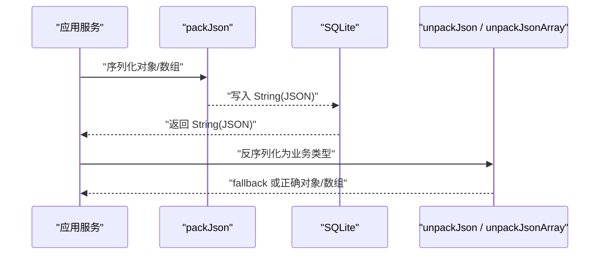

**图表来源**
- [json-text.ts:11-37](file://packages/db/src/json-text.ts#L11-L37)
- [schema.prisma:111-113](file://packages/db/prisma/schema.prisma#L111-L113)
- [schema.prisma:142-145](file://packages/db/prisma/schema.prisma#L142-L145)
- [schema.prisma:158-161](file://packages/db/prisma/schema.prisma#L158-L161)

**章节来源**
- [json-text.ts:1-38](file://packages/db/src/json-text.ts#L1-L38)
- [schema.prisma:111-113](file://packages/db/prisma/schema.prisma#L111-L113)
- [schema.prisma:142-145](file://packages/db/prisma/schema.prisma#L142-L145)
- [schema.prisma:158-161](file://packages/db/prisma/schema.prisma#L158-L161)

### 组织与用户管理模块
- ProductGroup：产品组，唯一 name，displayName 用于展示，支持 description。
- ProductGroupMember：产品组成员，联合唯一键 (productGroupId, userId)，role 使用 GroupRole 字符串。
- User：用户，唯一 email，支持 name、passwordHash、avatarUrl。
- Role、Permission、UserRole、RolePermission：RBAC 模型，Permission 以 (resource, action) 唯一键标识权限点，UserRole 支持 productGroupId 维度。

关系约束方面，ProductGroupMember 与 UserRole 通过外键关联 User 与 Role/ProductGroup，体现“用户-角色-产品组”三维授权。

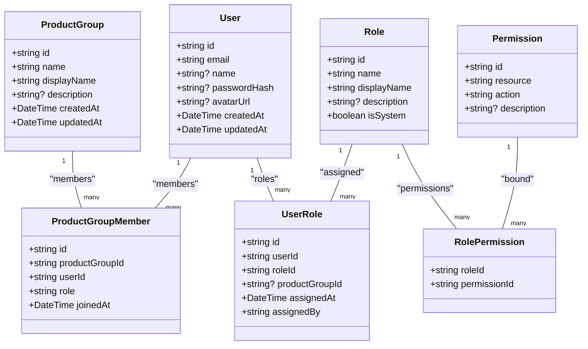

**图表来源**
- [schema.prisma:24-60](file://packages/db/prisma/schema.prisma#L24-L60)
- [schema.prisma:486-528](file://packages/db/prisma/schema.prisma#L486-L528)
- [migration.sql:2-31](file://packages/db/prisma/migrations/20261005033611_init_sqlite/migration.sql#L2-L31)
- [migration.sql:327-363](file://packages/db/prisma/migrations/20261005033611_init_sqlite/migration.sql#L327-L363)

**章节来源**
- [schema.prisma:24-60](file://packages/db/prisma/schema.prisma#L24-L60)
- [schema.prisma:486-528](file://packages/db/prisma/schema.prisma#L486-L528)
- [migration.sql:2-31](file://packages/db/prisma/migrations/20261005033611_init_sqlite/migration.sql#L2-L31)
- [migration.sql:327-363](file://packages/db/prisma/migrations/20261005033611_init_sqlite/migration.sql#L327-L363)

### Agent 四分区配置模块
Agent 的四分区配置拆分为四个独立实体，每个都与 Agent 一对一关联：
- PromptConfig：systemPrompt、roleDefinition、constraints（String[] → JSON 文本）、outputFormat。
- KnowledgeConfig：searchStrategy、fallbackToMcp、maxWikiResults、confidenceThreshold、syncStatus、wikiVaultId。
- ToolsConfig：mcpTools、wikiQueryTools（均为 Json → JSON 文本）、并发/超时/重试参数。
- RoutingConfig：rules、escalationPolicy（均为 Json → JSON 文本）、humanThreshold、会话参数。
- AgentDraftConfig：四分区配置的草稿快照，isDirty 标记是否未发布。

这种拆分使每个分区可独立版本化、独立变更、独立回滚，也便于权限与审计粒度细化。

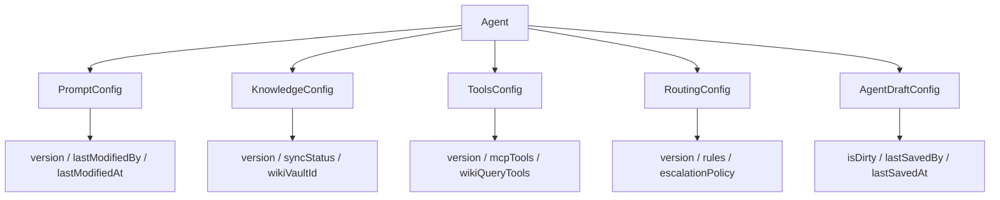

**图表来源**
- [schema.prisma:66-182](file://packages/db/prisma/schema.prisma#L66-L182)
- [migration.sql:34-120](file://packages/db/prisma/migrations/20261005033611_init_sqlite/migration.sql#L34-L120)

**章节来源**
- [schema.prisma:66-182](file://packages/db/prisma/schema.prisma#L66-L182)
- [migration.sql:34-120](file://packages/db/prisma/migrations/20261005033611_init_sqlite/migration.sql#L34-L120)

### 版本控制与发布审批
- AgentVersion：保存四分区 JSON 快照，major/minor/patch 语义版本，releaseId 唯一关联 Release，publishedAt/publishedBy/changeNote 记录发布元信息，effectivenessReport 为自由形状 JSON 文本。
- Release：承载发布审批流，changedPartitions（JSON 文本）、status（ReleaseStatus）、configSnapshot（JSON 文本）、aiReview（JSON 文本），并支持整版本回滚标记 rollbackFromVersion/rollbackToVersionId。
- ConfigChange：记录分区级变更，partition 使用 ConfigPartition 字符串，before/after/diff 为 JSON 文本，changeNote/releaseId 关联发布。

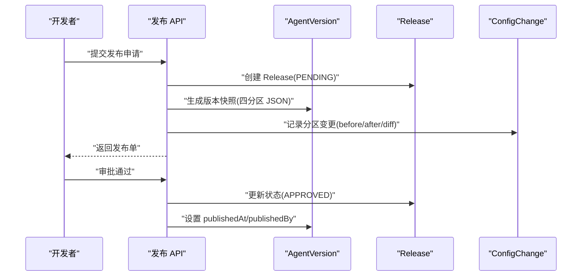

**图表来源**
- [schema.prisma:188-318](file://packages/db/prisma/schema.prisma#L188-L318)
- [批0迁移计划:102-211](file://docs/superpowers/plans/2026-09-09-prisma-persistence-batch0.md#L102-L211)

**章节来源**
- [schema.prisma:188-318](file://packages/db/prisma/schema.prisma#L188-L318)
- [批0迁移计划:102-211](file://docs/superpowers/plans/2026-09-09-prisma-persistence-batch0.md#L102-L211)

### 技能插件系统
- Skill：技能元数据，category/runtime/status 使用枚举字符串，triggerPatterns/dependencies/permissions 为 JSON 文本，inputSchema/outputSchema 为 JSON 文本。
- SkillVersion：技能版本快照，snapshot 为 JSON 文本。
- AgentSkillBinding：Agent 与 Skill 的多对多中间表，config 为 JSON 文本，allowedScopes 为 JSON 文本，enabled/priority/boundAt/boundBy 记录绑定状态。

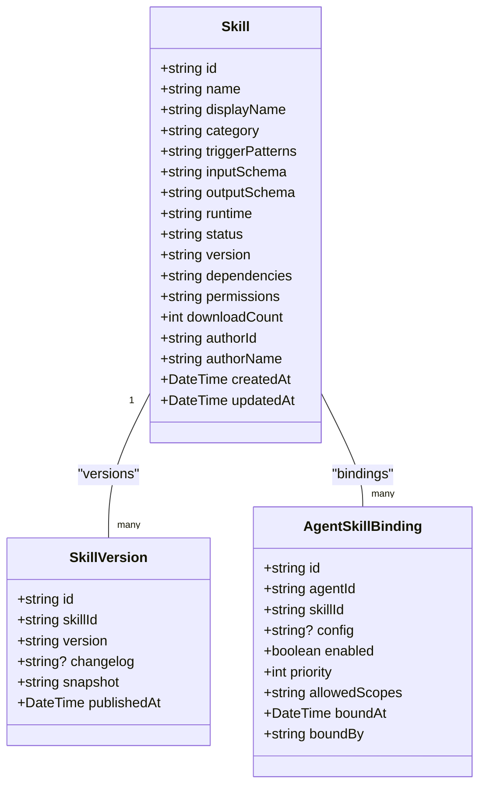

**图表来源**
- [schema.prisma:324-391](file://packages/db/prisma/schema.prisma#L324-L391)
- [migration.sql:210-258](file://packages/db/prisma/migrations/20261005033611_init_sqlite/migration.sql#L210-L258)

**章节来源**
- [schema.prisma:324-391](file://packages/db/prisma/schema.prisma#L324-L391)
- [migration.sql:210-258](file://packages/db/prisma/migrations/20261005033611_init_sqlite/migration.sql#L210-L258)

### 知识库模块
- WikiVault：wiki 仓库，agentId 可选且唯一，gitRepoUrl/gitBranch/lastCommitSha/pageCount/avgConfidence/orphanCount/isShared/sharedBy 等元数据。
- WikiPage：页面，provenance/lifecycle/tier 使用枚举字符串，sourceRefs/wikilinks/categories/tags 为 JSON 文本，filePath/inboundLinks/outboundLinks 等统计字段。
- WikiIngestJob：入库任务，jobType/sourceType/sourceId/sourceContent/sourceUrl/generatedPageIds/status/result/error 等字段，status/jobType 使用枚举字符串。

WikiPage 与 WikiIngestJob 对 WikiVault 采用级联删除，符合“删除 vault 即删除其页面与任务”的运行时语义。

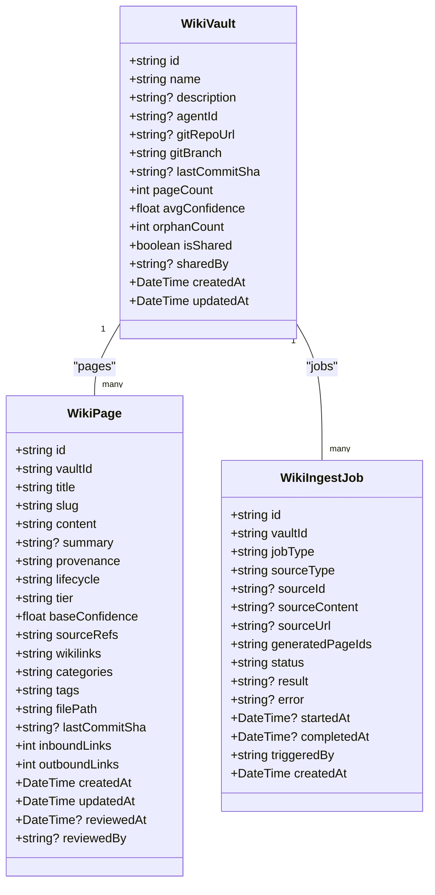

**图表来源**
- [schema.prisma:397-480](file://packages/db/prisma/schema.prisma#L397-L480)
- [migration.sql:261-324](file://packages/db/prisma/migrations/20261005033611_init_sqlite/migration.sql#L261-L324)

**章节来源**
- [schema.prisma:397-480](file://packages/db/prisma/schema.prisma#L397-L480)
- [migration.sql:261-324](file://packages/db/prisma/migrations/20261005033611_init_sqlite/migration.sql#L261-L324)

### 权限与审计模块
- AuditLog：记录 action/resource/resourceId/details/actor(userId/userName/userRole)/ipAddress/userAgent/createdAt。userId 仅作查询别名，不建立外键，因为审计流可能来自 system 或请求头。
- Role/Permission/UserRole/RolePermission：RBAC 模型，Permission 以 (resource, action) 唯一键标识权限点，UserRole 支持 productGroupId 维度。

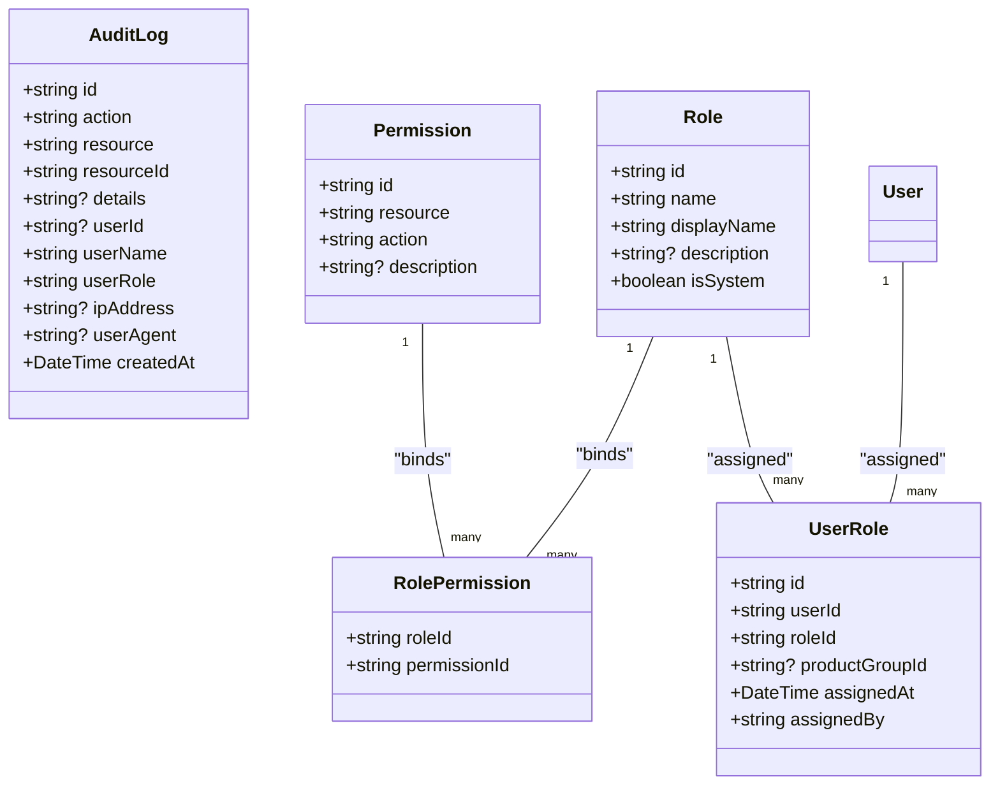

**图表来源**
- [schema.prisma:486-550](file://packages/db/prisma/schema.prisma#L486-L550)
- [migration.sql:327-378](file://packages/db/prisma/migrations/20261005033611_init_sqlite/migration.sql#L327-L378)

**章节来源**
- [schema.prisma:486-550](file://packages/db/prisma/schema.prisma#L486-L550)
- [migration.sql:327-378](file://packages/db/prisma/migrations/20261005033611_init_sqlite/migration.sql#L327-L378)

### 试聊 Trace 与评测用例
- Trace：记录一次试聊的系统提示、对话历史、消息、回复、模型、用量、延迟、评分与备注。history/usage 为 JSON 文本。
- EvalCase：基于 Trace 抽取的评测用例，包含 sourceTraceId、expectation、assertions（JSON 文本）、systemPrompt、history、message、referenceReply、status/createdBy。

这两个实体补齐了运行时新增的能力，并在 schema 中通过 Agent 反向关系与 Agent 关联。

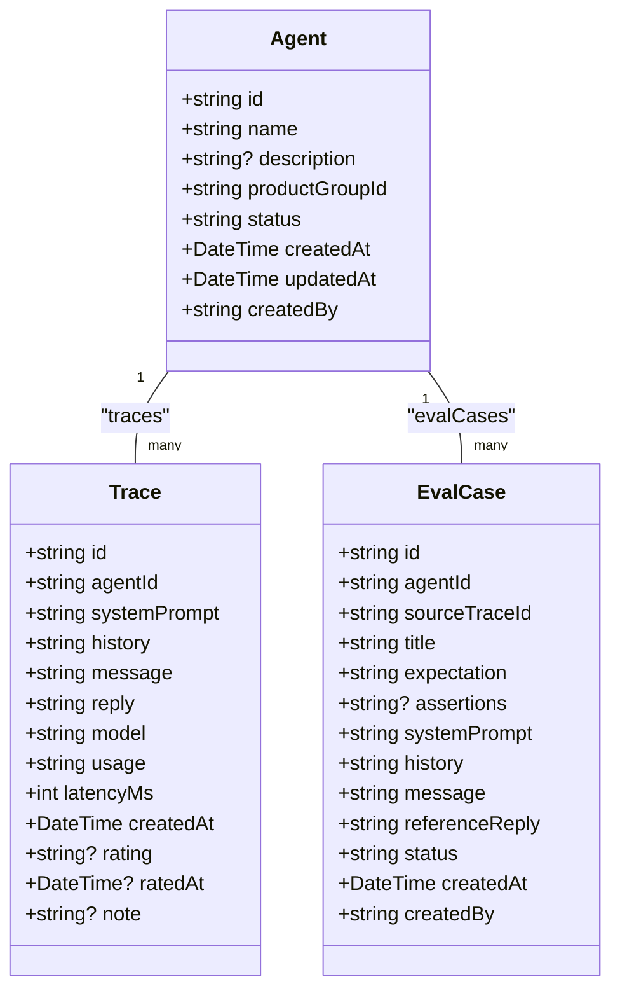

**图表来源**
- [schema.prisma:556-596](file://packages/db/prisma/schema.prisma#L556-L596)
- [批0迁移计划:170-211](file://docs/superpowers/plans/2026-09-09-prisma-persistence-batch0.md#L170-L211)

**章节来源**
- [schema.prisma:556-596](file://packages/db/prisma/schema.prisma#L556-L596)
- [批0迁移计划:170-211](file://docs/superpowers/plans/2026-09-09-prisma-persistence-batch0.md#L170-L211)

## 依赖关系分析
- 外部依赖：Prisma Client（sqlite provider）、Zod（值域校验）、JSON.stringify/parse（JSON 文本）。
- 内部依赖：schema.prisma 依赖 enums.ts 的枚举常量与 json-text.ts 的编解码函数；migration.sql 是 schema 的物理落地。
- 耦合与内聚：Agent 作为中心实体，聚合多个配置与关联实体，内聚度高；Skill、Wiki、RBAC 等模块相对独立，边界清晰。
- 循环依赖：无直接循环依赖；关系多为单向外键，符合典型领域建模。

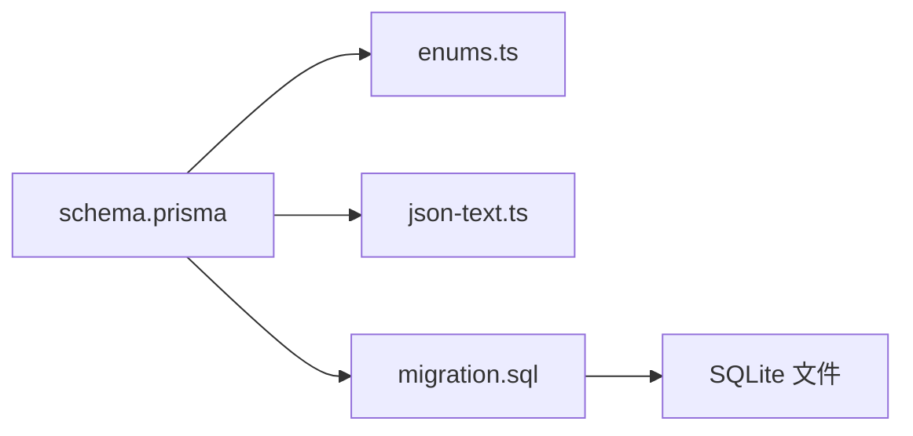

**图表来源**
- [schema.prisma:1-18](file://packages/db/prisma/schema.prisma#L1-L18)
- [enums.ts:1-11](file://packages/db/src/enums.ts#L1-L11)
- [json-text.ts:1-9](file://packages/db/src/json-text.ts#L1-L9)
- [migration.sql:1-547](file://packages/db/prisma/migrations/20261005033611_init_sqlite/migration.sql#L1-L547)

**章节来源**
- [schema.prisma:1-18](file://packages/db/prisma/schema.prisma#L1-L18)
- [enums.ts:1-11](file://packages/db/src/enums.ts#L1-L11)
- [json-text.ts:1-9](file://packages/db/src/json-text.ts#L1-L9)
- [migration.sql:1-547](file://packages/db/prisma/migrations/20261005033611_init_sqlite/migration.sql#L1-L547)

## 性能与索引设计
SQLite 版 schema 在高频查询路径上建立了复合索引，以提升 Agent 列表、反馈筛选、版本查询、wiki 页面检索、审计日志查询等场景的性能：
- Agent：productGroupId、status。
- Feedback：agentId+status、submittedAt、severity+status。
- Release：agentId+status、submittedAt。
- AgentVersion：agentId+publishedAt、agentId+version。
- Skill：category+status。
- SkillVersion：skillId、skillId+version。
- AgentSkillBinding：agentId、skillId、agentId+skillId。
- WikiVault：isShared。
- WikiPage：vaultId+lifecycle、vaultId+tier、vaultId+slug。
- WikiIngestJob：vaultId+status、jobType+status。
- AuditLog：resource+resourceId、userId+createdAt、action+createdAt、createdAt。
- Trace/EvalCase：agentId+createdAt。

这些索引与 schema 注释中的查询语义一致，兼顾写放大与读性能。

**章节来源**
- [migration.sql:416-547](file://packages/db/prisma/migrations/20261005033611_init_sqlite/migration.sql#L416-L547)

## 故障排查指南
- JSON 解析失败：若出现 diff 为空或 evidence-chain 的 detailOf 返回 null，优先检查是否绕过 `packJson`/`unpackJson` 直接 JSON.parse。应统一走 `json-text.ts`，并确保 fallback 合理。
- 枚举值不一致：确认 `enums.ts` 的值与 `lib/schemas.ts` 的 Zod 校验一致；若新增枚举值，需同步更新 schema 默认值、迁移与测试。
- 数组列类型错误：若 JSON 文本不是数组，`unpackJsonArray` 会返回 fallback；检查写入端是否误存对象而非数组。
- 外键约束失败：SQLite 外键默认开启，删除父记录时需关注 RESTRICT/CASCADE 行为，尤其是 WikiPage/WikiIngestJob 的 CASCADE 删除。
- 审计日志 userId：userId 仅为查询别名，不建外键；若查询不到，检查 actor.id 是否传入或请求头是否携带。

**章节来源**
- [json-text.ts:1-38](file://packages/db/src/json-text.ts#L1-L38)
- [schema.prisma:424-425](file://packages/db/prisma/schema.prisma#L424-L425)
- [schema.prisma:537-539](file://packages/db/prisma/schema.prisma#L537-L539)

## 结论
SQLite 版 schema 在保持业务语义不变的前提下，通过枚举迁移至 TypeScript、JSON 与数组列转为 JSON 文本、以及严格的编解码收口，成功适配 Prisma SQLite 连接器。整体模型以 Agent 为核心，围绕四分区配置、版本控制、技能插件、知识库、权限审计与运行期 trace/eval 形成清晰的模块边界。配合合理的索引设计与外键约束，该 schema 既能满足本地演示与轻量部署需求，也为后续扩展预留了良好空间。

## 附录：命名约定与设计原则
- 主键：统一使用 cuid() 生成的 String id。
- 时间戳：createdAt/updatedAt 使用 DateTime，必要时引入 lastModifiedAt/lastSavedAt 等更细粒度的时间字段。
- 枚举：数据库列为 String，TypeScript 侧用 enums.ts 的 const + union type 表达，值域校验由 Zod 负责。
- JSON：所有 Json 与数组列统一使用 String 存储 JSON 文本，读写经 packJson/unpackJson/unpackJsonArray。
- 关系：一对一配置实体使用 unique 外键；一对多用普通外键；多对多使用中间表（如 AgentSkillBinding、RolePermission、UserRole）。
- 索引：针对高频查询组合建立复合索引，避免全表扫描。
- 可审计：所有重要变更（配置、发布、wiki 任务、审计日志）均记录 changedBy/triggeredBy/createdAt 等元信息。

**章节来源**
- [schema.prisma:24-597](file://packages/db/prisma/schema.prisma#L24-L597)
- [enums.ts:13-180](file://packages/db/src/enums.ts#L13-L180)
- [json-text.ts:11-37](file://packages/db/src/json-text.ts#L11-L37)