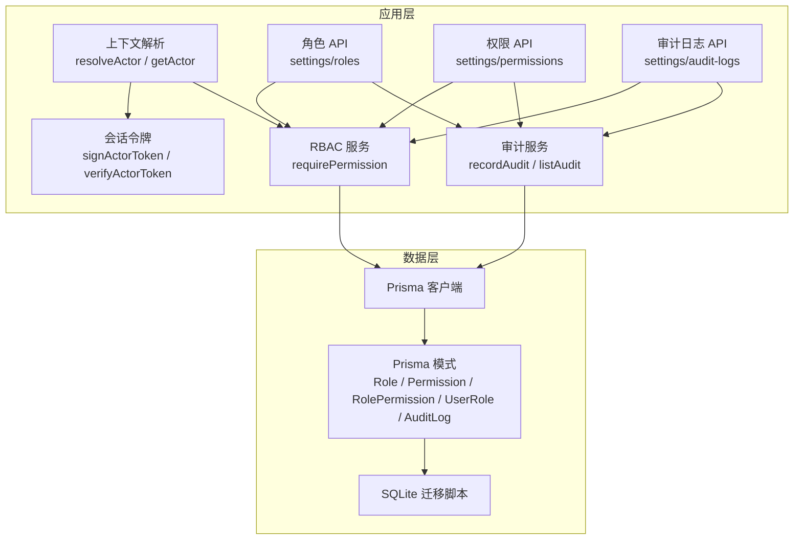
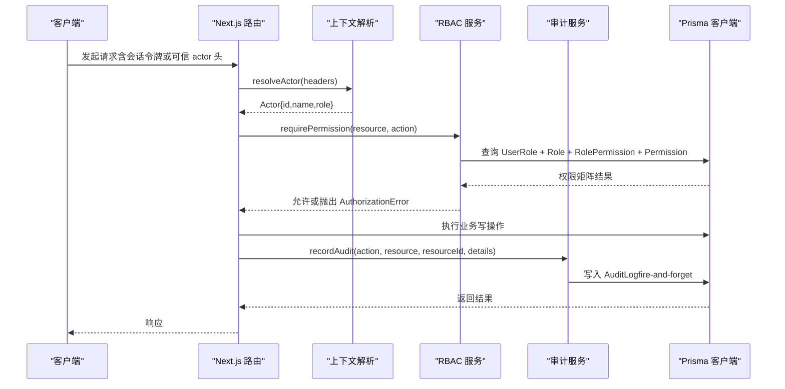
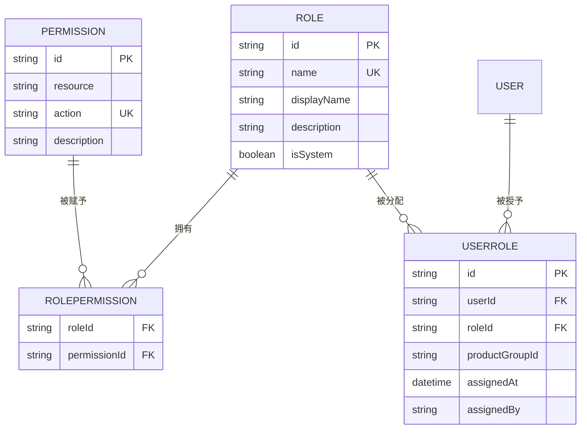
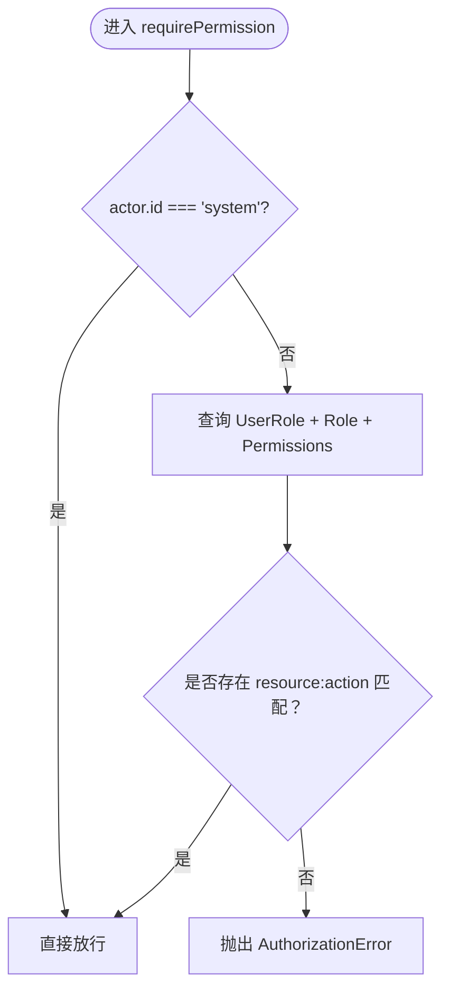
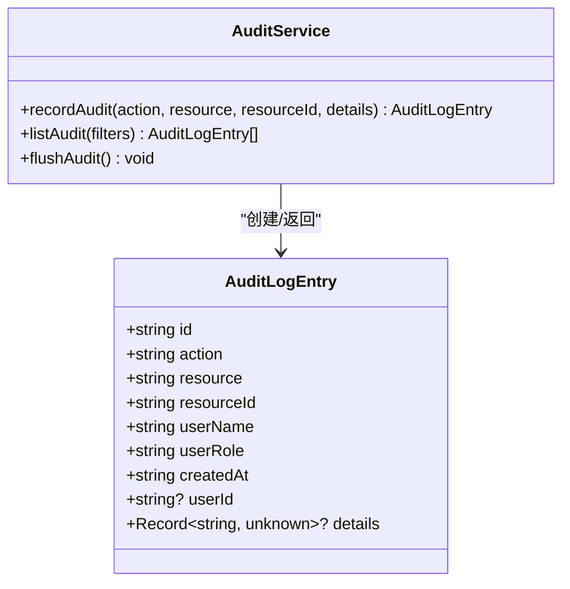
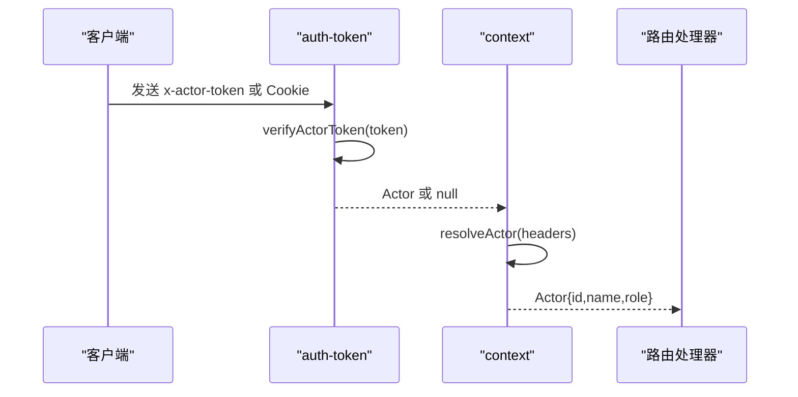
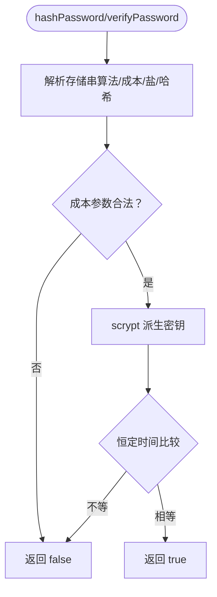
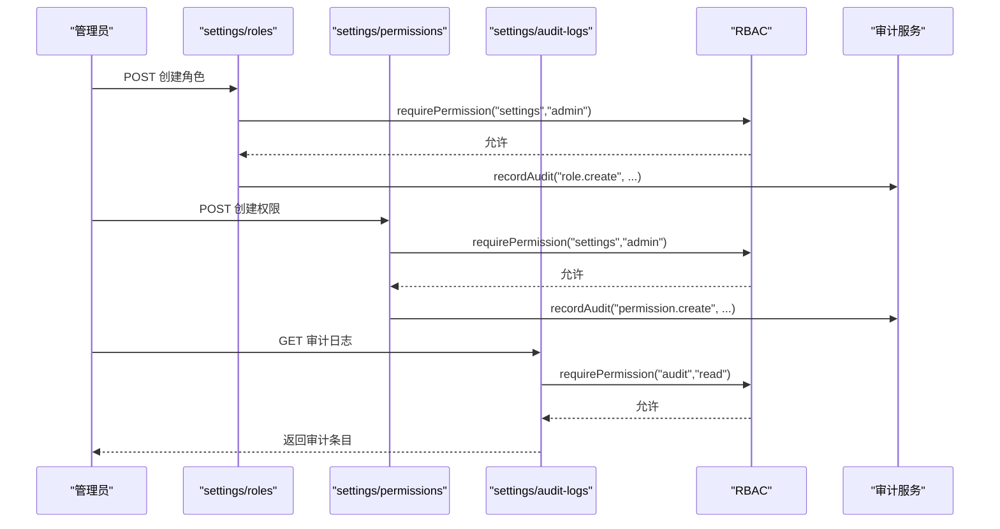
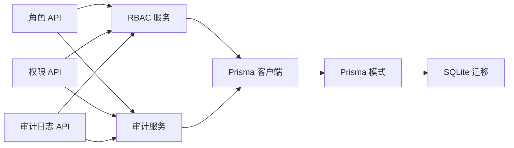

# 安全与访问控制

<cite>
**本文引用的文件**   
- [packages/db/prisma/schema.prisma](file://packages/db/prisma/schema.prisma)
- [packages/db/prisma/migrations/20261005033611_init_sqlite/migration.sql](file://packages/db/prisma/migrations/20261005033611_init_sqlite/migration.sql)
- [apps/web/lib/services/rbac.ts](file://apps/web/lib/services/rbac.ts)
- [apps/web/lib/services/audit-service.ts](file://apps/web/lib/services/audit-service.ts)
- [apps/web/app/api/settings/roles/route.ts](file://apps/web/app/api/settings/roles/route.ts)
- [apps/web/app/api/settings/permissions/route.ts](file://apps/web/app/api/settings/permissions/route.ts)
- [apps/web/app/api/settings/audit-logs/route.ts](file://apps/web/app/api/settings/audit-logs/route.ts)
- [apps/web/lib/context.ts](file://apps/web/lib/context.ts)
- [apps/web/lib/auth-token.ts](file://apps/web/lib/auth-token.ts)
- [packages/db/src/client.ts](file://packages/db/src/client.ts)
- [apps/web/lib/password-hash.ts](file://apps/web/lib/password-hash.ts)
</cite>

## 目录
1. [引言](#引言)
2. [项目结构](#项目结构)
3. [核心组件](#核心组件)
4. [架构总览](#架构总览)
5. [详细组件分析](#详细组件分析)
6. [依赖关系分析](#依赖关系分析)
7. [性能与安全特性](#性能与安全特性)
8. [故障排查指南](#故障排查指南)
9. [结论](#结论)
10. [附录：权限配置示例与安全清单](#附录权限配置示例与安全清单)

## 引言
本文件面向 AgentUp 的数据库安全与访问控制，聚焦 RBAC 权限模型在数据库层面的实现、敏感数据加密存储策略、审计日志机制、SQL 注入防护、数据脱敏处理、备份恢复的安全考虑，以及隐私合规要求与安全最佳实践。文档同时提供权限配置示例与安全检查清单，帮助开发者构建安全的数据库访问层。

## 项目结构
AgentUp 使用 Prisma 管理 SQLite 数据库模式，RBAC 与服务层鉴权位于 Next.js 应用侧，身份令牌与会话由应用内模块实现，审计日志通过独立服务写入。

**图表来源**
- [apps/web/lib/services/rbac.ts:21-51](file://apps/web/lib/services/rbac.ts#L21-L51)
- [apps/web/lib/services/audit-service.ts:43-85](file://apps/web/lib/services/audit-service.ts#L43-L85)
- [apps/web/lib/context.ts:65-89](file://apps/web/lib/context.ts#L65-L89)
- [apps/web/lib/auth-token.ts:68-118](file://apps/web/lib/auth-token.ts#L68-L118)
- [apps/web/app/api/settings/roles/route.ts:44-67](file://apps/web/app/api/settings/roles/route.ts#L44-L67)
- [apps/web/app/api/settings/permissions/route.ts:25-65](file://apps/web/app/api/settings/permissions/route.ts#L25-L65)
- [apps/web/app/api/settings/audit-logs/route.ts:7-32](file://apps/web/app/api/settings/audit-logs/route.ts#L7-L32)
- [packages/db/src/client.ts:7-14](file://packages/db/src/client.ts#L7-L14)
- [packages/db/prisma/schema.prisma:486-550](file://packages/db/prisma/schema.prisma#L486-L550)
- [packages/db/prisma/migrations/20261005033611_init_sqlite/migration.sql:326-378](file://packages/db/prisma/migrations/20261005033611_init_sqlite/migration.sql#L326-L378)

**章节来源**
- [packages/db/prisma/schema.prisma:1-18](file://packages/db/prisma/schema.prisma#L1-L18)
- [packages/db/src/client.ts:7-14](file://packages/db/src/client.ts#L7-L14)

## 核心组件
- RBAC 权限模型（数据库）：Role、Permission、RolePermission、UserRole 四表构成“用户-角色-权限”矩阵，支持多角色并集授权。
- 审计日志：AuditLog 记录全局行为审计流，append-only，fire-and-forget 不阻塞业务。
- 身份与会话：基于 HMAC-SHA256 的不透明会话令牌，生产环境强制校验密钥；明文 actor 头仅在受控环境下信任。
- 密码哈希：scrypt 自描述格式，带成本参数边界校验与恒定时间比较。
- 数据封装：JSON 字段以字符串存储，统一通过 packJson/unpackJson 包装，失败回退默认值。

**章节来源**
- [packages/db/prisma/schema.prisma:486-550](file://packages/db/prisma/schema.prisma#L486-L550)
- [apps/web/lib/services/audit-service.ts:43-85](file://apps/web/lib/services/audit-service.ts#L43-L85)
- [apps/web/lib/auth-token.ts:28-54](file://apps/web/lib/auth-token.ts#L28-L54)
- [apps/web/lib/password-hash.ts:42-77](file://apps/web/lib/password-hash.ts#L42-L77)
- [packages/db/prisma/schema.prisma:1-9](file://packages/db/prisma/schema.prisma#L1-L9)

## 架构总览
下图展示从请求到数据库的关键路径：请求携带会话令牌或可信 actor 头，context 解析出 Actor；RBAC 根据 Actor.id 查询 UserRole→Role→RolePermission→Permission 矩阵决定是否允许；写操作触发审计服务写入 AuditLog；所有数据访问经 Prisma 客户端执行。

**图表来源**
- [apps/web/lib/context.ts:65-89](file://apps/web/lib/context.ts#L65-L89)
- [apps/web/lib/services/rbac.ts:21-51](file://apps/web/lib/services/rbac.ts#L21-L51)
- [apps/web/lib/services/audit-service.ts:43-85](file://apps/web/lib/services/audit-service.ts#L43-L85)
- [packages/db/src/client.ts:7-14](file://packages/db/src/client.ts#L7-L14)

## 详细组件分析

### RBAC 权限模型与数据库设计
- Role：角色定义，包含名称、显示名、描述、是否系统角色。
- Permission：最小权限单元，资源+动作唯一键。
- RolePermission：角色与权限的多对多关联。
- UserRole：用户与角色的多对多关联，支持按产品组维度授权（productGroupId）。

**图表来源**
- [packages/db/prisma/schema.prisma:486-528](file://packages/db/prisma/schema.prisma#L486-L528)
- [packages/db/prisma/migrations/20261005033611_init_sqlite/migration.sql:326-363](file://packages/db/prisma/migrations/20261005033611_init_sqlite/migration.sql#L326-L363)

RBAC 服务层实现要点：
- 仅服务层强制权限，避免中间件静态导出限制。
- 解析链：actor.id → UserRole → Role → RolePermission → Permission，多角色取并集。
- system 主体豁免；匿名/未知用户一律拒绝。
- 只强制“改变配置与记录归属”的写操作，读型端点保持开放。

**图表来源**
- [apps/web/lib/services/rbac.ts:21-51](file://apps/web/lib/services/rbac.ts#L21-L51)

**章节来源**
- [apps/web/lib/services/rbac.ts:5-20](file://apps/web/lib/services/rbac.ts#L5-L20)
- [apps/web/lib/services/rbac.ts:21-51](file://apps/web/lib/services/rbac.ts#L21-L51)
- [packages/db/prisma/schema.prisma:486-528](file://packages/db/prisma/schema.prisma#L486-L528)

### 审计日志机制
- AuditLog 表记录 action/resource/resourceId/details/userName/userRole/ipAddress/userAgent/createdAt 等字段，索引覆盖常用查询维度。
- audit-service 提供 append-only 写入接口，fire-and-forget 语义，失败不抛错，避免影响主流程。
- listAudit 支持按 action/resource/resourceId/user 过滤，兼容 userName 与 userId 别名。

**图表来源**
- [apps/web/lib/services/audit-service.ts:13-24](file://apps/web/lib/services/audit-service.ts#L13-L24)
- [apps/web/lib/services/audit-service.ts:43-85](file://apps/web/lib/services/audit-service.ts#L43-L85)
- [apps/web/lib/services/audit-service.ts:87-119](file://apps/web/lib/services/audit-service.ts#L87-L119)

**章节来源**
- [packages/db/prisma/schema.prisma:530-550](file://packages/db/prisma/schema.prisma#L530-L550)
- [packages/db/prisma/migrations/20261005033611_init_sqlite/migration.sql:366-378](file://packages/db/prisma/migrations/20261005033611_init_sqlite/migration.sql#L366-L378)
- [apps/web/lib/services/audit-service.ts:43-85](file://apps/web/lib/services/audit-service.ts#L43-L85)
- [apps/web/lib/services/audit-service.ts:87-119](file://apps/web/lib/services/audit-service.ts#L87-L119)

### 身份与会话令牌
- 会话令牌为 v1.<base64url(payload)>.<base64url(sig)> 格式，HMAC-SHA256 签名，包含 iat/exp 过期时间。
- 生产环境缺失 AUTH_SECRET 将启动期报错，防止静默降级导致审计署名失效。
- resolveActor 优先读取签名令牌，其次在受控环境下接受明文 actor 头，否则返回匿名主体。

**图表来源**
- [apps/web/lib/auth-token.ts:68-118](file://apps/web/lib/auth-token.ts#L68-L118)
- [apps/web/lib/context.ts:65-89](file://apps/web/lib/context.ts#L65-L89)

**章节来源**
- [apps/web/lib/auth-token.ts:28-54](file://apps/web/lib/auth-token.ts#L28-L54)
- [apps/web/lib/auth-token.ts:68-118](file://apps/web/lib/auth-token.ts#L68-L118)
- [apps/web/lib/context.ts:1-17](file://apps/web/lib/context.ts#L1-L17)
- [apps/web/lib/context.ts:65-89](file://apps/web/lib/context.ts#L65-L89)

### 密码哈希与敏感数据存储
- 密码采用 scrypt 自描述格式，包含算法、N/r/p 成本参数、盐与派生密钥。
- 校验时对成本参数进行范围校验，并使用恒定时间比较，防御时序攻击。
- JSON 字段统一以字符串存储，读写经 packJson/unpackJson 收口，解析失败回落默认值，避免异常泄露。

**图表来源**
- [apps/web/lib/password-hash.ts:42-77](file://apps/web/lib/password-hash.ts#L42-L77)

**章节来源**
- [apps/web/lib/password-hash.ts:42-77](file://apps/web/lib/password-hash.ts#L42-L77)
- [packages/db/prisma/schema.prisma:1-9](file://packages/db/prisma/schema.prisma#L1-L9)

### 权限管理 API 与审计联动
- 角色 API：GET 列出角色及其权限计数；POST 创建角色并记录审计日志。
- 权限 API：GET 列出权限及角色计数；POST 创建权限并记录审计日志。
- 审计日志 API：GET 分页查询审计日志，需 audit:read 权限。

**图表来源**
- [apps/web/app/api/settings/roles/route.ts:44-67](file://apps/web/app/api/settings/roles/route.ts#L44-L67)
- [apps/web/app/api/settings/permissions/route.ts:25-65](file://apps/web/app/api/settings/permissions/route.ts#L25-L65)
- [apps/web/app/api/settings/audit-logs/route.ts:7-32](file://apps/web/app/api/settings/audit-logs/route.ts#L7-L32)
- [apps/web/lib/services/audit-service.ts:43-85](file://apps/web/lib/services/audit-service.ts#L43-L85)

**章节来源**
- [apps/web/app/api/settings/roles/route.ts:44-67](file://apps/web/app/api/settings/roles/route.ts#L44-L67)
- [apps/web/app/api/settings/permissions/route.ts:25-65](file://apps/web/app/api/settings/permissions/route.ts#L25-L65)
- [apps/web/app/api/settings/audit-logs/route.ts:7-32](file://apps/web/app/api/settings/audit-logs/route.ts#L7-L32)

## 依赖关系分析
- RBAC 依赖 Prisma 客户端与 Actor 上下文；审计服务依赖 Prisma 客户端与 Actor 上下文；路由依赖 RBAC 与审计服务。
- 模式与迁移确保 Role/Permission/RolePermission/UserRole/AuditLog 的结构与索引一致。

**图表来源**
- [apps/web/lib/services/rbac.ts:1-51](file://apps/web/lib/services/rbac.ts#L1-L51)
- [apps/web/lib/services/audit-service.ts:1-119](file://apps/web/lib/services/audit-service.ts#L1-L119)
- [packages/db/src/client.ts:7-14](file://packages/db/src/client.ts#L7-L14)
- [packages/db/prisma/schema.prisma:486-550](file://packages/db/prisma/schema.prisma#L486-L550)
- [packages/db/prisma/migrations/20261005033611_init_sqlite/migration.sql:326-378](file://packages/db/prisma/migrations/20261005033611_init_sqlite/migration.sql#L326-L378)

**章节来源**
- [apps/web/lib/services/rbac.ts:1-51](file://apps/web/lib/services/rbac.ts#L1-L51)
- [apps/web/lib/services/audit-service.ts:1-119](file://apps/web/lib/services/audit-service.ts#L1-L119)
- [packages/db/src/client.ts:7-14](file://packages/db/src/client.ts#L7-L14)

## 性能与安全特性
- SQL 注入防护：全部通过 Prisma 客户端进行参数化查询，避免拼接 SQL。
- 数据脱敏处理：审计日志 details 字段通过 packJson/unpackJson 统一序列化/反序列化，失败时回退默认值，避免异常信息泄露。
- 备份恢复安全考虑：
  - 建议对数据库文件与导出快照进行加密存储与传输。
  - 备份前清理或脱敏 sensitive fields（如 passwordHash、details 中的敏感信息）。
  - 恢复后进行完整性校验与权限基线核对。
- 性能优化建议：
  - 利用现有索引（如 AuditLog 的 resource/resourceId、userId/createdAt、action/createdAt、createdAt）优化查询。
  - 批量写入审计日志时使用 flushAudit 等待收尾，测试场景可保证一致性。
  - 避免在高频路径中重复加载完整权限矩阵，可在内存缓存短期缓存已认证用户的权限集合（注意失效策略）。

[本节为通用指导，不直接分析具体文件]

## 故障排查指南
- 审计写入失败：audit-service 捕获错误并仅记录日志，不影响主流程；检查 NODE_ENV 与日志输出。
- 权限不足：RBAC 抛出 AuthorizationError，检查 UserRole/RolePermission/Permission 是否正确配置。
- 会话令牌无效：verifyActorToken 返回 null，检查 AUTH_SECRET 配置与令牌过期时间。
- 密码校验失败：verifyPassword 对畸形输入返回 false，检查存储串格式与成本参数范围。

**章节来源**
- [apps/web/lib/services/audit-service.ts:77-83](file://apps/web/lib/services/audit-service.ts#L77-L83)
- [apps/web/lib/services/rbac.ts:45-50](file://apps/web/lib/services/rbac.ts#L45-L50)
- [apps/web/lib/auth-token.ts:87-118](file://apps/web/lib/auth-token.ts#L87-L118)
- [apps/web/lib/password-hash.ts:53-77](file://apps/web/lib/password-hash.ts#L53-L77)

## 结论
AgentUp 的数据库安全与访问控制围绕 RBAC 矩阵、append-only 审计日志、强化的身份与会话令牌、以及稳健的密码哈希与数据封装展开。通过 Prisma 的参数化查询与严格的权限校验，系统在保障功能的同时提升了安全性与可追溯性。建议在部署与运维中落实密钥管理、备份加密、权限基线核查与审计归档策略，以满足隐私合规与安全最佳实践。

[本节为总结性内容，不直接分析具体文件]

## 附录：权限配置示例与安全清单

### 权限配置示例（概念性步骤）
- 创建权限：
  - 资源：agent，动作：write
  - 资源：release，动作：approve
  - 资源：audit，动作：read
- 创建角色：
  - 平台管理员：授予 settings:admin、audit:read
  - 产品经理：授予 agent:write、release:approve
- 分配角色给用户：
  - 为用户分配对应角色，必要时限定 productGroupId 以实现产品级隔离。

[本节为概念性说明，不直接分析具体文件]

### 安全检查清单
- 身份与会话
  - 生产环境已配置 AUTH_SECRET，未配置则启动失败。
  - 禁用或显式开启 AUTH_TRUST_ACTOR_HEADERS，生产环境默认关闭。
  - 会话令牌包含 iat/exp，且使用恒定时间比较验证签名。
- 权限与审计
  - 所有写操作调用 requirePermission，system 主体豁免。
  - 关键写操作调用 recordAudit，审计失败不阻塞主流程。
  - 审计日志 API 需要 audit:read 权限。
- 数据安全
  - 密码使用 scrypt 自描述格式，成本参数范围校验。
  - JSON 字段统一序列化/反序列化，失败回退默认值。
  - 所有数据库访问通过 Prisma 客户端，避免 SQL 注入。
- 备份与恢复
  - 备份文件加密存储与传输。
  - 恢复前脱敏敏感字段，恢复后校验权限基线与数据完整性。

[本节为通用指导，不直接分析具体文件]