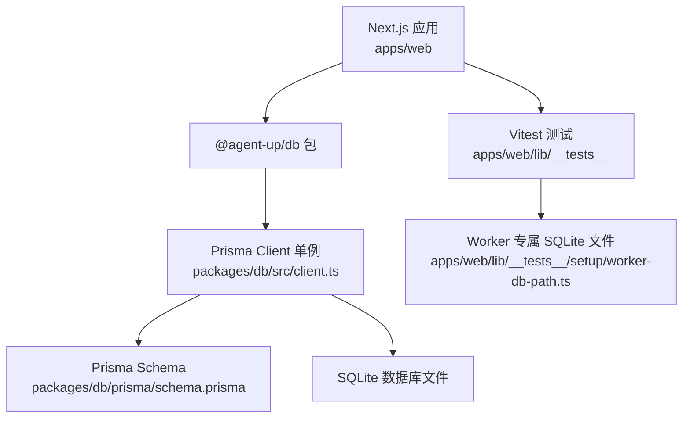
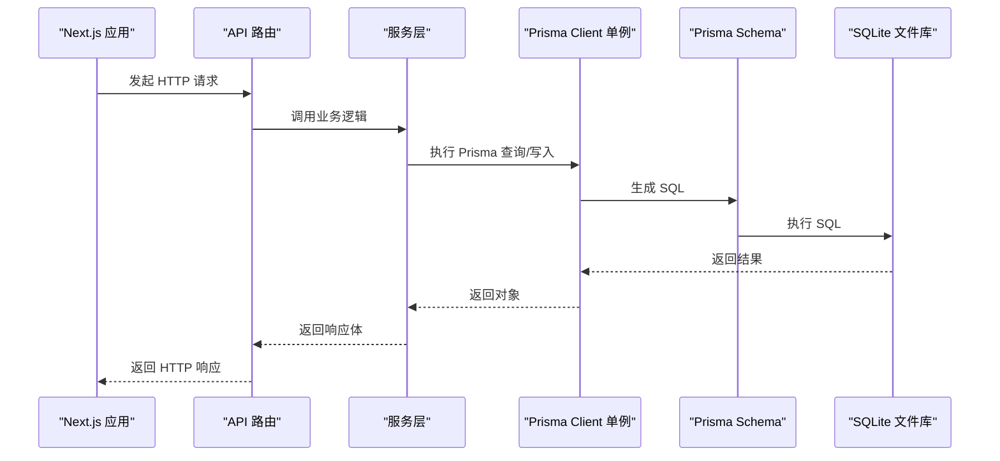
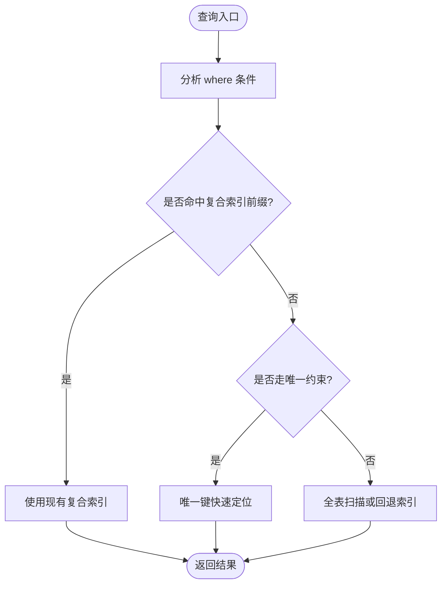
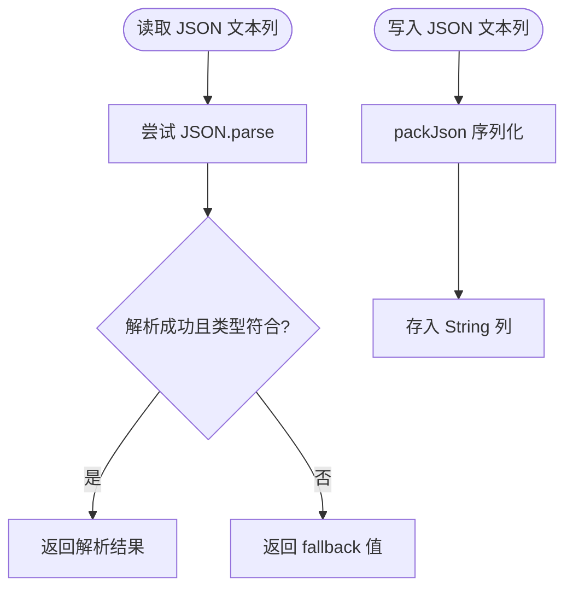
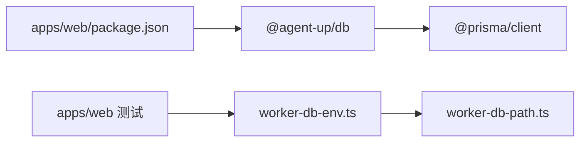

# 性能优化

<cite>
**本文引用的文件**   
- [schema.prisma](file://packages/db/prisma/schema.prisma)
- [client.ts](file://packages/db/src/client.ts)
- [json-text.ts](file://packages/db/src/json-text.ts)
- [package.json（db）](file://packages/db/package.json)
- [package.json（web）](file://apps/web/package.json)
- [worker-db-path.ts](file://apps/web/lib/__tests__/setup/worker-db-path.ts)
- [prepare-worker-dbs.ts](file://apps/web/lib/__tests__/setup/prepare-worker-dbs.ts)
- [worker-db-env.ts](file://apps/web/lib/__tests__/setup/worker-db-env.ts)
- [2026-10-04-project-evaluation-and-remediation.md](file://docs/reports/2026-10-04-project-evaluation-and-remediation.md)
- [2026-09-09-prisma-persistence-batch0.md](file://docs/superpowers/plans/2026-09-09-prisma-persistence-batch0.md)
</cite>

## 目录
1. [引言](#引言)
2. [项目结构](#项目结构)
3. [核心组件](#核心组件)
4. [架构总览](#架构总览)
5. [详细组件分析](#详细组件分析)
6. [依赖关系分析](#依赖关系分析)
7. [性能考量](#性能考量)
8. [故障排查指南](#故障排查指南)
9. [结论](#结论)
10. [附录：索引与查询清单](#附录索引与查询清单)

## 引言
本文件面向 AgentUp 项目的数据库性能优化，聚焦 SQLite 场景下的索引设计、Prisma Client 连接管理、大字段 JSON 文本存储、分页查询、慢查询分析与容量规划。文档基于仓库中的 Prisma Schema、客户端封装、JSON 编解码模块以及测试与评估报告整理而成，目标是帮助开发者识别瓶颈、制定优化策略并建立可复现的性能基线。

## 项目结构
AgentUp 的数据库层集中在 `packages/db`，应用通过 Next.js API Routes 调用共享的 `@agent-up/db` 包。关键路径如下：
- 数据模型与索引定义位于 `packages/db/prisma/schema.prisma`。
- Prisma Client 单例与日志配置位于 `packages/db/src/client.ts`。
- JSON 文本列读写收口位于 `packages/db/src/json-text.ts`。
- 测试环境使用独立 SQLite 文件库，避免并发冲突。

**图表来源**
- [client.ts:1-18](file://packages/db/src/client.ts#L1-L18)
- [schema.prisma:11-18](file://packages/db/prisma/schema.prisma#L11-L18)
- [worker-db-path.ts:13-21](file://apps/web/lib/__tests__/setup/worker-db-path.ts#L13-L21)

**章节来源**
- [schema.prisma:1-18](file://packages/db/prisma/schema.prisma#L1-L18)
- [client.ts:1-18](file://packages/db/src/client.ts#L1-L18)
- [worker-db-path.ts:1-21](file://apps/web/lib/__tests__/setup/worker-db-path.ts#L1-L21)

## 核心组件
- **Prisma Schema 与索引**：定义了组织、用户、Agent、配置分区、反馈、发布、版本、技能、Wiki、权限审计、Trace 与评测用例等实体，并在多处显式声明复合索引与唯一约束，用于加速常见查询路径。
- **Prisma Client 封装**：导出全局单例，按环境变量控制日志级别；生产环境仅输出错误日志，开发环境输出查询、错误与警告。
- **JSON 文本编解码**：由于 SQLite 连接器不支持原生 Json 类型，所有原 Json 列改为 String，统一通过 `packJson` / `unpackJson` / `unpackJsonArray` 进行序列化与容错解析，避免脏数据导致请求失败。
- **测试数据库隔离**：每个 Vitest worker 使用独立的 SQLite 文件，通过绝对路径构造 `file:` URL，避免进程间共享库导致的锁竞争。

**章节来源**
- [schema.prisma:24-596](file://packages/db/prisma/schema.prisma#L24-L596)
- [client.ts:1-18](file://packages/db/src/client.ts#L1-L18)
- [json-text.ts:1-38](file://packages/db/src/json-text.ts#L1-L38)
- [worker-db-path.ts:13-21](file://apps/web/lib/__tests__/setup/worker-db-path.ts#L13-L21)

## 架构总览
下图展示从应用到数据库的关键交互路径，包括 API 路由、Prisma Client、Schema 与 SQLite 文件库的关系。

**图表来源**
- [client.ts:1-18](file://packages/db/src/client.ts#L1-L18)
- [schema.prisma:11-18](file://packages/db/prisma/schema.prisma#L11-L18)

## 详细组件分析

### 索引设计与查询优化
当前 Schema 中广泛使用以下索引模式：
- **复合索引**：例如按 `(agentId, status)`、`(agentId, partition)`、`(vaultId, lifecycle)`、`(jobType, status)` 等组合，用于加速按主体+状态或分区的过滤查询。
- **唯一索引**：如 `ProductGroup.name`、`User.email`、`Release.releaseId`、`AgentVersion.agentId + version`、`SkillVersion.skillId + version`、`RolePermission.roleId + permissionId` 等，保证业务键的唯一性并隐式创建 B-tree 索引。
- **时间序列索引**：如 `AuditLog.createdAt`、`ConfigChange.changedAt`、`Feedback.submittedAt`、`Release.submittedAt`、`Trace.agentId + createdAt`、`EvalCase.agentId + createdAt`，支持按时间倒序分页与范围扫描。
- **分类与状态索引**：如 `Skill.category + status`、`Agent.status`、`WikiVault.isShared`，用于列表筛选与统计。

建议的优化方向：
- 对高频多条件查询补充更贴近谓词顺序的复合索引，避免索引前缀不匹配导致回表。
- 对包含 `%x%` 模糊匹配的字段谨慎建索引，SQLite 的 B-tree 无法有效利用前导通配符 LIKE。
- 对大表的时间窗口查询，优先使用 `(createdAt DESC, id DESC)` 这类稳定排序键，避免分页抖动。

**图表来源**
- [schema.prisma:97-99](file://packages/db/prisma/schema.prisma#L97-L99)
- [schema.prisma:203-205](file://packages/db/prisma/schema.prisma#L203-L205)
- [schema.prisma:248-251](file://packages/db/prisma/schema.prisma#L248-L251)
- [schema.prisma:286-288](file://packages/db/prisma/schema.prisma#L286-L288)
- [schema.prisma:316-318](file://packages/db/prisma/schema.prisma#L316-L318)
- [schema.prisma:356](file://packages/db/prisma/schema.prisma#L356)
- [schema.prisma:418](file://packages/db/prisma/schema.prisma#L418)
- [schema.prisma:451-454](file://packages/db/prisma/schema.prisma#L451-L454)
- [schema.prisma:478-480](file://packages/db/prisma/schema.prisma#L478-L480)
- [schema.prisma:546-550](file://packages/db/prisma/schema.prisma#L546-L550)
- [schema.prisma:574](file://packages/db/prisma/schema.prisma#L574)
- [schema.prisma:595](file://packages/db/prisma/schema.prisma#L595)

**章节来源**
- [schema.prisma:97-99](file://packages/db/prisma/schema.prisma#L97-L99)
- [schema.prisma:203-205](file://packages/db/prisma/schema.prisma#L203-L205)
- [schema.prisma:248-251](file://packages/db/prisma/schema.prisma#L248-L251)
- [schema.prisma:286-288](file://packages/db/prisma/schema.prisma#L286-L288)
- [schema.prisma:316-318](file://packages/db/prisma/schema.prisma#L316-L318)
- [schema.prisma:356](file://packages/db/prisma/schema.prisma#L356)
- [schema.prisma:418](file://packages/db/prisma/schema.prisma#L418)
- [schema.prisma:451-454](file://packages/db/prisma/schema.prisma#L451-L454)
- [schema.prisma:478-480](file://packages/db/prisma/schema.prisma#L478-L480)
- [schema.prisma:546-550](file://packages/db/prisma/schema.prisma#L546-L550)
- [schema.prisma:574](file://packages/db/prisma/schema.prisma#L574)
- [schema.prisma:595](file://packages/db/prisma/schema.prisma#L595)

### Prisma Client 连接池与日志配置
当前实现要点：
- 使用模块级全局变量缓存 PrismaClient 实例，避免每次导入重复创建连接。
- 日志级别根据 `NODE_ENV` 动态切换：开发环境启用 `query`、`error`、`warn`，生产环境仅保留 `error`。
- 未显式配置连接池参数，默认由 Prisma 驱动决定；对于 SQLite，通常以文件锁为主，连接数影响有限，但高并发 Node 进程仍可能产生锁竞争。

建议：
- 在部署为多进程或多 worker 时，确保每个进程拥有独立 SQLite 文件或使用只读副本，避免写锁争用。
- 如需监控连接行为，可在非生产环境开启 `query` 日志并结合外部 APM 工具采集耗时。
- 若未来迁移至 PostgreSQL，应显式配置连接池大小、超时与重试策略。

**章节来源**
- [client.ts:1-18](file://packages/db/src/client.ts#L1-L18)
- [package.json（db）:17-23](file://packages/db/package.json#L17-L23)

### JSON 文本大字段存储优化
背景：
- SQLite 连接器不支持原生 Json 类型，Schema 中原 Json 列已改为 String，存储 `JSON.stringify` 产物。
- 所有读写必须经过 `packJson` / `unpackJson` / `unpackJsonArray`，解析失败时返回 fallback，避免脏数据导致请求崩溃。

优化策略：
- 对频繁读取的大对象考虑拆分热点字段为独立列，减少反序列化成本。
- 对数组类字段使用 `unpackJsonArray`，防止非数组文本被误当作数组展开。
- 对历史脏数据建立清洗任务，逐步替换为规范化结构。
- 对需要全文检索的文本列，考虑引入倒排表或搜索专用引擎，避免全量内存扫描。

**图表来源**
- [json-text.ts:11-15](file://packages/db/src/json-text.ts#L11-L15)
- [json-text.ts:22-31](file://packages/db/src/json-text.ts#L22-L31)
- [json-text.ts:34-37](file://packages/db/src/json-text.ts#L34-L37)

**章节来源**
- [json-text.ts:1-38](file://packages/db/src/json-text.ts#L1-L38)
- [schema.prisma:105-182](file://packages/db/prisma/schema.prisma#L105-L182)
- [schema.prisma:188-205](file://packages/db/prisma/schema.prisma#L188-L205)
- [schema.prisma:211-251](file://packages/db/prisma/schema.prisma#L211-L251)
- [schema.prisma:257-318](file://packages/db/prisma/schema.prisma#L257-L318)
- [schema.prisma:324-391](file://packages/db/prisma/schema.prisma#L324-L391)
- [schema.prisma:397-480](file://packages/db/prisma/schema.prisma#L397-L480)
- [schema.prisma:530-550](file://packages/db/prisma/schema.prisma#L530-L550)
- [schema.prisma:556-596](file://packages/db/prisma/schema.prisma#L556-L596)

### 分页查询最佳实践
当前审计日志列表接口采用 `orderBy: [{ createdAt: "desc" }, { id: "desc" }]`，配合前端页码与每页大小参数，形成稳定的倒序分页。该模式适合追加型审计流，能避免相同时间戳导致的分页抖动。

建议：
- 对时间敏感的大表，优先使用 `(createdAt DESC, id DESC)` 作为排序键。
- 对高频分页接口，增加 `hasMore` 标志位，便于前端懒加载。
- 对复杂过滤条件，确保 where 子句命中复合索引前缀，避免全表扫描。

**章节来源**
- [2026-09-09-prisma-persistence-batch0.md:659-798](file://docs/superpowers/plans/2026-09-09-prisma-persistence-batch0.md#L659-L798)

### 慢查询分析方法
针对 Wiki 检索的全量内存扫描问题，评估报告指出：
- 当前实现每请求将整 vault 的 `WikiPage` 连同正文载入内存，再进行线性打分。
- LIKE 预筛在高 token 数与大正文下反而更慢，因为 `%x%` 无法使用 B-tree 索引，仍是全表扫描。
- FTS5 trigram 召回不稳定，尤其对 CJK bigram 与短词查询存在丢失风险。
- 真正可行的 DB 侧预筛方案是写入侧构建 `token → pageId` 倒排表，查询侧复用同一 token 列表做 `IN` 过滤。

建议：
- 先建立性能基线：记录 `findMany` 与 JS 打分阶段的耗时，区分 IO 与 CPU 瓶颈。
- 对大正文场景，限制单次载入字节数，设置预算阈值（例如 50ms）。
- 引入倒排表后，持续回归召回率与延迟，确保不改变对外语义。

**章节来源**
- [2026-10-04-project-evaluation-and-remediation.md:391-403](file://docs/reports/2026-10-04-project-evaluation-and-remediation.md#L391-L403)
- [2026-10-04-project-evaluation-and-remediation.md:874-928](file://docs/reports/2026-10-04-project-evaluation-and-remediation.md#L874-L928)

## 依赖关系分析
- `apps/web` 依赖 `@agent-up/db`，通过 workspace 引用本地源码包。
- `@agent-up/db` 依赖 `@prisma/client` 与 `prisma` CLI，提供 schema 生成、数据库操作与种子脚本。
- 测试套件通过 `dotenv` 加载 `.env`，并在 worker 进程中改写 `DATABASE_URL` 指向独立 SQLite 文件。

**图表来源**
- [package.json（web）:15-21](file://apps/web/package.json#L15-L21)
- [package.json（db）:17-23](file://packages/db/package.json#L17-L23)
- [worker-db-env.ts:12-18](file://apps/web/lib/__tests__/setup/worker-db-env.ts#L12-L18)
- [worker-db-path.ts:13-21](file://apps/web/lib/__tests__/setup/worker-db-path.ts#L13-L21)

**章节来源**
- [package.json（web）:1-37](file://apps/web/package.json#L1-L37)
- [package.json（db）:1-29](file://packages/db/package.json#L1-L29)
- [prepare-worker-dbs.ts:16-35](file://apps/web/lib/__tests__/setup/prepare-worker-dbs.ts#L16-L35)
- [worker-db-env.ts:12-18](file://apps/web/lib/__tests__/setup/worker-db-env.ts#L12-L18)
- [worker-db-path.ts:13-21](file://apps/web/lib/__tests__/setup/worker-db-path.ts#L13-L21)

## 性能考量
- **连接池**：当前未显式配置连接池参数；SQLite 以文件锁为主，重点在于避免多进程写锁竞争。
- **查询缓存**：代码中未发现应用层查询缓存；如需提升热点数据读取性能，可在服务层引入短期缓存（如内存 Map 或 Redis），注意失效策略与一致性。
- **批量操作**：对审计日志等追加型写入，当前为逐条插入；若吞吐压力大，可考虑批量写入事务，但需权衡 SQLite 事务开销与锁粒度。
- **大字段 I/O**：JSON 文本列的反序列化成本随体积增长；建议拆分热点字段、限制单次载入字节数，并引入倒排表优化检索。
- **分页稳定性**：使用时间+主键双排序键，避免分页抖动；对高频分页接口增加 `hasMore` 与游标分页选项。

[本节为通用指导，不直接分析具体文件]

## 故障排查指南
- **JSON 解析异常**：检查是否绕过 `unpackJson` 直接解析；确认 fallback 值是否符合业务预期。
- **测试数据库污染**：确认每个 worker 使用独立 `file:` URL，避免共享 SQLite 文件导致锁竞争。
- **慢查询定位**：在开发环境开启 Prisma `query` 日志，结合评估报告中对 Wiki 检索的基准数据，区分 IO 与 CPU 阶段。
- **索引未命中**：检查 where 条件是否与复合索引前缀匹配；避免前导通配符 LIKE。

**章节来源**
- [json-text.ts:1-38](file://packages/db/src/json-text.ts#L1-L38)
- [worker-db-path.ts:13-21](file://apps/web/lib/__tests__/setup/worker-db-path.ts#L13-L21)
- [2026-10-04-project-evaluation-and-remediation.md:874-928](file://docs/reports/2026-10-04-project-evaluation-and-remediation.md#L874-L928)

## 结论
AgentUp 的数据库层以 Prisma Schema 为核心，通过显式索引与唯一约束支撑主要查询路径；Prisma Client 封装简洁，日志策略与环境相关；JSON 文本列通过统一编解码模块保障健壮性。当前 Wiki 检索存在全量内存扫描与 LIKE 预筛性能反转问题，建议引入倒排表与字节预算控制，并持续回归召回率与延迟。未来若迁移至 PostgreSQL，应重新评估连接池、全文检索与索引策略。

[本节为总结，不直接分析具体文件]

## 附录：索引与查询清单
- **复合索引**：`(agentId, status)`、`(agentId, partition)`、`(vaultId, lifecycle)`、`(jobType, status)`、`(agentId, createdAt)`、`(userId, createdAt)`、`(action, createdAt)`、`(resource, resourceId)`。
- **唯一约束**：`ProductGroup.name`、`User.email`、`Release.releaseId`、`AgentVersion.agentId + version`、`SkillVersion.skillId + version`、`RolePermission.roleId + permissionId`、`ProductGroupMember.productGroupId + userId`、`UserRole.userId + roleId + productGroupId`。
- **时间序列索引**：`AuditLog.createdAt`、`ConfigChange.changedAt`、`Feedback.submittedAt`、`Release.submittedAt`。
- **分类与状态索引**：`Skill.category + status`、`Agent.status`、`WikiVault.isShared`。

**章节来源**
- [schema.prisma:97-99](file://packages/db/prisma/schema.prisma#L97-L99)
- [schema.prisma:203-205](file://packages/db/prisma/schema.prisma#L203-L205)
- [schema.prisma:248-251](file://packages/db/prisma/schema.prisma#L248-L251)
- [schema.prisma:286-288](file://packages/db/prisma/schema.prisma#L286-L288)
- [schema.prisma:316-318](file://packages/db/prisma/schema.prisma#L316-L318)
- [schema.prisma:356](file://packages/db/prisma/schema.prisma#L356)
- [schema.prisma:418](file://packages/db/prisma/schema.prisma#L418)
- [schema.prisma:451-454](file://packages/db/prisma/schema.prisma#L451-L454)
- [schema.prisma:478-480](file://packages/db/prisma/schema.prisma#L478-L480)
- [schema.prisma:546-550](file://packages/db/prisma/schema.prisma#L546-L550)
- [schema.prisma:574](file://packages/db/prisma/schema.prisma#L574)
- [schema.prisma:595](file://packages/db/prisma/schema.prisma#L595)