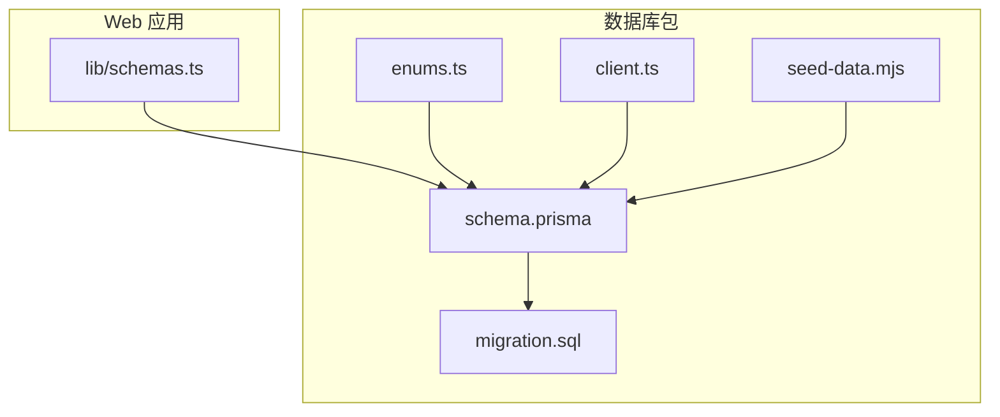
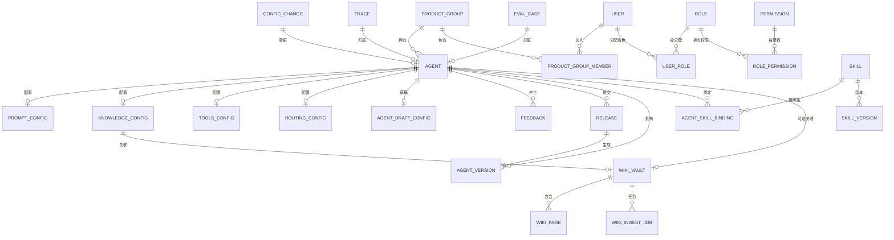
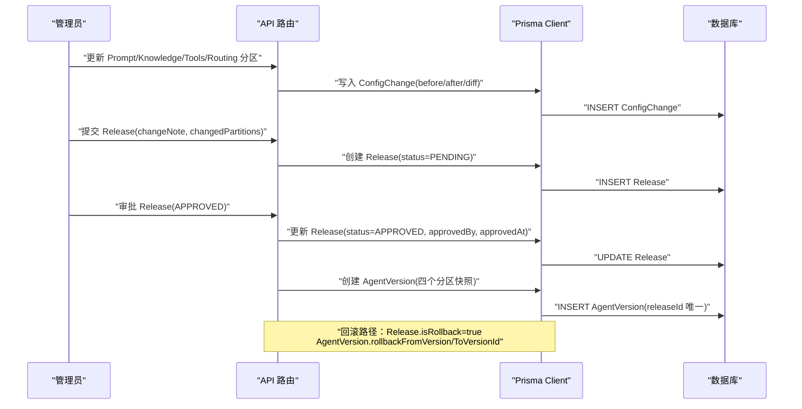
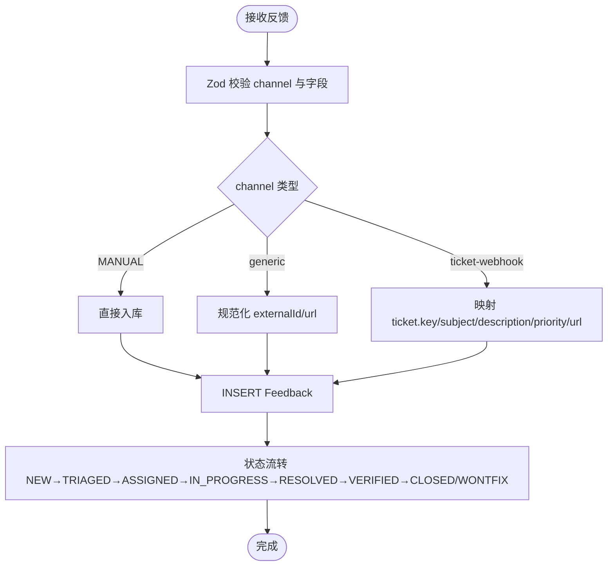
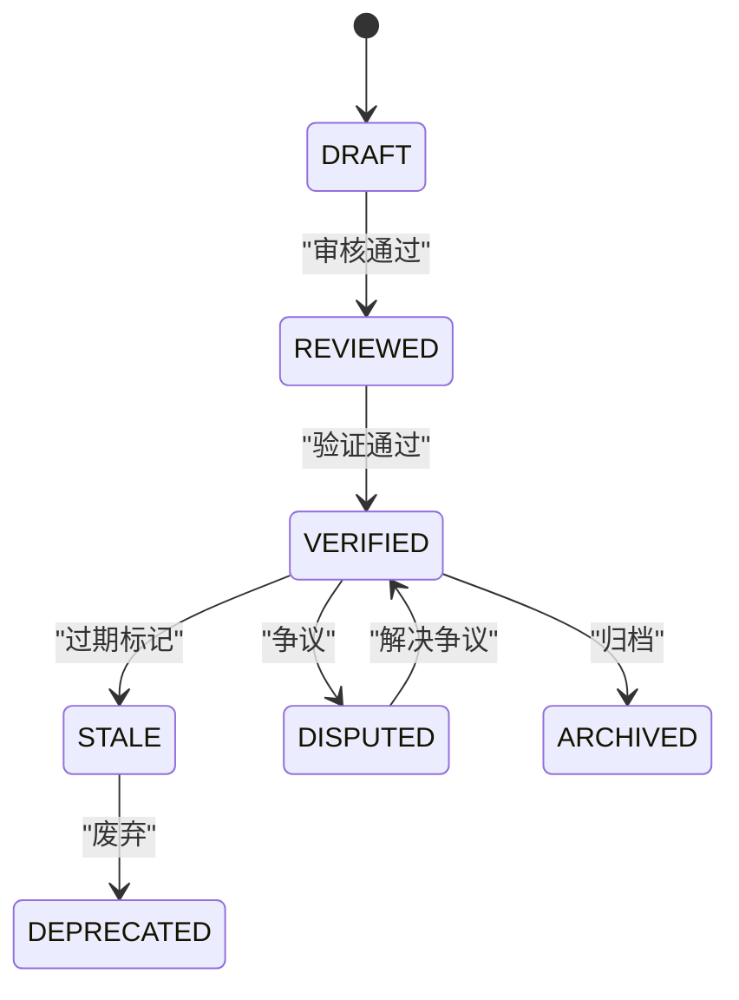
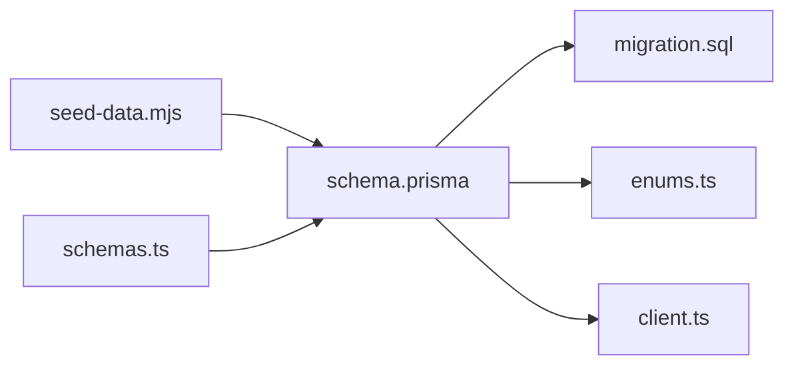

# 数据库设计

<cite>
**本文引用的文件**   
- [packages/db/prisma/schema.prisma](file://packages/db/prisma/schema.prisma)
- [packages/db/prisma/migrations/20261005033611_init_sqlite/migration.sql](file://packages/db/prisma/migrations/20261005033611_init_sqlite/migration.sql)
- [packages/db/src/enums.ts](file://packages/db/src/enums.ts)
- [apps/web/lib/schemas.ts](file://apps/web/lib/schemas.ts)
- [packages/db/src/client.ts](file://packages/db/src/client.ts)
- [packages/db/prisma/seed-data.mjs](file://packages/db/prisma/seed-data.mjs)
</cite>

## 目录
1. [引言](#引言)
2. [项目结构](#项目结构)
3. [核心实体与表结构](#核心实体与表结构)
4. [架构总览](#架构总览)
5. [详细组件分析](#详细组件分析)
6. [依赖关系分析](#依赖关系分析)
7. [数据迁移策略](#数据迁移策略)
8. [种子数据与版本管理](#种子数据与版本管理)
9. [数据访问模式与 Prisma Client 使用](#数据访问模式与-prisma-client-使用)
10. [缓存策略与性能优化](#缓存策略与性能优化)
11. [数据生命周期、保留与归档](#数据生命周期保留与归档)
12. [数据安全、隐私与访问控制](#数据安全隐私与访问控制)
13. [SQL 查询示例与 Prisma 查询模式](#sql-查询示例与-prisma-查询模式)
14. [故障排查指南](#故障排查指南)
15. [结论](#结论)

## 引言
本设计文档面向 AgentUp 的持久化层，围绕 Prisma Schema 中的核心实体展开，包括 Agent、Release、AgentVersion、Skill、WikiVault、Feedback、User、Role、Permission 等。文档说明实体关系、主键外键约束、索引设计、数据类型选择、从 PostgreSQL 到 SQLite 的迁移策略、种子数据结构与版本管理，并补充数据访问模式、缓存策略、性能优化、生命周期管理、安全与隐私要求，以及 SQL 查询示例和 Prisma Client 使用模式。

## 项目结构
AgentUp 的数据库定义集中在 `packages/db` 中：
- `prisma/schema.prisma`：SQLite 版 Prisma Schema，定义所有模型、关系、默认值、唯一约束和索引。
- `prisma/migrations/20261005033611_init_sqlite/migration.sql`：由 Prisma 生成的 SQLite 建表语句与索引。
- `src/enums.ts`：用 TypeScript const + union type 重建原数据库枚举，保持类型契约不变。
- `src/client.ts`：PrismaClient 单例导出，暴露给应用层。
- `prisma/seed-data.mjs`：演示环境种子数据单一事实源。
- `apps/web/lib/schemas.ts`：Zod 输入校验 schema，承担 SQLite 下缺失的数据库级 enum 值域校验职责。



**图表来源**
- [packages/db/prisma/schema.prisma:1-18](file://packages/db/prisma/schema.prisma#L1-L18)
- [packages/db/prisma/migrations/20261005033611_init_sqlite/migration.sql:1-547](file://packages/db/prisma/migrations/20261005033611_init_sqlite/migration.sql#L1-L547)
- [packages/db/src/enums.ts:1-180](file://packages/db/src/enums.ts#L1-L180)
- [packages/db/src/client.ts:1-19](file://packages/db/src/client.ts#L1-L19)
- [packages/db/prisma/seed-data.mjs:1-800](file://packages/db/prisma/seed-data.mjs#L1-L800)
- [apps/web/lib/schemas.ts:1-365](file://apps/web/lib/schemas.ts#L1-L365)

**章节来源**
- [packages/db/prisma/schema.prisma:1-18](file://packages/db/prisma/schema.prisma#L1-L18)
- [packages/db/prisma/migrations/20261005033611_init_sqlite/migration.sql:1-547](file://packages/db/prisma/migrations/20261005033611_init_sqlite/migration.sql#L1-L547)

## 核心实体与表结构
本节按业务域梳理核心实体及其字段语义、主键、外键、索引与默认值。

### 组织与用户
- ProductGroup：产品组，id 为主键，name 唯一；用于隔离 Agent 与成员。
- ProductGroupMember：产品组成员，联合 productGroupId+userId 唯一；role 为字符串（LEAD/MEMBER）。
- User：用户，id 主键，email 唯一；支持可选密码哈希、头像、名称。

关键字段与约束：
- ProductGroup.name 唯一索引。
- ProductGroupMember.productGroupId, userId 唯一索引。
- User.email 唯一索引。

**章节来源**
- [packages/db/prisma/schema.prisma:24-60](file://packages/db/prisma/schema.prisma#L24-L60)
- [packages/db/prisma/migrations/20261005033611_init_sqlite/migration.sql:1-31](file://packages/db/prisma/migrations/20261005033611_init_sqlite/migration.sql#L1-L31)
- [packages/db/prisma/migrations/20261005033611_init_sqlite/migration.sql:417-424](file://packages/db/prisma/migrations/20261005033611_init_sqlite/migration.sql#L417-L424)

### Agent 与四分区配置
- Agent：Agent 主实体，productGroupId 外键指向 ProductGroup；status 为字符串（DRAFT/ACTIVE/ARCHIVED）；包含 createdBy、时间戳。
- PromptConfig：系统提示词、角色定义、约束列表（JSON 文本）、输出格式、版本号。
- KnowledgeConfig：关联 WikiVaultId，搜索策略、MCP 回退开关、最大结果数、置信度阈值、同步状态、版本号。
- ToolsConfig：MCP 工具与 Wiki 查询工具的 JSON 文本，并发、超时、重试次数、版本号。
- RoutingConfig：路由规则与升级策略的 JSON 文本，人类阈值、对话轮次、空闲超时、版本号。
- AgentDraftConfig：草稿区，四个分区配置以 JSON 文本暂存，标记脏位、最后保存人/时间。

索引与关系：
- Agent.productGroupId、Agent.status 有索引。
- PromptConfig、KnowledgeConfig、ToolsConfig、RoutingConfig、AgentDraftConfig 均通过 agentId 与 Agent 一对一关联（unique）。
- KnowledgeConfig.wikiVaultId 唯一且可空，允许解绑知识库。

**章节来源**
- [packages/db/prisma/schema.prisma:66-182](file://packages/db/prisma/schema.prisma#L66-L182)
- [packages/db/prisma/migrations/20261005033611_init_sqlite/migration.sql:34-120](file://packages/db/prisma/migrations/20261005033611_init_sqlite/migration.sql#L34-L120)
- [packages/db/prisma/migrations/20261005033611_init_sqlite/migration.sql:425-447](file://packages/db/prisma/migrations/20261005033611_init_sqlite/migration.sql#L425-L447)

### 配置变更记录
- ConfigChange：记录 Agent 各分区的 before/after/diff，changedBy、changedAt、可选 releaseId；partition 为文本列以容纳回滚留痕扩展值。

索引：
- (agentId, partition) 复合索引。
- changedAt 索引。

**章节来源**
- [packages/db/prisma/schema.prisma:188-205](file://packages/db/prisma/schema.prisma#L188-L205)
- [packages/db/prisma/migrations/20261005033611_init_sqlite/migration.sql:122-135](file://packages/db/prisma/migrations/20261005033611_init_sqlite/migration.sql#L122-L135)
- [packages/db/prisma/migrations/20261005033611_init_sqlite/migration.sql:449-453](file://packages/db/prisma/migrations/20261005033611_init_sqlite/migration.sql#L449-L453)

### Feedback（反馈）
- Feedback：关联 Agent，source 为渠道名（MANUAL/generic/ticket-webhook），title/content 必填；rating、severity、status 均为字符串；tags 为 JSON 文本；支持 assignedTo/assignedAt/resolvedAt/resolvedBy/resolution/releaseId/ingestJobId/targetPartition/externalRefId/externalRefUrl/submittedBy/submittedAt/verifiedAt/verifiedBy/verificationNote。

索引：
- (agentId, status)。
- submittedAt。
- (severity, status)。

**章节来源**
- [packages/db/prisma/schema.prisma:211-251](file://packages/db/prisma/schema.prisma#L211-L251)
- [packages/db/prisma/migrations/20261005033611_init_sqlite/migration.sql:137-165](file://packages/db/prisma/migrations/20261005033611_init_sqlite/migration.sql#L137-L165)
- [packages/db/prisma/migrations/20261005033611_init_sqlite/migration.sql:455-462](file://packages/db/prisma/migrations/20261005033611_init_sqlite/migration.sql#L455-L462)

### Release（发布审批）
- Release：关联 Agent，changeNote 必填，changedPartitions 为 JSON 文本；status 为字符串（PENDING/APPROVED/REJECTED/CHANGES_REQUESTED）；支持 approvedBy/approvedAt/reviewComment；configSnapshot 与 aiReview 为 JSON 文本；isRollback/rollbackFromVersion/rollbackToVersionId 支持整版本回滚；version 关联 AgentVersion。

索引：
- (agentId, status)。
- submittedAt。

**章节来源**
- [packages/db/prisma/schema.prisma:257-288](file://packages/db/prisma/schema.prisma#L257-L288)
- [packages/db/prisma/migrations/20261005033611_init_sqlite/migration.sql:167-185](file://packages/db/prisma/migrations/20261005033611_init_sqlite/migration.sql#L167-L185)
- [packages/db/prisma/migrations/20261005033611_init_sqlite/migration.sql:464-468](file://packages/db/prisma/migrations/20261005033611_init_sqlite/migration.sql#L464-L468)

### AgentVersion（版本快照）
- AgentVersion：每个发布对应一个版本快照，包含 major/minor/patch 与四个分区快照（JSON 文本）；releaseId 唯一；wikiCommitSha/publishedAt/publishedBy/changeNote/effectivenessReport。

索引与唯一：
- (agentId, version) 唯一。
- releaseId 唯一。
- (agentId, publishedAt) 索引。

**章节来源**
- [packages/db/prisma/schema.prisma:294-318](file://packages/db/prisma/schema.prisma#L294-L318)
- [packages/db/prisma/migrations/20261005033611_init_sqlite/migration.sql:187-207](file://packages/db/prisma/migrations/20261005033611_init_sqlite/migration.sql#L187-L207)
- [packages/db/prisma/migrations/20261005033611_init_sqlite/migration.sql:470-477](file://packages/db/prisma/migrations/20261005033611_init_sqlite/migration.sql#L470-L477)

### Skill（技能插件）
- Skill：name 唯一，category/runtime/status 为字符串；triggerPatterns/dependencies/permissions 为 JSON 文本；inputSchema/outputSchema 为 JSON 文本；authorId/authorName/downloadCount/publishedAt。
- SkillVersion：(skillId, version) 唯一；snapshot 为 JSON 文本；changelog/publishedAt。
- AgentSkillBinding：(agentId, skillId) 唯一；config/allowedScopes 为 JSON 文本；enabled/priority/boundAt/boundBy。

索引：
- (category, status)。
- (skillId)。
- (agentId)。
- (skillId)。

**章节来源**
- [packages/db/prisma/schema.prisma:324-391](file://packages/db/prisma/schema.prisma#L324-L391)
- [packages/db/prisma/migrations/20261005033611_init_sqlite/migration.sql:209-258](file://packages/db/prisma/migrations/20261005033611_init_sqlite/migration.sql#L209-L258)
- [packages/db/prisma/migrations/20261005033611_init_sqlite/migration.sql:479-498](file://packages/db/prisma/migrations/20261005033611_init_sqlite/migration.sql#L479-L498)

### Wiki（知识库）
- WikiVault：name/description/agentId/gitRepoUrl/gitBranch/lastCommitSha/pageCount/avgConfidence/orphanCount/isShared/sharedBy；pages/ingestJobs/knowledgeConfig 关联。
- WikiPage：vaultId 外键级联删除；slug/vaultId 唯一；provenance/lifecycle/tier/baseConfidence/sourceRefs/wikilinks/categories/tags/filePath/lastCommitSha/inboundLinks/outboundLinks/reviewedAt/reviewedBy。
- WikiIngestJob：vaultId 外键级联删除；jobType/sourceType/sourceId/sourceContent/sourceUrl/generatedPageIds/status/result/error/startedAt/completedAt/triggeredBy/createdAt。

索引：
- isShared。
- (vaultId, lifecycle)。
- (vaultId, tier)。
- (vaultId, slug) 唯一。
- (vaultId, status)。
- (jobType, status)。

**章节来源**
- [packages/db/prisma/schema.prisma:397-480](file://packages/db/prisma/schema.prisma#L397-L480)
- [packages/db/prisma/migrations/20261005033611_init_sqlite/migration.sql:260-324](file://packages/db/prisma/migrations/20261005033611_init_sqlite/migration.sql#L260-L324)
- [packages/db/prisma/migrations/20261005033611_init_sqlite/migration.sql:500-519](file://packages/db/prisma/migrations/20261005033611_init_sqlite/migration.sql#L500-L519)

### 权限与审计
- Role：name 唯一，displayName/description/isSystem。
- Permission：(resource, action) 唯一。
- RolePermission：多对多桥接表，(roleId, permissionId) 复合主键。
- UserRole：(userId, roleId, productGroupId) 唯一；assignedAt/assignedBy。
- AuditLog：action/resource/resourceId/details/userId/userName/userRole/ipAddress/userAgent/createdAt；多个复合索引。

**章节来源**
- [packages/db/prisma/schema.prisma:486-550](file://packages/db/prisma/schema.prisma#L486-L550)
- [packages/db/prisma/migrations/20261005033611_init_sqlite/migration.sql:326-378](file://packages/db/prisma/migrations/20261005033611_init_sqlite/migration.sql#L326-L378)
- [packages/db/prisma/migrations/20261005033611_init_sqlite/migration.sql:521-540](file://packages/db/prisma/migrations/20261005033611_init_sqlite/migration.sql#L521-L540)

### Trace 与 EvalCase（试聊与评测用例）
- Trace：agentId/systemPrompt/history/message/reply/model/usage/latencyMs/rating/ratedAt/note。
- EvalCase：agentId/sourceTraceId/title/expectation/assertions/systemPrompt/history/message/referenceReply/status/createdAt/createdBy。

索引：
- (agentId, createdAt)。

**章节来源**
- [packages/db/prisma/schema.prisma:556-596](file://packages/db/prisma/schema.prisma#L556-L596)
- [packages/db/prisma/migrations/20261005033611_init_sqlite/migration.sql:380-414](file://packages/db/prisma/migrations/20261005033611_init_sqlite/migration.sql#L380-L414)
- [packages/db/prisma/migrations/20261005033611_init_sqlite/migration.sql:542-546](file://packages/db/prisma/migrations/20261005033611_init_sqlite/migration.sql#L542-L546)

## 架构总览
下图展示核心实体之间的关系，突出 Agent 为中心的配置、版本、发布、反馈、技能绑定与知识库关联。



**图表来源**
- [packages/db/prisma/schema.prisma:24-596](file://packages/db/prisma/schema.prisma#L24-L596)
- [packages/db/prisma/migrations/20261005033611_init_sqlite/migration.sql:1-547](file://packages/db/prisma/migrations/20261005033611_init_sqlite/migration.sql#L1-L547)

## 详细组件分析

### Agent 配置分区与版本发布流程
该流程体现从配置修改到发布审批、版本快照、回滚能力的完整链路。



**图表来源**
- [packages/db/prisma/schema.prisma:188-318](file://packages/db/prisma/schema.prisma#L188-L318)
- [packages/db/prisma/migrations/20261005033611_init_sqlite/migration.sql:122-207](file://packages/db/prisma/migrations/20261005033611_init_sqlite/migration.sql#L122-L207)

**章节来源**
- [packages/db/prisma/schema.prisma:188-318](file://packages/db/prisma/schema.prisma#L188-L318)
- [packages/db/prisma/migrations/20261005033611_init_sqlite/migration.sql:122-207](file://packages/db/prisma/migrations/20261005033611_init_sqlite/migration.sql#L122-L207)

### 反馈处理与多渠道接入
反馈可通过 MANUAL、generic、ticket-webhook 等多渠道接入，经 Zod 校验后落库，支持状态流转与外部工单幂等键。



**图表来源**
- [apps/web/lib/schemas.ts:66-134](file://apps/web/lib/schemas.ts#L66-L134)
- [packages/db/prisma/schema.prisma:211-251](file://packages/db/prisma/schema.prisma#L211-L251)

**章节来源**
- [apps/web/lib/schemas.ts:66-134](file://apps/web/lib/schemas.ts#L66-L134)
- [packages/db/prisma/schema.prisma:211-251](file://packages/db/prisma/schema.prisma#L211-L251)

### 知识库页面生命周期
WikiPage 支持多种 provenance/lifecycle/tier，配合 WikiIngestJob 进行导入、更新、合成、去重等任务。



**图表来源**
- [packages/db/prisma/schema.prisma:421-454](file://packages/db/prisma/schema.prisma#L421-L454)
- [packages/db/src/enums.ts:130-161](file://packages/db/src/enums.ts#L130-L161)

**章节来源**
- [packages/db/prisma/schema.prisma:421-454](file://packages/db/prisma/schema.prisma#L421-L454)
- [packages/db/src/enums.ts:130-161](file://packages/db/src/enums.ts#L130-L161)

## 依赖关系分析
- Schema 层：Prisma Schema 定义模型、关系、默认值、索引；SQLite 连接器不支持 enum/Json/数组，故枚举移至 enums.ts，JSON/数组字段以 String 存储。
- 校验层：Zod schemas 在 Web 层承担值域校验，确保字符串列的值符合业务枚举。
- 客户端层：PrismaClient 单例导出，开发环境开启 query/error/warn 日志，生产仅 error。
- 迁移层：migrations 目录包含 SQLite 初始化脚本，包含建表与索引。
- 种子层：seed-data.mjs 提供演示数据，同时被 db:seed 与 demo 模式消费。



**图表来源**
- [packages/db/prisma/schema.prisma:1-18](file://packages/db/prisma/schema.prisma#L1-L18)
- [packages/db/prisma/migrations/20261005033611_init_sqlite/migration.sql:1-547](file://packages/db/prisma/migrations/20261005033611_init_sqlite/migration.sql#L1-L547)
- [packages/db/src/enums.ts:1-180](file://packages/db/src/enums.ts#L1-L180)
- [packages/db/src/client.ts:1-19](file://packages/db/src/client.ts#L1-L19)
- [packages/db/prisma/seed-data.mjs:1-800](file://packages/db/prisma/seed-data.mjs#L1-L800)
- [apps/web/lib/schemas.ts:1-365](file://apps/web/lib/schemas.ts#L1-L365)

**章节来源**
- [packages/db/prisma/schema.prisma:1-18](file://packages/db/prisma/schema.prisma#L1-L18)
- [packages/db/src/client.ts:1-19](file://packages/db/src/client.ts#L1-L19)

## 数据迁移策略
- 迁移目标：从 PostgreSQL 迁移至 SQLite，以适配 Prisma SQLite 连接器的限制。
- 主要变更：
  - 移除数据库级 enum，改为 String 列，值域由 Zod 与 enums.ts 维护。
  - Json 字段改为 String，存储 JSON.stringify 产物，读写通过 pack/unpack 收口。
  - 标量数组（如 String[]）改为 String（JSON 文本）。
- 迁移产物：
  - migration.sql 包含完整的建表与索引语句。
  - 历史 PostgreSQL migrations 已删除，可在 git 中恢复。

建议步骤：
1. 备份现有 PostgreSQL 数据。
2. 执行 Prisma migrate 生成 SQLite 迁移。
3. 运行迁移并验证索引与约束。
4. 使用 seed-data.mjs 填充演示数据。
5. 在测试环境验证 CRUD 与复杂查询。

**章节来源**
- [packages/db/prisma/schema.prisma:1-10](file://packages/db/prisma/schema.prisma#L1-L10)
- [packages/db/prisma/migrations/20261005033611_init_sqlite/migration.sql:1-547](file://packages/db/prisma/migrations/20261005033611_init_sqlite/migration.sql#L1-L547)

## 种子数据与版本管理
- 种子数据单一事实源：seed-data.mjs 同时服务于 db:seed（PostgreSQL）与 demo 模式（浏览器内存态）。
- 数据结构：
  - users、permissions、roles、userRoles、productGroups、productGroupMembers。
  - agents（含 prompt/knowledge/tools/routing 配置）、wikiVaults、wikiPages。
  - skills、skillVersions、skillBindings。
  - releases、versions、feedback、evalCases。
- 一致性保障：测试断言 _count 与实际关系一致，避免演示态渲染假数字。

版本管理要点：
- AgentVersion.version 采用语义化版本（major.minor.patch）。
- SkillVersion.version 与 Skill.version 分离，支持技能独立演进。
- Release 与 AgentVersion 通过 releaseId 唯一关联。

**章节来源**
- [packages/db/prisma/seed-data.mjs:1-800](file://packages/db/prisma/seed-data.mjs#L1-L800)

## 数据访问模式与 Prisma Client 使用
- PrismaClient 单例：client.ts 导出全局 prisma 实例，开发环境启用 query/error/warn 日志。
- 访问模式：
  - 通过 @agent-up/db 导入 prisma。
  - 使用 findMany/findUnique/create/update/delete 等标准方法。
  - 利用 include/_count 获取关联数据与计数。
- 最佳实践：
  - 在 API 路由中进行参数校验（Zod）。
  - 使用事务处理多表写入（如 Release 审批与 AgentVersion 创建）。
  - 使用索引字段进行高效查询（如 agentId+status、submittedAt）。

**章节来源**
- [packages/db/src/client.ts:1-19](file://packages/db/src/client.ts#L1-L19)
- [apps/web/lib/schemas.ts:1-365](file://apps/web/lib/schemas.ts#L1-L365)

## 缓存策略与性能优化
- 索引优化：
  - 高频查询字段建立索引：Agent.status、Feedback.agentId+status、Release.agentId+status、WikiPage.vaultId+lifecycle、AuditLog.createdAt 等。
  - 复合索引提升多条件查询性能。
- 查询优化：
  - 使用 select/include 精确返回字段，减少数据传输。
  - 分页查询 large datasets（如 AuditLog、Feedback）。
- 缓存建议：
  - 对静态配置（如 Role、Permission、Skill）使用应用层缓存。
  - 对频繁读取的 Agent 配置分区考虑 Redis 缓存。
  - 对 Wiki 搜索结果使用向量缓存或 BM25 缓存。

[本节为通用指导，不直接分析具体文件]

## 数据生命周期、保留与归档
- Agent 生命周期：DRAFT → ACTIVE → ARCHIVED。
- Feedback 生命周期：NEW → TRIAGED → ASSIGNED → IN_PROGRESS → RESOLVED → VERIFIED → CLOSED/WONTFIX。
- WikiPage 生命周期：DRAFT → REVIEWED → VERIFIED → STALE → DEPRECATED → ARCHIVED。
- 保留策略：
  - Trace/EvalCase 作为运行时数据，建议定期归档或清理。
  - AuditLog 作为审计数据，建议长期保留并支持按时间范围查询。
  - ConfigChange 作为变更历史，建议按 Agent 维度归档。

**章节来源**
- [packages/db/src/enums.ts:19-24](file://packages/db/src/enums.ts#L19-L24)
- [packages/db/src/enums.ts:82-93](file://packages/db/src/enums.ts#L82-L93)
- [packages/db/src/enums.ts:141-150](file://packages/db/src/enums.ts#L141-L150)

## 数据安全、隐私与访问控制
- 身份认证：User.passwordHash 支持 scrypt 哈希（演示环境公开口令）。
- 授权模型：RBAC（Role-Permission）+ 产品组隔离（ProductGroupMember/UserRole.productGroupId）。
- 审计追踪：AuditLog 记录 action/resource/resourceId/details/actor 信息。
- 隐私保护：
  - 外部工单 externalRefId/externalRefUrl 需脱敏处理。
  - Feedback.sessionData 可能包含敏感会话信息，需加密或脱敏存储。
- 访问控制机制：
  - 基于角色的资源访问控制（Resource-Action）。
  - 产品组维度的成员权限控制。

**章节来源**
- [packages/db/prisma/seed-data.mjs:10-26](file://packages/db/prisma/seed-data.mjs#L10-L26)
- [packages/db/prisma/schema.prisma:486-550](file://packages/db/prisma/schema.prisma#L486-L550)
- [packages/db/prisma/migrations/20261005033611_init_sqlite/migration.sql:326-378](file://packages/db/prisma/migrations/20261005033611_init_sqlite/migration.sql#L326-L378)

## SQL 查询示例与 Prisma 查询模式

### 查询某产品的活跃 Agent 列表
```sql
SELECT id, name, description, status, createdAt, updatedAt
FROM Agent
WHERE productGroupId = 'ecs-group'
  AND status = 'ACTIVE'
ORDER BY updatedAt DESC;
```

Prisma 模式：
```ts
const agents = await prisma.agent.findMany({
  where: { productGroupId: 'ecs-group', status: 'ACTIVE' },
  orderBy: { updatedAt: 'desc' },
});
```

**章节来源**
- [packages/db/prisma/schema.prisma:66-99](file://packages/db/prisma/schema.prisma#L66-L99)
- [packages/db/prisma/migrations/20261005033611_init_sqlite/migration.sql:425-429](file://packages/db/prisma/migrations/20261005033611_init_sqlite/migration.sql#L425-L429)

### 查询某 Agent 的反馈统计
```sql
SELECT severity, status, COUNT(*) as count
FROM Feedback
WHERE agentId = 'ecs-assistant'
GROUP BY severity, status;
```

Prisma 模式：
```ts
const stats = await prisma.feedback.groupBy({
  by: ['severity', 'status'],
  where: { agentId: 'ecs-assistant' },
  _count: true,
});
```

**章节来源**
- [packages/db/prisma/schema.prisma:211-251](file://packages/db/prisma/schema.prisma#L211-L251)
- [packages/db/prisma/migrations/20261005033611_init_sqlite/migration.sql:455-462](file://packages/db/prisma/migrations/20261005033611_init_sqlite/migration.sql#L455-L462)

### 查询某知识库的页面列表（按生命周期过滤）
```sql
SELECT id, title, slug, lifecycle, tier, baseConfidence, updatedAt
FROM WikiPage
WHERE vaultId = 'ecs-wiki'
  AND lifecycle != 'ALL'
ORDER BY updatedAt DESC;
```

Prisma 模式：
```ts
const pages = await prisma.wikiPage.findMany({
  where: { vaultId: 'ecs-wiki', lifecycle: { not: 'ALL' } },
  orderBy: { updatedAt: 'desc' },
});
```

**章节来源**
- [packages/db/prisma/schema.prisma:421-454](file://packages/db/prisma/schema.prisma#L421-L454)
- [packages/db/prisma/migrations/20261005033611_init_sqlite/migration.sql:506-513](file://packages/db/prisma/migrations/20261005033611_init_sqlite/migration.sql#L506-L513)

### 查询某角色的权限列表
```sql
SELECT p.resource, p.action, p.description
FROM RolePermission rp
JOIN Permission p ON rp.permissionId = p.id
WHERE rp.roleId = 'role-admin';
```

Prisma 模式：
```ts
const permissions = await prisma.rolePermission.findMany({
  where: { roleId: 'role-admin' },
  include: { permission: true },
});
```

**章节来源**
- [packages/db/prisma/schema.prisma:486-515](file://packages/db/prisma/schema.prisma#L486-L515)
- [packages/db/prisma/migrations/20261005033611_init_sqlite/migration.sql:343-351](file://packages/db/prisma/migrations/20261005033611_init_sqlite/migration.sql#L343-L351)

## 故障排查指南
- 连接问题：检查 DATABASE_URL 环境变量是否正确指向 SQLite 文件。
- 迁移失败：确认 Prisma 版本与 Node.js 版本兼容，检查 migration.sql 语法。
- 数据不一致：使用 seed-data.mjs 重新填充演示数据，验证 _count 一致性。
- 查询性能：检查是否使用了合适的索引，避免全表扫描。
- 权限错误：确认 RBAC 配置正确，Role-Permission 关系已建立。

**章节来源**
- [packages/db/src/client.ts:1-19](file://packages/db/src/client.ts#L1-L19)
- [packages/db/prisma/seed-data.mjs:1-800](file://packages/db/prisma/seed-data.mjs#L1-L800)

## 结论
AgentUp 的数据库设计以 Prisma Schema 为核心，通过 SQLite 迁移实现了跨数据库兼容性。实体关系清晰，索引设计合理，支持复杂的配置管理、版本发布、反馈处理与知识库管理。通过 Zod 校验与 enums.ts 枚举重建，确保了数据完整性与类型安全。种子数据与版本管理提供了良好的演示与测试基础。未来可进一步优化缓存策略、数据归档与安全机制，以提升系统性能与可维护性。