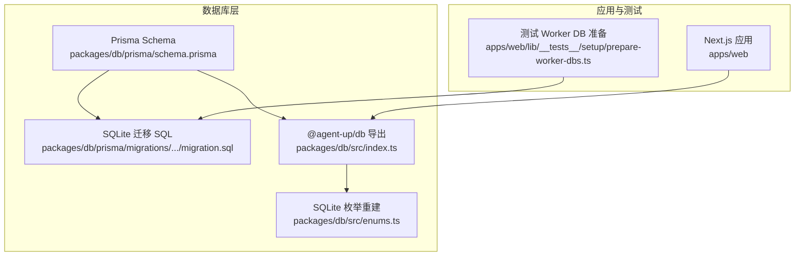
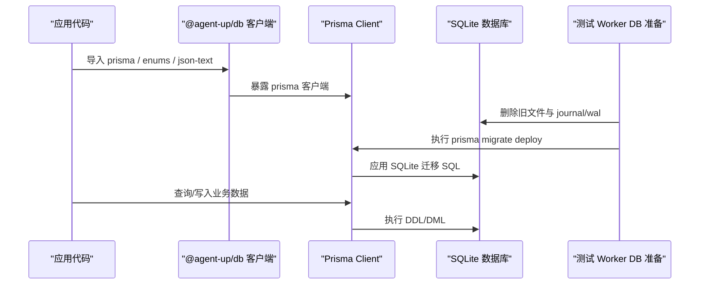
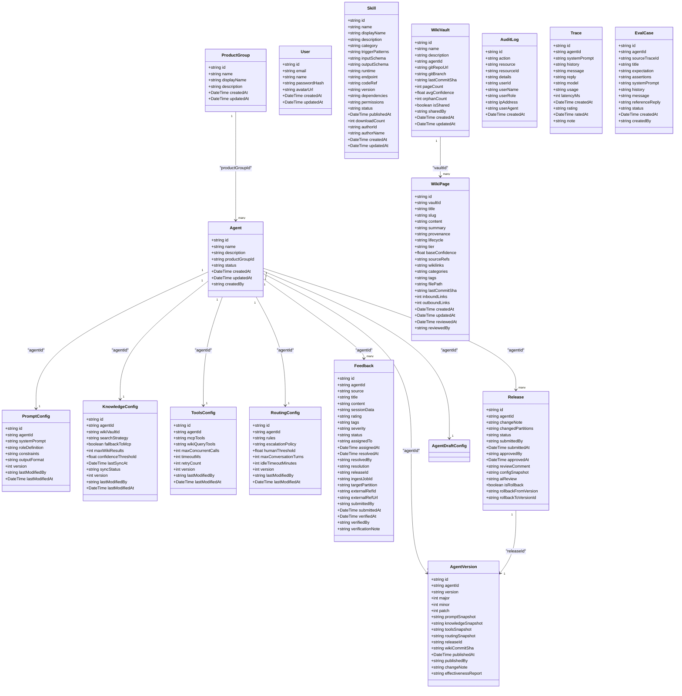
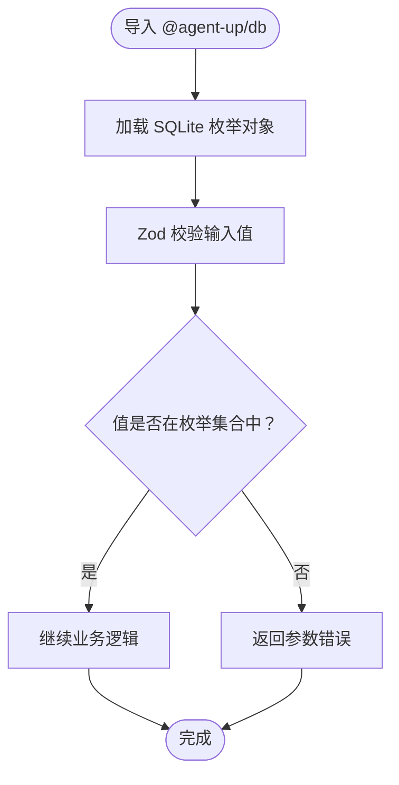
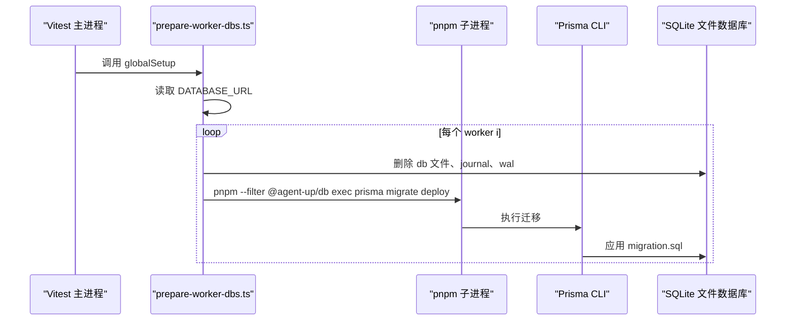
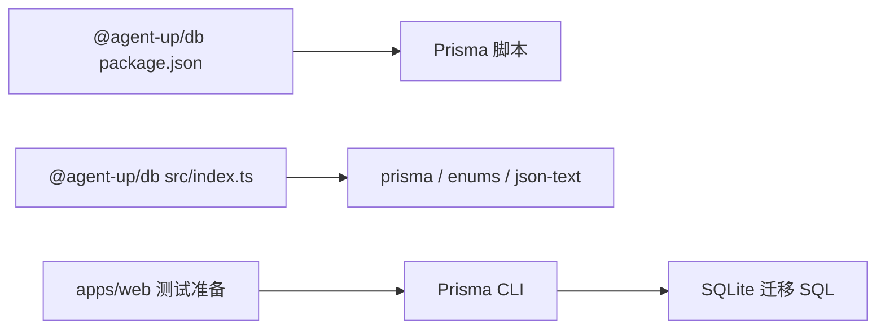
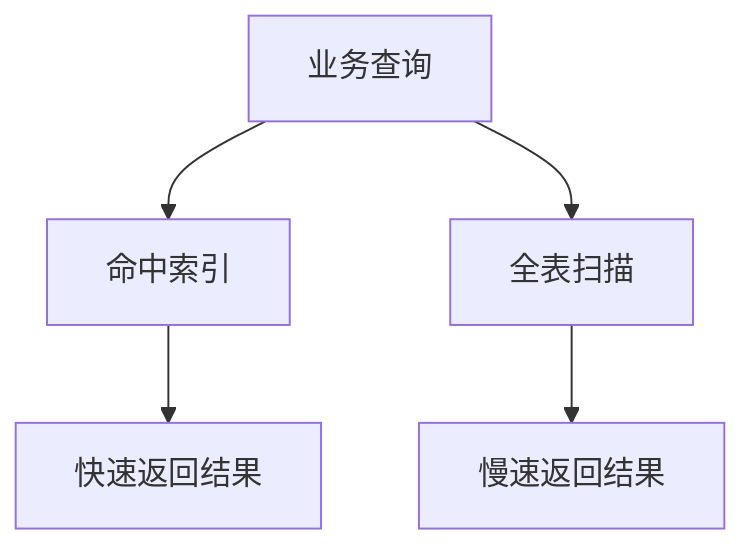
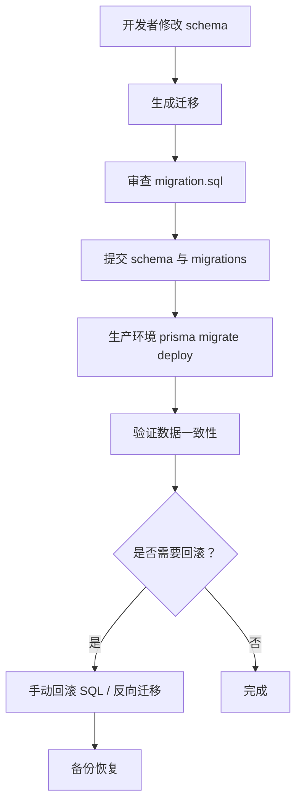
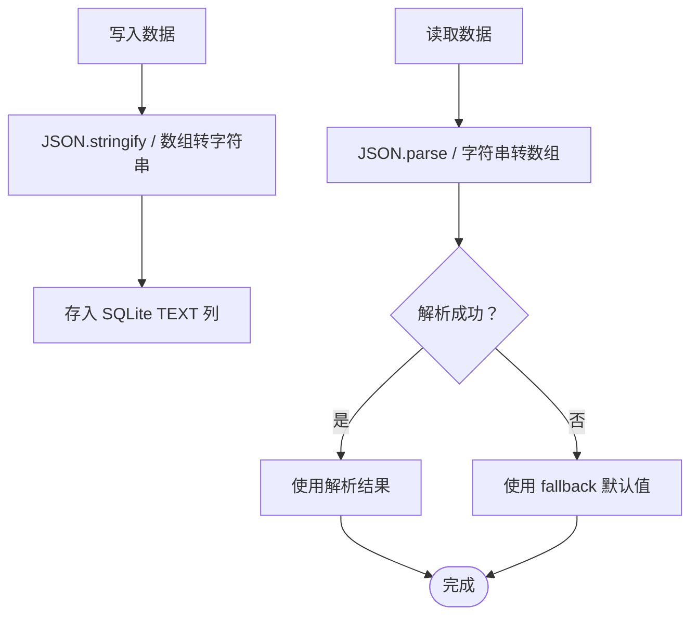
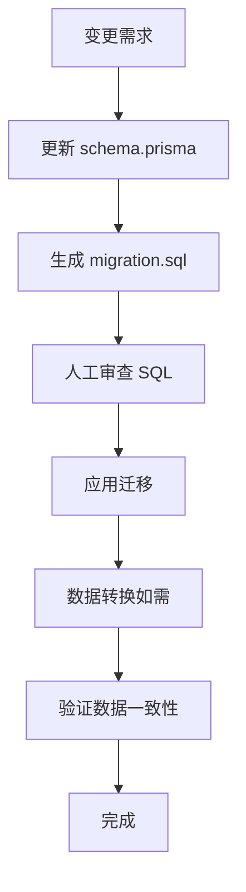

# 数据迁移策略

<cite>
**本文引用的文件**   
- [schema.prisma](file://packages/db/prisma/schema.prisma)
- [migration.sql](file://packages/db/prisma/migrations/20261005033611_init_sqlite/migration.sql)
- [package.json（@agent-up/db）](file://packages/db/package.json)
- [index.ts（@agent-up/db 导出）](file://packages/db/src/index.ts)
- [enums.ts（SQLite 枚举重建）](file://packages/db/src/enums.ts)
- [prepare-worker-dbs.ts（测试数据库准备）](file://apps/web/lib/__tests__/setup/prepare-worker-dbs.ts)
- [批0 Prisma 持久化计划](file://docs/superpowers/plans/2026-09-09-prisma-persistence-batch0.md)
</cite>

## 目录
1. [引言](#引言)
2. [项目结构](#项目结构)
3. [核心组件](#核心组件)
4. [架构总览](#架构总览)
5. [详细组件分析](#详细组件分析)
6. [依赖关系分析](#依赖关系分析)
7. [性能与索引优化](#性能与索引优化)
8. [回滚与版本管理](#回滚与版本管理)
9. [数据验证策略](#数据验证策略)
10. [常见迁移场景处理](#常见迁移场景处理)
11. [最佳实践](#最佳实践)
12. [故障排查指南](#故障排查指南)
13. [结论](#结论)

## 引言
本文件面向 AgentUp 从 PostgreSQL 到 SQLite 的数据迁移，目标是形成一份可执行、可审计、可回滚的完整策略文档。仓库当前已落地一个 SQLite 版 schema 与对应迁移文件，并通过 Prisma Migrate 进行版本化管理；同时，测试环境通过独立 SQLite 文件隔离 worker 数据库，并在 worker 启动前执行 `prisma migrate deploy` 应用基线迁移。

该迁移的核心挑战来自 Prisma SQLite 连接器对原生类型支持的差异：不支持数据库级 enum、原生 Json 列和标量数组类型。因此，本项目将枚举值下沉为 TypeScript 常量与 union 类型，将 JSON 与数组统一以字符串形式存储，并通过包内工具函数在读写边界做序列化与容错解析。

## 项目结构
AgentUp 的数据库相关代码集中在 `packages/db`，Prisma schema 与迁移位于 `packages/db/prisma`；应用层测试通过 `apps/web/lib/__tests__/setup/prepare-worker-dbs.ts` 初始化每个 worker 的 SQLite 文件库并应用迁移。

**图表来源**
- [schema.prisma:1-18](file://packages/db/prisma/schema.prisma#L1-L18)
- [migration.sql:1-547](file://packages/db/prisma/migrations/20261005033611_init_sqlite/migration.sql#L1-L547)
- [index.ts:1-5](file://packages/db/src/index.ts#L1-L5)
- [enums.ts:1-180](file://packages/db/src/enums.ts#L1-L180)
- [prepare-worker-dbs.ts:1-39](file://apps/web/lib/__tests__/setup/prepare-worker-dbs.ts#L1-L39)

**章节来源**
- [schema.prisma:1-18](file://packages/db/prisma/schema.prisma#L1-L18)
- [package.json（@agent-up/db）:7-15](file://packages/db/package.json#L7-L15)
- [prepare-worker-dbs.ts:1-39](file://apps/web/lib/__tests__/setup/prepare-worker-dbs.ts#L1-L39)

## 核心组件
- **Prisma Schema（SQLite 版）**：声明所有业务模型、字段、关系与索引；datasource provider 为 sqlite，url 由环境变量注入。
- **SQLite 迁移 SQL**：由 Prisma 生成，包含建表、外键、唯一约束与索引创建语句。
- **@agent-up/db 导出模块**：对外暴露 prisma 客户端、SQLite 枚举重建对象与 JSON 文本封装工具。
- **SQLite 枚举重建**：用 const 对象 + union type 重建原 18 个数据库枚举，保持既有 TS 类型与字符串值兼容。
- **测试 Worker DB 准备**：为每个 vitest worker 创建独立 SQLite 文件，删除旧文件及 journal/wal 残留后执行 `prisma migrate deploy`。

**章节来源**
- [schema.prisma:1-18](file://packages/db/prisma/schema.prisma#L1-L18)
- [migration.sql:1-547](file://packages/db/prisma/migrations/20261005033611_init_sqlite/migration.sql#L1-L547)
- [index.ts:1-5](file://packages/db/src/index.ts#L1-L5)
- [enums.ts:1-180](file://packages/db/src/enums.ts#L1-L180)
- [prepare-worker-dbs.ts:1-39](file://apps/web/lib/__tests__/setup/prepare-worker-dbs.ts#L1-L39)

## 架构总览
下图展示从应用调用到数据库迁移执行的端到端流程，以及 SQLite 与 Prisma 的关系。

**图表来源**
- [index.ts:1-5](file://packages/db/src/index.ts#L1-L5)
- [prepare-worker-dbs.ts:14-39](file://apps/web/lib/__tests__/setup/prepare-worker-dbs.ts#L14-L39)
- [migration.sql:1-547](file://packages/db/prisma/migrations/20261005033611_init_sqlite/migration.sql#L1-L547)

## 详细组件分析

### SQLite 版 Schema 设计
Schema 注释明确说明 SQLite 迁移背景：Prisma SQLite 连接器不支持 enum、Json、String[]，因此：
- 原 18 个 enum 移至 `packages/db/src/enums.ts`，列改为 String，值域校验由 Zod 承担。
- 原 Json 字段改为 String，存储 JSON.stringify 产物，读写经 packJson/unpackJson 收口，解析失败回落 fallback。
- 原标量数组改为 String（JSON 文本）。

模型覆盖组织与用户、Agent 四分区配置、反馈、发布审批、版本快照、技能插件、知识库、权限与审计、试聊 Trace 与评测用例等。

**图表来源**
- [schema.prisma:24-597](file://packages/db/prisma/schema.prisma#L24-L597)

**章节来源**
- [schema.prisma:1-18](file://packages/db/prisma/schema.prisma#L1-L18)
- [schema.prisma:24-597](file://packages/db/prisma/schema.prisma#L24-L597)

### SQLite 枚举重建与类型兼容
SQLite 版枚举重建模块提供 18 个枚举对象的 TypeScript 定义，包括 GroupRole、AgentStatus、SearchStrategy、SyncStatus、ConfigPartition、FeedbackRating、FeedbackTag、FeedbackSeverity、FeedbackStatus、ReleaseStatus、SkillCategory、SkillRuntime、SkillStatus、Provenance、PageLifecycle、PageTier、WikiJobType、JobStatus。这些枚举值与迁移前的数据库枚举值逐字一致，保证存量字符串数据无需转换；运行时入参校验权威在 apps/web/lib/schemas.ts 的 Zod，与此处枚举对齐。

**图表来源**
- [enums.ts:1-180](file://packages/db/src/enums.ts#L1-L180)

**章节来源**
- [enums.ts:1-180](file://packages/db/src/enums.ts#L1-L180)

### 测试 Worker DB 准备与迁移部署
测试环境为每个 vitest worker 准备独立 SQLite 文件数据库，步骤如下：
1. 读取环境变量 DATABASE_URL；若未设置则尝试加载 packages/db/.env。
2. 循环创建 N 个 worker 数据库文件。
3. 删除旧文件及其 -journal、-wal 残留，确保干净状态。
4. 使用 pnpm exec prisma migrate deploy 应用基线迁移。

**图表来源**
- [prepare-worker-dbs.ts:14-39](file://apps/web/lib/__tests__/setup/prepare-worker-dbs.ts#L14-L39)

**章节来源**
- [prepare-worker-dbs.ts:1-39](file://apps/web/lib/__tests__/setup/prepare-worker-dbs.ts#L1-L39)

## 依赖关系分析
- `packages/db/package.json` 定义了 Prisma 相关脚本：`db:generate`、`db:push`、`db:migrate`、`db:studio`、`db:seed`。
- `packages/db/src/index.ts` 导出 prisma 客户端、枚举与 JSON 文本工具，供应用层直接使用。
- `apps/web/lib/__tests__/setup/prepare-worker-dbs.ts` 通过 pnpm 子进程调用 Prisma CLI 执行迁移部署。

**图表来源**
- [package.json（@agent-up/db）:7-15](file://packages/db/package.json#L7-L15)
- [index.ts:1-5](file://packages/db/src/index.ts#L1-L5)
- [prepare-worker-dbs.ts:30-39](file://apps/web/lib/__tests__/setup/prepare-worker-dbs.ts#L30-L39)

**章节来源**
- [package.json（@agent-up/db）:7-15](file://packages/db/package.json#L7-L15)
- [index.ts:1-5](file://packages/db/src/index.ts#L1-L5)
- [prepare-worker-dbs.ts:30-39](file://apps/web/lib/__tests__/setup/prepare-worker-dbs.ts#L30-L39)

## 性能与索引优化
SQLite 版 schema 与迁移 SQL 显式创建了多类索引，用于提升常见查询路径的性能：
- 单列索引：如 Agent.status、AuditLog.createdAt。
- 复合索引：如 Feedback(agentId, status)、WikiPage(vaultId, lifecycle)、AgentVersion(agentId, publishedAt)。
- 唯一索引：如 ProductGroup.name、User.email、AgentVersion(agentId, version)、UserRole(userId, roleId, productGroupId)。

这些索引与 schema 中的 @@index 与 @@unique 注解一一对应，确保 Prisma 生成的 SQL 与应用查询模式匹配。

**图表来源**
- [schema.prisma:97-99](file://packages/db/prisma/schema.prisma#L97-L99)
- [schema.prisma:203-205](file://packages/db/prisma/schema.prisma#L203-L205)
- [schema.prisma:248-251](file://packages/db/prisma/schema.prisma#L248-L251)
- [schema.prisma:286-288](file://packages/db/prisma/schema.prisma#L286-L288)
- [schema.prisma:316-318](file://packages/db/prisma/schema.prisma#L316-L318)
- [schema.prisma:356-357](file://packages/db/prisma/schema.prisma#L356-L357)
- [schema.prisma:388-390](file://packages/db/prisma/schema.prisma#L388-L390)
- [schema.prisma:418-419](file://packages/db/prisma/schema.prisma#L418-L419)
- [schema.prisma:451-454](file://packages/db/prisma/schema.prisma#L451-L454)
- [schema.prisma:478-480](file://packages/db/prisma/schema.prisma#L478-L480)
- [schema.prisma:546-550](file://packages/db/prisma/schema.prisma#L546-L550)
- [schema.prisma:574-575](file://packages/db/prisma/schema.prisma#L574-L575)
- [schema.prisma:595-596](file://packages/db/prisma/schema.prisma#L595-L596)

**章节来源**
- [schema.prisma:97-99](file://packages/db/prisma/schema.prisma#L97-L99)
- [schema.prisma:203-205](file://packages/db/prisma/schema.prisma#L203-L205)
- [schema.prisma:248-251](file://packages/db/prisma/schema.prisma#L248-L251)
- [schema.prisma:286-288](file://packages/db/prisma/schema.prisma#L286-L288)
- [schema.prisma:316-318](file://packages/db/prisma/schema.prisma#L316-L318)
- [schema.prisma:356-357](file://packages/db/prisma/schema.prisma#L356-L357)
- [schema.prisma:388-390](file://packages/db/prisma/schema.prisma#L388-L390)
- [schema.prisma:418-419](file://packages/db/prisma/schema.prisma#L418-L419)
- [schema.prisma:451-454](file://packages/db/prisma/schema.prisma#L451-L454)
- [schema.prisma:478-480](file://packages/db/prisma/schema.prisma#L478-L480)
- [schema.prisma:546-550](file://packages/db/prisma/schema.prisma#L546-L550)
- [schema.prisma:574-575](file://packages/db/prisma/schema.prisma#L574-L575)
- [schema.prisma:595-596](file://packages/db/prisma/schema.prisma#L595-L596)

## 回滚与版本管理
- **Prisma Migrate 工具**：通过 `packages/db/package.json` 的脚本命令驱动，包括 `db:migrate`（开发环境）、`db:push`（直接同步 schema）、`db:generate`（生成客户端）、`db:studio`（可视化数据库）。
- **迁移文件命名约定**：迁移目录采用时间戳前缀加语义描述，例如 `20261005033611_init_sqlite`，SQL 文件位于该目录下。
- **版本管理流程**：
  - 修改 schema.prisma。
  - 运行 `pnpm --filter @agent-up/db exec prisma migrate dev --name <描述>` 生成迁移。
  - 提交 schema 与 migrations 目录。
  - 生产环境通过 CI 或运维脚本执行 `prisma migrate deploy` 应用迁移。
- **回滚机制**：
  - 开发环境可使用 `prisma migrate reset` 重置数据库（谨慎）。
  - 生产环境建议通过编写反向迁移（down）或手动回滚 SQL，并结合事务与备份恢复。
  - 测试环境通过删除 SQLite 文件并重新 deploy 实现“软回滚”。

**图表来源**
- [package.json（@agent-up/db）:7-15](file://packages/db/package.json#L7-L15)
- [migration.sql:1-547](file://packages/db/prisma/migrations/20261005033611_init_sqlite/migration.sql#L1-L547)

**章节来源**
- [package.json（@agent-up/db）:7-15](file://packages/db/package.json#L7-L15)
- [migration.sql:1-547](file://packages/db/prisma/migrations/20261005033611_init_sqlite/migration.sql#L1-L547)

## 数据验证策略
- **类型安全**：SQLite 列全部为 String/Int/Real/Boolean/DateTime，枚举值由 TypeScript 枚举对象与 Zod 校验保障。
- **JSON 文本封装**：原 Json 字段改为 String，读写经 packJson/unpackJson 收口，解析失败时回落 fallback，避免抛出异常影响业务。
- **默认值与约束**：大量字段设置默认值（如 `[]`、`DRAFT`、`PENDING`），配合唯一索引与外键约束保证数据完整性。
- **测试隔离**：每个 worker 拥有独立 SQLite 文件，globalSetup 清理旧文件并 deploy 基线迁移，确保测试互不干扰。

**图表来源**
- [schema.prisma:111-112](file://packages/db/prisma/schema.prisma#L111-L112)
- [schema.prisma:143-145](file://packages/db/prisma/schema.prisma#L143-L145)
- [schema.prisma:159-161](file://packages/db/prisma/schema.prisma#L159-L161)
- [schema.prisma:175-178](file://packages/db/prisma/schema.prisma#L175-L178)
- [schema.prisma:195-197](file://packages/db/prisma/schema.prisma#L195-L197)
- [schema.prisma:221-225](file://packages/db/prisma/schema.prisma#L221-L225)
- [schema.prisma:263-277](file://packages/db/prisma/schema.prisma#L263-L277)
- [schema.prisma:303-306](file://packages/db/prisma/schema.prisma#L303-L306)
- [schema.prisma:332-343](file://packages/db/prisma/schema.prisma#L332-L343)
- [schema.prisma:380-384](file://packages/db/prisma/schema.prisma#L380-L384)
- [schema.prisma:437-441](file://packages/db/prisma/schema.prisma#L437-L441)
- [schema.prisma:467-471](file://packages/db/prisma/schema.prisma#L467-L471)
- [schema.prisma:536-536](file://packages/db/prisma/schema.prisma#L536-L536)
- [schema.prisma:562-567](file://packages/db/prisma/schema.prisma#L562-L567)
- [schema.prisma:585-588](file://packages/db/prisma/schema.prisma#L585-L588)

**章节来源**
- [schema.prisma:111-112](file://packages/db/prisma/schema.prisma#L111-L112)
- [schema.prisma:143-145](file://packages/db/prisma/schema.prisma#L143-L145)
- [schema.prisma:159-161](file://packages/db/prisma/schema.prisma#L159-L161)
- [schema.prisma:175-178](file://packages/db/prisma/schema.prisma#L175-L178)
- [schema.prisma:195-197](file://packages/db/prisma/schema.prisma#L195-L197)
- [schema.prisma:221-225](file://packages/db/prisma/schema.prisma#L221-L225)
- [schema.prisma:263-277](file://packages/db/prisma/schema.prisma#L263-L277)
- [schema.prisma:303-306](file://packages/db/prisma/schema.prisma#L303-L306)
- [schema.prisma:332-343](file://packages/db/prisma/schema.prisma#L332-L343)
- [schema.prisma:380-384](file://packages/db/prisma/schema.prisma#L380-L384)
- [schema.prisma:437-441](file://packages/db/prisma/schema.prisma#L437-L441)
- [schema.prisma:467-471](file://packages/db/prisma/schema.prisma#L467-L471)
- [schema.prisma:536-536](file://packages/db/prisma/schema.prisma#L536-L536)
- [schema.prisma:562-567](file://packages/db/prisma/schema.prisma#L562-L567)
- [schema.prisma:585-588](file://packages/db/prisma/schema.prisma#L585-L588)

## 常见迁移场景处理
- **表结构变更**：新增/删除列、修改字段类型、添加/移除关系。应在 schema.prisma 中声明，再运行 `prisma migrate dev` 生成迁移，人工审查 migration.sql 后提交。
- **索引优化**：根据查询热点添加复合索引或唯一索引，确保与 schema 注解一致，Prisma 会生成对应 CREATE INDEX 语句。
- **数据转换**：对于 SQLite 不支持的类型（enum、Json、数组），在 schema 中使用 String 存储，并在应用层通过 packJson/unpackJson 与 Zod 校验完成转换。
- **约束添加**：外键、唯一约束、默认值应在 schema 中声明，Prisma 生成 ALTER TABLE 或 CREATE UNIQUE INDEX 语句。

**图表来源**
- [schema.prisma:1-18](file://packages/db/prisma/schema.prisma#L1-L18)
- [migration.sql:1-547](file://packages/db/prisma/migrations/20261005033611_init_sqlite/migration.sql#L1-L547)

**章节来源**
- [schema.prisma:1-18](file://packages/db/prisma/schema.prisma#L1-L18)
- [migration.sql:1-547](file://packages/db/prisma/migrations/20261005033611_init_sqlite/migration.sql#L1-L547)

## 最佳实践
- **迁移前备份**：生产环境执行迁移前务必备份数据库。
- **小步快跑**：每次变更只改少量 schema，便于审查与回滚。
- **迁移可逆**：尽量编写 down 迁移或保留反向 SQL。
- **类型安全优先**：使用 TypeScript 枚举与 Zod 校验替代数据库 enum。
- **JSON 文本封装**：统一通过 packJson/unpackJson 处理 JSON 字段，避免业务层散落解析逻辑。
- **索引先行**：在高频查询路径提前建立复合索引，避免上线后性能问题。
- **测试隔离**：每个 worker 使用独立 SQLite 文件，globalSetup 清理并 deploy 基线迁移。

[本节为通用指导，不直接分析具体文件]

## 故障排查指南
- **Prisma 客户端未生成**：检查是否运行 `pnpm --filter @agent-up/db exec prisma generate`。
- **DATABASE_URL 未设置**：确认 apps/web/.env 或 packages/db/.env 中存在 DATABASE_URL。
- **迁移未应用**：检查是否执行 `prisma migrate deploy`，并查看输出日志。
- **SQLite 文件损坏**：删除 -journal 与 -wal 残留后重新 deploy。
- **枚举值不匹配**：确认 TypeScript 枚举对象与 Zod 校验值与数据库字符串一致。
- **JSON 解析失败**：检查 packJson/unpackJson 的 fallback 逻辑，确保不会抛出异常。

**章节来源**
- [package.json（@agent-up/db）:7-15](file://packages/db/package.json#L7-L15)
- [prepare-worker-dbs.ts:14-39](file://apps/web/lib/__tests__/setup/prepare-worker-dbs.ts#L14-L39)
- [enums.ts:1-180](file://packages/db/src/enums.ts#L1-L180)

## 结论
AgentUp 的 SQLite 迁移策略围绕 Prisma Schema 与迁移 SQL 展开，通过 TypeScript 枚举重建与 JSON 文本封装解决 SQLite 类型限制，结合索引设计与测试隔离保障性能与稳定性。生产环境应遵循小步快跑、可逆迁移、类型安全与备份优先的原则，确保数据一致性与系统可靠性。

[本节为总结性内容，不直接分析具体文件]